# 4. 格式化与对齐数据

接下来，你将学习如何优化工作表在屏幕和打印时的呈现效果。Excel 提供了许多优秀的选项，帮助你在工作表和整个工作簿中建立独特且一致的样式。

阅读并学习完本章后，你将能够：
- 格式化数据和单元格背景
- 创建单元格边框
- 检查当前单元格已应用了哪些格式
- 对齐数据
- 将一个单元格的格式复制到其他单元格
- 格式化数值数据
- 使用“上下文工具栏”（`Context Toolbars`）菜单

格式化数据的原因包括：强调特定条目（例如总计），以及使工作表在视觉上更具吸引力并更易于理解（例如，通过使用颜色对行和列进行视觉分区）。这有助于为创建工作表的人员以及使用它进行分析和报告的其他人员保持信息的条理性。格式化还可用于更改数值数据的显示方式（如添加美元符号、逗号、小数、百分号等）。格式化同样用于对齐数据。你可以使用 Excel 的“格式刷”（`Format Painter`）将一个单元格的所有格式复制到其他单元格。你还可以创建单元格边框，以分隔不同区域或突出显示工作表中的特定区域。

## 使用“字体”组格式化文本

位于“开始”选项卡上的“字体”（`Font`）组提供了更改字体、字号、颜色等选项。图 4-1 显示了“字体”组中的格式化命令按钮。下文将逐一介绍这些按钮。

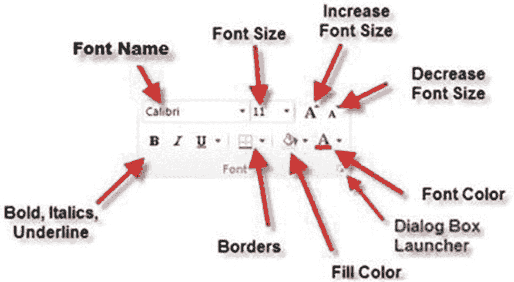

图 4-1 字体格式化命令按钮

### 使用加粗、斜体、下划线和双下划线

你可以对文本使用加粗、斜体或下划线的任意组合。选择这些选项中的一个或多个会影响活动单元格。这些选项类似于开关：点击即可启用，再次点击则关闭。你可以通过点击下划线按钮旁的下拉箭头，然后选择所需选项，在下划线和双下划线之间切换。参见图 4-2。

图 4-2 选择下划线或双下划线

### 更改字体及其大小

选择合适的字体和字号至关重要，这不仅能让电子表格数据脱颖而出，还能确保数据易于阅读。

#### 字体

可以通过点击字体下拉箭头，然后从列表中选择所需字体系列来更改字体。参见图 4-3。字体列表会显示不同字体的外观。当鼠标指针悬停在列表中的不同字体上时，Excel 会使用鼠标指针指向的字体在活动单元格中显示文本。更改字体会影响工作表中所有当前选定单元格的文本。

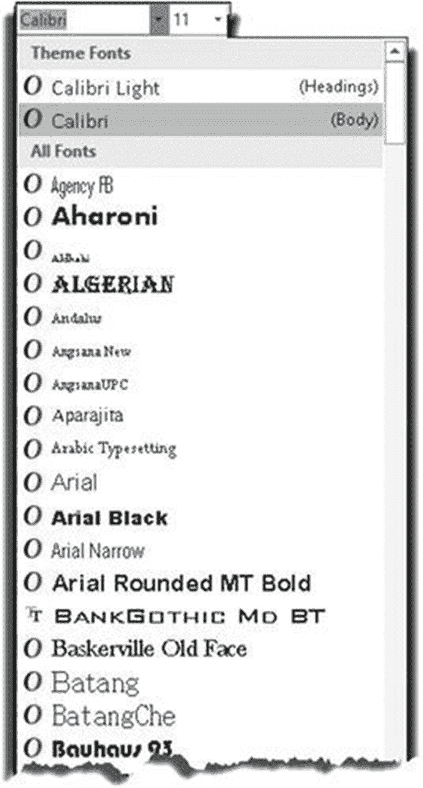

图 4-3 可用字体

列表中有很多字体。如果你想快速跳转到特定字体，可以在“字体名称框”（`Font Name Box`）中键入字体名称的前几个字母。例如，如果你想使用字体 `Bell MT`，可以键入前三个字母 `Bel`（因为只有一个以 `Bel` 开头的字体），然后按 `Enter` 键。

#### 字号

单击字号的下拉箭头会显示当前所选字体的所有可用字号。图 4-4 展示了 Calibri 字体可用的部分字号（上半部分）。

图 4-4 选择字号

单击增大字号按钮  会将字体大小增大到下一个可用的字号。参考图 4-4，如果当前字号是 11，单击增大字号按钮会将字号增大到下一个可用大小，即 12。如果当前字号是 18，单击增大字号按钮会将字号增大到下一个可用大小，即 20。

单击减小字号按钮  则执行相反操作：将字号减小到比当前大小小一级。参考图 4-4，你可以看到，如果当前字号是 18，单击减小字号按钮会将字号减小到 16 磅。字号以磅为单位计量。每磅大约等于 1/72 英寸。

### 练习 4-1：更改字体和字号

本练习涵盖了选择字体和更改字号的多种方法。

1. 新建一个工作簿。
2. 保存工作簿，并将其命名为 **Chapter 4**。将工作表名称从 `Sheet1` 改为 `Font`。
3. 在单元格 `H5` 中输入你的姓名，然后按 `Ctrl + Enter` 确认输入。
4. 在功能区的“开始”选项卡的“字体”组中，单击“字体”的下拉箭头。
5. 将鼠标指针悬停在不同字体上，观察你的姓名如何变化。如果有 `Arial Narrow` 字体，请选择它；否则，选择另一种字体。
6. 单击“字号”的下拉箭头。
7. 将鼠标指针悬停在不同字号上，观察你姓名的大小变化。选择字号 26。
8. 现在，尝试使用增大和减小按钮：
9. 单击增大字号按钮。字号变为 28。
10. 再次单击增大字号按钮。字号变为 36。
11. 单击减小字号按钮。字号变为 28。
12. 再次单击减小字号按钮。字号变为 26。
13. 双击单元格 `H5` 进入编辑模式。拖动选中你姓名的前三个字母。
14. 单击“字体”的下拉箭头。将鼠标指针悬停在不同字体上，观察只有前三个字母如何变化。
15. 在**字体名称框**中键入 `Ti`，跳转到 Times New Roman 字体。按 `Enter` 键。

现在，你应该熟悉菜单上“字体”组提供的所有工具了。接下来，你将了解如何通过“字体”组的对话框启动器来访问这些相同的工具。

### 使用“字体”组的对话框启动器

单击“字体”组的对话框启动器，会弹出“设置单元格格式”对话框，并自动激活“字体”选项卡。如图 4-5 所示。在此对话框中，你可以指定大多数在“字体”组中也可用的选项，此外，还可以在一个方便的位置添加效果。

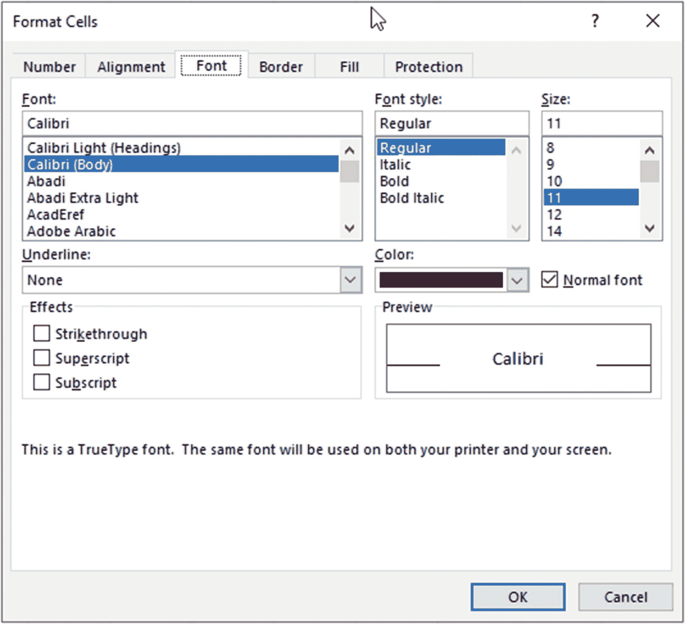

图 4-5 字体选项

### 使用颜色进行格式化

通过添加颜色，你可以将工作表从单调乏味变得引人注目。添加颜色不仅可以让你的工作表更富视觉冲击力，还可以：
* 突出显示你认为重要的单元格。
* 分隔工作表中的不同区域。
* 使你的工作表更易于阅读。

使用颜色时要小心。使用过多颜色或以错误的方式使用颜色（例如在深色背景上使用深色文本）会使你的工作表令人费解且难以阅读。

#### 更改字体颜色

单击字体颜色按钮  会将图标上当前显示的颜色应用到活动单元格的文本上。你可以通过单击其下拉箭头来选择其他颜色。

你可以从“主题颜色”集合或“标准色”集合中选择任何颜色，如图 4-6 所示。如果你想要更多颜色可供选择，请单击“其他颜色”选项。

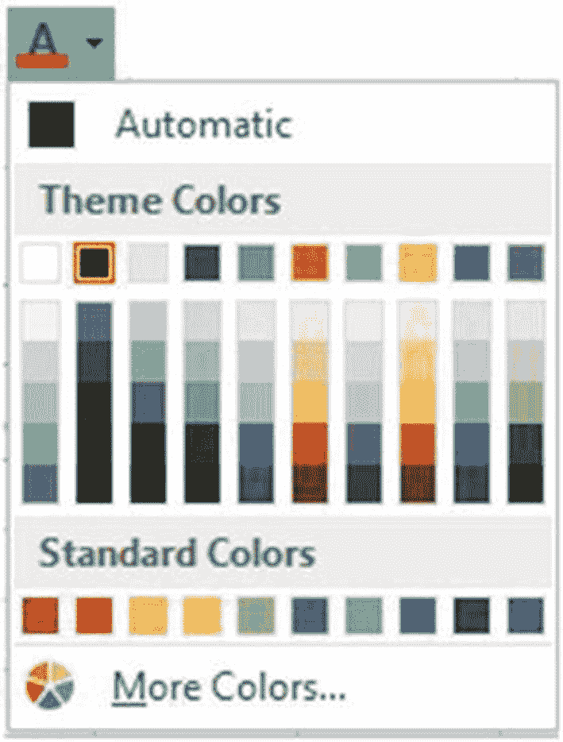

图 4-6 主题颜色和标准色

单击“其他颜色”选项会弹出“颜色”对话框，其中包含“标准”和“自定义”选项卡。“标准”选项卡允许你从蜂窝状网格中选择颜色。右下角的“当前”区域显示当前单元格的字体颜色。当你从网格中选择一种颜色时，它会显示在窗口右下角的“新增”区域中。如图 4-7 所示。这就是单击“确定”按钮后字体将被更改成的颜色。

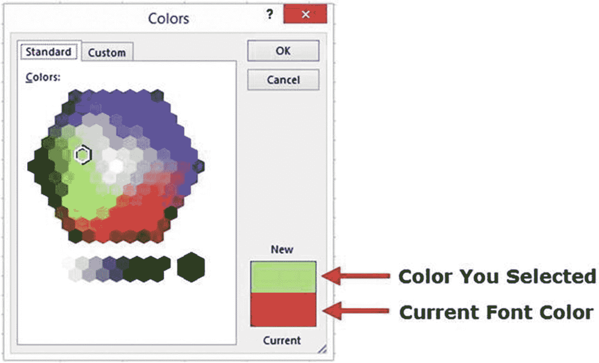

图 4-7 从颜色蜂窝中选择新颜色

“自定义”选项卡以垂直条显示颜色。如图 4-8 所示。每个垂直条的边缘与相邻颜色融合在一起。你可以在调色板中单击与你需要的颜色匹配的任意位置。然后，该颜色将显示在调色板右侧的垂直条中。向上或向下拖动箭头可更改颜色的强度。如图 4-8 所示。

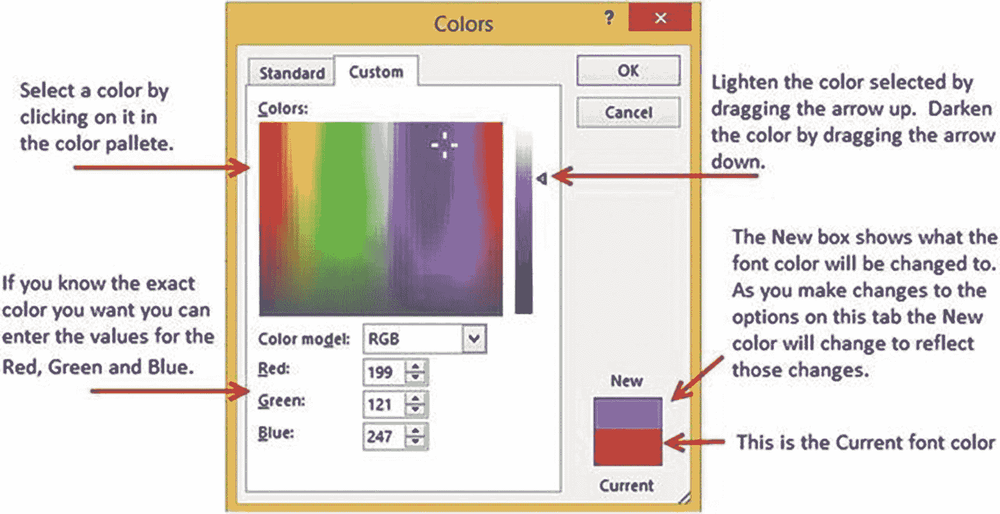

图 4-8 创建自定义颜色

#### 更改单元格背景颜色

## 单元格格式设置与强调

单击填充颜色按钮  会将图标上当前显示的颜色应用到活动单元格的背景上。你可以通过单击其下拉箭头来选择其他颜色。这将弹出与字体颜色相同的可用选项。

单击“字体”组的对话框启动器会弹出“设置单元格格式”对话框。“设置单元格格式”对话框中的“填充”选项卡提供了用于创建填充效果或图案背景的选项。如图 4-9 所示。

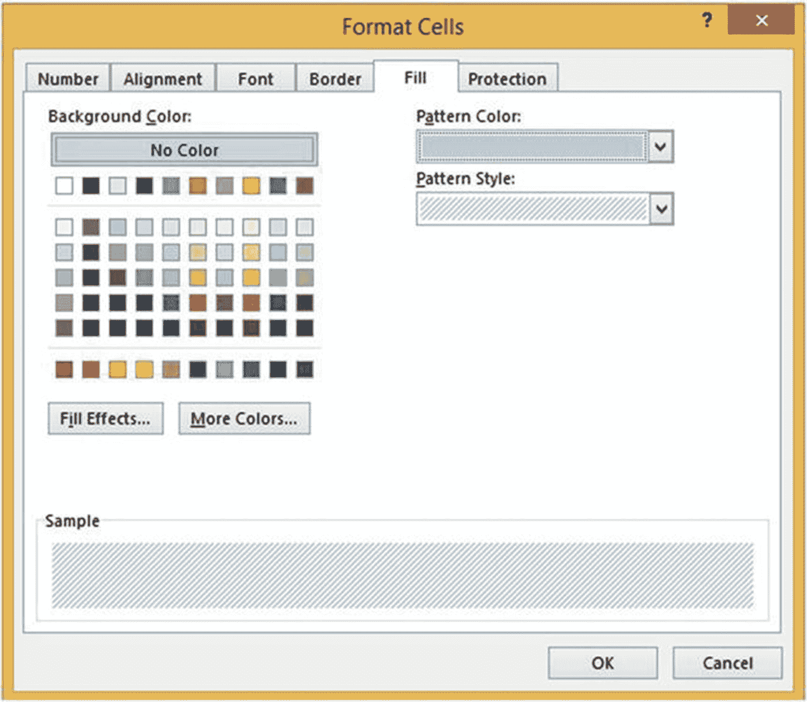
**图 4-9** 选择填充颜色、图案颜色或图案样式

### 检查当前单元格已应用了哪些格式

只需单击某个单元格，然后观察功能区“字体”组中显示的内容，即可判断该单元格已应用的某些格式。查看图 4-10，可以看到单元格 `C1` 中的文本已设置为加粗和斜体。它使用了 `Arial Black` 字体，字号为 `16`。

> **注意**：如果单元格中的所有文本并非采用相同格式，则需要选择那些你想显示其格式的字符。

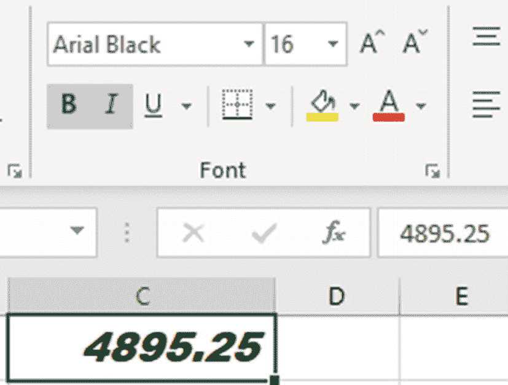
**图 4-10** – 所选文本已加粗并设为斜体

`边框`、`填充颜色`和`字体颜色`选项并不会反映当前单元格的状态。它们反映的是上次使用这些选项时所做出的选择。

### 练习 4-2：更改字体与背景颜色

本练习涵盖更改字体颜色以及更改单元格背景颜色。单元格背景可以是纯色、渐变或图案。

1.  单击`字体颜色`按钮的下拉箭头。选择`黑色`。在单元格 `B4` 中输入总计值。按 `Ctrl + Enter`。将字体更改为 `Cambria`。将字号改为 `14`。单击加粗和斜体按钮。加宽列以容纳更改后的内容。

2.  再次单击单元格 `B3`。你可以看到已应用到该单元格的格式。`加粗`按钮已高亮显示。字体显示为 `Calibri`。字号反映了你已单击过`增大字号`按钮。单击`填充颜色`按钮的下拉箭头。选择框位于黑色周围。单击`字体颜色`按钮的下拉箭头。选择框位于白色周围。单击单元格 `B4`。看看你是否能检测到已对其应用了哪些格式。

3.  单击单元格 `B4`。单击`填充颜色`按钮的下拉箭头。选择颜色“绿色，主题色 6，淡色 80%”。见图 4-11。
    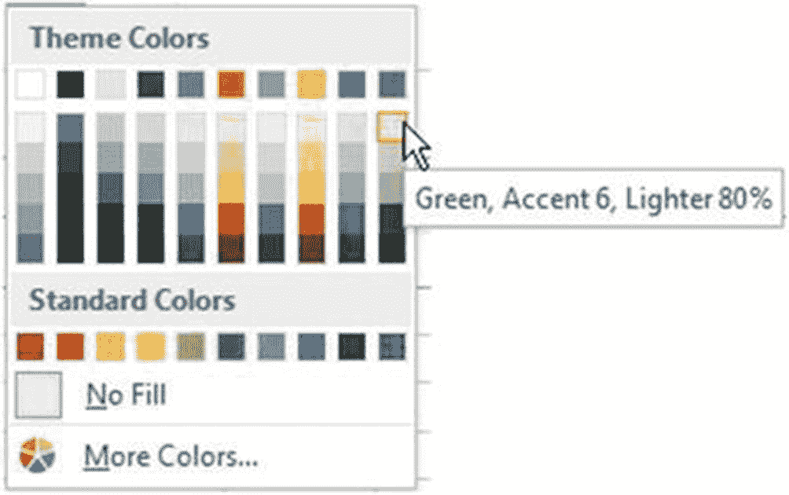
    **图 4-11** – 选择绿色，主题色 6，淡色 80%

4.  创建一个名为“Colors”的新工作表。

5.  单击单元格 `B3`。单击功能区的`开始`选项卡，然后在`字体`组中，单击`填充颜色`按钮的下拉箭头 。选择`黑色`。

6.  现在，输入并设置一些文本的格式：
    - 单击`字体颜色`按钮的下拉箭头 ，然后选择`白色`。
    - 输入总计值。按 `Ctrl + Enter`。
    - 如果字体类型还不是 `Calibri`，请将其更改为 `Calibri`。
    - 单击`增大字号`按钮  一次。
    - 按 `Ctrl + B` 将文本加粗。
    - 通过在列标题 `B` 和 `C` 之间双击来加宽列，以便所有文本都能容纳在单元格中。

#### 将背景更改为渐变

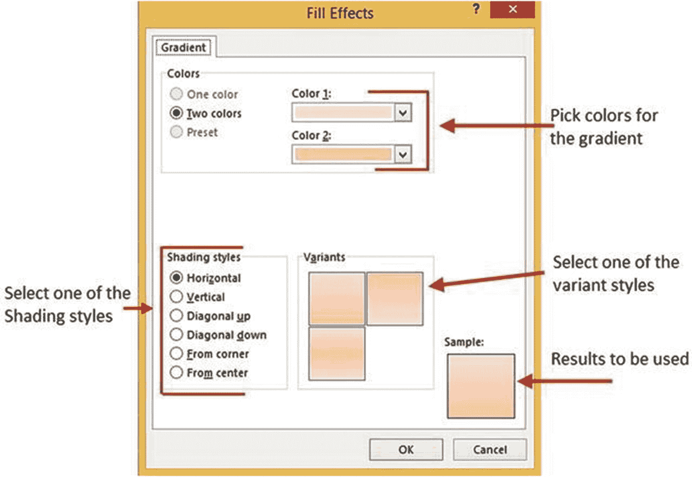
**图 4-12** – 将单元格背景颜色更改为渐变

1.  选中单元格 `B5:D5`。单击`字体`组的对话框启动器 。
2.  单击`填充`选项卡。
3.  单击`填充效果`按钮。`渐变`选项卡用于将背景更改为渐变颜色。见图 4-12。
4.  为颜色 1 选择任意颜色，然后为颜色 2 选择另一种颜色。
5.  单击每种底纹样式，观察渐变图案的变化。
6.  当你选择了想要使用的颜色和样式后，单击包含你想要使用的图案的`变体`框。`示例`区域会显示背景在你所选选项下的效果。
7.  单击`填充效果`对话框中的`确定`按钮。单击`设置单元格格式`对话框中的`确定`按钮。

#### 将背景更改为图案样式

1.  选中单元格 `B7:D8`。单击`字体`组的对话框启动器。单击`填充`选项卡。选择一种你喜欢的图案颜色。从`图案样式`下拉框中选择一种你喜欢的图案。单击`确定`按钮。
2.  单击`快速访问工具栏`上的`保存`按钮 。

你已经学会了如何更改文本的外观和大小以及如何强调文本。你可以运用这些知识将用户的视线吸引到你想要的文本上。你的公司可能有关于工作表应使用何种字体类型和颜色的标准。接下来，你将看到如何将边框放置在单元格周围，这同样可用于强调某些单元格，或作为显示工作表中不同区域分隔的一种方式。

### 单元格边框

所有单元格都有用于分隔它们的网格线。这可以将一个单元格与另一个单元格区分开来。可以通过单击功能区的`视图`选项卡，然后取消选中`网格线`来移除网格线。见图 4-13。
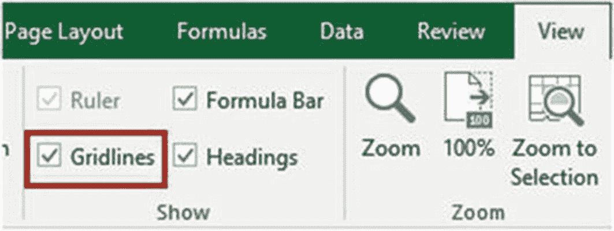
**图 4-13** – 取消选中网格线以从工作表中移除所有网格线

图 4-14 显示了移除网格线后的结果。
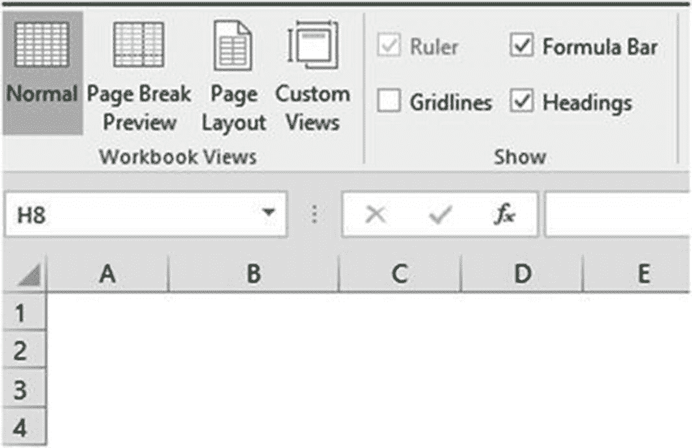
**图 4-14** – 无网格线

然而，有时候你需要区分特定的单元格、行、列或一组单元格。你可以通过使用边框来实现这一点。边框可以只是单元格或单元格区域左侧、顶部、右侧或底部的一条线。它也可以是几条线的组合，或者是一个环绕单元格或单元格区域的完整框线。图 4-15 展示了几种不同的边框类型。
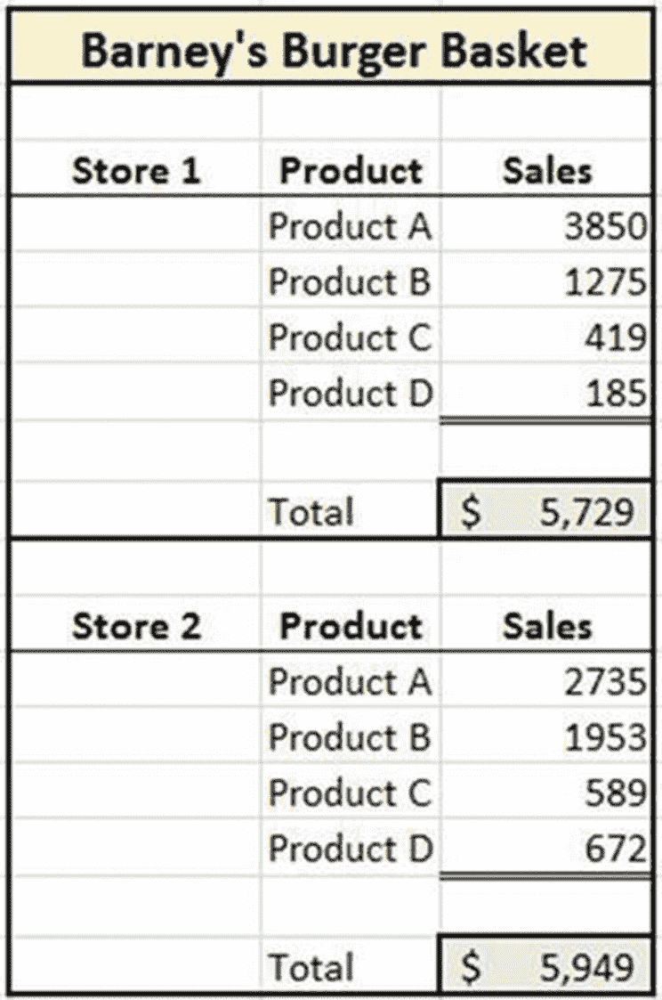
**图 4-15** – 不同的边框类型

单击`边框`按钮会将当前按钮上显示的边框应用于你的活动单元格。如果你想要不同的边框样式，可以单击边框旁边的下拉箭头，然后选择其中一个选项以应用于你选定的单元格。见图 4-16。

> **注意**：标准的会计惯例是在总计行的上方使用单线，下方使用双线。

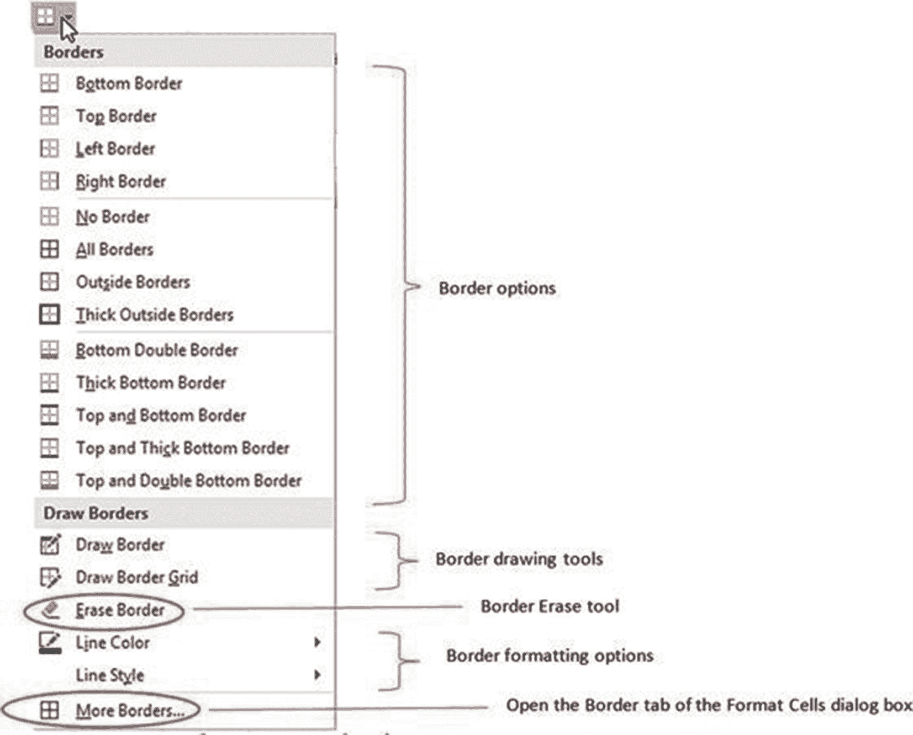
**图 4-16** – 边框选项与工具

> **注意**：你可以使用`擦除边框`工具擦除一部分边框。使用`擦除边框`工具时，鼠标指针将显示为橡皮擦形状。

#### 绘制边框

你甚至可以使用 `绘制边框` 或 `绘制边框网格` 工具来绘制边框。使用绘制边框工具时，鼠标指针会显示为铅笔形状。边框将以当前线条样式绘制。

`绘制边框` 工具会在你拖拽经过的单元格周围绘制完整的外边框。见图 4-17。
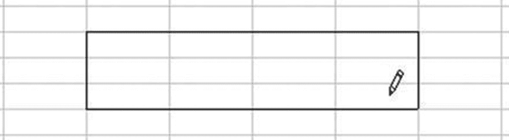
**图 4-17** 绘制边框工具

# 练习 4-3：创建单元格边框

在本练习中，你将使用多种方法来创建边框，并更改边框的宽度、样式和颜色。

## 使用边框按钮添加边框

1. 新建一个名为“Borders”的工作表。

2. 选中单元格`B2:C2`。

3. 在功能区`开始`选项卡的`字体`组中，点击`边框`按钮的下拉箭头。

4. 点击`上框线和双下框线`。点击另一个单元格以便查看结果。

## 绘制边框

1. 按`Esc`键关闭`绘制边框`模式。

2. 如果在选择`线条颜色`或`线条样式`时，`绘制边框`工具和`绘制边框网格`工具均未激活，Excel会自动启用`绘制边框`工具。

3. 在单元格`B15:C19`周围绘制边框。见图 4-21。

**图 4-21** 在单元格区域`B15:C19`周围绘制边框

4. 在单元格`B10:C13`周围绘制边框。边框应显示为绿色。

5. 点击`边框`按钮的下拉箭头。点击`绘制边框`按钮以取消选择。

6. 点击`边框`按钮的下拉箭头。点击`线条样式`。选择双线。见图 4-20。

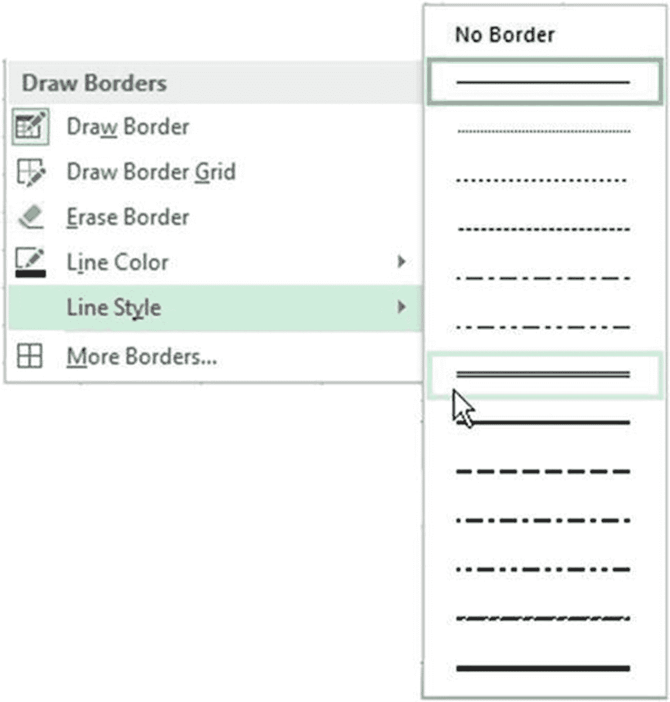
**图 4-20** 更改边框的线条样式

7. 在`字体`组中点击`边框`按钮的下拉箭头。

8. 点击`绘制边框`。鼠标指针应变为铅笔形状。

9. 在单元格`B4`到`B8`周围绘制边框。注意`边框`按钮的图标已变为铅笔形状以反映你的选择。

10. 点击`边框`按钮的下拉箭头。

11. 注意，`绘制边框`按钮周围现在有阴影，表示该工具当前处于激活状态。另外，注意`线条颜色`按钮上有一条彩色线条。这表示当前正在使用的颜色。

12. 当你更改`线条颜色`或`线条样式`时，你正在更改当前激活的工具（即`绘制边框`工具）的设置。

13. 点击`线条颜色`。从`标准色`中选择绿色。见图 4-19。

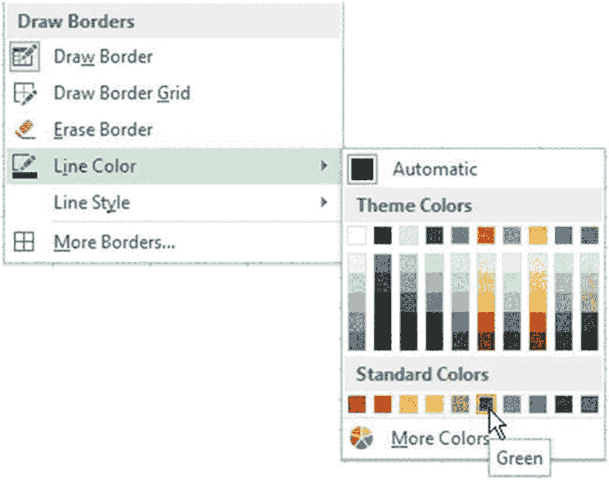
**图 4-19** 更改边框的线条颜色

## 绘制边框网格

`绘制边框网格`工具会在每个单元格周围放置完整的边框。见图 4-18。

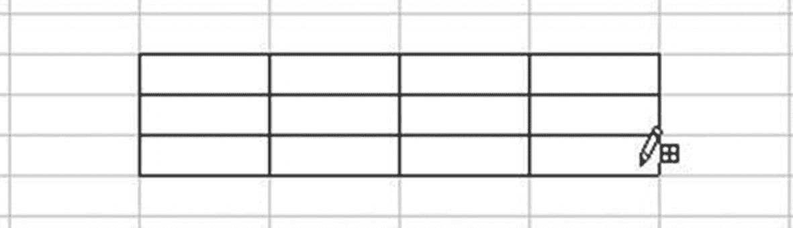
**图 4-18** 绘制边框网格工具

1. 点击`边框`按钮的下拉箭头。注意，`绘制边框网格`工具当前处于激活状态。选择`线条颜色`。从`标准色`中选择`红色`。

2. 在单元格`E10:F12`周围绘制边框，然后按`Esc`键。

3. 选中单元格`I2:J6`。

4. 点击`边框`按钮的下拉箭头。选择`上框线和粗下框线`。点击另一个单元格查看结果。（注意，线条现在显示为红色，因为这是你上次使用的线条颜色。）

5. 点击`边框`按钮的下拉箭头。注意，`绘制边框`工具不再处于激活状态。按`Esc`键使其失效。

6. 点击`绘制边框网格`。

7. 在单元格`E3:F7`周围绘制边框。边框应显示为绿色双线，因为这些是你上次选择的选项。

8. `边框`按钮的图标已更改，以反映`绘制边框网格`工具当前处于激活状态。见图 4-22。

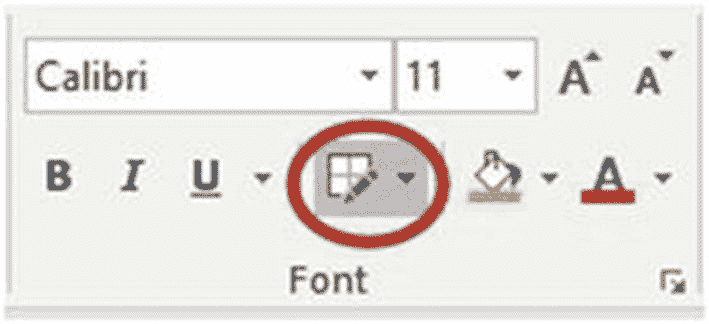
**图 4-22** 边框按钮反映`绘制边框网格`工具处于激活状态

## 使用设置单元格格式对话框创建边框

1. 点击`确定`按钮。

2. 选中单元格`E15:F20`。

3. 点击`边框`按钮的下拉箭头。选择`其他边框`。由于选中了多个单元格，`预置`区域中的`内部`按钮以及`边框`区域中的所有边框按钮都可用。

4. 点击`竖内部`按钮 。

5. 点击`预置`区域中的`无`按钮以清除`预览`区域。

6. 在`样式`组的第二列中选择第一条实线。

7. 选择`红色`作为颜色。

8. 点击`预置`区域中的`外边框`按钮。这将激活`上`、`下`、`左`和`右`的`边框`按钮。

9. 选择`绿色`作为颜色。

10. 点击`横内部`按钮 。见图 4-26。

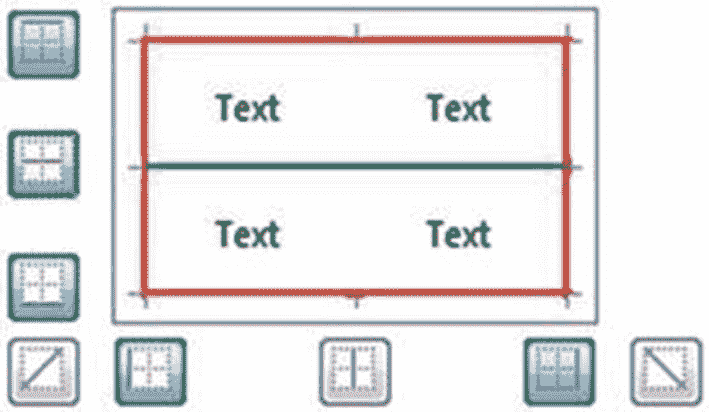
**图 4-26** `横内部`按钮创建水平内部边框

11. 点击`确定`按钮。点击另一个单元格以便查看结果。现在，单元格`I8`应有左边框和右边框。

12. 边框按钮的工作原理类似于切换开关。点击某个`边框`按钮会将相应的边框添加到单元格中。再次点击该`边框`按钮则会移除该边框。点击`上边框`按钮移除单元格的上边框。

13. 点击`左边框`按钮，然后点击`右边框`按钮。见图 4-25。

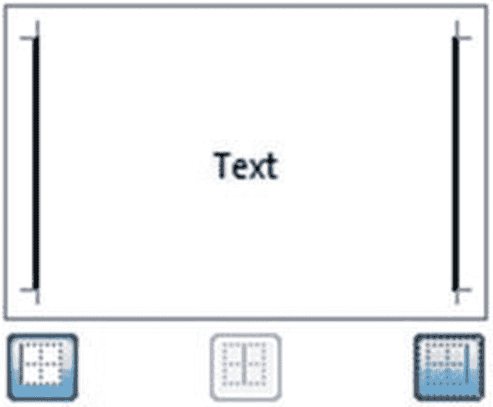
**图 4-25** `左边框`和`右边框`按钮创建左边框和右边框

14. `预置`区域中的`内部`选项呈灰色不可用状态，因为只有一个活动单元格，即单元格`I8`。点击`预置`区域中的`无`。这将移除`预览`框中的所有边框。

15. 点击`边框`区域中的`上边框`按钮。在`文本`框中会显示上边框。见图 4-24。

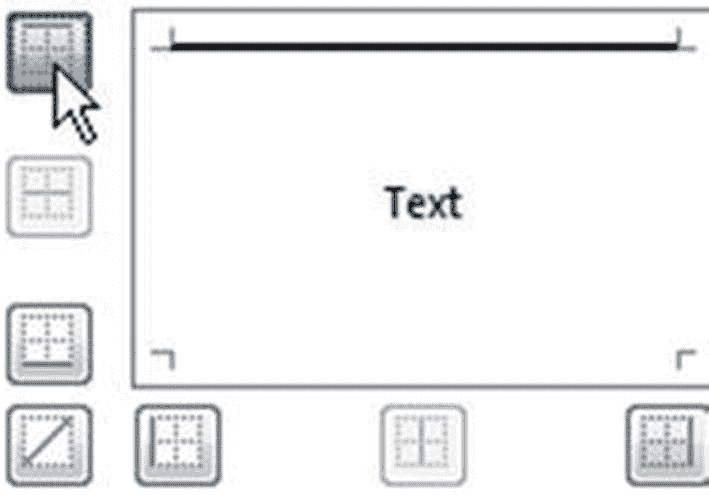
**图 4-24** `上边框`按钮创建上边框

16. 点击单元格`I8`。

17. 点击`边框`按钮的下拉箭头。选择`其他边框`。

18. 创建一个边框：
    1. 在`样式`组的第二列中选择第一条实线。
    2. 选择`自动`作为颜色。
    3. 点击`预置`区域中的`外边框`。`边框`区域中的`预览`框会显示单元格的外观。见图 4-23。

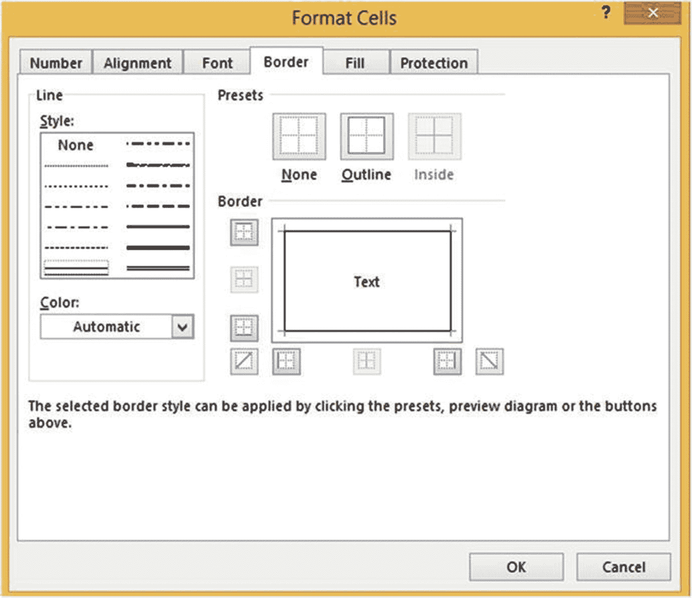
**图 4-23** `边框`区域中的预览框显示边框的外观

## 擦除边框

1. 按`Esc`键。这将关闭`擦除`工具。

2. 点击`快速访问工具栏`上的`保存`按钮 。

3. 点击`边框`按钮的下拉箭头。

4. 选择`擦除边框`。鼠标指针变为橡皮擦图标 ()。用橡皮擦尖端点击边框线即可删除该边框线。

5. 擦除第一、第三和第五根水平绿色线条。由于这些水平线跨越两个单元格，你需要点击每个单元格的水平线。更简便的方法是按住鼠标左键并拖过水平线，如图 4-27 所示。如果擦除过多，只需点击撤销按钮 () 或按`Ctrl + Z`并重试。

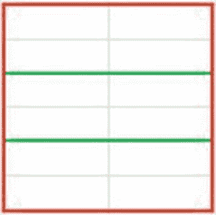
**图 4-27** 已擦除第一、第三和第五根内部水平边框线

## 使用“数字”组格式化数值数据

# 数字格式设置

## 概述
你已经看到 Excel 如何根据输入的数据对单元格中的格式和对齐方式做出假设（例如数值数据右对齐）。如果要更改该格式，你需要使用 Excel 的众多格式化功能之一，这些功能位于“开始”选项卡的“数字”组中。参见图 4-28。表 4-1 提供了“数字”组中每个选项的说明。

**表 4-1**

“数字”组中各选项的说明

| “数字”组按钮 | 说明 |
| --- | --- |
|  | “数字格式”下拉列表提供了数值、日期和时间值的多种默认格式。参见图 4-26。 |
|  | 点击该按钮的美元符号部分，将以会计专用格式（美元符号、逗号和两位小数）格式化当前单元格。如果要使用其他货币（如英镑或欧元），可以点击``按钮右侧的下拉箭头。 |
|  | 将单元格中的值乘以 100，并在值末尾添加`%`符号。 |
|  | 为数值添加逗号。如果数值不包含小数，则会添加`.00`。 |
| 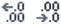 | 第一个按钮（增加小数位数）每点击一次，单元格中的小数位数增加一位。第二个按钮（减少小数位数）每点击一次，单元格中的小数位数减少一位。 |
|  | 对话框启动器会打开“设置单元格格式”对话框，并自动选中“数字”选项卡。 |

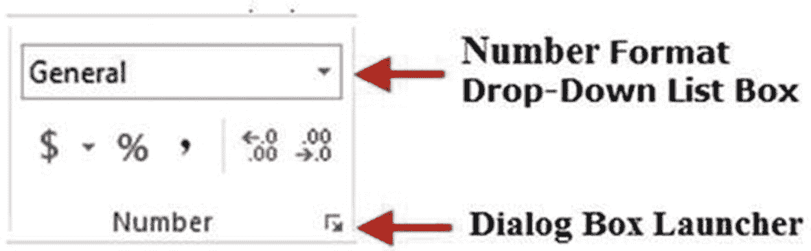

**图 4-28**
“开始”选项卡上的功能区“数字”组

## 使用默认格式

假设活动单元格当前值为`3859.27`。

点击“数字格式”下拉列表的下拉箭头，会显示默认格式列表（参见图 4-29）。点击此列表中的选项，即可按每个格式标签下方显示的样式格式化当前值。所见即所得，无需选择其他选项。

例如，如果你点击“分数”选项，当前单元格的格式将更改为`3859 1/4`。

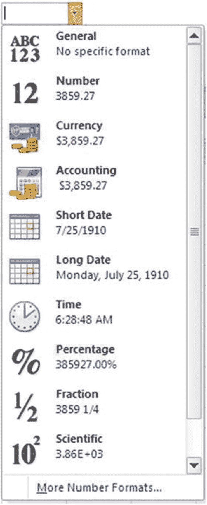

**图 4-29**
不同数据类型的默认格式

### 会计专用与货币格式

会计专用格式是一种特殊的货币格式，以美元符号、逗号和两位小数显示数值。会计专用格式使列中的美元符号和小数点对齐。参见图 4-30。美元符号始终位于单元格的最左侧。根据单元格宽度和其中的数值，美元符号与数值之间可能存在多个空格。

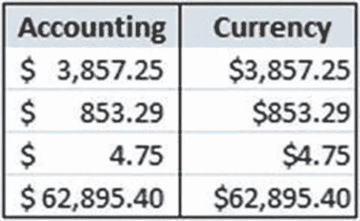

**图 4-30**
会计专用格式与货币格式的区别

货币格式与会计专用格式类似。它也为数值添加美元符号、逗号和两位小数。区别在于货币格式使用浮动美元符号，而会计专用格式使用固定美元符号。浮动美元符号不对齐，而是紧贴数值左侧放置。

## 格式化货币值

“数字”组中的``按钮执行与从“数字格式”下拉列表中选择“会计专用”完全相同的格式化操作。如果你希望以不同格式显示数值，或使用其他货币（如英镑或欧元），可以点击``按钮右侧的下拉箭头。参见图 4-31。

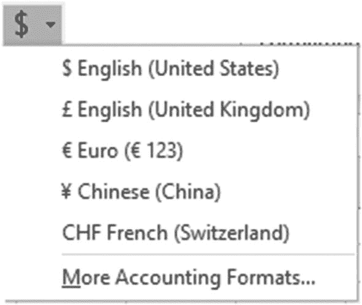

**图 4-31**
格式化后的货币值

如果你希望使用非两位小数，或使用下拉框中未显示的货币，可以选择最后一个选项**更多会计专用格式**。选择此选项是打开“设置单元格格式”对话框的多种方式之一。

在此对话框中，你可以从“符号”下拉列表中选择多种不同的货币选项。参见图 4-32。

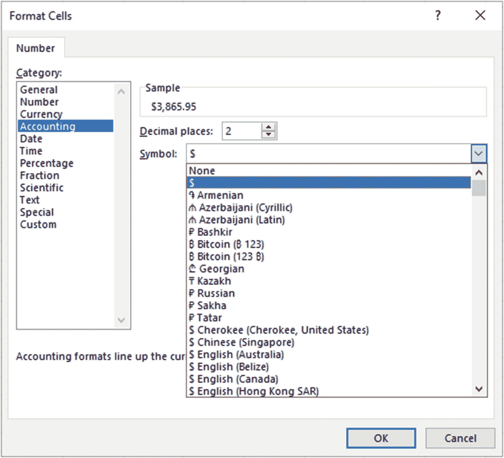

**图 4-32**
小数位数和货币符号的会计专用选项

## 转换为百分比样式

百分比样式``按钮会将选定单元格中的值乘以 100，并在数字后放置`%`符号。例如，值`.25`将被格式化为`25%`。`%`按钮会四舍五入数值并移除所有小数位，如图 4-33 所示。

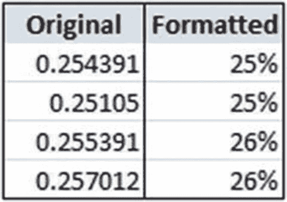

**图 4-33**
使用百分比样式格式化

如果你希望使用显示两位小数的百分比格式，请点击“数字格式”下拉列表的下拉箭头，并选择**% (百分比)**。图 4-34 显示了应用此格式后的结果。

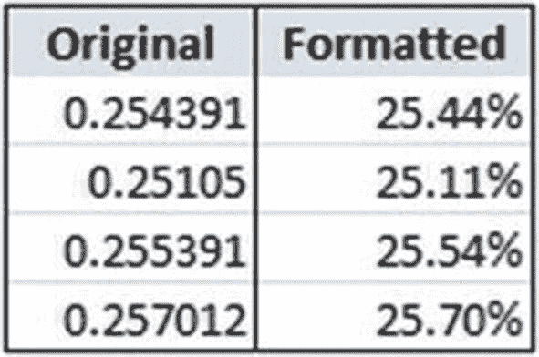

**图 4-34**
使用%选项格式化

## 将数值转换为千位分隔样式

点击“千位分隔样式”按钮``可以为选中的单元格数值添加逗号分隔符。例如，数值`3857495.25`将格式化为`3,857,495.25`。

## 更改小数位数

``“增加小数位数”按钮每点击一次，数值的小数位数就增加一位。图标显示从一位小数变为两位小数。

``“减少小数位数”按钮每点击一次，数值的小数位数就减少一位。图标显示从两位小数变为一位小数。

## 访问“设置单元格格式”对话框

如果你希望使用更多选项来格式化数字，那么使用“设置单元格格式”对话框中的“数字”选项卡是最佳途径。通过该选项卡，你可以对分数、日期、时间等进行格式化，而这些格式化操作在其他区域是无法完成的。窗口右侧显示哪些选项取决于所选的类别。参见图 4-35。

可以通过以下任一方法从“数字”组访问“设置单元格格式”对话框：
- 单击对话框启动器。
- 单击“数字格式”下拉框中的下拉箭头，然后选择**其他数字格式**。
- 单击`$`按钮右侧的下拉箭头，然后选择**其他会计格式**。

## 练习 4-4：格式化数字

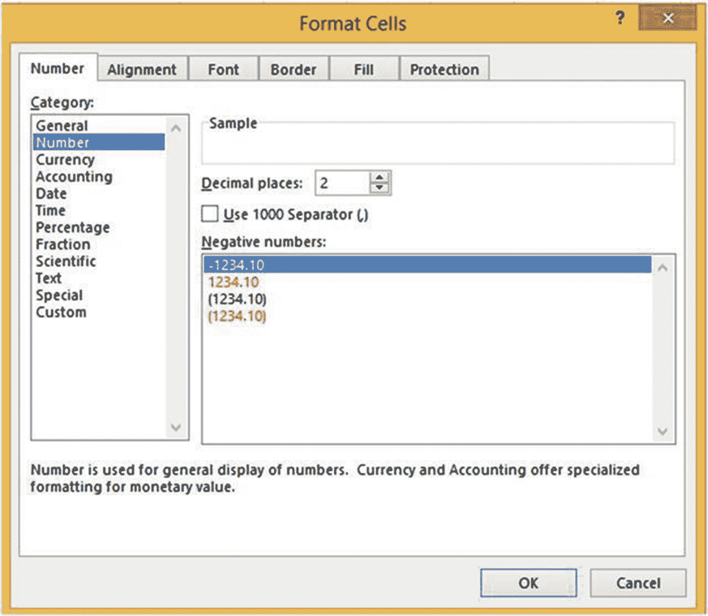
*图 4-35 选中“数字”格式的“设置单元格格式”对话框*

在此练习中，你将使用各种数字数据格式。如果你在上次练习后关闭了工作簿，可以重新打开第 4 章的工作簿。

1.  由于 Excel 将该值识别为日期，因此它会打开“设置单元格格式”对话框，并自动选中“日期”类别。选择类别后，你需要在“类型”区域中选择数据的显示方式。窗口的“示例”区域会显示，使用你在“类型”区域中选择的选项后，当前单元格中的数据将如何显示。如果你在工作表中选中了一个单元格区域，它将显示该区域中第一个单元格的显示效果。
2.  在“类别”区域中单击“数值”。“数值”类别提供了设置小数位数、使用千位分隔符以及选择负数显示方式的选项。
3.  依次单击其他各个类别，熟悉格式化数据的不同选项。
4.  再次单击“日期”类别。
5.  在“类型”区域中，选择 `Wednesday, March 14, 2012`。“示例”区域会显示此更改如何影响当前单元格的显示。
6.  单击“确定”按钮。
7.  单元格 `C3` 可能会显示为一串 `#` 符号。这是什么意思？没错，是列宽不够。加宽列宽以查看结果。
8.  单击快速访问工具栏上的“保存”按钮 。
9.  单击“会计专用”以更改单元格 `C1` 中的格式。
10. 在单元格 `C2` 中输入 `3.25`。按 `Ctrl + Enter`。单击“数字格式”下拉框的下拉箭头。单击 `分数`。分数格式将数字的小数部分转换为分数。小数部分 `.25` 被更改为 `1/4`。
11. 在单元格 `C3` 中输入 `5/15/2012`。按 `Ctrl + Enter`。单击“数字”组中的对话框启动器（如图 4-36 所示）以打开“设置单元格格式”对话框。参见图 4-37。

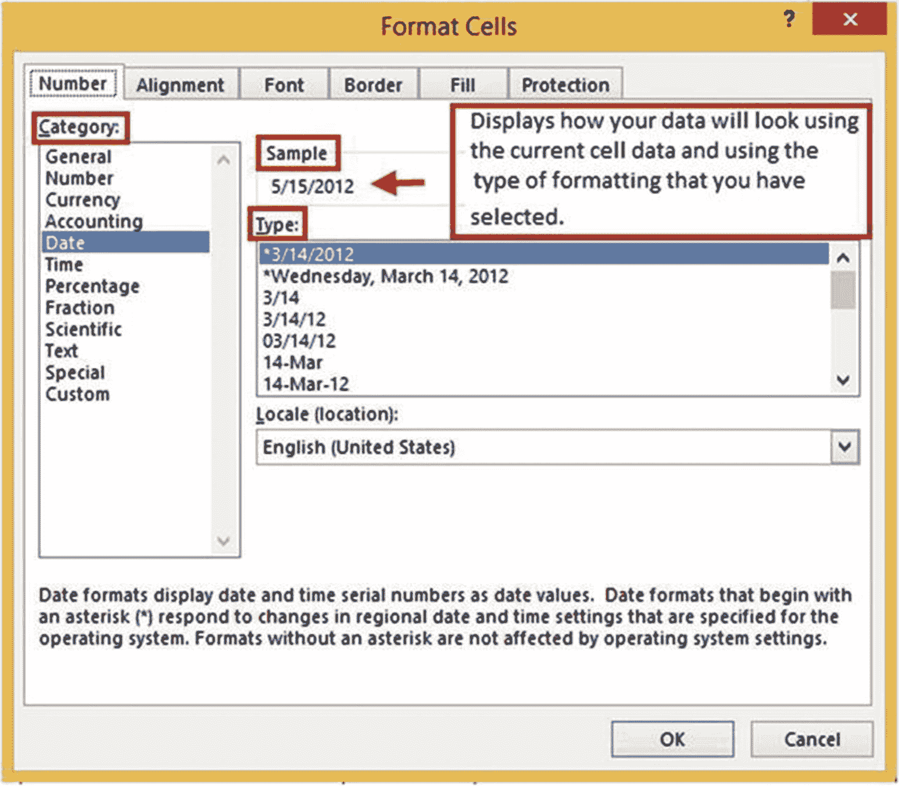
*图 4-37 选中“数字”选项卡的“设置单元格格式”对话框*

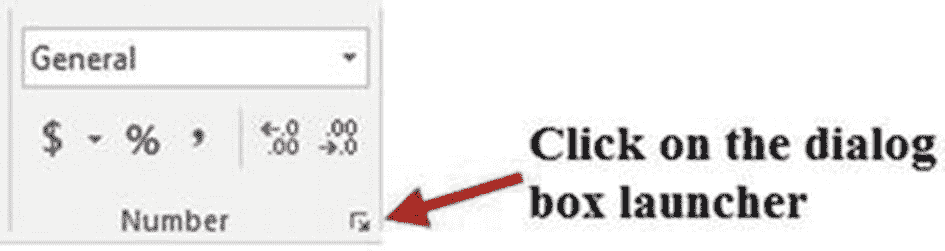
*图 4-36 “数字”组*

12. 单击“货币”格式。
13. 将 `A` 列的宽度更改为大约 13.43。
14. 在单元格 `A2` 中键入 `3427.35`，但不要按 Enter 键。单击编辑栏中的“输入”按钮。
15. 单击“数字”组中的“会计数字格式”按钮 。注意单元格 `A1` 的“货币”格式与单元格 `A2` 的“会计专用”格式之间的区别。使用“会计专用”格式时，`$` 符号显示在单元格的最左侧位置。“会计专用”格式还在最后一位数字的右侧留出一个空格。
16. 在单元格 `A3` 中键入 `.85`。按 `Ctrl + Enter`。单击“数字”组中的 `%` 按钮。该值应显示为 `85%`。
17. 在单元格 `A4` 中输入 `1385197`。按 `Ctrl + Enter`。单击“数字”组中的 `千位分隔样式` 按钮 。该值显示为 `1,385,197.00`。
18. 单击“减少小数位数”按钮 。小数位数减少一位。再单击一次“减少小数位数”按钮。第二位小数被删除。单击两次“增加小数位数”按钮 ，将数值恢复为两位小数。
19. 在单元格 `C1` 中输入 `–385`。按 `Ctrl + Enter`。单击“数字格式”下拉框的下拉箭头。注意，“货币”格式将该值显示为 `−$385.00`，而“会计专用”格式则显示为 `($385.00)`。在会计专用格式中，负数显示在括号内。
    **注意：** 注意“科学记数”格式将该值显示为 `–3.85+E02`。处理整数时，“科学记数”格式将小数点放在最左边数字之后，将数字四舍五入到两位小数，并将其余部分显示为指数。
20. 创建一个名为 `NumberGroup` 的新工作表。
21. 在单元格 `A1` 中键入 `1275.85`，但不要按 Enter 键。单击编辑栏中的“输入”按钮 。单击“输入”按钮会确认你输入的值，并使当前单元格保持为活动状态。一旦值被确认，编辑栏上的“输入”和“取消”按钮会变灰。
22. 在“开始”选项卡的“数字”组中，单击“数字格式”下拉框的下拉箭头 。注意，下拉框中的每个选项都显示了如果你单击该特定格式，单元格 `A1` 中的值将如何显示。
    **注意：** Excel 的日历从 1900 年 1 月 1 日开始。注意，“短日期”和“长日期”格式将日期显示为 1903 年 6 月 28 日。之所以显示这个日期，是因为你在单元格 `A1` 中输入值的整数部分是 1275，而日期 **1903 年 6 月 23 日** 是自 1900 年 1 月 1 日之后的第 1,275 天。

你已经学习了如何使用功能区“数字”组中的工具来格式化数字数据。格式化数据是必要的，这样用户才能按预期解读数据，例如确保用户知道一个数字是百分比而不仅仅是数值。接下来，你将学习如何对齐单元格内的数据。

## 使用“对齐方式”组对齐数据

“对齐方式”组位于“开始”选项卡中。见图 4-38。它包含用于垂直和水平对齐文本、旋转文本、增加和减少缩进、自动换行以及合并单元格的选项。表 4-2 描述了“对齐方式”组中的每个选项。

**表 4-2** 对齐按钮说明

| 按钮 | 说明 |
| --- | --- |
|  | **垂直对齐** — “顶端对齐”、“垂直居中”和“底端对齐”按钮分别用于将文本对齐到单元格的顶部、中部和底部。 |
| 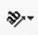 | **方向** — 单击此按钮可调出用于选择单元格内文本角度和方向的选项。 |
|  | **自动换行** — 用于将数据在单元格内分成多行显示。 |
|  | **水平对齐** — “左对齐”、“居中”和“右对齐”按钮分别用于将文本对齐到单元格的左侧、中部和右侧。 |
|  | **缩进** — “减少缩进量”按钮（左侧）用于减少单元格的缩进量。“增加缩进量”按钮（右侧）用于增加单元格的缩进量。 |

# Excel 单元格格式设置

## 合并与对齐

 | **合并后居中** — 此按钮提供合并单元格、合并后居中以及取消合并单元格的选项。

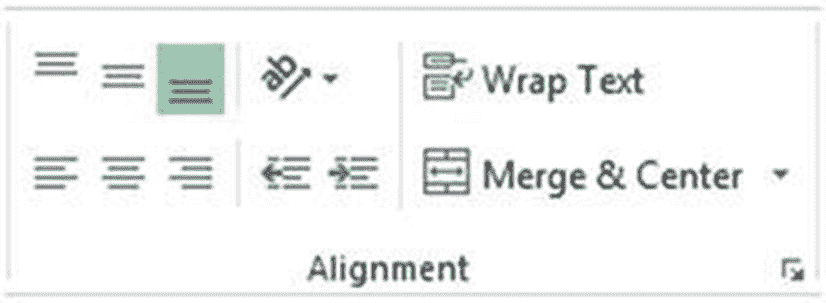
**图 4-38** “开始”选项卡上的“对齐方式”组

### 在单元格中容纳更多文本

Excel 提供了三个选项来在单元格中容纳更多数据：

- **自动换行** — 文本自动换行到下一行。
- **缩小字体填充** — 缩小单元格内容的尺寸，使其适应单元格。
- **合并单元格** — 将多个单元格合并为一个单元格。

#### 自动换行

如果文本在单元格中放不下，你可能希望将文本分成多行。Excel 有一个名为“自动换行”的功能，它可以格式化单元格，使文本自动换行。你可以通过选择想要自动换行的单元格，然后单击功能区中的“开始”选项卡来启用自动换行功能。在“对齐方式”组中，单击“自动换行”按钮。你也可以通过按 `Alt + Enter` 在任意位置强制换行。

**注意：** 启用自动换行后，单元格中的数据会换行以适应列宽。当你更改列宽时，数据换行会自动调整。

图 4-39 展示了使用“自动换行”前后的示例。

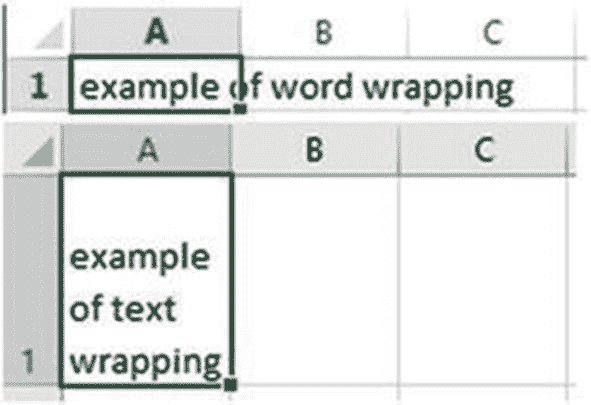
**图 4-39** 图片的上半部分显示了使用“自动换行”前的文本，下半部分显示了应用“自动换行”后的文本。

#### 缩小字体填充

启用“缩小字体填充”选项会缩小单元格的内容，使其适应单元格的大小。图 4-40 展示了使用前后的示例。

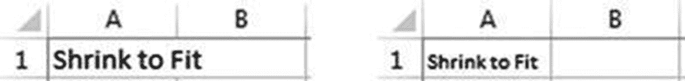
**图 4-40** 左侧的图片显示了使用“缩小字体填充”前的文本，右侧的图片显示了应用“缩小字体填充”后的文本。

如果你输入了大量文本，除非你加宽列宽，否则文本可能会变得太小而无法看清。“缩小字体填充”选项位于“设置单元格格式”对话框的“对齐”选项卡上。见图 4-41。有几种方法可以打开此选项卡。一种方法是单击“对齐方式”组的对话框启动器，然后选择“对齐”选项卡。

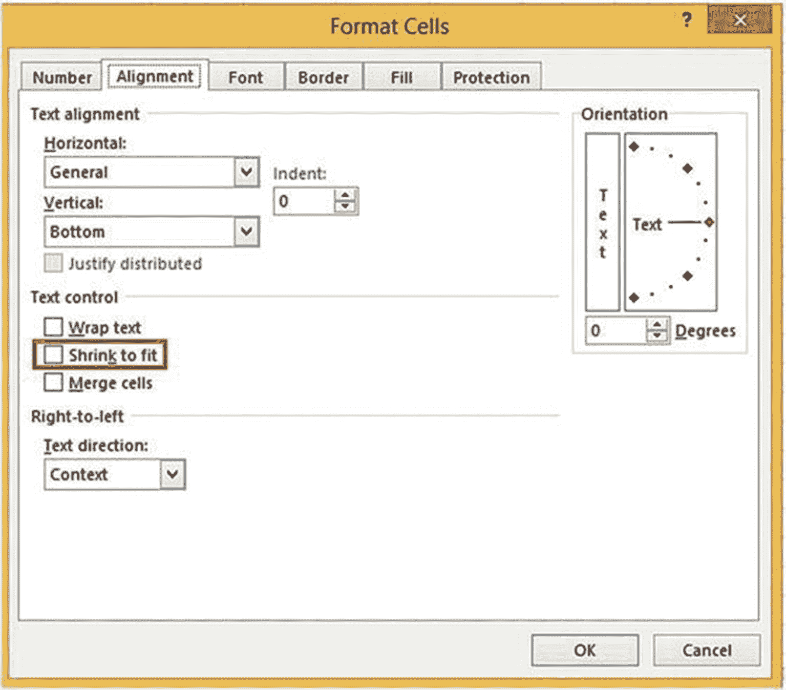
**图 4-41** 选中“对齐”选项卡的“设置单元格格式”对话框

通过选中或清除 `缩小字体填充` 复选框，可以启用或禁用该选项。请注意，此处也有用于启用“自动换行”和“合并单元格”的选项。

#### 合并及取消合并单元格

你可以使用三种不同的合并单元格选项之一来将多个单元格合并成一个更大的单元格：

- 合并后居中
- 跨越合并
- 合并单元格

**合并后居中**选项会合并所选单元格，然后将数据在新扩展的单元格中水平居中显示。“合并后居中”按钮位于“开始”选项卡 -> “对齐方式”组中。

你可以通过让标题在工作表宽度范围内居中显示来改善电子表格的外观。在图 4-42 中，标题已输入到单元格 `A1` 中。如果标题能够在 A 列到 F 列之间居中显示，效果会更好。

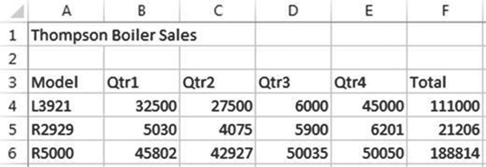
**图 4-42** 居中前的标题

要使标题在单元格中居中显示，你需要选择这些单元格，然后选择“合并后居中”选项。当你合并单元格 `A1`、`B1`、`C1`、`D1`、`E1` 和 `F1` 后，最终得到一个占据这六个单元格空间的单元格。见图 4-43。这个单独的单元格的地址将是 `A1`。

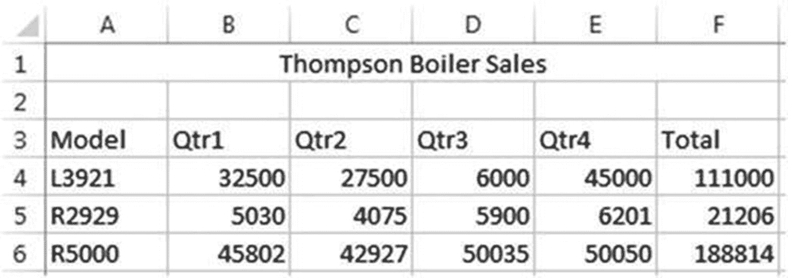
**图 4-43** 单元格已合并且标题已居中

“合并后居中”命令不仅可以合并水平相邻的单元格，还可以合并垂直相邻的单元格。尽管你可以合并垂直相邻的单元格，但“合并后居中”命令通常用于创建横跨多列的标签，或使标题跨报表显示。

单击“合并后居中”按钮右侧的下拉箭头可以访问所有合并选项。见图 4-44。

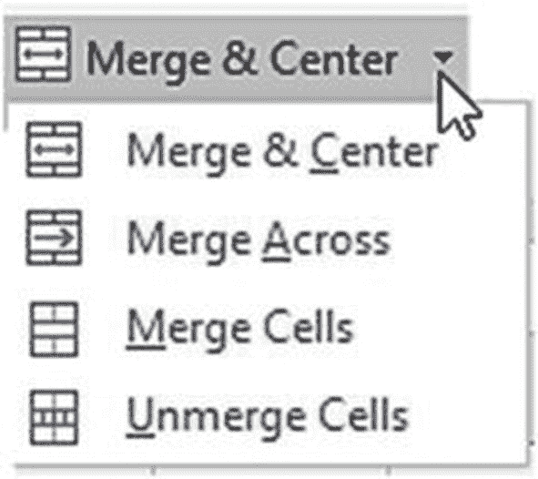
**图 4-44** 合并选项

其他三个选项的功能如下：

- **跨越合并**选项只能合并水平相邻的单元格。它不会使文本居中。
- **合并单元格**选项可以合并水平或垂直相邻的单元格。与“跨越合并”选项类似，它不会使文本居中。
- 你可以通过选择要取消合并的单元格，然后单击**取消合并单元格**选项来取消合并单元格。

### 对齐和缩进单元格中的文本

Excel 提供了设置单元格中数据对齐方式（见表 4-3）以及增加或减少单元格缩进（见表 4-4）的选项。

#### 垂直和水平对齐

**表 4-4** 增加和减少单元格中文本的缩进

| 按钮 | 说明 |
| --- | --- |
|  | **减少缩进**——用于减少单元格中的缩进量。 |
|  | **增加缩进**——用于增加单元格中的缩进量。 |

**表 4-3** 垂直和水平对齐

| 按钮 | 说明 |
| --- | --- |
|  | **垂直对齐**——这些按钮依次用于将文本对齐到单元格的顶部、中部和底部。默认情况下，Excel 将数据对齐到底部。 |
|  | **水平对齐**——这些按钮依次用于将文本对齐到单元格的左侧、中部和右侧。 |

#### 垂直和水平对齐文本

在“设置单元格格式”对话框的“对齐”选项卡上，还有用于水平和垂直对齐的其他选项。见图 4-45。其中一些选项与“开始”选项卡上“对齐”组中显示的选项相同，但这里还有更多选项，例如可以通过使用“缩进”数值文本框来设置左对齐、右对齐和分散对齐的缩进量。

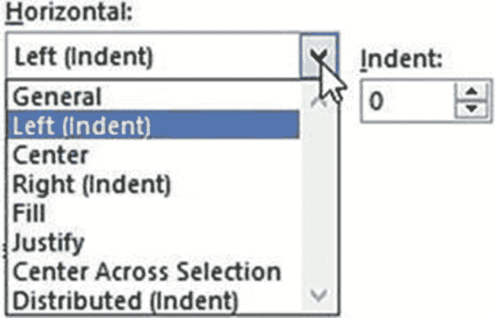
**图 4-45** 对齐选项

分散水平对齐方式在单元格文本的两侧使用相等的缩进量。因此，如果你在“缩进”中输入 3，那么单元格中输入的文本左侧和右侧将各有三个空格。

两端对齐水平对齐选项仅在单元格中输入多行文本时有用。Excel 会*两端对齐*除最后一行以外的每一行，通过调整字间距，使文本完全填满单元格的左右边界。见图 4-46。

**图 4-46** 两端对齐方式

#### 旋转文本

单击“方向”按钮（图 4-47）会显示用于旋转文本的选项列表。前五个默认选项不言自明。如果要指定其他特定的方向，请选择最后一个选项**设置单元格对齐方式**。此选项会显示“设置单元格格式”对话框中的“对齐”选项卡。

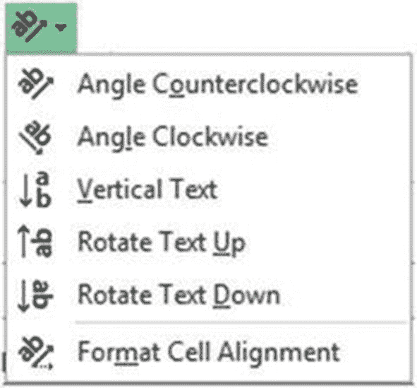
**图 4-47** 方向选项

“设置单元格格式”对话框的“对齐”选项卡上的“方向”区域用于设置文本的角度。见图 4-48。

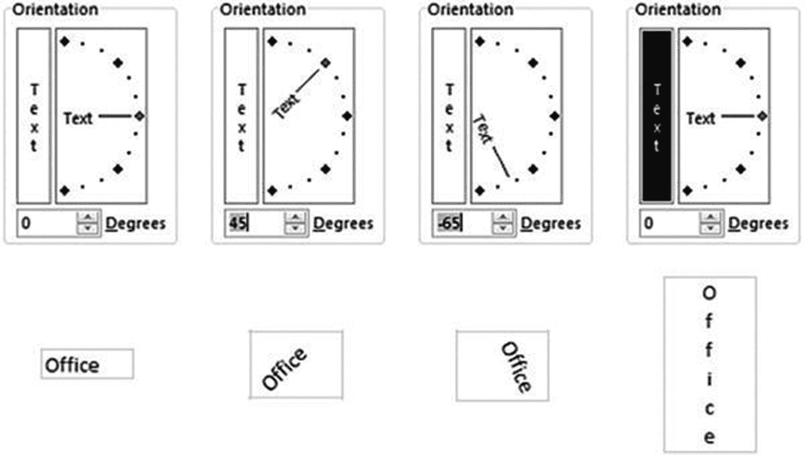
图 4-48

设置文本角度的选项

你可以通过向上或向下拖动线条，或者通过设置度数来设定文本的显示角度。如果输入度数，Excel 会自动调整线条，反之亦然。将线条从 0 度向上移动会使文本从下到上显示。将线条从 0 度向下移动会使文本从上到下显示。如果你在输入度数时希望文本从上到下显示，则需要输入负值。单击“方向”框左侧的“文本”按钮会将文本设置为完全垂直的格式。

**注意**

旋转文本时，单元格的大小会自动调整以适合旋转后的文本。

## 练习 4-5：使用“对齐”组

在本练习中，我们将创建如图 4-49 所示的工作表。该工作表显示了在仙境大学参加 Office 集成和财务管理课程的学生信息。

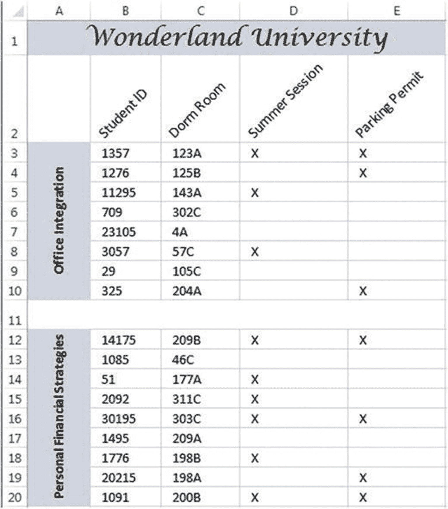
图 4-49

你将创建的工作表

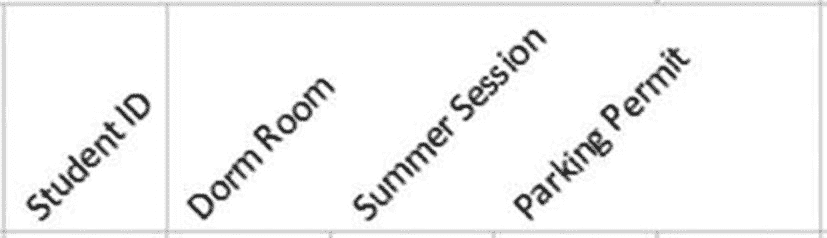

1.  如果在上一次练习后关闭了工作簿，则可以打开第 4 章的工作簿，然后创建一个名为`"Align"`的新工作表。
2.  在单元格`A1`中输入`Wonderland University`。单击公式栏上的“输入”按钮。
3.  选中单元格`A1:E1`。单击“合并后居中”按钮。
4.  选择 Lucida Calligraphy 字体。将字号更改为 18。
5.  在单元格`B2`中输入列标题`Student ID`，然后按 Tab 键。
6.  在第 2 行中输入其余的列标题。
7.  我们希望将列标题设置为 45 度角。在此之前，我们需要加宽列。

**注意** 如果不加宽列，则会导致多个列标题位于同一列中，如下所示。

1.  在单元格`B22`中输入你的全名，然后按 Ctrl + Enter。右键单击单元格`B22`。选择“设置单元格格式”。在“对齐”选项卡上，勾选“缩小字体填充”。单击“确定”按钮。你的姓名应完全适合在该单元格内。
2.  右键单击单元格`B22`。选择“设置单元格格式”。在“对齐”选项卡上，勾选“自动换行”。单击“确定”按钮。
3.  在单元格`C23`中输入你的姓氏，然后按 Ctrl + Enter。右键单击单元格`C23`。选择“设置单元格格式”。单击“方向”框左侧的垂直排列的“文本”一词。单击“确定”按钮。
4.  在仍选中单元格`C23`的情况下，单击“对齐”组中的以下按钮：单击“左对齐”按钮，然后单击“右对齐”按钮，最后单击“居中”按钮。
5.  单击快速访问工具栏上的“保存”按钮 。
6.  我们可以通过让数据稍微靠左单元格边框右侧显示来改善电子表格的外观：
    1.  选择单元格`B3:E10`。点击`对齐方式`组中的`增加缩进量`按钮 ``。
    2.  选择单元格`B12:E20`。点击`增加缩进量`按钮 ``。
7.  在单元格`B12:E20`中输入数据。
8.  通过拖动鼠标选择单元格区域`A12:A20`，或在`名称`框中输入`A12:A20`，然后按 `Enter` 键。
9.  点击`合并后居中`按钮。
10. 输入`个人财务策略`。暂时不必在意文本的显示效果。点击公式栏上的`输入`按钮。
11. 点击`方向`按钮 ``，然后选择`向上旋转文本`。
12. 点击`加粗`按钮 `` 或按 `Ctrl + B`。
13. 点击`垂直居中`按钮 ``。文本会略微超出其边框。我们将使用`缩小字体填充`功能，使其完全适应单元格。
14. 点击`对齐方式`组中的对话框启动器。在`文本控制`区域中，勾选`缩小字体填充`。点击`确定`按钮。
15. 点击单元格`A1`，按住 `Ctrl` 键，然后点击单元格`A3`和`A12`。点击`字体`组中`填充颜色`按钮的下拉箭头。选择`蓝灰，文本 2，淡色 80%`颜色。参见图 `4-50`。
    ``
    图 4-50

    颜色选择
16. 拖动鼠标选择列标`B`到`E`。点击功能区的`开始`选项卡，在`单元格`组中，点击`格式`按钮。选择`自动调整列宽`。
17. 选择单元格`B2:E2`。
18. 在`对齐方式`组中，点击`方向`按钮 ``，然后选择`逆时针角度`。每个列标题现在应在其各自列中以 45 度角显示。
19. 在单元格`B3`中输入`1357`，然后按 `Tab` 键。由于该值是数字，它应在单元格中右对齐显示。
20. 在单元格`C3`中输入`123A`，然后按 `Tab` 键。由于该值包含字母，它被视为文本或字符串值，并在单元格中左对齐。
21. 在单元格`D3`中输入一个大写`X`，然后按 `Tab` 键。`X`是文本，因此左对齐。
22. 在单元格`E3`中输入一个大写`X`，然后按 `Enter` 键。
23. 继续在单元格`B4:E10`中输入其余数据。
24. 通过拖动鼠标选择单元格区域`A3:A10`，或在`名称`框中输入`A3:A10`，然后按 `Enter` 键。点击`合并后居中`按钮。
25. 输入`办公室集成`。暂时不必在意文本的显示效果。按 `Ctrl + Enter`。
26. 点击`方向`按钮 ``，然后选择`向上旋转文本`。
27. 点击`加粗`按钮 `` 或按 `Ctrl + B`。
28. 点击`对齐方式`组顶行的`垂直居中`按钮 ``。
29. 接下来，我们想要在两个分类之间创建一个分隔空间：
    1.  选择单元格`A11:E11`。点击`合并后居中`按钮。
    2.  通过在第 11 行和第 12 行行标之间点击并向下拖动，将第 11 行的高度增加到大约 22.5。

您已经学会了如何使用功能区`对齐方式`组中的命令，在单元格内水平和垂直对齐数据，以及旋转单元格数据。您练习了合并单元格，以便数据可以占用多个单元格。`自动换行`和`缩小字体填充`功能允许您在单元格中放置更多文本。接下来，您将了解如何将应用于一个单元格的所有格式复制到其他单元格。

## 使用格式刷复制格式

格式刷可用于将一个单元格中的所有格式复制到其他单元格。格式刷按钮的图标是一把刷子。它位于“开始”选项卡的“剪贴板”组中。参见图 4-51。

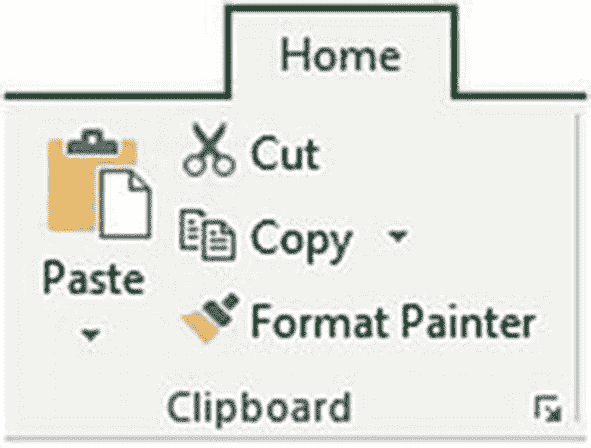

图 4-51

“剪贴板”组

格式刷不仅加快了将相同格式应用于其他单元格的过程，还使您的工作簿外观保持一致变得轻松。

单击格式刷按钮可将选定单元格的格式复制到单个单元格区域，然后自动关闭。双击格式刷按钮可使其保持开启状态，这样您就可以继续将格式应用于任意多个单元格区域，直到再次单击该按钮将其关闭。

### 练习 4-6：使用格式刷复制格式

本练习将指导您完成将应用于一个单元格的格式复制到其他单元格的过程。

1. 单击快速访问工具栏上的“保存”按钮 。
2. 再次单击“格式刷”按钮将其关闭。您的鼠标指针应恢复为 。
3. 由于您在复制格式时拖选了单元格 `C6`，因此如果在此单元格中输入内容，它应具有与单元格 `A1` 相同的格式。在单元格 `C6` 中键入 **horse**`in`。
4. 如果要清除某个或某些单元格的格式，可以仅清除格式而保留其中的数据。拖选单元格 `C6:E8`。单击“开始”选项卡“编辑”组中“清除”按钮的下拉箭头。单击“清除格式”。参见图 4-55。

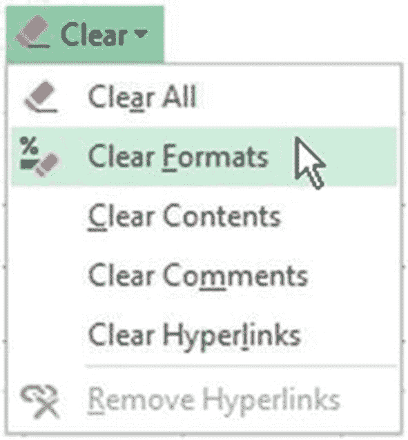

图 4-55

“清除”选项

5. 单击单元格 `B2`。单元格 `B2` 将采用您应用于单元格 `A1` 的所有格式。格式刷按钮应不再高亮显示。您的鼠标指针应恢复为 。
6. 选择单元格 `A1`。这次双击“格式刷”按钮。鼠标指针将保持为 ，您可以继续复制格式，直到关闭格式刷。
7. 拖选单元格 `C3:E9`。这些单元格现在具有与单元格 `A1` 相同的格式。
8. 拖选单元格 `C12` 和 `C13`。这些单元格现在具有与单元格 `A1` 相同的格式。参见图 4-54。

图 4-54

应用格式刷的结果

9. 在 `C8` 中键入单词 **Data**。使用自动填充柄拖动到 `E9`。在 `C12` 中键入 **Data**，并使用自动填充柄拖动到 `C13`。
10. 通过从“字体”组中选择以下选项来设置单元格 `A1` 的格式：加粗、倾斜和下划线；将文本颜色更改为红色。
11. 单击“对齐”选项卡上的“居中”按钮。
12. 选中单元格 `A1`，单击“格式刷”按钮。格式刷按钮现在应高亮显示。鼠标指针将变为带有刷子的块状加号。参见图 4-53。

图 4-53

选中格式刷且单元格 `A1` 处于活动状态

13. 如果您从上一次练习中关闭了工作簿，可以打开第 4 章的工作簿，然后创建一个名为 `Format` 的新工作表。
14. 单击单元格 `A1`。键入 **Copy formatting**，然后按 `Ctrl + Enter`。
15. 加宽 A 列，使所有文本都显示在单元格中。
16. 在单元格 `B2` 和 `C3` 中键入单词 **Data**。使用单元格 `C3` 上的自动填充柄向下拖动到单元格 `C5`。松开鼠标左键。将自动填充柄拖动到单元格 `E5`。参见图 4-52。

图 4-52

使用自动填充的结果

您一直在使用功能区中的命令。通过迷你工具栏或上下文菜单可以更快地访问这些命令中的大部分，上下文菜单会显示与您当前操作相关的命令。

## 使用迷你工具栏和上下文菜单

您已经了解了 Excel 用于设置数字和文本数据格式的工具。毫无疑问，您会经常使用这些工具。Microsoft 通过迷你工具栏提供了对这些工具的快速访问。有两种不同大小的迷你工具栏。

如果您选择了单元格中的任何文本，您将看到两个迷你工具栏中较小的那个，如图 4-56 所示。将鼠标指针移离迷你工具栏，它会逐渐消失。当您将光标移回迷你工具栏时，它会重新出现。您可以通过以下任一方式移除迷你工具栏：

- 将光标移动到功能区区域。
- 单击另一个单元格。
- 将光标移动到距离工具栏足够远的位置，直到它不可见。

如果您想再次显示迷你工具栏，则需要重新选择单元格中的文本。这个较小的迷你工具栏仅包含“字体”组中的工具。

图 4-56

较小的迷你工具栏

图 4-57 中所示的较大迷你工具栏包含来自“字体”、“对齐”和“数字”组的按钮，以及来自“剪贴板”组的“格式刷”。通过右键单击任何单元格（即使单元格为空）即可访问此迷你工具栏。

图 4-57

上下文菜单和较大的迷你工具栏

当您右键单击某个单元格或对象时，还会显示一个上下文菜单（也称为快捷菜单）。上下文菜单中显示哪些项目取决于您单击的对象以及您当时正在处理的内容。您可以从迷你工具栏或快捷菜单中进行选择。如果您决定两者都不使用，只需单击另一个单元格，两者都会消失。

请注意，上下文菜单中有些选项后面带有三个点。参见图 4-58。这三个点称为**省略号**。省略号表示选择此选项时将打开另一个对话框。例如，单击上下文菜单中的“插入…”选项将打开“插入”窗口。上下文菜单中的某些选项带有一个箭头。将鼠标指针移到箭头上会弹出包含更多选项的子菜单。

图 4-58

上下文菜单

## 行与列的插入、删除、隐藏和取消隐藏

你可以在已有电子表格的行之间添加新的空白行。你也可以删除行来移除数据或删除空白行。

你可以对用户隐藏单行或多行数据。已隐藏的行可以取消隐藏。你不必取消隐藏所有行，只需取消隐藏你选择的行即可。

### 隐藏与取消隐藏列和行

列和行可以被隐藏和取消隐藏，以便用户只需关注必要且与其相关的数据。

#### 隐藏列和行

在电子表格中隐藏列或行的原因有很多：

- 屏幕上显示的数据太多，因此可以隐藏那些你确实不需要查看的数据。
- 你想要隐藏部分数据，使其不被打印出来。
- 这些数据与用户无关。
- 你想要隐藏公式。
- 你不希望用户看到某些数据。

隐藏某一列或某一行不会影响该列或行中的数据，也不会阻止它被引用。

可以隐藏单列或单行数据，也可以隐藏多列或多行数据。如果要隐藏多列或多行，它们不必是相邻的。

**如何隐藏单列或单行**

1. 右键单击列标或行号。
2. 从上下文菜单中选择`隐藏`。

**如何隐藏相邻的列或行**

1. 拖拽选中你想要隐藏的列标或行号。
2. 右键单击选中的标头。
3. 从上下文菜单中选择`隐藏`。

**如何隐藏不相邻的列**

1. 单击一个列标。
2. 按住`Ctrl`键，同时单击其他列标。
3. 右键单击其中一个选中的列标。
4. 从上下文菜单中选择`隐藏`。

**如何隐藏不相邻的行**

1. 使用与隐藏不相邻列相同的步骤来隐藏不相邻的行。

> **注意：** 你不能在同一操作中同时选中列和行。你必须先隐藏列或行，然后再执行另一个操作。

#### 取消隐藏列和行

你隐藏的列和行将保持隐藏状态，直到你运行`取消隐藏`命令。

**取消隐藏所有列和行**

# 操作工作表：隐藏、取消隐藏、插入和删除

你可以通过首先单击位于行号 A 左侧的`全选`按钮，然后右键单击任一标头并从上下文菜单中选择`取消隐藏`，来取消隐藏所有列和行。如果你想取消隐藏多个工作表中的列和行，则应先选择这些工作表标签，再执行这些步骤。

## 取消隐藏相邻的列或行

在图 4-59 所示的工作表示例中，列 B 和列 C 是隐藏的。

*图 4-59 — 列 B 和列 C 已隐藏*

可以通过拖拽选中列标 A 和 D，右键单击，然后选择`取消隐藏`来取消隐藏列 B 和列 C。

取消隐藏行的步骤相同，当然，你需要使用行号而不是列标。

## 取消隐藏不相邻的列或行

在图 4-60 所示的工作表示例中，列 B 和列 C 已隐藏，列 F、G 和 H 也已隐藏。

*图 4-60 — 列 B、C、F、G 和 H 已隐藏*

可以通过拖拽选中列标 A 和 D，然后按住`Ctrl`键同时拖拽选中列标 E 和 I，右键单击，再选择`取消隐藏`来取消隐藏列 B 和 C 以及列 F、G 和 H。

另一种实现方法是同时取消隐藏所有五列。你可以拖拽选中列标 A 到 I，右键单击其中一个选中的列标，然后选择`取消隐藏`。

## 取消隐藏列 A 或行 1

取消隐藏列 A 或行 1 是一种特殊情况。之所以特殊，是因为列 A 之前没有列标可供拖拽选中，行 1 之前也没有行号可供拖拽选中。

### 取消隐藏列 A

*图 4-61 — 隐藏和取消隐藏选项*

1. 在名称框中输入`A1`，然后按`Enter`键。
2. 单击功能区上的`开始`选项卡。
3. 在`单元格`组中，单击`格式`按钮。
4. 从菜单中选择`隐藏与取消隐藏`，然后选择`取消隐藏列`。参见图 4-61。

### 取消隐藏行 1

1. 在名称框中输入`A1`，然后按`Enter`键。
2. 单击功能区上的`开始`选项卡。
3. 在`单元格`组中，单击`格式`按钮。
4. 从菜单中选择`隐藏与取消隐藏`，然后选择`取消隐藏行`。

## 练习 4-7：隐藏和取消隐藏行与列

本练习将引导你完成隐藏和取消隐藏行与列的操作，以及处理取消隐藏列 A 和行 1 这个特殊情况。

*图 4-63 — 使用自动填充句柄复制的列 A 数据*

1. 将自动填充句柄向右拖拽至列 M。参见图 4-63。
2. 创建一个新工作表。将其命名为`Rows_Columns`。
3. 在单元格`A1`中输入`1`，在单元格`A2`中输入`2`。
4. 拖拽选中单元格`A1`和`A2`。
5. 将自动填充句柄向下拖拽至第 12 行。释放鼠标按钮。参见图 4-62。

*图 4-62 — 单元格 A1 和 A2 的图案向下复制到单元格 A12*

### 隐藏列

1. 拖拽选中列标 B 至 D。
2. 按住`Ctrl`键，同时单击列标 G 并拖拽选中列标 J 和 K。
3. 右键单击其中一个选中的列标，然后选择`隐藏`。

### 隐藏行

1. 拖拽选中行号 2 和 3。
2. 按住`Ctrl`键，同时拖拽选中行号 6 和 7，并单击行号 10。
3. 右键单击其中一个选中的行号，然后选择`隐藏`。

### 取消隐藏列

1. 拖拽选中列标 A 和 E。右键单击选中区域，然后选择`取消隐藏`。
2. 拖拽选中列标 F 至 L。右键单击选中区域，然后选择`取消隐藏`。

### 取消隐藏行

1. 拖拽选中行号 1 至 12。
2. 右键单击选中区域，然后选择`取消隐藏`。

### 隐藏列 A

1. 右键单击列标 A。
2. 选择`隐藏`。

### 取消隐藏列 A

1. 在名称框中输入`A1`，然后按`Enter`键。
2. 单击功能区上的`开始`选项卡。在`单元格`组中，单击`格式`按钮。
3. 从菜单中选择`隐藏与取消隐藏`，然后选择`取消隐藏列`。

### 隐藏行 1

1. 右键单击行号 1。
2. 选择`隐藏`。

### 取消隐藏行 1

1. 在名称框中输入`A1`，然后按`Enter`键。
2. 单击功能区上的`开始`选项卡。在`单元格`组中，单击`格式`按钮。
3. 从菜单中选择`隐藏与取消隐藏`，然后选择`取消隐藏行`。

## 插入列和行

在向工作簿中输入数据后，您可能会发现在其他列之间需要添加一列数据，或者想添加一个空白列以使工作表更易于阅读。行的情况也是如此；您可能发现自己忘记添加数据行，或者只是想添加额外的空白行来改善工作表的外观。

您可以在工作表中的任意位置添加新列或新行。

### 如何插入列

1. 在要插入列的位置选择列标题。
2. 右键单击工作表，然后选择 `Insert`。您选择的列将向右移动，您创建的列将取代其位置。新列的宽度将与左侧列的宽度相同。

您可以通过选择要插入新列的位置来插入多列。如果您选择了四列，那么当您右键单击工作表并选择 `Insert` 时，将插入四个新列。

### 如何插入行

1. 在要插入行的位置选择行标题。
2. 右键单击工作表，然后选择 `Insert`。您选择的行将向下移动，您创建的行将取代其位置。新行的高度将与上方行的高度相同。

您可以通过选择要插入新行的位置来插入多行。如果您选择了四行，那么当您右键单击工作表并选择 `Insert` 时，将插入四个新行。

## 删除列和行

您可以像添加列或行一样轻松地删除它们。删除列的一些原因包括：

- 您在列中输入了错误的数据。
- 您确定不再需要某列中的数据。
- 您想删除空列以改善电子表格的外观或使用。

如果您在列中输入了无效数据，仅清除该列中的数据而非删除整列可能更简单。这可以通过选择包含无效数据的所有单元格，然后选择 `Home` 选项卡 ➤ `Editing` 组 ➤ `Clear` 按钮 ，再选择其中一个清除选项来完成。

### 如何删除列

您可以一次删除一列或多列。

1. 选择要删除的列的列标题。
2. 右键单击工作表，然后选择 `Delete`。被删除列右侧的列将向左移动以填补您删除的那些列的位置（填补空出的空间）。

### 如何删除行

您可以一次删除一行或多行。

1. 选择要删除的行的行标题。
2. 右键单击工作表，然后选择 `Delete`。被删除行下方的行将向上移动以填补您删除的那些行的位置。

## 插入和删除单元格

您可以在活动单元格的上方或左侧插入空白单元格。您可以通过右键单击任意单元格，然后从上下文菜单中选择 `Insert` 来调出 `Insert` 对话框（图 4-64）执行此操作。

图 4-64：插入窗口

插入空白单元格时，您可以选择将同一列中的其他单元格下移（`Shift cells down`）或将同一行中的其他单元格右移（`Shift cells right`）以容纳新单元格。请注意，`Insert` 对话框也提供了插入整行和整列的选项。

您可以通过选择要删除的单元格，然后右键单击并从上下文菜单中选择 `Delete` 来删除单元格。这将调出 `Delete` 对话框（图 4-65），其中提供了删除单元格、整行或整列的选项。

图 4-65：删除窗口

您可以选择让被删除的单元格由右侧的单元格替代（`Shift cells left`），或者选择由下方的单元格替代（`Shift cells up`）。

## 练习 4-8：插入和删除单元格、行和列

本练习将带您完成插入和删除单元格，然后决定如何移动其他单元格。

图 4-66：输入此工作表中的数据

1. 右键单击仍处于选中状态的三个单元格，然后选择 `Delete`。选择 `Shift cells left`。单击 `OK` 按钮。
2. 右键单击单元格 `B4`，然后选择 `Insert`。选择 `Entire row`。单击 `OK` 按钮。在所选单元格上方插入了一行。
3. 右键单击单元格 `C4`，然后选择 `Insert`。选择 `Entire column`。单击 `OK` 按钮。在所选单元格左侧插入了一列。
4. 右键单击单元格 `C4`，然后选择 `Delete`。选择 `Entire column`。单击 `OK` 按钮。
5. 单击行标题 6。按住 `Ctrl` 键并单击行标题 7、8 和 9。右键单击任意选中的行标题，然后选择 `Insert`。
6. 您现在每两行之间应该有一个空白行。
7. 右键单击列标题 A，然后从上下文菜单中选择 `Insert`。
8. 右键单击行标题 1，然后从上下文菜单中选择 `Insert`。
9. 右键单击单元格 `B5`，然后选择 `Insert`。选择 `Shift cells down`。单击 `OK` 按钮。
10. 右键单击单元格 `B5`，然后选择 `Delete`。选择 `Shift cells up`。单击 `OK` 按钮。
11. 您可以在选择下移或右移单元格之前选择多个单元格。移动的单元格数量将与您选择的单元格数量相同：选择单元格 `B5:D5`。右键单击所选区域中的一个单元格，然后选择 `Insert`。
12. 选择 `Shift cells right`。单击 `OK` 按钮。
13. 创建一个新工作表。将工作表命名为“Stocks”。
14. 在单元格 `A1` 中输入 `Stocks Purchased 06-15-2016`。选择单元格 `A1` 到 `D1`。右键单击所选单元格。较大的迷你工具栏应出现在所选文本上方。单击 `Merge & Center` 按钮 。
15. 在单元格 `A2` 中输入 `Stock`。
16. 在单元格 `B2` 中输入 `Closing`。按 `Alt + Enter`。按 `Alt + Enter` 会在单元格中创建额外的一行并启用文本换行。输入 `Price`。
17. 选择单元格 `C2` 和 `D2`。在所选区域右键单击。选择 `Format Cells`。从 `Alignment` 选项卡中选择 `Wrap text`。单击 `OK` 按钮。
18. 将图 4-66 中的数据输入到单元格 `C2` 和 `D2` 中。您可能需要加宽列才能看到 Purchased 这个词的全部内容。然后输入图 4-66 中的其余数据。

注意：进行选择时，您选择的行、列或单元格不必是相邻的。

您已经学习了如何插入和删除行和列，以及如何隐藏和取消隐藏它们。您应该只允许需要查看数据的用户访问这些数据；您应该隐藏他们不需要的任何内容。您还学习了插入和删除单个单元格。您经常会发现自己忘记输入某项内容。Excel 允许您在有需要的地方插入新单元格，然后将其下方的数据下移一行，或将其右侧的数据右移一列，从而轻松纠正这一疏忽。

## 摘要

格式化工作表可以使其更具视觉吸引力且更易于理解。它还可用于更改数字和日期数据的显示方式。格式化可用于实现自动换行、旋转文本和缩小文本。格式化也用于对齐数据。你可以使用 Excel 的格式刷将一个单元格的所有格式复制到其他单元格。你已经练习了如何有效使用颜色，并学会了如何为工作表创建统一的图形样式。这是使演示文稿外观专业、并为你的项目提供标志性风格的重要方面。Excel 通过将最常用的工具放置在两个微型工具栏上，使你能够快速访问它们，从而简化了格式化操作。你已经了解了如何隐藏和取消隐藏行和列，以及如何插入和删除单元格、行和列。你还了解了如何应用边框以及如何绘制边框。

在第 5 章中，你将通过使用页眉和页脚、设置分页符、将工作表拆分为多个窗格以及学习更多函数，继续优化工作簿的设置。你还将学习自定义视图以及如何打印工作表的选定部分以用于特定数据报告。