# 9. 审核、验证与保护数据

作为 Excel 工作簿的创建者，确保工作表中的数据被正确输入是你的首要责任。虽然你可能无法控制数据源，但确保准确无误地输入所给数据仍是你的责任。糟糕的数据和错误的输入可能会毁掉一个企业。在一个地方产生的错误可能会在工作簿的其他区域扩散。用户可能会将你工作簿中的数据用于自己的项目，或者依据你的工作簿做出决策。Excel 提供了多种工具来帮助你防止错误进入工作簿，但你是否使用这些工具，则取决于你自己。

在阅读并完成本章学习后，你应该能够：

*   识别错误
*   使用数据验证来防止错误
*   圈释无效数据并清除验证圈
*   使用 `IFERROR` 函数检查公式中的错误
*   更正循环引用
*   通过以下方式审核公式：
    *   追踪从属单元格
    *   追踪引用单元格
    *   使用“`监视窗口`”
    *   使用“`公式求值`”功能
*   让 Excel 自动朗读单元格内容
*   使用拼写检查与同义词库
*   保护工作表与单元格

## 验证数据并防止错误

Excel 拥有许多工具来帮助你防止错误输入到应用程序中，但审核所有输入内容并检查计算与函数的结果是否合理，仍然是你的责任。

### 数据验证

Excel 开发者所能执行的最重要的功能之一，就是确保错误不会进入电子表格。你需要尽可能让用户清楚地理解应该输入什么，并尽可能简化数据输入过程。你不希望用户去猜测应该输入什么，然后做出错误的假设。确保数据正确输入的一种方法是使用“`数据验证`”功能。数据验证包含各种验证规则，这些规则指定了数据输入的标准。如果数据仍然输入错误，你可以阻止数据被接受。如果用户输入了可疑内容，你可以向她提供警告或信息提示，然后由她决定是否接受该数据。

输入的数据可以被限制为以下类型：

*   下拉列表中的值
*   指定范围内的整数
*   指定范围内的小数
*   指定时间范围内的日期
*   指定时间范围内的时间
*   指定长度的文本
*   基于其他单元格内容的值
*   基于公式的值

“`数据验证`”按钮位于功能区“数据”选项卡的“数据工具”组中（图 9-1）。


图 9-1 功能区的“数据工具”组

“`数据验证`”按钮分为两部分。点击“`数据验证`”按钮的上半部分会打开“`数据验证`”对话框。

“`数据验证`”对话框包含三个选项卡（见图 9-2）：

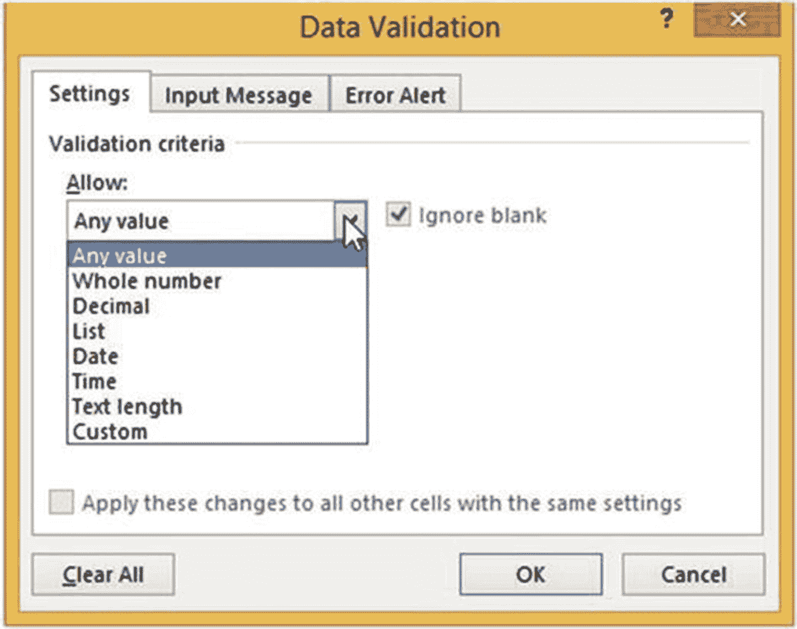
图 9-2 数据验证对话框

*   “设置”选项卡——用于设定单元格中允许输入内容的规则。
*   “输入信息”选项卡——创建一个屏幕提示，告知用户应在单元格中输入什么内容。
*   “出错警告”选项卡——可用于警告输入内容不符合你设定的规则，也可以在违反规则时阻止输入。

点击“`数据验证`”按钮的下半部分，会弹出如图 9-3 所示的三个选项。

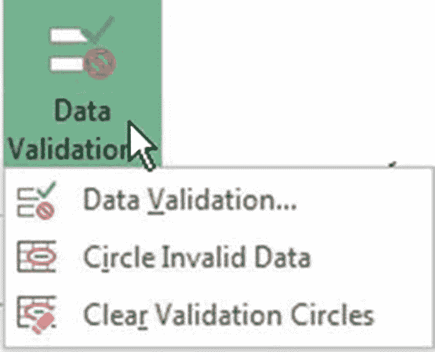
图 9-3 数据验证选项

点击第一个选项（“`数据验证`”）的效果与点击按钮上半部分相同。

练习 9-1：创建数据验证

在本练习中，你将为六个字段创建数据验证，以警告用户可能存在的问题，或阻止他们进行无效输入。

本练习中所需的所有输入内容均位于第 9 章工作簿的“Validation”工作表中。该工作表显示了在“`数据验证`”对话框的三个选项卡上，每个选项所需输入的内容。你可以打印该工作表，然后边练习边使用，也可以按照每列给出的说明进行操作。

1.  选择单元格区域 `A2:A12`。
2.  点击“数据”选项卡。在“数据工具”组中，点击“`数据验证`”按钮。
    此时出现“`数据验证`”窗口，见图 9-5。从 H 列开始的工作表包含了你在“`数据验证`”窗口中将要输入的所有内容。

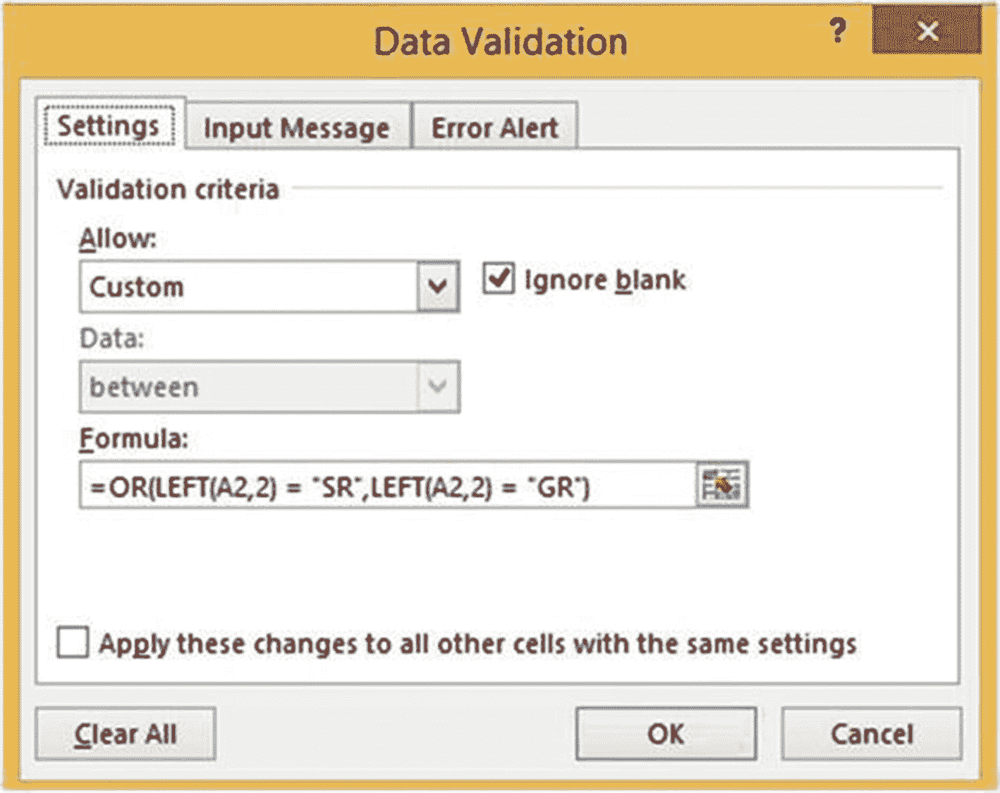
图 9-5 公式确保订单 ID 以 SR 或 GR 开头

3.  如果“设置”选项卡未被选中，请点击“设置”选项卡。
4.  点击“允许”的下拉箭头，选择“`自定义`”。“`自定义`”选项用于输入公式。
5.  由于我们需要检查订单 ID 的前两个字符，因此将使用 `LEFT` 函数。
    1.  打开工作簿第 9 章。单击`Val_Entry`工作表标签。图 9-4 显示了`Val_Entry`工作表中的列标题。本练习需要输入的条目位于列标题的右侧。`Validation`工作表上还有一个副本。

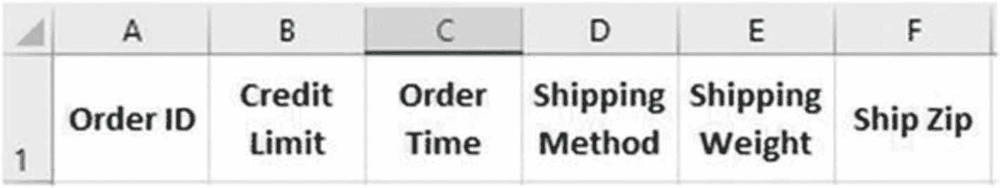
图 9-4 第 9 章工作簿的列标题

`Order ID`必须以`SR`或`GR`开头。我们将阻止用户为前两个字符输入任何其他文本。当用户在`A2:A12`范围内的任何单元格中输入值时，我们将对`Order ID`执行验证检查。

`LEFT`函数的语法为：

```
= LEFT(text, [num_chars])
```

参数为：

`text` 是文本或包含文本的单元格地址。

`num_chars` 是要从字符串开头提取的字符数。

在公式框中输入公式`=OR(LEFT(A2,2) = "SR",LEFT(A2,2) = "GR")`。

该公式使用了`OR`函数。该公式测试在单元格`A2`中输入的前两个字符是`SR`还是`GR`，如果是，则结果为`True`；否则，返回`False`。如果任一参数为真，则结果为真，Excel 将接受该输入。我们使用的是单元格`A2`，它是该范围内的第一个单元格。Excel 会自动调整范围内每个单元格的公式。

6.  单击“重试”按钮。在单元格中输入`SR14`。按 Tab 键。
7.  在单元格中输入`KY14`，然后按 Tab 键。您应该会看到在“错误警告”选项卡上创建的错误消息。见图 9-9。

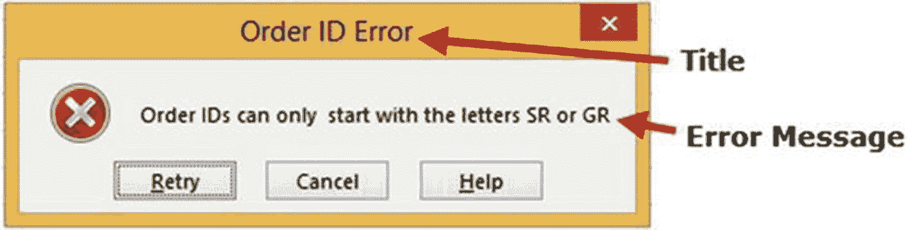
图 9-9 用户进行无效输入时的错误消息

8.  单击单元格`A2`内部。您应该会看到在“输入信息”选项卡上创建的消息（图 9-8）。

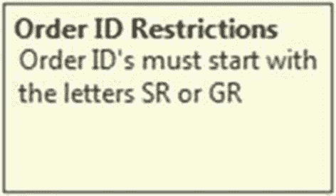
图 9-8 告知需要在单元格中输入何种内容的消息

9.  单击“错误警告”选项卡。
10. 为样式选择“停止”。“停止”样式会阻止接受无效输入。
11. 输入标题“订单 ID 错误”。
12. 输入错误消息“订单 ID 只能以字母 SR 或 GR 开头”。见图 9-7。

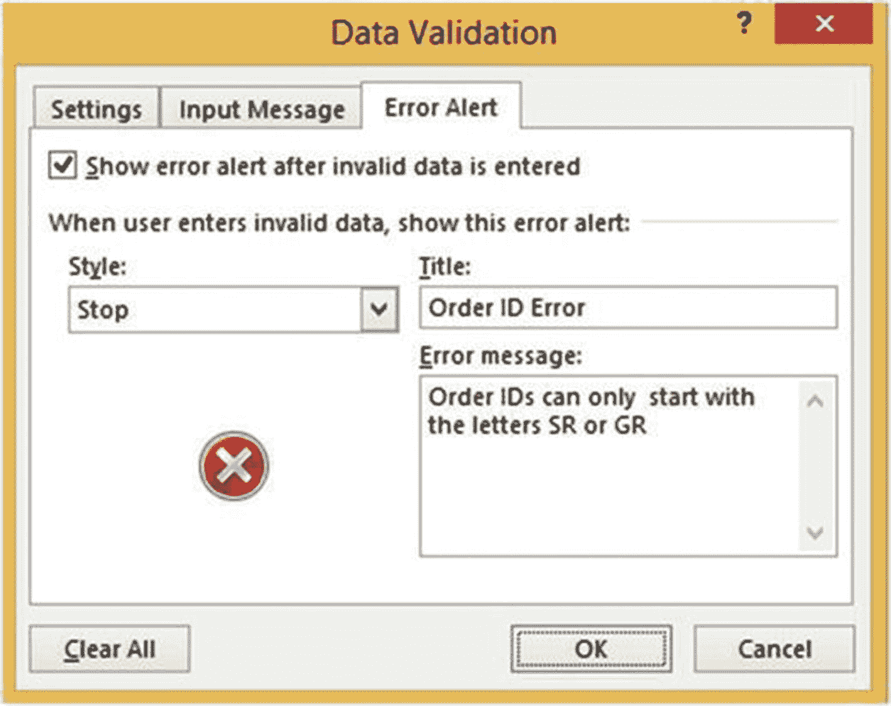
图 9-7 创建进行无效输入时的错误消息

13. 单击“确定”按钮。

14. 单击“输入信息”选项卡。如果您查看“订单 ID”下方的 H 列，您会看到在“输入信息”选项卡上，您需要输入标题“订单 ID 限制”和输入消息“订单 ID 必须以字母 SR 或 GR 开头”。现在进行这些输入。您的“输入信息”选项卡应如图 9-6 所示。

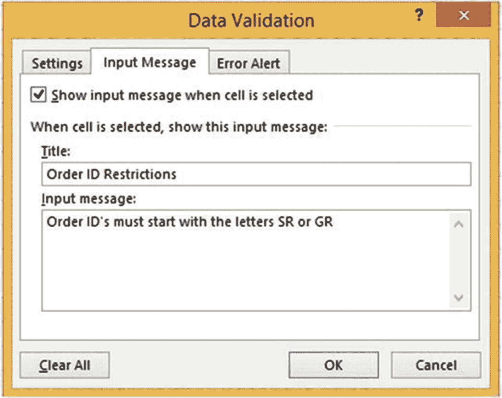
图 9-6 选择订单 ID 单元格时出现的消息

“输入信息”选项卡上的输入消息告知用户任何输入限制，但如果用户违反了在“设置”选项卡上输入的规则，我们希望显示一条错误消息。

#### 使用“无样式”创建错误警告

在此验证中，我们将创建一条消息，告知用户输入通常应为多少，但我们不会显示错误警告消息，也不会阻止用户进行不符合输入建议（输入小于 30000 的值）的输入。

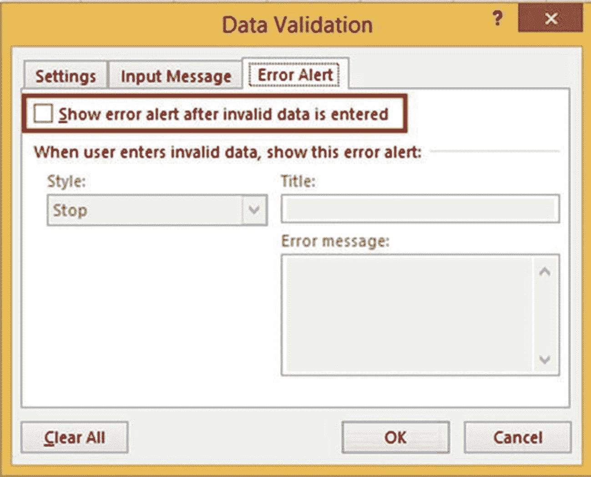
图 9-10 取消勾选“输入无效数据时显示出错警告”

表 9-1

#### 在以下三个选项卡的表格中输入数据

### 创建警告样式并使用时间限制

对于此验证规则，你将针对“订单时间”列中不在上午 8:00 至下午 5:00 之间的条目创建一个警告。

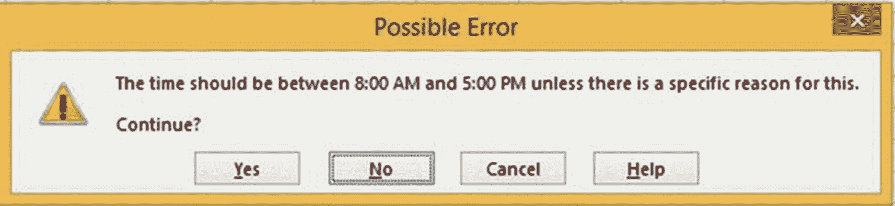

#### 表 9-2 在该表格中输入数据
| 选项卡 | 选项 | 选择或输入的值 |
| --- | --- | --- |
| 设置 | | |
| | 允许 | 时间 |
| | 数据 | 介于 |
| | 开始时间 | 8:00 AM |
| | 结束时间 | 5:00 PM |
| 输入信息 | | |
| | 标题 | 订单时间限制 |
| | 信息 | 输入的时间应在上午 8 点至下午 5:00 之间 |
| 出错警告 | | |
| | 样式 | 警告 |
| | 标题 | 可能出错 |
| | 信息 | 除非有特殊原因，否则时间应在上午 8:00 至下午 5:00 之间。 |

1.  单击 `否` 按钮，然后将条目更改为 `1:00 PM`，再按 `Tab` 键。
2.  `警告`样式会提醒你可能犯了错误，并让你决定是否接受该条目。单击 `确定` 按钮。
3.  在单元格 `C2` 中输入 `6:00 PM`，然后按 `Tab` 键。将出现图 9-11 中的错误信息。

如果你单击 `否` 按钮，Excel 会选中该单元格以便编辑，你可以进行更改。如果单击 `是` 按钮，则你输入的条目将被接受。

1.  选择单元格区域 `C2:C12`。单击 `数据验证` 按钮。单击 `设置` 选项卡。
2.  在表格 9-2 中输入数据。

### 创建列表限制

此验证将“运输方式”列的输入限制在我们创建的列表范围内。

#### 表 9-3 在该表格中输入数据
| 选项卡 | 选项 | 选择或输入的值 |
| --- | --- | --- |
| 设置 | | |
| | 允许 | 序列 |
| | 来源 | Freightways, FED EX, Parcel Post, UPS |
| 输入信息 | | |
| | 标题 | 运输方式限制 |
| | 信息 | 您只能从列表中选择一种运输方式。 |
| 出错警告 | | |
| | 样式 | 停止 |
| | 标题 | 运输方式错误 |
| | 信息 | 您只能从列表中选择一种运输方式。 |

1.  选择单元格区域 `D2:D12`。单击 `数据验证` 按钮。单击 `设置` 选项卡。
2.  在表格 9-3 中输入数据。

图 9-12 展示了`设置`选项卡应该呈现的样子。

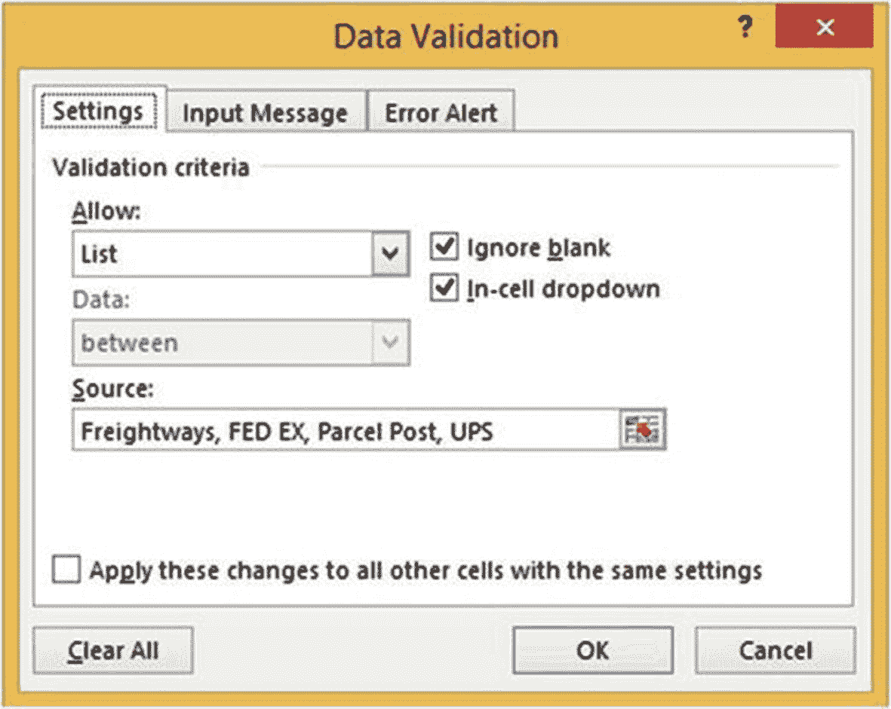

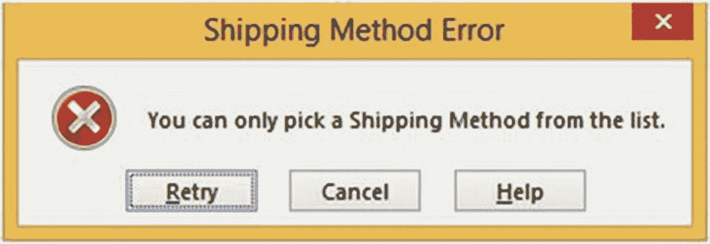

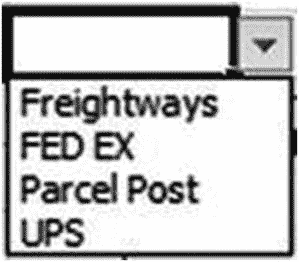

1.  单击单元格 `D2` 中的向下箭头，然后从列表中选择 `UPS`。按 `Tab` 键。
2.  单击 `确定` 按钮。
3.  双击单元格 `D2` 内部。单击单元格右侧的向下箭头。将出现一个列表框，您可以选择之前创建的条目之一（图 9-13）。
    如果在单元格中键入了列表中不存在的其他内容，则会收到图 9-14 中所示的消息。

### 创建信息样式的错误警告

此针对“运输重量”列的数据验证，会在有人尝试输入大于 35 的数值时显示警告消息。


#### 表 9-4 输入此数据
| 选项卡 | 选项 | 选择或输入的值 |
| --- | --- | --- |
| 设置 | | |
| | 允许 | 整数 |
| | 数据 | 小于或等于 |
| | 最大值 | 35 |
| 输入信息 | | |
| | 标题 | 运输重量信息 |
| | 消息 | 重量超过 35 磅的订单通常使用货运公司运输。 |
| 错误警告 | 样式 | 信息 |
| | 标题 | 运输重量信息 |
| | 消息 | 此订单上的重量超过 35 磅。您是否使用了货运公司运输？ |

1.  单击 `确定` 按钮。光标将移动到单元格 `F3`。
2.  单击 `确定` 按钮。
3.  双击单元格 `E2`。输入 `45`，然后按 `Tab` 键。将出现一条警告消息（图 9-15）。
4.  选择单元格区域 `E2:E12`。单击 `数据验证` 按钮。单击 `设置` 选项卡。
5.  在表 9-4 中输入数据。
    `信息`样式不会阻止用户输入不符合`设置`选项卡上设置条件的值。

### 创建限制可输入字符数的自定义限制

此验证将“邮政编码”列限制为 5 个或 9 个字符。

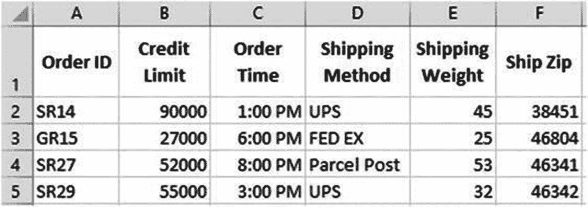


#### 表 9-5 输入此数据
| 选项卡 | 选项 | 选择或输入的值 |
| --- | --- | --- |
| 设置 | | |
| | 允许 | 自定义 |
| | 公式 | `=OR(LEN(F2)=5, LEN(F2) =9)` |
| 输入信息 | | |
| | 标题 | 邮政编码限制 |
| | 消息 | 请输入 5 位或 9 位邮政编码。 |
| 错误警告 | | |
| | 样式 | 停止 |
| | 标题 | 邮政编码错误 |
| | 消息 | 邮编只能输入 5 位或 9 位数字。 |

1.  单击 `重试` 按钮。将邮政编码更改为 `38451`，然后按 `Tab` 键。
2.  单击单元格 `A3` 内部。按照图 9-17 所示输入其余数据。单元格 `C3` 和 `C4` 将给出时间警告。对两者都单击 `是` 按钮。单元格 `E2` 和 `E4` 将给出重量警告。对两者都单击 `确定` 按钮。
3.  单击 `确定` 按钮。
4.  双击单元格 `F2` 内部。输入 `3845`，然后按 `Tab` 键。将显示图 9-16 中的消息。
5.  选择单元格区域 `F2:F12`。单击 `数据验证` 按钮。单击 `设置` 选项卡。
6.  在表 9-5 中输入数据。
    `OR`函数用于测试参数中是否有任何一个为真；如果有一个为真，则结果为真，Excel 将接受该输入。Excel 将自动调整区域中每个单元格的公式。

### 圈释无效数据

对于此验证规则，你将针对“订单时间”列中不在上午 8:00 至下午 5:00 之间的条目创建一个警告。

我们为“信用额度”、“订单时间”和“运输重量”设置了“警告”和“信息”样式，而不是“错误警告”选项卡上的“停止”样式。这允许我们打破在“设置”选项卡上设置的规则。我们可以让 Excel 在所有违反规则的单元格周围画一个圆圈。

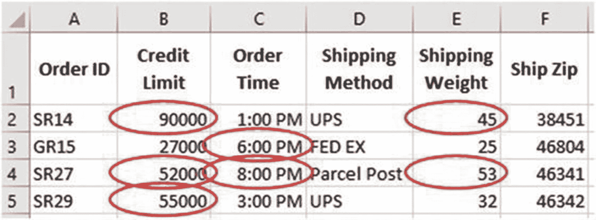
图 9-18 违反规则的单元格被圈出

1.  单击`数据验证`按钮的下拉箭头，然后选择`清除验证标识圈`。
2.  单击`数据验证`按钮的下拉箭头，然后选择`圈释无效数据`。参见图 9-18。

### 扩大验证区域的大小

我们已将验证设置为在第 2 行到第 12 行上生效。现在，让我们将其扩展到第 20 行。

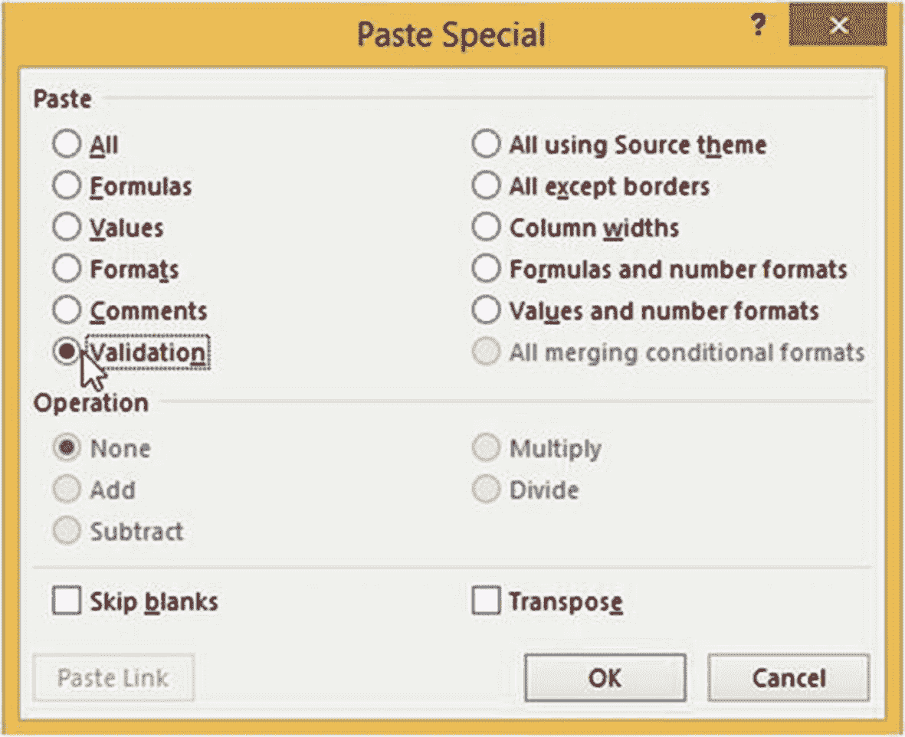
图 9-19 从“选择性粘贴”窗口中选择“验证”

1.  选择单元格区域`A13`到`F20`。
2.  单击`开始`选项卡。在`剪贴板`组中，单击`粘贴`按钮上的向下箭头。选择`选择性粘贴`。选择`验证`。参见图 9-19。单击`确定`按钮。
3.  单击单元格`D12`内部。其右侧有一个向下箭头。
4.  单击单元格`D13`内部。其右侧没有向下箭头。

    如果以后我们需要在第 12 行之后添加数据怎么办？我们可以通过使用“选择性粘贴”来扩展验证区域。

5.  选择单元格区域`A2:F2`。按`Ctrl + C`复制这些单元格。

**说明** 执行复制操作时，您实际上可以使用包含要使用验证的任何单元格。

验证区域现在已扩展到第 20 行。

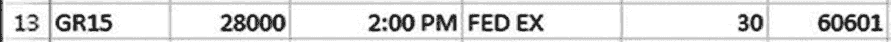
图 9-20 在第 13 行输入此数据

1.  在第 13 行输入以下数据。参见图 9-20。

    您已经学习了如何使用数据验证来防止用户输入您不希望他们输入的数据。接下来，您将看到当 Excel 遇到无法理解的输入时，它会显示一个错误代码。

## 公式求值

Excel 通常能识别函数中的问题，例如在存在循环引用时发出警告。表 9-6 展示了 Excel 在发现其认为的错误时所显示的部分错误信息。

表 9-6 错误值消息

| 错误值 | 含义 | 原因 |
| --- | --- | --- |
| `#DIV/0` | 除数为零。 | 当尝试将一个数值除以零，或者尝试将一个数值除以一个空单元格时，会发生此错误。 |
| `#N/A` | 无可用值。 | 这不一定是错误。它表示你在查找表中查找的内容不存在。例如，如果你使用`VLOOKUP`且未找到与`lookup_value`参数匹配的值。 |
| `#NAME?` | 公式包含无法识别的文本。 | 当使用不存在的区域名称或工作表名称、函数名称拼写错误，或者忘记在公式中的文本字符串两侧添加引号时，会发生此错误。 |
| `#NULL!` | 单元格引用未正确分隔。 | 如果使用空格而非逗号来分隔单元格引用或区域，会发生此错误。如果忘记在单元格引用之间放置运算符，例如在公式`= B3 + C3 D3`中忘记放置一个加号，也可能发生此错误。 |
| `#NUM!` | 公式使用了无效数字。 | 公式使用了无效数字，例如输入了无效的序列日期数字。 |
| `#REF!` | 无效的单元格引用。 | 当公式使用的单元格引用由于某种原因不再存在时（例如，你删除了公式所引用的某个值），会发生此错误。 |
| `#VALUE!` | 公式为参数使用了错误的数据类型。 | 为用于数学运算的参数使用了文本。 |

### 使用 IFERROR

`IFERROR`函数检查一个公式（或表达式），如果无错误则返回结果；否则，它返回你指定的值。

`IFERROR`函数的语法如下：

```
=IFERROR(value, value_if_error)
```

参数：
- `value`是被测试的表达式。
- `value_if_error`是当表达式存在错误时将返回的文本。

`IFERROR`无法区分错误的类型。错误可能是`#DIV/0`、`#NAME?`、`#N/A`、`#REF!`等等。无论错误类型是什么，`value_if_error`参数中使用的值都将被显示出来。

公式`=IF(Sales > 25000,B3 + B2, B4 + B2)`如果`Sales`区域不存在，则会返回`#NAME?`错误。如果你想测试这种情况，可以使用以下公式：

```
=IFERROR(IF(Sales > 25000,B3 + B2, B4 + B2),"区域名称不存在")
```

如果`Sales`区域不存在，Excel 会在你输入公式的单元格中显示`区域名称不存在`。如果该区域存在，则`IF`函数将正常执行。

在图 9-21 中，单元格 C1 包含公式`=a1/b1`，单元格 C2 包含公式`=a2/b2`。单元格 C1 出现了除零错误。单元格 C2 出现了`#VALUE!`错误，因为它试图用一个字母字符做除数。

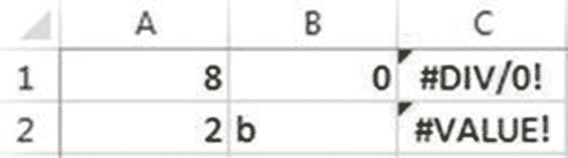
图 9-21 公式的无效值

你可以通过使用`IFERROR`函数使这些消息更有意义。在单元格 C1 中输入公式`=IFERROR(A1/B1,"除以零")`，在单元格 C2 中输入公式`=IFERROR(A2/B2,"除以文本")`，将产生如图 9-22 所示的结果。

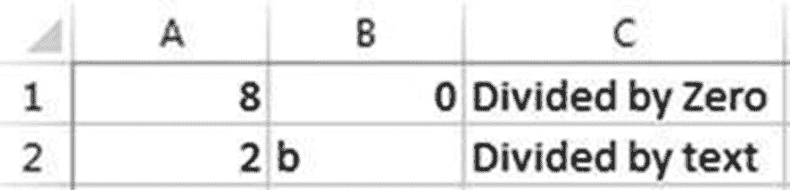
图 9-22 由`IFERROR`函数创建的更清晰的消息

> **注意：** 使用`IFERROR`函数时要格外小心。如果我们同时在单元格 C1 和 C2 中使用公式`=IFERROR(A1/B1,"除以零")`，结果将是相同的：两者都会显示“除以零”。

## 公式审核

Excel 的“公式审核”组包含用于追踪单元格及其所使用的公式之间关系的工具。“公式审核”组位于功能区上的“公式”选项卡中。参见图 9-29。

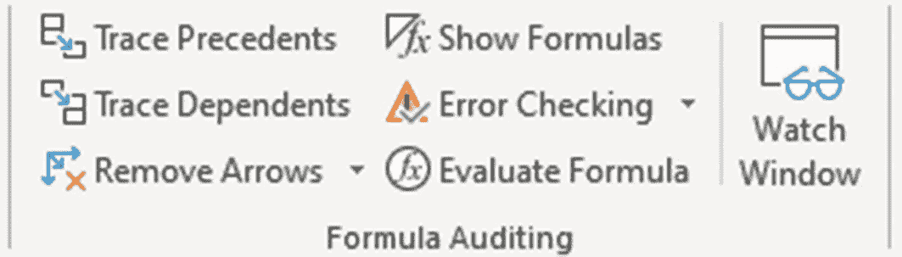
图 9-29 公式审核工具

### 追踪引用单元格与从属单元格

`引用单元格`是公式中使用的其他单元格的值。`从属单元格`是受公式影响的值。追踪引用单元格和从属单元格可以直观地查看单元格值与公式之间的关系。一个单元格值既可以作为引用单元格，也可以作为从属单元格。选中包含要检查公式的单元格，然后点击`追踪引用单元格`按钮。点击一个公式，再点击引用单元格按钮，将显示公式中使用的所有单元格的值。

图 9-30 展示了单元格`A5`和`C5`的引用单元格。由于单元格`A5`的公式中使用了单个单元格，因此每个引用单元格都会显示一个点。而`C5`的公式中使用了单元格区域，因此第一个引用单元格显示一个点，其余引用单元格则用一条线表示。

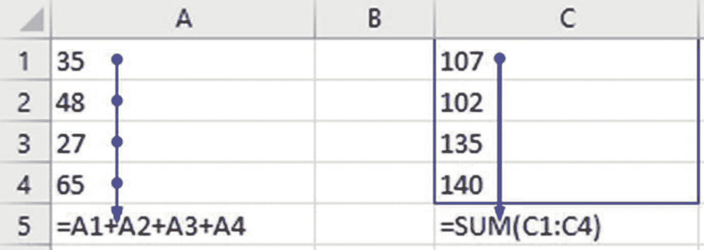
图 9-30 单元格`A5`和`C5`的引用单元格

### 练习 9-2：追踪引用单元格与从属单元格

本练习将引导您追踪所选单元格被用于哪些公式（从属单元格），以及找出哪些单元格为其提供值（引用单元格）。您还将移除引用单元格和从属单元格的箭头。

1.  打开工作簿第 9 章。
2.  单击`引用单元格`工作表标签。

图 9-31 显示了该工作表中使用的公式。

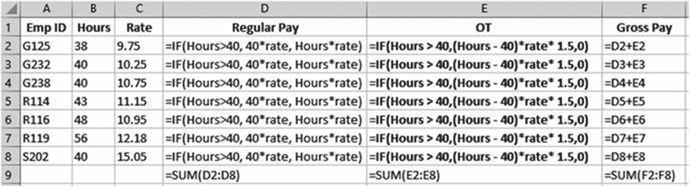
图 9-31 工作表中使用的公式

#### 创建从属追踪线

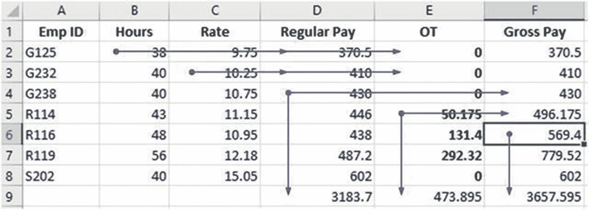
图 9-32 从属追踪线

## 追踪从属单元格

1.  单击单元格 `B2`。点击`追踪从属单元格`。追踪线显示单元格 `B2` 被用于单元格 `D2` 和 `E2` 的公式中。
2.  单击单元格 `C3`。点击`追踪从属单元格`。追踪线显示单元格 `C3` 被用于单元格 `D3` 和 `E3` 的公式中。
3.  单击单元格 `D4` 内部。点击`追踪从属单元格`。追踪线显示单元格 `D4` 被用于单元格 `D9` 和 `F4` 的公式中。
4.  单击单元格 `E5` 内部。点击`追踪从属单元格`。追踪线显示单元格 `E5` 被用于单元格 `E9` 和 `F5` 的公式中。
5.  单击单元格 `F6` 内部。点击`追踪从属单元格`。追踪线显示单元格 `F6` 被用于单元格 `F9` 的公式中。图 9-32 展示了您创建的所有从属追踪线。

### 移除从属追踪线

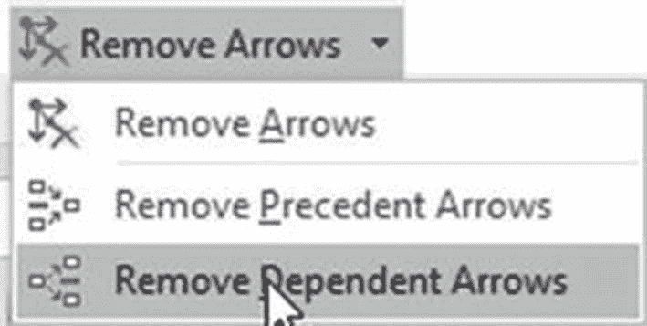
**图 9-33** 选择移除从属箭头

1.  点击`移去箭头`下拉箭头。点击`移去从属箭头`。参见图 9-33。这将移除所选单元格的从属追踪线。
2.  点击`移去箭头`下拉箭头。点击`移去箭头`。这将移除所有追踪线。

### 创建引用追踪线

1.  单击单元格 `D2`。点击`追踪引用单元格`。引用线显示为单元格 `D2` 中公式提供值的单元格。
2.  单击单元格 `D9`。点击`追踪引用单元格`。引用线显示为单元格 `D9` 中公式提供值的单元格。
3.  单击单元格 `F9`。点击`追踪引用单元格`。引用线显示为单元格 `F9` 中公式提供值的单元格。
4.  点击`移去箭头`下拉箭头。点击`移去箭头`。现在所有箭头都应被移除。

您已经学会了如何创建追踪线，以显示公式中使用的值来自哪些单元格，以及哪些单元格正在使用这些公式的结果。接下来，您将学习如何将您想要密切关注的单元格地址添加到监视窗口中。监视窗口将反映这些单元格值的任何变化。

## 使用监视窗口

当您想查看您输入的数值如何影响无法直接看到的公式结果时，`监视窗口`非常有用。公式可能因为位于另一个工作表而不可见，也可能位于同一工作表，但处于需要反复来回滚动的位置。`监视窗口`按钮位于`公式`选项卡的`公式审核`组中。参见图 9-34。

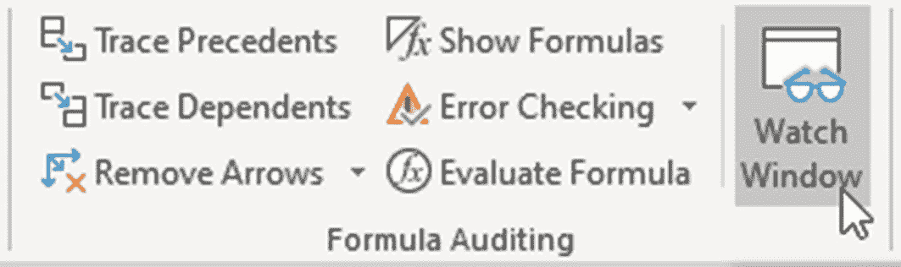
**图 9-34** 功能区中的`公式审核`组

通过点击`监视窗口`按钮、选择要添加的单元格，然后点击`添加监视`按钮，可以将单元格添加到`监视窗口`。通过选择要移除的项目，然后点击`删除监视`按钮，可以从`监视窗口`中移除单元格。

### 练习 9-3：使用监视窗口

在本练习中，您将把单元格添加到`监视窗口`，然后再将它们移除。

1.  打开工作簿第 9 章。该工作簿包含一月、二月和三月销售的工作表，以及一个汇总这些销售额的工作表，同时还提供了销售员 127 和 235 的一月销售总额。
2.  单击 `销售总额` 工作表标签。

#### 向监视窗口添加单元格

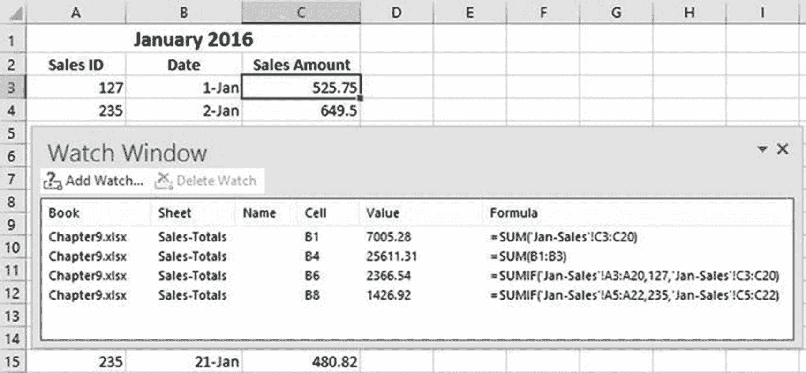
**图 9-36** 将单元格 `C3` 中的值更改为 600.00
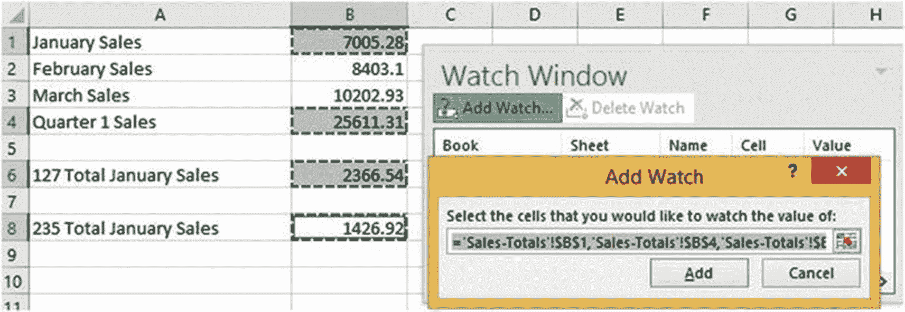
**图 9-35** 点击`添加监视`窗口

1.  单击 `一月销售` 工作表标签。参见图 9-36。将单元格 `C3` 中的值更改为 600.00。
2.  单击功能区中的`公式`选项卡。在`公式审核`组中，点击`监视窗口`按钮。
3.  按住 `Ctrl` 键，同时选中单元格 `B1`、`B4`、`B6` 和 `B8`。
4.  点击`添加监视`按钮。参见图 9-35。`监视窗口`会显示您所选单元格的值及其公式。在`添加监视`对话框中点击`添加`按钮。

您可以在`监视窗口`中看到，将单元格 `C3` 的值更改为 600 后，单元格 `B1`、`B4` 和 `B6` 的值发生了变化。参见图 9-37。这些单元格包含了一月总销售额、季度总销售额和销售员 127 的公式。

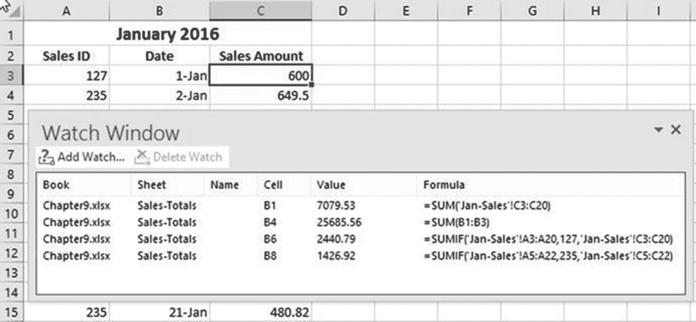
**图 9-37** 监视窗口

1.  将单元格 `C4` 中的值更改为 700。这将更改一月总销售额、季度总销售额以及销售员 235 的总销售额的值。

#### 从监视窗口中移除单元格

通过点击项目，然后点击`删除监视`按钮，将单元格从`监视窗口`中移除。

您已经学会了如何通过向`监视窗口`添加或移除单元格地址来控制哪些单元格被监视。接下来，您将学习如何逐步计算嵌套函数。嵌套函数可能非常复杂，难以确定其不同部分。`公式求值`功能会一步步检查嵌套函数的各个部分，并显示中间结果。

### 使用公式求值功能逐步计算嵌套函数

`公式求值`功能可以帮助你逐步了解嵌套函数的工作原理。

#### 练习 9-4：求值嵌套公式

在本练习中，你将求值一个嵌套公式。

1.  打开工作簿第 9 章。
2.  点击`求值`工作表标签。

单元格 `B2` 有一个区域名称 `性别`。单元格 `C2` 有一个区域名称 `年龄`。单元格 `D2` 中的公式会判断 `性别` 的值是否为 `F`，或者 `年龄` 的值是否大于等于 21。如果任一条件为 `真`，则显示 `B`；否则显示空白。见图 9-38。

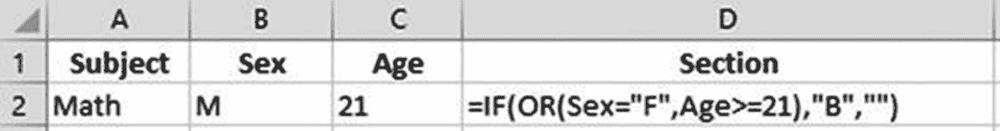
*图 9-38：嵌套公式*

1.  点击`单步退出`按钮。`公式求值`对话框显示单元格 `B2` 中有一个 `M`。它检查该值是否等于 `F`。见图 9-41。
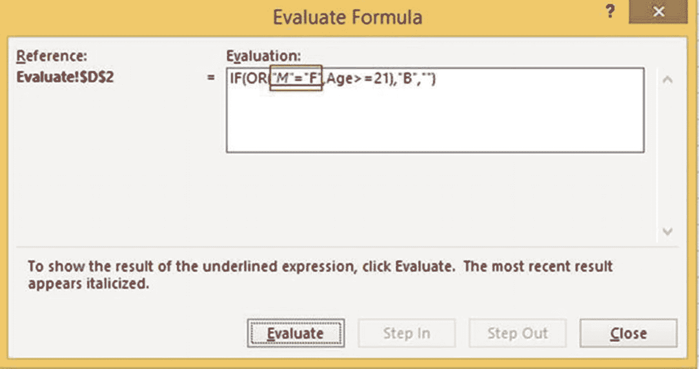
*图 9-41：使用单步退出*
2.  点击`求值`按钮。`M` 不等于 `F`，因此表达式显示为 `FALSE`，如图 9-42 所示。
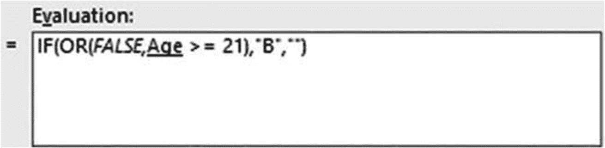
*图 9-42：M = F 的求值结果为 FALSE*
3.  点击`单步进入`按钮。`年龄`带有下划线，因此接下来将被求值。你可以在图 9-43 中看到单元格 `C2` 的区域名称是 `年龄`。
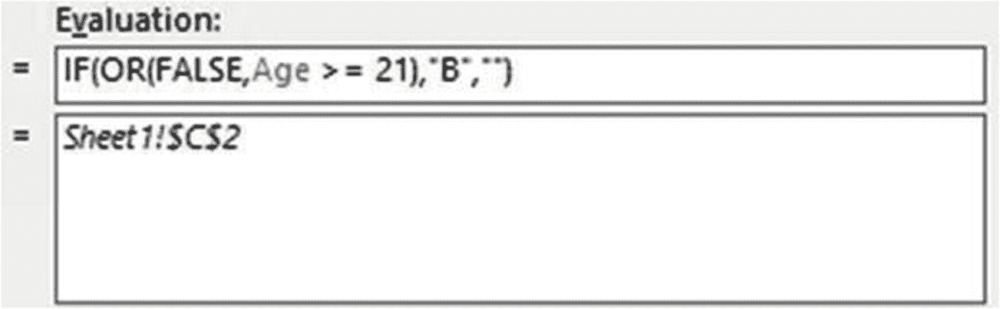
*图 9-43：单元格 C2 的区域名称为 Age*
4.  点击`单步退出`。`公式求值`窗口显示单元格 `C2` 中的值为 21。它检查该值是否大于等于 21。见图 9-44。
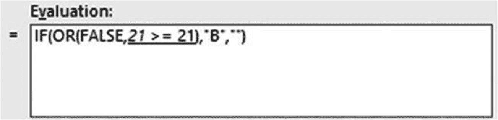
*图 9-44：年龄区域值为 21*
5.  点击`求值`按钮。条件 `21>=21` 结果为 `TRUE`。见图 9-45。
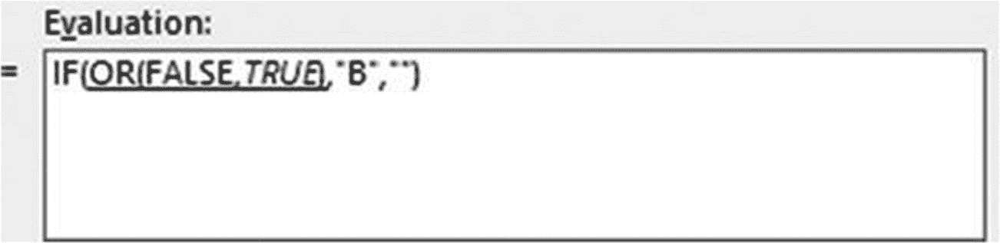
*图 9-45：第二个条件 21>=21 结果为 True*
6.  点击`求值`按钮。如果任一条件为真，`OR` 函数返回 `TRUE`。第二个条件为 `True`，因此函数返回 `TRUE`。见图 9-46。
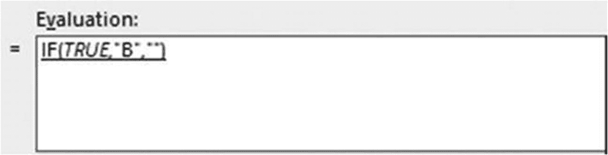
*图 9-46：OR 函数的结果为 TRUE*
7.  `OR` 函数的求值已完成，现在将求值 `IF` 函数。点击`求值`按钮。公式结果为 `TRUE`，因此显示真值，此处为 `B`。关闭对话框。

### 校对单元格值——让 Excel 朗读你的输入内容

如果你想知道带下划线的值来自哪里，可以点击`单步进入`按钮。点击`单步进入`按钮。`单步进入`按钮显示单元格`B2`与区域名称`性别`关联。见图 9-40。

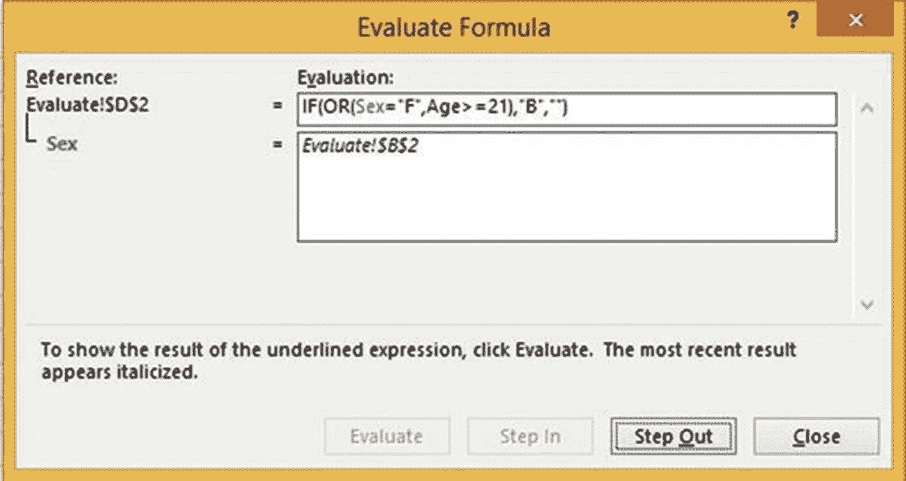
*图 9-40：使用单步进入*

点击单元格`D2`内部。

点击功能区中的`公式`选项卡。在`公式审核`组中，点击`公式求值`以打开`公式求值`对话框，如图 9-39 所示。内部函数`OR`将首先被求值，然后是外部函数`IF`。`性别`带有下划线。带下划线的部分即是要求值的部分。

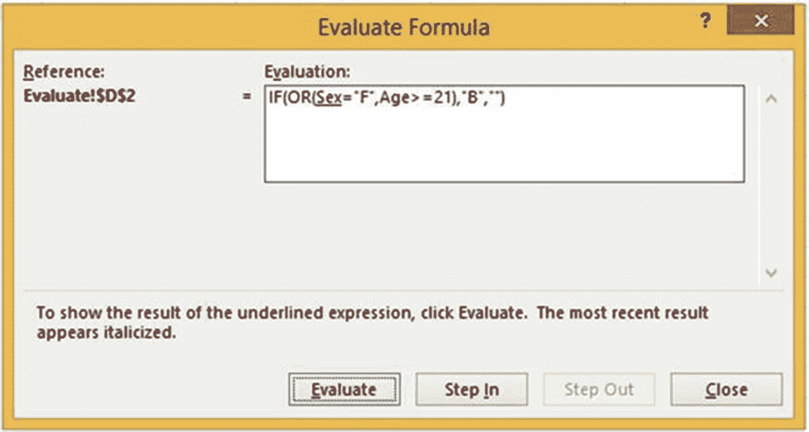
*图 9-39：公式求值窗口*

Excel 可以通过朗读单元格中输入的值来帮助你校对电子表格。你可以一边听着 Excel 朗读，一边对照原始数据源，从而验证输入是否正确。

此选项不在功能区中，需要将其添加到功能区或`快速访问工具栏`。

**练习 9-5：校对单元格值**

我们不将`校对`选项添加到功能区，而是将其添加到`快速访问工具栏`。

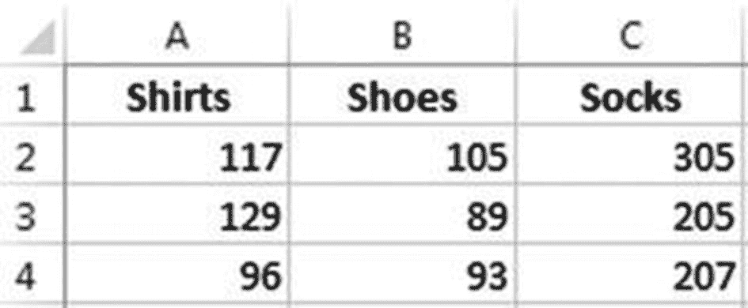
*图 9-49：输入这些数据*


*图 9-48：添加到快速访问工具栏的“朗读”命令*

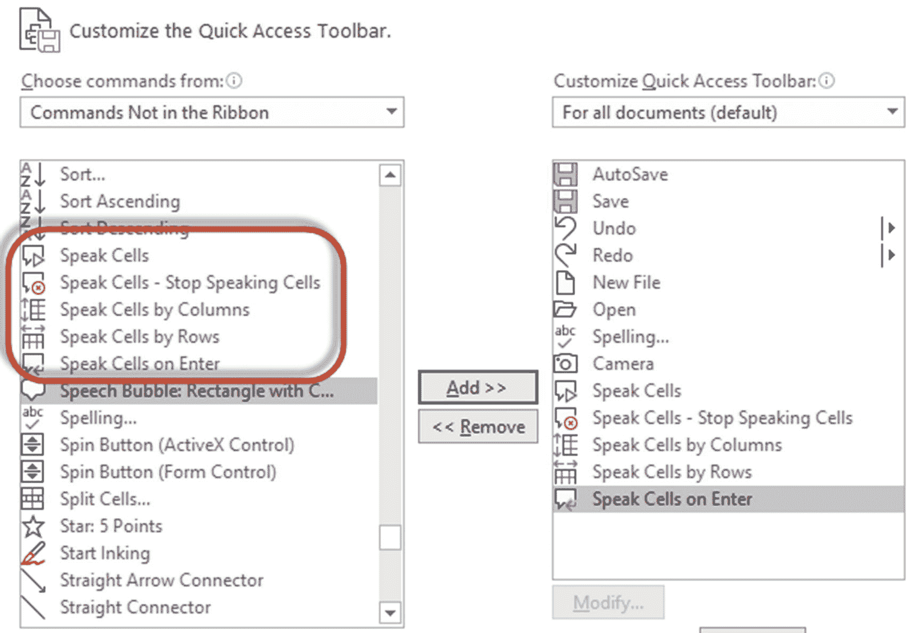
*图 9-47：将“朗读”命令添加到快速访问工具栏*

右键点击`快速访问工具栏`并选择`自定义快速访问工具栏`。

在`从下列位置选择命令`下拉框中，选择`不在功能区中的命令`。

使用滚动条向下滚动，直到找到`朗读单元格`。点击`朗读单元格`，然后点击`添加`按钮。对余下四个选项执行相同操作。见图 9-47。

点击`确定`按钮。现在你的`快速访问工具栏`上应该有五个新按钮。见图 9-48。

右键点击`快速访问工具栏`并选择`在功能区下方显示快速访问工具栏`。

选中单元格`A1:C4`。点击快速访问工具栏上的`按行朗读单元格`按钮。点击快速访问工具栏上的`朗读单元格`按钮。Excel 按行顺序朗读数据。

点击`按列朗读单元格`按钮。点击`朗读单元格`按钮。Excel 按列顺序朗读数据。在 Excel 读完所有数据之前，点击`朗读单元格 - 停止朗读单元格`按钮。Excel 允许在任何时候停止朗读，然后从中断处继续。现在，如果你点击`朗读单元格`，Excel 将从你点击`朗读单元格 - 停止朗读单元格`按钮的位置开始朗读。

点击快速访问工具栏上的`按回车键朗读单元格`按钮。你会听到一个语音确认，告诉你输入到单元格中的任何内容都将被朗读出来。

在新工作表中输入图 9-49 中的数据。当你输入数据时，信息会被朗读出来。

再次点击`按回车键朗读单元格`。这将关闭`随输入朗读`选项。

## 拼写检查

`拼写检查`和`同义词库`按钮位于`审阅`选项卡的`校对`组中。参见图 9-50。

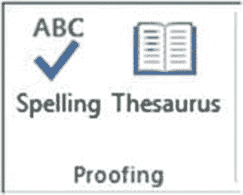
图 9-50：`校对`组

为了避免因工作簿中的拼写错误而难堪，你应始终使用 Excel 的`拼写检查`功能进行检查。你可以检查某个单元格区域，也可以检查整个工作表。如果在点击`拼写检查`之前选中了一个单元格区域，则仅检查该区域。如果你只选中了一个单元格，或者点击了 A 列左侧的`全选`按钮，则会检查整个工作表。

如果 Excel 在其词典中找不到某个单词，它会将该单词显示在`不在词典中`文本框内。它会在`建议：`列表框中提供一个或多个它认为正确的拼写建议。参见图 9-51。

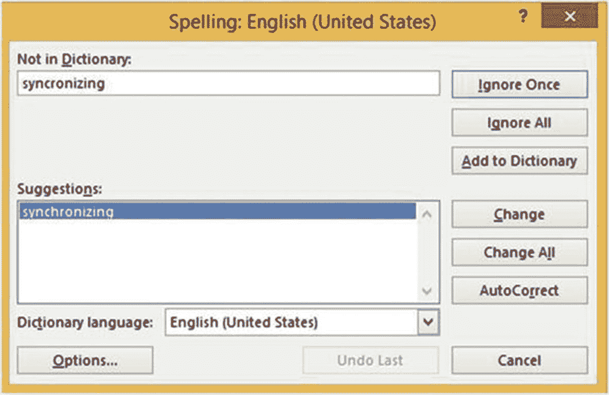
图 9-51：`拼写检查`

各个按钮的用途如下：

- `忽略一次` — 告知 Excel 你不想更改当前单元格的拼写，但仍希望在其他位置检查该单词。

- `全部忽略` — 告知 Excel 你不想更改`不在词典中`文本框内的单词在当前工作表任何位置的拼写。

- `添加到词典` — 将该单词添加到 Excel 的词典中。此后 Excel 将不再提示该单词拼写错误。

- `更改` — 将工作表中单元格里的单词替换为你在`建议：`列表框中选中的单词。

- `全部更改` — 将工作表中所有出现的`不在词典中`文本框内的单词，替换为你在`建议：`列表框中选中的单词。

- `自动更正` — 将`建议：`列表框中选中的单词添加为 Excel `自动更正`功能中`不在词典中`文本框内单词的替换项。

- `词典语言` — 允许你从多种不同的词典中选择一种。

---

## 同义词库

如果你想在电子表格中查找与某个单词含义相近的另一个单词，可以使用 Excel 的`同义词库`。只需选中该单词，然后点击`同义词库`按钮即可。图 9-52 显示了在点击`同义词库`按钮时，单词 `Synchronizing` 已被选中。

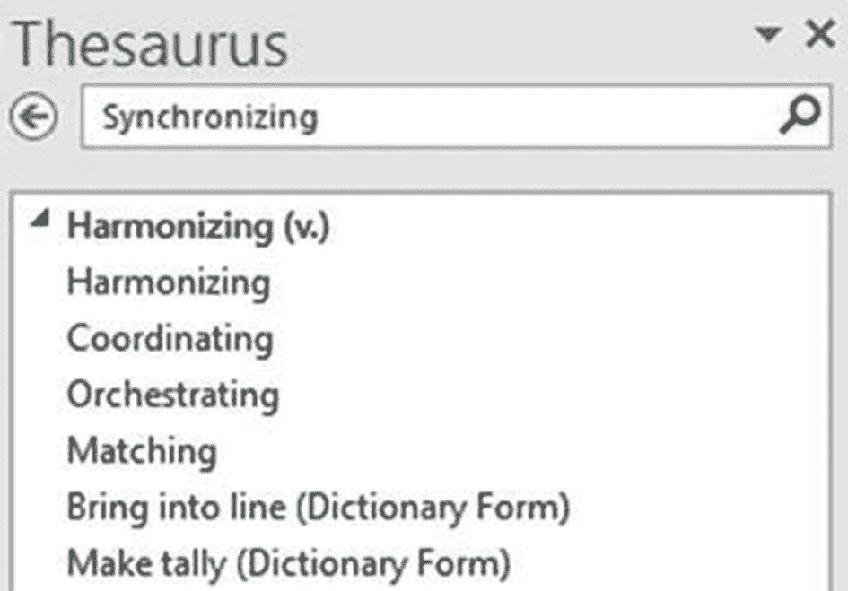
图 9-52：`同义词库`

`Harmonizing` 旁边的 `(v.)` 表示它是一个动词。点击列表中的某个单词，它会显示该单词的近义词。

图 9-53 显示从图 9-52 的列表中选中了 `Harmonizing`，现在显示了与 `Harmonizing` 含义相近的单词。`(adj.)` 表示该单词是形容词。

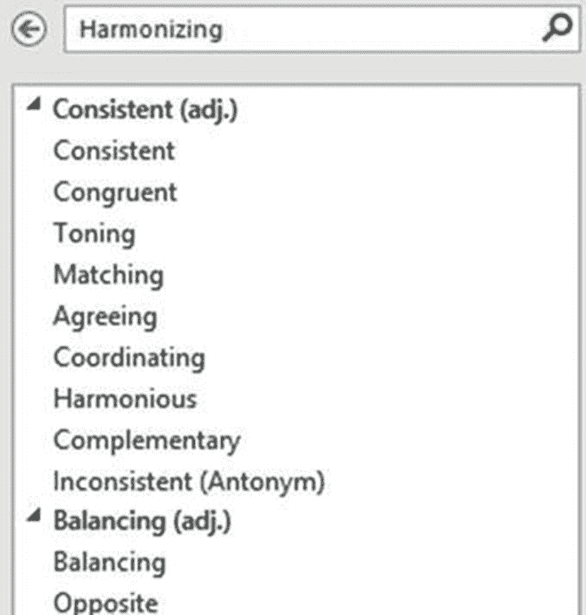
图 9-53：与 `Harmonizing` 含义相近的单词

要返回单词列表的上一步，请点击  按钮。

要将单元格中的单词替换为`同义词库`列表中的单词，请右键点击`同义词库`列表中的单词，然后选择`插入`。参见图 9-54。

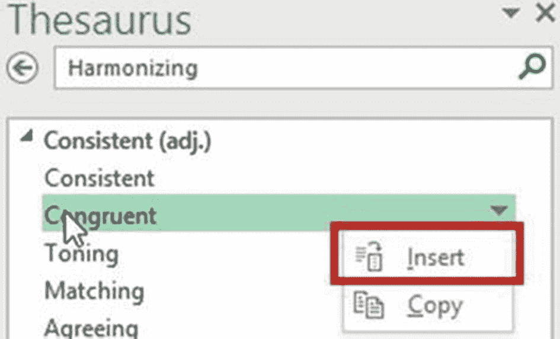
图 9-54：将电子表格中的单词替换为`同义词库`列表中的单词

---

## 保护工作表与单元格免受意外或蓄意更改

你可以通过防止用户意外或蓄意更改、添加或删除数据来保护工作簿数据。

你可以在工作簿级别、工作表级别或单元格级别保护数据。在第 6 章中，你已经了解了如何在工作簿级别保护数据。现在，你将学习如何使用工作表和单元格级别的保护。

### 在工作表级别保护数据

工作表级别和单元格级别保护所需的命令位于`审阅`选项卡的`保护`组中。参见图 9-55。

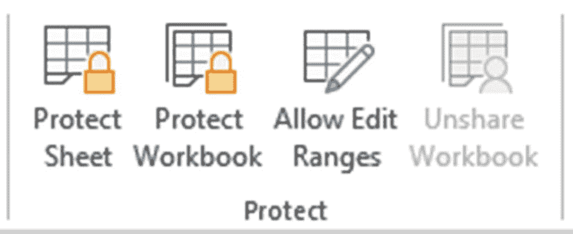
图 9-55：功能区的`更改`组

默认情况下，工作簿中的所有单元格都是锁定的。`锁定单元格`在你点击`保护工作表`按钮之前不提供任何保护。右键点击单元格，然后选择`设置单元格格式`，即可打开`设置单元格格式`窗口。如果你点击`保护`选项卡，你会看到“锁定”复选框已被勾选。参见图 9-56。

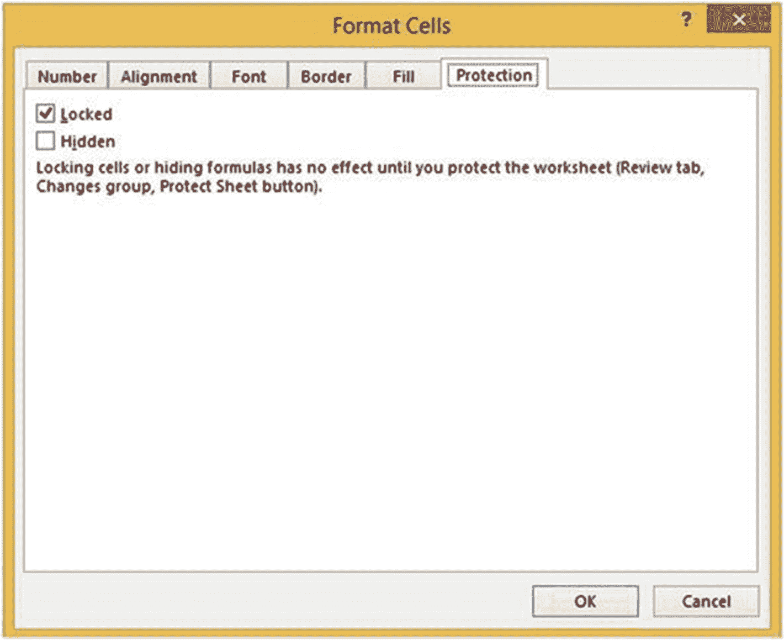
图 9-56：单元格默认处于锁定状态

**练习 9-6：保护工作表**

在本练习中，你将使用密码保护一个工作表。

1. 打开工作簿第 9 章。点击`保护工作表`标签页。

2. 点击功能区的`审阅`选项卡。在`更改`组中，点击`保护工作表`按钮。将显示`保护工作表`对话框。参见图 9-57。

   `保护工作表`对话框允许你通过勾选你想要赋予用户的选项（例如，格式化单元格或插入行列的能力）来为其分配权限。

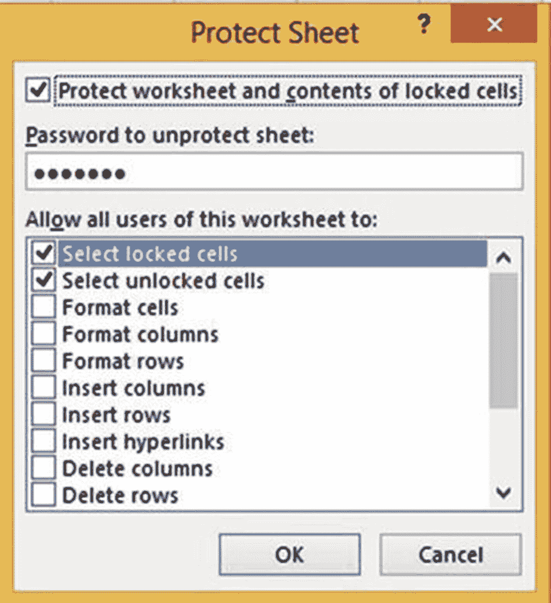

图 9-57：`保护工作表`对话框

3. 保持勾选`选定锁定单元格`和`选定未锁定单元格`。

4. 输入一个密码。

   `警告` 务必记住该密码。你应该将其保存在安全的地方。如果忘记密码，你将无法再次打开该工作表。

5. 点击`确定`按钮。

6. 重新输入你的密码，以确认在`保护工作表`窗口中输入的密码。参见图 9-58。

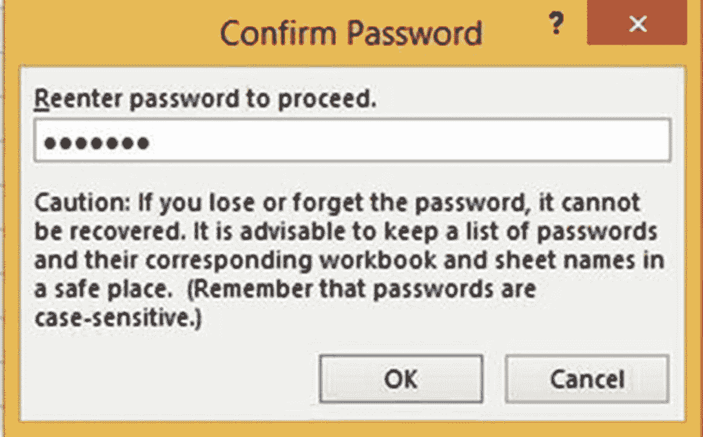

图 9-58：确认密码对话框

7. 尝试更改一个值。你将收到图 9-59 中的消息。点击`确定`按钮。

8. 右键点击一个行号。注意，`插入`和`删除`选项是灰色的。

   这些选项以及你在`保护工作表`窗口中没有选择的其他选项均不可用。

9. 右键点击一个单元格。注意，`设置单元格格式`选项是灰色的。

10. 点击`确定`按钮。

11. 在`P`组中，点击`撤销工作表保护`。

12. 在`撤销工作表保护`对话框中输入你之前输入的相同密码。参见图 9-60。点击`确定`按钮。

13. 尝试在空白单元格中输入一个值。你将收到与图 9-59 相同的消息。


图 9-59：提示你尝试更改的内容受保护的消息

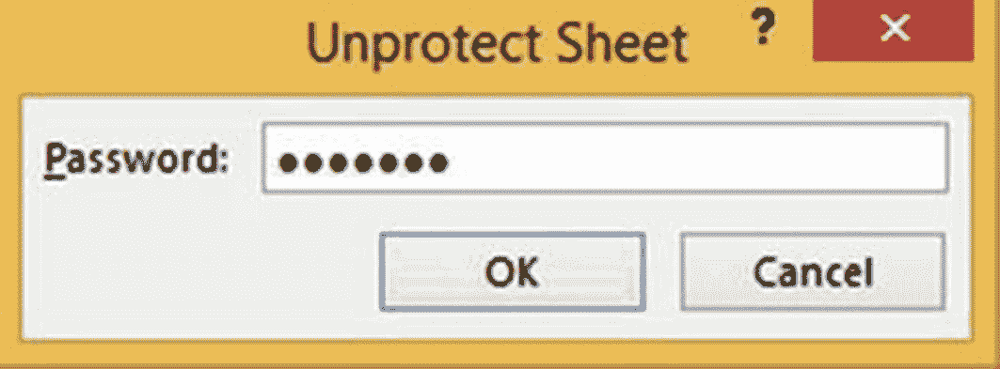

图 9-60：输入密码以撤销工作表保护

现在工作表已取消保护。你可以对数据进行任何添加或更改。

## 在单元格级别保护数据

前面你已经看到，默认情况下所有单元格都处于锁定状态。当你单击“更改”组中的“保护工作簿”按钮时，所有被锁定的单元格都会受到保护，你将无法输入任何数据。因此，当允许用户修改单元格数据时，你不需要保护这些单元格（因为它们已经被保护了）。相反，你需要先解除那些你希望允许用户更改的单元格的锁定。在单击“保护工作簿”按钮之前，你必须指定要解除锁定的单元格。

`练习 9-7：保护单元格`

在本练习中，你将阻止用户取消隐藏 F 列，并防止对公式或标题进行任何更改。

1.  打开工作簿`Chapter 9`。单击`Protection`工作表标签。

2.  右键单击列标头 F，然后选择`Hide`。

3.  选择单元格区域`A2:C8`。右键单击选中的单元格，然后选择`Format Cells`。

4.  单击`Protection`选项卡，并执行以下操作：
    - 取消勾选`Locked`。这将解除单元格区域`A2:C8`的锁定。
    - 勾选`Hidden`。这将阻止用户取消隐藏 F 列。
    - 单击`OK`按钮。

在功能区的“审阅”选项卡上的“保护”组中，单击`Protect Sheet`按钮。输入密码。重新输入密码以确认密码。


`图 9-61` 提示你所尝试更改的内容受保护的消息

1.  拖动选择列标头 E 和 G。右键单击所选区域，你会看到`unhide`（取消隐藏）选项是灰色的。

2.  在“保护”组中，单击`Unprotect Sheet`按钮。

3.  输入你的密码。单击`OK`按钮。
    现在你可以对所有单元格进行更改了。

4.  拖动选择列标头 E 和 G。右键单击所选区域，然后选择`unhide`（取消隐藏）。

1.  尝试更改单元格区域`A2:C8`中的某个值。你可以成功更改。

2.  尝试更改 D 列或 E 列中的某个公式。你将看到图 9-61 中显示的消息。

现在 F 列应该是可见的。

## 小结

Excel 拥有许多有用的功能，可以确保数据条目输入正确，并在输入错误时立即通知你，以便你更正错误。你已经了解了 Excel 如何纠正拼写错误，以及如何通过其同义词库建议其他词语。你还了解了如何通过视觉提示来追踪公式的进入和移出。Excel 还会显示追踪箭头，以指示哪些单元格涉及循环引用。

下一章将介绍如何创建、编辑和删除超链接。超链接通常简称为链接。你可能在互联网上经常使用它们，从网站的一个位置链接到另一个位置，或链接到一个完全不同的网站。超链接是可以点击的文本或对象，用于跳转到当前应用程序或其他应用程序（如另一个工作簿、网站、电子邮件应用程序等）中的某个位置。我们还将探讨如何将多个列中的文本与你希望添加的任何其他文本合并。

