# 5. 查看和打印工作簿的不同方式

Excel 允许你向一个工作表中输入种类繁多、数量庞大的数据，然后仅提取你需要与客户或员工分享的数据。有时你不需要打印整个工作簿或整个工作表。在本章中，你将学习如何仅查看和打印与你的任务相关的数据。你可能正在处理一个地理区域或某个特定销售人员，并且只想显示与每个人相关的内容。打印布局视图让你可以看到工作表在打印时的外观，这一点非常重要，因为屏幕截图可能与最终打印出来的产品有很大差异。

阅读并完成本章学习后，你应该能够：
- 插入、删除、重置和更改分页符的位置
- 在所有页面上重复行标题和列标题
- 使用预设的页眉
- 创建你自己的页眉和页脚
- 创建打印区域、向其中添加内容以及移除打印区域
- 打印工作表的一部分
- 使用“选择性粘贴”来组合一个可打印的工作表
- 创建你自己的自定义视图
- 使用“同步滚动”功能
- 将工作表拆分为多个窗格
- 冻结行和列

## 视图

到目前为止，我们一直在“`普通视图`”中查看工作表，但这并非唯一可用的视图。除了“`普通视图`”，还有“`分页预览`”和“`页面布局视图`”。可以从功能区上的“`视图`”选项卡访问不同的视图。“`分页预览`”用于调整分页符。此视图允许你插入、更改、删除和重置分页符。“`页面布局视图`”提供了一种添加、编辑和删除页眉和页脚的快速方法。它还让你能够直观地看到工作簿打印时的样子。你还可以创建自己的“`自定义视图`”。

工作簿视图位于功能区的“`视图`”选项卡上。请参见图 5-1。

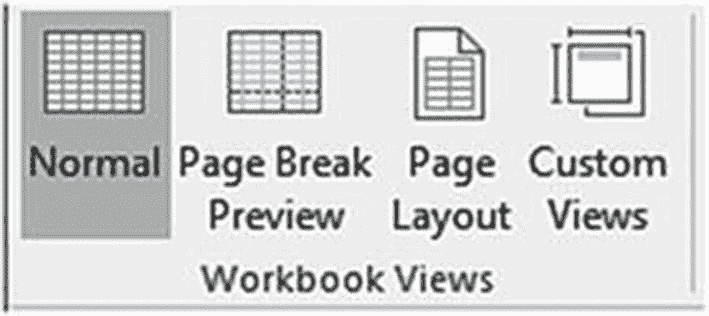

图 5-1 工作簿视图按钮

“`普通视图`”、“`分页预览`”和“`页面布局视图`”按钮也出现在 Excel 任务栏的右侧。这三个按钮  执行的功能与“工作簿视图”组中的功能相同。如果你在任务栏上看不到它们，请右键单击任务栏并选择“`视图快捷方式`”。

**注意**：“`普通视图`”和“`分页预览`”不显示页眉和页脚，但“`页面布局视图`”会显示。

还有一个“`打印预览`”，你将在本章中使用到。“`打印预览`”不是工作簿视图的一部分。“`打印预览`”仅用于确切查看你的工作表将如何被打印。

### 分页预览

分页符有两种类型：一种是由 Excel 自动创建的，另一种是手动创建的。自动分页符会在您调整行高或列宽、删除或添加列/行、更改页面大小、更改页面方向、更改页边距等操作时自动调整。

在普通视图中，分页符显示为虚线。在普通视图中，您可以插入、删除和重置分页符。但是，您无法像在分页预览中那样将分页符拖动到新位置。在分页预览中，分页线也更易于查看。在普通视图和分页预览中，插入、删除和重置分页符的操作方式是相同的。因此，我们仅介绍在分页预览模式下执行这些步骤的方法。

打印包含大量列的工作表可能颇具挑战性。Excel 可能无法按您期望的方式拆分报告（即打印的工作表）。您可以将方向从`纵向`切换为`横向`，以增加纸张的宽度，但某些列仍可能会打印在单独的页面上。`分页预览`用于调整分页符。此视图允许您插入、更改、删除和重置分页符。

分页预览会显示数据的缩小视图。数据由代表分页符的蓝色水平虚线和垂直虚线分隔。您可以通过拖动蓝色线到所需分页位置来更改分页符的位置。如果更改了分页符的位置，该线将从虚线变为实线。如果您插入新的分页符，它也将显示为实线。这有助于轻松识别您所做的更改与 Excel 最初创建的分页符。

### 练习 5-1：使用分页符和预览

在本练习中，您将练习创建垂直和水平分页符。您还将练习移动和删除分页符。

**注意**：您可以从 Apress 网站的源代码/下载区域（[`www.apress.com/source-code`](http://www.apress.com/source-code)）下载本书附带的示例文件。

1. 单击功能区上的“`视图`”选项卡。在“工作簿视图”组中，单击“`分页预览`”按钮。本练习的其余部分仅涉及分页预览。查看窗口右下角的“缩放”工具。缩放比例会自动设置为低于 100%，以便您更轻松地查看分页符。
    该工作表显示两条垂直虚线和一条水平虚线，将工作表分成六页。请参见图 5-4。

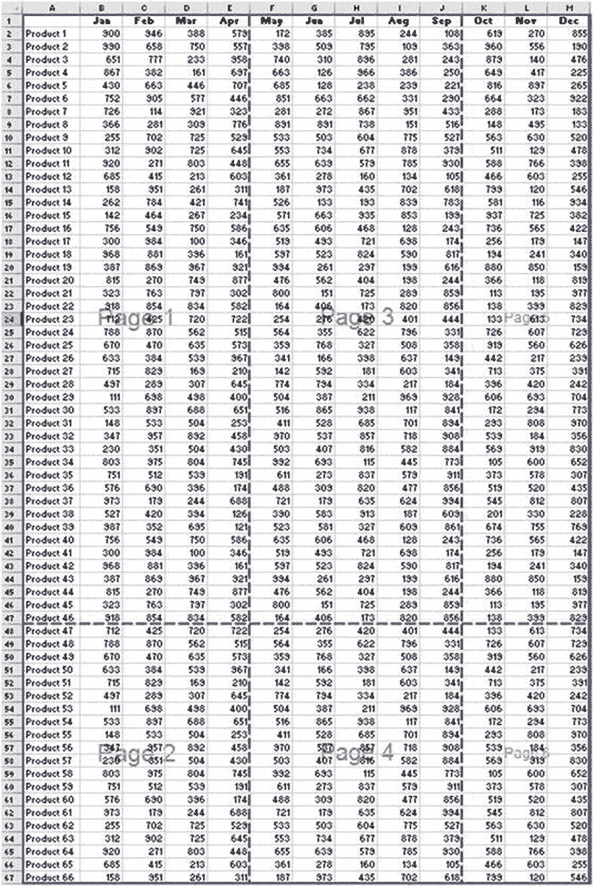

图 5-4 分页预览

2. 打开工作簿`第 5 章`。单击“`月份`”工作表。
3. 单击“`文件`”选项卡。
4. 在左侧窗格中选择“`选项`”。
5. 在左侧窗格中选择“`高级`”。
6. 找到`此工作表的显示选项`组。如果“`显示分页符`”未选中，请将其选中。
7. 单击“`确定`”按钮。这仅影响普通视图。您无法在分页预览中关闭分页线。

现在已选择“`显示分页符`”，您应该会看到用虚线表示的分页符。在 E 列和 F 列之间有一个垂直分页符，在 J 列和 K 列之间还有另一个垂直分页符（图 5-2）。在第 47 行和第 48 行之间有一个水平分页符（图 5-3）。

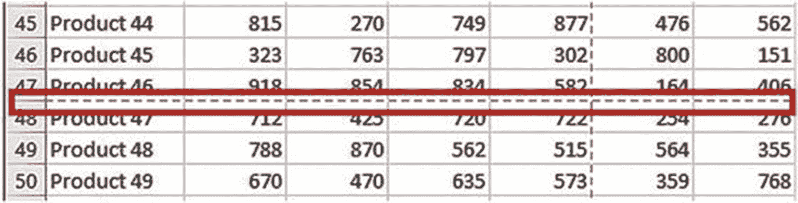

图 5-3 水平分页线

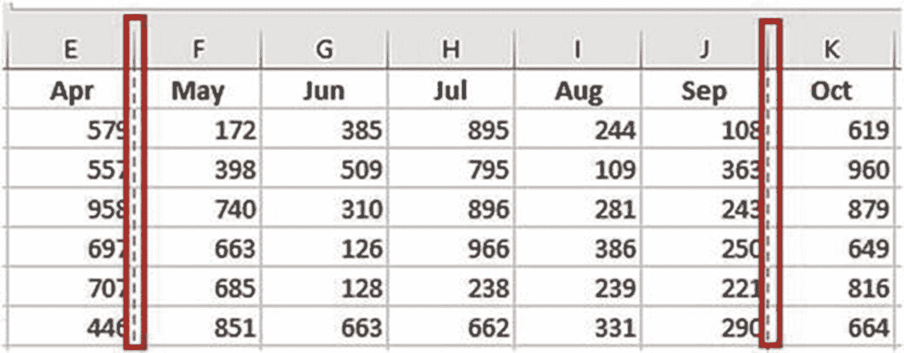

图 5-2 垂直分页线

#### 在打印预览中查看报表

1. 单击`File`选项卡。在左侧窗格中选择`Print`。右侧的`Print Preview`（打印预览）窗格会显示工作表打印时的样子。您可以单击预览区域底部的`Forward`（前进）和`Back`（后退）按钮 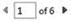 来浏览不同页面。
2. 单击`Return`（返回）按钮  退出`Print Preview`（打印预览）。

### 在分页预览中插入分页符

1. 单击列标题`H`以选中该列。当您插入垂直`Page Break`（分页符）时，分页符会出现在选中列的左侧。
2. 在功能区上，单击`Page Layout`（页面布局）选项卡。在`Page Setup`（页面设置）组中，单击`Breaks`（分隔符）按钮。单击`Insert Page Break`（插入分页符）。单击任意单元格以查看`Page Break`（分页符）。它是一条实线而非虚线。实线是您自己创建的分页符，而虚线是 Excel 自动创建的。

### 在分页预览中删除分页符

1. 右键单击列标题`H`。选择`Remove Page Break`（删除分页符）。
2. 您也可以通过将分页符线拖出工作表来将其删除。将列`J`和`K`之间的垂直分页符拖出工作表。

### 在分页预览中重置分页符

1. 右键单击工作表，然后选择`Reset All Page Breaks`（重置所有分页符）。这会将分页符恢复为 Excel 最初设置的状态。

### 在分页预览中更改分页符的位置

1. 拖动水平分页符线，使其位于第`36`行和第`37`行之间。此线变为实线。这有助于轻松区分 Excel 设置的分页符（虚线）和您自己设置的分页符（实线）。
2. 将列`E`和`F`之间的虚线分页符线拖动到列`G`和`H`之间。该线变为实线。

### 在打印预览中查看电子表格

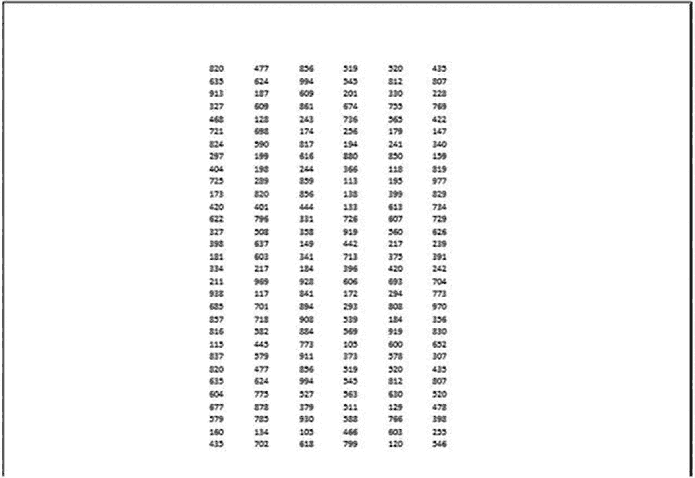

图 5-5 报告的第 4 页没有行或列标题

1. 右键单击工作表，然后选择`Page Setup`（页面设置）。在`Page Setup`（页面设置）对话框中，单击`Print Preview`（打印预览）按钮。

2. 窗口的右侧是 `Print Preview`（打印预览）区域。这里会精确显示打印输出的效果。在窗口底部，您会看到一个页面选择器 。单击右箭头转到下一页。请注意，在第 2 页上，没有列标题。单击页面选择器的右箭头转到第 3 页。请注意，没有行标题。转到第 4 页。此页既没有行标题也没有列标题。参见图 5-5。除非您将页面粘在一起，否则任何人都很难阅读这份报告。

**注意** 当您在 `Page Break Preview`（分页预览）中查看电子表格时，它会显示网格，但在 `Print Preview`（打印预览）中，没有网格。打印时不会有任何网格线。

1. 单击 `Return`（返回）按钮 ，然后单击功能区的 `Home`（开始）选项卡。

### 在所有页面上重复行和列标题

1. 单击页面选择器的左箭头，直到您位于第 1 页，共 4 页 。第 1 页显示了 1 月至 6 月的数据。单击页面选择器的右箭头转到第 2 页。第 2 页显示了 1 月至 6 月的其余记录。第 2 页现在有列标题。
2. 浏览其他页面；它们都有列标题和行标题。
3. 单击 `Return`（返回）按钮 。
4. 单击 `Print Preview`（打印预览）按钮。页面现在显示网格线。
5. 单击位于 `Print Preview`（打印预览）区域右下角的 `Zoom to Page`（缩放到页面）按钮。参见图 5-7。

**图 5-7** 单击 `Zoom to Page`（缩放到页面）按钮

6. 右键单击工作表，然后选择 `Page Setup`（页面设置）。在 `Page Setup`（页面设置）对话框中，单击 `Sheet`（工作表）选项卡。
7. 如果我们希望行标题出现在每个打印页面上，我们需要在 `Rows to repeat at top`（顶端标题行）文本框中标识标题行。单击文本框内部。您可以键入 `$1:$1`，或者单击单元格 `A1`，它会自动将地址放入文本框中。此地址告诉 Excel 使用第 1 行中的标题作为所有打印页面的列标题。
8. 按 `Tab` 键切换到 `Columns to repeat at left`（左端标题列）文本框。您可以键入 `$A:$A`，或者单击单元格 `A1`，它会自动将地址放入文本框中。此地址告诉 Excel 使用 A 列中的行标题作为所有打印页面的行标题。
9. 选中 `Gridlines`（网格线）复选框。这会将所有数据打印在网格线内。参见图 5-6。

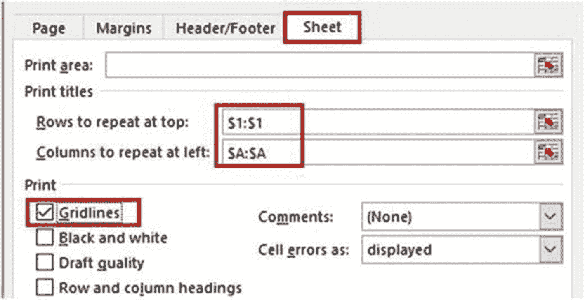
**图 5-6** 选中 `Gridlines`（网格线）以在网格线内打印数据

您已经学习了如何插入、删除和重新排列分页符，以便控制分页符出现的位置。您还学习了如何让行标题和列标题出现在报告的每一页上。接下来，您将看到如何在 `Page Layout`（页面布局）视图中向工作表添加页眉和页脚。

### 页面布局视图

`页面布局`视图提供了一种快速添加、编辑和删除页眉与页脚的方法。它会显示打印输出相对于水平和垂直标尺以及分页符的外观。您可以轻松更改边距并立即看到结果。`页面布局`视图的工作方式与`普通`视图类似；您仍然可以添加和编辑数据并应用格式。

`页面布局`视图会显示一个水平标尺和一个垂直标尺，当您移动到另一页时，它们会随之移动到该页。您可以通过将标尺拖到所需位置来调整边框。拖动鼠标指针时，会有一条线同时移动，向您显示边距的位置。如果您希望将边距设置到某个特定的英寸位置，则不宜在此处操作，因为在拖动时不会显示以英寸为单位的变动。

`页面布局`视图显示三个页眉部分和三个页脚部分。如果您单击其中一个页眉或页脚部分，功能区会新增一个名为`页眉和页脚工具`的上下文选项卡。请参见图 5-8。页眉打印在每页的顶部。页脚打印在每页的底部。

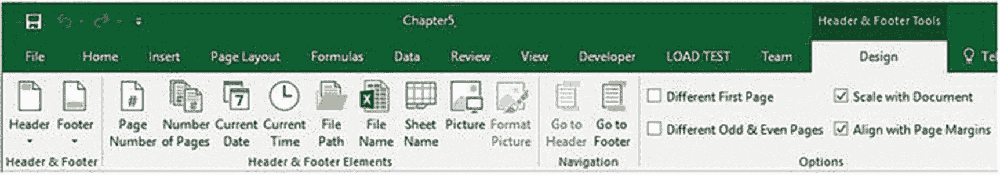
**图 5-8** 用于页眉和页脚的上下文选项卡

### 练习 5-2：使用页面布局视图

在此练习中，您将使用`页面布局`视图来添加和更改页眉与页脚，以及删除页面之间的空白区域。

1. 使用第 5 章的工作簿。单击 `Months` 工作表。
2. 单击工作簿状态栏上的`页面布局`视图按钮 。
3. 您应该在状态栏上看到我们当前查看的是第 1 页，共 4 页。
4. 更改`缩放`工具，以便您可以同时看到所有页面。
5. 按 `Ctrl + Home` 转到单元格 `A1`。

### 更改页眉和页脚

**注意** 页眉和页脚区域在空置或首次使用时通常不会显示。您可能需要将光标移动到它们应该存在的区域才能看到它们。

1. 单击包含用户名、页码和当前日期的预设页眉。
2. 在第一个页眉区域内部单击，将名称更改为您的全名。使用工作表的垂直和水平滚动条查看页眉是否出现在每页的顶部。
3. 滚动到第 1 页的底部。您应该会看到文本 `添加页脚`。
4. 单击“添加页脚”字样，以便看到三个页脚区域。
5. 单击`设计`选项卡。在`页眉和页脚`组中，单击`页脚`按钮。Excel 会显示一个预设页脚列表。与页眉一样，逗号用于标识文本将放置在哪个区域。
6. 单击预设页脚 `第 1 页，共 ? 页`。此预设页脚不包含逗号；因此，它显示在中间区域。
7. 在中间区域内部单击。用于创建页脚的代码 `第 &[页码] 页，共 &[总页数] 页` 会显示出来。我们希望文本出现在右侧区域。按 `Ctrl + X` 剪切文本。在右侧区域内部单击。按 `Ctrl + V` 粘贴。在中间区域内部单击。您应该会看到文本现在显示在右侧区域。
8. 单击功能区的`设计`选项卡，在`导航`组中，然后单击`转至页眉`按钮。
9. 将鼠标指针移动到该区域的左侧，左侧区域将被选中。在左侧区域内部单击。每当页眉或页脚区域处于活动状态时，功能区都会在`页眉和页脚工具`标题下显示一个`设计`选项卡。
10. 单击`设计`选项卡。在`页眉和页脚`组中，单击`页眉`按钮。Excel 会显示一个预设页眉列表。请参见图 5-10。将打印在页眉每个部分的数据由逗号分隔：
    - 不包含逗号的预设页眉将显示在中间页眉区域。
    - 对于包含一个逗号的预设页眉，逗号左侧的文本将出现在中间页眉区域。逗号右侧的文本将出现在右侧区域。
    - 对于包含两个逗号的预设页眉，第一个逗号左侧的文本将出现在最左侧页眉区域。第一个逗号右侧至第二个逗号之间的文本将出现在中间区域。第二个逗号右侧的文本将出现在最右侧区域。

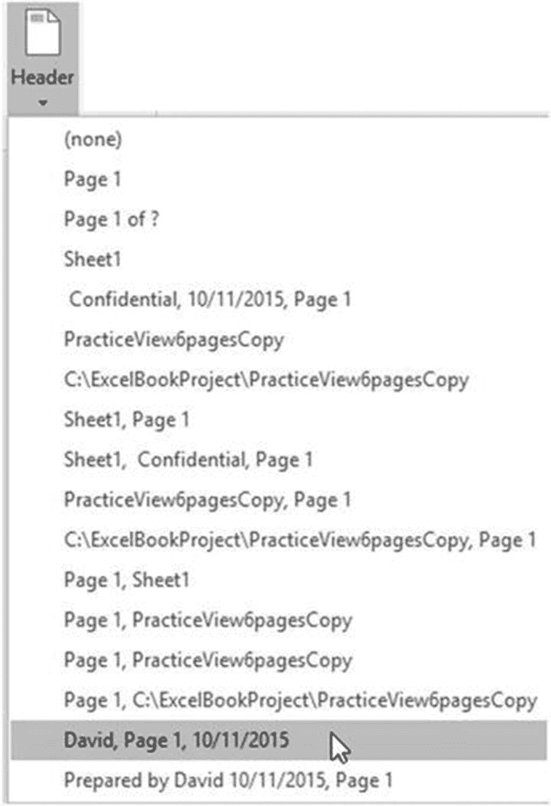
**图 5-10** 从这些预设页眉中选择一个页眉

11. 更改`缩放`工具，以便您能清晰地看到工作表上方的文本 `添加页眉`。将鼠标指针移动到“添加页眉”文本上。该区域应被选中。请参见图 5-9。

**图 5-9** 向工作簿添加页眉

### 打印工作表

1. 单击功能区的`文件`选项卡。在左侧窗格中单击`打印`。
2. 您应该会看到包含三个页眉区域的工作表。如果需要，向下滚动到页面底部以查看页脚 `第 1 页，共 4 页`。浏览其他页面。每页的页眉和页脚都相同。
3. 如果要打印报表，请单击`打印`按钮。

## 打印

电子表格可能非常庞大。在大型电子表格中对齐页面并按照所需方式调整页边距可能很困难。但很可能你并不想打印大型电子表格中的所有信息。如果你只想打印工作表的一部分，可以通过以下几种方式实现：

- 隐藏不想打印的行或列。
- 如果要打印的单元格不相邻，你可以先选定一个区域中要打印的单元格，然后按住 `Ctrl` 键，再选择其他要打印的区域。
- 将要打印的不同区域按照你希望打印的顺序复制到另一个工作表。您可以使用粘贴链接，以便数据动态更新。然后打印只包含所需数据并按你希望顺序排列的工作表。
- 设置打印区域。打印区域可以按需扩展或清除。除非你选择“忽略打印区域”选项，否则只会打印打印区域内的内容。

以下部分将指导您使用打印区域，并按照所需顺序组装一份打印报告。

### 创建打印区域

你可以通过选择要打印的一个或多个区域，然后将这些区域设为打印区域，仅打印电子表格中所需的部分。如果你要经常打印工作表的这些区域，请设置一个打印区域。

可以通过先选择要打印的单元格，然后单击“页面布局”选项卡上“页面设置”组中的“打印区域”按钮来设置打印区域。见图 5-14。选择设置打印区域即可创建打印区域。添加到打印区域选项仅在已设置打印区域后出现。

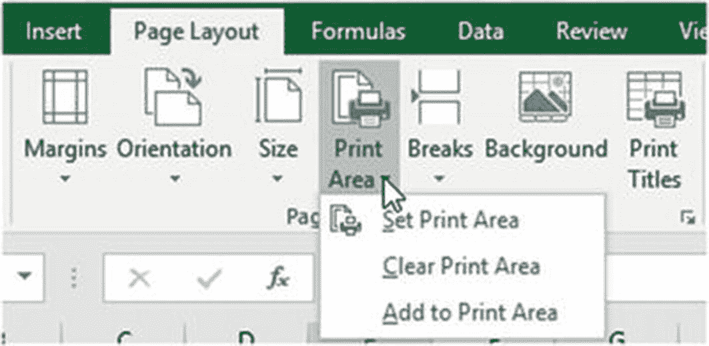

**图 5-14** “打印区域”按钮

Excel 会将选定的单元格保存为一个命名区域，并自动将其命名为 `Print_Area`。你只能有一个打印区域，但该打印区域可以包含多个范围。

### 向打印区域添加其他单元格

创建打印区域后，可以通过选择其他单元格，然后单击“打印区域”按钮并选择添加到打印区域，将这些单元格添加到打印区域。

**注意**

使用多个范围作为打印区域时有一个烦人的问题，那就是 Excel 会在这些范围之间插入分页符。这意味着每次添加到打印区域的内容都会显示在单独的页面上。

### 移除打印区域

只需单击 `打印区域` 按钮，然后选择 `清除打印区域`，即可移除打印区域。

只有在需要多次使用打印区域时，您才会用到它；否则，您可以选择要打印的区域，然后单击功能区上的 `文件` 选项卡，从左窗格中选择 `打印`，单击 `打印活动工作表` 的下拉箭头，然后选择 `打印选定区域`。见图 5-15。

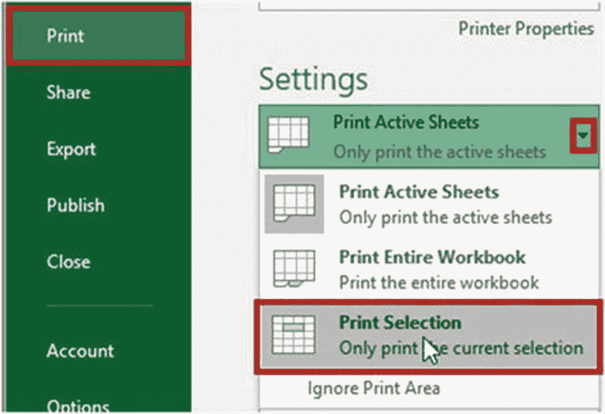

**图 5-15** 仅打印工作表的选定区域

### 练习 5-3：打印工作表的一部分

此示例的工作表包含一家大型公司的数据，该公司正在追踪其在 17 家门店销售的 39 种产品的销售情况。

1. 单击 `返回` 按钮 。
2. 在功能区的 `页面布局` 选项卡上的 `页面设置` 组中，单击 `打印区域` 按钮，然后选择 `清除打印区域`。
3. 取消隐藏被隐藏的列。
    1. 选中单元格 `A1` 到 `H9` (`A1:H9`)。
    2. 在功能区的 `页面布局` 选项卡上的 `页面设置` 组中，单击 `打印区域` 按钮，然后选择 `设置打印区域`。名称 `Print_Area` 应出现在 `名称` 框中。
    3. 选中单元格 `U3` 到 `V6` (`U3:V6`)。您应该会看到单元格 `A1:H9` 周围有一条细线，表示您已选择这些单元格作为打印区域。
    4. 在 `页面设置` 组中，单击 `打印区域` 按钮，然后选择 `添加到打印区域`。
    5. 单击功能区的 `文件` 选项卡。从左窗格中选择 `打印`。
    6. 打印预览区域应显示您正在查看第 1 页，共 2 页。当您单击 `添加到打印区域` 时选择的单元格位于第二页。每次使用 `添加到打印区域` 添加另一个选择时，它都会打印在不同的页面上。如果您希望每个部分都打印在单独的页面上，这非常有效；但是，如果您不想这样，可以使用下一节讨论的 `选择性粘贴`。
    7. **注意** 如果将 `设置` 更改为 `打印整个工作簿`，则将忽略打印区域并打印整个工作簿。如果选择 `忽略打印区域`，则任何 `打印` 选项都不会识别打印区域。见图 5-17。
        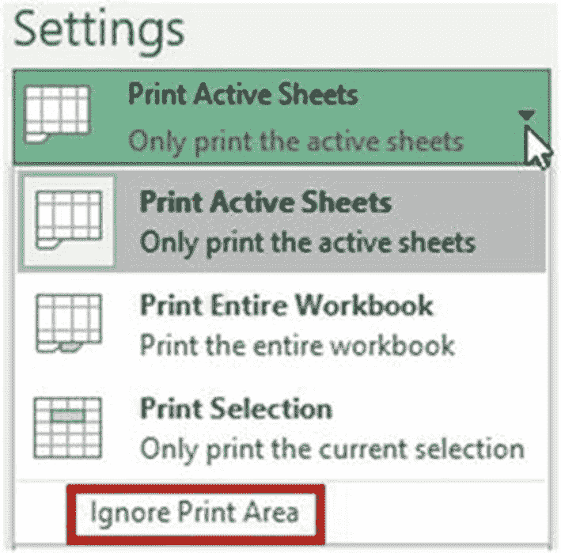

        **图 5-17**

选择`忽略打印区域`，以防止任何打印选项使用打印区域。

1. 如果尚未打开，请打开您一直在本章中使用的工作簿第 5 章。单击`门店`工作表。

2. 拖选列标题`D`到`G`。右键单击其中一个选中的列标题。选择`隐藏`。

3. 拖选列标题`L`到`R`。右键单击其中一个选中的列标题。选择`隐藏`。

4. 单击功能区的`文件`选项卡。从左窗格中选择`打印`。

5. 注意，隐藏的列不会出现在打印预览中。

6. 单击`返回`按钮。

7. 将从单元格`U3`开始，如图 5-16 所示的数据添加到工作表中。

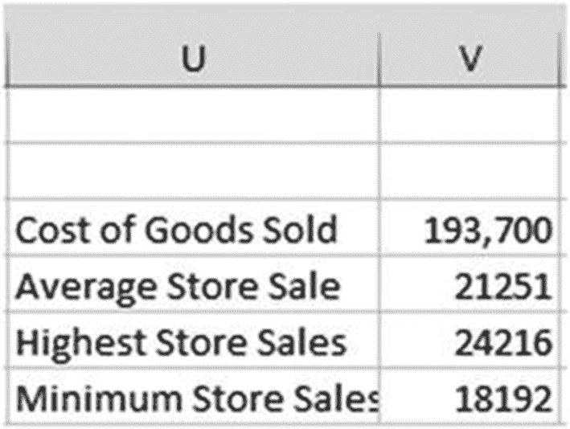

图 5-16 将这些数据添加到工作表

您已经学会了如何仅打印您想要打印的单元格区域。接下来，您将看到使用`选择性粘贴`如何让您对打印有更多控制，并有助于解决 Excel 在区域之间放置分页符的问题。

### 使用选择性粘贴进行打印

如果您希望更灵活地控制报表不同部分的打印位置，可以复制报表中您想看到的各个部分，然后使用`选择性粘贴`将它们放置到独立工作表中您希望打印的位置。此方法的另一个好处是，您可以复制来自不同工作表的数据。

### 练习 5-4：使用选择性粘贴组合一个可打印的工作表

在本练习中，您将提取工作表的不同部分，并将它们组合到另一张工作表中，该工作表可以打印为单页。

1. 单击`门店`工作表。选择范围`U3:V6`。按`Ctrl + C`复制数据。

2. 单击您命名为`已粘贴`的工作表。单击单元格`G2`。在功能区的`开始`选项卡上的`剪贴板`组中，单击`粘贴`按钮的下拉箭头。选择`选择性粘贴`。

3. 将显示`选择性粘贴`窗口。单击`粘贴链接`。加宽`G`列以查看所有数据。

4. 单击`门店`工作表。选择范围`A17:D21`。按`Ctrl + C`复制数据。

5. 单击您命名为`已粘贴`的工作表。单击单元格`A11`内部。在功能区的`开始`选项卡上的`剪贴板`组中，单击`粘贴`按钮的下拉箭头。选择`选择性粘贴`。

6. 将显示`选择性粘贴`窗口。单击`粘贴链接`。

7. 单击功能区的`文件`选项卡。从左窗格中选择`打印`。打印预览显示您已成功地将所需数据放在了所需位置，并且仍将其保留在同一页面上。

8. 单击`返回`按钮。

9. 单击`门店`工作表。将单元格`B2`中的值从 900 更改为 820。

10. 单击`已粘贴`工作表。因为您创建了链接，所以单元格`B2`会更新为您在`门店`工作表中输入的值。

1. 使用第 5 章的工作簿。创建一个新工作表。将该工作表命名为`已粘贴`。

2. 单击`门店`工作表。选择单元格区域`A1:E9`。按`Ctrl + C`复制数据。

3. 单击您命名为`已粘贴`的工作表。单击单元格`A1`内部。

4. 单击功能区的`开始`选项卡，然后在`剪贴板`组中，单击`粘贴`按钮的下拉箭头。选择最后一个选项`选择性粘贴`。

5. 将显示`选择性粘贴`对话框。单击`粘贴链接`。见图 5-18。这将在`门店`工作表和`已粘贴`工作表上的数据之间创建一个链接。

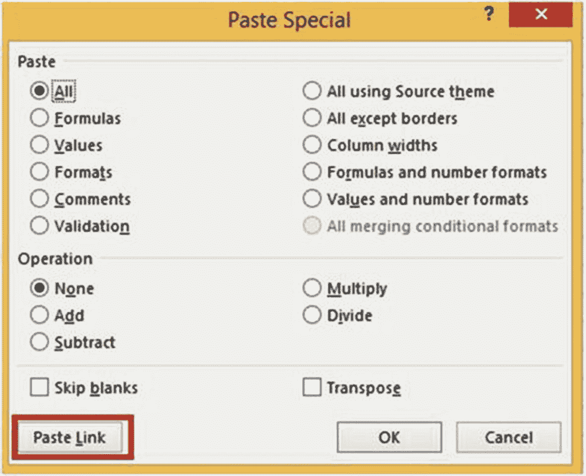

图 5-18 `粘贴链接`在复制的数据和粘贴的数据之间创建链接

您已经学会了使用`选择性粘贴`比使用打印区域能对打印进行更多的控制。`选择性粘贴`允许您从多个区域获取数据，并按您想要打印的顺序排列它们。接下来，您将学习如何同时查看工作表的多个副本。

## 将 Excel 窗口拆分为多个窗格

大型工作表可能难以分析。你无法同时看到列标题和列合计；因此，每当你查看某个合计时，都必须向上滚动到工作表顶部，才能看到其列标题，从而了解该合计代表什么。行合计与行标题也存在同样的问题。另一个潜在问题是，你想比较 B 列与 V 列中的值，但无法同时看到两者，因此必须左右来回水平滚动才能进行比较。这些类型的问题可以通过将 Excel 屏幕拆分为多个独立的窗格来解决。你所创建的每个窗格中都会自动放置一份工作表的副本。这让你能够同时查看工作表的不同区域。

屏幕可以拆分为两个垂直窗格、两个水平窗格，或者两者的组合（将产生四个窗格）。

以下是创建两个垂直窗格的方法：

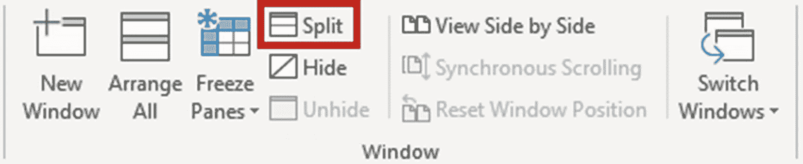

图 5-19 `拆分窗口`按钮已高亮显示

1. 单击某一列标题。

2. 单击功能区的`视图`选项卡。在`窗口`组中，单击`拆分`按钮。请参见图 5-19。窗格将在所选列的左侧拆分。

以下是创建两个水平窗格的方法：

1. 单击某一行标题。

2. 单击功能区的`视图`选项卡。在`窗口`组中，单击`拆分`按钮。窗格将在所选行的上方拆分。

以下是创建四个窗格的方法：

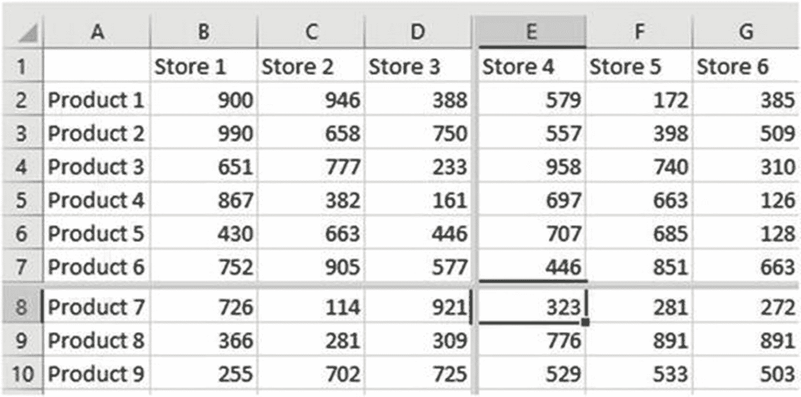

图 5-20 窗口拆分为 4 个窗格。拆分线位于选定单元格的上方和左侧

1. 单击某一个单元格。

2. 单击功能区的`视图`选项卡。在`窗口`组中，单击`拆分`按钮。拆分条出现在选定单元格的上方和左侧。请参见图 5-20。

可以通过将拆分条拖拽到所需位置来调整窗格的大小。

如果当前没有显示任何拆分条，则单击`拆分`按钮会在窗口（而非工作表）的中心显示一条水平和一条垂直拆分条。请参见图 5-21。

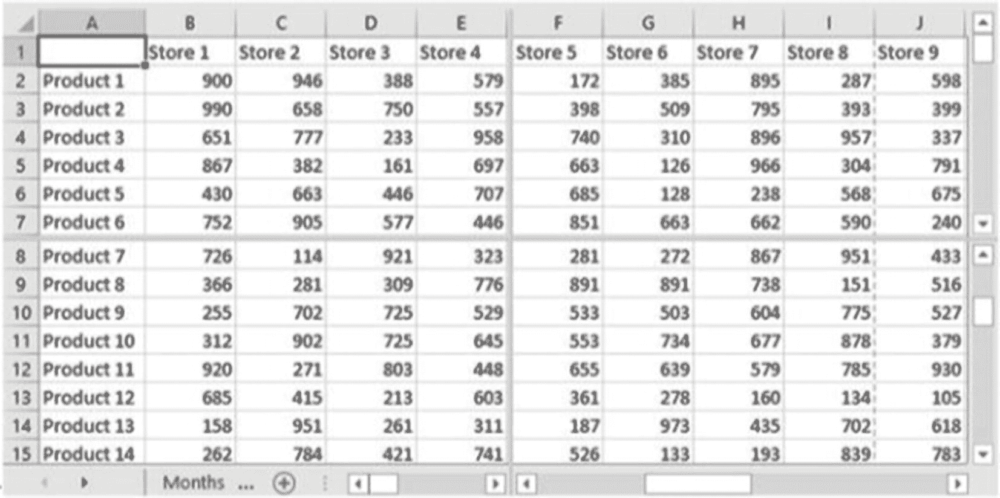

图 5-21 拆分条出现在窗口的中心

在工作表上放置水平拆分条会添加一个额外的垂直滚动条。在工作表上放置垂直拆分条会添加一个额外的水平滚动条。在工作表上同时放置水平和垂直拆分条会添加额外的水平和垂直滚动条。这提供了单独滚动每个窗格的能力。请参见图 5-22。

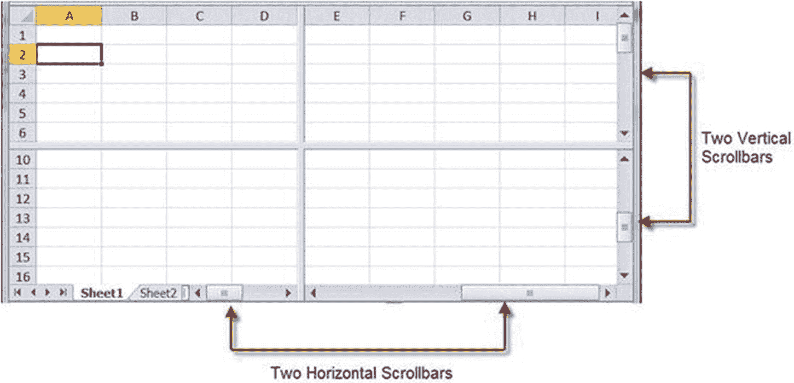

图 5-22 用于分别滚动四个窗格的水平与垂直滚动条

可以通过双击拆分条将其从工作表中移除。双击两条拆分条的交汇处可以同时移除两者。功能区上的`拆分`按钮就像是一个切换开关。单击它可添加拆分条。再次单击则可移除拆分条。

## 冻结行与列

冻结行与列是另一种解决无法同时查看行标题和行合计，或列标题和列合计问题的方法。

在冻结工作表时，你可以选择以下三个选项之一：

* `冻结窗格`——你可以同时冻结当前单元格之前的所有列和行。如果当前单元格是 C4，这意味着 A 列和 B 列被冻结，同时第 1、2 和 3 行也被冻结。其余列和行则可滚动。

* `冻结首行`——你可以冻结工作表的第一行，以便在滚动浏览工作表的其余部分时，该行始终保持可见。

* `冻结首列`——你可以冻结第一列，以便在滚动浏览工作表的其余部分时，该列始终保持可见。

你可以通过单击`视图`选项卡，然后单击位于`窗口`组中的`冻结窗格`按钮来选择这三个选项之一。请参见图 5-23。

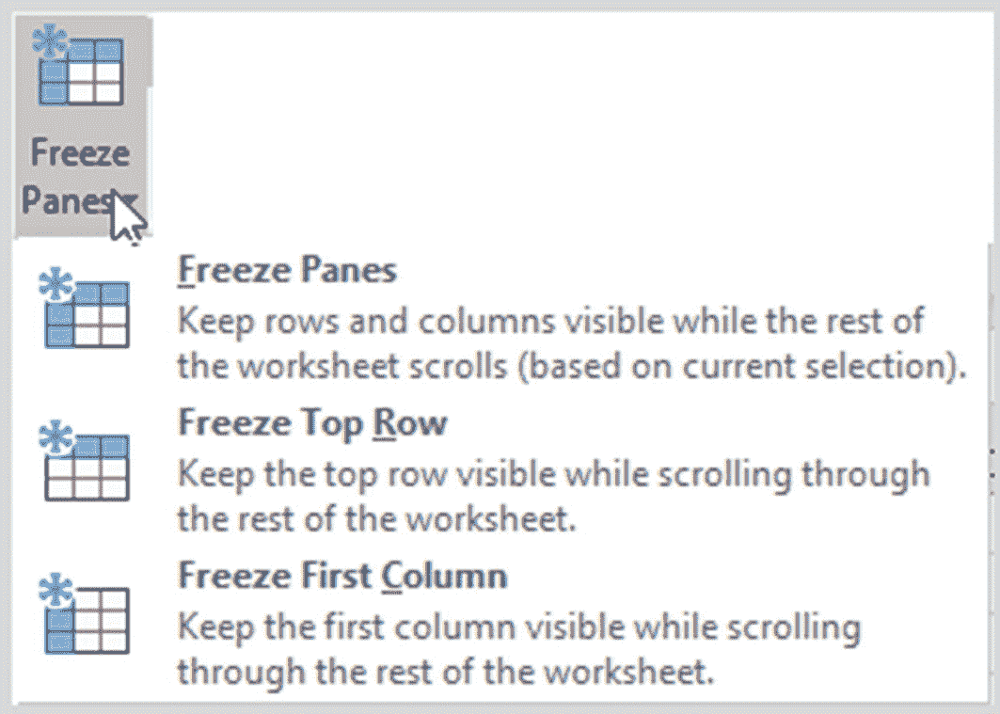

图 5-23 `冻结窗格`选项

一旦你使用三个选项之一冻结了工作表，第一个选项将从`冻结窗格`变为`取消冻结窗格`。单击`取消冻结窗格`将使你恢复正常查看状态。

## 同步滚动

您可以使用`窗口`组中的`新建窗口`、`并排查看`和`同步滚动`选项，打开工作簿的第二份副本，并排查看工作簿，使包含相同工作表的副本能够同步滚动。

### 练习 5-5：同步滚动、将窗口拆分为多个窗格以及冻结窗口

在此练习中，您将把一个工作表拆分为多个工作表。看起来好像有多个工作表副本，但它们只是同一工作表的单独视图，您可以同时滚动它们。您还将练习冻结行和列。

1.  单击功能区的`视图`选项卡。在`窗口`组中，单击`全部重排`。选择`垂直`和`当前活动工作簿的窗口`。
    
    工作簿顶部的名称显示为`Chapter 5:2`。原始工作簿的标题栏显示`Chapter 5:1`。

2.  `同步滚动`现在在`并排查看`按钮下高亮显示。使用其中一个工作簿的垂直和水平滚动条。请注意，当您拖动一个工作簿上的滚动条时，另一个工作簿也会随之滚动。

3.  通过单击工作簿右上角的`X`来关闭其中一个工作簿。工作簿标题恢复为其原始名称`Chapter 5`。

4.  单击功能区的`视图`选项卡。在`窗口`组中，单击`并排查看`。
    
    **注意**：如果除了`Chapter 5`工作簿之外，您还打开了其他工作簿，则会弹出一个`并排比较`窗口，您可以在其中选择要与`Chapter 5`并排查看的工作簿。您需要选择`Chapter 5:1`。

5.  如果`Chapter 5`工作簿尚未打开，请将其打开。单击`Stores`工作表。

6.  单击功能区的`视图`选项卡。在`窗口`组中，单击`新建窗口`。将打开第二个窗口，其中`Stores`工作表处于活动状态。您可能看不到原始窗口，因为它可能隐藏在新建窗口后面。

7.  单击功能区的`视图`选项卡。在`窗口`组中，单击`全部重排`。选择`垂直`和`当前活动工作簿的窗口`。见图 5-24。

    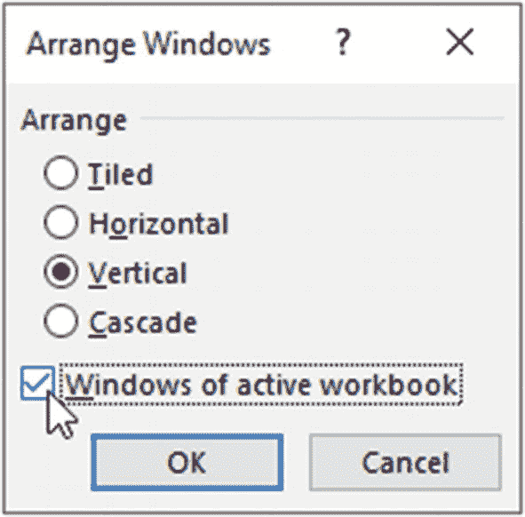
    
    *图 5-24：选择当前活动工作簿的窗口*

### 创建拆分条

1.  双击两条拆分条相交的位置以同时移除它们。

2.  将鼠标指针移动到两条拆分条的相交处。鼠标指针应变为双箭头。见图 5-27。按住鼠标按钮并朝任意方向拖动；两条拆分条将随鼠标一起移动。

    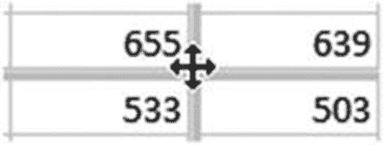
    
    *图 5-27：鼠标指针放置在拆分条连接处时显示为双箭头*

3.  使用顶部窗格中的滚动条滚动浏览顶部窗格中的数据。

4.  使用底部窗格中的滚动条滚动浏览底部窗格中的数据。如您所见，您拥有工作表的两份完整副本。调整您的工作表，以便在两个工作表中都能看到单元格`B2`。

5.  单击上方窗格中的单元格`B2`内部。当您在一个窗格中选择一个单元格时，它也会在另一个窗格中被选中。

6.  在单元格中输入`500`。按`Enter`键。此时，在两个工作表中，单元格`B2`的值都应显示为`500`。

7.  双击拆分条以将其移除。

8.  单击单元格`G8`。在功能区的`视图`选项卡上的`窗口`组中，单击`拆分`按钮。这将在该单元格的上方和左侧创建相交的拆分条。见图 5-26。

    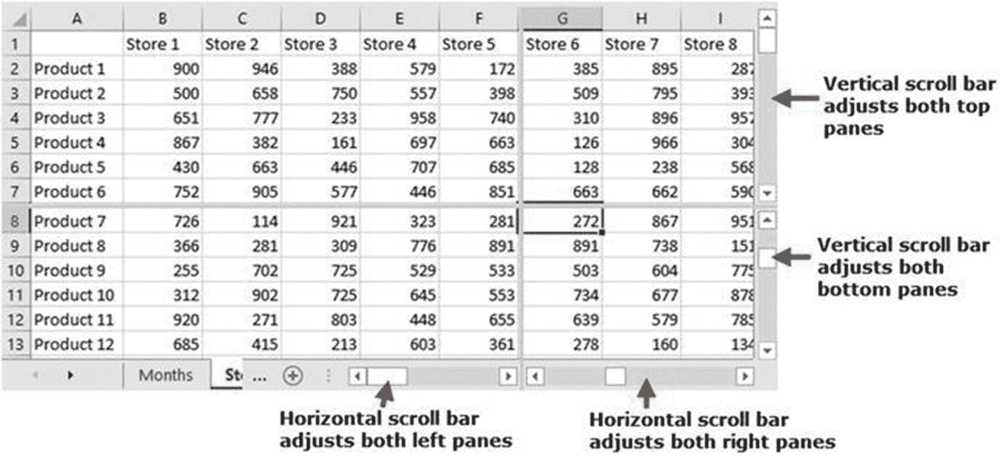
    
    *图 5-26：窗口拆分为四个窗格，带有两个垂直和两个水平滚动条*
    
    练习移动水平滚动条和垂直滚动条，然后调整四个工作表，以便在所有四个窗格中都能看到同一个单元格。单击其中一个单元格。请注意，它会在所有四个窗格中高亮显示同一个单元格。如果您更改其中一个单元格，会影响所有四个窗格中的工作表。

9.  单击单元格`A3`内部。在功能区的`视图`选项卡上的`窗口`组中，单击`拆分`按钮。在当前选定的单元格上方会出现一条拆分条。您可以将拆分条拖动到其他位置。将水平拆分条向下拖动，使其位于第 7 行和第 8 行之间。请注意，您会看到两个垂直滚动条。见图 5-25。

    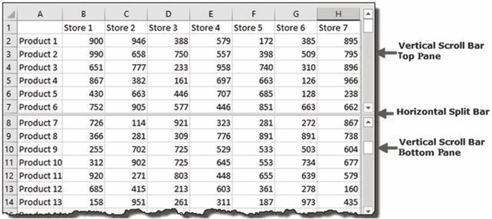
    
    *图 5-25：窗口分为两个窗格，带有两个独立的滚动条*

### 冻结窗格

1.  尝试使用不同的活动单元格，然后冻结窗格。这对活动单元格上方的行和左侧的列有何影响？

2.  单击单元格`B2`并完成以下步骤：
    
    1.  单击`冻结窗格`按钮。
    2.  单击`冻结窗格`。
    3.  垂直和水平滚动到数据的末尾。您的列标题和行标题都保持不动。
    4.  取消冻结窗格。

3.  在`窗口`组中，单击`冻结窗格`按钮。将显示三个冻结选项：
    
    1.  单击冻结首行的选项。向下滚动数据。列标题将保持在其固定位置，这样无论您位于哪一行，都可以始终看到列标题。

4.  在`窗口`组中，单击`冻结窗格`按钮。第一个选项已更改为`取消冻结窗格`。单击此选项可取消冻结首行。

5.  单击`冻结窗格`按钮。单击冻结首列的选项。向右滚动到数据的末尾。行标题将保持在其固定位置，这样无论您位于哪一列，都可以始终看到行标题。

6.  单击`冻结窗格`按钮。单击`取消冻结窗格`。
    
    您已经学会了如何冻结行标题和列标题，使它们在滚动时保持不动。您还学会了如何同时查看工作表的多个副本，同时保持它们的滚动同步。接下来，您将了解如何指定查看工作表的不同方式，然后将这些视图保存为自定义视图。

## 自定义视图：如何创建、显示和删除

如果您或其他用户以不同方式查看您的工作簿，例如使用不同的页眉或页脚、不同的打印区域或页边距、显示不同的列或行、或者对数据应用了筛选等，您可以将不同的视图保存为自定义视图。每个自定义视图都有其自己的名称。当打开一个自定义视图时，它将使用所有已存储的设置打开。

在创建自定义视图之前，您需要将工作簿设置为您希望其显示和打印的精确外观。当您准备好保存当前视图时，请单击`视图`选项卡。在`工作簿视图`组中，单击`自定义视图`按钮。见图 5-28。

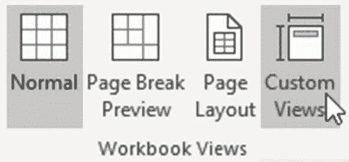

图 5-28 — 自定义视图按钮

单击`自定义视图`按钮会弹出如图 5-29 所示的`自定义视图`对话框，您可以在其中单击`添加`按钮。

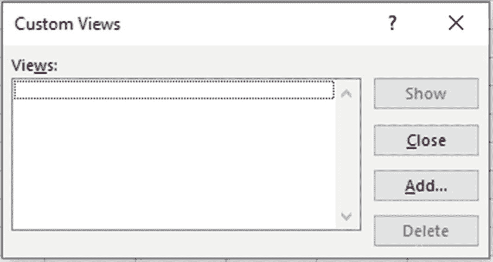

图 5-29 — 自定义视图对话框

单击`添加`按钮会弹出如图 5-30 所示的`添加视图`对话框，您可以在此处输入要分配给该视图的名称。

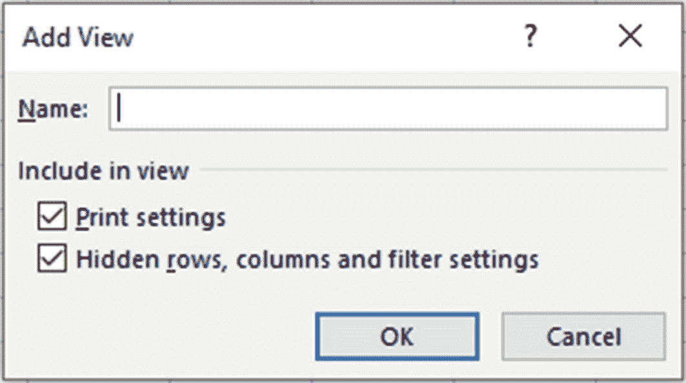

图 5-30 — 添加视图对话框

创建视图后，您可以通过从`自定义视图`对话框中选择另一个视图，然后单击`显示`按钮来切换至该视图。

注意：您不能创建包含表格的自定义视图。

### 练习 5-6：创建、显示和删除自定义视图

在本练习中，您将创建三个视图，显示这些视图，然后将其删除。

#### 创建视图

1.  单击功能区上的`视图`选项卡。在`工作簿视图`组中，单击`自定义视图`按钮。
2.  在`自定义视图`窗口中，单击`添加`按钮。在`添加视图`窗口中，为名称输入`打印变更`。单击`确定`按钮。
3.  跨列标题 D、E、F 和 G 拖动以将其选中。右键单击选定的文本，然后选择`隐藏`。
4.  单击功能区上的`视图`选项卡。在`工作簿视图`组中，单击`自定义视图`按钮。
5.  在`自定义视图`窗口中单击`添加`按钮。如图 5-31 所示，为自定义视图的名称输入`隐藏列`。单击`确定`按钮。

    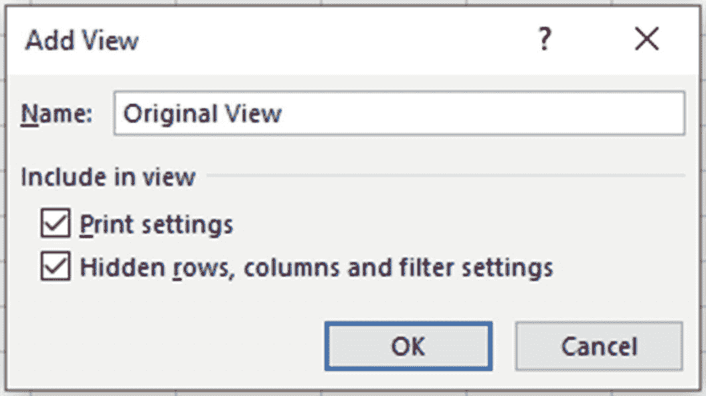
    
    图 5-31 — 添加视图窗口

6.  跨列标题 C 和 H 拖动以将其选中。右键单击选定的文本，然后选择`取消隐藏`。
7.  跨行标题 15 至 20 拖动以将其选中。右键单击选定的文本，然后选择`隐藏`。
8.  单击功能区上的`视图`选项卡。在`工作簿视图`组中，单击`自定义视图`按钮。
9.  在`自定义视图`窗口中，单击`添加`按钮。
10. 为自定义视图的名称输入`隐藏行`。单击`确定`按钮。
11. 跨行标题 14 和 21 拖动。右键单击选定的文本，然后选择`取消隐藏`。
12. 单击功能区上的`页面布局`选项卡。在`页面设置`组中，单击`纸张方向`按钮，然后选择`横向`。
13. 单击`页面设置`组的对话框启动器 ：

### 显示视图

- 单击`工作表`选项卡。
- 在`打印区域`文本框中输入`A1:K6`。
- 选择`网格线`。
- 单击`确定`按钮。

14. 如果尚未打开，请打开工作簿第 5 章。单击`自定义`选项卡。
15. 单击功能区上的`视图`选项卡。在`工作簿视图`组中，单击`自定义视图`按钮。
16. 在`自定义视图`窗口中单击`添加`按钮。如图 5-31 所示，为自定义视图的名称输入`原始视图`。单击`确定`按钮。

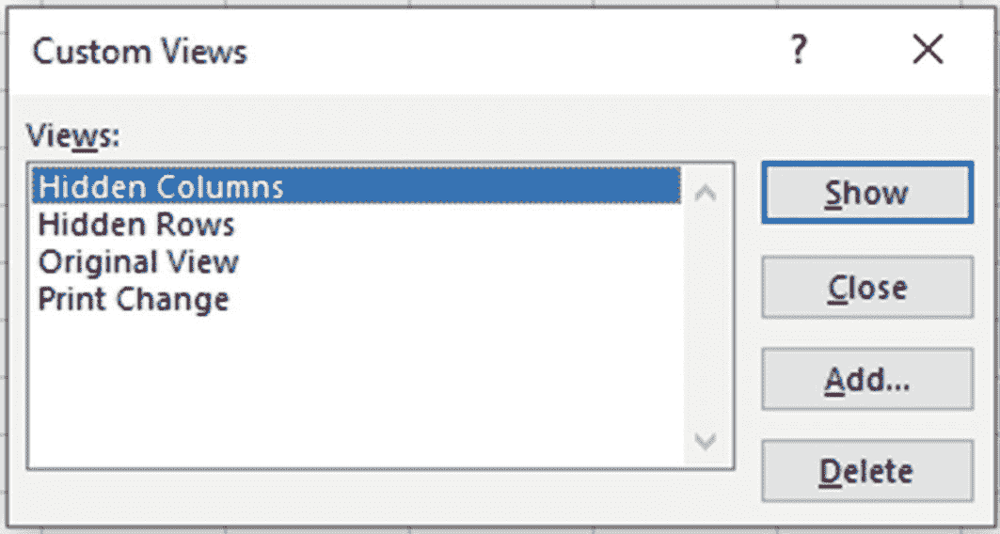

图 5-32 — 自定义视图窗口

1.  单击`自定义视图`按钮。单击`隐藏行`，然后单击`显示`按钮。第 15 行至第 20 行被隐藏。
2.  单击`自定义视图`按钮。单击`打印变更`，然后单击`显示`按钮。单击功能区上的`文件`选项卡。在左侧窗格中单击`打印`。您可以看到，只有您为打印区域选择的内容才会被打印，并且是横向模式。单击`返回`按钮。
3.  单击`自定义视图`按钮。单击`原始视图`，然后单击`显示`按钮。
4.  单击`自定义视图`按钮。单击`隐藏列`，然后单击`显示`按钮。见图 5-32（D 列至 G 列被隐藏）。

### 删除视图

1.  在`工作簿视图`组中，单击`自定义视图`按钮。
2.  选择一个视图，然后单击`删除`按钮。系统将要求您确认删除。单击`是`。
3.  对其余三个视图重复步骤 1 和 2。

本节向您展示了如何创建自己的自定义视图，以便以不同方式查看同一个工作表。每个自定义视图都分配有自己独有的名称。工作簿的所有自定义视图都存储在该工作簿中。如果您不使用自定义视图，则必须保存工作簿的不同版本来获得相同的结果。

## 总结

Excel 可以在三种不同视图之一中显示电子表格。`普通`视图是您大多数时候会使用的视图。`分页预览`对于调整分页符很有用。`页面布局`视图提供了一种添加、编辑和删除页眉和页脚的快捷方式。

自定义视图允许您或其他用户在同一电子表格的不同视图之间来回切换。例如，您可以创建一个视图来显示所有数据，创建第二个视图来显示某些列，创建第三个视图来打印工作表的一部分。

您可以将工作表拆分为多个窗格，然后逐个滚动浏览各个窗格。您已经练习了如何让工作表呈现出您想要的样子，并使用了打开 Excel 时可以看到的许多按钮。接下来，您将学习“后台视图”，其中包括以不同格式保存工作簿的更多选项，以及如何跟踪有关工作簿创建时间和原因的信息。您还将练习如何通过电子邮件共享工作簿。接下来讨论的其他功能包括如何跟踪您最近的工作以及如何使用导航窗格。