# 6. 了解后台视图

`文件`选项卡与其他选项卡不同，它不会显示一系列带有按钮的组；相反，它会显示所谓的后台视图。这个区域被称为后台视图，因为后台视图上的选项是在工作簿幕后处理的，例如处理文件、打印、共享和导出工作簿、帐户信息，以及选择更改 Excel 工作方式的选项。它还显示有关工作簿的信息。

阅读并完成本章的学习后，您应该能够：

- 以不同格式保存工作簿

- 添加和编辑有关文件及其属性的信息

- 使用各种选项以您希望的方式打印工作簿

- 将工作簿作为电子邮件附件发送

- 搜索满足您需求的模板

- 通过浏览或使用`最近使用`列表打开工作簿

- 指定`最近使用`列表中显示的工作簿数量

- 将工作簿保留在`最近使用`列表中

- 将最近打开的工作簿放置在`导航`窗格中

- 设置 Excel 选项

## Backstage 概览

图 6-1 展示了 Backstage。在导航窗格中点击某个分组项（例如 `Info`、`New`、`Open` 等），右侧区域会显示该分组的信息和选项。我们将介绍导航窗格中的大部分分组。

以下列表展示了您可以在 Backstage 中执行的一些操作：

*   以多种不同格式保存文件。
*   更改打印机设置。
*   保护工作簿。
*   将工作簿保存到 OneDrive。
*   授予他人对工作簿的权限。
*   以各种格式通过电子邮件发送工作簿。
*   在工作簿中添加和删除个人信息。
*   检查工作簿对残障人士的辅助功能。
*   检查与早期 Excel 版本的兼容性。
*   更新 Excel。
*   更改您的 Microsoft 帐户信息。
*   指定“最近使用的文件”列表中显示的工作簿数量。
*   将工作簿固定到 Backstage 窗格。
*   恢复未保存的工作簿。

表 6-1 列出了导航窗格中的一些分组并进行了说明。

**表 6-1**

**Backstage 导航分组及其说明**

| 分组 | 说明 |
| --- | --- |
| **Info** | 显示当前打开的工作簿的信息。 |
| **New** | 创建新的空白工作簿或根据模板创建工作簿。 |
| **Open** | 打开现有的 Excel 工作簿。 |
| **Save** | 保存对当前打开的工作簿的更新。不更改现有工作簿的名称。 |
| **Save As** | 保存之前未保存过的工作簿。也可用于创建当前打开工作簿的第二份副本并为其指定不同的名称。 |
| **Print** | 打印工作簿的选项。 |
| **Share** | 提供与他人共享工作簿的选项。 |
| **Close** | 关闭工作簿。 |
| **Account** | 提供您的 Microsoft Office 帐户信息。 |
| **Options** | 显示可用于更改 Excel 工作方式的选项。 |

## Info 分组——查看、添加和编辑工作簿信息

当您单击 `File` 选项卡时，`Info` 分组默认显示在 Backstage 中。见图 6-1。

`Info` 分组显示当前打开工作簿的信息并处理与其相关的信息。我们将首先查看“属性”窗格选项卡；然后查看中间窗格中用于保护和工作簿检查的选项。

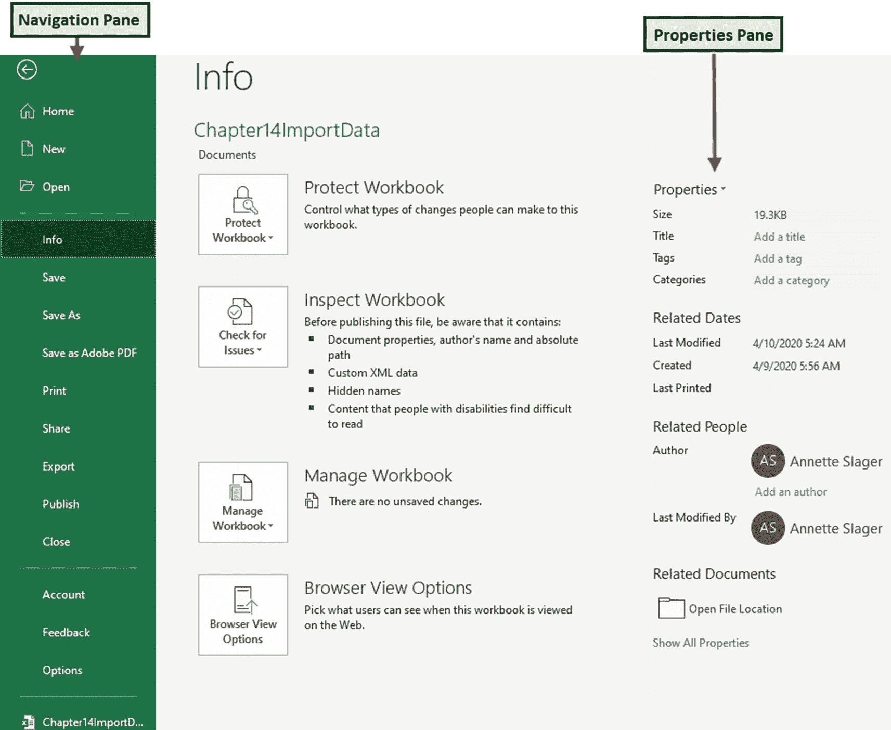

**图 6-1**

从包含数据的工作簿访问时的 Backstage

### 属性窗格

当您在 Windows 资源管理器中查看文件时，可以看到文件的名称、日期和大小，但这通常不够。可以在“属性”窗格中输入或查看文件的附加信息。在“属性”窗格底部，如果当前未显示所有属性，可以点击**显示所有属性**。如果当前显示了所有属性，可以点击**显示更少属性**。

您可以在此窗口中直接输入或编辑属性。您可以输入标题、标记、类别、公司和经理等内容。

在“属性”窗格中点击 **Properties** 旁边的向下箭头，会调出图 6-2 所示的**高级属性**按钮。点击**高级属性**按钮会显示图 6-3 所示的**属性**对话框。

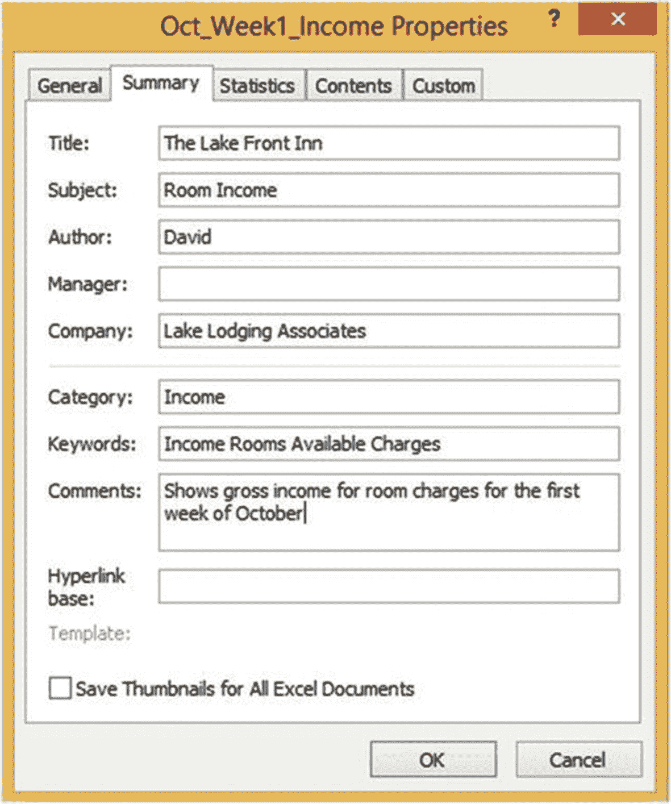

**图 6-3**

工作簿属性对话框

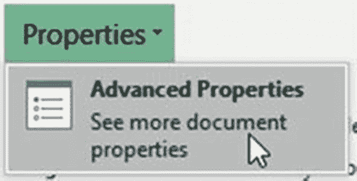

**图 6-2**

高级属性按钮

您在**属性**对话框中输入的部分信息可以在“属性”窗格中查看。当您点击**浏览**按钮时，这些信息也会显示在 **Save As** 窗口的底部，如图 6-4 所示。您在此处输入的信息可作为文档使用，并有助于您搜索工作簿。

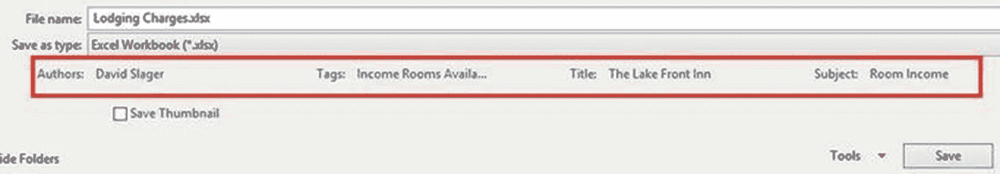

**图 6-4**

在属性对话框中输入的部分信息会显示在您通过 Backstage 的导航窗格使用“另存为”保存文件时

在 Windows 资源管理器中右键单击 Excel 文件，然后选择**属性**，会显示“属性”窗口。选择**详细信息**选项卡以查看您输入的信息。见图 6-5。

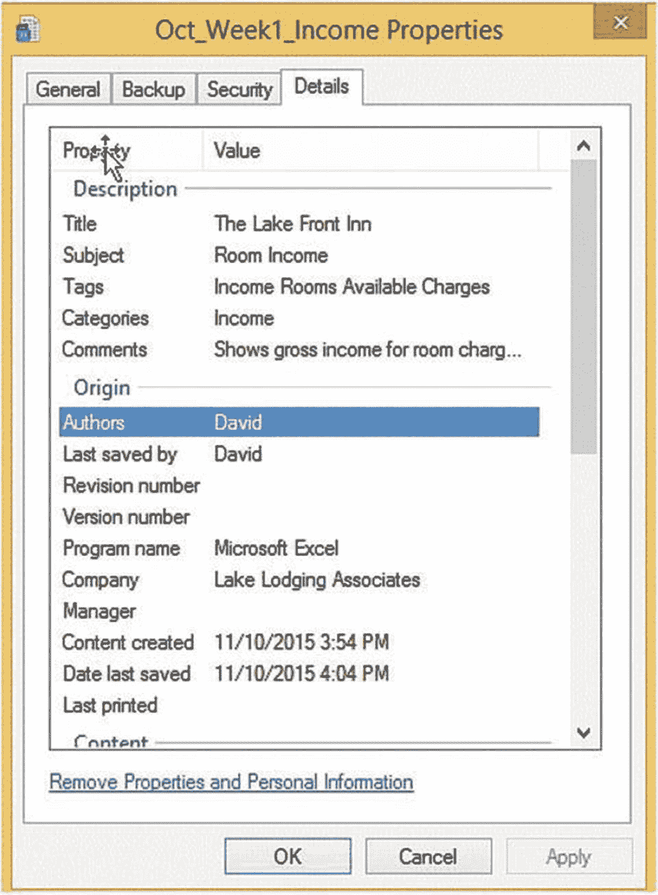

**图 6-5**

名为 `Oct_Week1_Income` 的工作簿的工作簿信息

### 保护工作簿选项

在“信息”窗格中，点击**保护工作簿**按钮会弹出一个菜单，其中包含用于保护工作簿的不同方式的选项。见图 6-6。我们将介绍**标记为最终状态**、**用密码进行加密**和**保护工作簿结构**。这些并非保护工作簿的唯一选项。我们将在本章后面介绍保护工作簿的其他方法。

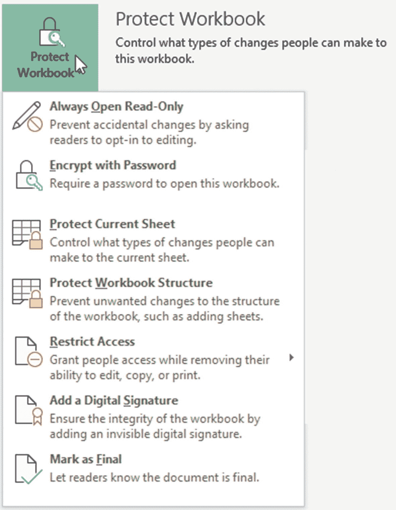

**图 6-6**

保护工作簿的选项

#### 标记为最终状态

选择**标记为最终状态**会将您的工作簿设为只读。您将无法对任何工作表进行任何更改，也无法创建任何新工作表。点击**标记为最终状态**按钮会弹出图 6-7 所示的消息框。

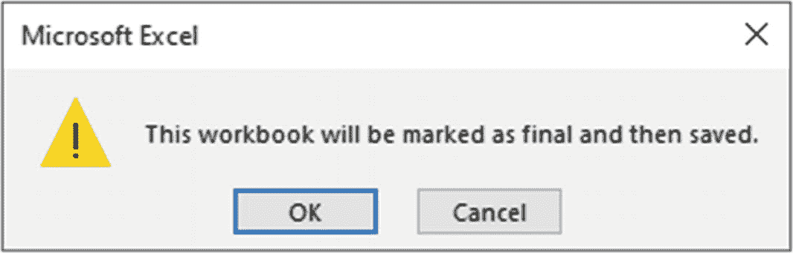

**图 6-7**

Excel 询问是否要将工作簿标记为最终状态

点击**确定**按钮会弹出图 6-8 所示的消息窗口。

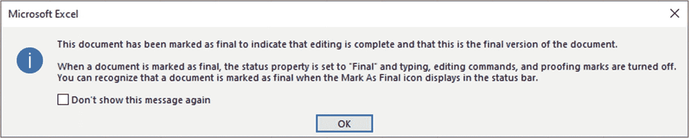

**图 6-8**

告知编辑已完成且这是最终版本的消息

工作簿打开时，状态栏上会显示一个**标记为最终状态**图标，工作表上方会显示一条消息，表明作者已将工作簿标记为最终状态，以阻止编辑。见图 6-9。如果您或您将工作簿分享给的任何其他人认为需要进行更改，可以通过点击**仍然编辑**按钮来完成。点击此按钮允许您对工作簿中的任何工作表进行任何更改或添加。

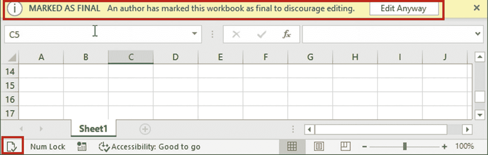

**图 6-9**

已被标记为最终状态的工作簿

#### 用密码进行加密

选择此选项需要您输入密码并进行验证。它使用 128 位高级加密技术来提高文件的安全性。下次打开此文件时需要输入此密码。

**注意**

Microsoft 不提供恢复在 Microsoft Office 中创建的密码的方法。

#### 保护工作簿结构

此选项可防止用户添加或删除工作表；隐藏和取消隐藏工作表；以及移动、复制或重命名工作表。如果需要，您可以为该选项添加密码。参见图 6-10。

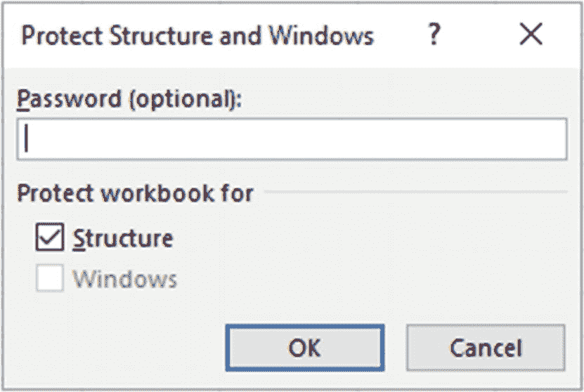

图 6-10 – 选择结构保护以防止用户进行更改

如果已为工作簿应用了密码保护，并且已应用了工作簿结构保护，则`保护工作簿`区域会通知您这一点。参见图 6-11。

图 6-11 – 通知用户结构已锁定且需要密码才能打开工作簿的消息

如果您已保护工作簿并单击功能区的`审阅`选项卡，您会注意到在`保护`组中，`保护工作簿`按钮处于高亮状态。如果您想取消保护，需要单击此按钮。如果您在保护时输入了密码，则需要输入相同的密码才能取消保护。密码区分大小写。

### 检查问题

`检查问题`按钮的右侧是`检查工作簿`区域。`检查工作簿`会显示尚未解决的项目。参见图 6-12。这些问题不会影响工作簿的运行。

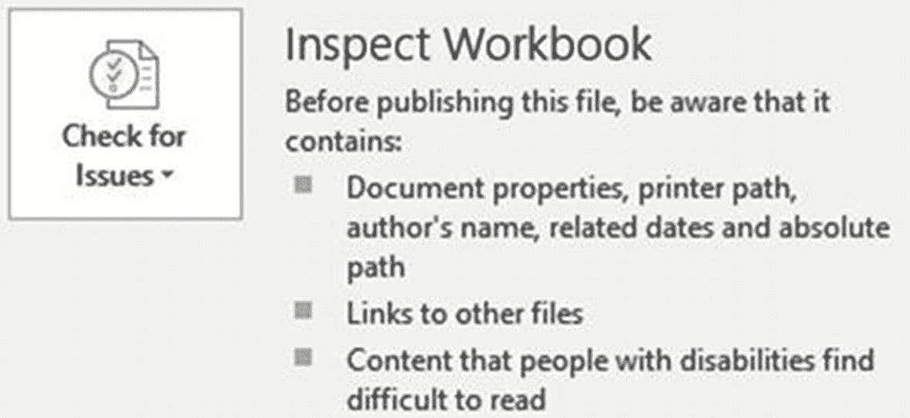

图 6-12 – `检查工作簿`显示尚未解决的项目

`检查问题`按钮提供了检查工作簿是否包含个人信息、检查工作簿是否可被残障用户轻松阅读，以及检查与早期 Excel 版本兼容性的选项。参见图 6-13。接下来我们将介绍如何使用`检查文档`、`检查辅助功能`和`检查兼容性`。

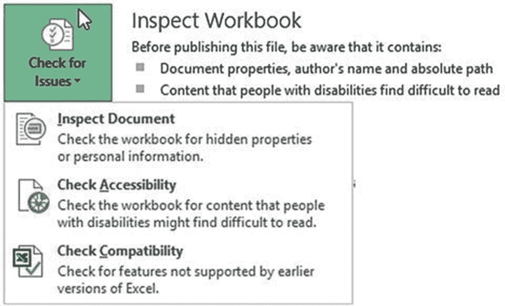

图 6-13 – `检查问题`选项

#### 检查文档

`文档检查器`可帮助您查找可能希望在与他人共享此文档之前删除的个人和隐藏信息。如果您在保存 Excel 工作簿之前运行`检查文档`，您将收到图 6-14 中的警告消息，提示您应单击`是`立即保存文件；否则，您可能会丢失部分数据。

如果您已保存文件或已对图 6-14 中的消息做出响应，则会显示`文档检查器`对话框。参见图 6-15。勾选您希望在`文档检查器`中检查的每个复选框。

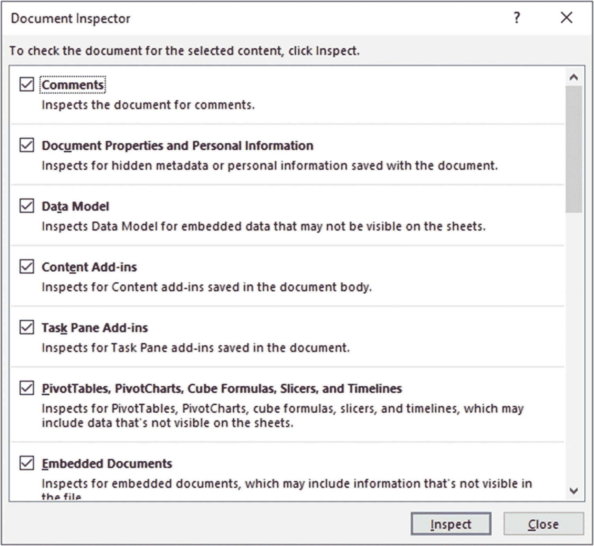

图 6-15 – 选择要检查的项目

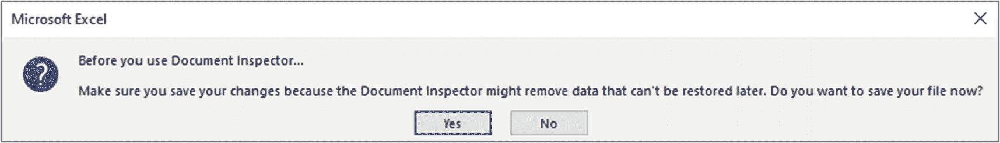

图 6-14 – 通知用户单击`是`按钮保存文件的消息

单击`检查`按钮，会检查文档中您已勾选的项目。如果 Excel 为您选择的任何选项找到了个人或隐藏数据，它将为该选项显示一个`全部删除`按钮。参见图 6-16。

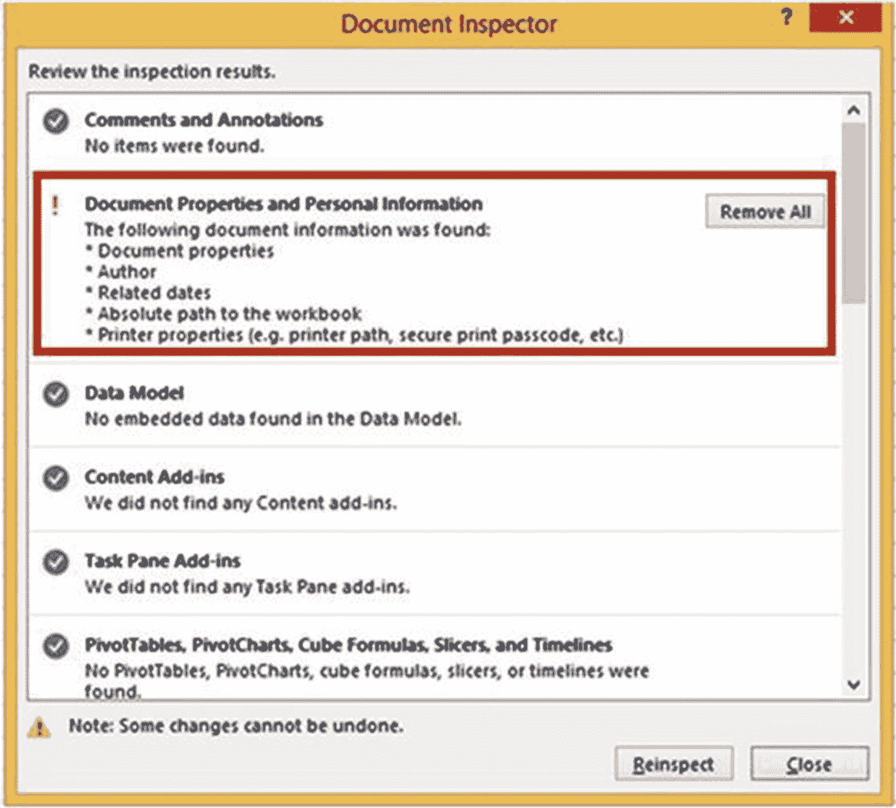

图 6-16 – Excel 报告其针对所选选项找到的个人或隐藏数据

#### 检查辅助功能

`检查辅助功能`会检查工作簿中与残障用户相关的问题，这些用户可能难以阅读工作簿。有些人使用屏幕阅读器来为他们朗读工作簿。问题的一个示例是屏幕阅读器无法读取图像。如果您希望使工作簿对这些用户兼容，则需要为图像输入替代文本。当您单击`检查辅助功能`按钮时，`辅助功能检查器`会出现在工作簿的右侧。`辅助功能检查器`将问题细分为错误和警告。图 6-17 显示了未发现任何问题时`辅助功能检查器`的外观。

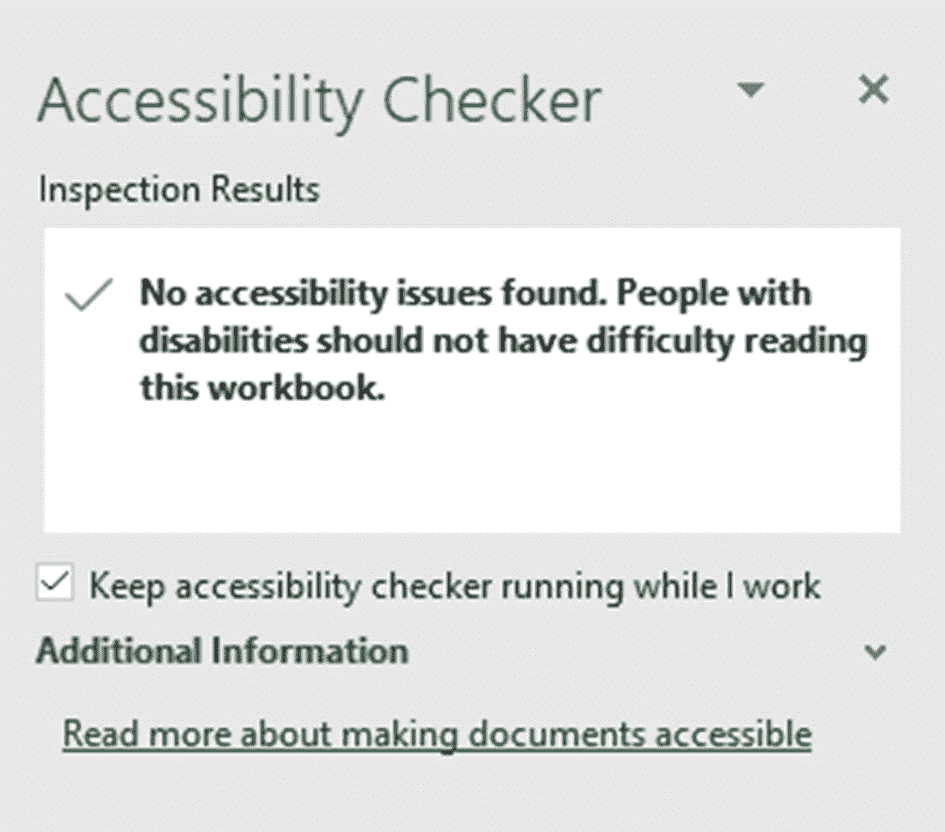

图 6-17 – 无错误或警告

图 6-18 显示了一个警告错误，因为工作表未被赋予名称，因此它们被保留为`Sheet1`和`Sheet2`。

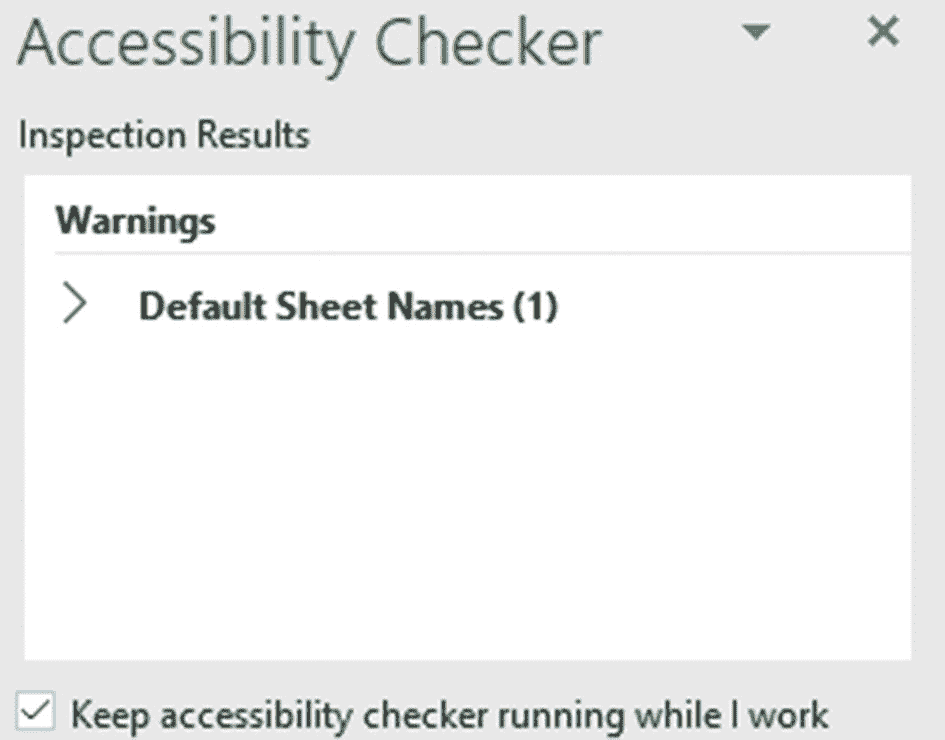

图 6-18 – 警告工作表仍具有默认名称`Sheet1`和`Sheet2`

#### 检查兼容性

如果您希望与未安装相同版本 Excel 的其他人共享工作簿，您需要运行`兼容性检查器`。`兼容性检查器`会报告哪些功能可能丢失以及这些功能在工作簿中出现的次数。参见图 6-19。如果您将工作簿保存为 Excel 97-2003 格式，`兼容性检查器`将自动运行。97-2003 格式的工作簿文件扩展名为`.xls`。从 2007 版开始的工作簿扩展名为`.xlsx`。

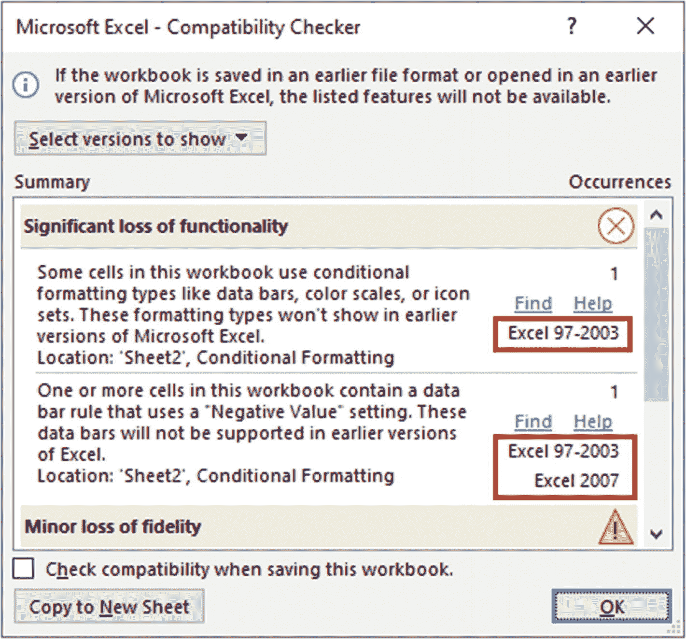

图 6-19 – `兼容性检查器`

在`兼容性检查器`中单击`选择要显示的版本`按钮，会弹出要测试的 Excel 版本。参见图 6-20。`兼容性检查器`将测试与您所选 Excel 版本的兼容性。

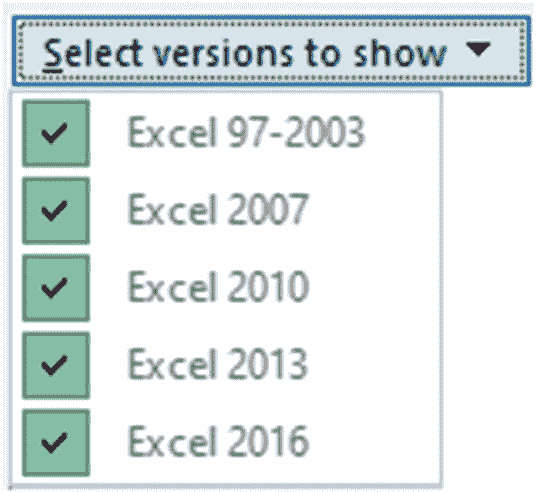

图 6-20 – 选择要测试的 Excel 版本

勾选`保存此工作簿时检查兼容性`复选框，以便每次保存此工作簿时 Excel 都检查兼容性。

## 新建组 — 创建工作簿

您可以通过单击 Backstage 导航窗格中的 `新建` 或在非 Backstage 状态下按 `Ctrl + N` 来创建新工作簿。从导航窗格选择 `新建` 可以创建一个全新的空白文档。但是，如果您要创建的项目与众多预建模板之一相似，不妨考虑改用某个模板（见图 6-21）。常言道：“何必多此一举。”

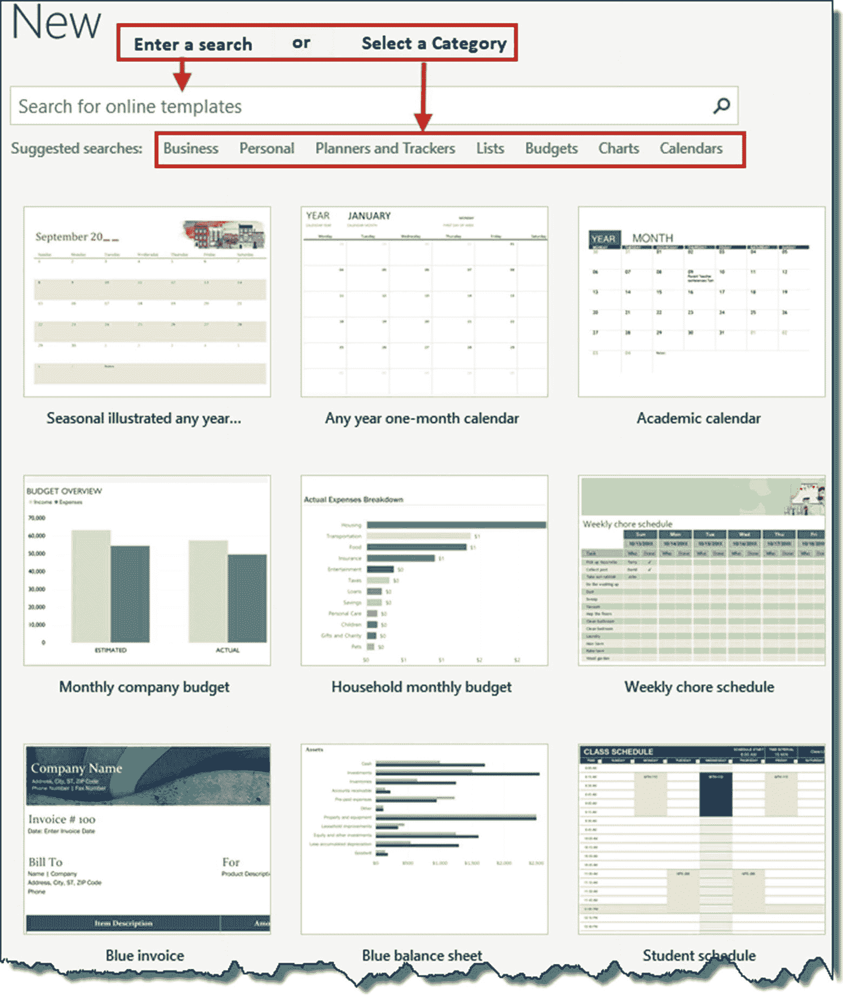

图 6-21

搜索模板或选择一个模板

如果选择某个模板类别，Excel 将显示该类别下的可用模板。见图 6-22。

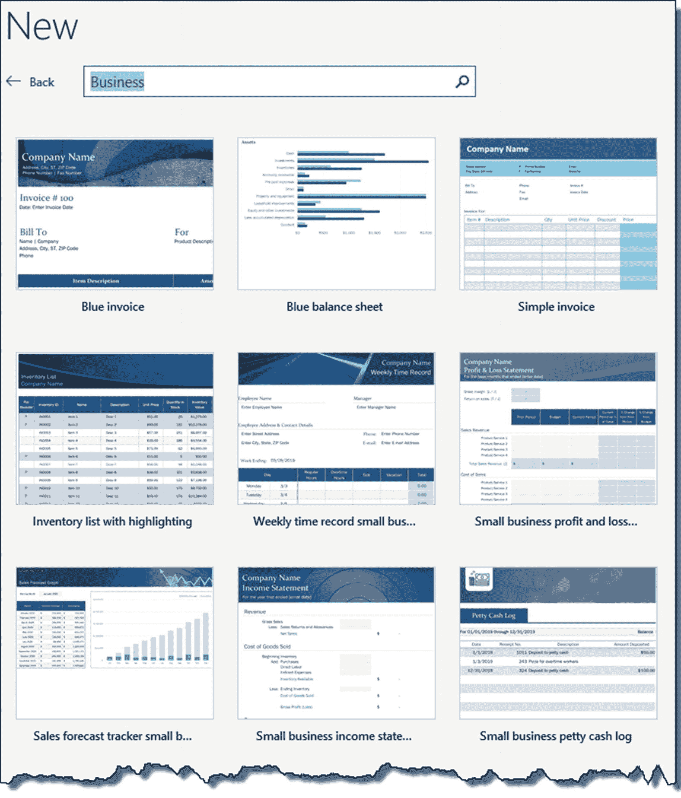

图 6-22

所选类别的可用模板

双击要使用的模板。Excel 会打开一个使用该模板的新工作簿。如果您想在打开前查看模板的更大视图，可以单击该模板。见图 6-23。您可以使用 `上一个` 和 `下一个` 按钮查看其他模板。单击 `创建` 按钮即可打开该模板。

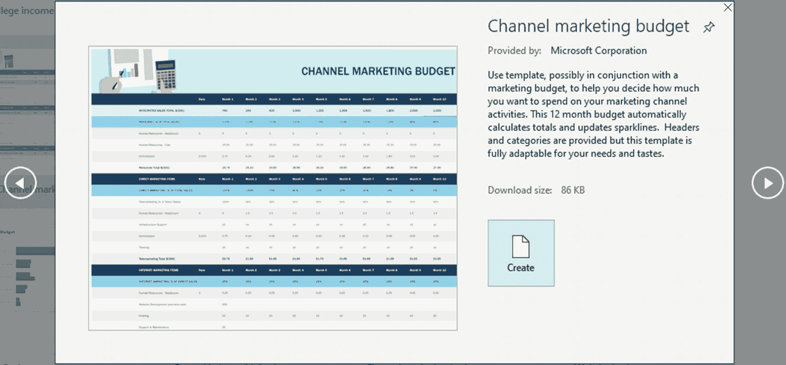

图 6-23

单击模板可显示其放大视图

## 打开组 — 打开工作簿

通过 Backstage 窗格中的 `打开` 组，您可以浏览工作簿或从 `最近使用` 列表中选择工作簿。如果您希望某个工作簿保留在 `最近使用` 列表中，可以将其固定。

### 打开现有工作簿

在 Backstage 视图的 `打开` 组中，您可以通过以下方式之一打开工作簿：

- 从 `最近使用` 列表中选择一个工作簿。
- 选择一个 Excel 文件的位置，例如 `OneDrive` 或某个网络位置。
- 选择 `PC` 以在本地计算机或网络上查找 Excel 文件。您可能需要单击 `浏览` 按钮才能找到工作簿文件的位置。

#### 从最近使用列表打开工作簿

如果您最近使用过该工作簿，通过选择中间窗格中的 `最近使用` 来打开文件会更方便。选择 `最近使用` 会显示您最近打开过的工作簿列表。最近使用的工作簿将位于列表顶部。Excel 会将其划分为 `今天`、`昨天`、`本周`、`上周` 和 `更早` 使用过的工作簿。Excel 会显示文件名、文件路径以及右侧的保存日期和时间。见图 6-24。

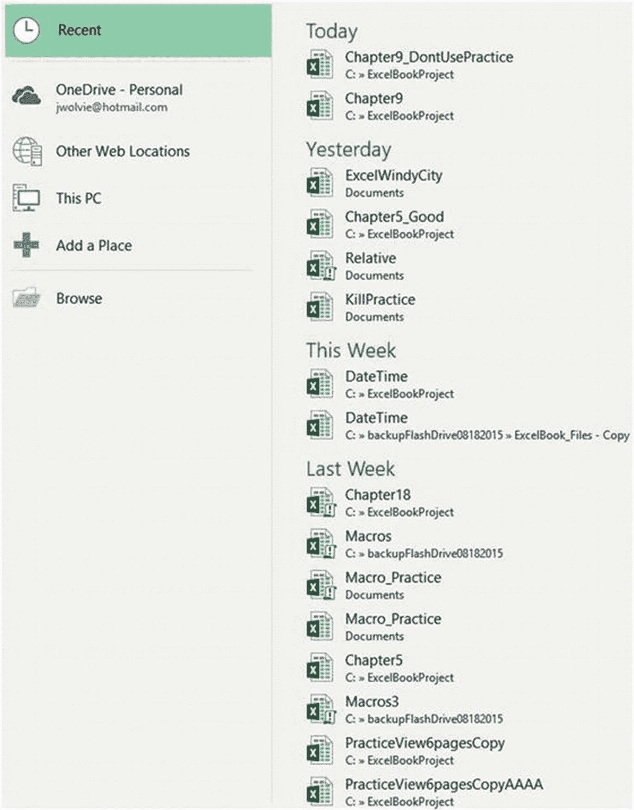

图 6-24

最近使用过的工作簿及其存储位置

如果您需要打开的工作簿不在 `最近使用` 列表中，可以使用其他选项，例如从 `OneDrive` 或 `PC` 上的其他位置访问工作簿。

#### 将工作簿保留在最近使用列表中

当您将鼠标光标悬停在 Backstage 中 `最近使用` 列表的工作簿名称上时，您会在工作簿名称右侧看到一个图钉。见图 6-25。

图 6-25

图钉

单击图钉将使与该图钉关联的工作簿保留在 `最近使用` 列表中，无论您打开和关闭多少个文件。固定的项目将显示在 `最近使用` 列表的顶部。见图 6-26。您可以再次单击图钉来取消固定该工作簿。

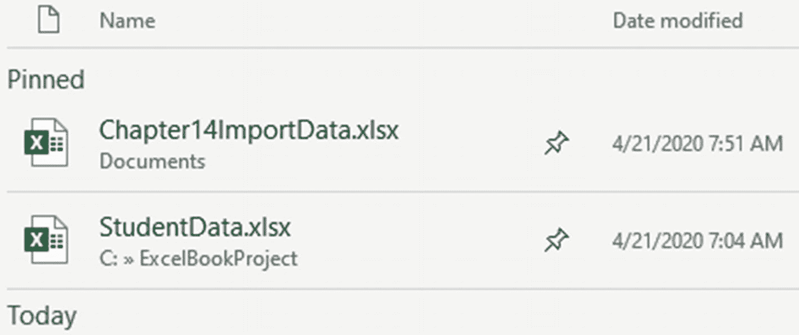

图 6-26

固定的工作簿将保留在“最近使用”列表的顶部

右键单击 `最近使用` 列表中的工作簿会弹出一个包含六个选项的上下文菜单，其中包括 `固定到列表`，其功能与单击文件旁边的图钉相同。见图 6-27。

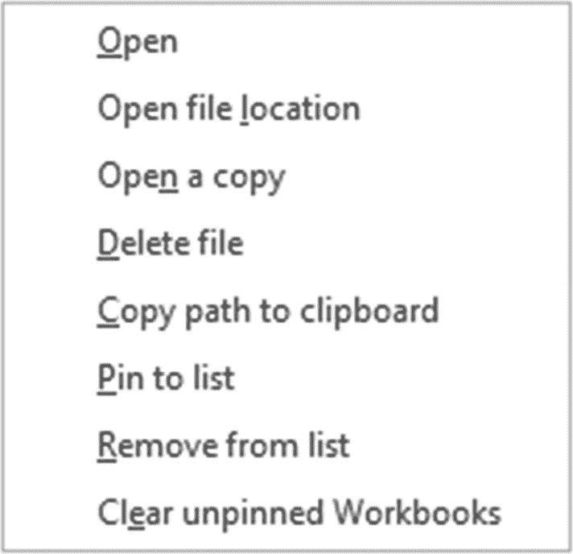

图 6-27

包含六个选项的上下文菜单

除了从此菜单固定或取消固定工作簿外，您还可以选择：

- 打开工作簿
- 打开工作簿的副本，以保护原始文件
- 删除工作簿
- 将路径复制到剪贴板 — 将路径和文件名复制到剪贴板，以便粘贴到工作表中
- 从最近使用列表中移除工作簿
- 从最近使用列表中移除所有未固定的工作簿

### 影响“打开”组的选项

您可以在 `选项` 组中设置两个选项，它们会影响 `最近使用` 列表中显示的工作簿数量以及导航窗格中另一个可用列表上显示的工作簿数量。

#### 指定最近使用列表中显示的工作簿数量

最近使用列表中显示的工作簿数量取决于 `Excel 选项` 窗口中的指定数量。默认情况下，列表显示最近使用的 25 个工作簿，但您可以调高或调低该数字。要更改列表中显示的数量，请单击功能区上的 `文件` 选项卡，单击导航窗格中的 `选项`，然后单击左侧窗格中的 `高级`。您需要向下滚动才能找到 `显示` 部分。根据您的需要更改 `显示此数目的最近工作簿` 的值。见图 6-28。单击 `确定` 按钮。

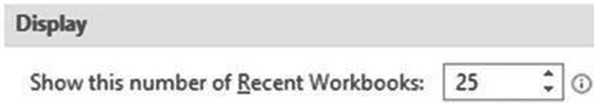

图 6-28

选择在 Backstage 中显示的最近文档数量

#### 在导航窗格中放置最近打开的工作簿

如果您希望更快速地访问工作簿，请选择 `显示` 部分中的下一个选项，即 `快速访问此数目的最近工作簿`。在此处，您可以输入要从导航窗格访问的工作簿数量。见图 6-29。

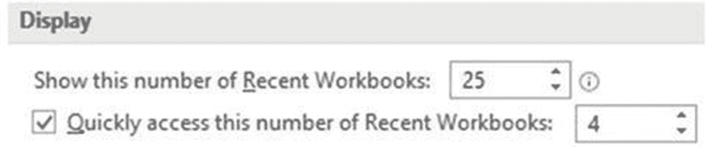

图 6-29

选中“快速访问”选项后，将在导航窗格上显示您为最近使用的工作簿输入的数量

图 6-30 展示了当选择四个工作簿进行快速访问时，导航窗格的示例外观。这四个工作簿将保留在导航窗格中。单击其中任一工作簿即可将其打开。

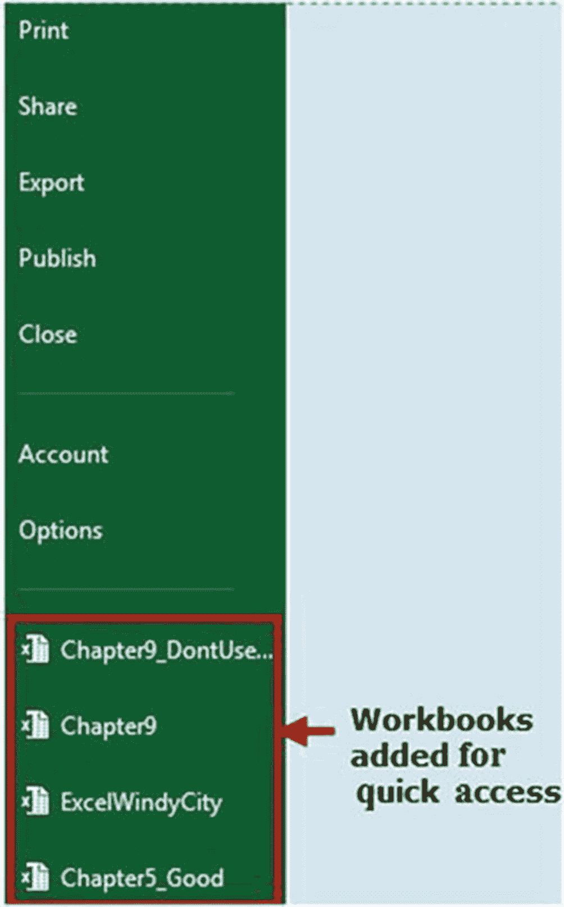

图 6-30

最近使用的四个工作簿

## 另存为与保存组——使用 `Save` 或 `Save As` 保存工作簿

在 Excel 中工作时，你所创建和导入的所有内容（如数据、图表、图形等）都存储在计算机的随机存取存储器（`RAM`）中。`RAM` 只是临时存储空间。当你关闭计算机时，`RAM` 中的所有内容都会被清除。因此，如果计算机发生意外或断电，自上回保存以来所做的所有增改内容都将丢失。在执行`保存`操作之前，增改内容不会保存到硬盘或其他类型的永久存储设备中。当你保存工作簿时，信息会从 `RAM` 中取出，并作为一个文件存储到你的永久存储设备上。

如果出现意外情况（例如断电），而你又很久没有保存工作，请不要惊慌，因为 Excel 可能已使用`自动恢复`功能将你的工作保存到了永久存储设备上，我们将在本章稍后部分介绍该功能。

Backstage 视图中有两个专门用于保存工作簿的组：`保存`组和`另存为`组。实际上，`保存`组算不上一个组，因为它不包含任何选项。`另存为`组与你在本章前面已经见过的`打开`组几乎相同。如果单击`保存`组，且工作簿之前已保存过，那么 Excel 会用你最近的更改来更新工作簿。如果你选择了`保存`，并且这是你首次保存工作簿，Excel 会打开`另存为`窗口（其操作方式与点击`另存为`完全一致）。

在`另存为`窗口中，你必须先选择一个用于保存工作簿的文件夹。接下来，你需要为工作簿文件输入文件名。Excel 默认使用文件名 `Book1`。你应该将名称更改为与工作簿包含的数据类型相匹配的名称；例如，如果工作簿包含截至 2020 年 6 月 30 日的库存数据，则将其命名为"Inventory_063020"之类的名称。在图 6-31 中，你可以看到当前文件夹是 `Documents`。如果你单击文件夹图标左侧的向上箭头，将会向上移动到 `Documents` 之上的文件夹层级。图中右下角显示的文件夹是 `Documents` 文件夹内的子文件夹。如果你要保存到的目标文件夹没有显示出来，则需要单击`浏览`或点击`更多选项...`。点击其中任何一个选项都会弹出`另存为`对话框窗口，如图 6-32 所示。

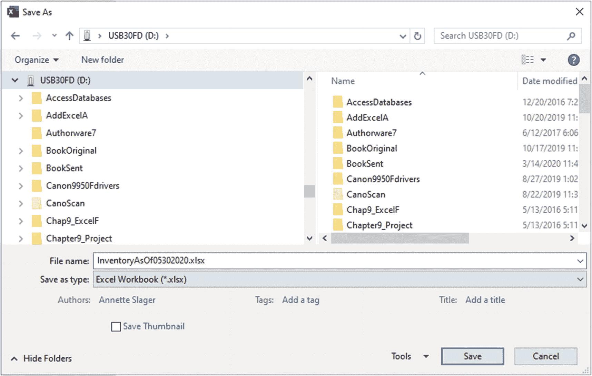

图 6-32

`另存为`对话框

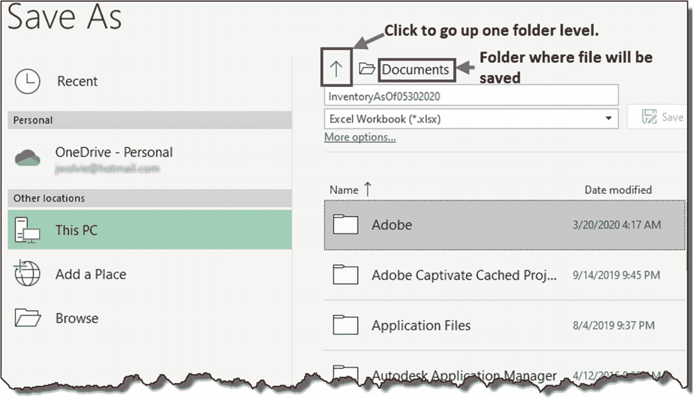

图 6-31

`另存为`——选择文件夹并输入文件名

接下来，你需要为正在保存的文件选择`保存类型`。工作簿的默认文件类型是`Excel 工作簿`。这可能是你最常使用的格式。如果你想要使用其他格式，可以点击`保存类型`的下拉箭头。如图 6-33 所示，工作簿可以保存为多种不同的格式。

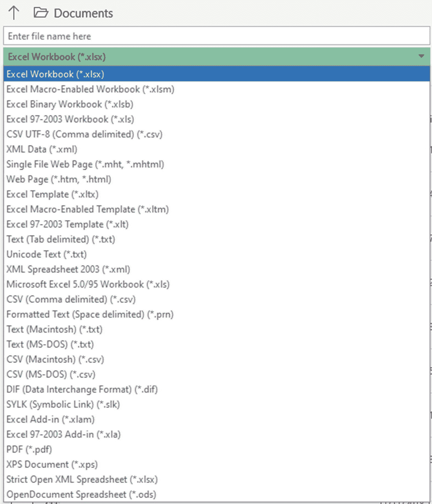

图 6-33

你可以将文件保存为多种不同文件类型中的一种

Excel 会根据你选择的文件类型自动为你的文件添加扩展名。

如果你为文件名输入了 `Inventory_063020`，那么你的完整文件名将是 `Inventory_063020.xlsx`。Windows 资源管理器使用这些扩展名来确定在文件名旁边显示什么图标。

文件名连同路径最多可以有 255 个字符。路径是指访问文件所需经过的驱动器和文件夹。例如：`C:\users\Annette\My Documents\Inventory_063020.xlsx`。文件名中可以使用空格，但最好使用下划线来分隔单词。文件名不能包含以下字符：`< >`（尖括号）、`|`（管道符号）、`\`（反斜杠）、`?`（问号）、`:`（冒号）、`*`（星号）和 `""`（引号）。

除了将工作簿保存到本地计算机，另一种选择是使用 `OneDrive` 将工作簿存储到在线。`OneDrive` 是微软免费提供的在线存储空间。点击 `OneDrive` 会弹出一个 `另存为` 窗口，就像你将文件保存到个人电脑或网络驱动器时一样。你可以像在硬盘上一样在 `OneDrive` 中创建文件夹。

### 文档恢复

你应该经常保存工作簿，但如果你在尚未保存的情况下系统崩溃或突然断电，请不要惊慌。Excel 有一个名为`自动恢复`的功能，它会按你指定的时间间隔自动保存文件。时间间隔可以设置为 1 到 120 分钟之间。默认时间间隔是 10 分钟。我个人喜欢将其设置为 5 分钟或更短，因为在这段时间内我可能会做很多不想丢失的更改。但是，缩短时间间隔可能会降低计算机速度，具体取决于文件大小和所做更改的数量。

在 Backstage 视图的导航窗格中点击`选项`，会弹出`Excel 选项`窗口。见图 6-34。

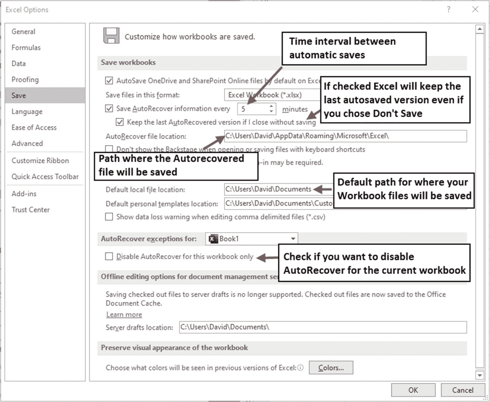

图 6-34

`Excel 选项`窗口，左窗格中选中了`保存`

在`Excel 选项`窗口的左窗格中点击`保存`，会显示用于保存工作簿和使用`自动恢复`的选项。在这里，你可以设置保存的时间间隔、`自动恢复`文件的存储路径、是否在关闭而未保存时保留最后自动保存的版本、是否要对当前工作簿禁用`自动恢复`等。

以默认的 10 分钟间隔为例，如果你保存了 Excel 工作簿，29 分钟后断电，你只会丢失最后 9 分钟内所做的更改，因为 Excel 会在第 10 分钟和第 20 分钟备份你的文件。当你之后重新打开该文件时，Excel 会显示文档恢复窗格，其中包含文件的自动保存版本和原始版本。

#### 从系统崩溃中恢复

如果在处理工作簿时系统崩溃，当您再次打开 Excel 时，将在左侧窗格中看到“文档恢复”文件。将鼠标悬停在这些文件上时，会显示哪个是原始文件，哪个是恢复的版本。请参见图 6-35。

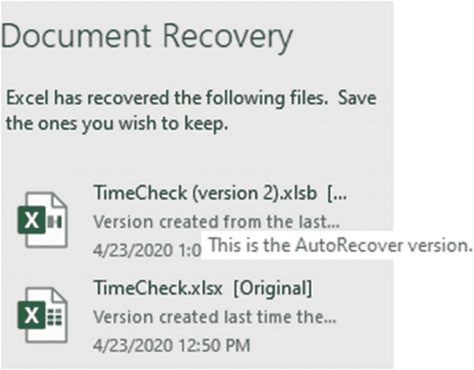

**图 6-35** 可以保存的已恢复文件

点击图 6-36 中的任意一个已恢复文件，会显示一个下拉箭头。点击该下拉箭头会显示一个右键菜单，您可以选择`打开`、`另存为`、`删除`或`显示修复`。

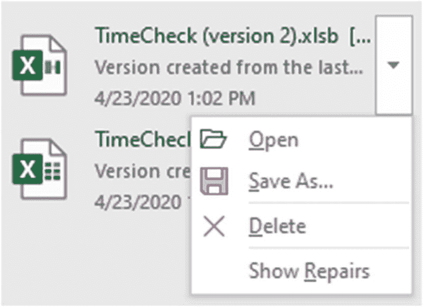

**图 6-36** 已恢复文件的选项

选择`显示修复`会使用崩溃前所做的更改来恢复工作簿。如果文件包含任何错误，或文件已进行过任何修复，则会显示一条消息。

您可以点击`另存为`为恢复的工作簿指定一个新名称。

如果在“文档恢复”窗格底部仍有可恢复文件显示时点击`关闭`按钮，Excel 会询问您是希望稍后查看这些文件还是将其删除。请参见图 6-37。如果选择“是，我希望稍后查看这些文件”，Excel 将保留这些文件，并在您下次启动 Excel 时将其显示在“文档恢复”窗格中。

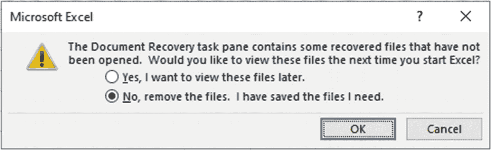

**图 6-37** 询问您希望稍后查看还是删除已恢复文件的消息

#### 未保存即关闭工作簿

##### 关闭从未保存过的工作簿

如果您在未保存的情况下关闭工作簿，但后来决定确实需要保存它，您仍然可以找回部分或全部更改，这取决于您设置的自动恢复时间间隔以及自上次保存以来经过的时间。

如果您正在处理一个从未保存过的新工作簿，并在未保存的情况下将其关闭，您将看到如图 6-38 所示的消息。

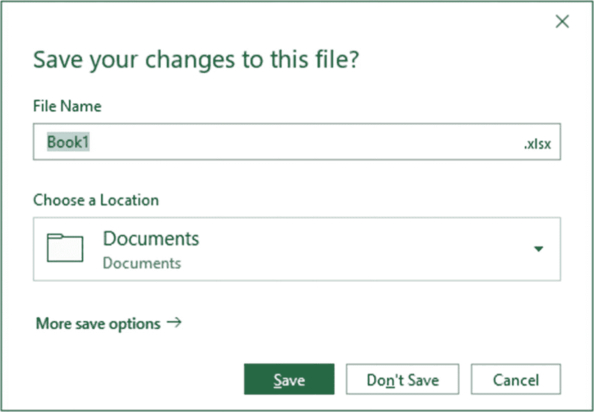

**图 6-38** 未保存文件即关闭

现在重新启动 Excel。点击左侧窗格中的`打开`。在右侧窗格的底部，您会看到一个`恢复未保存的工作簿`按钮。

点击`恢复未保存的工作簿`。打开的对话框中会显示所有未保存的文件。文件名会显示工作簿名称后跟一长串数字。请参见图 6-39。

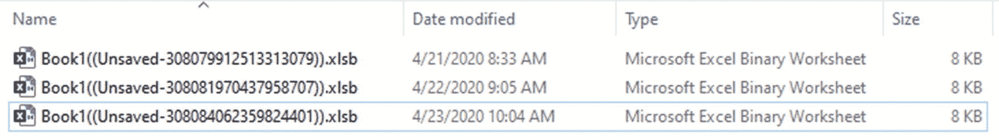

**图 6-39** 未保存文件的名称后附加了一长串数字

双击该未保存文件会在 Excel 中打开它。您将看到如图 6-40 所示的消息。点击`另存为`并为工作簿指定一个新名称。

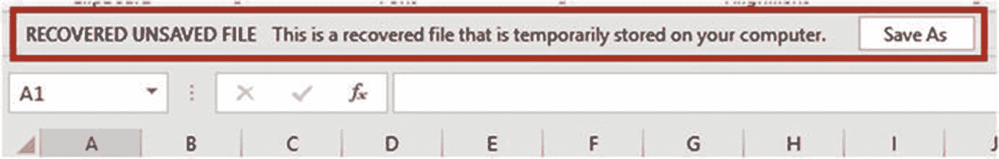

**图 6-40** “已恢复未保存文件”消息

您还可以通过点击功能区的`文件`选项卡，然后点击左侧窗格中的`信息`来检查是否有未保存的工作簿。点击`管理工作簿`按钮，查看是否有其他可恢复的未保存工作簿。请参见图 6-41。

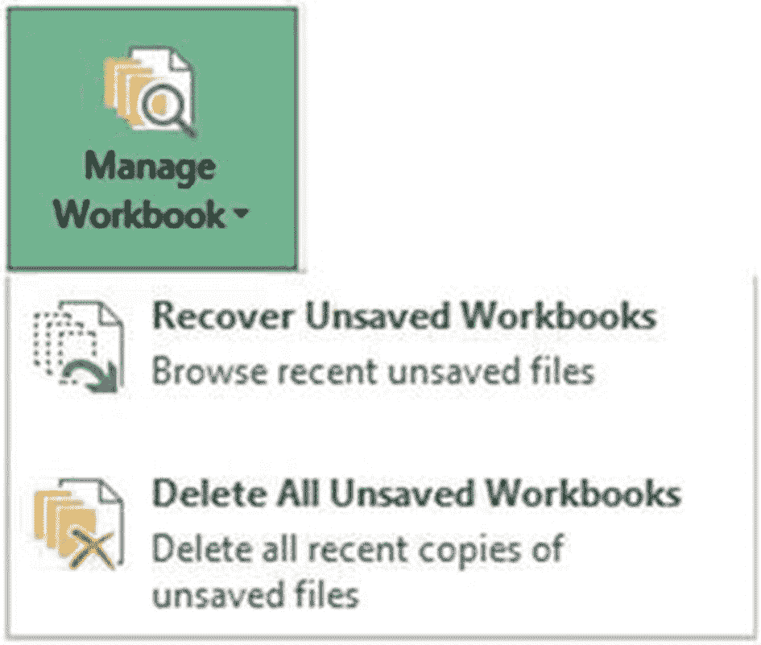

**图 6-41** 点击“管理工作簿”按钮以查看是否存在未保存的工作簿

##### 关闭已保存但未保存更改的工作簿

如果您的工 _ 作簿已经保存过至少一次，请使用本节中的信息。

如果您在未保存更改的情况下关闭 Excel 工作簿，并且这些更改是在自动恢复时间间隔内进行的，Excel 将显示如图 6-42 所示的消息。如果您点击`不保存`，您将无法恢复，更改将丢失。例如，如果时间间隔为 5 分钟，您在过去的 5 分钟内输入了一些数据并在未保存的情况下关闭了它，数据将丢失。

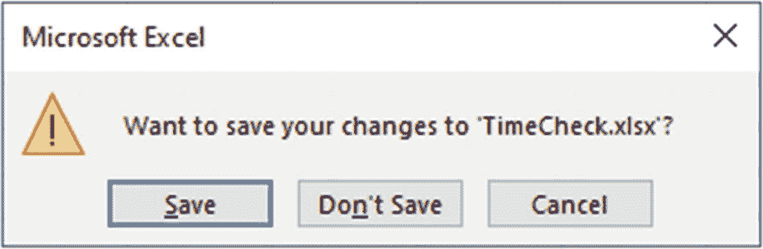

**图 6-42** 警告：正在保存前关闭工作簿

如果您对工作簿进行了更改但尚未保存，然后在您为自动恢复设置的时间间隔之后关闭工作簿，Excel 将显示如图 6-43 所示的消息。如果您看到此消息，您将能够恢复至少部分数据。

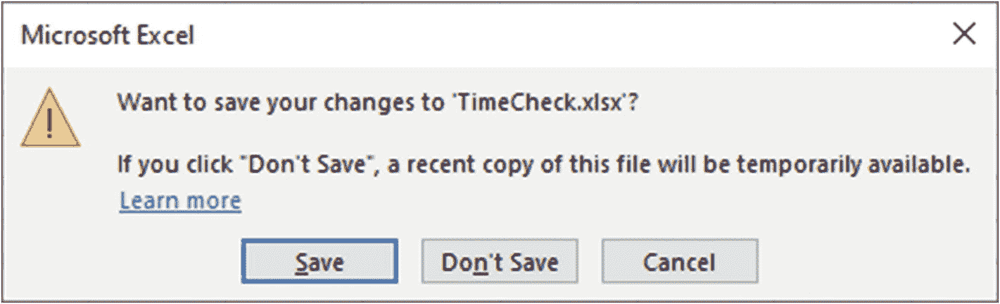

**图 6-43** 消息：如果选择不保存文件，临时文件将仍然可用

您应该点击`保存`按钮，但如果您点击`不保存`，您仍然可以恢复您所做更改的至少一部分。重新启动 Excel。“管理工作簿”按钮的右侧会出现一条消息。请参见图 6-44。

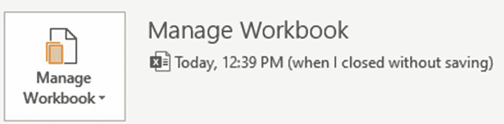

**图 6-44** 打开未保存即关闭的工作簿时显示的消息

点击该消息。工作簿将打开，工作表上方会出现如图 6-45 所示的消息。点击`恢复`按钮以恢复您的工作簿。

**图 6-45** 通过点击“恢复”按钮恢复未保存的文件

### 保存带保护的工作簿：备份与限制更改

你可以在文件级别设置密码，防止未经授权的用户打开工作簿。你也可以允许用户打开工作簿，但禁止其保存任何更改（除非另存为新文件）。在本节中，我们将学习如何为工作簿设置定期备份、使用“只读”保护原始文件，以及为工作簿添加密码保护。

打开需要保护的工作簿后，单击功能区中的`文件`选项卡。在导航窗格中单击`另存为`。单击`浏览`。在`另存为`对话框中，单击`工具`下拉菜单并选择`常规选项`。见图 6-46。

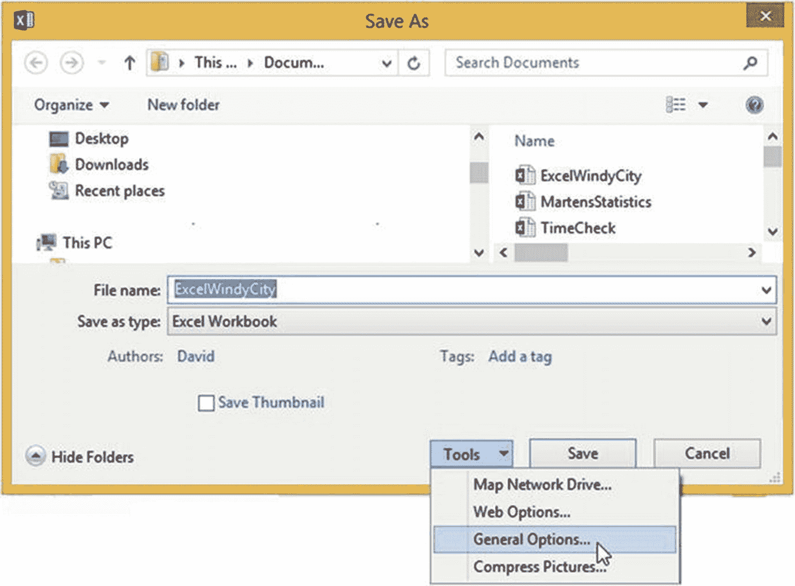

**图 6-46** `另存为`对话框中的“工具”选项

此时会打开`常规选项`对话框。勾选`生成备份`复选框。这将在保存文件的同一位置创建一个备份文件。该备份文件的名称格式为`Backup of`后面加上你为工作簿指定的名称，扩展名为`.xlk`。例如，如果你将文件命名为`Invoices.xlsx`，则备份文件将被命名为`Backup of Invoices.xlk`。见图 6-47。

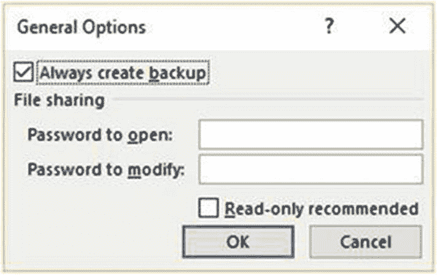

**图 6-47** 选中`生成备份`后的“常规选项”

在你选中`生成备份`后首次保存文件时，只会保存原始文件，不会生成备份。假设你仅在单元格`A1`中输入了一个值，并将文件保存为`Invoices.xlsx`。接着，你在单元格`B1`中输入了一个值并再次保存工作簿。此时`Invoices.xlsx`文件包含单元格`A1`和`B1`中的值；同时会创建一个名为`Backup of Invoices.xlk`的备份，该备份仅包含单元格`A1`中的值。我们再试一次。

你在`Invoices.xlsx`工作簿的单元格`C3`中添加一个值并再次保存文件。此时`Invoices.xlsx`文件包含单元格`A1`、`B1`和`C1`中的值，但备份文件`Backup of Invoices.xlk`仅包含单元格`A1`和`B1`中的值。备份文件始终比原始文件落后一个版本（即一个副本）。

如果你希望允许用户查看工作簿但不能进行任何更改，请勾选`建议只读`复选框。

你可以要求用户同时输入`打开权限密码`和`修改权限密码`，也可以只要求输入其中之一，或完全不设置密码。请记住，如果你忘记了密码，将无法找回。

如果你希望要求用户在打开工作簿之前输入密码，请在`打开权限密码`文本框中输入密码。用户可以查看或更改工作簿。

如果你希望要求用户在修改工作簿时输入密码，请在`修改权限密码`文本框中输入另一个密码。如果用户不输入该密码，则只能以只读方式查看工作簿。

如果你希望要求用户输入密码才能打开工作簿，然后要求他们输入另一个密码才能修改工作簿，则应同时输入两个密码。这两个密码不应相同。

如果你为`打开权限密码`输入了密码，则需要确认该密码。见图 6-48。

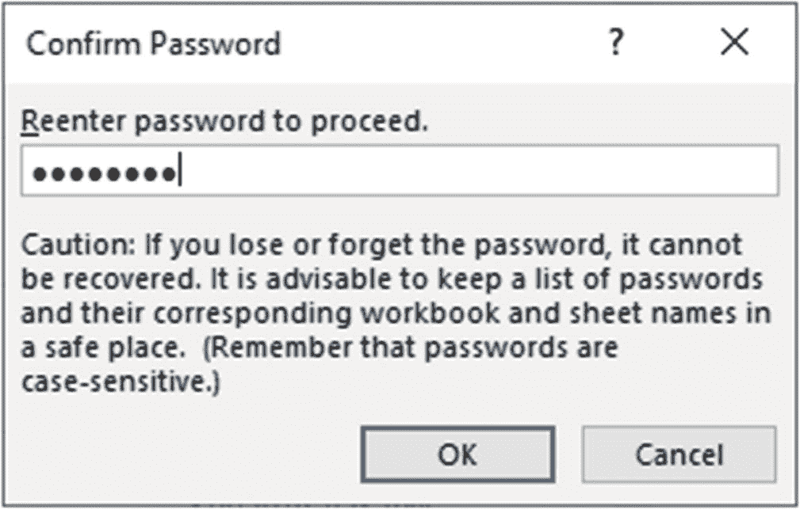

**图 6-48** 若为`打开权限密码`输入了密码，需确认密码

如果你为`修改权限密码`输入了密码，则需要确认该密码。见图 6-49。如果你同时输入了两个密码，则需要同时确认它们。

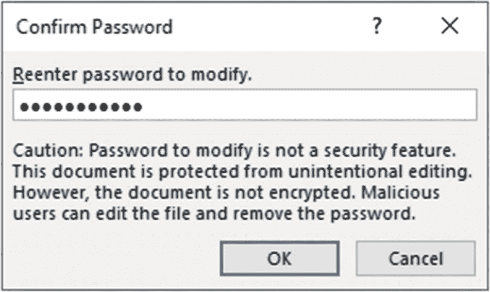

**图 6-49** 若为`修改权限密码`输入了密码，需确认密码

单击`保存`按钮即可使用你在`常规选项`中设置的选项保存工作簿。见图 6-50。

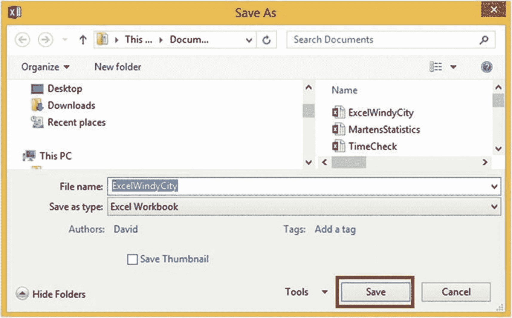

**图 6-50** 使用你所做的选择保存文件

如果你设置了密码，在关闭并重新打开工作簿后，系统将要求你输入密码。

- 如果你设置了打开工作簿的密码，则在打开工作簿时会看到图 6-51 所示的窗口。

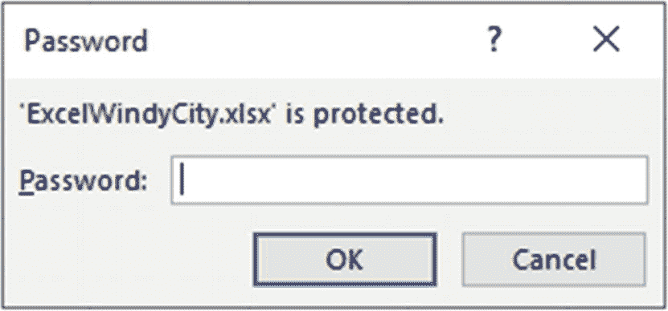

**图 6-51** 打开工作簿需要密码

- 如果你设置了修改工作簿的密码，则会弹出另一个“密码”窗口。用户必须输入密码才能修改工作簿。用户也可以通过单击`只读`按钮，在不输入密码的情况下以只读方式打开工作簿。见图 6-52。

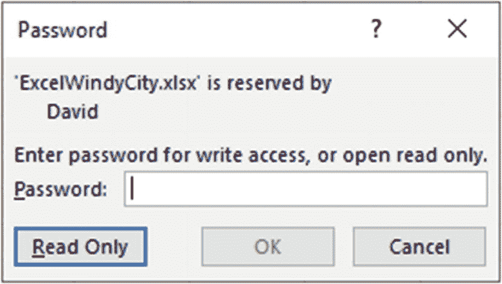

**图 6-52** 输入密码以修改工作簿，或单击`只读`按钮

如果用户单击`只读`按钮，他们可以对工作簿进行更改，但无法保存，从而防止任何更改被保留。用户将看到图 6-53 中的消息。

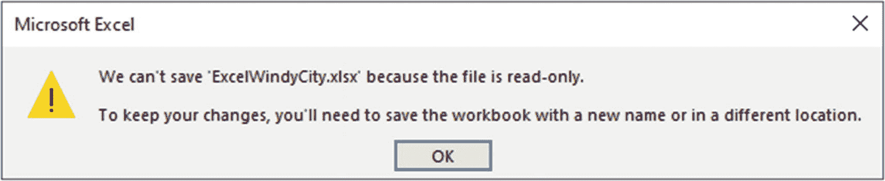

**图 6-53** 提示文件为只读的消息。若要保存更改，需要将文件另存为新名称

如果打开工作簿需要密码，并且用户选择使用“只读”而不输入修改密码，则 Backstage 视图将如图 6-54 所示。

**图 6-54** Backstage 视图中的消息

## 打印组 — 打印工作簿

打印组的左窗格（图 6-55）包含用于控制工作表或工作簿打印方式的“设置”。其中许多选项与功能区“页面布局”选项卡中的选项相同。打印组的右窗格根据左窗格中使用的打印选项，显示当前文档打印时的外观。

**图 6-55** 打印选项

你应首先对`打印机`和`设置`属性进行任何必要的更改，然后单击`打印`按钮执行打印。

### 选择打印机

你需要做出的决定之一是将报告打印到哪里。你不一定非要打印到打印机。你可以打印到程序、其他设备（如传真机）或文件。单击`打印机`的下拉箭头会列出所有当前可用的选项。见图 6-56。此处显示的内容取决于你安装的程序以及连接到计算机的设备。如果你想要使用的打印机不在列表中，但已连接到你的计算机或网络，请单击`添加打印机`选项。

**图 6-56** 可发送打印数据的目标位置

#### 打印机设置

打印机属性选项完全取决于你为打印机选择了什么。如果你选择了一台实体打印机，你可能会看到横跨三个或更多选项卡的大量选项。打印机厂商不同，提供的选项也不同；你可能会看到预设、打印质量、纸张类型、方向、文档尺寸、双面打印、无边距、维护等选项。如果你选择传真，你只会看到少量选项。

#### 选择打印活动工作表、整个工作簿或选定部分

“设置”区域中的第一个选项用于选择是仅打印当前工作表、整个工作簿，还是仅打印你选定的区域。请参阅图 6-57。你在此处的选择会反映在右窗格中。`打印活动工作表`仅打印你当前选定的工作表。`打印选定区域`则打印你当前选定的单元格。

图 6-57

打印选项

#### 选择要打印的页面

下一个“设置”选项允许你选择要打印的页面。图 6-58 中的输入将仅打印第 2、3 和 4 页。即使你选择了`打印整个工作簿`，情况也是如此。

图 6-58

输入要打印的页面范围

#### 逐份打印

在 Excel 中，逐份打印的工作方式与复印机上的逐份打印相同。如果你要打印一个五页的工作表，并选择打印四份，那么选择`逐份打印`将为你提供四套第 1 页到第 5 页。选择`不逐份打印`将打印四份第 1 页，然后四份第 2 页，然后四份第 3 页，依此类推。请参阅图 6-59。

图 6-59

逐份打印选项

#### 方向

你可以按纵向（垂直格式）或横向（水平格式）打印。选择横向是在一页上打印更多列的一种方法。

#### 选择纸张尺寸

你很可能会使用信纸尺寸（8.5" x 11"）的纸张，但如果不是这样，你也可以选择其他纸张尺寸。请参阅图 6-60。如果你的电子表格有很多列，你可以尝试使用法律纸尺寸。Excel 将自动调整你的电子表格以反映所选的纸张尺寸。

图 6-60

选择输出尺寸

#### 设置页边距

你可以使用 Excel 预设的“普通”、“宽”或“窄”页边距之一，也可以通过选择`自定义页边距`来自定义页边距。请参阅图 6-61。

图 6-61

选择页边距

单击`自定义页边距`将打开“页面设置”窗口，并选中“页边距”选项卡。请参阅图 6-62。

图 6-62

输入页边距以及数据在页面上的居中方式

“页边距”选项卡提供了设置页面顶部、左侧、右侧和底部页边距的选项，以及设置页眉和页脚页边距的选项。你可以使用复选框来指定数据在页面上的居中方式。当你选中  `水平`、 `垂直`或两者时，选项卡中间图像将反映你的选择，显示数据在报告中的显示方式。

#### 选择缩放选项

你可以按实际尺寸打印报告，也可以选择 Excel 的预设缩放选项之一来缩小报告中的文本和对象。请参阅图 6-63。

图 6-63

选择一个缩放选项

打印报告时，你可能不希望因为多出的几列或几行而多打一页。这会使阅读数据变得非常困难。如前所述，如果列数太多无法在一页中容纳，你可以尝试切换到横向模式。缩小工作表中的文本和对象使其适合一页纸通常会更简单。

图 6-64

自定义缩放选项

*   选择`将工作表调整为一页`将打印一个工作表中的所有内容，使其适合一页。
*   选择`将所有列调整为一页`会缩小打印输出，使其宽度为一页，但报告可能在垂直方向上超过一页。
*   选择`将所有行调整为一页`会缩小打印输出，使其高度为一页，但报告可能在水平方向上超过一页。
*   如果这些选项都不能满足你的需求，你可以选择`自定义缩放选项`。选择`自定义缩放选项`将打开“页面设置”对话框，并选中“页面”选项卡。请参阅图 6-64。

此处的缩放选项允许你设置报告相对于实际大小的百分比。你输入的值必须在 10 到 400（含）之间。

你还可以指定希望报告的页宽和页高。

**注意**

`页面设置`选项位于 Backstage 视图“设置”区域的底部。单击`页面设置`将打开“页面设置”对话框。这与单击`自定义页边距`或`自定义缩放选项`时看到的“页面设置”窗口相同。“页面设置”窗口包含“打印”面板其他区域中可用的一些相同选项，以及一些附加选项。也可以从功能区上的“页面布局”选项卡访问“页面设置”窗口。

## 共享组——共享工作簿

“共享”组使你能够与他人共享工作簿。你有多种选项，包括共享已保存到 OneDrive 的文件以及通过电子邮件发送文件。

### 使用 OneDrive 在线共享

将工作簿保存到 OneDrive 后，点击 Backstage 左侧面板中的 `Share`。这将调出图 6-65 中的 `Share` 面板。

图 6-65

共享选项

现在，您已将自己的工作簿保存到 OneDrive，您可以邀请其他人仅在 OneDrive 上查看您的工作簿，或者允许他们对其进行修改。右键单击图 6-65 右侧窗格中的 `Share with People` 按钮。这将调出图 6-66 所示的 `Share` 窗口。输入您想要邀请使用您工作簿的人员的电子邮件地址。您可以选择 `Can Edit` 或 `Can View`。您可以添加一条消息。点击 `Share` 按钮发送电子邮件。

图 6-66

邀请他人共享您的工作簿

您还可以通过提供您工作簿的链接来共享它。在 `Share` 窗口的底部，您将看到两个选项：`Send as attachment` 和 `Get a sharing link`。请参见图 6-67。点击 `Get a sharing link`。

图 6-67

点击文本 `Get a sharing link`

将显示图 6-68 中的窗口。如果您希望允许用户在线编辑您的工作簿，可以点击 `Create an edit link` 按钮；或者，如果您只想允许用户在线查看您的工作簿，可以点击 `Create a view-only link` 按钮。

图 6-68

选择您是希望用户仅能查看工作簿，还是允许其进行编辑

图 6-69 显示了点击 `Create an edit link` 时提供的链接。

图 6-69

为用户提供编辑工作簿的链接

您可以通过电子邮件将此链接发送给他人，可以告知他人此链接，也可以将其发布到网站上，等等。

点击图 6-68 中 `Get a sharing link` 左侧的箭头。`Share` 窗口现在将显示您向其发送电子邮件的人员以及您授予他们的权限。它还显示您现在拥有一个可以与任何人共享的编辑链接。请参见图 6-70。

图 6-70

`Share` 窗口显示您已发送电子邮件的人员

### 使用电子邮件共享文件

您可以将 Excel 工作簿以任何可用格式作为电子邮件附件发送给他人。请参见图 6-71。收到您电子邮件的人可以在其 Excel 副本中打开它。

图 6-71

选择您希望工作簿以电子邮件发送的格式

点击 `Send as Attachment` 按钮将调出 Outlook（前提是您安装了 Outlook 副本），并且 Excel 工作簿文件已设置为附件。请参见图 6-72。`Subject` 字段已填入 Excel 工作簿的名称。然后，您可以填写收件人的电子邮件地址，或许还可以添加一条文本消息。最后点击 `Send` 按钮将附件发送到该电子邮件地址。

图 6-72

工作簿已作为附件文件设置在 Outlook 中

如果电子邮件的收件人不需要编辑工作簿，或者没有安装 Excel 副本，则您可以采用 Adobe 的 PDF 格式或 Microsoft 的 XPS 格式发送工作簿。以这两种格式之一发送文件的好处是，它们有许多查看选项，并且不需要收件人拥有 Excel 程序。

## 帐户组

您的 `Account` 窗格中的更改将影响您的所有 Microsoft Office 产品。在此处，您可以管理您的 Microsoft Office 帐户、检查 Microsoft 更新以及更改 Office 主题。您还可以添加显示在标题栏上的 Office 背景图案。

## 总结

在本章中，您学习了如何使用 Backstage 选项来管理、编辑、保存和打印工作簿。您还了解了如何保护工作簿、恢复工作簿以及共享工作簿。

下一章将向您展示如何手动或使用向导创建公式。Excel 函数是内置公式。函数是将 Excel 转变为一个计算能力强大的工具，而不仅仅是允许您输入数据并对其进行精美格式化和打印的工具。

