# 7. 创建和使用公式

创建公式是为了从诸如计算我们在商店购买的物品总额、计算我们的税款、计算汽车的每加仑英里数等事务中获得结果。Excel 中的公式是一个经过计算的表达式，其结果将放置在包含该公式的单元格中。您可以输入自己的公式，也可以使用 Excel 众多的内置公式之一。Excel 的内置公式被称为 `functions`。

阅读并完成本章后，您应该能够：

- 在单元格或编辑栏中输入公式
- 按照正确的运算顺序输入公式
- 复制公式
- 使用自动函数
- 查看工作表上的所有公式
- 选择在公式中使用的已命名区域
- 使用绝对引用和混合单元格引用
- 创建和编辑已命名区域和常量

### 公式

如果没有输入公式的能力，Excel 将仅仅作为一个数据输入表，您可以对齐和格式化数据以及创建图表。Excel 有用于合计行和列的公式，但它允许您做的远不止这些。您可以使用 Excel 的内置公式，也可以输入您能想到的几乎任何公式。您可以使用非常基础的公式，也可以使用极其复杂的公式。如果您想计算三角形的面积，可以输入该公式。需要使用二次方程求解问题？您也可以输入相应的公式。

### 公式介绍

公式的一个示例是 `= 5 * 6`，该表达式返回数值 30。公式始终以等号 (`=`) 开头。表 7-1 列出了 Excel 使用的数学符号及其含义。

**表 7-1** Excel 使用的数学符号

| 符号 | 含义 |
| --- | --- |
| `+` | 加法 |
| `–` | 减法 |
| `*` | 乘法 |
| `/` | 除法 |
| `%` | 百分比（将整数转换为百分比） |
| `^` | 乘方 例如 (`3²`) |
| `=` | 等于 |
| `<` | 小于 |
| `<=` | 小于或等于 |
| `>` | 大于 |
| `>=` | 大于或等于 |
| `<>` | 不等于 |

公式可以包含特定数值和单元格地址。当公式中包含单元格地址时，公式中实际使用的是该单元格中的值，而非地址本身。表达式的结果会放入包含该公式的单元格中。

如果我想将单元格 `A3` 和 `B3` 中的值相加，并将结果放入单元格 `C3` 中，则应按图 7-1 所示输入公式。

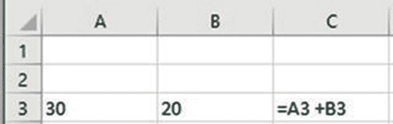

**图 7-1** 单元格 `C3` 包含将单元格 `A3` 和 `B3` 中的值相加的公式

图 7-2 显示了输入图 7-1 中公式后的结果。

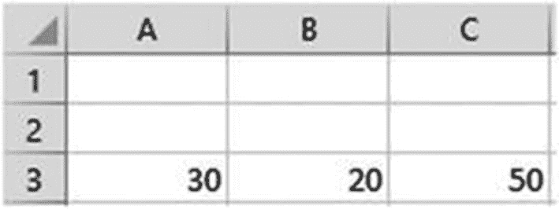

**图 7-2** 单元格 `C3` 包含单元格 `A3` 和 `B3` 相加的结果

如果当前单元格中有公式，单元格将显示公式的结果，但公式会显示在编辑栏中。参见图 7-3。

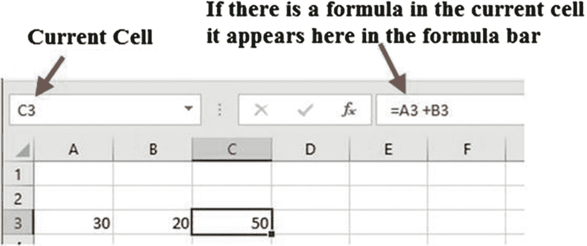

**图 7-3** 单元格 `C3` 的公式显示在编辑栏中

表 7-2 显示了公式的示例，以及假设单元格 `A3` 包含值 30 且单元格 `B3` 包含值 20 时，这些公式将产生的结果。

**表 7-2** Excel 公式及其结果（结果将放入包含该公式的单元格中）

| 公式 | 结果 |
| --- | --- |
| `= A3 + 25` | 55 |
| `= A3 – B3` | 10 |
| `= B3 – A3` | –10 |
| `= A3 * 10` | 300 |
| `= A3 / B3` | 1.5 |
| `= A3 * 10%` | 3 |
| `= B3 ^ 3` | 8000 |

在单元格中输入 `=` 号作为第一个字符，即告知 Excel 其后内容为一个公式。

### 输入公式

输入公式有以下三种方式：

- 直接在单元格中键入公式
- 单击要在公式中引用的单元格，并用数学符号分隔
- 使用箭头键选择要在公式中引用的单元格，并用数学符号分隔

#### 在单元格中键入公式

键入完整公式时，首先输入一个等号，然后输入任何数值或单元格引用，并用数学符号分隔。如果在公式中输入了任何单元格引用，Excel 将高亮显示公式中的单元格地址，并在被引用的单元格周围添加边框。两者会以相同的颜色高亮显示。

图 7-4 中的示例显示了要在单元格 `C1` 中输入的公式，用于将单元格 `A1` 和 `B1` 中的值相加。在公式中输入 `A1` 时，单元格 `A1` 的背景色和文本 `A1` 将颜色相同。单元格 `B2` 的单元格背景及文本 `B1` 将使用另一种匹配的颜色。

**图 7-4** 使用颜色来显示每个操作数使用了哪个单元格

#### 通过单击要引用的单元格来创建公式

通过单击要引用的单元格来创建公式时，首先输入一个等号，然后单击任何要引用的单元格，并用数学符号分隔。

以图 7-4 为例，您需要执行以下步骤：

1. 单击单元格 `C1` 内部。
2. 输入等号。
3. 单击单元格 `A1`（Excel 会在公式中输入 `A1`）。
4. 输入加号。
5. 单击单元格 `B1`（Excel 会在公式中输入 `B1`）。
6. 按 `Enter` 键。

您的公式将与手动输入的公式相同，即 `=A1+B1`。

#### 使用方向键创建公式

使用方向键输入公式的好处是，你的双手无需离开键盘。以下使用同一个示例，演示如何通过以下步骤创建公式：

1.  单击单元格 `C1` 内部。
2.  输入等号。
3.  按两次左方向键，以选中单元格 `A1`。
4.  输入加号。
5.  按一次左方向键，以选中单元格 `B1`。
6.  按 `Enter` 键。

### 练习 7-1：输入公式

在此练习中，你将使用不同的数学运算输入四个公式。

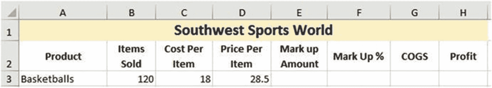

图 7-5

在自己的工作簿中输入此数据

1.  创建一个名为 `Chapter 7` 的新工作簿。将工作表 `Sheet1` 的选项卡重命名为 `"MarkUp"`。
2.  将工作表的外观设置为与图 7-5 一致。

表 7-3 展示了每个未填充列所需使用的公式。

表 7-3

电子表格所需的公式

| 电子表格公式 |
| --- |
| 加价金额 | `单价` – `单位成本` |
| 加价百分比 | `单位成本` / `单价` |
| 销售成本 | `销售数量` * `单位成本` |
| 利润 | (`销售数量` * `单价`) – `销售成本` |

### 计算加价金额

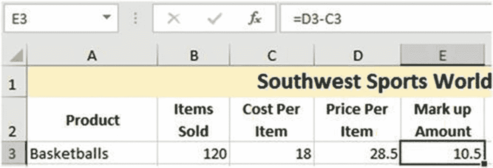

图 7-9

公式栏显示已在活动单元格中输入的公式

1.  在单元格 `E3` 中输入`等号` (=)。然后输入 `d`。Excel 知道你在输入公式，因此它会尝试提供帮助，建议一个以 `D` 开头的 Excel 内置函数。见图 7-6。

    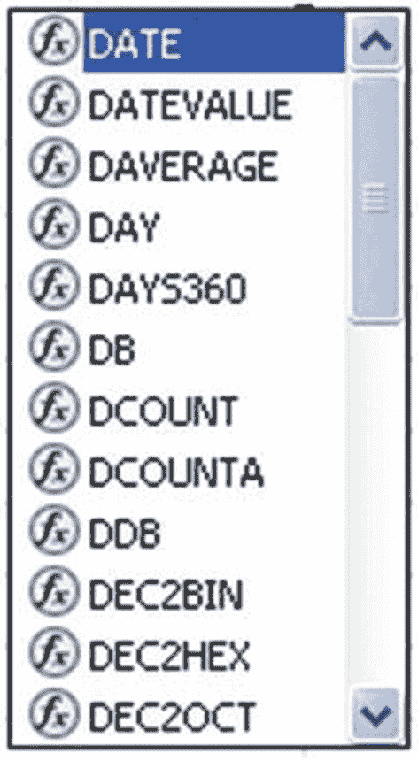

    图 7-6

    内置函数

2.  我们稍后会介绍内置函数，但现在先忽略函数选项，直接输入 `d3`。Excel 会在你公式中输入的单元格周围放置一个框，作为选择的视觉提示。它会使单元格地址和这个框都变为蓝色。见图 7-7。

    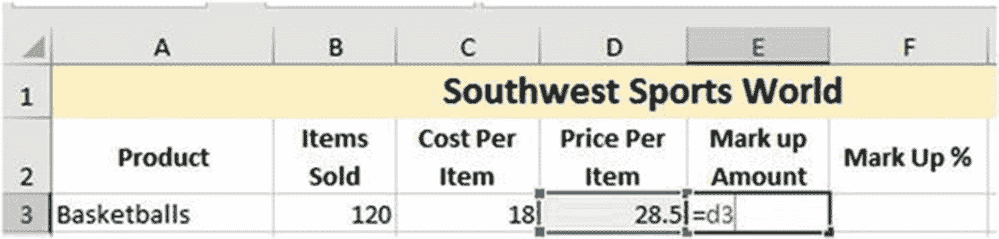

    图 7-7

    单元格地址及其对应的单元格颜色相同

3.  输入`减号` (–)，然后输入 `c3`。Excel 将单元格地址和引用单元格周围的框都变为红色。见图 7-8。

    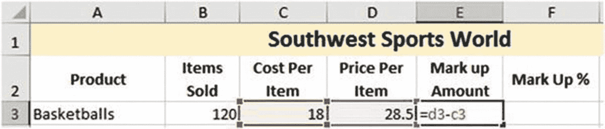

    图 7-8

    单元格地址及其对应的单元格都是红色

4.  按 `Tab` 键。该单元格将显示公式返回的值。然而，公式栏会显示在单元格中输入的公式。见图 7-9。

### 计算加价百分比

1.  在单元格 `F3` 中输入`等号` (=)。这次，你将通过单击要使用的单元格来输入公式中的单元格地址，Excel 会自动将该单元格的地址放入公式中。单击`单元格 C3`。Excel 会围绕 `C3` 放置一个动画框，并将其地址放入公式中。
2.  输入`除号` (`/`)。
3.  单击单元格 `D3`。见图 7-10。

    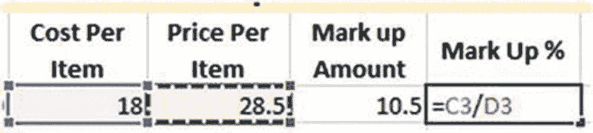

    图 7-10

    为加价百分比输入的公式

4.  按 `Ctrl + Enter`。结果为 `0.631578947`。此数字可能会根据列宽进行四舍五入。
5.  我们希望将此值显示为百分比。如果尚未选中`开始`选项卡，请选择它，然后单击`数字`组中的 `%` 图标。结果向上舍入为 `63%`。
6.  我们希望数字显示两位小数。单击`增加小数位数`按钮  两次。值变为 `63.16%`。

### 计算销售成本

1.  单击单元格 `G3` 并输入 `=b3*`。
2.  单击单元格 `C3` 并按 `Tab` 键。

### 计算利润

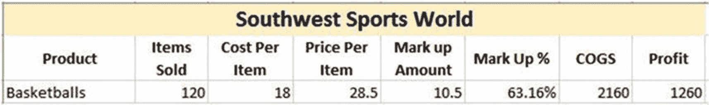

图 7-11

输入利润公式的结果

1.  对于利润公式，你可以混合使用键入单元格引用或单击单元格来获取其引用。在单元格 `H3` 中输入公式 `=(b3*d3)–g3`。
2.  按 `Enter` 键。见图 7-11。

好的，作为一名高级文档工程师和翻译员，我将严格遵循您提供的注意事项和示例格式，将给定的英文文本翻译成中文。

### 复制公式

之前，您使用填充柄来自动填充一系列值。填充柄也可用于跨行或跨列复制公式，同时它会自动调整公式以适用于正确的列和行。

如果向下复制公式（同一列），公式中的行号将自动调整为当前复制到的行。如果横向复制公式（同一行），公式中的列字母将自动调整为当前复制到的列。这种对行和列地址的自动调整称为`相对单元格引用`，因为单元格地址会根据公式所在位置的变化而变化。

### 练习 7-2：使用自动填充复制公式

本练习将继续使用上一练习中的同一个工作表。您将添加额外的记录，然后将之前制作的公式复制到新的行中。

1.  添加图 7-12 所示的额外记录（第 4–7 行）。

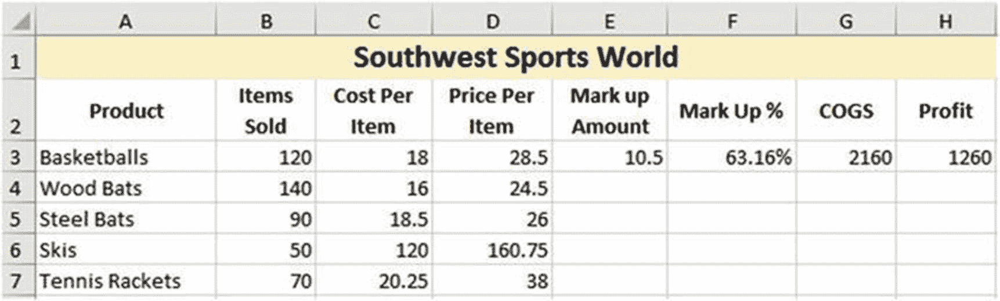

图 7-12

添加这些额外记录

2.  单击单元格 `E3`。从单元格 `E3` 向下拖动填充柄到单元格 `E7`。参见图 7-13。

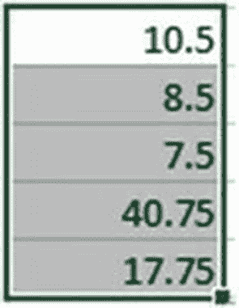

图 7-13

从单元格 `E3` 向下拖动填充柄到单元格 `E7` 的结果

自动填充会自动将公式复制到其他单元格中。当使用自动填充向下复制公式时，它会自动将公式中的单元格引用调整到当前行。

3.  单击单元格 `E4`。单元格 `E4` 中的公式是 `=D4-C4`。行号已从 3 调整为 4。

4.  单击该列中的其他单元格，查看它们的公式是如何调整的。

5.  从单元格 `F3` 向下拖动填充柄到 `F7`。

6.  从 `G3` 向下拖动填充柄到 `G7`。

7.  从 `H3` 向下拖动填充柄到 `H7`。

您的结果应如图 7-14 所示。

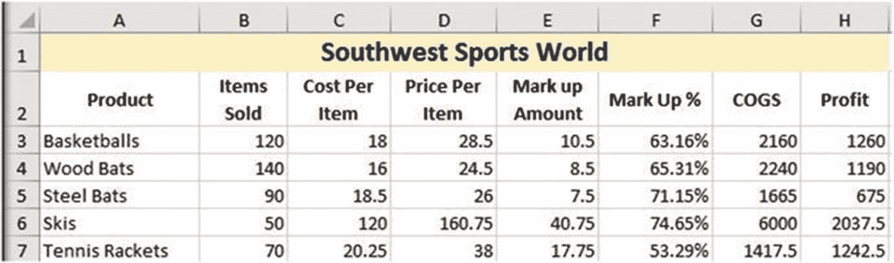

图 7-14

复制公式的结果

### 练习 7-3：跨列复制公式

您已经了解了在向下复制公式时，自动填充柄如何自动调整`行引用`。现在，我们将研究如何在跨行复制公式时，使用自动填充柄来自动调整列引用。

1.  创建一个名为 `ColumnRef` 的新工作表。按图 7-15 所示，在单元格 `A1:D2` 中输入值。两个单元格地址之间的冒号表示单元格之间的范围。第一个单元格地址（此处为 `A1`）是范围的左上角单元格。第二个单元格地址（此处为 `D2`）是范围的右下角单元格。参见图 7-15。

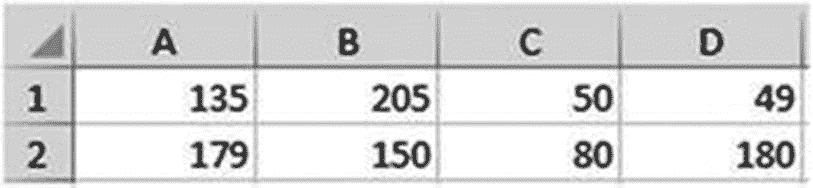

图 7-15

输入这些值

2.  在单元格 `A3` 中输入 `= a1-a2`。参见图 7-16。

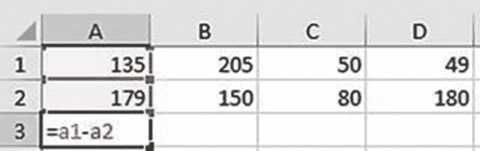

图 7-16

在单元格 `A3` 中输入公式

3.  按 `Ctrl + Enter`。

4.  将单元格 `A3` 中的填充柄拖动到单元格 `D3`。

图 7-17 显示了使用自动填充柄将公式从单元格 `A3` 复制到单元格 `B3`、`C3` 和 `D3` 的结果。

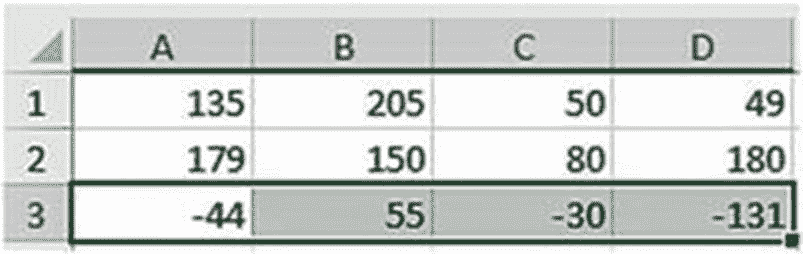

图 7-17

使用复制公式的结果

您可以在图 7-18 中看到，Excel 在复制公式时调整了单元格引用中的列。

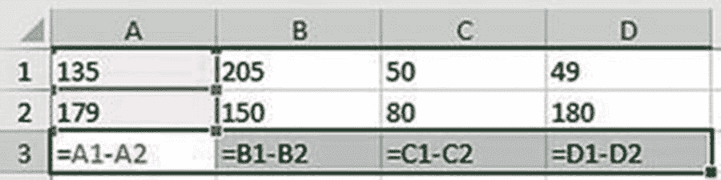

图 7-18

复制后的公式

您已经学会了如何输入公式。接下来，您将使用 Excel 的自动计算工具。这些工具允许您选择一个数据范围，然后单击您需要的计算工具。公式会自动应用于该数据，而无需您手动输入。

## 自动计算工具

自动计算工具功能包括用于求和、求平均值、计数包含数值数据的单元格数量以及在单元格范围内查找最大值或最小值的工具。

### 自动求和

`AutoSum`（自动求和）功能提供了一种对数字区域进行快速求和的途径。该区域可以包含单个单元格，也可以包含成千上万个单元格。`AutoSum`功能会自动添加连续区域中的数值。所谓连续区域，是指其中没有空单元格的区域。

`AutoSum`功能位于功能区上`开始`选项卡的`编辑`组中。该功能的图标是希腊大写字母 Sigma 。在数学和科学领域中，常用  作为求和运算符。详情请见图 7-19。

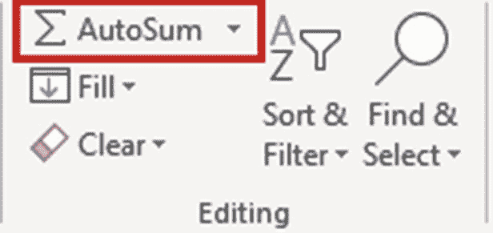

**图 7-19** AutoSum（自动求和）功能

当您单击`AutoSum`按钮时，Excel 首先会检查当前单元格上方是否存在数值。如果存在，Excel 将对上方的数值进行求和；否则，它会检查左侧是否存在数值，如果存在，则对左侧的数值进行求和。

在图 7-20 中，按下`AutoSum`按钮时选定的是单元格`F2`。Excel 高亮了其左侧的数值。如果在单击`AutoSum`按钮时只选中了一个单元格，那么`SUM`（求和）公式将显示正在被求和的数值区域。如果这不是您想要求和的区域，则可以更改起始或结束单元格的地址。

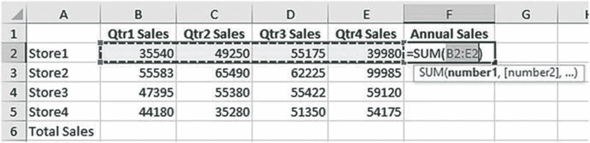

**图 7-20** 使用 AutoSum 时，Excel 会选择左侧的数值，并显示将要使用的区域

再次单击`AutoSum`按钮或按`Enter`键，将显示结果，如图 7-21 所示。编辑栏中显示的是由`AutoSum`创建的公式。

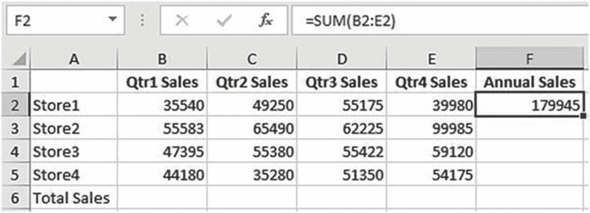

**图 7-21** 再次单击 AutoSum 按钮，将结果值输入到单元格中

图 7-22 展示了使用`自动填充句柄`将公式向下复制到单元格`F5`的结果。

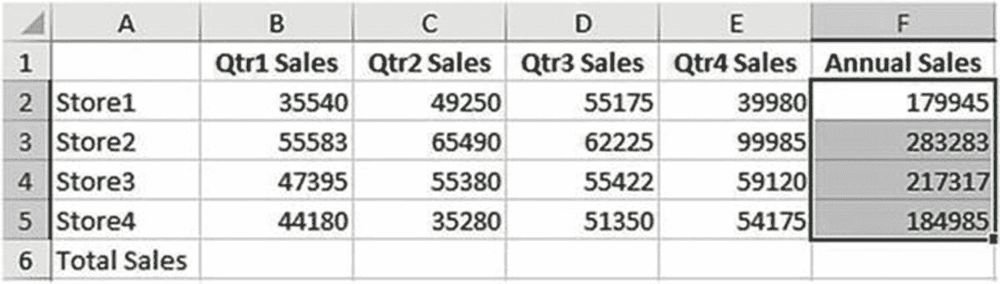

**图 7-22** 复制公式的结果

由于我们是对行进行求和，Excel 会自动调整每个被复制单元格的行地址：

-   单元格`F3`包含公式`=SUM(B3:E3)`。
-   单元格`F4`包含公式`=SUM(B4:E4)`。
-   单元格`F5`包含公式`=SUM(B5:E5)`。

接下来，我们将探讨如何同时对列和行进行求和。但在那之前，我们先来看一下如何清除 F 列中的汇总结果。

可以通过首先选中要清除的单元格，然后执行以下任一操作来清除单元格内容：

-   单击`编辑`组中的`清除`按钮 ，然后选择`清除内容`
-   右键单击选中的区域，然后从上下文菜单中选择`清除内容`

要同时对列和行进行汇总，首先选中将要放置汇总结果的行和列单元格。在图 7-23 所示的电子表格中，您需要先选中单元格`F2:F5`，然后按住`Ctrl`键并选中单元格`B6:F6`。

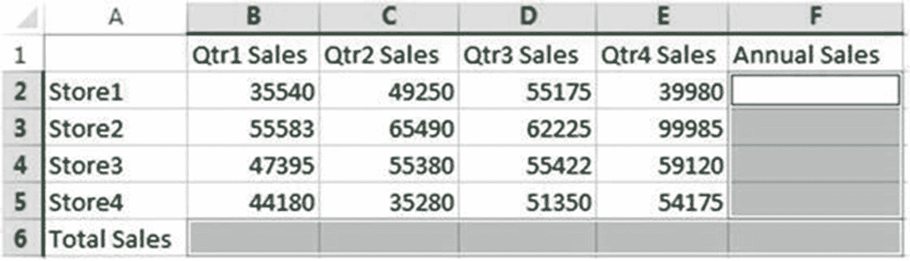

**图 7-23** 按住 Ctrl 键可以选中多个单元格区域

现在单击`AutoSum`按钮，将对行和列同时进行求和。请参见图 7-24。

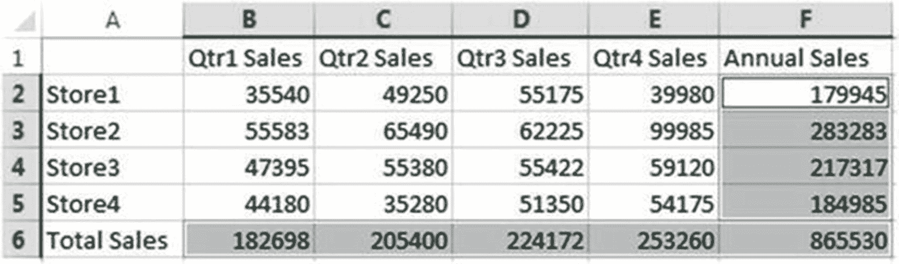

**图 7-24** 对行和列求和的结果

对某个数值区域的行和列进行求和的更快方法是，先选中数值本身以及右侧的一列和下方的一行，如图 7-25 所示。

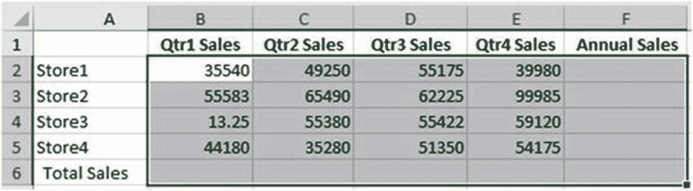

**图 7-25** 在单击 AutoSum 之前，先选中数据以及右侧一列和下面一行

然后按下`AutoSum`按钮。结果将与图 7-24 相同。

### 处理区域中的空单元格

`AutoSum`在遇到空单元格后，不会将其之后的任何单元格纳入求和区域。请参见图 7-26。如果您希望将单元格`A2`包含在总计中，则需要将公式中的`A4`更改为单元格`A2`。

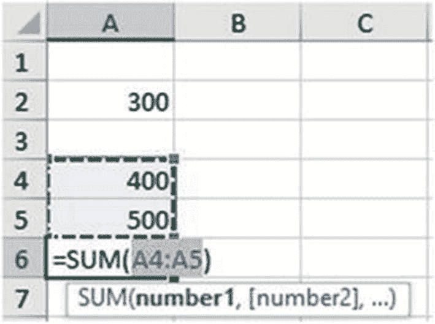

**图 7-26** 将 SUM 函数中的 A4 更改为 A2

更改区域的另一种方法是，拖动选中区域的某个句柄，使其包含所有您想要的单元格，如图 7-27 所示。

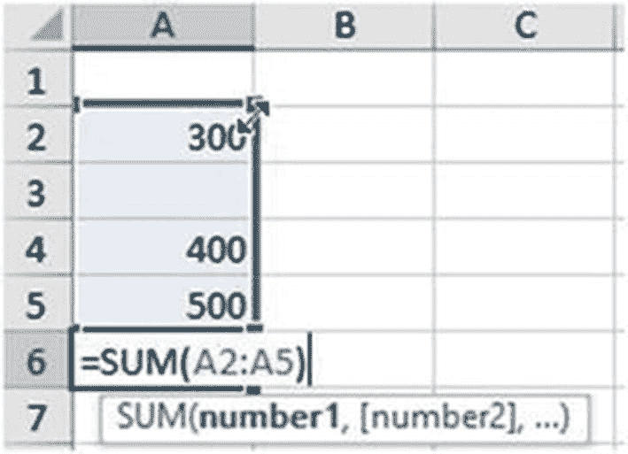

**图 7-27** 拖动选择句柄以包含您想要包含的单元格

### 平均值、计数、最大值、最小值

如果单击 `AutoSum`（自动求和）按钮（图 7-28）旁边的向下箭头，你会看到 Excel 包含多个其他“自动”函数。这些函数包括 `Average`（平均值）、`Count Numbers`（计数）、`Max`（最大值）、`Min`（最小值）以及`More Functions`（其他函数）。这些“自动”函数的使用方式与 `AutoSum` 相同。

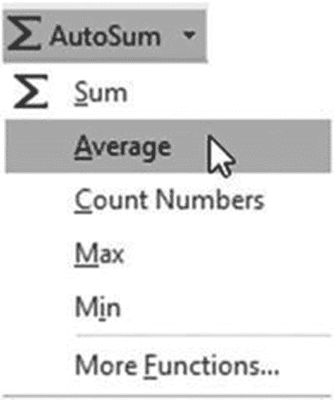

图 7-28

自动函数

**练习 7-4：自动计算工具**

在本练习中，你将应用自动计算工具 `AutoSum`、`Average`、`Max` 和 `Min` 对行和列进行计算。

1.  创建一个名为“AutoCalculate”的新工作表。
2.  选择单元格 `B1:I1`，这些将是包含列标题的单元格。在“`开始`”选项卡的“`对齐方式`”组中，单击“`自动换行`”按钮。见图 7-29。现在你的列标题将自动换行，而不会被部分隐藏。

图 7-29

选择“自动换行”

3.  如图 7-30 所示输入工作簿的数据。

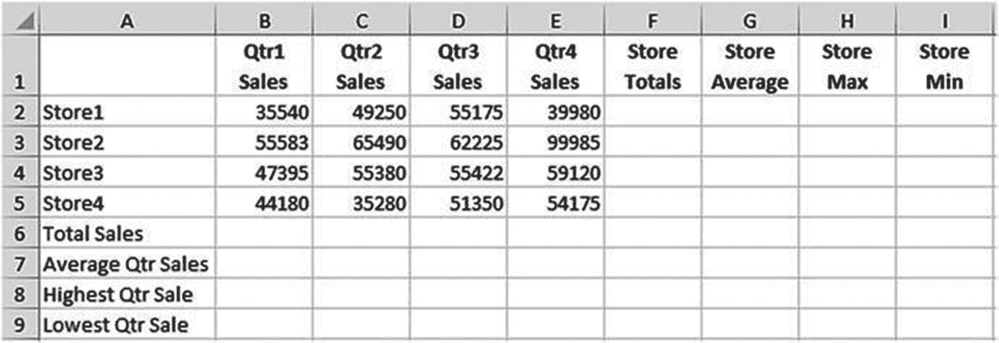

图 7-30

输入此数据

4.  选择单元格区域 `B6:E6`。单击 `AutoSum` 按钮。
5.  选择单元格区域 `B2:E5`。单击 `AutoSum` 按钮旁边的向下箭头。选择 `Average`。

**注意** 当使用“自动”函数时，如果所选范围在一列中（或者如我们当前情况同时包含行和列），Excel 会将结果放置在所选范围下方的第一个空白行。如果范围仅在一行中，Excel 会将结果放置在该范围的右侧。

1.  当前选中了单元格区域 `B2:E6`。将选择区域重新改为 `B2:E5`。单击 `AutoSum` 按钮旁边的向下箭头。选择 `Max`。`Max` 函数返回所选行或列中的最大值。店铺 2 在每个季度的销量都是最高的。
2.  再次选择单元格区域 `B2:E5`。单击 `AutoSum` 按钮旁边的向下箭头。选择 `Min`。见图 7-31。`Min` 函数返回所选行或列中的最小值。店铺 1 在第 1 季度和第 4 季度销量最低。店铺 4 在第 2 季度和第 3 季度销量最低。

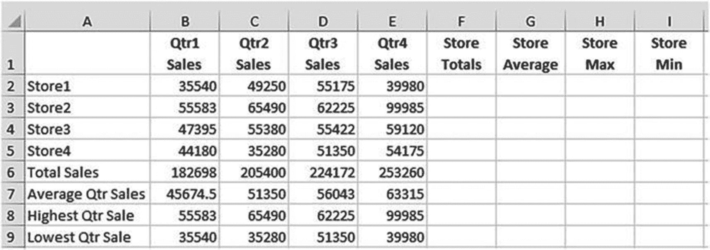

图 7-31

使用自动函数的结果

3.  选择单元格 `F2:F5`。单击 `AutoSum` 按钮。
4.  选择单元格 `B2:E2`。单击 `AutoSum` 按钮的向下箭头。选择 `Average`。单击单元格 `G2`。使用“`自动填充句柄`”将公式向下拖动到单元格 `G5`。
5.  选择单元格 `B2:E2`。单击 `AutoSum` 按钮的向下箭头。选择 `Max`。单击单元格 `H2`。使用“`自动填充句柄`”将公式向下拖动到单元格 `H5`。

让我们看看另一种操作方法。

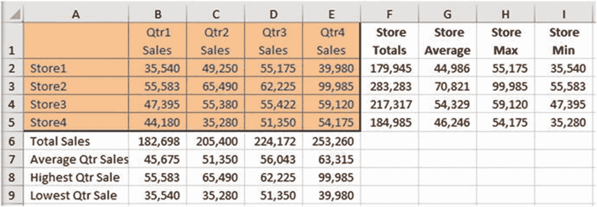

图 7-37

粗的外边框

1.  单击单元格 `I2`。单击 `AutoSum` 按钮的向下箭头。选择 `Min`。见图 7-32。函数显示出来，并且单元格 `B2:H2` 周围出现一个选框。这不是我们想要的区域。

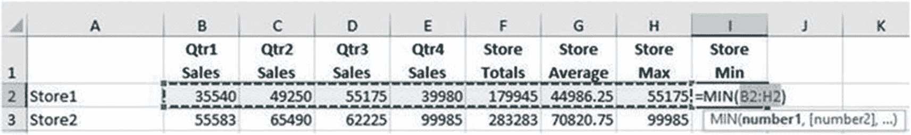

图 7-32

选错了区域

2.  选择单元格 `B2:E2`。公式将相应调整。见图 7-33。

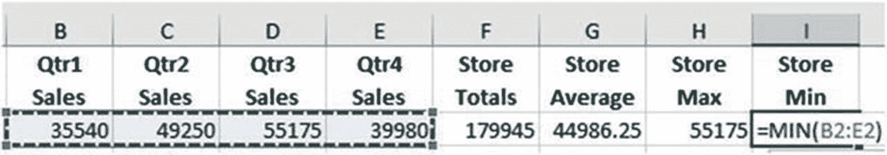

图 7-33

为 MIN 函数使用区域 `B2:E2`

3.  按 `Ctrl + Enter`。使用“`自动填充句柄`”将公式向下复制到单元格 `I5`。见图 7-34。

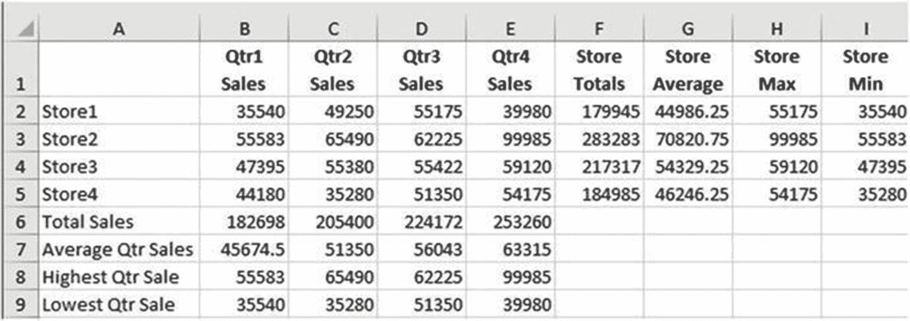

图 7-34

使用自动填充句柄将公式从 `I2` 复制到 `I5`

4.  让我们改进一下电子表格的外观。我们添加逗号以便于阅读，并添加颜色来区分原始数据和计算数据。
5.  在“`名称框`”中输入 `A1:I9`，然后按 `Enter`。
6.  在“`开始`”选项卡的“`样式`”组中，单击“`单元格样式`”的“`其他`”按钮。见图 7-35。图 7-36 显示了单击“`单元格样式 其他`”按钮后出现的内容。

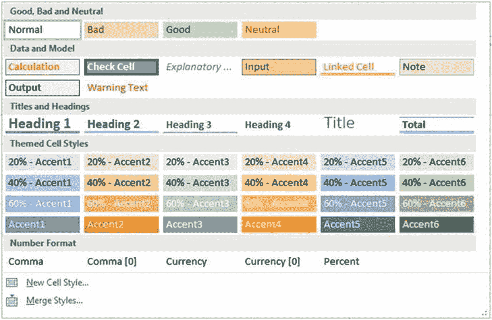

图 7-36

所有单元格样式

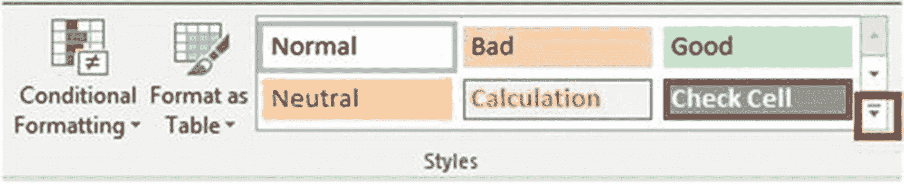

图 7-35

单击“其他”按钮以查看更多样式

7.  在“`数字格式`”区域，将鼠标悬停在 `Comma[0]` 上。你可以看到选择此选项后，数据将变为带逗号且不含小数位的形式，从而影响工作表。单击 `Comma[0]`。
8.  在“`名称框`”中输入 `A1:E5`，然后按 `Enter`。
9.  在“`开始`”选项卡的“`样式`”组中，单击“`单元格样式`”的“`其他`”按钮。
10. 在“`数据和模型`”区域中，单击“`输入`”。
11. 使用“`字体`”组中的边框按钮，为同一组单元格创建粗的外边框。见图 7-37。

你已经学习了如何手动输入公式，以及如何使用 Excel 的自动计算工具。在查看工作表时，你会看到公式的结果，而看不到公式本身。要查看公式，你需要单击包含公式的单元格，然后在编辑栏中查看。

### 查看公式

单击包含公式的单元格将在编辑栏中显示该公式，但如果能一次性看到所有公式岂不是更好？你可以通过按住 `Ctrl` 键并按波浪线键（`~`）来实现这一点。

你可以在所有公式都可见的情况下打印电子表格。这为你提供了公式的记录，并为你提供了一种方便的方式来全面检查工作，确保所有公式都已正确输入。图 7-38 显示了使用 `Ctrl + ~` 后的结果。

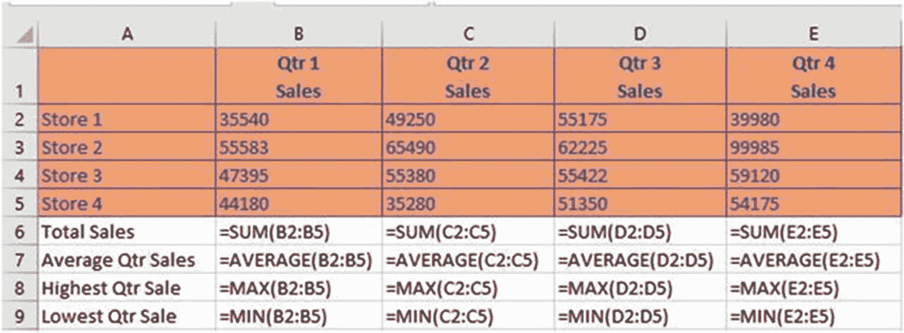

图 7-38

公式视图

你可以通过再次单击 `Ctrl + ~` 返回普通视图。

### 创建命名区域和命名常量

到目前为止，我们在公式中一直使用单元格地址，但在进行运算思考时，我们通常不会考虑单元格地址；我们通常使用描述性词语。例如，在计算公司工资时，我会想到`小时 * 费率`，而不是 `B2 * C2`。我们还可以为已知不会更改的值指定名称。例如，我可以将 `PI` 赋值为 `3.14`，然后在公式中使用 `PI` 这个名称，而不是使用值 `3.14`。

## 命名区域

我们可以为单元格区域指定一个描述性名称，然后在公式中使用该名称。通过选择单元格区域，然后在“`名称`框”中输入该区域的名称，即可将名称分配给该区域。见图 7-39。

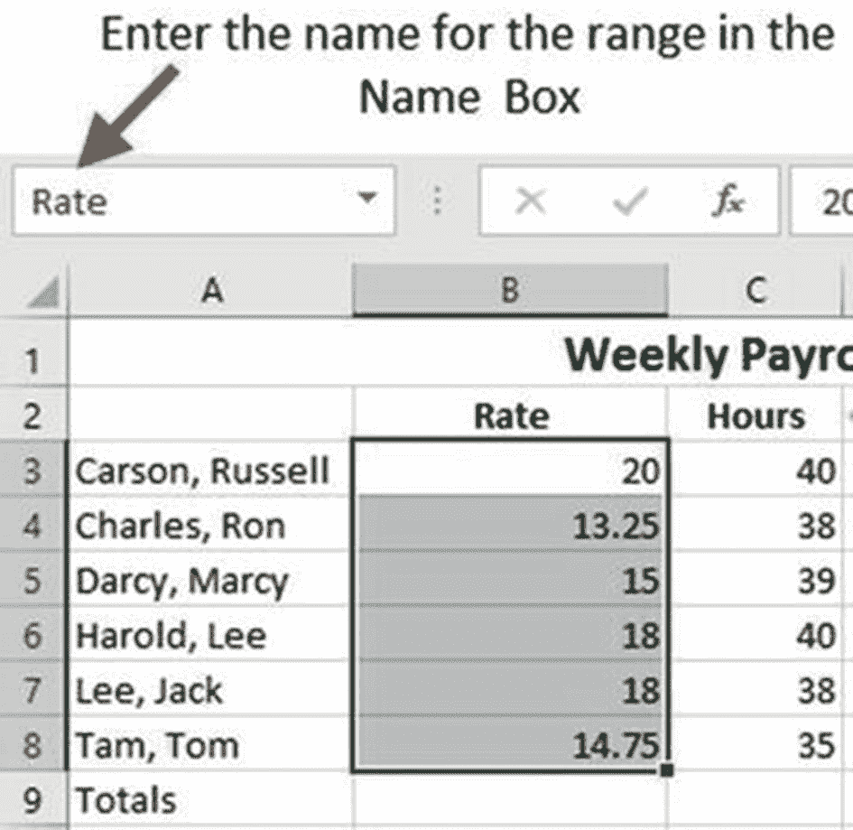

图 7-39

在“`名称`框”中输入区域名称

名称不能超过 255 个字符，并且必须以字母、下划线或反斜杠开头。名称不区分大小写。单击“`名称`框”旁边的向下箭头，会显示工作簿中所有已命名区域的列表。单击其中一项，将突出显示该名称区域所包含的单元格。

注意：人们常犯的一个错误是，在“`名称`框”中输入名称后，没有按 `Enter` 键。如果不按 `Enter` 键，该名称将不会被保存。

另一种创建命名区域的方法是使用“`定义的名称`”组中的选项，该组位于功能区上的“`公式`”选项卡中。见图 7-40。

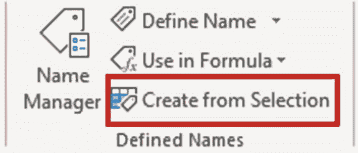

图 7-40

“`定义的名称`”组

单击“`定义名称`”按钮会弹出“`新建名称`”对话框。见图 7-41。你可以在打开“`新建名称`”对话框之前，先选中要创建命名区域的单元格，也可以等到对话框打开后再选择区域。你也可以通过右键单击工作表，然后从上下文菜单中选择“`定义名称`”来调出“`新建名称`”对话框。使用“`新建名称`”对话框创建命名区域，会提供一些仅通过在“`名称`框”中输入名称所不具备的选项。

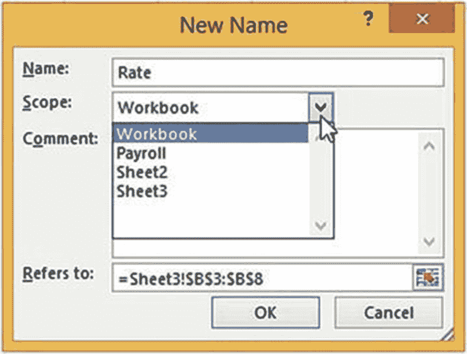

图 7-41

“`新建名称`”对话框

“`新建名称`”对话框中的“`名称`”文本框，对于你打开该对话框之前选中的单元格，会默认使用列标题或行标题。你可以根据需要更改名称。

“`范围`”下拉框的目的是让你选择，是让该命名区域可用于整个工作簿的公式，还是仅用于某个特定工作表。

你可以输入“`备注`”。该备注不会显示在工作表上，它只会出现在我们稍后会看到的“`名称管理器`”中。你也可以在“`名称管理器`”中命名区域。

“`引用位置`”文本框显示所选单元格的区域地址。如果你在调出“`新建名称`”对话框之前尚未选择要命名的单元格，可以在此刻进行选择。

### 命名非连续区域

要为不连续的单元格组创建命名区域，请在按住 `Ctrl` 键的同时选择单元格，然后输入该组的名称。在图 7-42 中，你可以为所有第一季度值指定一个适当的名称，例如 `QTR1`。你可以通过在单元格中输入 `=SUM(QTR1)` 来累加所有第一季度值，或者输入 `=AVERAGE(QTR1)` 来计算平均值。

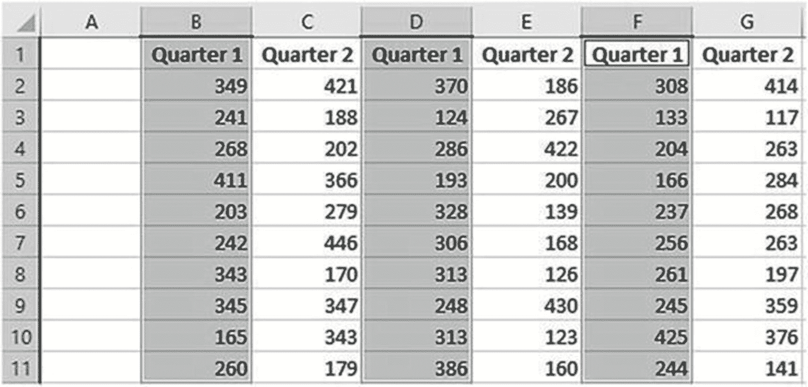

图 7-42

为不连续单元格创建命名区域

### 命名常量

你也可以使用“`新建名称`”对话框为常量指定名称。常量是一个不变的值。例如，你可以为利率或税率指定名称。在“`名称`”文本框中输入要分配给常量的名称。接着，将“`引用位置`”文本框中的当前单元格地址替换为常量值。如果你输入的常量是百分比，可以用百分号输入，例如 `4.5%`，或者输入其十进制等效值 `.045`。见图 7-43。为常量指定名称可以降低出错几率。如果我在十个单元格中使用了 `4.5%` 的税率，而现在税率变成了 `4.7%`，我需要更改多少个单元格？没错，我必须找到这十个单元格，然后逐一更改它们。但是，如果我使用了常量，我只需要将常量的值一次性改为 `4.7%` 即可。

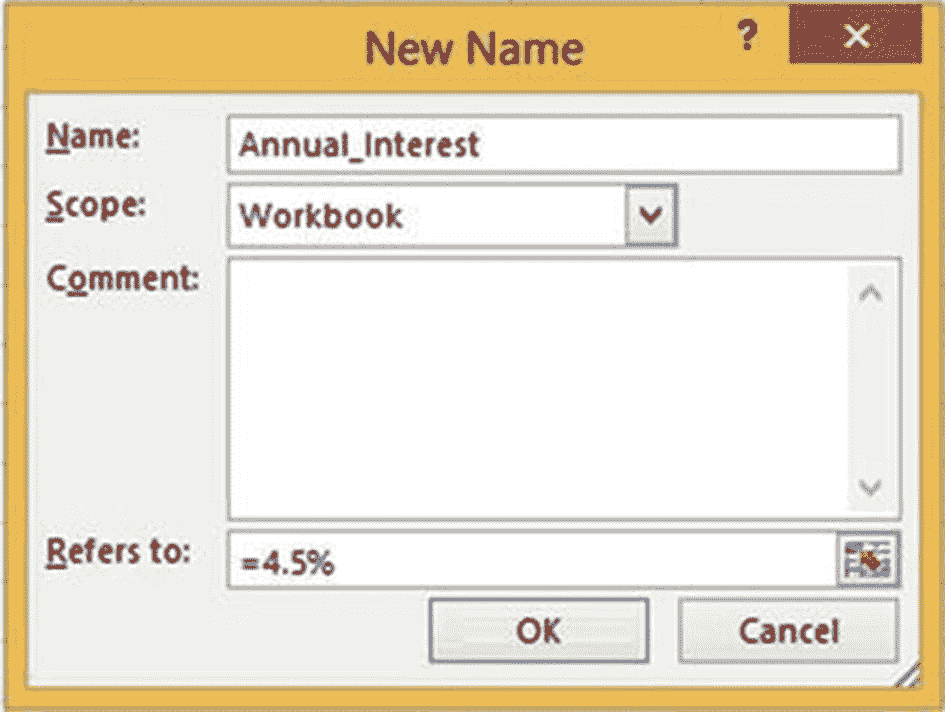

图 7-43

为常量指定名称

### 名称管理器

单击“`定义的名称`”组中的“`名称管理器`”按钮，将显示“`名称管理器`”，其中列出了命名区域和常量。“`名称管理器`”具有用于添加、编辑和删除命名区域的按钮。它还有一个“`筛选`”选项，用于限制要显示的命名区域。

你可以在图 7-44 中看到，命名区域 `Rate` 在创建时其区域内包含值。而 `Gross Pay` 和 `Hours` 区域则是在其单元格中尚未输入任何值时创建的。

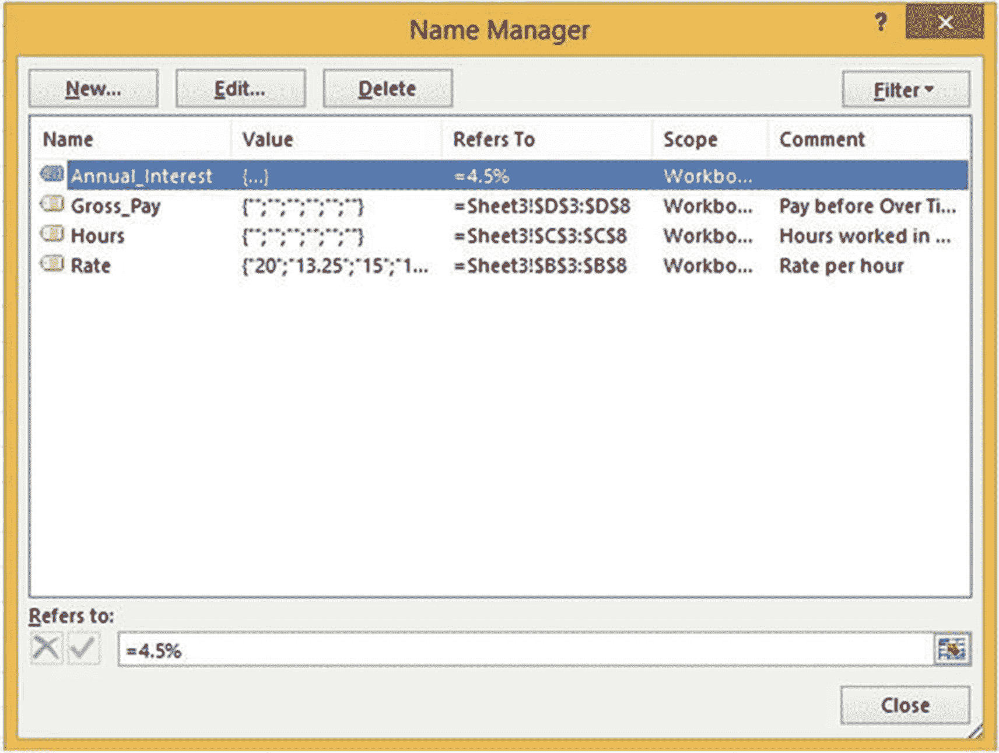

图 7-44

区域名称 `Rate` 包含值，因为这些值在选择该区域时已经存在

#### 编辑命名区域和常量

在“`名称管理器`”窗口中单击“`新建`”按钮，会弹出与我们单击“`定义的名称`”组中的“`定义名称`”按钮时看到的相同的“`新建名称`”对话框。要编辑一个命名区域，请从列表中选择要编辑的区域，然后单击“`编辑`”按钮。“`编辑名称`”对话框（图 7-45）与“`新建名称`”对话框类似。在此处，你可以更改`名称`、`备注`、区域的位置，或更改常量值。

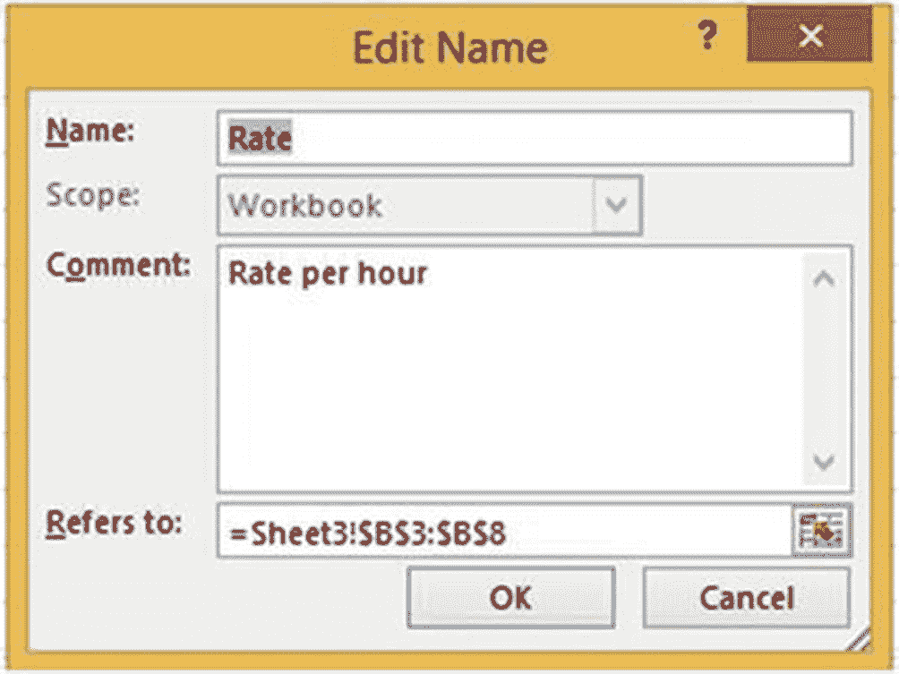

图 7-45

“`编辑名称`”对话框

#### 删除命名区域和常量

删除命名区域的唯一方法是使用“`名称管理器`”。首先，选择要删除的区域，然后按下“`删除`”按钮。这会弹出一个警告对话框，要求你确认删除操作（图 7-46）。删除命名区域只会移除与单元格区域关联的名称，并不会移除单元格或其中的数据。

图 7-46

确认要删除命名区域的消息

### 使用列标题或行标题作为区域名称

如果你打算为多行或多列创建命名区域，可能会发现让 Excel 使用你的行标题或列标题作为这些区域名称会更加便捷。操作方法是，首先选中你的命名区域要包含的所有单元格以及对应的列标题或行标题。参见图 7-47。

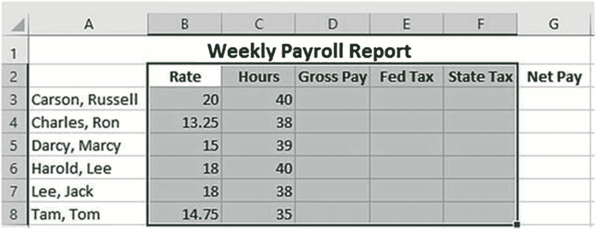

图 7-47：为多行或多列创建区域名称时，选中标题及数据

接着，点击“定义名称”组中的“根据所选内容创建”按钮。参见图 7-48。这将弹出“以选定区域创建名称”对话框（图 7-49）。

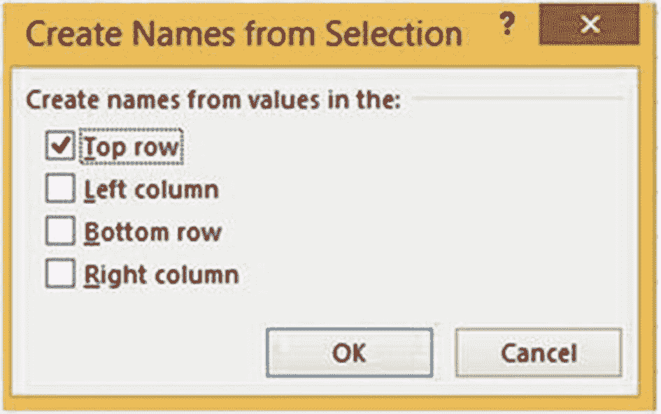

图 7-49：以选定区域创建名称对话框

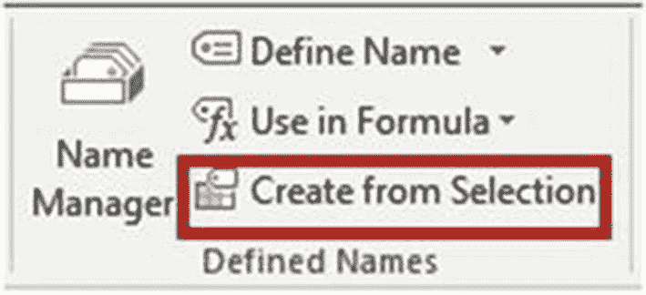

图 7-48：根据所选内容创建按钮

你需要勾选“首行”选项来获取列标题。Excel 将按以下方式分配命名区域：

- `Rate` 对应单元格 B3:B8
- `Hours` 对应单元格 C3:C8
- `Gross_Pay` 对应单元格 D3:D8
- `Fed_Tax` 对应单元格 E3:E8
- `State_Tax` 对应单元格 F3:F8

**注意**：命名区域不能包含空格。当 Excel 使用行标题或列标题时，会用下划线代替空格。

### 在公式中选择命名区域而非手动输入

你可以直接将命名区域键入公式，例如 `=Rate*Hours`。如果你不记得分配给某个区域的名称，或者想确保拼写正确，可以使用“定义名称”组中的“用于公式”按钮。参见图 7-50。

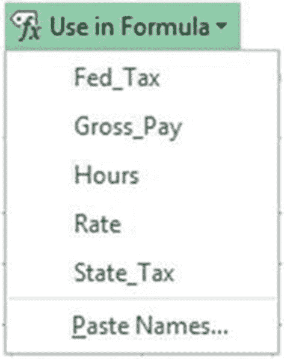

图 7-50：用于公式按钮

如果你刚开始编写公式，点击某个命名区域会将等号连同该命名区域一同放入公式。例如，以我们的人员工资计算为例，我们想通过将“费率”乘以“工时”来计算单元格 D3 的总工资。你可以点击单元格 D3，然后在“用于公式”列表框中点击 `Rate`。这会创建 `=Rate`。接着键入乘号 `*`。最后，点击 `Hours` 完成公式，然后按 Enter 键。

更快捷地选择命名区域或常量是按 F3 键。按 F3 会弹出所有可用的名称供你选择。

### 练习 7-6：命名区域与常量

在本练习中，你将使用不同方法创建区域名称。你还会创建用于存放税率值的常量。

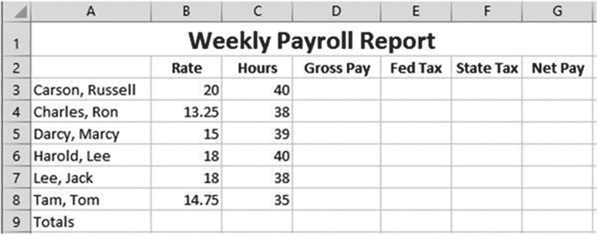

图 7-52：格式化后的工作表

1.  按照图 7-51 所示，将数据输入到新的工作表中。

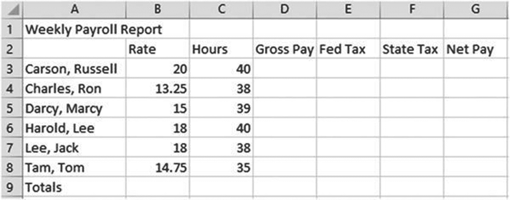

图 7-51：输入数据

2.  格式化标题：
    1.  选中单元格 A1:G1。
    2.  点击“开始”选项卡“对齐方式”组中的“合并后居中”按钮。
    3.  将文本加粗。
    4.  在“开始”选项卡的“字体”组中，点击两次“增大字号”按钮。

3.  将列标题居中并加粗。你的电子表格现在应如图 7-52 所示。

**使用名称框创建命名区域**

1.  选中单元格 B3:B8。在名称框中输入 `Rate`。按 Enter 键。
2.  选中单元格 C3:C8。在名称框中输入 `Hours`。按 Enter 键。
3.  选中单元格 D3:D8。在名称框中输入 `GrossPay`。按 Enter 键。
4.  选中单元格 E3:E8。在名称框中输入 `FedTax`。按 Enter 键。

**使用“定义名称”创建命名区域**

1.  选中单元格 F3:F5。
2.  右键单击所选单元格中的任意一个。从上下文菜单中选择“定义名称”。Excel 将名称 `State_Tax` 分配给该区域。Excel 从列标题中获取了该名称。名称不能包含空格；因此，Excel 用下划线填充了空格。“引用位置”文本框中包含了选中的区域。
3.  点击确定按钮。

**更改名称或其区域**

你不能在名称框中更改名称或其区域。这些更改只能通过名称管理器完成。州税区域当前是 F3:F5，但需要改为 F3:F8。同时，我们也通过移除下划线来更改名称。

1.  点击“公式”选项卡；在“定义名称”组中，点击“名称管理器”按钮。
2.  点击 `State_Tax`。点击“编辑”按钮。将出现“编辑名称”对话框。
3.  从名称中移除下划线，使名称变为 `StateTax`。
4.  按 Tab 键切换到“引用位置”文本框。参见图 7-53。单元格 F3:F5 周围会出现一个闪烁的边框。

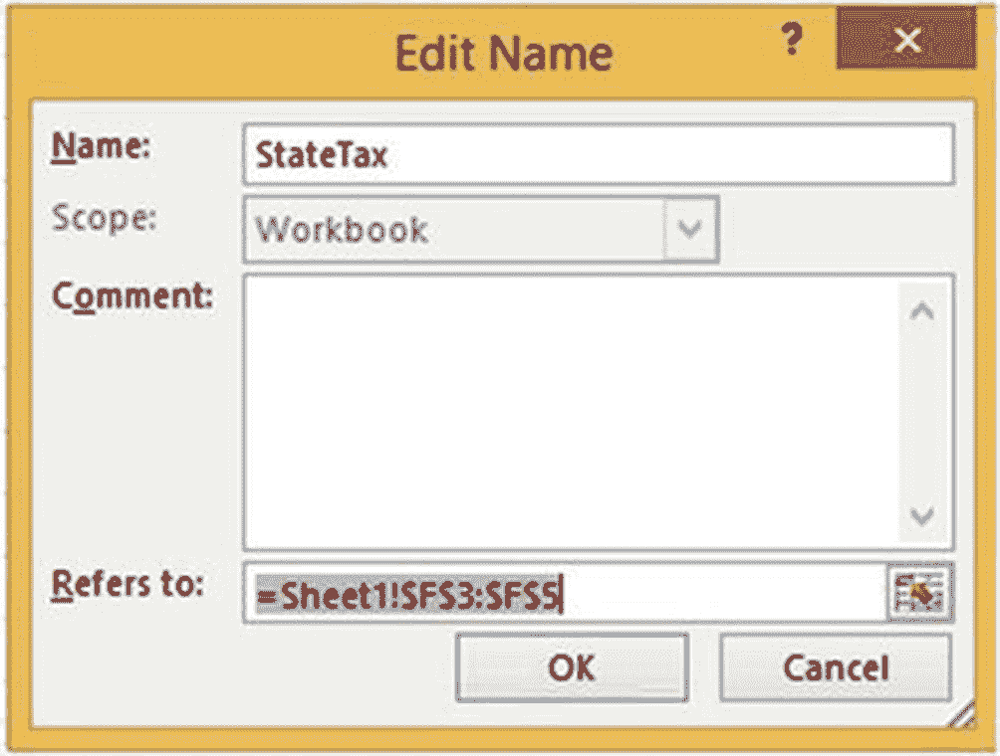

图 7-53：更改区域名称和位置

5.  如果看不到单元格 F3:F8，请移动“编辑名称”窗口直至能看到。
6.  拖动鼠标选中单元格区域 F3:F8。点击确定按钮。点击关闭按钮。
7.  点击名称框的下拉箭头。它应该会显示你所有的命名区域。参见图 7-54。

图 7-54

名称框中显示的区域名称

8.  单击 `StateTax`。这将高亮显示 `StateTax` 区域。

9.  在工作表上选择单元格区域 `B3:B8`。名称框现在应显示名称 `Rate`。

**更改名称框的大小**

图 7-55

更改名称框的大小

1.  由于名称最长可达 255 个字符，您可能需要加宽名称框以显示更多名称内容。
2.  将光标移动到名称框的右侧。当光标变为水平双箭头时，向右拖动以增大名称框的尺寸。当您增大名称框尺寸时，功能区会缩小，反之亦然。向左拖动以减小名称框的尺寸。参见图 7-55。

**删除已命名的区域**

1.  单击功能区上的 **公式** 选项卡。
2.  在 **定义的名称** 组中，单击 **名称管理器** 按钮。名称管理器会显示现有的已命名区域。它们按字母顺序显示。
3.  要选择所有已命名的区域，请单击 `FedTax`，然后按住 `Shift` 键，再单击 `StateTax`。
4.  在名称管理器窗口中单击 **删除** 按钮。
5.  此时会弹出一个对话框，询问“您确定要删除选定的名称吗？”
6.  单击 **确定** 按钮。
7.  单击 **关闭** 按钮。

**使用“根据所选内容创建”创建命名区域**

1.  选择单元格 `B2:F8`。
2.  在“定义的名称”组中，单击 **根据所选内容创建** 按钮。
3.  从 **根据所选内容创建名称** 对话框中选中 **首行**。单击 **确定** 按钮。
4.  单击 **名称管理器** 按钮。已从列标题创建了命名区域。列名称中的空格已替换为下划线。参见图 7-56。

图 7-56

根据列标题创建的区域名称

5.  单击 **关闭** 按钮。

**创建命名常量**

出于此示例的目的，我们假设联邦税率为 32%。我们将为此值分配一个命名常量。

1.  在“定义的名称”组中，单击 **定义名称** 按钮。
2.  在 **名称** 文本框中键入 `FederalTaxRate`。
3.  在 **备注** 框中键入 `用于练习示例的虚构联邦税率`。
4.  在 **引用位置** 文本框中覆盖现有文本，键入 `=32%`。参见图 7-57。如果愿意，您可以使用等效十进制数并键入 `=.32`。

图 7-57

分配给常量 32% 的名称 `FederalTaxRate`

5.  单击 **确定** 按钮。

假设州税率为 8%。

1.  单击 **定义名称** 按钮。
2.  在 **名称** 文本框中键入 `StateTaxRate`。
3.  在 **备注** 框中键入 `用于练习示例的虚构州税率`。
4.  这次，我们使用 8% 的等效十进制数。在 **引用位置** 文本框中键入 `=.08`。参见图 7-58。

图 7-58

分配给常量 `.08` 的名称 `StateTaxRate`

5.  单击 **确定** 按钮。
6.  单击 **名称管理器** 按钮。您可以看到已添加了新的常量。
7.  单击 **关闭** 按钮。
8.  单击 **名称框** 的下拉箭头。如您所见，常量不会出现在名称框中。这是因为它们不指向任何特定单元格。

**在公式中使用命名区域**

1.  在单元格 `D3` 中，输入 `=R`。Excel 会弹出一个列表，其中包含所有以 `R` 开头的内置函数以及所有以 `R` 开头的命名区域。参见图 7-59。

**图 7-59** 以 R 开头的内置函数和已命名区域

已命名区域与函数很容易区分，因为它们前面的图标不同。图标代表已命名区域。请注意，有一个你创建的 `Rate` 已命名区域和一个 `RATE` 函数。我们要使用的是前面带有图标的 `Rate`。

2. 单击 `Rate`，然后按 Tab 键。按 Tab 键后，Excel 会在属于该已命名区域的单元格周围放置一个矩形框。见图 7-60。

**图 7-60** 输入区域名称时，Excel 会高亮显示该区域中的单元格

3. 输入 `Ho`。见图 7-61。

**图 7-61** 输入 `Ho` 会调出函数 `Hour` 和已命名区域 `Hours` 的智能感知选项

4. 使用向下箭头选择  `Hours`，然后按 Tab 键。Excel 会用不同颜色的矩形框包围包含 `Hours` 区域的单元格。

5. 按 Ctrl + Enter。

6. 使用自动填充功能将公式向下复制到 D8 单元格。

7. 单击 D4 单元格。查看公式栏。该列中每个单元格的公式都会显示为 `=Rate*Hours`。你不会看到像在公式中使用单元格引用时那样的行调整。

### 从公式中使用已命名区域

1. 单击 E3 单元格内部。在“公式”选项卡的“定义的名称”组中，单击 **公式中使用** 按钮。选择 `FederalTaxRate`。

2. 输入 `*`（星号）。

3. 单击 **公式中使用** 按钮。选择 `Gross_Pay`。

4. 按 Ctrl + Enter。

5. 双击自动填充柄，将公式向下复制到 E8 单元格。

6. 单击 F3 单元格内部。在“公式”选项卡的“定义的名称”组中，单击 **公式中使用** 按钮。选择 `StateTaxRate`。

7. 输入 `*`（星号）。

8. 单击 **公式中使用** 按钮。选择 `Gross_Pay`。

9. 按 Ctrl + Enter。

10. 双击自动填充柄，将公式向下复制到 F8 单元格。

### 设置名称的作用域

名称的作用域指的是该名称可以在何处使用。作用域可以针对整个工作簿，也可以针对单个工作表。当你使用名称框创建已命名区域时，该已命名区域的作用域是整个工作簿。换句话说，你可以在声明该区域的工

作簿中的任何工作表上使用它。无论工作簿中有多少个工作表都没关系；它在任何一个工作表上都能起作用。

让我们来看看为已命名区域或已命名常量声明单个工作表作用域时会发生什么。

1. 向工作簿中添加另一个工作表。将工作表标签上的名称改为“TestScope”。

2. 选择单元格区域 A1:A5。

3. 在功能区“公式”选项卡的“定义的名称”组中，单击 **定义名称** 按钮。

4. 在“名称”框中输入 `SheetScope`。

5. 单击“作用域”的下拉箭头，选择 TestScope。“引用位置”文本框应反映你已选择了 A1:A5 区域。见图 7-62。

**图 7-62** 选择了 A1:A5 区域

6. 单击“确定”按钮。

7. 按 F3。`SheetScope` 区域会与你之前创建的名称一起出现在列表中。由于其他名称的作用域都是工作簿，因此可以从任何工作表访问它们。

8. 单击“取消”按钮。

9. 单击另一个工作表。按 F3。`SheetScope` 不会出现在此列表中，因为它的作用域仅限于 TestScope 工作表。

10. 单击“取消”按钮。

11. 单击 **名称管理器** 按钮。单击 **筛选** 按钮。选择 **作用域为工作表** 的名称。见图 7-63。`SheetScope` 是唯一显示的名称，因为它是唯一一个作用域仅限于工作表的名称。

**图 7-63** 选择作用域为工作表的名称

12. 再次单击 **筛选** 按钮。选择作用域为工作簿的名称。除了 `SheetScope` 之外，所有名称都会显示出来。

**注意** 如果你为名称分配了工作表的作用域，则可以在另一个工作表上创建同名的区域。

13. 单击“关闭”按钮。

现在你已了解如何通过使用已命名区域和已命名常量来简化公式。到目前为止，当你将公式向下复制到一列或横向复制到一行时，公式会自动根据行或列的变化进行调整，但有时你并不希望发生这种情况。你将在下一节学习如何防止这些变化。

### 运算优先级

运算优先级是一组预定义的规则，用于确定公式中运算的执行顺序。看下面的公式，很难知道应该先执行哪个运算：

`= 3+2*18 /-3² – 2`

Excel 遵循正常的数学**运算优先级**，也称为**运算顺序**。如果一个表达式包含优先级相同的运算符，则它们会从左到右进行计算。将表达式的一部分放在括号内，可以控制运算符的求值顺序。Excel 按照表 7-5 所示的顺序执行数学运算。

**表 7-5** 运算优先级

| 运算符 | 说明 | 优先级 |
| --- | --- | --- |
| `( )` | 括号内 | 1 |
| `-` | 一元运算符（负号） | 2 |
| `%` | 百分号 | 3 |
| `^` | 乘幂 | 4 |
| `*` | 乘法 | 5 |
| `/` | 除法 | 5 |
| `+` | 加法 | 6 |
| `–` | 减法 | 6 |

现在你知道了运算的执行顺序，可以用这一知识来确定以下公式的结果：

`=3+2*18/-3²–2`

负数首先被求值，然后是指数。现在该表达式等价于：

`=3+2*18/9–2`

乘法和除法具有相同的级别。由于乘法在除法左边，所以先进行乘法运算。现在该表达式等价于：

`=3+36/9–2`

接下来执行除法：

`=3+4–2`

加法和减法具有相同的优先级。由于加法在减法左边，所以先进行加法运算：

`=7–2`

接下来执行减法，结果为 **5**。

通过将要优先执行的运算放在括号内，可以覆盖正常的运算符优先级。如果括号内还有括号，则最内层括号内的运算将首先执行。

使用括号可以使公式更清晰，如下面的公式所示：

`=3+((2*18)/(-3²))–2`

## 摘要

Excel 中的所有公式都必须以 `=` 号开头。

公式可以通过以下三种方式之一输入：

- 直接在单元格中键入
- 单击公式中想要引用的单元格，并用数学符号分隔
- 使用箭头键选择公式中想要引用的单元格，并用数学符号分隔

Excel 遵循正常的数学运算优先级。请务必使用括号来确保你的数学运算按你想要的顺序执行。

Excel 有一个 `自动` 按钮，其中包含聚合函数 `求和`、`平均值`、`计数`、`最小值` 和 `最大值`。你无需输入函数即可使用这些常用函数中的任何一个。只需选择结果放置位置上方或左侧的单元格，然后通过单击 `自动求和` 按钮右侧的下拉箭头来选择要使用的函数。

你可以为单元格区域分配一个名称。这可以使你的公式更易于阅读和理解。

有三个地方可以命名区域：

- `名称框`
- `定义名称` 对话框
- `名称管理器`

按 `Ctrl + ~` 显示工作表上的所有函数。你可以在显示公式的情况下打印工作表。再次按 `Ctrl + ~` 来显示函数的结果，而不是函数本身。

你可以使用 `自动填充句柄` 复制公式。公式中使用的任何地址都将在复制的单元格中自动调整。能够调整的地址称为相对地址。你可以在公式中锁定一个地址，使其在复制时不会调整。被锁定的地址称为绝对地址。美元符号用于锁定行或列。按 `F4` 可在行和列前面添加美元符号。如果你只锁定地址中的行或列，则称为混合单元格地址。

你可以通过按 `F3` 从列表中选择已命名的区域和常量。

你可以通过单击 `在公式中使用` 右侧的下拉箭头，然后选择 `粘贴名称`，将分配给区域的名称及其区域地址放置在工作表中。这为你的工作表创建了良好的文档。

