# 14. 导入数据

Excel 是首屈一指的分析工具。这就是将数据从其他源导入 Excel 的原因。对于 Excel 2019，Microsoft 增加了更多导入数据的源和方式。

阅读并完成本章后，您应该能够：

*   导入分隔文本文件和固定宽度文本文件
*   从 Access 数据库导入数据
*   从网页按原样导入数据，并在导入前对其进行修改和转换
*   在工作簿和数据源之间创建连接

## 将数据导入 Excel

用于导入和转换数据的按钮位于功能区的“数据”选项卡上。Excel 2016 有一个用于获取外部数据的组和另一个用于转换数据的组。Excel 2019 已将这些组合成一个名为“获取和转换数据”的组。参见图 14-1。Excel 增加了更多您可以访问数据的数据库类型。他们还扩展了您可以下载的数据源和文件类型的数量。


图 14-1：“获取和转换数据”组

Excel 可以从各种源导入数据。“获取和转换数据”组中的按钮允许您从文本文件、Access 数据库、Web、XML 文件、SQL 服务器等导入数据。它甚至可以使用 `ODBC`（开放式数据库连接）驱动程序或 `OLEDB`（对象链接嵌入）驱动程序连接到其他程序。不同的文件类型在 Excel 中的功能并不相同。某些选项适用于某些数据类型，但不适用于其他类型。

## 导入文本文件

文本文件不包含任何格式。这使得不同程序可以轻松交换文本文件数据。文本文件有两种类型：分隔文本文件和固定宽度文本文件。文件中的数据通常被划分成字段。分隔文件具有可变长度的字段。固定宽度字段中的所有值都具有相同的长度。使用空格使文本字段的长度相同；数值字段可以用零填充以使它们长度相同。

### 分隔符文本文件

文本文件中的字段通常用逗号分隔，但也可以用制表符、空格或任何其他字符分隔。用于分隔字段的字符称为分隔符。字段由逗号分隔的文本文件称为逗号分隔文本文件。大多数文本文件的扩展名为 `.txt`。Excel 电子表格可以保存为扩展名为 `.csv` 的文本文件。该扩展名代表“逗号分隔值”。

以下是一个逗号分隔文件的内容。该文件的第一行包含标题。并非所有文本文件都包含标题行。

```
EmployeeID,DeptID,LastName,FirstName,MidInitial
A3251,05,Carson,Annette,F
A3291,04,Sterk,Carrie,M
A1450,04,Uhrhammer,Dorothy,L
A1425,05,Carson,Dick,J
```

### 练习 14-1：导入逗号分隔的文本文件

在本练习中，您将把数据从分隔符文本文件导入到工作表中。您将创建两个到该文本文件的连接。一个连接会在文件打开时，自动用文本文件中的任何更新数据刷新工作表，而另一个连接则不会。您还将学习仅导入您希望导入的数据。

1.  现在，您可以通过单击**加载**按钮将数据直接加载到新工作表中，或者可以单击**加载**按钮的下拉箭头，然后选择 `加载到`，这将调出如图 14-3 所示的**导入数据**对话框。单击**加载**按钮的下拉箭头，然后选择 `加载到`。

    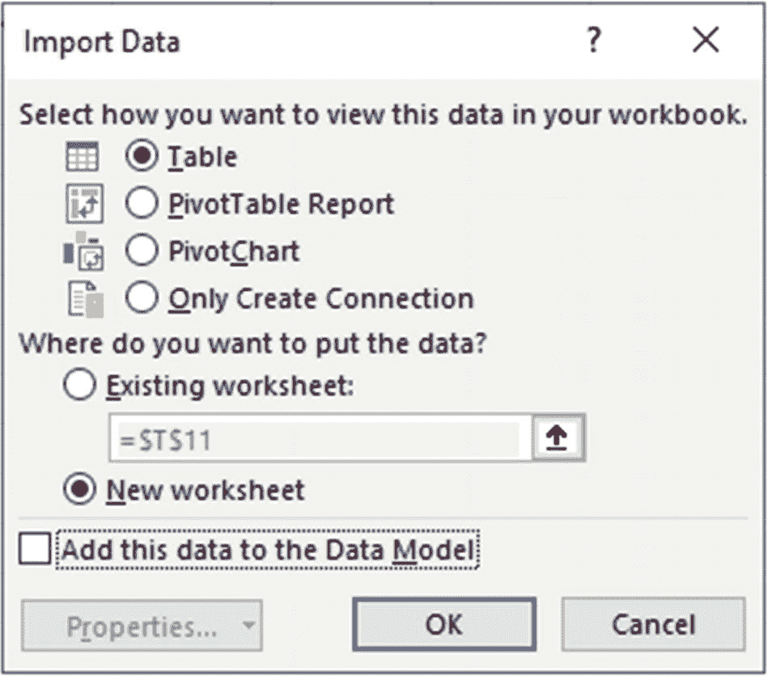

    **图 14-3** 导入数据对话框

2.  创建一个新的空白工作簿。单击功能区上的**文件**选项卡。单击**另存为**。将工作簿命名为 `ImportingData`。返回工作表。

3.  单击功能区上的**数据**选项卡。在**获取和转换数据**组中，单击 `自文本/CSV`。

4.  这将调出**导入数据**窗口，您可以在其中浏览直到找到所需文件。找到并选择 `Employee.txt` 文件。单击**导入**按钮。

5.  这将调出如图 14-2 所示的对话框。您可以通过单击**分隔符**文本框并选择一种分隔符来选取分隔符，也可以选择**自定义**或**固定宽度**。为分隔符选择**逗号**。

    **注意** 有一个用于固定宽度的分隔符选项。但目前这对固定宽度文本文件无效。如果您尝试加载固定宽度文本文件，则不会显示分隔符文本框。您将在下一个练习中学习如何导入固定宽度文本文件。

    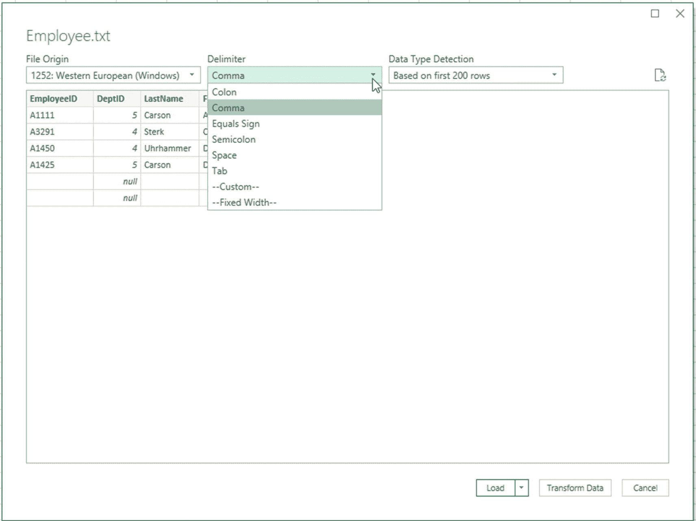

    **图 14-2** 导入数据对话框

**导入数据**对话框提供了一些选项，允许您将文本加载到您选择的工作表或新工作表中。与 Excel 2016 不同的是，您还可以将文本文件加载到数据透视表或数据透视图中。我们将在下一章讨论数据透视表和数据透视图。您可以将文件添加到数据模型。数据模型用于集成来自多个表的数据。

单击 `现有工作表` 的**选项**按钮。单击单元格 `A1`。单击**确定**按钮。文本文件中的数据将加载到当前工作表的一个表格中。参见图 14-4。

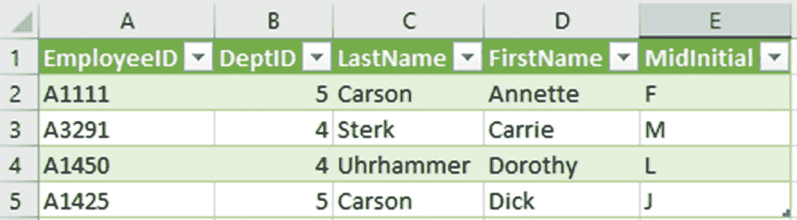

**图 14-4** 已导入数据加载到工作表表格中

### 创建到外部数据的连接

1.  选择 `打开文件时刷新数据`。单击**确定**按钮。
2.  单击单元格 `F7`。
3.  单击功能区上的**数据**选项卡；在**获取和转换数据**组中，单击**现有连接**。
4.  单击窗口底部的省略号按钮 (`…`)，然后选择**属性**。这将调出如图 14-6 所示的**查询属性**对话框。

在此窗口中，您可以进行的一项更改是控制文件更新频率或更新时机。例如，您可以将 `Refresh`（刷新）控件设置为每十分钟刷新一次。然后，您可以修改 `Employee.txt` 文件中的数据，等待十分钟，即可在工作表中看到更改后的结果显示。或者，您也可以将其设置为在重新打开工作簿时进行刷新。

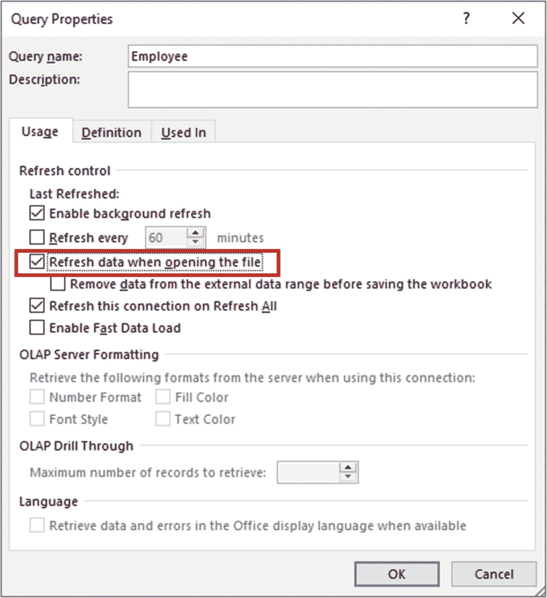

**图 14-6** “查询属性”对话框

5.  加载文件时，`Queries & Connections`（查询和连接）窗格会在工作表右侧打开。其中显示文件名和加载的行数。将光标悬停在文本上，会弹出如图 14-5 所示的窗口。该窗口显示已上传文件的数据和信息。您可以查看上次刷新数据的时间以及上传文件的位置。

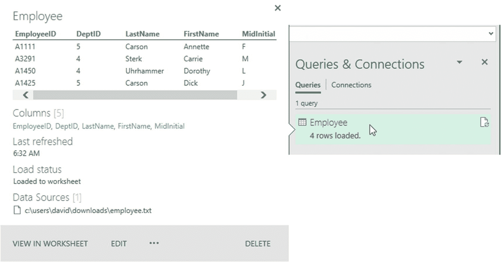

**图 14-5** 已上传文件信息

此时会打开“`Existing Connections`（现有连接）”窗口。参见图 14-7。此窗口显示当前工作簿、网络和计算机上的所有现有连接。目前，我们只连接了工作簿中的 `Employee` 文本文件。既然已建立连接，我们就可以继续使用这些数据，而无需创建其他连接。

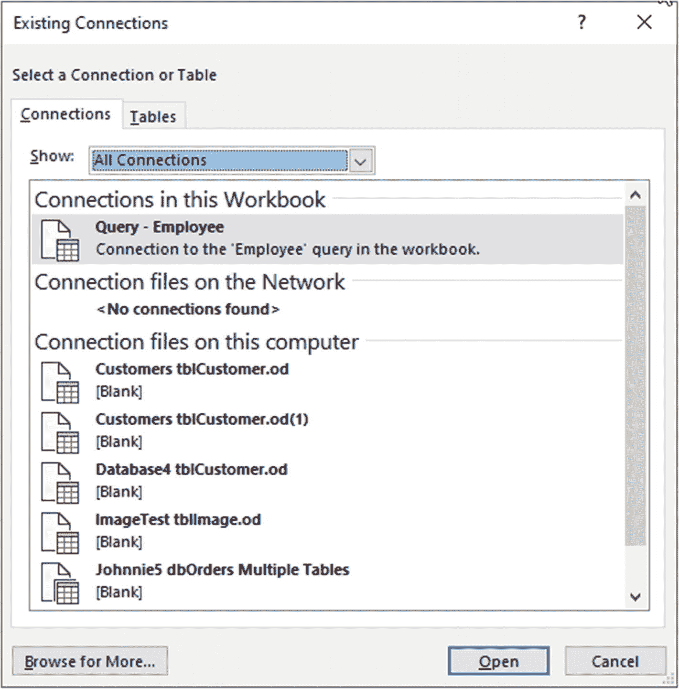

**图 14-7** “现有连接”对话框

### 创建到 `Employee.txt` 文件的第二个连接


**图 14-11** `Refresh All`（全部刷新）按钮

1.  如果要立即刷新所有连接的数据，请单击 `Refresh All`（全部刷新）按钮。参见图 14-11。
2.  单击 `Query – Employee (2)`（查询 - Employee (2)）。点击 `Open`（打开）按钮。
3.  此时会打开“`Import Data`（导入数据）”对话框。单击 `Properties`（属性）按钮。

由于第二个连接的属性未设置为在打开文件时刷新，因此，当工作簿打开时，对 `Employee.txt` 文件所做的任何更改都不会影响第二个连接在工作表上的数据副本。

请注意，`Refresh this connection on Refresh All`（在全部刷新时刷新此连接）选项已被勾选。

4.  单击“`Query Properties`（查询属性）”对话框中的`Cancel`（取消）按钮。单击“`Import Data`（导入数据）”对话框中的`Cancel`（取消）按钮。

5.  保存此工作簿。关闭工作簿。

6.  使用`Notepad`（记事本）或`WordPad`（写字板）更改`Employee.txt`文件，将第一个 EmployeeID 从 `A1111` 改为 `A9999`。保存`Employee.txt`文件。

7.  重新打开`ImportingData`工作簿。

工作表上方可能会显示安全警告。如果出现，请单击`Enable Content`（启用内容）按钮。

图 14-10 显示单元格`A2`中的 EmployeeID 已更改为您在`Employee.txt`文件中更新的相同值。单元格`F8`中的值保持不变。出现这种情况是因为在第一个连接中，我们选择了`Refresh data when opening the file`（打开文件时刷新数据）属性。

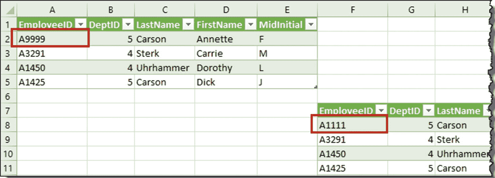

**图 14-10** 单元格`A2`中的 EmployeeID 已更改为您在`Employee.txt`文件中更新的值

1.  将“`Existing worksheet`（现有工作表）”的起始单元格保留为`F7`。

2.  单击`OK`（确定）按钮。第一个连接的另一个文件副本会从单元格`F7`开始显示。

3.  单击功能区上的`Data`（数据）选项卡；在`Get & Transform Data`（获取和转换数据）组中，单击`Existing Connections`（现有连接）。

4.  此时会打开“`Existing Connections`（现有连接）”对话框。Excel 将第二个连接命名为`Query – Employee(2)`（查询 - Employee(2)）。参见图 14-9。


**图 14-9** 导入文件的连接

5.  双击`Query – Employee`（查询 - Employee）连接，或单击`Open`（打开）按钮。

6.  此时会打开“`Import Data`（导入数据）”窗口。参见图 14-8。您可以将数据放置在其他位置或其他工作表中。

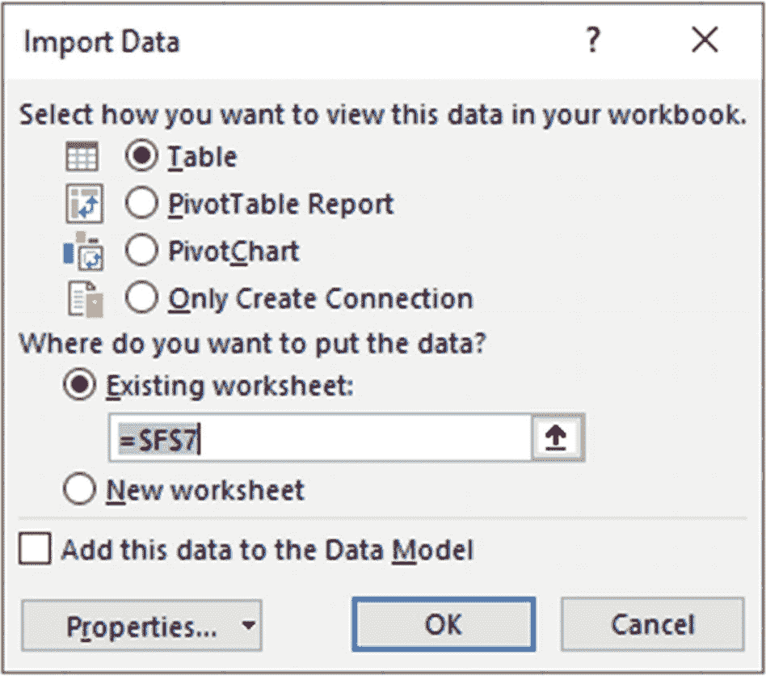

**图 14-8** 指定导入数据的放置位置

单击功能区上的`Data`（数据）选项卡；在`Connections`（连接）组中，单击`Refresh All`（全部刷新）按钮。此时两个连接的数据应保持一致。

### 断开导入文件与工作簿之间的连接

如果您不希望 Excel 在文件发生更改时继续更新数据，该怎么办？

1.  单击`OK`（确定）按钮。

2.  更改`Employee.txt`文件，将第一个 EmployeeID 设为 `A0000`。保存该文件。

3.  单击功能区上的`Data`（数据）选项卡。在`Queries & Connections`（查询和连接）组中，单击`Refresh All`（全部刷新）按钮。

4.  单击从单元格`A1`开始的表格。功能区上会出现`Table Tools`（表格工具）和`Query Tools`（查询工具）的上下文组。单击`Query Tools`（查询工具）。单击`Design`（设计）选项卡。在功能区的`Design`（设计）选项卡上，找到`External Table Data`（外部表数据）组，单击`Unlink`（取消链接）按钮。此时会显示如图 14-12 所示的对话框。


**图 14-12** 永久删除查询定义

由于第一个表格的链接已被移除，其 EmployeeID 未发生变化，但另一个表格中的 EmployeeID 已更新。参见图 14-13。

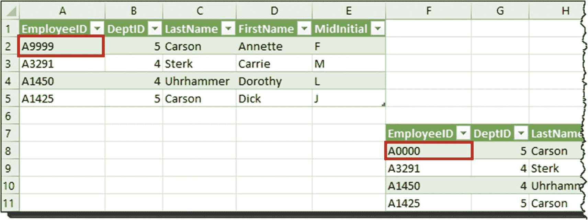

**图 14-13** 已取消链接，第一个表格的数据不再更新

### 更改导入的数据


**图 14-17** 表格根据查询的更改而改变

1.  单击`Close & Load`（关闭并加载）按钮。单元格`F7`开始处的表格会更新以反映编辑后的查询结果。参见图 14-17。

2.  右键单击`DeptID`列标题。选择`Rename`（重命名）。在`Dept`和`ID`之间加一个空格。右键单击`LastName`列标题。选择`Rename`（重命名）。在`Last`和`Name`之间加一个空格。对`FirstName`执行相同操作。您的列标题现在应类似于图 14-16 所示。

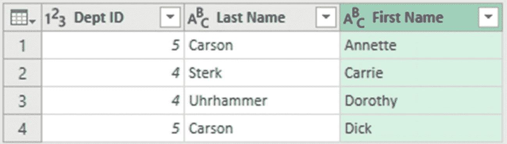

**图 14-16** 从查询中移除两列并更改列名

3.  单击`Definition`（定义）选项卡。单击`Edit Query`（编辑查询）按钮。

4.  单击`EmployeeID`列标题，然后按住`Ctrl`键，再单击`MidInitial`列标题。

5.  单击`Home`（开始）选项卡。单击如图 14-15 所示的`Remove Columns`（删除列）按钮的上半部分。这两列从查询中被移除。

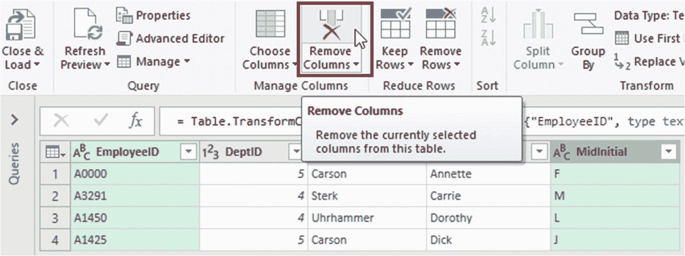

**图 14-15** 从查询中移除两列

6.  单击从单元格`F7`开始的表格。单击`Query`（查询）菜单。在`Edit`（编辑）组中，单击`Properties`（属性）按钮。

7.  此时会显示“`Connection Properties`（连接属性）”窗口。参见图 14-14。

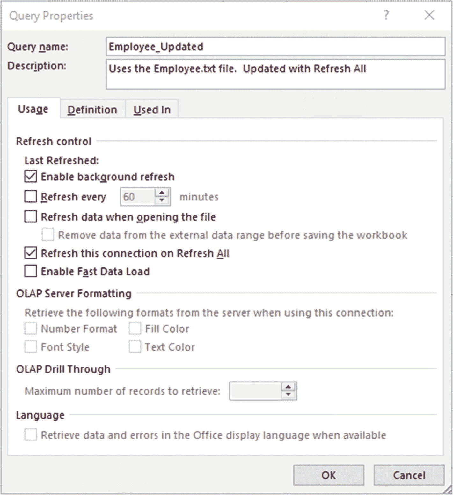

**图 14-14** “连接属性”对话框

8.  `Employee(2)`这个名称不太合适；将其改为`Employee_Updated`。

9.  在`Description`（描述）中，输入`使用 Employee.txt 文件。通过“全部刷新”更新`。

请注意，`Refresh this connection on Refresh All`（在全部刷新时刷新此连接）已被选中。

你已经学会了如何导入分隔符文件。这类文件的字段可以用逗号、分号等符号分隔，字段之间不必有空格。接下来，你将学习如何导入固定宽度的文本文件。在固定宽度文本文件中，没有分隔符，字段之间依靠空格来分隔。

### 固定宽度文本文件

在固定宽度文本文件中，每个字段占据相同的空间。通常不会使用表头，因为表头很难与数据列对齐。

```
A3251 05 Carson         Annette F
A3291 04 Sterk          Carrie  M
A1450 04 Uhrhammer      Dorothy L
A1425 05 Carson         Dick    J
```

练习 14-2：导入固定宽度文本文件

在本练习中，你将把固定宽度格式文本文件中的数据，导入到工作表中指定的位置。

在导入固定宽度文本文件之前，我们需要恢复旧版（传统）的导入方法。如果像上一个练习那样使用`From Text/CSV`导入固定宽度文本文件，它将不会提供分隔符选项。

1. 在“步骤 2（共 3 步）”中，点击“下一步”按钮。

2. 在“步骤 3（共 3 步）”中，点击“完成”按钮。

   此时会显示“导入数据”对话框，如图 14-20 所示。在此对话框中，你可以指定将数据加载到当前工作簿中的位置，或者将其放入一个新工作表中。

## 导入数据

3. 选中单元格 `A3`。点击“确定”按钮。

4. 点击“下一步”按钮，进入第二个步骤，如图 14-19 所示。

   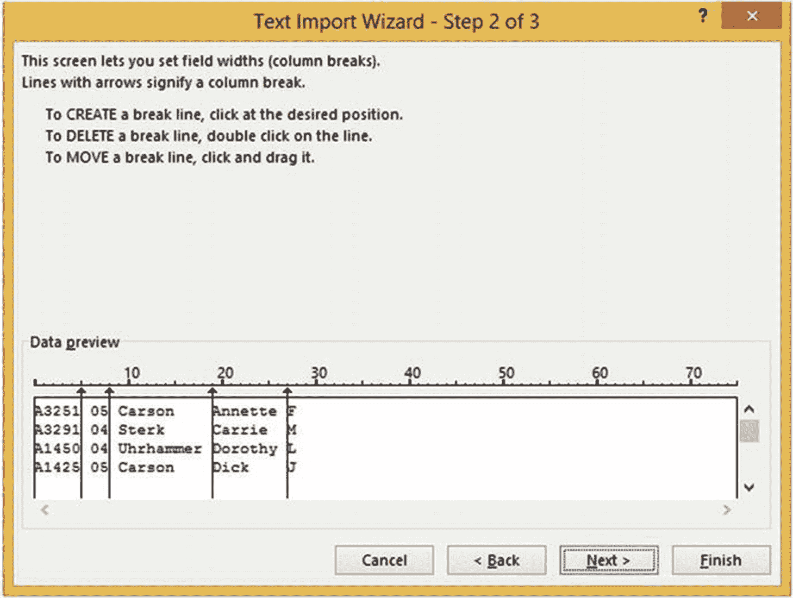

   图 14-19

   `文本导入向导 – 步骤 2（共 3 步）`

   在固定宽度文件中，你可以通过拖动分隔线，在任意位置划分字段。双击两列之间的分隔线可以移除它，从而合并字段。在你希望创建新分隔线的位置单击，就可以在列之间创建新列。

5. 点击功能区中的“文件”选项卡。在左侧窗格中点击“选项”。

6. 点击左侧窗格中的“数据”。选中“从 Text (旧版)”。点击“确定”。

7. 创建一个名为 `Fixed-Width` 的新工作表。

8. 点击功能区中的“数据”选项卡；在“获取和转换数据”组中，点击“获取数据”按钮。其中有一个你刚刚创建的“旧版向导”选项。点击“旧版向导”，然后点击“从 Text (旧版)”。

9. 此时会弹出“导入文本文件”对话框，你可以在其中浏览并找到目标文件。选择 `Employee_Fixed.txt` 文件，然后点击“导入”按钮。

10. 此时会弹出“文本导入向导”，如图 14-18 所示。Excel 会自动识别出这是固定宽度文件，并自动选中该选项。

    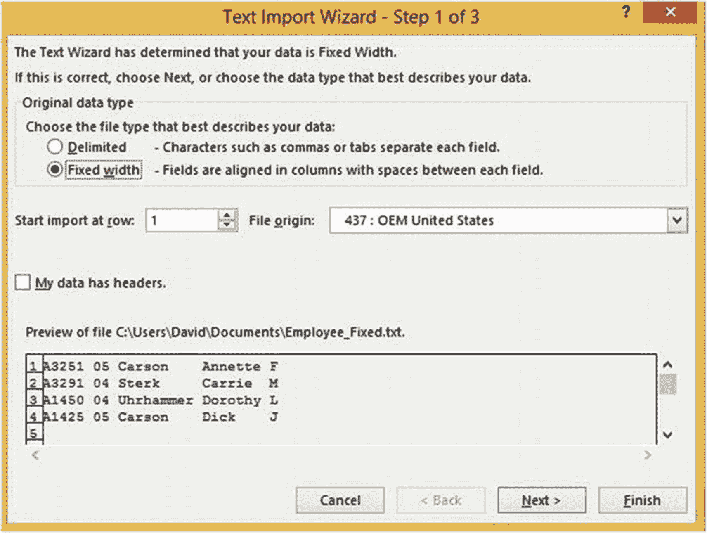

    图 14-18

    `文本导入向导 – 步骤 1（共 3 步）`

数据从单元格 `A3` 开始导入，如图 14-21 所示。

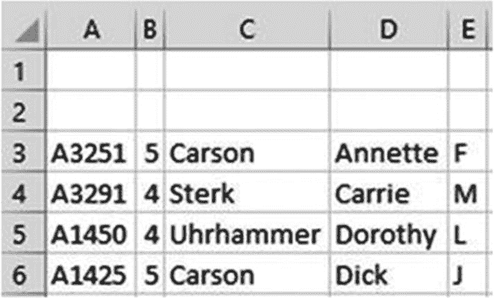

图 14-21

已导入的数据

你已经学会了如何导入文本文件。接下来，你将学习如何从 Access 数据库中导入数据。

## 从 Access 数据库导入数据

Microsoft Access 是 Microsoft Office 套件的一部分。一个 Access 数据库可以包含多个相互关联的表和查询。一个查询包含你从表中请求的特定字段，并且其包含的记录受限于你设置的所有筛选条件。你可以导入在 Access 中创建的表格和查询中的数据。

### 练习 14-3：从 Access 数据库导入数据

在本练习中，你将从一个名为 `Customers` 的 Access 数据库中，导入名为 `tblCustomer` 的表中的数据。

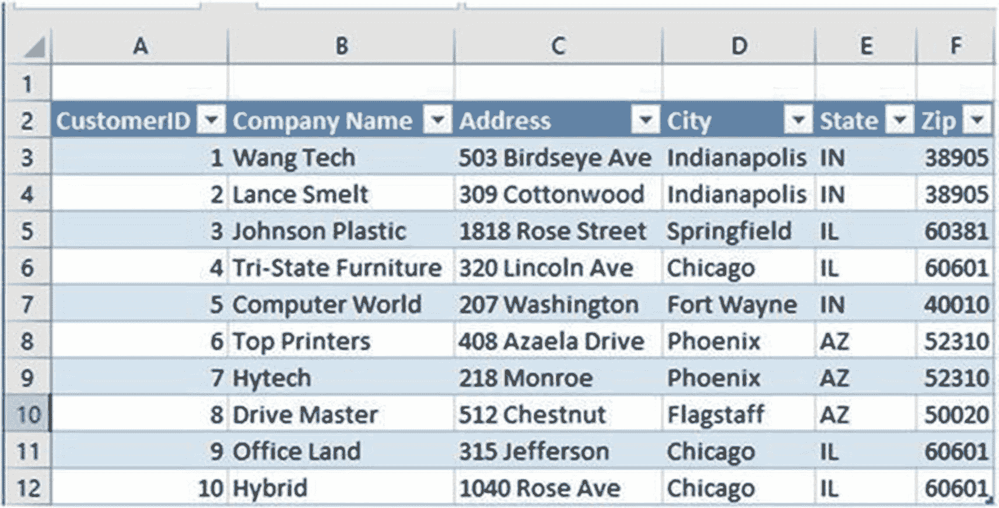

图 14-25

数据已导入到表中

1. 在“导入数据”对话框中，你需要指定数据的查看方式以及在工作簿中的放置位置。点击“现有工作表”单选按钮，并点击单元格 `A2`，如图 14-24 所示。然后点击“确定”按钮。

   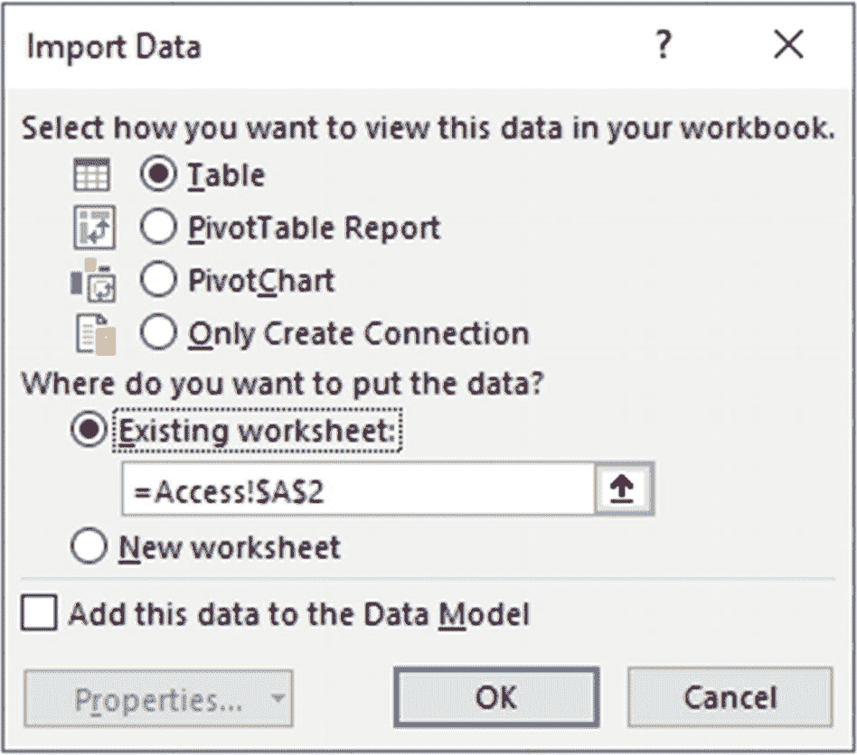

   图 14-24

   选择数据查看方式及放置位置

   你选择的数据将被放置在工作簿的一个表格中，如图 14-25 所示。如果你在 Access 中更改了数据后想要更新 Excel 工作簿中已导入的数据，可以在表格中任意位置右键单击，然后选择“刷新”。

2. `Customers` Access 数据库包含两个表：`tblCustomer` 和 `tblOrderinfo`。它还包含一个名为 `qryCustomerbyState` 的查询，如图 14-23 所示。在“导航器”对话框中点击名为 `tblCustomer` 的表。该表会显示在右侧窗格中。如果要导入多个表或查询，你需要勾选“选择多项”。

   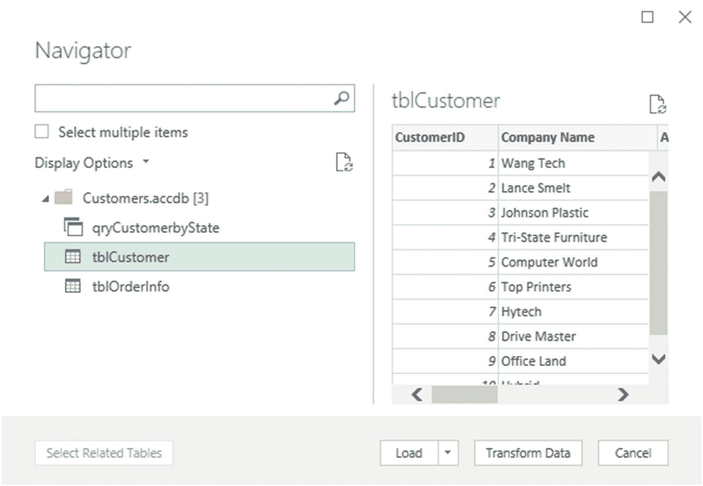

   图 14-23

   选择要导入的表或查询

3. 点击“加载”按钮的下箭头，并选择“加载到”。

4. 创建一个名为 `Access` 的新工作表。

5. 点击功能区中的“数据”选项卡。在“获取和转换数据”组中，点击“获取数据”按钮。点击“来自数据库”。点击“来自 Microsoft Access 数据库”。此时会打开“导入数据”对话框。

6. 找到并选择名为 `Customers` 的 Access 数据库，然后点击“导入”按钮，如图 14-22 所示。

   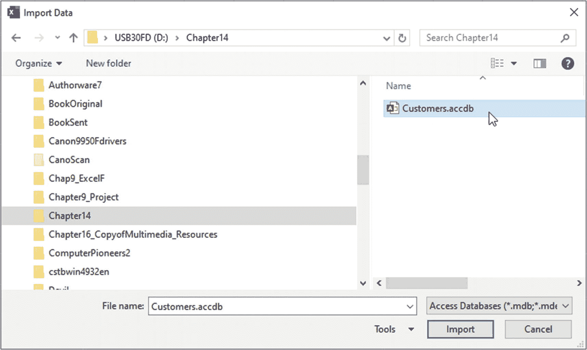

   图 14-22

   选择要打开的 Access 数据库

## 从网站导入数据

网站是另一个可以向 Excel 中导入数据的数据源。在本节中，你将像它们在网页上显示的那样，将网页中的表格导入进来。与其他数据源一样，你也可以使用查询功能，这将在下一节中介绍。

### 练习 14-4：从网站获取数据

在本练习中，你将把一个网站中的两个表格导入到一个工作表中。

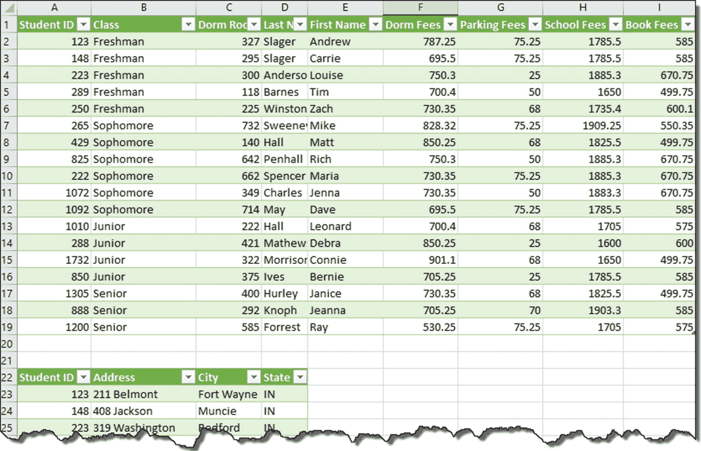

图 14-30 — 已导入的数据

1. 单击 `Table` 选项和 `Existing worksheet` 选项。单击单元格 `A1`。单击 `OK` 按钮。数据现在已被导入到一个表格中，你可以按任何方式对其进行操作。

2. 右键单击 `Queries & Connections` 窗格中的 `Table 1`。选择 `Load To`。

3. 在 `Import Data` 对话框中，单击 `Table` 选项和 `Existing worksheet` 选项。单击单元格 `A23`。单击 `OK` 按钮。两个表格都已加载到工作表中。见图 14-30。

4. 右键单击 `Queries & Connections` 窗格中的 `Table 0`。选择 `Load To`。Excel 会询问你要将数据导入到哪里。见图 14-29。请注意，你可以将数据加载到 `PivotTable` 或 `PivotChart` 中。

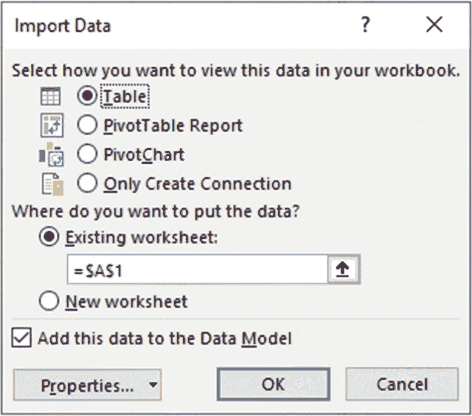

图 14-29 — 选择要存储导入数据的位置

5. 单击 `Load` 按钮。`Queries & Connections` 窗格会显示在工作表的右侧。Excel 将第一个表命名为 `Table 0`，将第二个表命名为 `Table 1`。见图 14-28。


图 14-28 — 两个表格已加载到查询中

6. 单击 `OK` 按钮。`Navigator` 对话框显示该网页上有两个表格。单击每个表格可在预览区域中查看它们。预览区域中有两个选项卡：`Table View` 和 `Web View`。`Web View` 向您展示表格在网页上的样子。`Table View` 向您展示表格在工作表中的样子。

7. 选中 `Select multiple items` 复选框，然后勾选每个表格。见图 14-27。

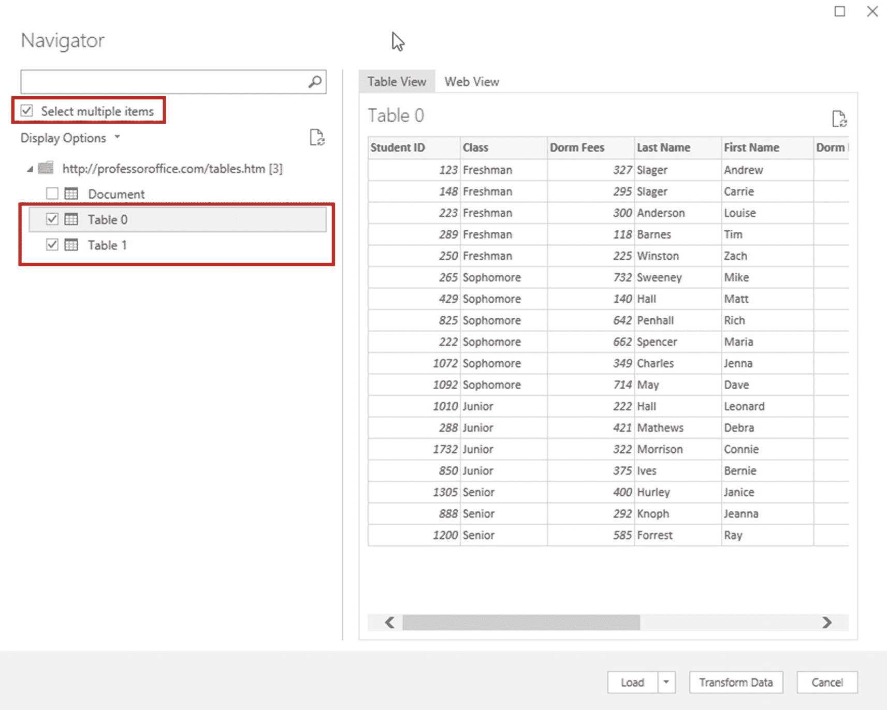

图 14-27 — 两个表格均被选中

8. 向 `Importing Data` 工作簿添加一个新的工作表。将工作表命名为 `ImportWeb`。

9. 单击功能区中的 `Data` 选项卡。在 `Get & Transform Data` 组中，单击 `From Web` 按钮。`From Web` 对话框将打开。见图 14-26。

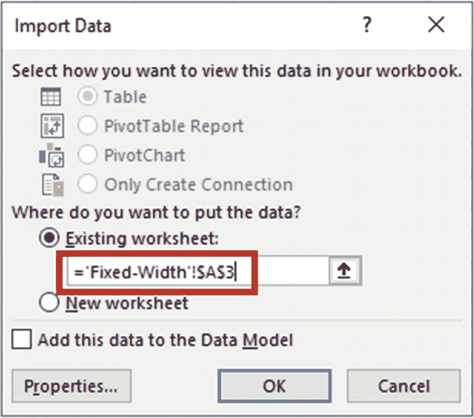

图 14-20

导入数据窗口


图 14-26 — 新建 Web 查询对话框

10. 在 `Address` 框中，输入 `http://professoroffice.com/tables.htm`。

您已学习了如何直接从您在互联网上找到的表格中将数据导入 Excel。接下来，您将学习如何使用 Excel 的 `Power Query` 功能。此功能允许您仅选择要导入的字段和数据。您甚至可以添加自己的计算字段。

## 使用转换功能导入数据

Excel 的 `Power Query` 功能可以从许多源导入数据，并且能够对数据进行大量修改。可以从中导入数据的源包括网页和数据库。Excel 默认支持从多种数据库类型导入数据。您可以使用 `Get & Transform Data` 组中提供的任何数据源。

> **注意：** 您也可以从其他来源导入数据，例如通过 `ODBC` 标准从各种数据库管理系统（DBMS）导入。您可以从第三方获取 `ODBC` 和其他数据源驱动程序。

在本节中，您将使用 `Get & Transform Data` 组中的查询从网页导入数据，然后将该数据转换为您想要的格式。

### 练习 14-5：使用 Power Query 转换数据

在本练习中，我们将使用与前一个示例相同的数据。这次，我们将使用 `Power Query` 来选择要导入哪些字段，而不是直接将数据加载到工作表中。您将过滤数据、创建计算列、合并查询到的数据以及更改列的顺序。

1.  勾选 `Select multiple items`。勾选 `Table 0` 和 `Table 1`。见图 14-33。

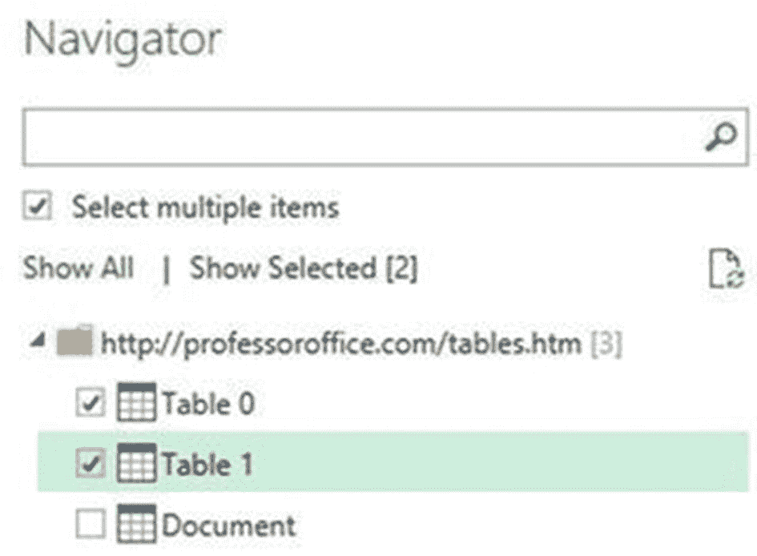

图 14-33 — 选择多个项目以及 Table 0 和 Table 1

2.  单击 `Transform Data` 按钮。
3.  单击 `OK` 按钮。将显示 `Navigator` 窗口。见图 14-32。来自网页的两个表现在可用。单击左窗格中的表名称会在右窗格中显示该表。如果您想选择多个表，则需要勾选 `Select multiple items`。

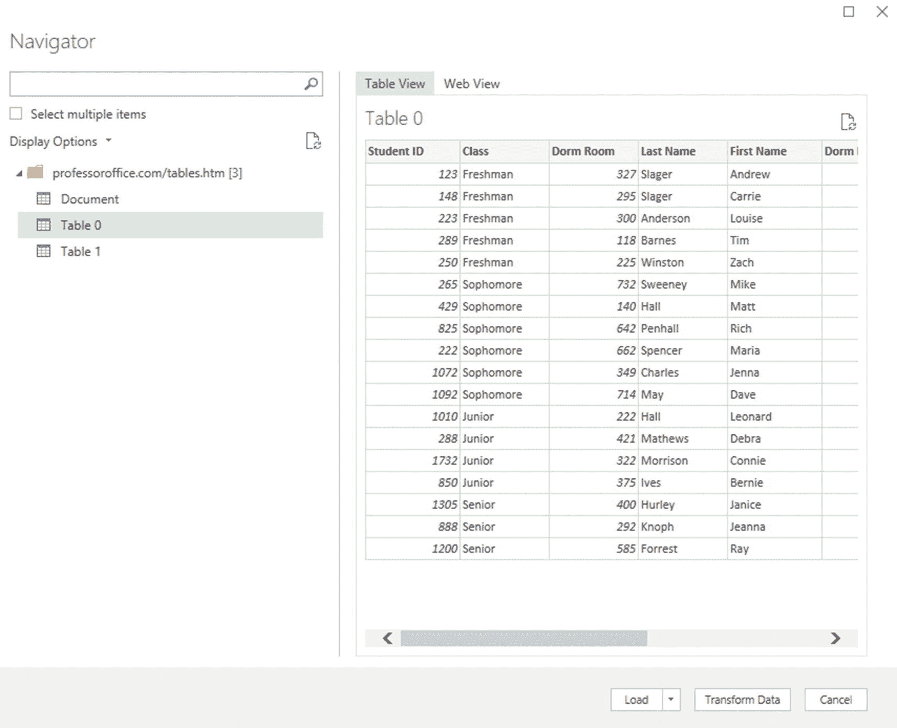

图 14-32 — 从左窗格中选择一个表格会将其显示在右窗格中

在窗口底部，有一个 `Load` 和 `Transform Data` 按钮。单击 `Transform Data` 按钮后，您有机会在数据导入到工作表之前修改数据并限制导入的数据。
4.  启动一个新的空白工作簿。
5.  单击功能区中的 `Data` 选项卡。在 `Get & Transform` 组中，单击 `Get Data` 按钮。
6.  单击 `From Other Sources`，然后选择 `From Web`。
7.  在 `URL`（统一资源定位符）文本框中，输入 `http://professoroffice.com/tables.htm`。见图 14-31。

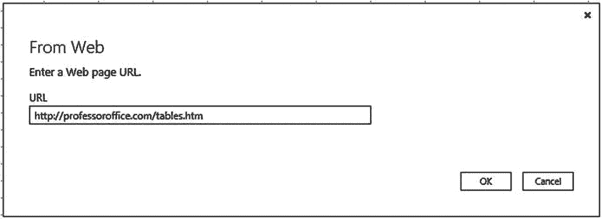

图 14-31 — 在 URL 文本框中输入网址

#### 命名表格

8.  单击屏幕左侧的 `Table 1`。在 `Query Settings` 窗格中将其名称更改为 `tblStudentAddress`。按 `Enter` 键。
9.  显示 `Power Query` 编辑器。`Query Settings` 窗格位于屏幕右侧。将表名从 `Table 0` 更改为 `tblStudentFees`。按 `Enter` 键。见图 14-34。


图 14-34 — 将名称更改为 tblStudentFees

#### 选择要导入的字段

列标题中的图标标识了列中数据的类型。`ABC` 是文本数据，`123` 是数值数据。`tblStudentAddress` 表中不需要 `Address` 列。
10. 单击 `Address` 列标题以选择整列。单击功能区中的 `Home` 选项卡。

在 `Power Query` 编辑器的功能区中，`管理列`组里有一个`删除列`按钮。点击按钮的上半部分会删除当前选中的列。点击按钮的下半部分会提供两个选项。其中一个选项是`删除列`，其功能与点击按钮上半部分相同。点击第二个选项`删除其他列`，会删除除当前选中列之外的所有列。
11. 点击`删除列`按钮的上半部分。
12. 在窗口左侧，点击表`tblStudentFees`。我们不需要该表中的`Dorm Room`列。
13. 点击`Dorm Room`列标题。
14. 在功能区的`管理列`组中，点击`删除列`按钮的上半部分。

##### 应用筛选器

我们只想导入停车费大于 25 美元的学生记录。

1.  点击`Parking Fees`列标题右侧的下拉箭头。
2.  点击`数字筛选器`。选择`大于`。此时会出现`筛选行`窗口。
3.  点击第二个下拉框的下拉箭头。此下拉框会显示该列中的所有值。参见图 14-35。

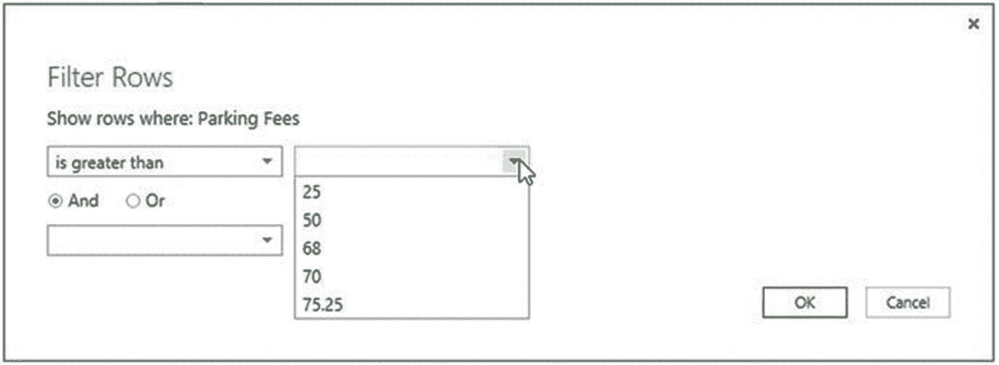

图 14-35

在选择`大于`后，选定`25`
4.  选择`25`。点击`确定`按钮。所有停车费小于等于 25 的记录都被删除。三条记录被删除。
5.  在窗口左侧，点击`tblStudentAddress`表。
6.  点击`State`列标题右侧的下拉箭头。
7.  取消选中`IL`。点击`确定`按钮。包含州`IL`的四条记录被删除。

##### 撤消和重做查询步骤

`查询设置`窗格中的`已应用步骤`区域会记录你对查询所做的所有更改。如果你想查看查询在上一步之前的样子，可以点击上一步。在`已应用步骤`中上移时，你基本上是在执行撤消操作。如果你想重做某一步，可以点击当前步骤下面的步骤。

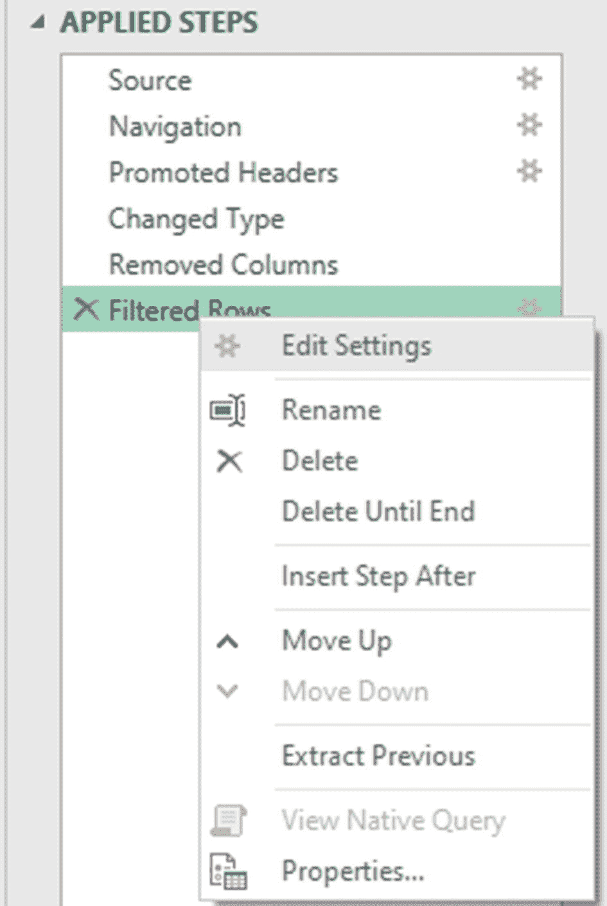

图 14-37

右键点击一个步骤以查看其选项

1.  在左侧窗格中，点击`tblStudentFees`表。在`已应用步骤`区域，点击`已删除列`。

包含停车费小于等于 25 的记录会再次显示。
2.  点击`已筛选行`。筛选器被重新应用，那些包含停车费小于等于 25 的记录不再显示。
    *   右键点击一个已应用的步骤，会弹出图 14-37 所示的菜单选项。在此菜单中，你可以选择执行以下操作：
        1.  编辑你之前创建的设置。例如，可以将此步骤从仅显示停车费大于 25 的记录，更改为显示大于 50 的记录，或者任何你想要的数值。
        2.  重命名一个步骤。
        3.  删除一个步骤。如果你删除它，就无法找回该步骤。
        4.  从当前步骤删除到最后一个步骤。
        5.  上下移动步骤以更改其顺序。

3.  在`已应用步骤`区域，点击`已删除列`。参见图 14-36。

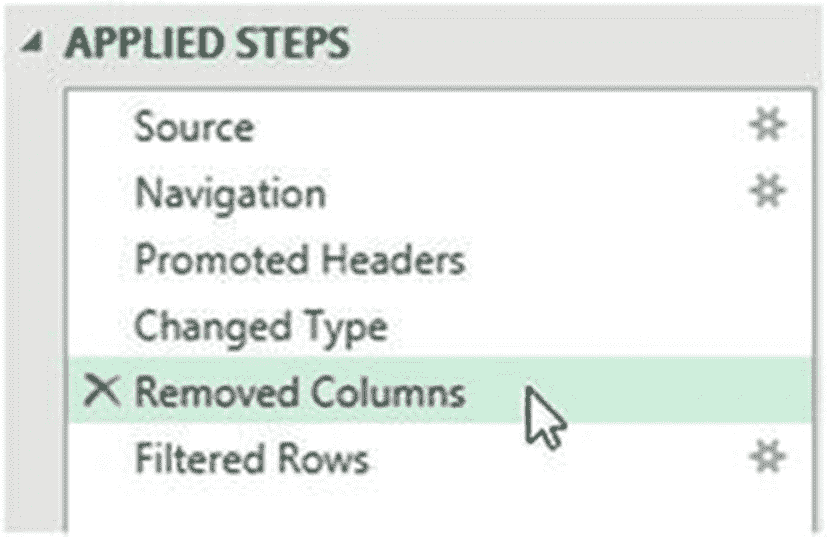

图 14-36

选择`已删除列`

包含州`IL`的记录会再次显示。

##### 创建计算列

1.  点击`Total Fees`字段右侧的下拉箭头。选择`降序排序`。
2.  在`添加自定义列`对话框中，输入`Total Fees`作为新列名，并完成以下步骤。参见图 14-39。

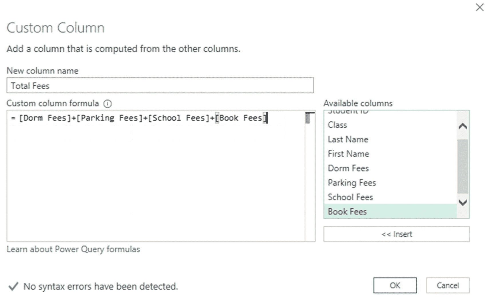

图 14-39

添加自定义列

3.  在`可用列`列表框中，双击`Dorm Fees`。
4.  输入加号（`+`）。
5.  点击`Parking Fees`。点击`插入`按钮。
6.  输入加号（`+`）。
7.  点击`Tuition`。点击`插入`按钮。
8.  输入加号（`+`）。
9.  点击`Books Fees`。点击`插入`按钮。

8. 点击**确定**按钮。

1.  点击 Power Query 编辑器功能区的**添加列**选项卡。在**常规**组中，点击**自定义列**按钮。
2.  你可能会看到图 14-38 中的消息。如果出现，请点击**插入**按钮。


**图 14-38** 插入步骤消息

Excel 创建已应用步骤的原因是，下次你想从网页导入数据时，无需再次经历此编辑过程。这些步骤将被保存并自动为你运行。

### 合并查询

1.  在公式栏中，删除 `City` 前面的 `tblStudentAddress.`。
2.  在公式栏中，删除 `State` 前面的 `tblStudentAddress.`。
3.  点击**确定**按钮。

**城市**和**州/省**列已添加到表中。我们想从**城市**和**州/省**列标题中删除表名。见图 14-44。

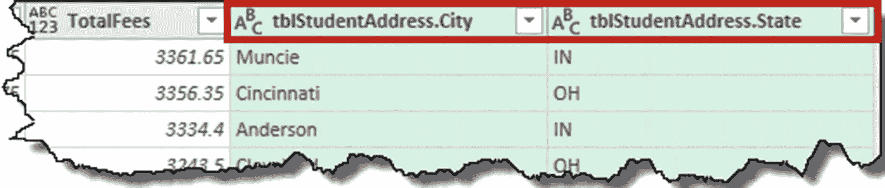

**图 14-44** 从城市和州/省列标题中删除表名

1.  点击**列展开**按钮。取消选中**学生 ID**。
2.  点击**确定**按钮。

`tblStudentFees` 表的末尾出现一个新列。该列中的每一行都包含**表**这个词。见图 14-42。

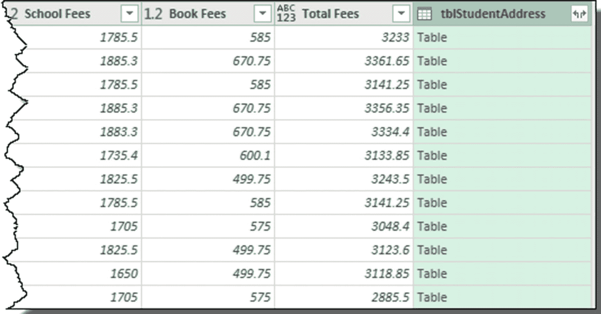

**图 14-42** 表右侧显示一个新列

在 `tblStudentAddress` 表头右侧，有一个列展开按钮。见图 14-43。我们希望从 `tblStudentAddress` 表中添加**城市**和**州/省**字段，但不添加**学生 ID**。合并后的表中已经包含了一个**学生 ID**，因此这会是重复的。

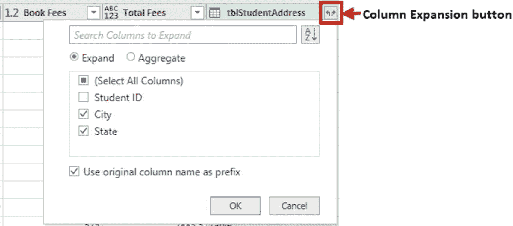

**图 14-43** 点击列展开按钮并取消勾选学生 ID

1.  点击两个表中的**学生 ID** 列标题。这将链接这两个表。两个表具有相同的**学生 ID** 编号。链接表需要你的表具有一个公共字段。
2.  点击**联接种类**的下拉箭头，然后选择**内部（仅匹配行）**。见图 14-41。

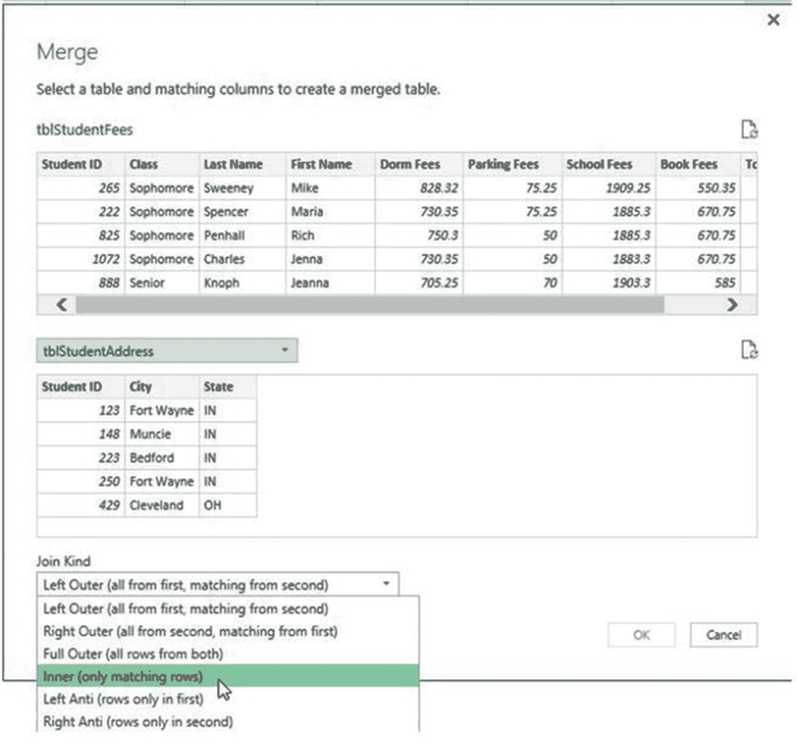

**图 14-41** 点击两个表中的学生 ID 列标题以链接两个表

`tblStudentFees` 中的十二条记录在 `tblStudentAddress` 中有匹配的记录。因为你选择了**内部（仅匹配行）**，所以只有具有匹配**学生 ID** 的记录才会成为查询的一部分。

1.  点击功能区的**主页**选项卡。在**组合**组中，点击**合并查询**按钮。
**合并**窗口将显示，`tblStudentFees` 的数据显示在顶部。
2.  从下拉框中选择 `tblStudentAddress`，如图 14-40 所示。我们将链接这两个表，然后添加我们想要的来自 `tblStudentAddress` 字段的字段。

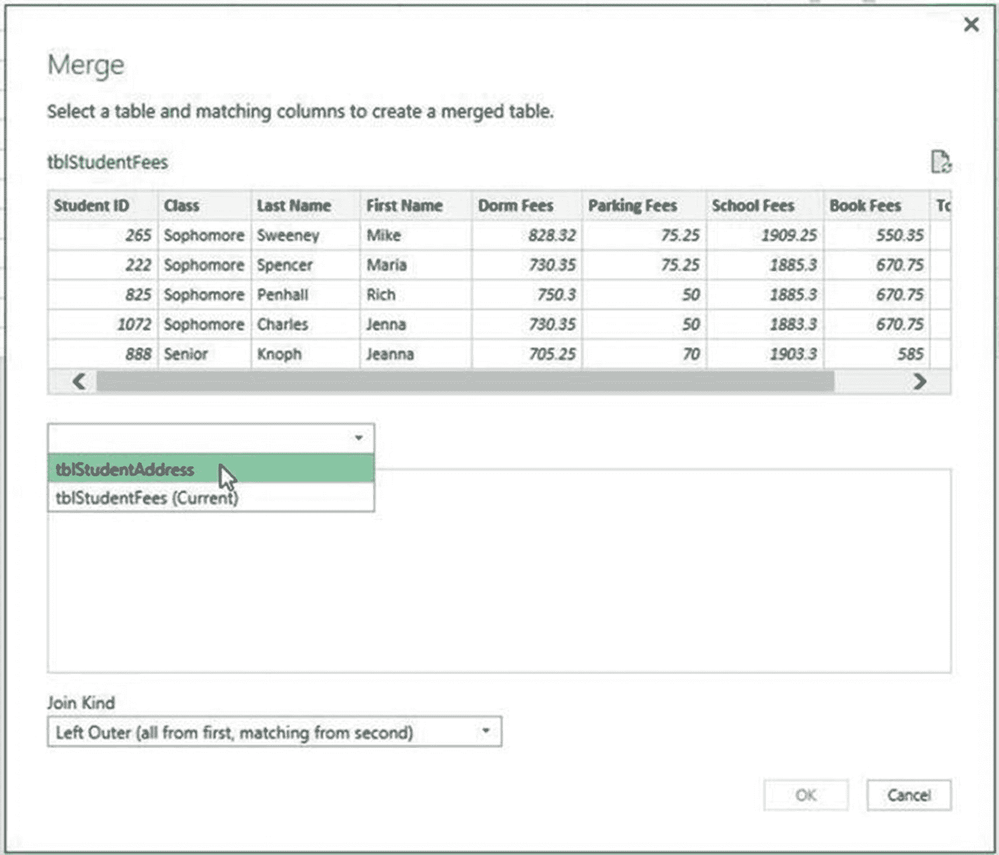

**图 14-40** 选择 tblStudentAddress

### 移动列标题


**图 14-45** 将城市和州/省列拖到班级列右侧

1.  点击**城市**列标题，然后按住 **Ctrl** 键并点击**州/省**列标题。
2.  拖动这些列标题，使它们正好位于**班级**列的右侧。见图 14-45。

### 关闭查询并将结果加载到 Excel

1.  将光标移动到**查询和连接**窗格中的 `tblStudentFees` 上。见图 14-48。

在此窗口中，你可以

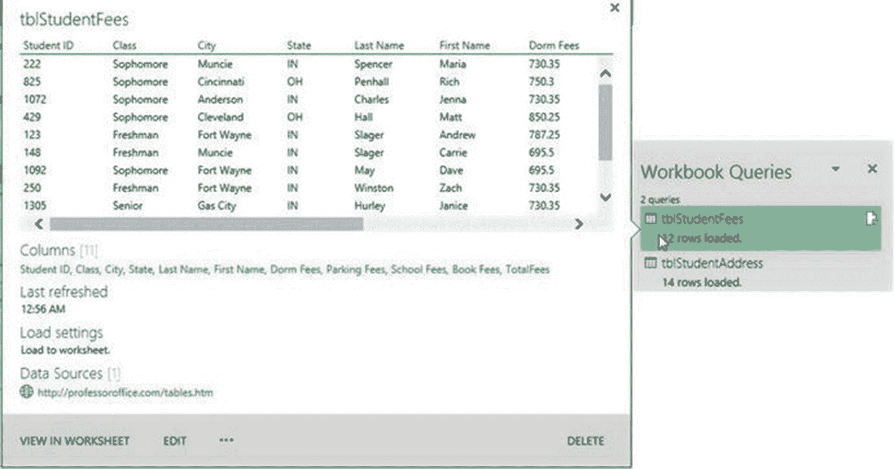

**图 14-48** tblStudentFees 表

1.  查看上次刷新查询的时间
2.  将查询加载到另一个工作表（从省略号（`…`）菜单）
3.  点击**编辑**返回查询编辑器
4.  点击**删除**以删除查询
5.  点击 Power Query 编辑器的功能区。在**关闭**组中，点击**关闭并加载**按钮的下半部分。
6.  点击**关闭并加载**。见图 14-46。


**图 14-46** 选择关闭并加载

**查询编辑器**窗口关闭，`tblStudentFees` 和 `tblStudentAddress` 表被加载到单独的工作表中。`tblStudentAddress` 表如图 14-47 所示。

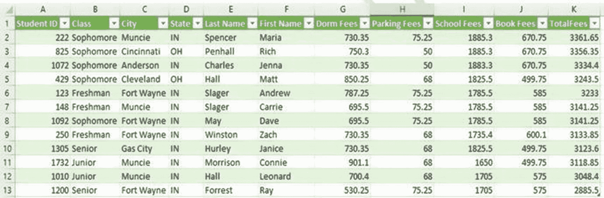

**图 14-47** 表已加载到工作表中

这些表是查询。网站上的原始数据并未更改。

## 总结

数据可以从许多不同的数据源导入 Excel。你可以使用单个数据源或多个数据源。数据导入后，就可以利用 Excel 强大的分析功能。

Power Query 允许你从许多不同的源中提取、传输、操作、链接和加载数据到 Excel。

有许多不同的文件类型，例如文本文件、Access 文件、Microsoft 查询文件等。不同的文件类型可以使用不同的 Excel 选项。

文本文件是不包含格式的文件，这使得它们易于导入。它们可以是分隔符分隔的或固定宽度的。在文本分隔文件中，字段由逗号或分号等字符分隔。在固定宽度的文本文件中，所有字段具有相同的长度。空格被添加到字段中，以使其长度相同。

下一章将介绍数据透视表和数据透视图。数据透视表比普通 Excel 表具有更强大的功能。如果希望数据成为行，可以将其拖到一个区域；如果希望成为列，则拖到另一个区域；如果希望汇总，则拖到另一个区域。数据透视图比普通 Excel 图表更具优势，因为它们可以被筛选。用户可以选择要在数据透视图中显示哪些项目。

