# 10. 使用超链接、合并文本以及使用状态栏

超链接可以是一段文本或一个对象（如图片或图表元素），点击后可以跳转到另一个位置（例如，文档中的特定位置）或从其他文件或网页调出信息。你可能已经在互联网上使用过超链接。点击网页中的超链接可以跳转到该页面的不同位置，或跳转到一个完全不同的网页。

`Concatenation`（合并）和`Flash Fill`（快速填充）功能允许你将多个单元格中的文本合并，并添加额外的文本。

在本章中，你还将学习如何在状态栏上显示与电子表格相关的信息。

阅读并完成本章内容后，你将能够：

- 超链接到网页
- 超链接到文件
- 超链接到电子邮件
- 超链接到当前工作簿中的某个位置
- 创建用于创建并打开新工作簿的超链接
- 删除超链接
- 创建合并文本
- 使用快速填充


## 使用超链接

超链接通常以不同的颜色（通常是蓝色）显示，并且常常带有下划线，以便于识别。为了进一步方便识别，当鼠标移动到超链接上时，鼠标光标会变成手形指示符。你可以在 Excel 中使用超链接来链接到以下内容：

- 网页或文件（文件可以是另一个电子表格文件，也可以是其他类型的文件，例如 Word 文档）
- 当前工作簿中的特定单元格
- 新文档
- 电子邮件地址

链接到其他文件时，Excel 会在与该文件类型关联的程序中打开该文件。例如，如果你创建了一个指向扩展名为 `.docx` 的文件的超链接，点击该超链接时，Excel 将在 Word 中打开该文件。如果你创建了一个指向扩展名为 `.psd` 的文件的超链接，Excel 将在 Photoshop 中打开该文件。

要打开 `插入超链接` 窗口，请执行以下步骤：

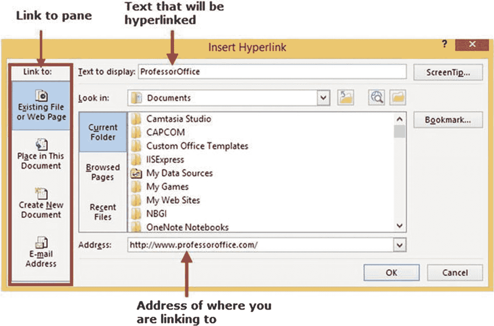

**图 10-1** – 插入超链接对话框

1. 单击你希望放置超链接的单元格。
2. 在功能区上，单击 `插入` 选项卡。在 `链接` 组中，单击 `链接` 按钮的上半部分。
3. 在 `插入超链接` 对话框中，执行以下操作：
   1. 从 `链接到` 窗格中选择你想要创建的链接类型。
   2. 在 `要显示的文字` 文本框中输入超链接应显示的文本。
   3. 选择或输入你想要链接到的地址，并输入你想要显示的任何屏幕提示。参见图 10-1。

创建超链接时，你需要做的第一件事是决定要创建的链接类型。通过单击窗口左侧 `链接到` 窗格中的相应按钮，可以选择要创建的链接类型。参见图 10-1。`链接到` 窗格右侧显示的选项会根据你在 `链接到` 窗格中选择的按钮而变化。例如，单击 `现有文件或网页` 按钮，右侧显示的选项与单击 `本文档中的位置` 按钮时不同。

如果插入超链接时电子表格单元格中已有文本，该文本会显示在 `要显示的文字` 文本框中。你在此文本框中输入的任何内容都将显示在单元格中；它会覆盖单元格中现有的任何文本。文本框右侧有一个 `屏幕提示...` 按钮。单击 `屏幕提示` 按钮会弹出一个窗口，你可以在其中输入超链接的描述。当用户将鼠标移动到超链接上时，此描述会短暂显示。你将要链接到的位置地址输入在 `地址` 框中。

可以通过右键单击超链接所在的单元格，然后从上下文菜单中选择 `取消超链接` 来移除超链接。

接下来的四个练习将提供关于超链接到网页、文件、当前工作簿中的位置以及新建 Excel 工作簿的实践。

### 练习 10-1：链接到网页

在本练习中，你将练习超链接到网页。你将使用自动超链接，并了解如何撤销自动超链接。你还会使用词语（而非 URL 地址）来访问网页。

1. 此时，单元格 `A7` 中应有一个超链接 `教授的办公室网站`。将鼠标光标移动到该超链接上。将会显示屏幕提示 `Microsoft Office 及其他培训`。点击该超链接。然后关闭网页。
2. 右键单击单元格 `A7`。选择 `取消超链接`。
3. 在 `链接到` 窗格中，选择 `现有文件或网页`。
4. 在 `要显示的文字` 文本框中输入 `教授的办公室网站`。
5. 在 `地址:` 框中输入 `www.professoroffice.com`。Excel 会自动为地址添加前缀 `http://`。


4.  点击 `ScreenTip…` 按钮。在屏幕提示文本框中输入 `Microsoft Office 及其他培训`。见图 10-5。按 `OK`。

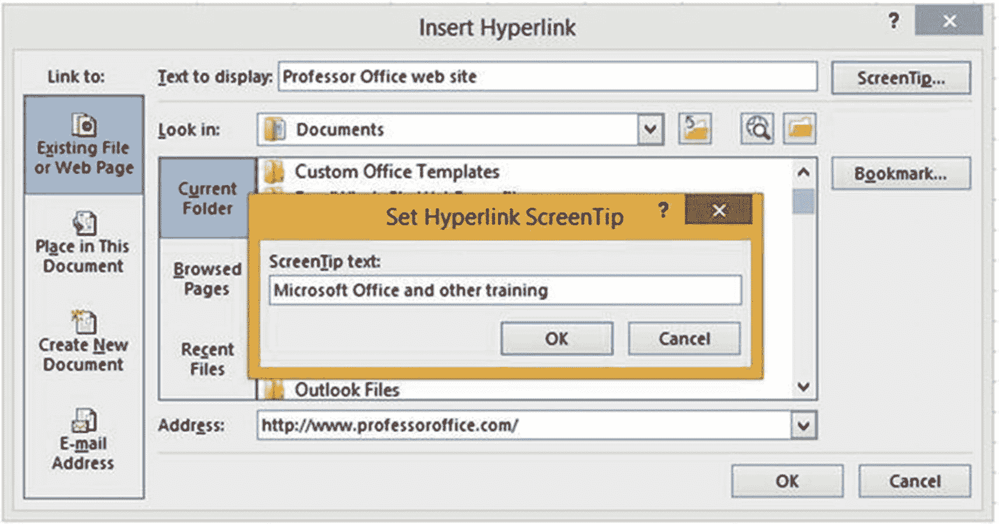

**图 10-5** 为超链接创建屏幕提示

点击“插入超链接”对话框的 `OK` 按钮。

1.  选择 `撤消超链接`。文本保留，但超链接被移除。

现在，让我们添加一个带有屏幕提示的超链接。

2.  点击 `A7` 单元格。点击功能区中的 `插入` 选项卡。在 `链接` 组中，你会看到 `链接` 按钮。`链接` 按钮有上下两部分。点击 `链接` 按钮的下半部分会显示你最近使用的链接。点击 `链接` 按钮的上半部分会打开“插入超链接”对话框。

**注意** 也可以通过右键单击空白单元格并从上下文菜单中选择 `链接` 来打开“插入超链接”窗口。

1.  在 `A3` 单元格中输入 `jnobody@hotmail.com`，然后按 `Enter`。
2.  点击你刚刚创建的电子邮件地址。

当你点击电子邮件地址的超链接时，如果你的电子邮件程序已安装（如 `Outlook`），它会自动启动并创建一个收件人地址已填写正确的邮件。

如果你想输入一个不带超链接的 `URL`，该怎么办？

3.  在 `A5` 单元格中输入 `www.MadeinUsa.com`，然后按 `Enter`。
4.  加宽列，使所有文本都能适应单元格。将光标移到 `A5` 单元格中刚输入的文本上。超链接中的第一个 `w` 会带下划线。将鼠标光标移到下划线上，会出现一个菜单标签。
5.  点击菜单标签，调出上下文菜单。见图 10-4。

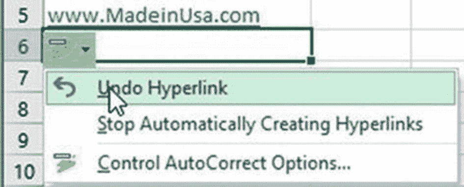

**图 10-4** 超链接的上下文菜单

1.  点击 `Excel 选项` 对话框的 `OK` 按钮。
2.  在 `A1` 单元格中输入 `www.apress.com`，然后按 `Enter`。因为你设置了选项，当你输入合适的网址时自动创建超链接，所以超链接会自动创建。
3.  将光标移到 `A1` 单元格中刚输入的文本上。光标应显示为手指形状。工具提示会显示超链接地址。点击该超链接。
4.  关闭网页。

超链接有效，但如果你想让 `Apress Corporation` 这些词显示在单元格中而不是 `www.apress.com`，该怎么办？你需要编辑超链接。

5.  右键单击 `A1` 单元格，然后选择 `编辑超链接`。
6.  将“要显示的文字”文本框中的文本更改为 `Apress Corporation`。见图 10-3。地址应该正确。点击 `OK`。

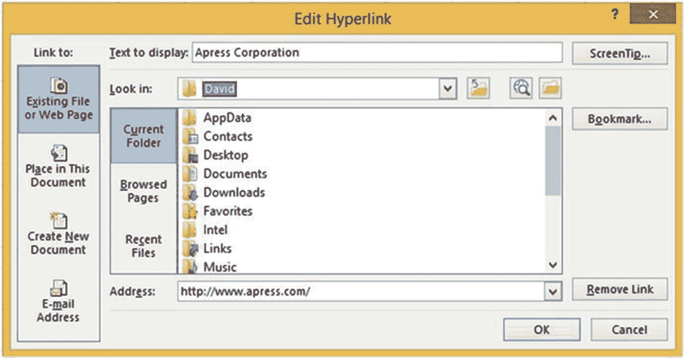

**图 10-3** 编辑超链接对话框

7.  `A1` 单元格现在显示 `Apress Corporation`。点击该文本。`Apress` 网站应该会显示。关闭你的互联网浏览器。

接下来，让我们链接到一个电子邮件地址。

1.  创建一个名为 `超链接` 的新工作簿。

如果你在单元格中输入以 `http://` 或 `www.` 开头的合适网址，并且此选项已开启，Excel 会自动为网页创建超链接。你现在检查一下该选项是否已开启。

2.  点击 `文件` ➤ `选项`。
3.  在 `Excel 选项` 对话框中，选择 `校对`。点击窗口右侧窗格中的 `自动更正选项…` 按钮。
4.  点击 `键入时自动套用格式` 选项卡。如果尚未选中，请选中 `Internet 和网络路径替换为超链接`。见图 10-2。点击 `OK`。

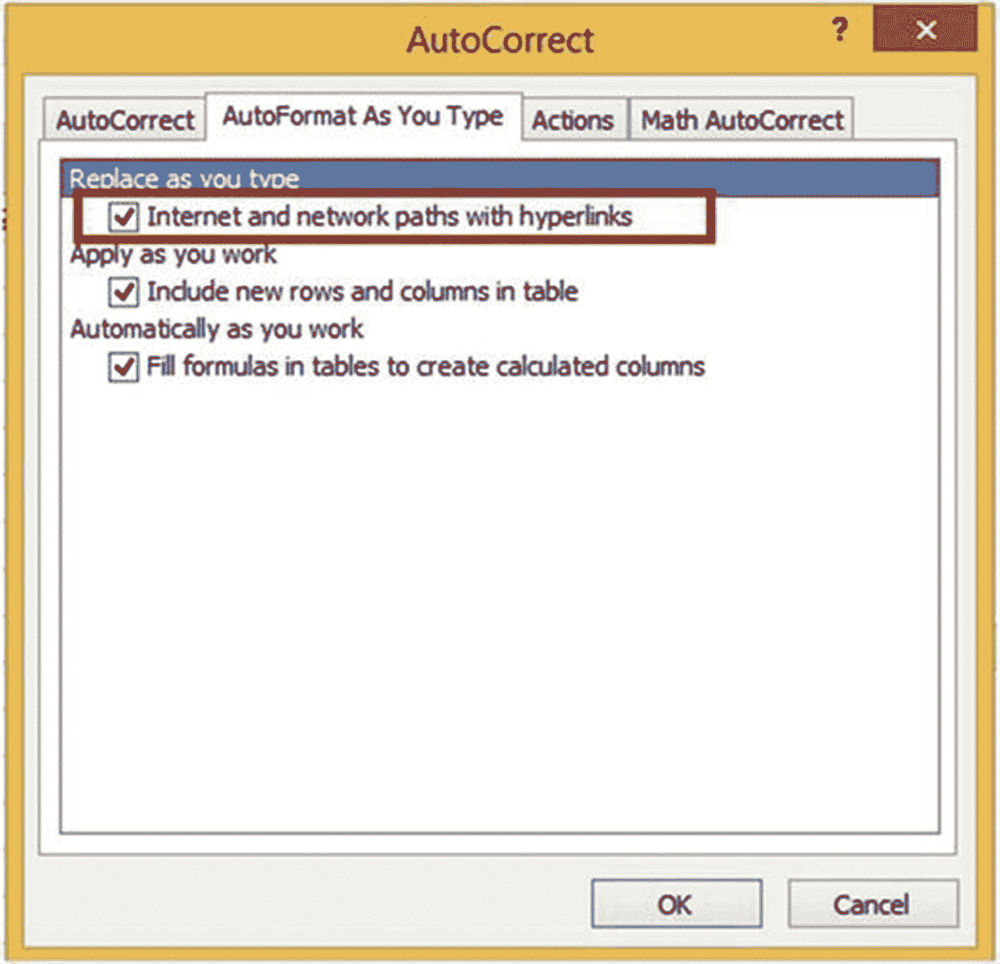

**图 10-2**


### "自动更正"对话框中的"键入时自动套用格式"选项卡

**练习 10-2：创建指向文件的超链接**

可能存在某个包含更多信息的文件，你不想将其存储在 Excel 中，但又希望快速访问。本练习将演示如何创建指向文件的超链接。当你点击该超链接时，文件将打开。

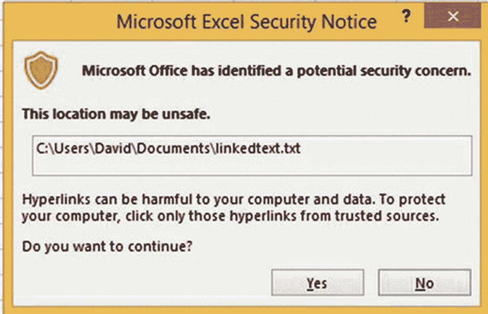

*图 10-10*

忽略提示信息，点击`是`按钮。

1. 关闭记事本或写字板程序。
2. 点击单元格`A5`中的超链接。如果出现图 10-10 所示的消息，点击`是`按钮。`linkedtext.txt`文件将在记事本或写字板中打开，具体取决于你系统中用于打开文本文件的默认程序。
3. 点击"Office 文件"右侧的下拉箭头，然后选择**所有文件**。这将使你能看到文本文件。
4. 找到`linkedtext`文件，然后点击`打开`按钮。
5. 包含`linkedtext`文件的地址现在应显示在"插入超链接"对话框中。参见图 10-9。点击`确定`按钮。

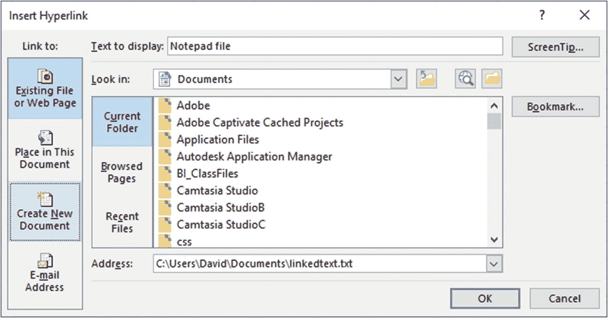

*图 10-9*

文件名及其路径显示在`地址`字段中。

6. 点击**浏览文件**按钮。这将弹出图 10-8 中的"链接到文件"对话框。Excel 以为你在搜索 Office 文件，但实际上你在搜索文本文件。

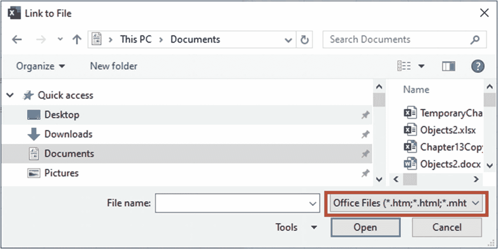

*图 10-8*

在"链接到文件"对话框中找到你想要链接的文件。

7. 在工作表的单元格`A5`内右键单击，然后选择`链接`。
8. 在"要显示的文字"文本框中输入**记事本文件**。参见图 10-7。

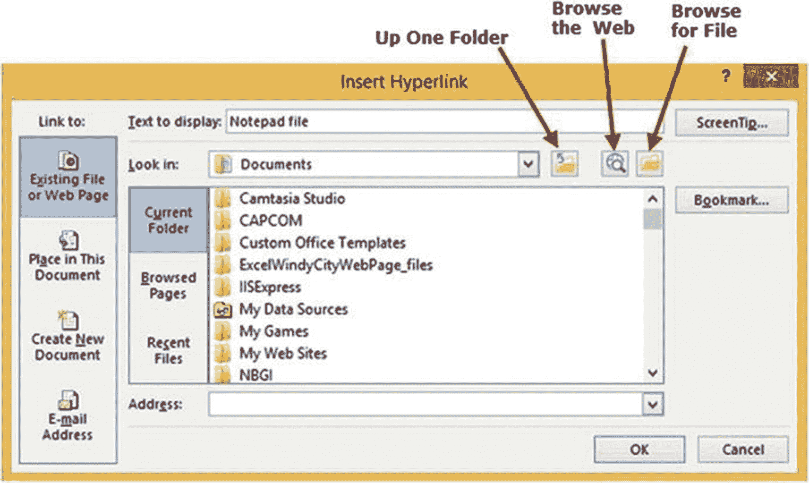

*图 10-7*

在"插入超链接"对话框中添加指向文件的链接。

有几种方法可以在"地址"框中获取地址（路径）和文件名：
- 你可以直接输入路径。
- 你可以点击**查找范围**下拉框右侧的下拉箭头找到正确的文件夹，然后选择`linkedtext`文件。
- 你可以点击**浏览文件**按钮。

**注意：** 如果你的文件从提供的路径中移走，则超链接将无法工作。

9. 在你的"超链接"工作簿中创建一个新工作表。
10. 你可以使用本书提供的`linkedtext.txt`文件，也可以通过以下步骤创建自己的`linkedtext.txt`文件：
    - 启动记事本程序。
    - 输入文本**这是我要链接的文本**。将文件保存，名称为`linkedtext`。参见图 10-6。


*图 10-6*

在记事本中创建文本。

    - 将文件保存到你的`我的文档`文件夹或一个你能轻松找到路径的位置。
    - 关闭记事本程序。

---

**练习 10-3：链接到当前工作簿中的某个位置**

在处理大型工作簿时，能够链接到工作簿中的任意单元格是非常方便的。在本练习中，你将创建一个超链接，该链接将跳转到`Sheet2`上的单元格`DA`。

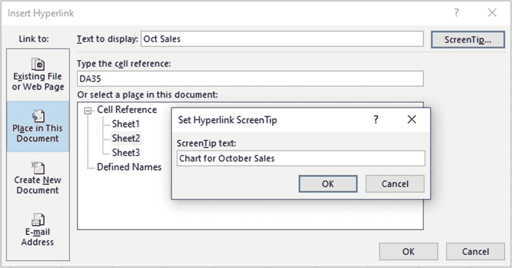

*图 10-11*

为图表输入屏幕提示。

1. 在"插入超链接"对话框中点击`确定`按钮。
2. 将光标移到超链接上。你创建的屏幕提示将显示出来。点击该超链接。此时活动单元格是`Sheet2`上的`DA35`。
3. 使用与先前练习相同的工作簿。
4. 添加另一个工作表。
5. 在`Sheet3`上，右键单击单元格`D7`内部，然后选择`链接`。
6. 在"链接到"区域中选择**本文档中的位置**。
7. 在"要显示的文字"文本框中输入**十月销售额**。
8. 在"键入单元格引用"文本框中输入`DA35`作为单元格地址。
9. 在"单元格引用"中选择**Sheet2**。
10. 假设单元格`DA35`中有一个图表。点击`屏幕提示...`按钮。输入**十月销售额图表**作为屏幕提示文本。参见图 10-11。点击`确定`按钮。

---

**练习 10-4：创建指向新创建的 Excel 工作簿的超链接**

你可以创建一个超链接，当首次点击它时，会创建一个新的 Excel 工作簿，然后打开该工作簿。此后每次点击它，都会打开该工作簿。这个 Excel 工作簿将被赋予你在超链接选项中指定的名称。

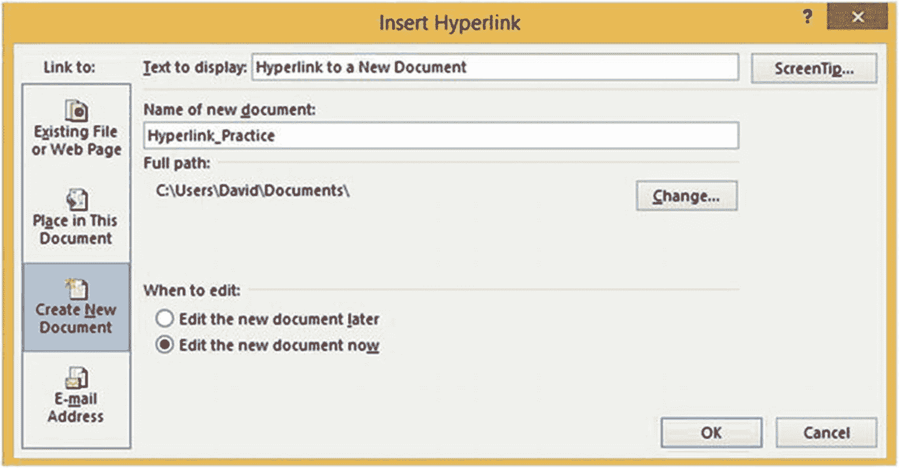

*图 10-12*

在"插入超链接"窗口中选择"现在编辑新文档"。

1. 你的光标现在应位于名为`Hyperlink_Practice`的新建工作簿的单元格`A1`中。回到名为`Hyperlinks`的工作簿。点击`Sheet2`选项卡的单元格`A1`。由于`Hyperlink_Practice`已经创建，Excel 不会尝试重新创建它，而是会将你带到`Hyperlink_Practice`工作簿。在打开`Hyperlink_Practice`工作簿之前，Excel 可能会显示一个安全通知窗口。既然是你自己创建的超链接，可以确定它是安全的，所以点击`是`按钮。
2. 使用与先前练习相同的工作簿。
3. 在`Sheet2`上，在单元格`A1`中输入文本"指向新文档的超链接"。按`Ctrl + Enter`。
4. 右键单击单元格`A1`，然后选择`链接`。
5. 出现"插入超链接"窗口。在**链接到**：区域中，点击`新建文档`。
6. 点击`屏幕提示...`按钮。
7. 输入"将你带到一个名为 Hyperlink_Practice 的新建 Excel 工作簿"作为屏幕提示文本。点击`确定`。
8. 在"新文档的名称"中输入`Hyperlink_Practice`。
9. 如果需要，更改路径。

在"何时编辑"部分，你有两个选项：可以选择立即转到新创建的工作簿，或者创建工作簿然后在你选择的任何时间打开它。

10. 选择**现在编辑新文档**选项。参见图 10-12。
11. 点击`确定`按钮。

你已经学习了如何创建和删除超链接。你可以创建超链接来打开文档，将你带到互联网上的各种网站、Excel 工作簿中的不同位置等。如果你希望用户从其他位置获取信息，请使用超链接。这可以节省用户大量查找信息的时间。接下来，你将了解如何合并不同单元格中的数据（例如，将名字、中间名和姓氏合并到一列中）。


## 连接与快速填充

将多个单元格的数据或单元格数据与附加文本合并到单个文本项中，称为*连接*。用于执行连接操作的符号是 `&`（与符号）。必须在每个单元格地址以及要添加的每个额外文本字符串之间放置一个与符号。

例如，如果你想要合并单元格 `A1` 和 `B1` 的内容，并将结果放入单元格 `C1`，则需要在单元格 `C1` 中输入以下公式：`=A1&B1`。如果你想要在单元格 `A1` 和 `B1` 的数据之间添加一个空格，则需要将公式改为 `=A1&" "&B1`。两个引号之间的空格即创建一个空白空间。如果你想要在两个数据之间添加两个空格，则需在两个引号之间放置两个空格。

图 10-13 显示了一个从单元格 `A8` 开始的连接示例，它包含了来自列 `A`、`B` 和 `C` 的内容以及附加文本。在单元格 `A8` 中输入的公式为：

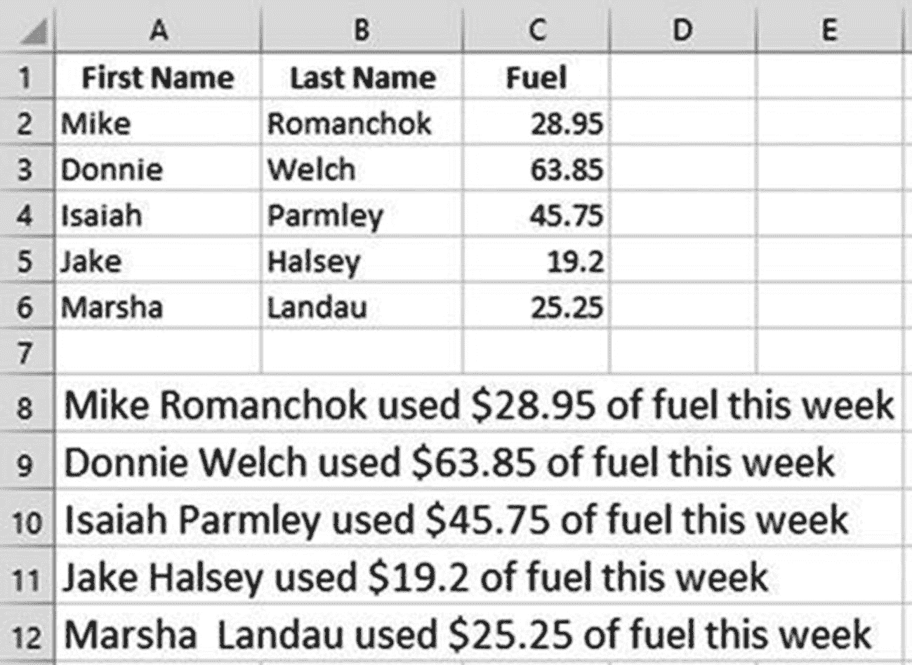

**图 10-13** – 合并来自列 `A`、`B` 和 `C` 的数据

```
= A2 & " " & B2 & " used " & "$" & C2 & " of fuel this week"
```

该公式通过自动填充柄向下复制到单元格 `A12`。

### 练习 10-5：使用连接

在本练习中，你将使用 `&` 字符来合并列数据以及其他字符。

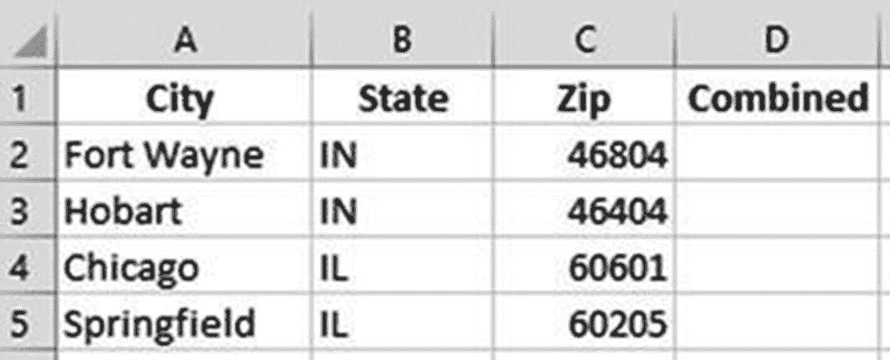

**图 10-14** – 连接工作表中的数据

1.  在本练习中，你将把城市、州和邮政编码合并到一个单元格中。在单元格 `D2` 中，输入以下公式，然后按 `Ctrl + Enter`：
    - 打开工作簿 Chapter 10。
    - 单击工作表“连接”。
    - 图 10-14 显示了工作表中的数据。

    ```
    =A2 & ", " & B2 & " " & C2
    ```

    此公式在城市后显示一个逗号，后跟一个空格，并在州和邮政编码之间提供两个空格。

    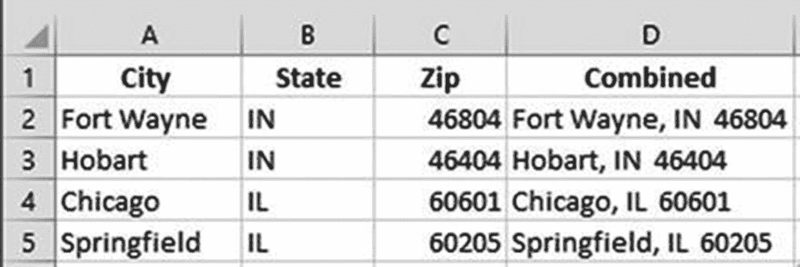

    **图 10-15** – 使用自动填充柄的结果

2.  加宽 `D` 列，使城市、州和邮政编码都能完整显示在该列内。

3.  双击自动填充柄，将公式向下复制到单元格 `D5`。结果应如图 10-15 所示。

现在你已经练习了如何使用连接。接下来，我们来看一个名为**快速填充**的功能，它无需使用 `&` 符号即可完成连接。当你希望连接同一行中的值时，快速填充可以加快连接速度。你只需输入一个希望数据如何呈现的示例。Excel 会检查其他行中是否存在该模式，并使用快速填充将该模式沿列向下复制。

但在以下情况，你仍然需要知道如何使用 `&` 符号进行连接：

1.  连接结果存入单个单元格时。
2.  在公式中使用连接时。
3.  所连接的内容不在同一行时。
4.  在编程代码中使用连接时。

我们来看一下之前用于连接功能的同一个示例。快速填充的功能远不止连接。它可用于查找列中的模式，然后在另一列中重复这些模式。例如，你可以创建一个列，该列使用包含中间名的列的第一个字母，或者创建一个列，该列使用日期列中的“日”部分。

在此示例中，我们将连接结果放在与其所组合数据相同的行上。

### 练习 10-6：使用快速填充

在本例中，你将使用快速填充来合并多列数据以及附加文本。

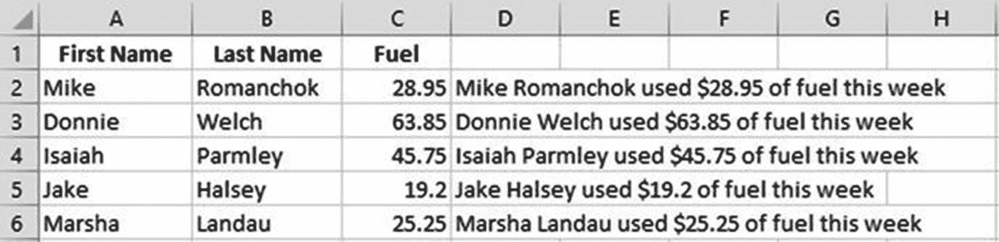

**图 10-18** – 快速填充的结果


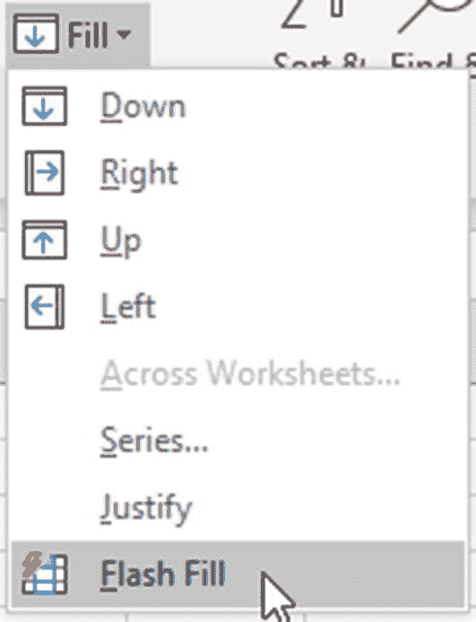  
图 10-17  
选择“快速填充”

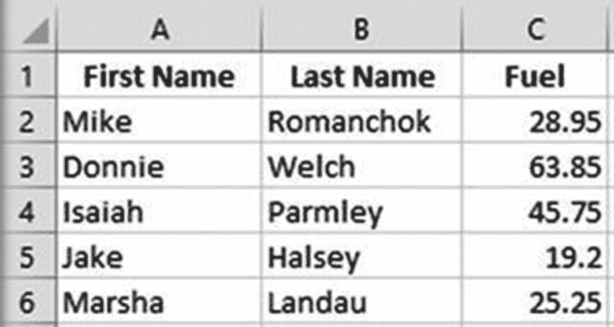  
图 10-16  
工作表中的数据 FlashFill A

1. 在单元格 `D2` 中，输入 **Mike Romanchok 本周使用了 28.95 美元的燃料**。按 `Enter` 键。光标应位于单元格 `D3`。
2. 单击功能区上的“开始”选项卡。在“编辑”组中，单击 `Fill` 按钮，然后选择 `Flash Fill`。见图 10-17。

`Flash Fill` 使用了三列数据以及您输入的附加文本。它甚至在每个金额前面都加上了美元符号。见图 10-18。

1. 如果尚未打开，请打开工作簿第 10 章。
2. 单击工作表 `FlashFill A`。
3. 图 10-16 显示了工作表中的数据。

**练习 10-7：使用更多快速填充功能**  
本练习将展示不同的功能，并说明使用 `Flash Fill` 时可能出现的潜在问题。

  
图 10-22  
将单元格 `D2` 更改为 John Studebaker 的结果

  
图 10-21  
D 列中所有的姓氏都变为了 Sludebaker

  
图 10-20  
使用 `Flash Fill` 的结果

  
图 10-19  
名为 `3 Names` 的工作表上的数据

1. 清除 D 列中的内容。
2. 在单元格 `D2` 中，输入 **John Studebaker’s**，然后按 `Enter` 键。
3. 按 `Ctrl + e`。图 10-22 显示了结果。

**注意** 如果我们没有对 A、B、C 列中的列标题进行加粗或居中处理，Excel 将无法识别它们是列标题。这会在我们应用 `Flash Fill` 时造成问题。Excel 会将单元格 `A1` 和单元格 `C1` 中的文本合并，并放入单元格 `D1` 中。通过在单元格 `D1` 中添加一个列标题也可以避免此问题。

1. 选择 D 列中的数据。右键单击所选数据，然后选择 `Clear Contents`。
2. 在单元格 `D2` 中，输入 **John Sludebaker**，然后按 `Enter` 键。
3. 按 `Ctrl + e`。

由于 Excel 在该行中找不到匹配的名称，它会为所有复制单元格创建新名称 Sludebaker。见图 10-21。

如果您对文本末尾进行了修改，该修改将反映在下面的行中。

1. 在单元格 `D2` 中，输入 **John Studebaker**，然后按 `Enter` 键。加宽列以容纳该名称。
2. 单击单元格 `D3` 内部。

我们不再执行单击“开始”选项卡，再单击“编辑”组中的 `Fill` 按钮，然后选择 `Flash Fill` 的步骤，而是使用 `Flash Fill` 的快捷键：`Ctrl + e`。

3. 按 `Ctrl + e`。图 10-20 显示了结果。

您需要注意拼写，以下步骤将对此进行说明。

1. 如果尚未打开，请打开工作簿第 10 章。
2. 单击工作表 `3 Names`。
3. 图 10-19 显示了工作表中的数据。

我们希望将个人的名字和姓氏组合起来。

您不必按照相同的顺序输入来自列的数据。我们可以轻松地使用姓氏，后跟一个逗号、一个空格，然后跟名字。

  
图 10-26  
在单元格 `D2` 中输入 J. Studebaker 的结果

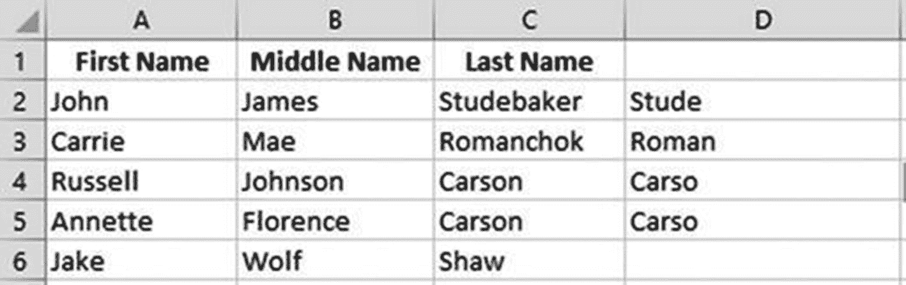  
图 10-25  
Shaw 未出现在 D 列中，因为它只有四个字符

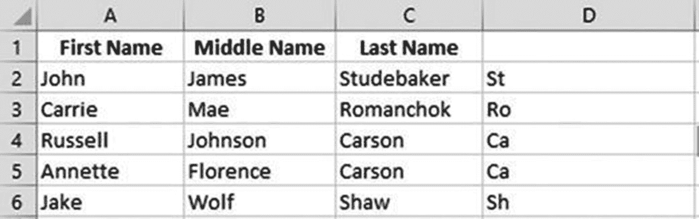  
图 10-24  
在单元格 `D2` 中键入了两个字母，因此第 2 列中的所有其他单元格都显示两个字母

  
图 10-23  
将单元格 `D2` 更改为 Studebaker, John 的结果

1. 清除 D 列中的内容。
2. 在单元格 `D2` 中，输入 **J. Studebaker**，然后按 `Enter` 键。
3. 按 `Ctrl + e`。结果如图 10-26 所示。

1. 清除 D 列中的内容。
2. 在单元格 `D2` 中，输入 **Studebaker, John**，然后按 `Enter` 键。
3. 按 `Ctrl + e`。图 10-23 显示了结果。

您键入的字符数将是该列中显示的字符数。如果您在名称 Studebaker 中键入前两个字母，然后使用 `Flash Fill`，Excel 将显示其他姓氏的前两个字母。见图 10-24。

姓氏 Shaw 仅包含四个字符，因此如果您输入超过四个字符的姓氏，那么名称 Shaw 将完全不会出现。见图 10-25。

让我们尝试一个示例，其中我们将个人的名字首字母和姓氏组合起来。

**潜在问题**  
在第二行中，John 和 James 都以“J”开头，这可能会造成一些混淆。当文本出现重复时，Excel 会使用最左侧的列。如果我们输入 John J. Studebaker，然后使用 `Flash Fill`，Excel 将使用 A 列中的首字母，而不是 B 列。见图 10-27。

  
图 10-27  
在单元格 `D2` 中输入 John J. Studebaker 的结果

如果我们想使用中间名首字母，我们必须教会它正确的模式。我们可以通过键入下一行（或多行）的数据来完成此操作，直到模式满足我们的要求。由于第 3 行中的中间名与名字的首字母不同，因此它可以满足我们的需求。

  
图 10-28  
在单元格 `D3` 中输入 Carrie M. Romanchok 的结果

1. 清除 D 列中的内容。
2. 在单元格 `D3` 中，输入 **Carrie M. Romanchok**，然后按 `Enter` 键。
3. 按 `Ctrl + e`。图 10-28 显示了结果。


## 使用状态栏

Excel 窗口底部的状态栏可用于显示大量有用的信息。您无需输入任何公式，即可查看不同区域的计算结果。状态栏上显示的内容由您决定。右键单击状态栏会显示所有可用的选项，如图 10-29 所示。您只需选择想要看到的选项，并取消选择不想看到的选项。选中的项目左侧会显示复选标记。单击带有复选标记的行上的任意位置将移除该复选标记。单击没有复选标记的行上的任意位置则会添加上复选标记。

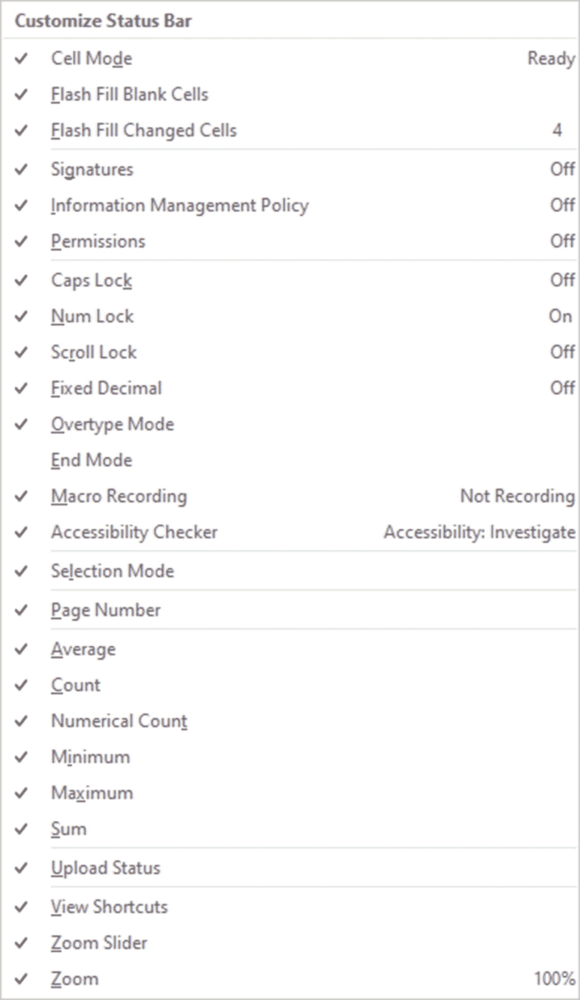

图 10-29

状态栏上的可用选项

在本节中，我们将介绍大部分选项。我们将省略**签名**、**信息管理策略**和**权限**，因为这些选项仅在处理 SharePoint 时使用。

#### 单元格模式

单元格模式显示在状态栏的最左侧位置。它会显示以下三个词之一：`Ready`、`Enter` 或 `Edit`。`Ready` 表示单元格已准备好供您输入数据。如果您正在向单元格中输入数据，则会显示 `Enter` 一词。如果您双击某个单元格使其进入编辑模式，则会显示 `Edit` 一词。

### 快速填充空白单元格和快速填充更改的单元格

如果开启了这些选项，每当您执行快速填充时，状态栏将显示空白单元格的数量以及快速填充更改的单元格数量。

使用图 10-30 中的数据，如果您在单元格 `D1` 中键入 `Rhianna Slager` 以向 Excel 展示模式，然后选中单元格区域 `D1:D4`，并按 `Ctrl + e` 启动快速填充，将出现一个空白单元格，并且两个单元格的内容会被更改，这将在状态栏上显示为 


图 10-30

输入的原始数据

生成的电子表格将如图 10-31 所示。


图 10-31

使用快速填充的结果

### 大写锁定、数字锁定

如果开启了**大写锁定**或**数字锁定**，则会显示对应的文字 `Caps Lock` 或 `Num Lock`。

### 滚动锁定

如果开启了滚动锁定，则会显示 `Scroll Lock` 文字。当您想要滚动工作表但又想跟踪当前位置时，滚动锁定非常有用。当滚动锁定开启时，使用箭头键会按箭头方向移动工作表，但活动单元格不会改变。

### 固定小数位

这表示固定小数位模式是否开启。可以通过依次点击“文件” ➤ “选项” ➤ “高级”，然后在 `自动插入小数点` 前面勾选，来开启固定小数位模式。您可以设置小数位数。固定小数位模式会自动为您输入小数。如果您将小数位数设置为 2 并键入 `2375`，Excel 会将其更改为 `23.75`。如果您键入 `3`，它将被更改为 `0.03`。

#### 改写模式

按下 Insert 键会开启改写模式。如果开启了改写模式并且您正在编辑单元格中的数据，您键入的字符将替换现有字符；否则，当您插入新字符时，现有字符会移动。再次按 Insert 键可关闭改写模式。

### 结束模式

当已按下 End 键时，会显示此模式。End 键用作与某个箭头键组合使用的双键组合的一部分。

### 宏录制

当正在录制宏时，宏录制功能会在状态栏上显示按钮 。单击该按钮将停止录制。宏在第 19 章中解释。

### 辅助功能检查器

辅助功能检查器会在您创建文档时检查文档，并提供如何使文档更易于视障人士访问的信息。

#### 选择模式

选择模式用于使用箭头键选择单元格，而不是用鼠标拖拽选择。

### 页码

页码显示当前页码和总页数。页码仅在页面布局视图中显示。

### 平均值、计数、数值计数、最小值、最大值、求和

这些选项会立即显示对您所选单元格执行计算的结果。所选单元格不必相邻。这些数学函数被称为聚合函数。聚合函数对一组值执行计算并返回单个值。

### 视图快捷方式

这三个按钮  出现在任务栏的右侧。它们控制工作表的查看方式。按顺序分别是：普通视图、页面布局视图和分页预览。


#### 缩放与缩放滑块

`Zoom` 选项显示当前的缩放百分比。`Zoom Slider`（缩放滑块）则控制缩放的量。


缩放工具位于 Excel 窗口右下角的状态栏上。你可以将缩放工具的滑块向右拖动以放大对象（使其变大），或者向左拖动以缩小对象（使其变小）。缩放范围从 10% 到 400%。这不仅是开发工作表时的绝佳工具，也是一个出色的演示工具。

除了拖动滑块来改变缩放比例，你还可以执行以下操作：

*   点击滑轨上的任意位置，滑块就会移动到该位置。
*   每次单击“缩小”按钮 ，对象尺寸将减小 10%。
*   每次单击“放大”按钮 ，对象尺寸将增大 10%。

**注意**

更改缩放比例只会影响你的工作表，不会改变功能区的大小。

### 练习 10-8：使用状态栏

本练习涵盖了状态栏的各项选项。

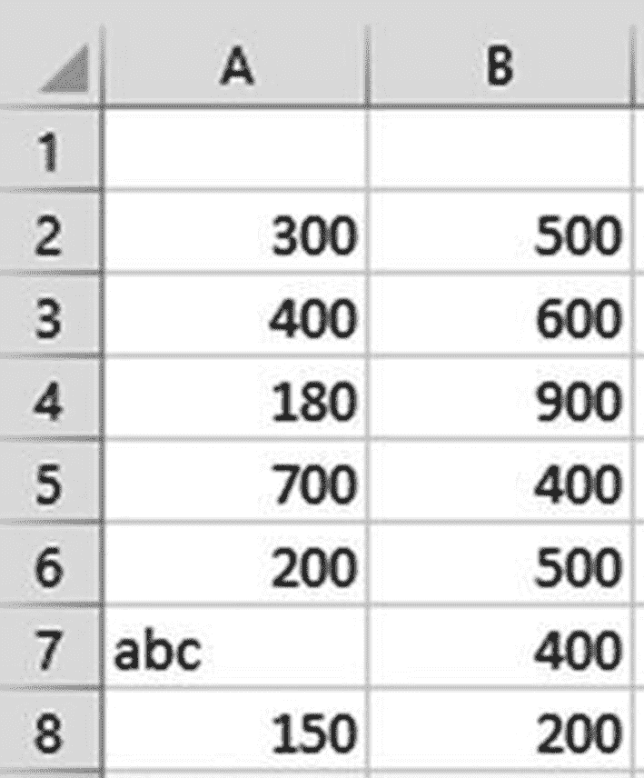

图 10-32：名为“状态”的工作表中的数据

1.  如果尚未打开，请打开第 10 章的工作簿。
2.  单击工作表 `Status`。
3.  图 10-32 显示了工作表中的数据。

#### 计算

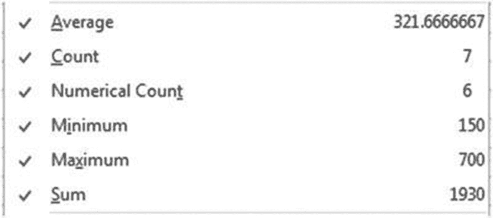

图 10-34：选择结果显示在状态栏菜单上


图 10-33：状态栏上显示的计算结果

1.  选择单元格 `A2:B8`。查看结果。
2.  单击一个空白单元格以取消选择。
3.  按住 `Ctrl` 键并选择单元格 `A2`、`A4` 和 `B6`。状态栏现在仅显示这三个单元格的结果。
4.  右键单击状态栏。请注意，结果也显示在菜单上。见图 10-34。

**注意：** 您选择的单元格不必是垂直的；实际上，它们甚至不需要彼此相邻。

1.  右键单击状态栏。选择 `Average`（平均值）、`Count`（计数）、`Numerical Count`（数值计数）、`Minimum`（最小值）、`Maximum`（最大值）和 `Sum`（求和）。
2.  单击一个空白单元格以关闭状态栏菜单。
3.  拖动选择单元格 `A2` 到 `A8`。查看状态栏上的结果。你的结果应类似于图 10-33 中所示。

**注意：** 空单元格不参与计算和单元格计数。`Count`（计数）和 `Numerical Count`（数值计数）之间的区别在于，`Numerical Count`（数值计数）仅统计包含数值数据的单元格；因此，它排除了包含文本 `abc` 的单元格的计数。

#### 选择模式

1.  单击单元格 `A2`。按下 `F8` 键。这将使单元格 `A2` 成为起始单元格或锚点单元格。状态栏显示 `Extend Selection`（扩展选定区域）。
2.  单击单元格 `B9`。这将高亮显示锚点单元格与所选单元格之间的所有单元格。
3.  按两次右箭头键。这将使所选区域向右扩展两列。
4.  按两次下箭头键。这将使所选区域向下扩展两行。
5.  单击单元格 `F15`。这将使选定区域从锚点扩展到单元格 `F15`。
6.  使用箭头键将选定区域移回，使得选中区域 `A2:B9`。
7.  可以使用 `Shift + F8` 键将其他区域或单个单元格添加到当前选定区域中。按下 `Shift + F8`。状态栏上的文字从 `Extend Selection`（扩展选定区域）变为 `Add or Remove Selection`（添加或删除选定区域）。
8.  拖动选择单元格 `E2:G9`。
9.  拖动选择单元格 `B13:B16`。
10. 随机单击单个单元格。它们都将成为选定区域的一部分。
11. 按下 `Shift + F8` 返回正常模式。

#### 单元格模式

1.  单击单元格 `A17`。如果已选择单元格模式，你应该会在状态栏的最左侧看到 `Ready`（就绪）字样。如果没有，请右键单击状态栏并选择 `Cell Mode`（单元格模式）。
2.  开始在单元格中键入。文字应从 `Ready`（就绪）变为 `Enter`（输入）。在单元格中输入内容后，按 `Enter` 键。
3.  双击单元格 `A17` 进入编辑模式。状态栏上的文字现在应变为 `Edit`（编辑）。你现在可以对单元格 `A17` 中的文本进行任何需要的更改。

#### 大写锁定、数字锁定、滚动锁定

1.  右键单击状态栏，如果 `Caps Lock`（大写锁定）、`Num Lock`（数字锁定）和 `Scroll Lock`（滚动锁定）尚未选中，请选中它们。单击一个单元格关闭状态栏菜单。

当这些键开启时，状态栏会显示相应状态。当它们未开启时，不会显示任何内容。这些键通常在键盘上有对应的指示灯，为你提供视觉提示，表明它们是否开启。选择这些选项将为你提供另一个视觉提示。

2.  分别单击这些键，查看它们在状态栏上的显示方式，然后再次单击这些键将其关闭。

#### 改写模式

1.  右键单击状态栏，如果 `Overtype Mode`（改写模式）尚未选中，则选择它。
2.  在单元格 `A10` 和单元格 `A11` 中，将单词 `Excel` 拼写错误，漏掉字母 c（写成 Exel）。如果你在状态栏上看到 `Overtype`（改写）字样，请单击 `Insert` 键将其关闭。
3.  双击单元格 `A10` 进入编辑模式。将光标放在字母 x 和 e 之间。现在键入字母 c。字母 c 应插入，字母 e 和 l 向右移动。按 `Enter` 键。
4.  双击单元格 `A11` 进入编辑模式。将光标放在字母 x 和 e 之间。按下 `Insert` 键。你现在应该在状态栏上看到 `Overtype`（改写）。现在键入字母 c。它会改写字母 e。字母 l 不会移动。改写模式会阻止字符的插入。按下 `Insert` 键。你应该不再看到状态栏上的 `Overtype`（改写）字样。
5.  键入字母 e 并按 `Enter` 键。

#### 缩放、缩放滑块

1.  将缩放滑块栏向右拖动，以增大工作表中项目的大小。
2.  将缩放滑块栏向左拖动，以减小工作表中项目的大小。
3.  多次单击加号。注意每次单击它，尺寸都会增大 10%。
4.  多次单击减号。每次单击它，尺寸都会减小 10%。
5.  单击功能区的 `View`（视图）选项卡。在 `Zoom`（缩放）组中，单击 `Zoom`（缩放）按钮。选择 `Custom`（自定义）。在百分比中输入 `147`。单击 `OK`（确定）按钮。
6.  在 `Zoom`（缩放）组中，单击 `100%` 按钮。
7.  选择单元格 `A2:B8`。单击功能区的 `View`（视图）。
8.  在 `Zoom`（缩放）组中，单击 `Zoom to Selection`（缩放到选定区域）按钮。使用 `Zoom to Selection`（缩放到选定区域）可以使所选内容占据窗口的垂直或水平方向的大小，以先达到其极限的方向为准。
9.  单击缩放滑块的中央，返回到 100% 视图。


## 摘要

超链接可用于创建指向文件、网页、特定单元格、新文档或电子邮件地址的快速链接。

你可以通过使用连接或快速填充来合并数据。`&`（与号）用于在使用连接时连接不同的数据字符串。快速填充可以自动连接数据，而无需手动输入公式。

用户通常忘记状态栏。这可能是因为除非右键单击，否则这些选项不可见。状态栏是同时查看应用于多个范围的多个函数结果的最快方式。状态栏上显示的结果是临时的；它们不会存储在单元格中。

在下一章中，你将学习复制和粘贴数据的不同方法。你还将了解如何切换行和列标题。你将学习如何使用 Microsoft Office 剪贴板以及如何同时在多个工作表中输入数据。

