# 11. 将数据传输和复制到其他位置

有时你会将数据放入单元格，然后决定将该数据显示在其他位置，或者希望将该数据复制到其他地方。Excel 提供了多种方法来实现此目的，并允许你选择新传输或复制数据的格式。此传输或复制的数据可以复制到其他数据、其他工作表和其他工作簿中的位置。

阅读并完成本章后，你应该能够：

* 使用拖放方法移动和复制单元格
* 手动复制和粘贴
* 使用键盘复制和粘贴
* 将数据复制到其他工作表
* 将数据从一个工作簿复制到另一个工作簿
* 使用“选择性粘贴”转置行和列
* 使用“粘贴”按钮库
* 使用“选择性粘贴”的“加”和“乘”选项
* 使用“选择性粘贴”的“跳过空单元格”选项
* 使用 Microsoft Office 剪贴板
* 插入已复制或已移动的单元格

## 移动和复制数据

你可以使用 Excel 的“移动”功能（也称为“剪切”功能）来移动数据。**移动**单元格会将一个单元格中的值移动到另一个单元格。移动后，原始单元格位置将为空。接收位置中的任何现有值都将被移动的数据覆盖。

你可能希望相同的数据出现在多个位置。与其重复输入相同的数据，不如使用 Excel 的“复制”功能。**复制**单元格涉及将一个单元格中的值复制到另一个单元格。复制后，该值将同时存在于原始位置和复制到的位置。每当你剪切或复制数据时，该数据的副本都会放置在 Microsoft Office 剪贴板中。剪贴板与其他 Microsoft Office 产品共享。如果你复制单元格，然后启动 Word 并打开其剪贴板，你将看到你在 Excel 中复制的单元格。然后，你可以将该单元格数据粘贴到 Word 文档中。

移动单元格可以通过使用拖放或“剪切-粘贴”方法来完成。复制可以通过在按住 `Ctrl` 键的同时使用拖放或使用“复制-粘贴”方法来完成。

### 使用拖放方法移动和复制单元格

使用拖放方法移动数据时，请按照以下步骤操作：

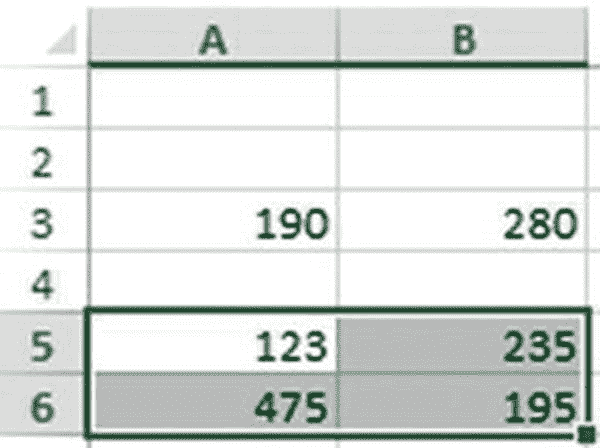
图 11-3 移动数据的结果

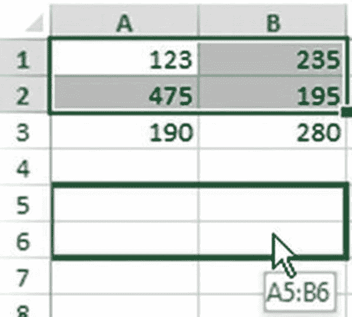
图 11-2 拖动数据时，一个与选定区域大小相同的框会随光标移动

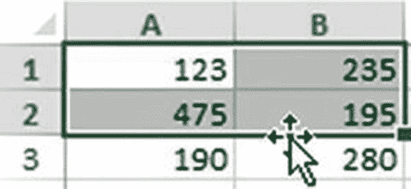
图 11-1 选择要移动的区域

1. 选择要移动的区域。
2. 将鼠标光标移动到所选区域的某一边上。光标应变为移动箭头，如图 11-1 所示。
3. 将数据拖到其新位置。拖动数据时，一个与选定区域大小相同的框会随光标移动，以便你随时了解数据将被移动到的位置。见图 11-2。
4. 释放鼠标按钮。数据被移动到其新位置。应用于单元格的任何格式都会随值一起移动。见图 11-3。

使用拖放方法复制数据时，请按照以下步骤操作：

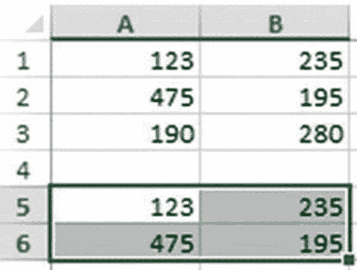
图 11-6 复制数据的结果


图 11-5 拖动数据时，一个与选定区域大小相同的框会随光标移动

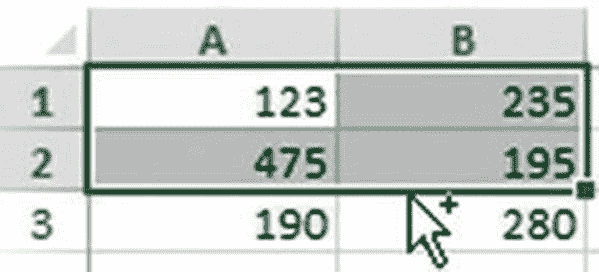
图 11-4 选择要复制的区域

1. 选择要复制的区域。
2. 按住 `Ctrl` 键，并将鼠标光标移动到所选区域的某一边上。光标应变为带有加号的箭头。加号表示你正在复制所选数据。见图 11-4。
3. 保持按住 `Ctrl` 键，并将数据拖到其新位置。拖动数据时，一个与选定区域大小相同的框会随光标移动，以便你随时了解数据将被复制到的位置。见图 11-5。
4. 当框到达目标位置时，释放鼠标按钮。数据被复制到其新位置。应用于单元格的任何格式都会随值一起复制。见图 11-6。

**注意** 复制单元格时，单元格引用会自动调整，但移动时则不会。你需要手动调整已移动单元格以及指向它们的任何单元格的单元格引用。

### 使用“剪切”和“复制”按钮移动和复制单元格

用于复制和粘贴的按钮位于“开始”选项卡上的“剪贴板”组中。见图 11-7。

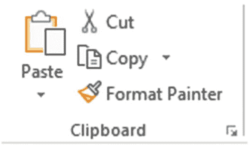
图 11-7 功能区的“剪贴板”组

**移动单元格值**

1. 选择要移动的单元格。
2. 单击“剪切”按钮 。
3. 选择要移动内容的左上角单元格。单击“粘贴”按钮。

**复制单元格值**

1. 选择要复制的单元格。
2. 单击“复制”按钮 。
3. 选择要复制内容的左上角单元格。单击“粘贴”按钮。

除了使用功能区上的“剪切”、“复制”和“粘贴”按钮外，你还可以通过右键单击所选单元格，从上下文菜单中选择它们。

**注意**
Excel 会在已剪切或复制的单元格周围显示一个动画选取框。完成将内容粘贴到新位置后，按 `Esc` 键取消动画选取框。

### 使用键盘移动和复制单元格

记住所有键盘快捷键是不可能的，但你应该记住复制、剪切和粘贴的快捷键，因为你会一直用到它们。请参考表 11-1。

**表 11-1** 键盘快捷键

| 功能 | 快捷键 |
| --- | --- |
| 剪切 | `Ctrl + X` |
| 复制 | `Ctrl + C` |
| 粘贴 | `Ctrl + V` |

这些快捷键在大多数其他程序中也同样适用。

**练习 11-1：复制、粘贴和移动内容**

在本练习中，你将通过复制和粘贴来复制单元格内容，然后使用剪切和粘贴移动内容。


**图 11-8** 输入这些数据

1. 新建一个工作簿，命名为 Chapter 11。将工作表命名为“CopyPaste”。
2. 将图 11-8 中的数据输入工作表中。

**复制单元格内容**

1. 选择单元格 `A1:A6`。
2. 在 **开始** 选项卡上的 **剪贴板** 组中，单击 **复制** 按钮 ，复制单元格 `A1:A6` 的内容。按 `Ctrl + C` 是 **复制** 命令的快捷键。
3. 单元格 `A1:A6` 周围会出现一个动态的虚线边框，表示这些单元格正在被复制。
4. 单击单元格 `C3`。这是内容将要复制到的目标区域的左上角单元格。
5. 在 **开始** 选项卡上的 **剪贴板** 组中，单击 **粘贴** 按钮的上半部分 。现在，单元格 `A1:A6` 中的内容的副本存在于单元格 `C3:C8` 中。
6. 只要被复制的单元格周围出现动态虚线边框，你就可以继续将它们粘贴到其他位置。单击单元格 `C5`。这次使用粘贴快捷键 `Ctrl + V`，而不是使用 **粘贴** 按钮。当将内容粘贴到已有内容的单元格时，原始内容会被覆盖。
7. 按 `Esc` 键。动态虚线边框将消失。

**移动单元格内容**

1. 选择单元格 `A1:A6`。

2. 在`开始`选项卡上的`剪贴板`组中，单击`剪切`按钮以剪切单元格。按`Ctrl + X`是`剪切`命令的快捷键。
3. 单击单元格`E1`。这是内容将要移动到的目标区域的左上角单元格。
4. 按`Ctrl + V`将内容粘贴到新位置。单元格内容已移动到单元格`E1:E6`。动态虚线边框已消失。
你已经学会了如何使用拖放方法、键盘快捷键以及单击`剪切`和`复制`命令按钮来移动和复制单元格数据。这些方法没有提供任何用于指定要粘贴的内容及其格式的选项。如果你希望可以选择粘贴后数据的显示方式，则需要在`粘贴`按钮库中进行选择。点击`粘贴`按钮的下半部分即可访问`粘贴`按钮库。

### “粘贴”按钮库
`粘贴`按钮实际上是两个独立的按钮。如果将光标悬停在`粘贴`按钮的上半部分，你将看到如图 11-9 左侧所示的工具提示。如果将光标悬停在`粘贴`按钮的下半部分（带有向下箭头的部分），你将看到如图 11-9 右侧所示的工具提示。单击`粘贴`按钮的下半部分会高亮显示整个按钮，并显示一个粘贴选项库。
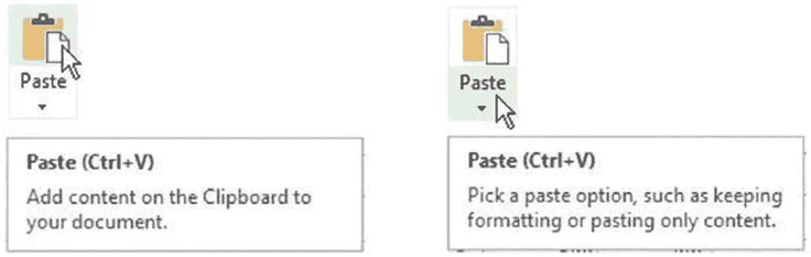
**图 11-9** 单击按钮上半部分进行粘贴，或单击按钮下半部分打开`粘贴`库
库中的粘贴选项可以执行诸如仅粘贴格式而非数据，或者仅粘贴公式的结果而非公式本身等功能。图 11-10 显示了`粘贴`库选项。并非所有选项每次都会出现；这取决于你复制的内容。表 11-2 列出了每个粘贴选项及其说明。
**表 11-2** `粘贴`库选项及其说明
| 按钮 | 名称（含快捷键） | 说明 |
| --- | --- | --- |
|  | `粘贴 (P)` | 完全按原样粘贴所有内容。保留所有格式、公式等。不调整列宽。 |
|  | `公式 (F)` | 粘贴除格式之外的所有内容。 |
|  | `公式和数字格式 (O)` | 粘贴公式和数字格式（如美元符号、逗号、括号内的负数等），但不复制文本格式。 |
|  | `保留源格式 (K)` | 粘贴所有数据以及*所有*格式。 |
|  | `无边框 (B)` | 粘贴除应用于所复制单元格的边框之外的所有内容。 |
|  | `保留源列宽 (W)` | 粘贴所有内容并调整列宽以匹配复制的列宽。 |
|  | `转置` | 更改所复制单元格的方向。例如，如果复制的单元格是垂直格式，则会变为水平格式。 |
| **粘贴数值** | | |
|  | `数值 (V)` | 仅粘贴数值，不粘贴公式。不粘贴任何格式。 |
|  | `值和数字格式 (A)` | 仅粘贴公式的结果，不粘贴公式本身。粘贴任何数字格式，如 `$` 和逗号等，但不粘贴任何文本格式。 |
|  | `值和源格式 (E)` | 仅粘贴公式的结果，不粘贴公式本身。粘贴应用于原始复制单元格的所有格式。 |
| **其他粘贴选项** | | |
|  | `格式 (R)` | 仅粘贴应用于单元格的格式，不粘贴数据本身。 |
|  | `粘贴链接 (N)` | 创建指向所复制项目的链接。粘贴链接意味着当您更改原始单元格时，粘贴的单元格将始终更新。 |
|  | `图片 (U)` | 将数据作为图片粘贴，而不是粘贴为单独的数据单元格。粘贴的数据不可编辑。 |
|  | `链接的图片 (I)` | 粘贴所有内容。您对原始数据或其格式所做的任何更改都会自动更新到粘贴的数据中。 |
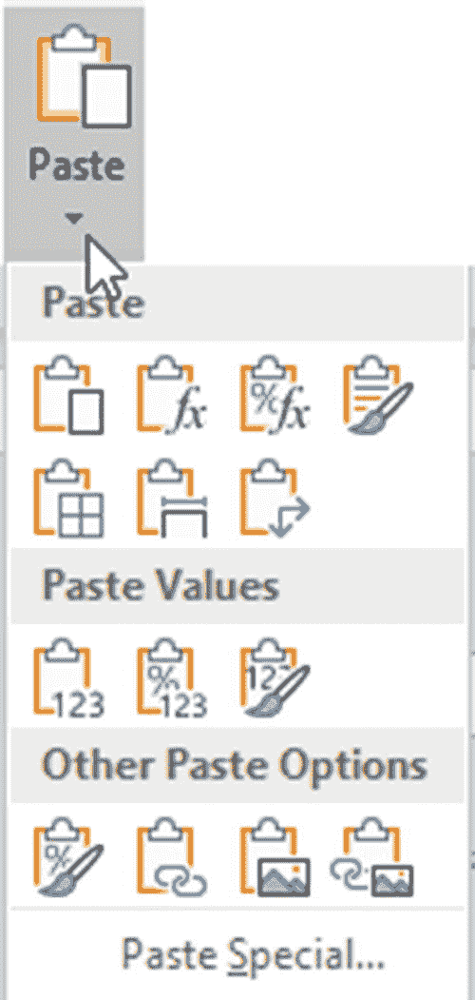
**图 11-10** 粘贴选项
### 练习 11-2：使用粘贴库
在本练习中，您将应用各种粘贴选项来查看它们如何影响数据。
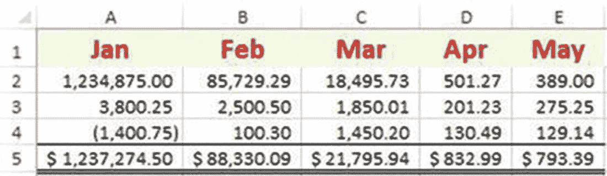
**图 11-12** 自动调整列宽
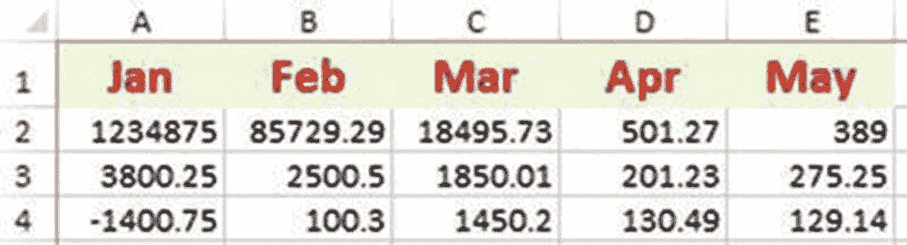
**图 11-11** 输入其余数据
1. 选择单元格`K1`和`K2`。对这些单元格应用加粗、倾斜和下划线。
2. 对单元格`A5:E5`应用`自动求和`。
3. 选择单元格`A2:E4`。在`开始`选项卡的`数字`组中，单击`千位分隔样式`按钮。
4. 选择单元格`A5:E5`。在`开始`选项卡的`数字`组中，单击按钮。
5. 在`开始`选项卡的`字体`组中，单击边框的下拉箭头。选择`上框线和下双框线`边框。
6. 选择 A 到 E 列的列标题。双击 E 列和 F 列标题之间，以自动调整列宽，如图 11-12 所示。
7. 使用您创建的第 11 章工作簿。创建一个名为“Pasting”的新工作表。
8. 在单元格`A1`中输入`Jan`。按`Ctrl + Enter`。
9. 将`自动填充句柄`向右拖动，直到获得`Jan`到`May`的月份。

10. 选择单元格`A1:E1`。在`开始`选项卡的`字体`组中，单击`增加字号`按钮三次。将字体颜色更改为红色。将填充颜色更改为（绿色, 强调文字颜色 6, 浅色 80%）。将标题加粗并居中。

11. 输入图 11-11 中的其余数据。

## 查看粘贴选项如何影响复制的数据

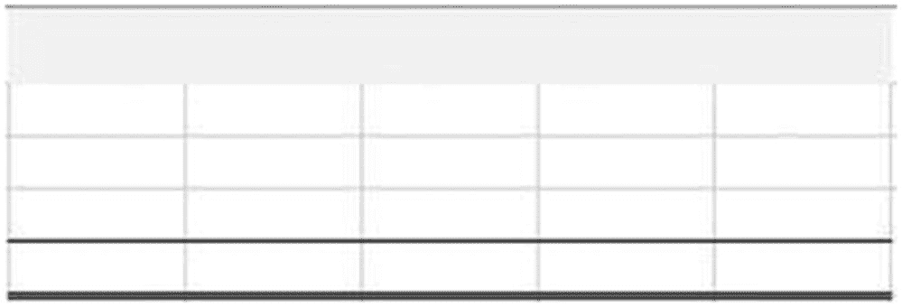
**图 11-13** 粘贴了格式但未粘贴单元格内容

**表 11-3** 带示例的粘贴库选项

| 粘贴选项 | 示例 |
| --- | --- |
|  `粘贴` | 粘贴所有数据和格式，但不会根据被复制区域调整列宽。这与按下 `Ctrl + V` 效果相同。 |
|  `公式` | 粘贴数据和公式。不粘贴任何格式。粘贴区域中原有的格式会影响被复制的单元格（注意单元格 `K1` 和 `K2` 的格式）。 |
|  `公式和数字格式` | 仅粘贴公式和数字格式，不粘贴其他格式。粘贴区域中原有的格式会影响被复制的单元格。 |
|  `保留源格式` | 保留原始数据的外观，但不会调整列宽。 |
|  `无边框` | 注意顶部和双底边框未被粘贴。 |
|  `保留源列宽` | 与原始数据完全一致，包括列宽。 |
|  `转置` | 改变行和列的排列方向。 |
|  `数值` | 不复制任何格式。它显示公式的结果，但不会保留公式。 |
|  `数值和数字格式` | 与“公式和数字格式”看起来相同。它不保留公式，而是显示公式的计算结果。 |
|  `数值和源格式` | 与“保留源格式”看起来相同。它不保留公式，而是显示公式的计算结果。 |

1. 选择单元格区域`G1:K5`。在`开始`选项卡上的`编辑`组中，单击`清除`按钮，然后选择`全部清除`。选择`全部清除`会清除数据和所有格式。
2. 选择单元格区域`A1:E5`。按下 `Ctrl + C`。单击单元格`G1`内部。单击`粘贴`按钮的下半部分。在`粘贴数值`区域中，单击`数值`按钮。单击单元格`G5`内部。注意公式栏中没有公式，只有被复制单元格所用公式的结果。
3. 选择单元格区域`G1:K5`。在`开始`选项卡上的`编辑`组中，单击`清除`按钮，然后选择`全部清除`。
4. 选择单元格区域`A1:E5`。按下 `Ctrl + C`。单击单元格`G1`内部。单击`粘贴`按钮的下半部分。在`其他粘贴选项`区域中，单击`粘贴链接`按钮。粘贴区域会链接到复制区域。你在复制区域中所做的任何更改都会反映在粘贴区域中。
5. 单击单元格`G2`内部。单元格`G2`包含公式`=A2`。单元格`G3`包含公式`=A3`。
6. 将单元格`A3`中的值从`3,800.25`更改为`6,725.50`。按下 `Enter` 键。该更改会反映在单元格`G3`中。单元格`G5`中的总计也已更改，使其与单元格`A5`的值相同。
7. 选择单元格区域`G1:K5`。在`开始`选项卡上的`编辑`组中，单击`清除`按钮，然后选择`全部清除`。
8. 选择单元格区域`A1:E5`。按下 `Ctrl + C`。单击单元格`G1`内部。单击粘贴按钮的下半部分。在`其他粘贴选项`区域中，单击`图片`按钮。粘贴区域被视为一个图像。你可以判断它现在是一个图像，因为上下文选项卡组`图片工具`及其`格式`选项卡会显示出来。
9. 单击`格式`选项卡。你可以将光标移过`图片样式`以查看它们对图像的影响。单击`图片样式`的下拉箭头以查看更多选项。
10. 按下 `Delete` 键以移除单元格`G1`中的图像。
11. 在仍然选中单元格区域`A1:E5`的情况下，单击单元格`G1`内部。单击粘贴按钮的下半部分。在`其他粘贴选项`区域中，单击`链接的图片`按钮。注意上下文选项卡组`图片工具`再次可见。由于图像链接到了被复制的单元格，你对原始单元格所做的任何更改都会反映在粘贴的图像中。
12. 将单元格`D3`中的值更改为`87.75`。按下 `Enter` 键。该更改会反映在粘贴的图像中。
13. 将单元格`A1`的字体颜色更改为蓝色。将单元格`A1`设为斜体。注意粘贴区域中的变化。
14. 关闭第`11`章的工作簿。
15. 如果你在粘贴区域的某个单元格中键入数据，该数据将采用原始被复制单元格的格式：
    1. 在单元格`G1`中键入`June`。
    2. 在单元格`G5`中键入`395`。
16. 在仍选中复制区域`A1:E5`的情况下，单击单元格`G1`内部。单击`粘贴`按钮的下拉箭头部分。在`其他粘贴选项`区域中，单击`格式`按钮。所有格式都被粘贴了，但没有任何单元格内容。参见图`11-13`。
17. 选择单元格区域`A1:E5`。按下 `Ctrl + C`。
18. 单击单元格`G1`内部。单击`粘贴`按钮的下半部分以查看粘贴选项库。
19. 将光标移过粘贴选项。结果应如表`11-3`所示。
20. 你已经使用粘贴选项复制了单元格值、单元格格式、仅公式以及其他格式。接下来，你将学习如何将数据从一个工作表复制到另一个工作表，之后还将学习如何将数据从一个工作簿复制到另一个工作簿。

## 使用“跨工作表填充”将数据复制到其他工作表

您可以使用`跨工作表填充`复制命令，将一张工作表上的全部或部分数据复制到其他工作表。执行`跨工作表填充`复制命令的步骤如下：
1. 选择要复制到其他工作表的单元格。您只能选择整个工作表或单个区域。如果要复制多个区域，则需要重复这些步骤。
2. 选择要复制数据的目标工作表标签。
3. 在功能区上，单击`开始`选项卡，在`编辑`组中，单击`填充`按钮。选择`跨工作表`。`跨工作表填充`对话框将打开。您可以在此处选择要复制全部、仅数据或仅格式。

**练习 11-3：使用“跨工作表填充”复制命令**

在本练习中，您将把数据从一个工作表复制到其他工作表。

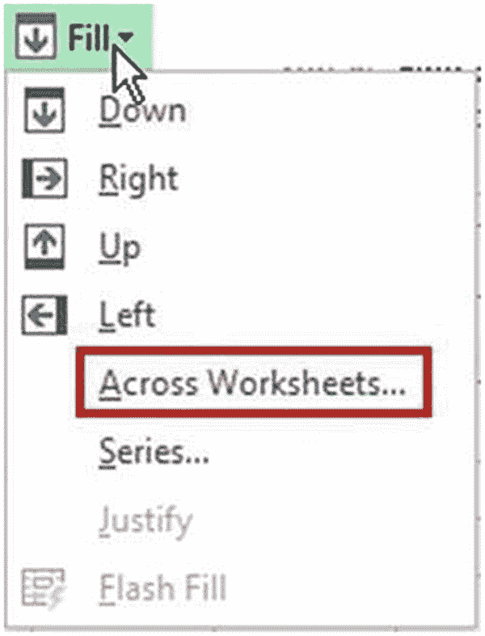
图 11-15：选择“跨工作表”

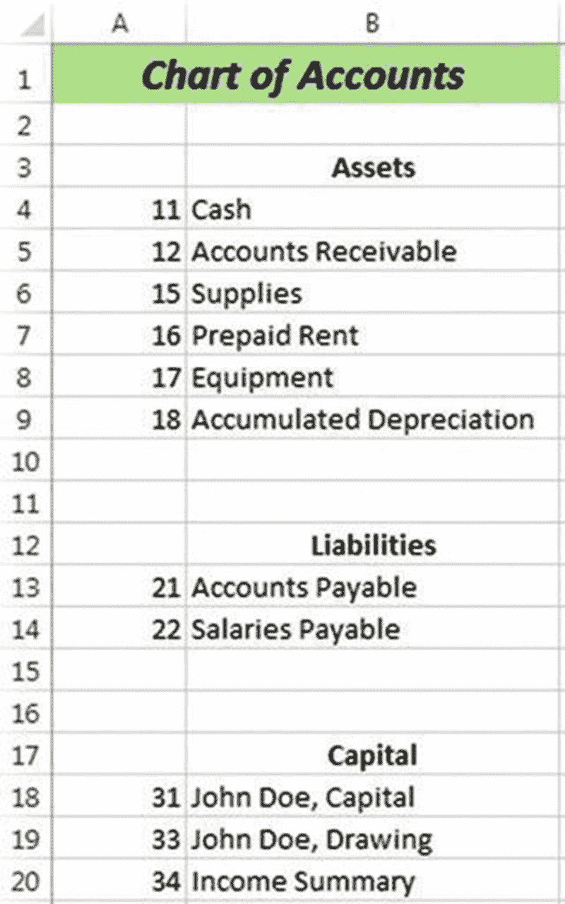
图 11-14：输入此数据

### 将数据从一个工作簿复制到另一个工作簿

您可以通过从一个工作簿复制数据，然后使用某种粘贴方法将其粘贴到另一个工作簿中，来将数据从一个工作簿复制到另一个工作簿。

**练习 11-4：将数据从一个工作簿复制到另一个工作簿**

本练习涵盖了在复制数据时使用各种粘贴选项。

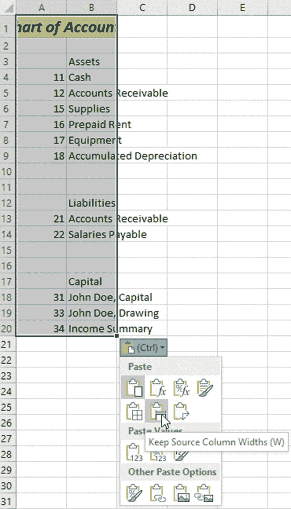
图 11-18：粘贴选项

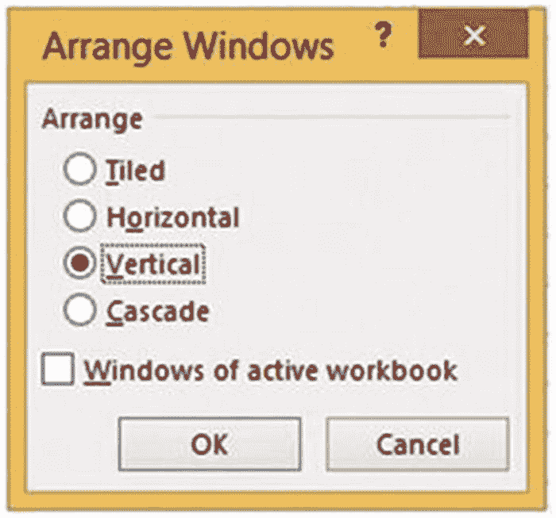
图 11-17：“重排窗口”对话框

1.  使用您在上一练习中创建的工作簿`Chapter 11B`。
2.  按`Ctrl + N`。这是创建新工作簿的快捷键。
3.  单击功能区的“`视图`”选项卡。在“`窗口`”组中，单击“`全部重排`”按钮。将显示“`重排窗口`”对话框。参见图 11-17。
4.  选择“`垂直并排`”。单击“`确定`”按钮。
5.  选择`Chapter 11B`工作簿中`Sheet1`上的所有数据。按`Ctrl + C`复制数据。
6.  单击新工作簿中的单元格`A1`。按`Ctrl + V`将数据粘贴到新工作簿中。
    粘贴数据的列宽与复制数据的列宽不匹配。
7.  单击粘贴数据右下角出现的“`粘贴选项`”按钮，或按`Ctrl`键调出粘贴选项。参见图 11-18。
8.  单击“`保留源列宽`”按钮。列将调整为其原始宽度。
    让我们重复刚才所做的操作，但这次我们将复制整个工作表。
9.  首先，清除我们粘贴到新工作簿中的数据。按`Ctrl + Z`。
10. 通过单击列 A 标题左侧的“`全选`”按钮，选择`Chapter 11B`工作簿中`Sheet1`上的所有数据。按`Ctrl + C`。
11. 单击新工作簿的单元格`A1`。
12. 在新工作簿中，单击功能区的“`开始`”选项卡。在“`剪贴板`”组中，单击“`粘贴`”按钮的下半部分。将显示“`粘贴`”按钮库。
13. 将光标移到不同的按钮上；当您这样做时，您将确切看到如果单击该按钮，电子表格的外观。
    由于您选择了整个工作表，因此“`粘贴`”按钮和“`保留源列宽`”按钮会给出相同的结果。
14. 单击“`粘贴`”按钮。
15. 关闭这两个工作簿。

### 选择性粘贴

“`选择性粘贴`”命令为您提供了对粘贴操作更强的控制。只要您想要执行以下任何操作，就应使用它：
-   粘贴来自复制或剪切单元格操作的某些属性。
-   使用复制或剪切单元格的内容与粘贴单元格的内容执行数学运算。
-   忽略空单元格。
-   将行数据转置为列数据，或将列数据转置为行数据。
-   将粘贴的单元格链接到复制的单元格。

“`选择性粘贴`”命令位于“`粘贴`”库的底部。参见图 11-19。

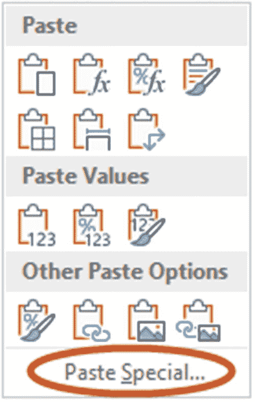
图 11-19：选择“选择性粘贴”

#### 使用“选择性粘贴”

选择`Paste Special`（选择性粘贴）会弹出`Paste Special`（选择性粘贴）对话框。见图 11-20。

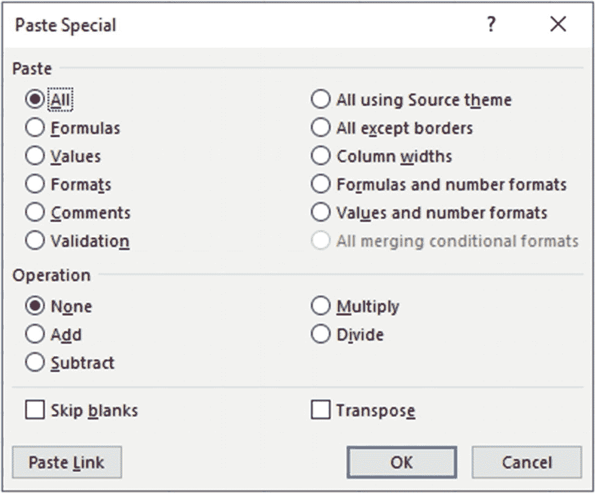
图 11-20
“选择性粘贴”对话框

注意
窗口底部的`Paste Link`（粘贴链接）按钮仅在选择了`All`（全部）或`All Except Borders`（除边框外全部）时可用。选择其他选项时，该按钮会变灰。

表 11-4 描述了粘贴选项。表 11-5 描述了运算选项。

表 11-5
运算选项

| 运算选项 | 描述 |
| --- | --- |
| `None`（无） | 不对粘贴的单元格执行任何数学运算。 |
| `Add`（加） | 将复制单元格中的值与被粘贴单元格中的值相加。 |
| `Subtract`（减） | 从被粘贴单元格中的值中减去复制单元格中的值。 |
| `Multiply`（乘） | 将复制单元格中的值与被粘贴单元格中的值相乘。 |
| `Divide`（除） | 将被粘贴单元格中的值除以复制单元格中的值。 |

表 11-4
“选择性粘贴”选项

| 选择性粘贴选项 | 描述 |
| --- | --- |
| `All`（全部） | 执行与按下`Ctrl + V`相同的操作。粘贴所有单元格内容和格式。不调整列宽。 |
| `Formulas`（公式） | 粘贴复制单元格中使用的公式。 |
| `Values`（数值） | 仅粘贴公式的结果，而不是公式本身。 |
| `Formats`（格式） | 仅粘贴格式，不粘贴数据。 |
| `Comments`（批注） | 仅粘贴附加到单元格的批注。 |
| `Validation`（验证） | 粘贴复制单元格的数据验证规则。 |
| `All Using Source Theme`（使用源主题的全部内容） | 使用应用于复制单元格的主题粘贴所有单元格内容和格式。 |
| `All Except Borders`（除边框外全部） | 粘贴除应用于复制单元格的边框之外的所有内容。 |
| `Column Widths`（列宽） | 粘贴列宽，使其与复制单元格的列宽匹配。 |
| `Formulas and Number Formats`（公式和数字格式） | 粘贴公式和单元格内容。粘贴任何数字格式，例如`$`和逗号等，但不粘贴文本格式。 |
| `Values and Number Formats`（数值和数字格式） | 仅粘贴公式的结果，而不是公式本身。粘贴任何数字格式，例如`$`和逗号等，但不粘贴文本格式。 |

注意
根据您复制的内容和选择的粘贴选项，某些选项可能不可用。

注意
数学运算只能应用于数值。如果您要执行数学运算之一（`Add`（加）、`Subtract`（减）、`Multiply`（乘）或`Divide`（除）），则必须从粘贴选项中选择`All`（全部）、`All except borders`（除边框外全部）或`Values and number formats`（数值和数字格式）。

#### 使用“选择性粘贴”的操作步骤

1.  选择包含要复制的数据或属性的单元格。
2.  按`Ctrl + C`。
3.  选择粘贴区域左上角的单元格。如果您要执行数学运算，则需要选择粘贴区域中的所有单元格。

4. 在`Home`（开始）选项卡上的`Clipboard`（剪贴板）组中，单击`Paste`（粘贴）按钮的下半部分。选择`Paste Special`（选择性粘贴）。

5. 选择您想要执行的粘贴选项。

6. 选择您想要执行的运算选项。如果您不执行数学运算，请选择`None`（无）。

7. 如果要粘贴静态数据（非链接），请点击您要使用的粘贴选项，然后点击`OK`（确定）按钮。

或者

*   如果要粘贴链接数据，必须从粘贴选项中选择`All`（全部）或`All except borders`（除边框外全部），然后单击`Paste Link`（粘贴链接）按钮。

*   选择`Skip blanks`（跳过空单元格）以避免将空白单元格复制到粘贴区域。

*   选择`Transpose`（转置）将行数据更改为列数据，反之亦然。

实用提示

如果您经常使用`Paste Special`（选择性粘贴），可以将其添加到快速访问工具栏。

### 使用“选择性粘贴”转置行和列

`Paste Special`（选择性粘贴）命令有一个`Transpose`（转置）选项，用于将行数据转换为列数据，反之亦然。您可能会使用`Transpose`（转置）功能的一个常见场景是：您已经设置好了行标题和列标题，然后决定您实际上希望将行标题作为列标题，而将列标题作为行标题。您无需手动重新输入标题，而是可以通过使用`Paste Special`（选择性粘贴）的`Transpose`（转置）选项来交换它们。

#### 练习 11-5：使用“选择性粘贴”的“转置”选项

在本练习中，您将转置原始复制数据的行和列。

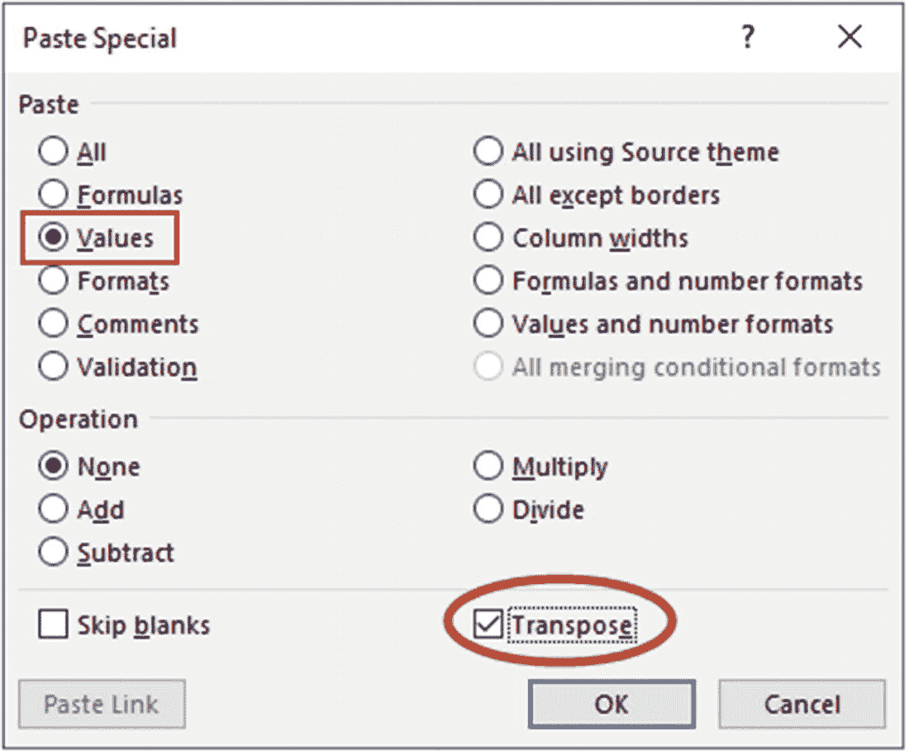

图 11-22

在`Paste Special`（选择性粘贴）对话框中选择`Values`（数值）和`Transpose`（转置）

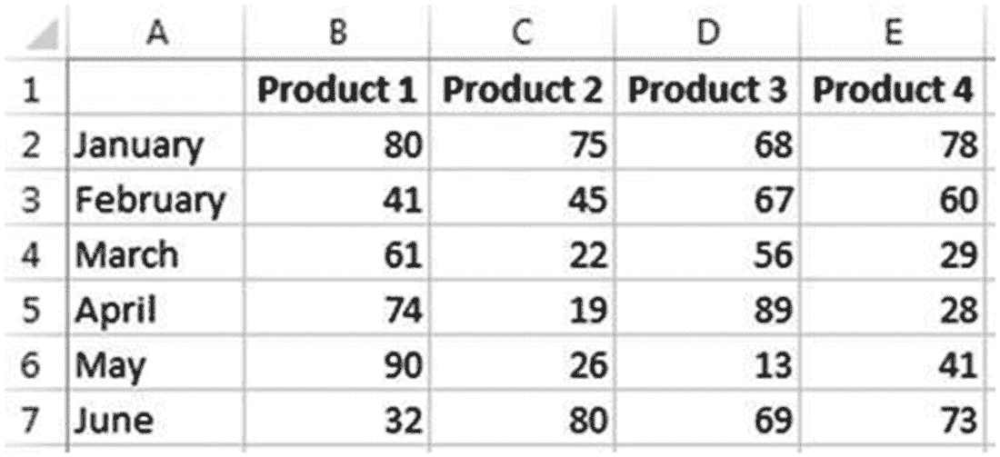

图 11-21

输入此数据

1. 选择`Transpose`（转置）。

2. 点击`OK`（确定）按钮。

3. 将列标题加粗并居中。

4. 选择单元格 A1:E7。

5. 右键单击所选数据并选择`Copy`（复制）。

6. 右键单击单元格 A10 内部。从上下文菜单中选择`Paste Special`（选择性粘贴）。

7. 在“粘贴”区域中，选择`Values`（数值）（图 11-22）。如果选择`All`（全部），会使现在将成为行标题的内容保持加粗。

8. 创建一个名为`Chapter 11C`的新工作簿。将工作表命名为“Transpose”（转置）。

9. 输入图 11-21 中的数据。将列标题加粗。

结果应如图 11-23 所示。

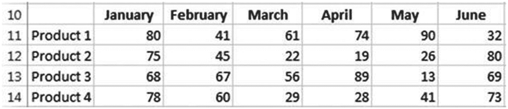

图 11-23

转置行标题和列标题的结果

### 使用“选择性粘贴”进行计算

`选择性粘贴`可以在粘贴的同时执行计算。`选择性粘贴`具有运算选项，包括`加`、`减`、`乘`和`除`。

可以将单个单元格的值粘贴到一组单元格并同时执行算术运算，也可以将一组单元格粘贴到另一组单元格并同时执行算术运算。

假设你想将单元格`A3`中的数值 5 添加到区域`A1:D1`的每个单元格中。见图 11-24。

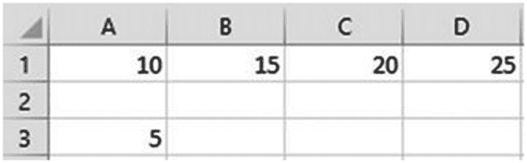

**图 11-24**

你将把单元格`A3`中的值添加到区域`A1:D1`的每个单元格中

请执行以下步骤：

1. 选择单元格`A3`，然后复制。

2. 选择要粘贴操作的目标单元格。在本例中，即区域`A1:D1`。

3. 右键单击所选单元格之一，然后选择`选择性粘贴`。

4. 选择`加`运算。

结果如图 11-25 所示，其中 5 已经被添加到粘贴区域中的每个值上。

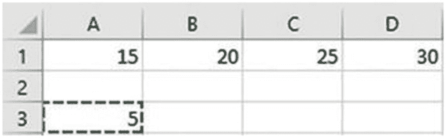

**图 11-25**

第 1 行中的每个单元格都加上了 5

在执行算术运算时，你可以组合一组或多组数据。

如果你想将第 3 行中的各个值与第 1 行中的各个值相加，如图 11-26 所示，请执行以下步骤：

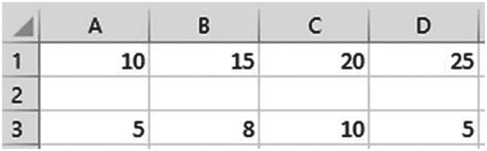

**图 11-26**

第 3 行中的值将被加到第 1 行中的值上

1. 选择单元格区域`A3:D3`，然后复制。

2. 选择单元格`A1:D1`。

3. 右键单击所选单元格之一，然后选择`选择性粘贴`。

4. 选择`加`运算。

图 11-27 显示了结果。

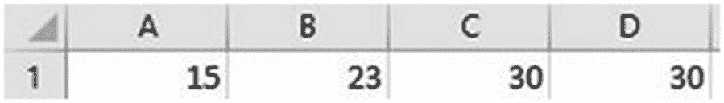

**图 11-27**

将第 3 行的值加到第 1 行后的结果

如果你复制的值少于要粘贴的值，则复制的值会重复其模式。

在图 11-28 中，单元格`A3`中的值将加到单元格`A1`的值上，单元格`B3`中的值将加到单元格`B1`的值上。

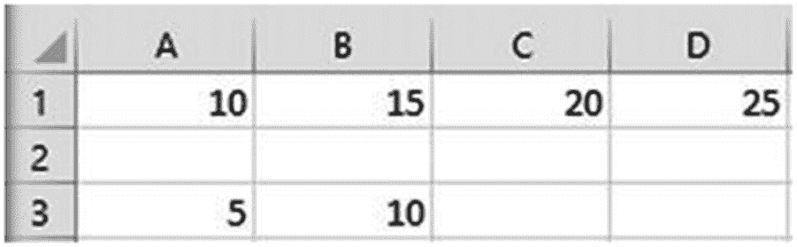

**图 11-28**

单元格`A3`中的值将加到单元格`A1`和`C1`上。单元格`B3`中的值将加到单元格`B1`和`D1`上

然后，单元格`A3`中的值将加到`C1`的值上，单元格`B3`中的值将加到`D1`的值上。

图 11-29 显示了结果。

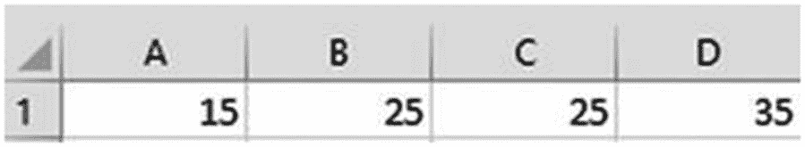

**图 11-29**

`A3`中的值已加到`A1`和`C1`上。`B3`中的值已加到`B1`和`D1`上

#### 练习 11-6：使用选择性粘贴的加运算选项

当你想要合并多组数值时，`选择性粘贴`的`加`选项会非常有用。`加`选项会将你在*源*区域中复制的值与*目标*区域中的值相加，然后用新值替换目标区域。

在本例中，我们将把 B 组和 C 组中的值加到 A 组的值上。然后，我们将删除包含 B 组和 C 组值的行。

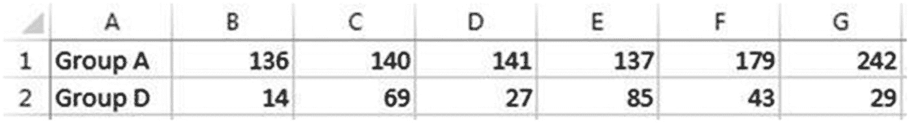

**图 11-31**

删除第 2 行和第 3 行后的结果

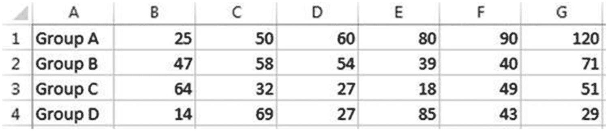

**图 11-30**

输入此数据

1. 打开工作簿 Chapter 11C。创建一个名为`PasteAdd`的新工作表。

2. 创建如图 11-30 所示的电子表格。

3. 选择单元格区域`B3:G3`。按`Ctrl + C`。单击单元格`B1`内部。单击`粘贴`按钮的下半部分。选择`选择性粘贴`。在`运算`下，选择`加`。单击`确定`。

4. 选择单元格区域`B2:G2`，并执行以下操作：

   *   按`Ctrl + C`。

   *   单击单元格`B1`内部。单击`粘贴`按钮的下半部分。

   *   选择`选择性粘贴`。

   *   在`运算`下，选择`加`。单击`确定`。

5. 选择第 2 行和第 3 行的行号，然后右键单击并从上下文菜单中选择`删除`。见图 11-31。

现在，A 组中的值是之前 A 组、B 组和 C 组中值的总和。

#### 练习 11-7：使用选择性粘贴的乘运算选项

我们有一份所售商品的价格清单。我们想将每种产品的价格提高 10%。

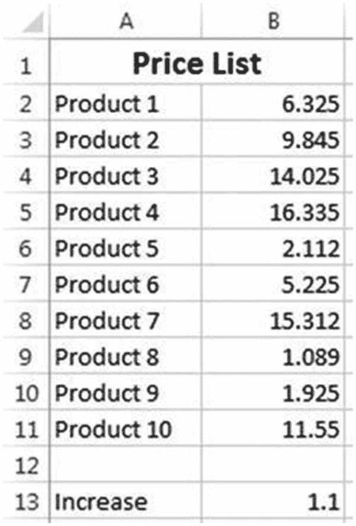

**图 11-33**

# 插入单元格、复制与剪切

## 使用选择性粘贴进行运算

### 乘法运算

将粘贴区域中的每个值乘以 1.1 的结果。

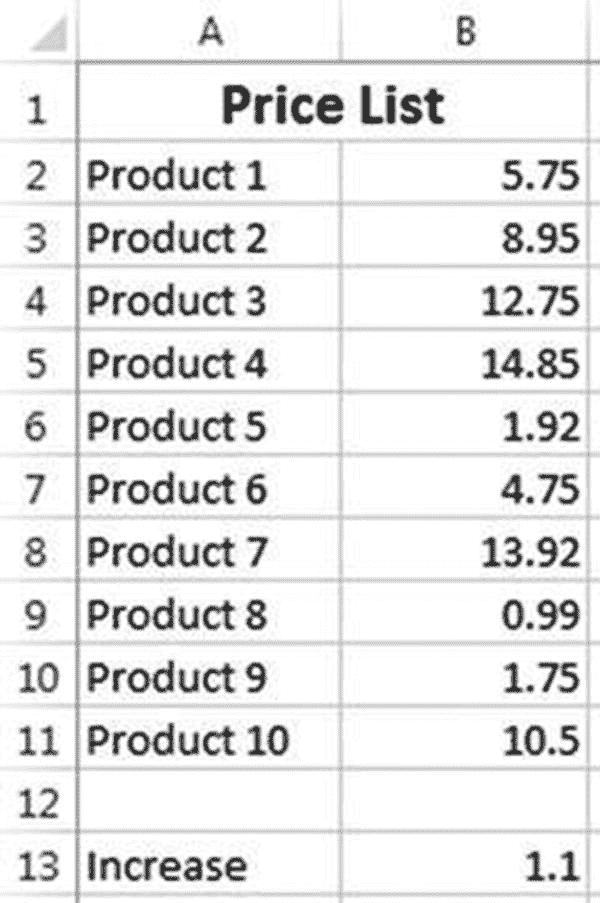

图 11-32

在工作表`PasteMultiply`中输入此数据：

1.  打开工作簿 Chapter 11C。创建一个名为`PasteMultiply`的新工作表。
2.  输入如图 11-32 所示的数据。
3.  单击单元格`B13`。按`Ctrl + C`。
4.  选择单元格区域`B2:B11`。右键单击所选单元格，然后从上下文菜单中选择`选择性粘贴`。
5.  在`运算`下选择`乘`。单击`确定`按钮。

Excel 将粘贴区域中的每个值乘以 1.1。图 11-33 显示了结果。尝试使用其他`运算`选项。

### 跳过空单元格

#### 练习 11-8：使用选择性粘贴的跳过空单元格选项

当你复制一个单元格区域时，复制区域中任何空白的单元格都会覆盖粘贴区域中的相应单元格，从而使这些单元格也变为空白。然而，如果你对`选择性粘贴`使用了`跳过空单元格`选项，则复制区域中的空白单元格将不会覆盖粘贴区域中单元格的数据。

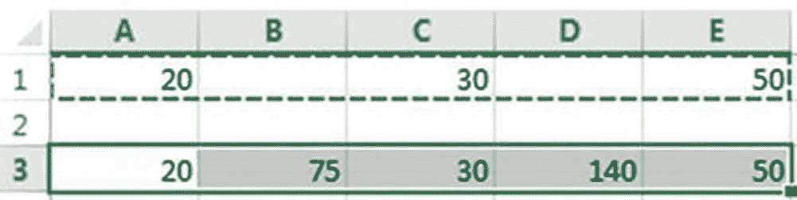

图 11-36: 使用`选择性粘贴`防止空白单元格覆盖非空白单元格

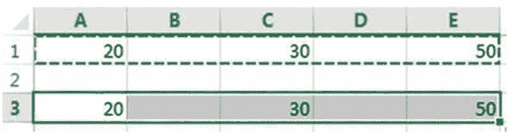

图 11-35: 单元格区域`A1:E1`粘贴到区域`A3:E3`

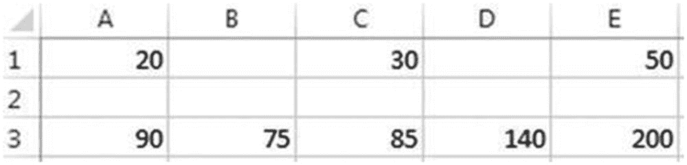

图 11-34: 输入此数据

1.  使用工作簿 Chapter 11C。创建一个名为`Skip`的新工作表。
2.  输入如图 11-34 所示的数据。
3.  拖动选择单元格`A1:E1`。按`Ctrl + C`复制它们。
4.  单击单元格`A3`。按`Ctrl + V`。见图 11-35。
    - 请注意，复制的空白单元格替换了单元格`B3`和`D3`中的内容。
5.  单击快速访问工具栏上的`撤消`按钮，或按`Ctrl + Z`撤消粘贴。
6.  单击`粘贴`按钮的下半部分。选择`选择性粘贴`。
7.  选择`跳过空单元格`。单击`确定`。见图 11-36。

单元格`B3`和`D3`中的值没有改变。

## 插入复制或移动的单元格

与其让移动或复制操作覆盖接收位置中的值，不如插入复制的或移动的单元格，这样接收位置中的值会被移开以容纳它们。

### 插入复制的单元格

将图 11-37 中 `A1:B2` 范围内的单元格复制到 `A6:B7` 单元格范围的操作步骤如下。

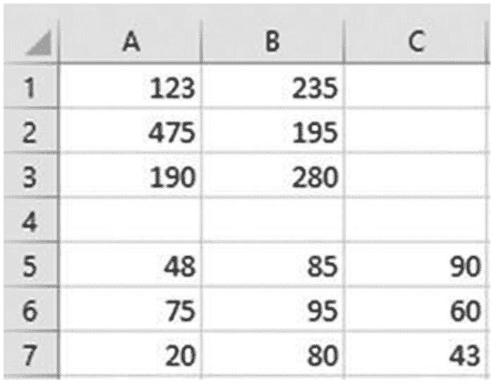

图 11-37: 将 `A1:B2` 范围内的单元格复制到 `A6:B7` 范围内的单元格

**步骤 1**

首先，选中要复制的单元格。右键单击所选区域，然后从上下文菜单中选择`复制`。见图 11-38。

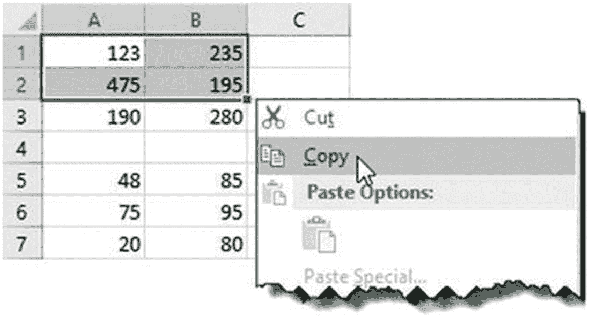

图 11-38: 右键单击所选单元格，然后选择`复制`

**步骤 2**

右键单击单元格 `B6`，然后从上下文菜单中选择`插入复制的单元格`。见图 11-39。

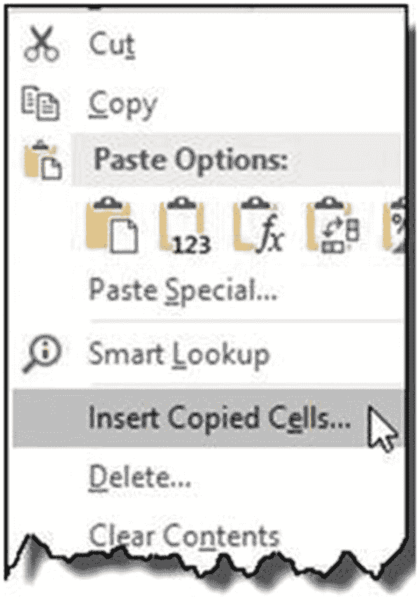

图 11-39: 选择`插入复制的单元格`

**步骤 3**

选择要移动当前单元格值的方向。见图 11-40。


图 11-40: 选择要移动当前单元格值的方向

图 11-41 显示了在步骤 3 中如果选择`下方单元格上移`后的结果。

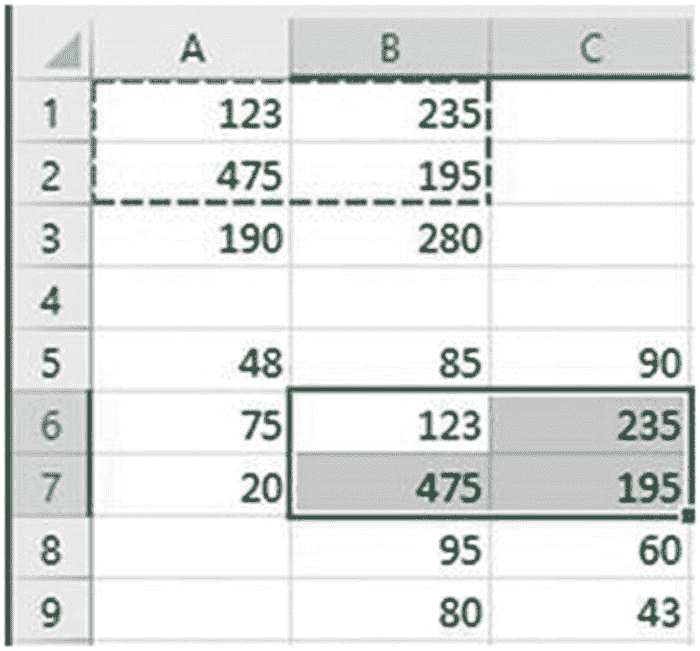

图 11-41: 如果选择`下方单元格上移`后的结果

图 11-42 显示了在步骤 3 中如果选择`右侧单元格左移`后的结果。

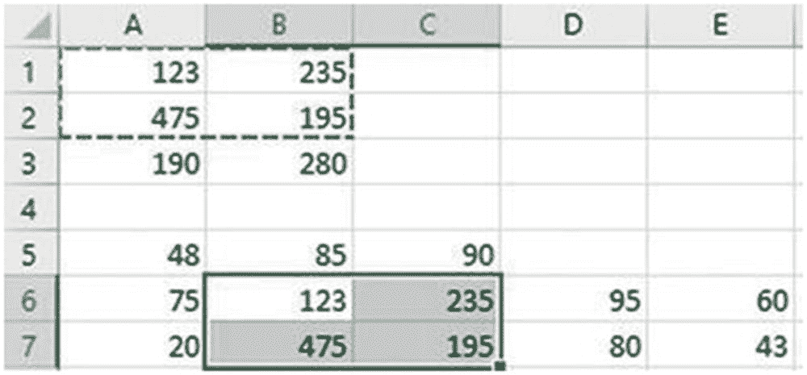

图 11-42: 如果选择`右侧单元格左移`后的结果

### 插入剪切的单元格

插入剪切的单元格与插入复制的单元格操作方法类似。

#### 练习 11-9：插入剪切的单元格

在本练习中，您将把数据移动到另一个位置，强制目标位置当前的数据向下移动到其下方的单元格中。

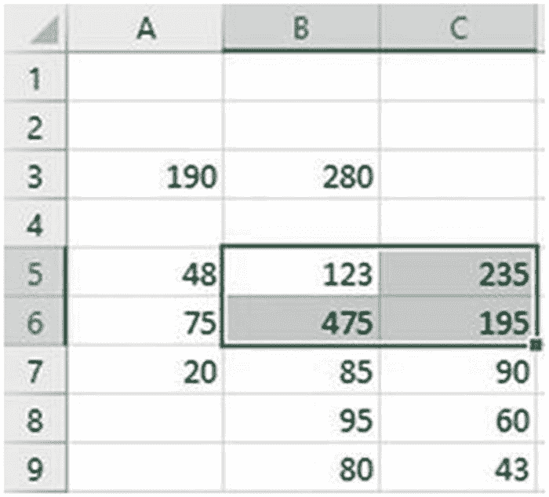

图 11-44: 将数据复制到现有数据上

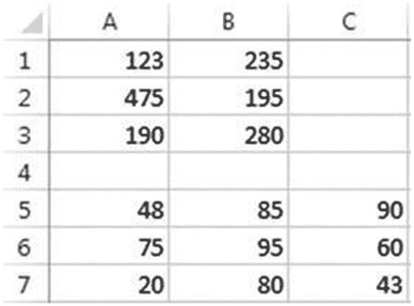

图 11-43: 输入此数据

1.  关闭 Chapter 11C 工作簿。
2.  选中单元格区域 `A1:B2`。按 `Ctrl + X` 剪切这些单元格以便移动。
3.  右键单击单元格 `B5` 内部。选择`插入剪切的单元格`。选择`下方单元格上移`。图 11-44 显示了结果。
4.  使用您创建的 Chapter 11C 工作簿。新建一个名为“CutCells”的工作表。
5.  将图 11-43 中的数据输入到工作表中。

## 使用 Microsoft Office 剪贴板

每执行一次复制操作，所复制的项目就会被放入 Office 剪贴板。Office 剪贴板是一个临时存储区域，最多可以复制 24 个项目。这些项目可以是文本，也可以是图表、图片、剪贴画、形状等图形。该剪贴板与其它 Microsoft Office 产品共享。这意味着您可以在 Excel、Access、PowerPoint、Word 等应用程序之间复制和粘贴项目。剪贴板使您可以快速轻松地重新排列文档中的数据，或者将来自其他 Office 产品的元素合并到文档中。剪贴板上的项目可以单独粘贴，也可以一次全部粘贴。

项目会保留在剪贴板上，直到您将其从剪贴板中删除，或者直到关闭所有 Microsoft Office 应用程序为止。即使关闭了所有 Microsoft Office 应用程序，您添加到剪贴板中的最后一个项目仍会被保留。最后一个复制的项目会被添加到剪贴板的顶部。如果您尝试向剪贴板添加超过 24 个项目，则最早添加的项目将被删除。重新启动计算机时，所有项目都将被清除。

可以通过单击剪贴板组中的对话框启动器来打开剪贴板。这将打开“剪贴板”任务窗格。

#### 练习 11-10：使用剪贴板

本练习涵盖使用剪贴板复制文本、形状、图片和图表。

1.  打开工作簿 `Clipboard.xlsx`。
2.  单击`剪贴板`工作表标签。
3.  单击剪贴板组右下角的“对话框启动器”以打开剪贴板窗格。
4.  单击`全部清空`按钮。
5.  进行以下选择：
    1.  选中单元格 `B3:C3`。按 `Ctrl + C`。
    2.  选中单元格 `B4:C4`。按 `Ctrl + C`。
    3.  选中单元格 `B5:C5`。按 `Ctrl + C`。
    4.  选中单元格 `B6:C6`。按 `Ctrl + C`。

请注意，`全部粘贴`按钮是灰色的。`全部粘贴`按钮不适用于图表和图片。

6.  选择`剪贴板`工作表标签并完成以下步骤。

# 同时向多个工作表输入数据

当您选中多个工作表时，在其中一个工作表中输入的任何内容都将同时输入到其他工作表中。您应用的任何格式也将应用于所有工作表。

## 练习 11-11：通过多个工作表输入数据

在本练习中，您将在一个工作表中输入文本和公式，这些内容将复制到另外三个工作表中。您对一个工作表应用的格式也将复制到其他工作表中。

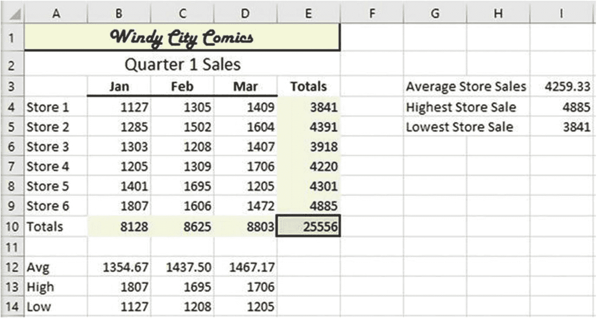

图 11-48

您的工作表现在应如下图所示

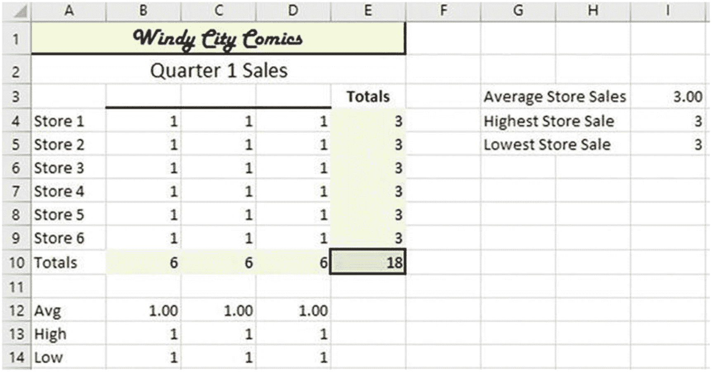

图 11-47

您的工作表现在应如下图所示

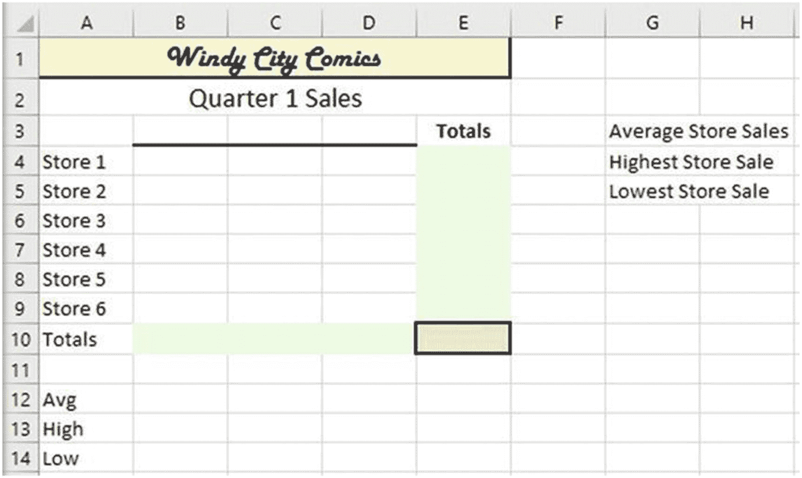

图 11-46

您的工作表现在应如下所示

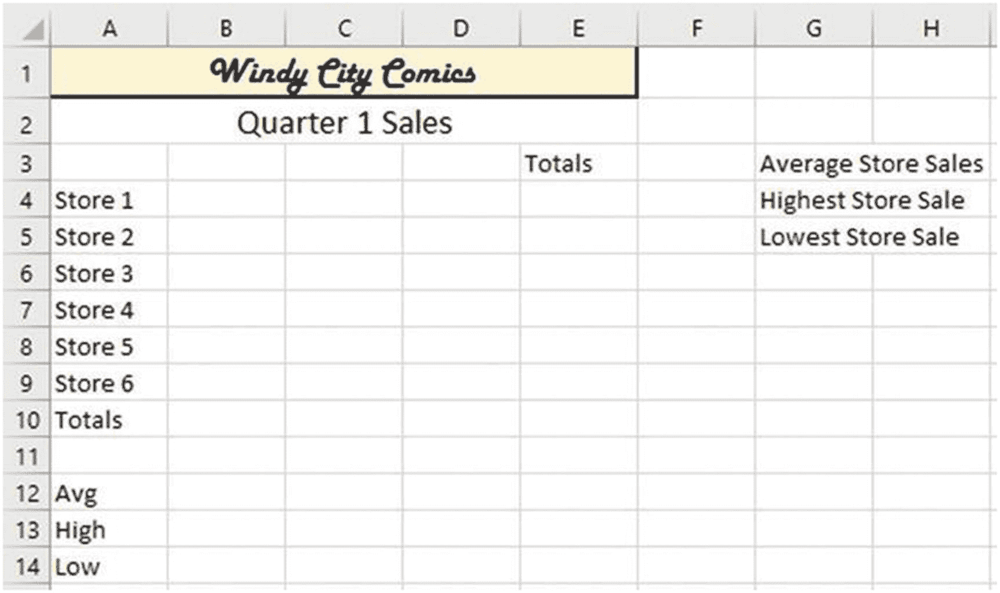

图 11-45

请将您的工作表设置为此图所示

1.  单击 `Qtr2` 工作表。将标题从“第一季度销售额”更改为“第二季度销售额”。在单元格 `B3` 中输入 `Apr`，在单元格 `C3` 中输入 `May`，在单元格 `D3` 中输入 `Jun`。
2.  在单元格区域 `B4:D9` 中输入您想要的任意数字。
3.  选中单元格区域 `B4:D9`。右键单击所选区域并选择“清除内容”。由于没有数据，平均值将出现除以零的错误。

我们的模板已完成。现在，您需要取消工作表的分组，以便在单个工作表中输入数据。

1.  右键单击选中的工作表，然后选择“取消工作表分组”。
2.  单击每个工作表。它们应完全相同。
3.  单击 `Qtr1` 工作表。在单元格 `B3` 中输入 `Jan`，在单元格 `C3` 中输入 `Feb`，在单元格 `D3` 中输入 `Mar`。
4.  选中单元格区域 `B4:B9`。右键单击其中一个选中的单元格并选择“清除内容”。在单元格区域 `B4:D9` 中输入您想要的任意数字。

您的工作表应类似于图 11-48 所示。

1.  在单元格 `B4` 中输入 `1`。使用自动填充柄将 `1` 向下复制到单元格 `B9`。将单元格 `B9` 中的自动填充柄拖至单元格 `D9`，将 `1` 复制到 C 列和 D 列。
2.  选中单元格区域 `B4:E10`。单击“自动求和”按钮。
3.  在单元格 `B12` 中输入公式 `=Average(B4:B9)`。
4.  在单元格 `B13` 中输入公式 `=Max(B4:B9)`。
5.  在单元格 `B14` 中输入公式 `=MIN(B4:B9)`。
6.  选中单元格区域 `B12:B14`。使用自动填充柄将公式复制到单元格 `D14`。
7.  在单元格 `I3` 中输入公式 `=Average(E4:E9)`。
8.  在单元格 `I4` 中输入公式 `=Max(E4:E9)`。
9.  在单元格 `I5` 中输入公式 `=Min(E4:E9)`。
10. 选中单元格区域 `B12:D12`。按住 `Ctrl` 键并选中单元格 `I3`。在功能区“开始”选项卡的“数字”组中，单击“数字格式”的下拉箭头，然后选择“数字”。我们选择“数字”格式是为了让平均值显示两位小数。

您的电子表格现在应如图 11-47 所示。

1.  选中单元格区域 `B3:E3`。将文本加粗。在“对齐方式”组中选择“居中”按钮。
2.  选中单元格区域 `B10:D10`。按住 `Ctrl` 键，同时拖动鼠标选中单元格 `E4` 到 `E9`。应用最浅的绿色背景色。
3.  为单元格 `E10` 应用粗的外边框。应用第二浅的绿色背景色。
4.  选中单元格区域 `B3:D3`。应用粗的下边框。您的工作表现在应如图 11-46 所示。

1.  在单元格 `A2` 中输入“第一季度销售额”。合并并居中单元格区域 `A2:E2`。将字号更改为 14。
2.  在单元格 `A4` 中输入“商店 1”。使用单元格 `A4` 的自动填充柄，向下拖拽至单元格 `A9`。
3.  输入工作表的其余内容，使其看起来如图 11-45 所示。

1.  创建一个包含四个工作表的新工作簿。将工作表分别命名为 `Qtr1`、`Qtr2`、`Qtr3` 和 `Qtr4`。
2.  按住 `Ctrl` 键，依次单击 `Qtr1`、`Qtr2`、`Qtr3` 和 `Qtr4` 工作表标签。
3.  在单元格 `A1` 中输入“风城漫画”，并按如下格式设置：
    1.  合并并居中单元格区域 `A1:E1`。
    2.  将字体更改为 Harlow Solid Italic，并将字号更改为 14。
    3.  使用“填充颜色”应用浅金色背景色。
    4.  应用粗框线边框。

# 总结

```
移动和复制的区别在于，执行复制操作后，数据将同时存在于其原始位置和粘贴位置；而移动操作则会清除原始位置的数据，并将其存储到粘贴位置。`选择性粘贴` 命令的功能远不止将数据粘贴到单元格中。在粘贴的同时，它还可以执行计算。它提供了仅复制单元格值（不复制格式）或仅复制格式（不复制单元格值）的选项。`选择性粘贴` 的 `转置` 选项可将行数据转换为列数据，或将列数据转换为行数据。`填充成组工作表` 选项可将数据从一个工作表复制到多个工作表中。

每当您执行复制操作时，复制的数据都会临时存储在 Office 剪贴板中。Office 剪贴板一次最多可以存储 24 个项目。此剪贴板与其他 Office 产品共享，因此您可以轻松地在它们之间复制和粘贴。

在下一章中，您将了解如何将数据转换为表格。您可以对表格应用多种排序和复杂筛选，以便仅按您想要的顺序查看所需的数据。
```