## 16. 地理与股票数据类型

Excel 新增了两种数据类型，`Geography`（地理）和 `Stocks`（股票）。它们的工作方式类似。这两种数据类型位于功能区“数据”选项卡的“`Data Type`（数据类型）”组中，参见图 16-1。微软计划在未来增加更多的数据类型。

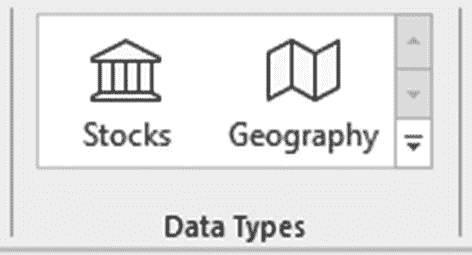

图 16-1：股票和地理数据类型

### 地理数据类型

我们先来看看 `Geography`（地理）。使用 `Geography` 数据类型，您可以收集有关国家、省份、地区、州、县、城市和城镇的数据。这些信息来源于维基百科和其他在线来源。您可以提取的数据取决于您所选的地理位置类型。您可以收集单个地理位置的信息，也可以同时收集大量地理位置列表的信息。

图 16-2 在单元格 A1 中显示了印第安纳州一个名为赫布伦的小镇名称。当我们选中该单元格并点击 `Geography` 按钮时，名称左侧会出现一个问号。Excel 显示这个问号是因为有许多名为赫布伦的城镇，它不知道您想使用哪一个。

图 16-2：问号表示确切位置未知

Excel 在单元格中放置问号的同时，会在工作表右侧显示一个 `Data Selector`（数据选择器），参见图 16-3。`Data Selector` 在名称左侧显示单元格地址，方便您识别 Excel 正在询问的是哪个单元格。您可以点击这些城镇中的任何一个来了解更多信息。名为赫布伦的城镇比此处显示的更多。要查看更多名为赫布伦的城镇，您可以点击放大镜图标，或点击窗口底部的“显示更多结果”。这些结果的显示顺序可能因时而异。

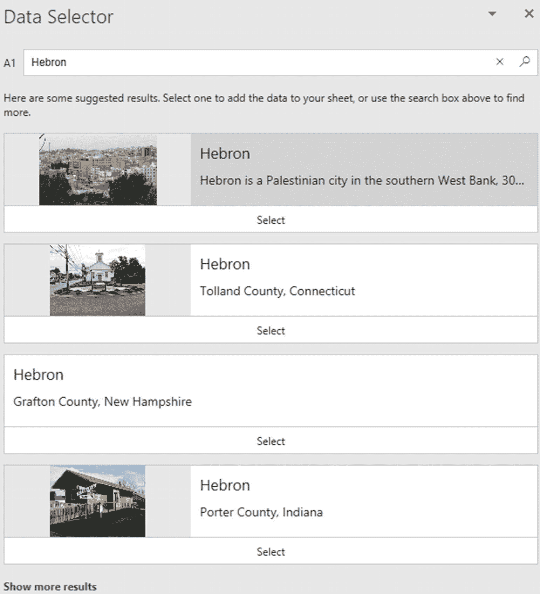

图 16-3：数据选择器

如果您点击某个城镇下方的“选择”，Excel 就会将该城镇确定为要收集信息的对象。我将选择印第安纳州波特县的赫布伦。如果您在未选择位置的情况下关闭了 `Data Selector`，您可以随时点击单元格中的问号重新打开它。

当您做出选择后，Excel 会在单元格中放置地理数据类型图标。当单元格处于活动状态时，数据右侧会显示一个图标。将光标移到该图标上，您会看到工具提示“插入数据 将数据提取到单元格”，参见图 16-4。

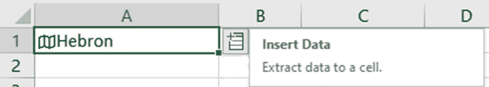

图 16-4：数据类型工具提示

点击该图标将显示与您输入的位置类型相关的可用选项，参见图 16-5。第一个选项是 `Admin Division 1`（一级行政区）。您可能会对列表顶部的 `Field`（字段）一词感到困惑。这是微软将其作为标题置于列表顶部，并非一个选项。

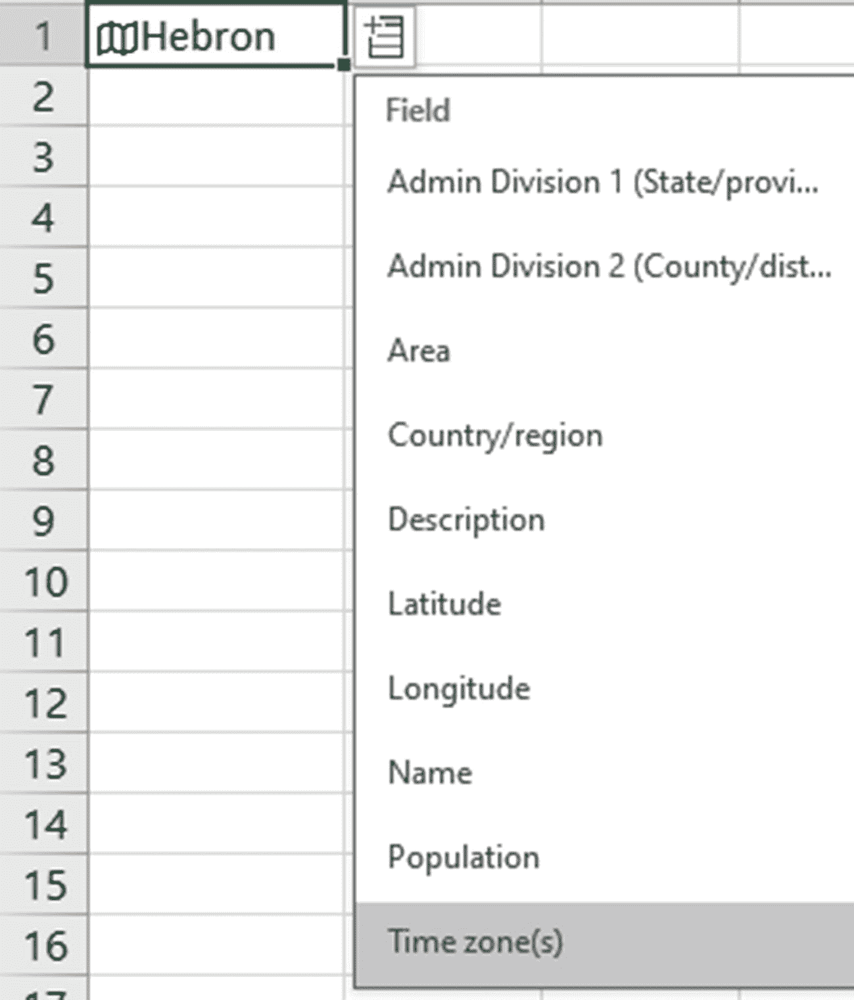

图 16-5：地理位置选项

选择“population”（人口）会将城镇的人口数量放入右侧单元格中。选择 `Admin Division 2`（二级行政区）会将县名放入右侧第一个空白单元格中，参见图 16-6。

图 16-6：已应用人口和二级行政区选项

`Geography` 数据类型图标显示的信息比单元格右侧出现的 `Insert Data`（插入数据）图标更多。将光标移到 `Geography` 数据类型图标上会显示一个工具提示，提示内容为“显示卡片”。点击该图标会显示可滚动的 `Card`（卡片），其中包含该位置的一张或多张图片及其相关信息。与 `Insert Data` 图标不同，`Card` 会显示它正在检索的实际数据。例如，`Card` 不仅仅显示 `Admin Division 1`，而是显示实际结果——Indiana（印第安纳州）。如果您滚动到 `Card` 的底部，您还会看到该位置的描述。`Card` 还包含指向维基百科上该位置的可点击链接以及更多图片，参见图 16-7。当您将光标移到 `Card` 的字段上时，该字段的右侧会显示一个图标。点击该图标会将信息放入右侧第一个空白单元格中。例如，在图 16-7 中，点击 `Admin Division` 右侧的图标，我会将 Indiana 这个词放入赫布伦右侧的第一个空白单元格中。

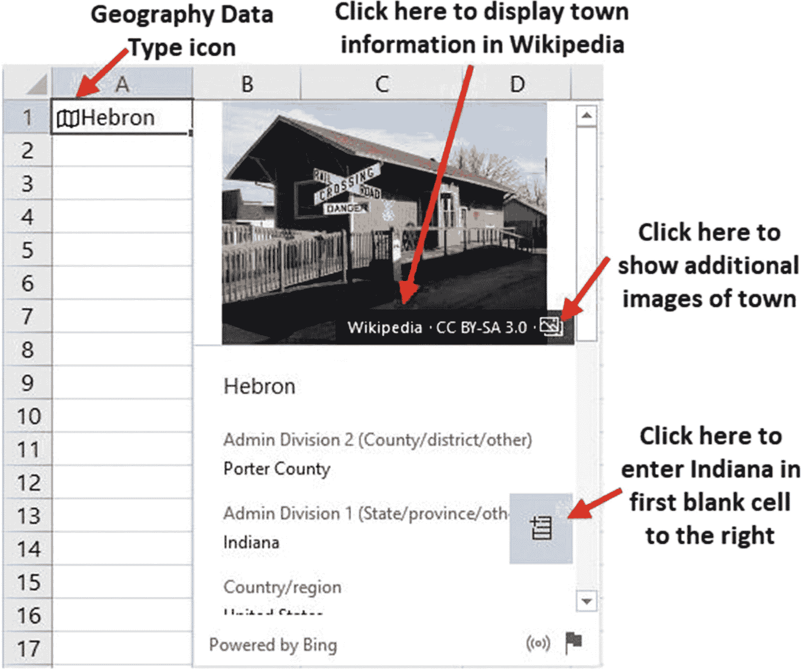

图 16-7：卡片包含位置数据和链接

您可以通过输入城市名称，后跟逗号，再后跟州、省或地区来区分城市的位置。例如，在单元格中键入 `Hebron, Indiana` 可以明确您所指的城市。当您点击 `Geography` 按钮时，不会出现问号，因为 Excel 将确切知道您指的是哪个赫布伦。Excel 会删除逗号和 Indiana 字样，仅保留单元格中的 `Hebron`。

在单元格中输入此内容 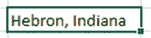 并点击 `Geography` 按钮会得到此结果 。

如果您选择了如图 16-8 所示的一系列印第安纳州城市和城镇，然后点击 `Geography` 按钮，Excel 将自动假定您想要的城市和城镇是印第安纳州境内的，并会在单元格中输入地理数据类型图标，而不是问号，参见图 16-9。

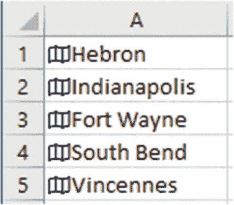

图 16-9：Excel 假定这些是印第安纳州的城市/城镇

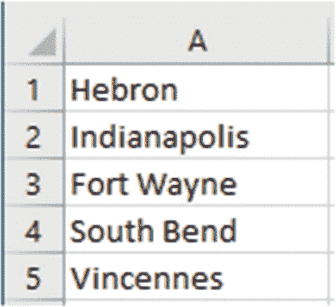

图 16-8：印第安纳州城市/城镇列表

#### 在表格中使用地理数据类型

## Excel中的地理数据类型

让我们将图 16-10 中的各州放入一个表格中：选中这些单元格，点击快速分析按钮，然后选择“表格”。

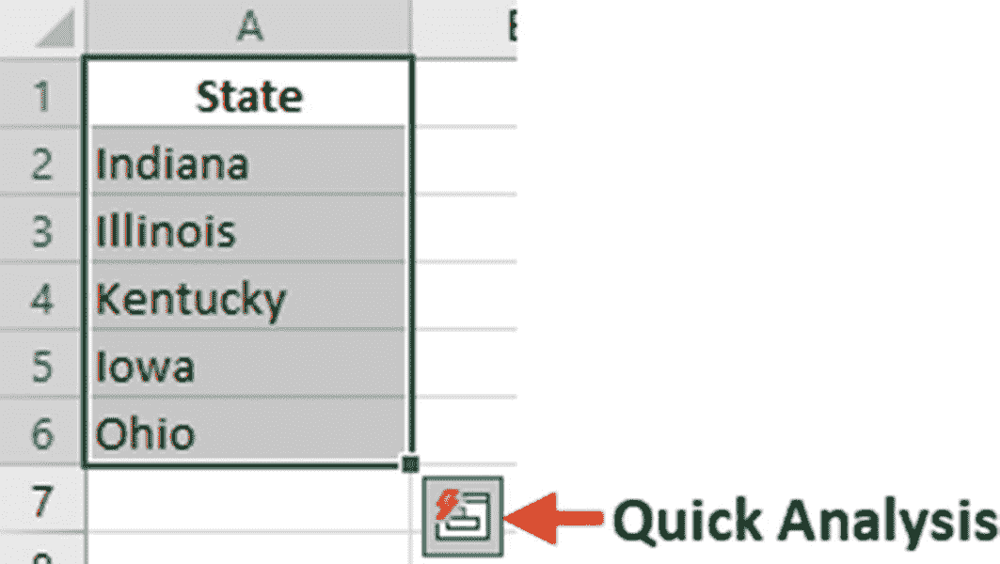

**图 16-10** 要转换为表格的数据

使用表格的优点包括：

-   可以一次性添加一列新数据。
-   列标题会自动创建。
-   由于数据在表格中，你可以轻松筛选数据，只看你想看的内容，例如只想查看收入中位数大于 50,000 的州。
-   当你添加其他位置时，它们会自动成为表格的一部分。

要将表格中的州转换为地理数据类型，首先选中包含州的单元格，然后在功能区“数据”选项卡的“数据类型”组中点击`地理`按钮。随后，每个单元格的州名左侧都会出现地理数据类型图标。只要光标位于某个表格单元格内，表格的右上方就会出现一个图标。该图标的工具提示显示为`添加列`。（当你点击一个不属于表格的数据类型单元格时，该图标的工具提示显示为`插入数据`。）点击`添加列`按钮会显示该位置的可用选项。请注意，在图 16-11 中，州的可用选项与市/镇的可用选项不同。每种地理位置类型都有其专属的选项。

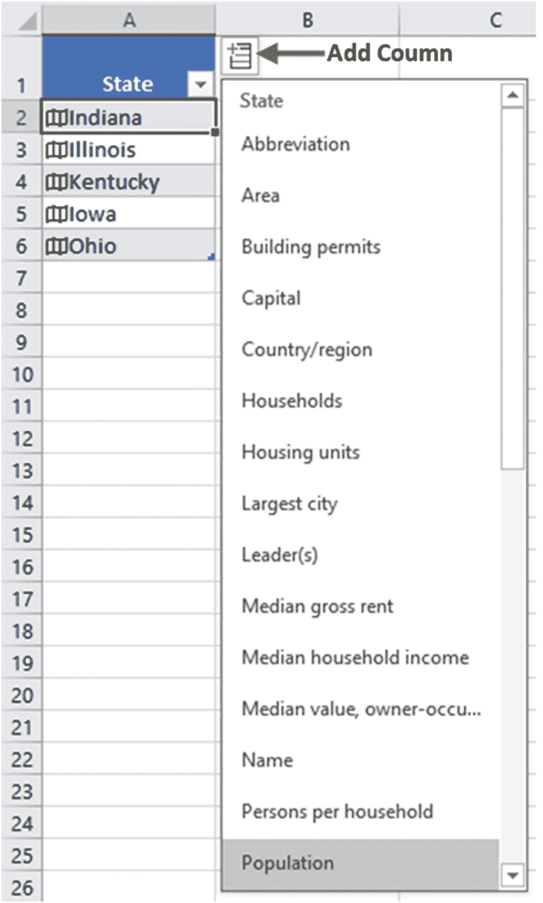

**图 16-11** 州位置的可用选项

我将选择`人口`。`人口`标题以及每个州的人口数据会出现在右侧的列中。见图 16-12。

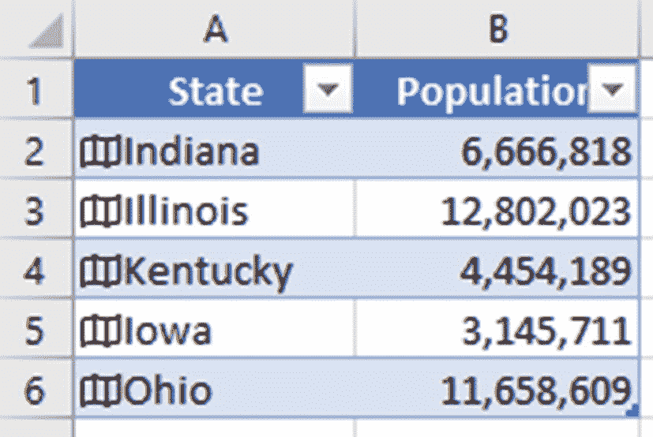

**图 16-12** 每个州的人口

点击肯塔基州的地理数据类型图标，然后从信息卡中选择`首府`。见图 16-13。

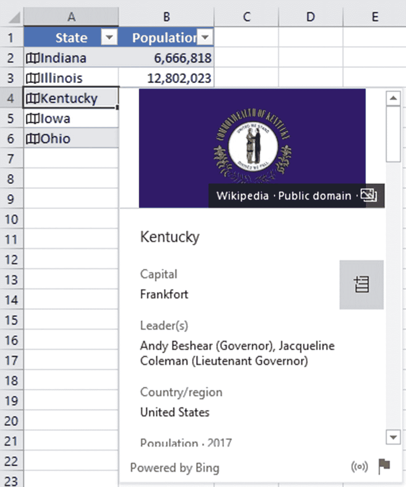

**图 16-13** 肯塔基州的信息卡

尽管我只从肯塔基州的信息卡中选择了`首府`，但 Excel 却输出了每个州的首府。见图 16-14。

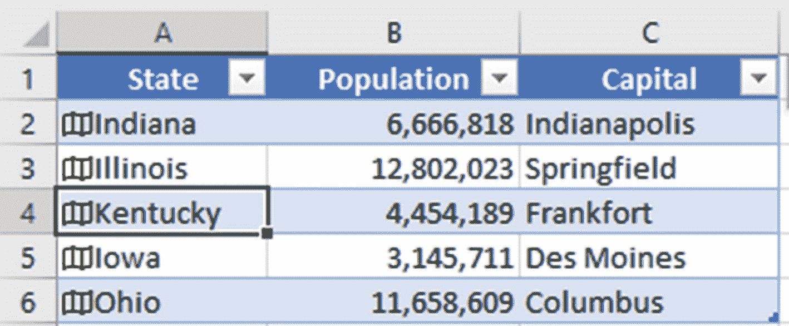

**图 16-14** 每个州的首府

如果添加另一个州，它会自动采用地理数据类型。当在第 7 行输入田纳西州时，它会被自动分配地理数据类型，并且任何列的数据都会被自动填充。见图 16-15。

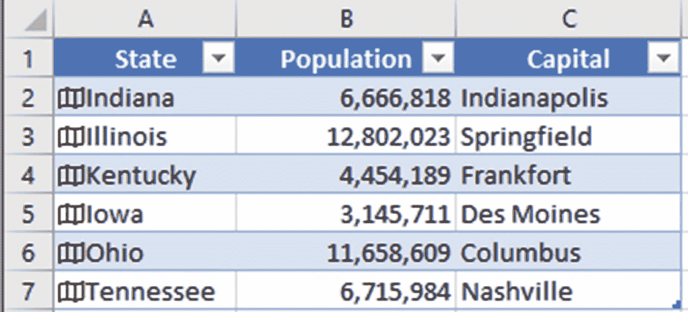

**图 16-15** 田纳西州的数据被自动添加

如果将单元格`A7`中的文本从田纳西州改为密苏里州，所有数据列都会自动更改，以反映密苏里州的数据。

假设你想获取一些城市、州和国家的面积和人口数据，如图 16-16 所示。由于你同时使用了城市、州和国家，当你点击`添加列`按钮时，所有这三种类型的字段选项都会显示出来。城市、州和国家都有面积和人口字段，这使得这可能成为现实。

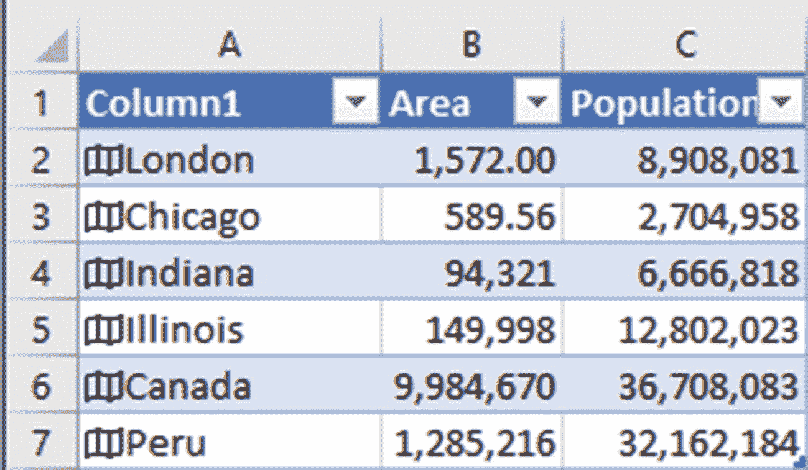

**图 16-16** 城市、州和国家的面积与人口

现在你想了解一些额外的数据，比如`最大城市`和农业用地百分比。当添加这些字段时，某些单元格会出现`#FIELD!`错误。见图 16-17。城市不提供`最大城市`字段，而城市和州不提供`农业用地百分比`字段。如果你使用的地理位置中某个特定字段没有可用数据，也会发生这种情况。这不一定意味着存在错误，只是没有可用的数据而已。

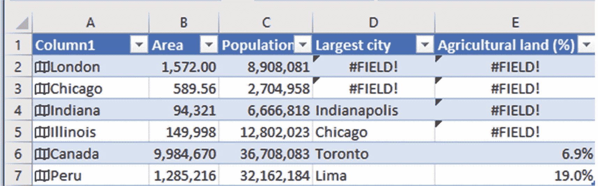

**图 16-17** `#FIELD!` 意味着没有可用数据

当我点击伦敦左侧的地理数据类型图标时，信息卡会显示出来，我可以看到 Excel 假定我想要的是英国伦敦。如果这不是我想要的伦敦呢？右键单击该单元格，然后选择`数据类型`，再点击`更改`。见图 16-18。

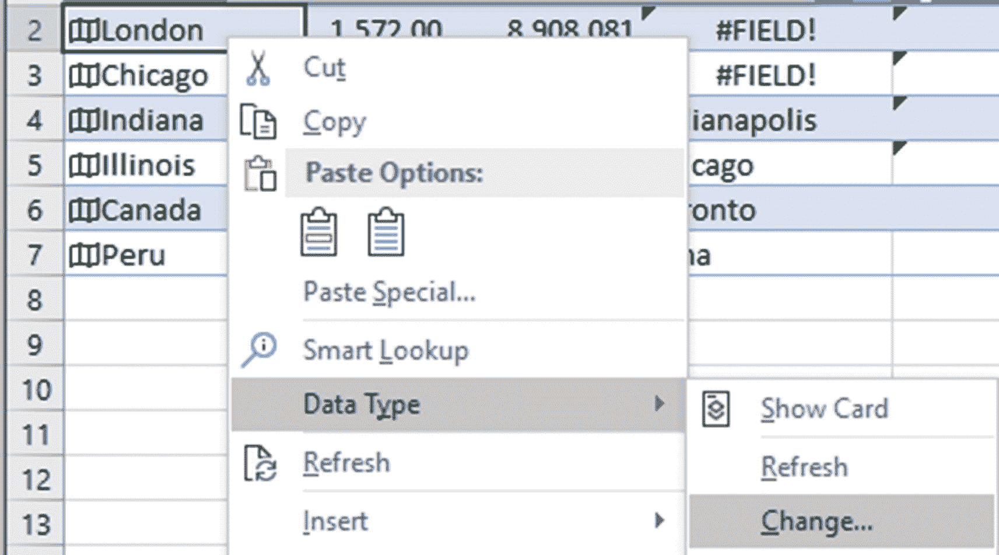

**图 16-18** 更改位置

选择`更改`会调出数据选择器，然后就可以选择另一个伦敦了。

## 在公式中使用地理位置数据

假设我们有以下三列数据，想要知道每个地理位置每平方公里居住的人口数量。在单元格`D2`中，我输入了一个等号，然后点击了单元格`C2`。Excel 会自动填入`[@Population]`来代表该列。接着，我输入了除号，并点击了单元格`B2`。请参见图 16-19。

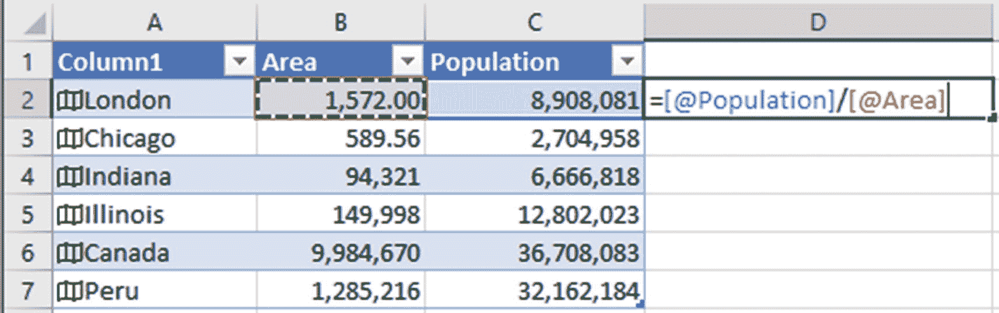

**图 16-19** 使用数据类型数据创建公式

现在，当我按下 `Enter` 键时，Excel 会为所有位置填充数据。我输入了这一列的标题。请参见图 16-20。

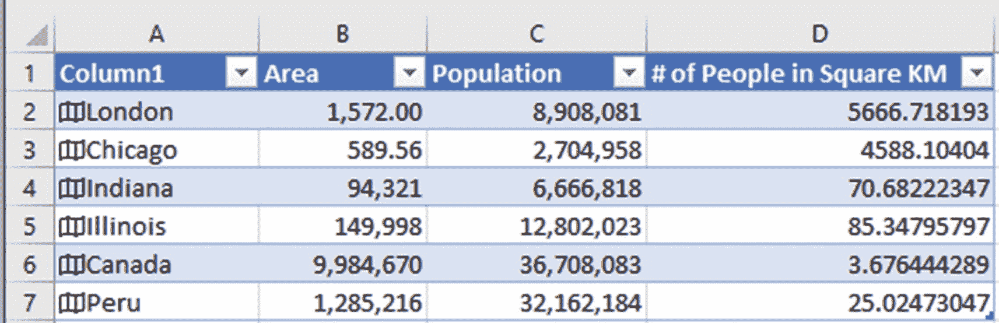

**图 16-20** 在公式中使用数据类型数据的结果

## 练习 16-1：使用地理数据类型

### 使用单个数据类型位置

1.  在功能区上的`数据`选项卡中，位于`数据类型`组内，点击`地理`。由于两个都是州名，数据选择器不会显示；Excel 假定您指的是州。
2.  在单元格`A4`中输入`肯塔基`。
3.  点击单元格`A2`中的`地理数据类型`图标。印第安纳州的州旗会显示在卡片的顶部。点击`维基百科`字样。您将被带到印第安纳州的维基百科网站。关闭浏览器。再次点击单元格`A2`中的地理图标。点击`更多图片`图标。浏览器会打开，显示印第安纳州的图片。关闭浏览器。
4.  点击三个州中任意一个州的`地理数据类型`图标。选择哪一个州并不重要。点击`人口`。然后点击右侧的`提取`图标。三个州的人口数据连同标题会被添加进来。调整列宽，以便您能看到所有数据。
5.  点击表格中的任一单元格。点击`人口`标题右侧的`添加列`图标。点击`家庭收入中位数`。
6.  点击`添加列`图标。点击`租金中位数`。
7.  点击`添加列`图标。点击`人口：65 岁以上 (%)`。
8.  选中单元格`D2`。右键单击选中的单元格，然后选择`清除内容`。

### 在表格中使用数据类型位置

在单元格`A1`中输入`州`。在单元格`A2`中输入`印第安纳州`。在单元格`A3`中输入`伊利诺伊州`，然后按下 `Ctrl + Enter`。光标仍停留在单元格`A3`中时，点击功能区的`开始`选项卡。在`样式`组中，点击`套用表格格式`命令。在`中等深浅`组的第一行，点击第二个表格样式。确保勾选`表包含标题`复选框，然后点击`确定`按钮。请参见图 16-23。

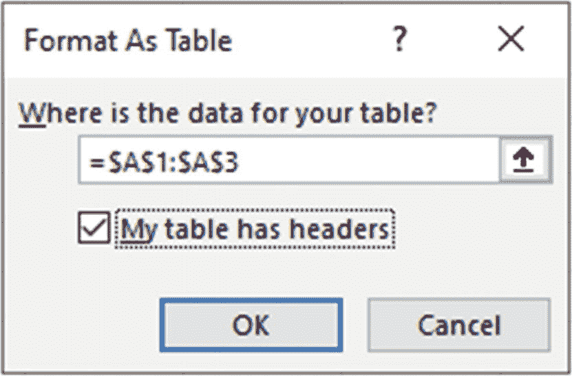

**图 16-23** 带标题的“套用表格格式”

# 地理和股票数据类型

### 添加和更改地理数据类型

1.  点击印第安纳县内的印第安纳镇（注意不是它下方的`选择`）。您会看到与该镇相关的数据。向下滚动到底部。您应该会看到对该镇的描述。这可以帮助您确认正在查看的内容。点击返回箭头返回。现在，点击印第安纳县内印第安纳镇下方的`选择`。`地理数据类型`图标会出现在单元格中。点击该图标。向下滚动直到看到`人口`。将光标移至`人口`上。点击右侧的图标。人口数据会显示在单元格`E2`中。
2.  假设您原本并不想获取镇的数据，而是想要获取县的数据。右键单击单元格`D2`，选择`数据类型`，然后点击`更改`。现在，点击该县下方的`选择`。注意观察，人口数字发生了变化，显示的是该县的人口数据。
3.  选中单元格`D2`和`E2`。右键单击选中的单元格，然后选择`清除内容`。

在单元格`D3`中输入`Indiana`。在功能区“数据”选项卡的“数据类型”组中，点击“地理”。在数据选择器中，输入`Indiana State`。通过添加`State`一词，消除了歧义，数据选择器将仅显示一个结果。参见图 16-22。

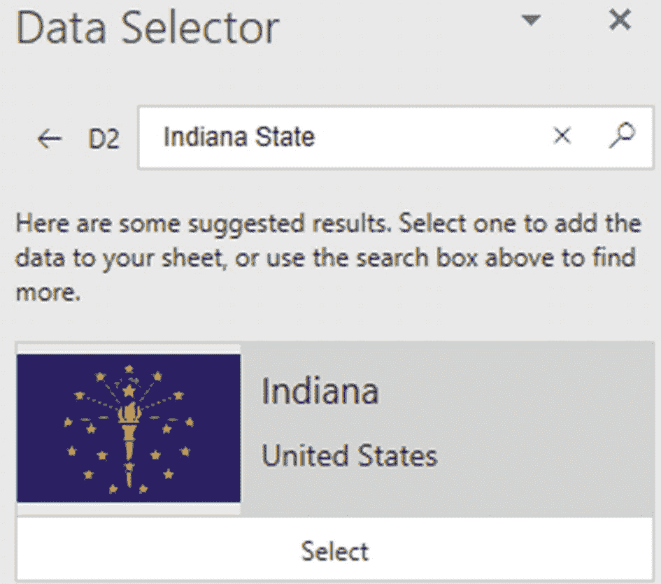

图 16-22：筛选数据选择器结果

只有一个`Indiana State`，也只有一个`Indiana County`，因此如果您输入`Indiana County`，它也只会显示一个结果。

4.  创建一个新工作簿。在单元格`D2`中输入`Indiana`，然后按`Ctrl + Enter`。在功能区“数据”选项卡的“数据类型”组中，点击“地理”。点击单元格`D2`中的“地理数据类型”图标。数据选择器将出现在电子表格右侧。在宾夕法尼亚州，有一个名为`Indiana`的城镇、县和镇区。参见图 16-21。

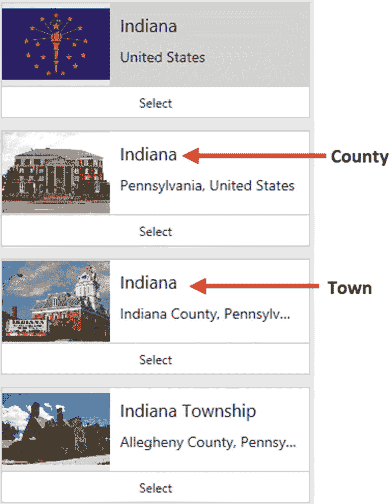

图 16-21：`Indiana`的数据选择器

### 添加和更改数据类型

1.  在单元格`A5`中输入`Michigan`。在单元格`A6`中输入`Ohio`。您为其他州选择的状态数据会自动填充到`Michigan`和`Ohio`中。
2.  将单元格`A5`中的`Michigan`更改为`Iowa`。数据会自动更新以反映状态更改。
3.  在单元格`F1`中输入`65 and Over`。选择单元格区域`C1:F1`。在功能区“开始”选项卡的“对齐”组中，点击“自动换行”。加宽各列，以确保您能看到所有数据。

### 在公式中使用数据类型数据

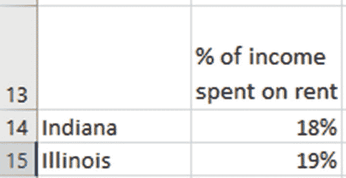

图 16-27：计算租金占收入百分比的结果公式

1.  按`Ctrl + Enter`。
2.  在功能区“开始”选项卡的“数字”组中，点击`%`。将自动填充柄向下拖动到`B15`。参见图 16-27。
3.  双击`Median gross rent`以选中它。
4.  输入`* 12`（这是月租金，因此需要将其乘以 12 以获得年租金）。
5.  输入除号。
6.  输入`A2`以调出字段选项。
7.  双击`Median household income`。完整的公式如图 16-26 所示。

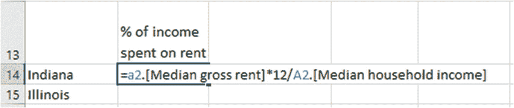

图 16-26：计算租金占收入百分比的公式

1.  在单元格`A14`中输入`Indiana`，在单元格`A15`中输入`Illinois`。在单元格`B13`中输入`% of Income Spent on Rent`。对单元格`B13`应用“自动换行”。
2.  在单元格`B14`中输入一个`=`号。您可以点击单元格`A2`或输入其单元格地址。当您这样做时，您将获得该州的所有字段选项。参见图 16-25。

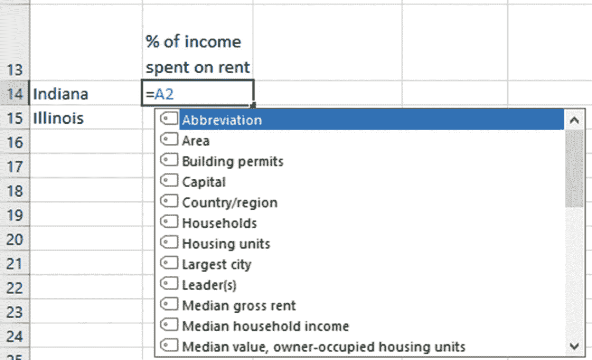

图 16-25：在公式中使用可用的数据类型字段

1.  您已经有了 65 岁以上人口的百分比，但没有 65 岁以上人口的具体数量。您可以自行计算。在单元格`F2`中，输入`=`号以开始公式。点击单元格`B2`。输入`*`号进行乘法运算。点击单元格`E2`。按`Enter`键。
2.  选择单元格区域`F2:F6`。在功能区“开始”选项卡的“数字”组中，点击逗号样式。参见图 16-24。

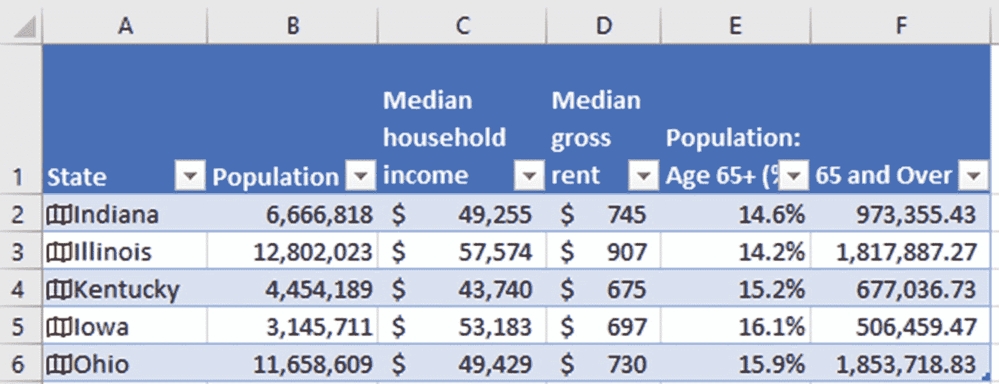

图 16-24：使用逗号格式计算的“65 岁及以上”字段

假设您想了解在`Indiana`和`Illinois`州，家庭收入中用于租金的中位数百分比。您无需创建新的“地理”数据类型，因为您可以使用已创建的数据类型。

### 格式化数据类型数据

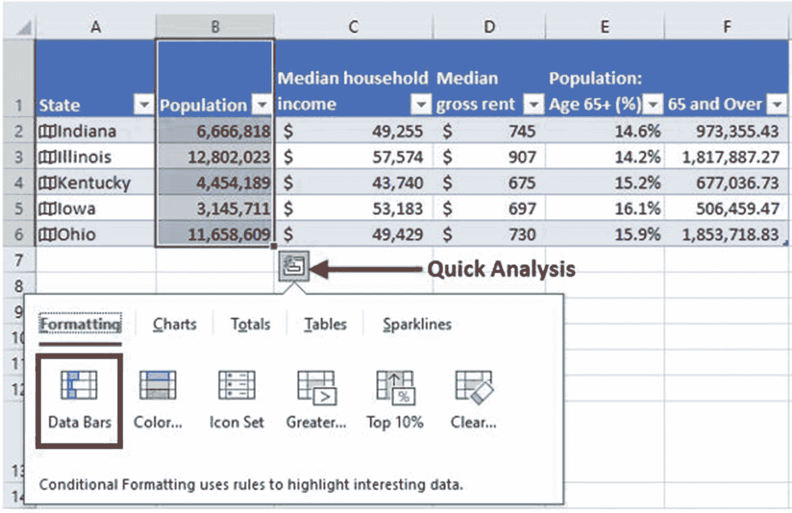

图 16-28：为“人口”创建数据条

1.  选择单元格区域`B1:B6`。点击快速分析图标。
2.  点击“数据条”。参见图 16-28。

### 在地图中使用数据类型数据

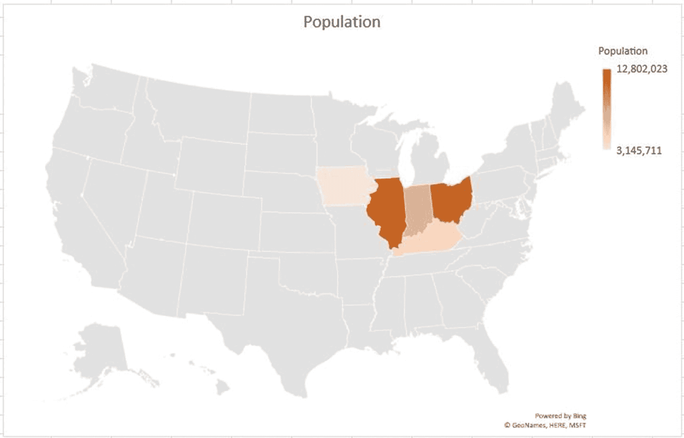

图 16-29：各州人口地图

1.  选择单元格区域`A1:B6`。
2.  在功能区“插入”选项卡的“图表”组中，点击“地图”。
3.  点击“填充地图”。
4.  点击“图表标题”。输入`Population`。
5.  图表有两个上下文菜单：“设计”和“格式”，位于“图表工具”下。点击“设计”选项卡。在“图表样式”组中，点击“更改颜色”。选择您想要的颜色。进行任何其他您想要的更改。参见图 16-29。

Excel 的“地理”数据类型可用于通过选择包含国家、省份、地区、州、县、城市和城镇相关数据的字段，将数据输入到单元格中。既然您已熟悉“地理”数据类型，您可以将同样的技能应用于“股票”数据类型。

## 股票

Excel 的股票数据类型与地理数据类型的工作方式相同。为了从股票数据类型中获取信息，您需要输入股票的代码、公司名称或基金名称。

股票的选项与基金的选项有所不同。我们先来看看输入公司名称的结果。如果您在单元格中输入 `Adobe`，公司名称左侧会出现一个问号，并且电子表格右侧会出现`数据选择器`，因为有许多不同的 `Adobe` 选项。第一个 `Adobe` 选项显示，该股票在纳斯达克证券交易所上市，其股票代码为 `ADBE`。请参见图 16‑30。与地理数据类型一样，您可以点击信息以查看数据卡，或点击`选择`来接受。

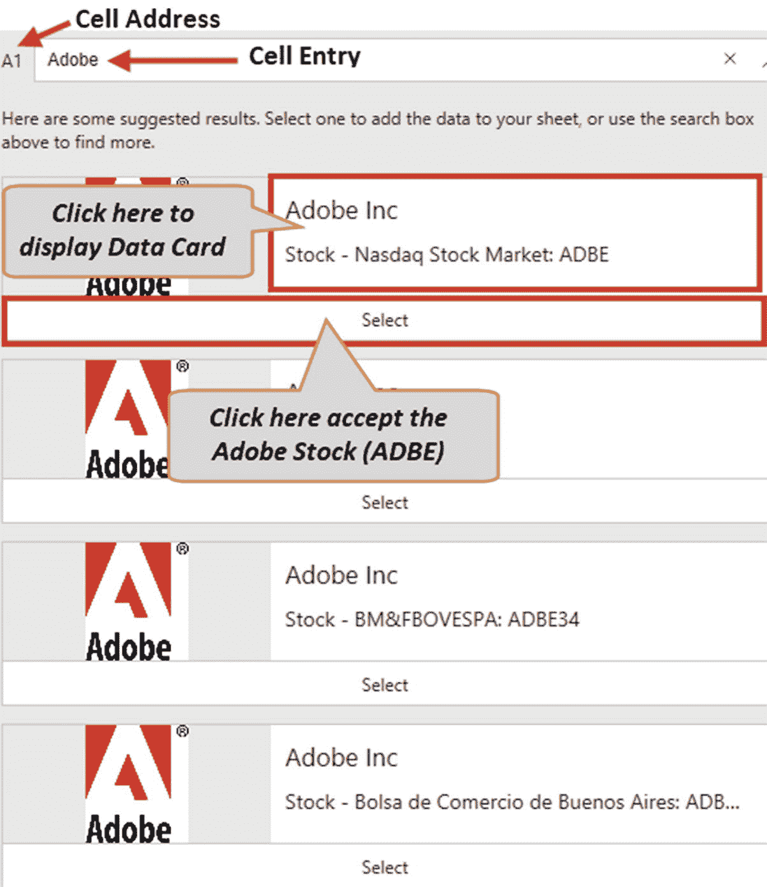

图 16‑30 使用 Adobe 进行数据选择

当您点击`选择`时，公司名称左侧会出现股票数据类型图标，而公司名称右侧会显示交易所的缩写和股票代码。请参见图 16‑31。

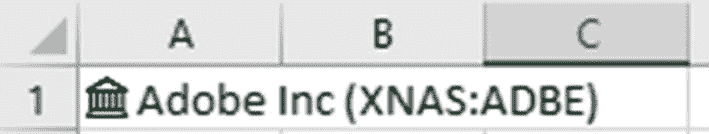

图 16‑31 添加到单元格中的股票数据类型图标和股票代码

如果您知道股票代码，则应该输入它而不是公司名称。这可能会缩小`数据选择器`中显示的选项数量。它甚至可能将数量限制为一个，在这种情况下，Excel 将确切知道您指的是哪只股票或基金；因此，它不会在单元格中输入问号，也不会显示`数据选择器`。有三个股票代码为 `ADBE` 的股票，因为它们位于三个不同的证券交易所：一个在纳斯达克交易所，一个在瑞士交易所，另一个在奥地利维也纳的维也纳证券交易所。请参见图 16‑32。

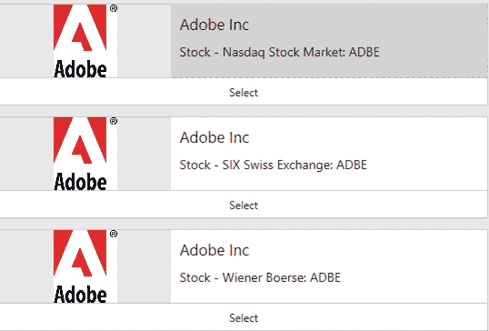
图 16‑32 三只具有相同股票代码的股票

Adobe 的数据卡会显示其公司徽标，但其他公司的数据卡可能不会。大多数公司数据卡会显示“维基百科”字样，并且在其公司徽标上带有一个图像图标。请参见图 16‑33。点击“维基百科”字样会显示该公司在维基百科中的信息。点击图像图标则会显示该公司的图像。

图 16‑33 指向公司信息和图像的链接

如果您将共同基金设为股票数据类型，您看到的字段将与股票的字段不同。共同基金有评级选项以及过去一周、一个月、三个月、一年、三年、五年和年初至今的回报率选项。请参见图 16‑34。

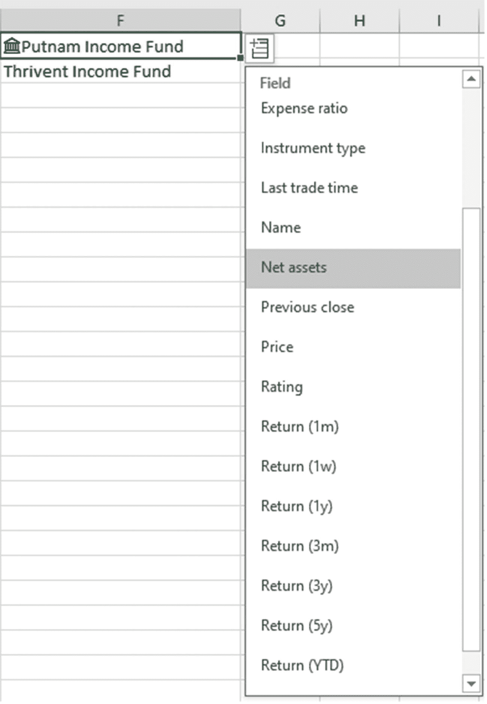
图 16‑34 共同基金字段

我们先从一个表格中的一些公司名称开始。请参见图 16‑35。

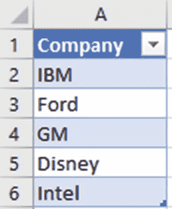
图 16‑35 表格中的公司名称

我首先要选中这些公司名称，然后在功能区“数据”选项卡的“数据类型”组中点击`股票`。这样做会将缩写的公司名称更改为其全称，并添加股票代码。请参见图 16‑36。Excel 无法确定 Ford 应使用什么，因此在其名称左侧放置了一个问号。

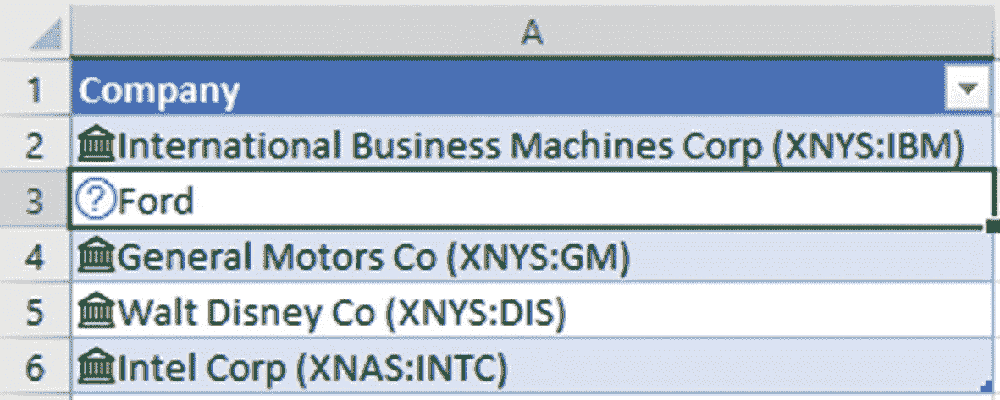
图 16‑36 带有股票代码的全称

点击问号会显示`数据选择器`。我将从纽约证券交易所 `F` 中选择 Ford。现在，我们可以通过点击`添加列`按钮开始选择我们的数据类型字段选项。请参见图 16‑37。

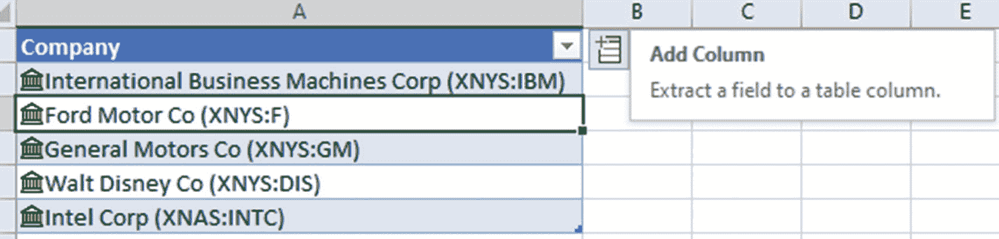
图 16‑37 点击`添加列`按钮添加字段

图 16‑38 显示了对价格、前收盘价、52 周最高价、52 周最低价、涨跌额和涨跌幅所做的字段选择。“涨跌额”和“涨跌幅”列中的某些值位于括号内。括号内的值是负值。

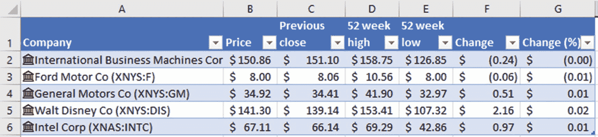
图 16‑38 点击`添加列`按钮后所做的字段选择

现在，我们可以进行一些计算，以计算每只股票的当前价值、我们股票的总现值、每只股票的盈亏额以及当日总盈亏。我们可以将这些计算放在表格的末尾，但让我们将它们放在从单元格 `A11` 开始的单独区域中。在前两列中，我们有公司名称以及我们在这些公司中拥有的股票数量。请参见图 16‑39。

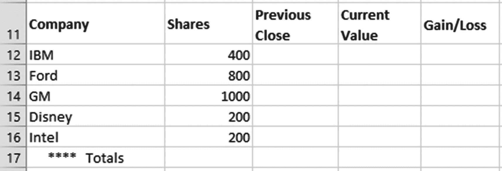
图 16‑39 进行股票计算的相关设置

我们的第一个计算将是确定每只股票在前收盘价时的价值。我们将以等号开始单元格 `C12` 中的公式，然后点击单元格 `C2`。我们将添加乘号，然后点击单元格 `B12`。请参见图 16‑40。

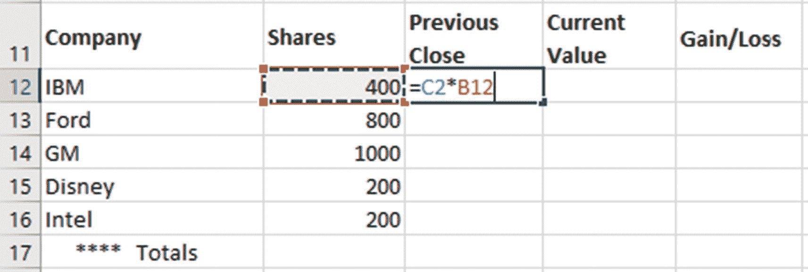
图 16‑40 用于计算前收盘价时股票价值的公式

我们将向下拖动`自动填充柄`，以计算其他公司的前收盘价。请参见图 16‑41。

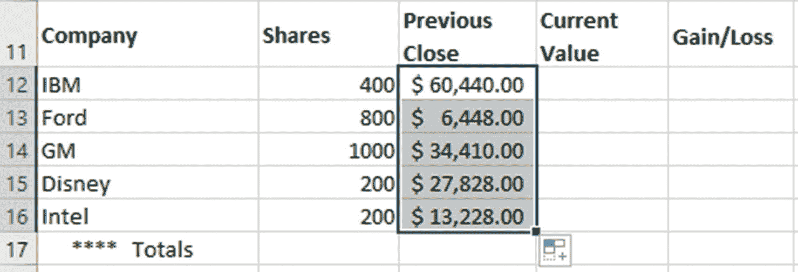
图 16‑41 向下拖动自动填充柄将公式复制到其他股票

当前价值是价格乘以股票数量，因此我们将在单元格 `D12` 中输入公式 `=B2*B12`。然后我们将`自动填充柄`向下拖动到单元格 `D16`。

盈亏额是涨跌额乘以股票数量，因此我们将在单元格 `E12` 中输入公式 `=F2*B12`。然后我们将`自动填充柄`向下拖动到单元格 `E16`。结果显示在图 16‑42 中。

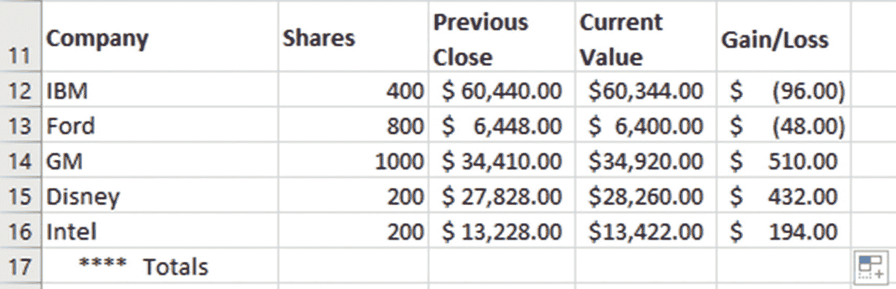
图 16‑42 前收盘价、当前价值和盈亏额的结果

现在可以通过选择区域 `B17:E17`，然后在“开始”选项卡上点击`自动求和`来添加总计。对总计应用格式后，结果如图 16‑43 所示。我们可以看到当日收益为 992 美元。

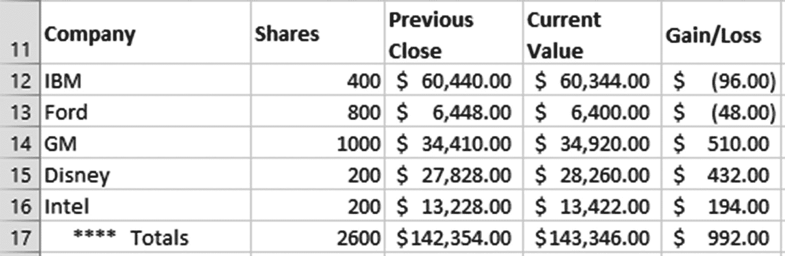
图 16‑43 `AutoSum` 用于计算第 17 行中的合计

股票期权表中的值并非静态。如果股市开盘，部分值（如价格、美元变动额和百分比变动额）会在一天中发生变化。如果股市开盘，可以刷新数据以获取当前值（存在 15 分钟延迟）。要更新数据，请单击功能区中的“数据”选项卡，然后在“查询和连接”组中单击`Refresh All`（全部刷新）。当表中的值更新后，任何使用该数据的计算结果也会随之更新。

图 16-44 显示了在输入表格后的第二天单击`Refresh All`（全部刷新）的结果。

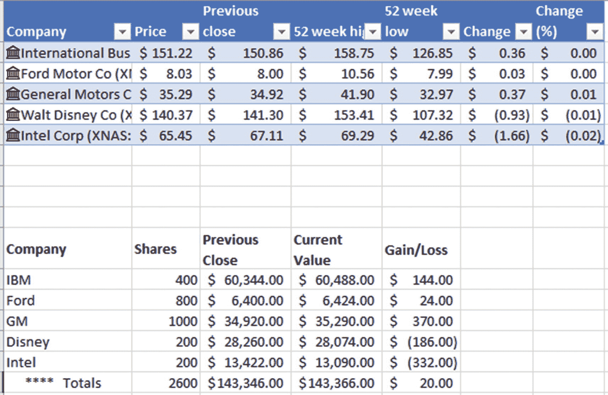
图 16-44 单击`Refresh All`（全部刷新）后自动更新的股票值

## 练习 16-2：使用股票数据类型

### 创建共同基金表

在此练习中，你将使用“股票”数据类型创建一个共同基金数据表。

1.  单击功能区中的“数据类型”选项卡，然后在“数据类型”组中单击`Stocks`（股票）。股票代码将转换为共同基金名称，并且股票数据类型符号会出现在基金名称的左侧。

2.  单击表格右上角出现的“添加列”按钮。选择`Return (1y)`（1 年回报率）。再次单击“添加列”按钮并选择`Return (3y)`（3 年回报率）。再单击一次“添加列”按钮并选择`Return (5y)`（5 年回报率）。

3.  你需要应用“自动换行”以使列标题可读。选中单元格区域`A1:E1`（你稍后将向 E 列添加数据）。右键单击选中的其中一个单元格，选择“设置单元格格式”。在“设置单元格格式”窗口中，单击“对齐”选项卡并选择“自动换行”。单击“确定”按钮。见图 16-47。

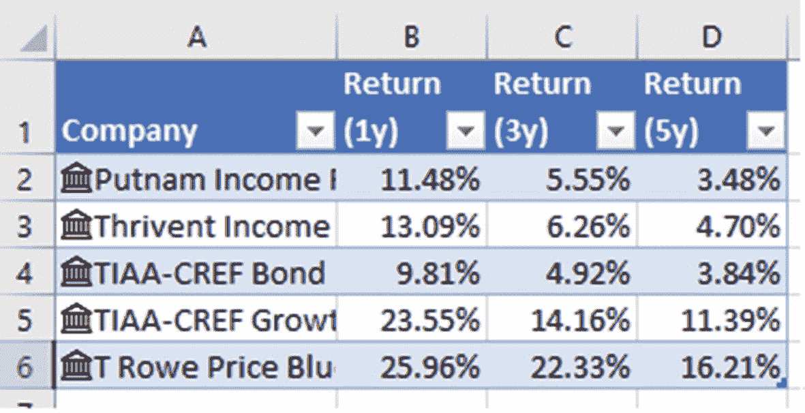
图 16-47 转换为股票数据类型、添加字段并设置标题文本自动换行

4.  选择单元格区域`A1:A6`，然后单击“快速分析”按钮。选择“表格”选项卡，然后单击“表格”图标。见图 16-46。

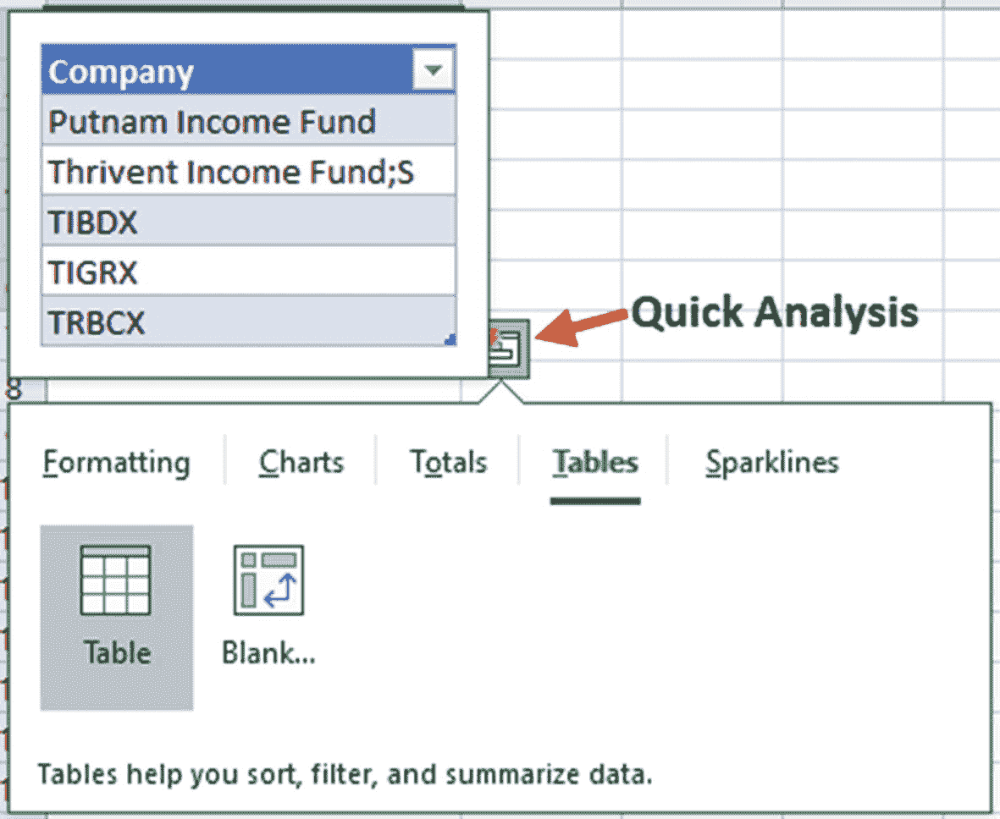
图 16-46 将数据转换为表格

5.  创建一个新工作表。

6.  输入包含共同基金名称或其股票代码的以下数据。将标题行中的“公司”加粗。见图 16-45。

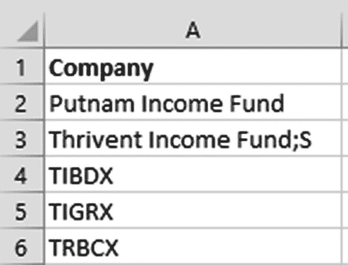
图 16-45 在工作表中输入此数据

### 创建计算

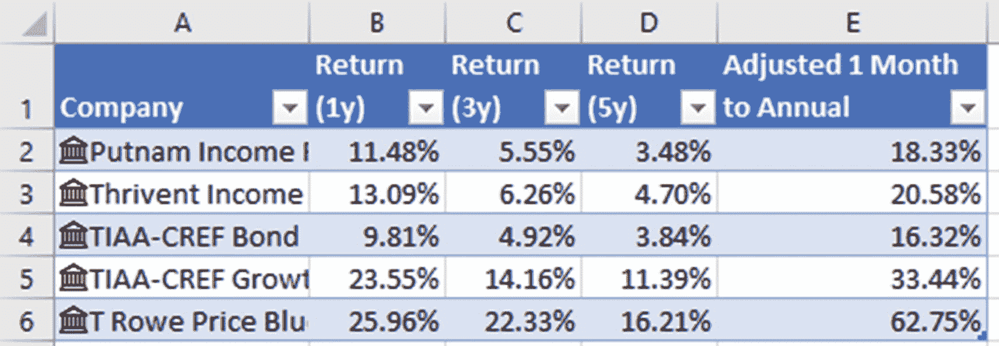
图 16-49 E 列包含向下复制的公式并添加了标题

7. 按`Enter`键，其他共同基金的数据将自动填充。你可以看到本月表现良好。如果该基金能在全年保持此收益率，那么 T Rowe Price Blue Chip 基金全年将实现 62.75%的增长。将`E`列的列标题更改为“调整后月度收益年化”。见图 16-49。

8. 有一个 1 个月期的回报选项。假设你想知道如果全年都保持相同的回报率，年化收益是多少。在单元格`E2`中输入等号（`=`）。单击单元格`A2`中的股票数据类型符号。双击`Return (1m)`（1 个月回报率）。输入星号（`*`）进行乘法运算，然后输入`12`。你的公式应如图 16-48 所示。

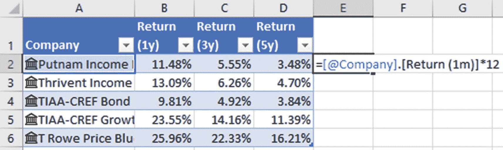

图 16-48

基于当前 1 个月回报率的年化回报率计算公式

> **注意：**
>
> 你可以通过右键单击单元格，然后选择`数据类型` > `转换为文本`来将数据类型更改回文本。仅当你希望拥有静态数据时才执行此操作。如果执行此操作，你将移除与数据的在线连接。你将无法刷新数据，并且包含使用该数据公式的单元格将显示`#FIELD!`错误。

## 总结

微软创建了两种新的数据类型：`地理`和`股票`，未来可能还会有更多数据类型。`地理`数据类型包含有关国家、省、地区、州、县、市和城镇的字段数据。`股票`数据类型包含有关股票、债券和共同基金的字段数据。这两种数据类型的工作方式相同。你可以从选项列表中仅显示所需数据，或者将数据用于公式。如果 Excel 无法识别你输入的地理位置或股票，单元格中会出现一个问号，并且`数据选择器`将显示一条消息，提示未找到该位置的结果。如果存在多个同名的位置或股票，单元格中也会出现一个问号。此时，你必须选择你所指的地理位置或股票。在`数据选择器`中单击某个位置，或单击单元格中的数据类型图标，将显示一个`数据卡片`，其中不仅包含可用数据的类型，还包括数据本身。`添加列`功能显示可用数据的类型，但不显示数据本身。你可以通过单击包含数据类型的单元格并选择要使用的字段选项，来创建使用数据类型的公式。

