# 12. 使用表格

表格是由标题行和多行数据行组成的数据集合。它用于包含单一类型的数据，例如订单、销售额、库存等。表格使筛选、排序、分析、汇总和格式化数据变得更加容易。

阅读并完成本章学习后，您应该能够：

*   创建和格式化表格
*   对表格进行排序和筛选
*   向表格添加数据
*   调整表格大小
*   向表格添加计算字段
*   创建切片器
*   应用主题
*   应用样式
*   创建条件格式

您可以从多个表格中提取数据来创建另一个表格。表格中的数据可以与工作表中的其他数据分开保存。您可以将现有的单元格区域格式化为表格。如果您不再希望数据以表格格式存在，也可以将其转换回普通区域。

本章最后一部分介绍条件格式。条件格式允许您根据单元格值应用格式或显示图标，从而提高数据的可读性。例如，如果单元格值小于 0，则列中的数据可以显示为粗体红色；如果值在 0 到 1000 之间，则显示为蓝色；如果值大于 1000，则显示为绿色。您可以决定数据的格式化方式，并为这些格式创建规则。

## 创建和格式化表格

创建和格式化表格的过程非常简单。选中你想要制成表格的数据，然后挑选一种你喜欢的格式即可。仅此而已。

在工作表上，你通过点击`套用表格格式`按钮，就能将选中的数据格式化为表格。`套用表格格式`按钮位于`开始`选项卡下的`样式`组中。点击该按钮会弹出一个样式库供你选择，如图 12-1 所示。这个样式库分为“浅色”、“中等深浅”和“深色”三类。有些样式带有彩色列标题；有些有单元格边框，有些没有；有些每隔一行使用不同颜色，有些则没有。如果你不喜欢 Excel 提供的任何一种样式，你还可以创建自己的样式。

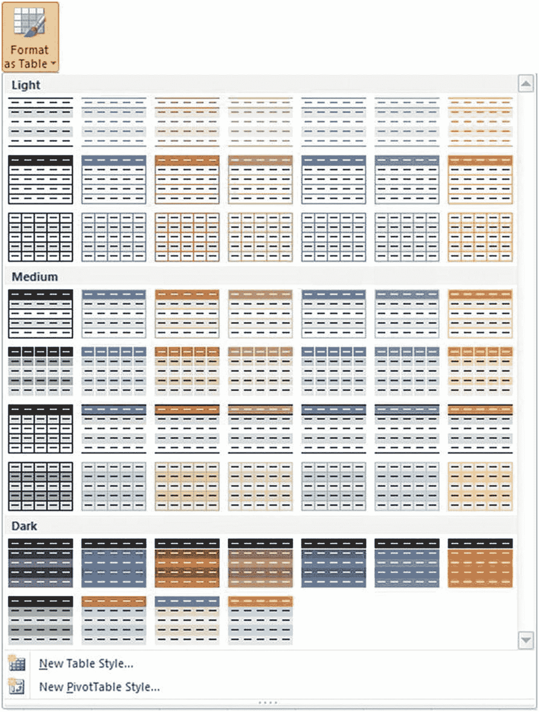

图 12-1

样式库。选择你想要用于格式化表格的样式

当你选择一种样式后，Excel 会弹出`套用表格格式`对话框。如果你之前还没有选中要作为表格的单元格，此时可以选中。如果你选中的数据包含标题，请确保选中`表包含标题`复选框。见图 12-2。

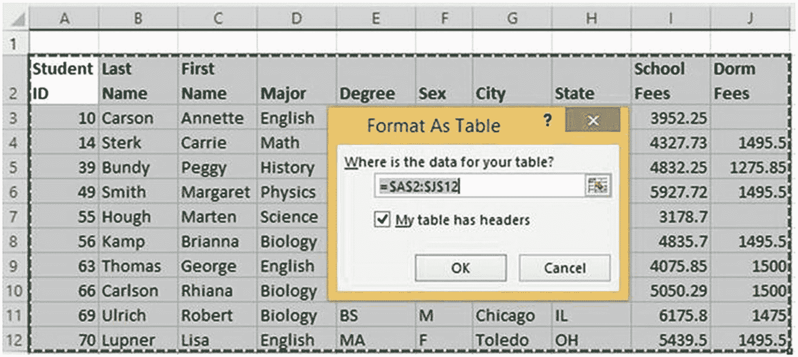

图 12-2

选择你想要变成表格的单元格。如果包含标题，请确保选中`表包含标题`

## 对表格进行排序和筛选

表格在每个列标题的右侧会显示一个下拉箭头。点击其中一个下拉箭头会弹出该列的排序和筛选选项，如图 12-3 所示。

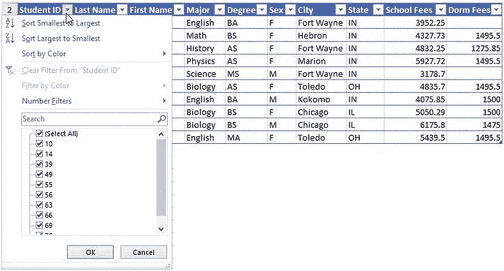

图 12-3

选择标题右侧的下拉箭头以选择筛选器

列中出现的每个唯一值都会显示出来。如果一列中有重复值，它们不会在列表中重复出现。

移除某个值前面的复选框勾选标记，将会阻止包含该值的行显示。如果你移除了多个勾选标记，可以通过选择`(全选)`快速重新选中所有值。如果你只想选择少量项目进行筛选，可以取消勾选`(全选)`，然后仅点击你想包含在表格中的项目。

筛选操作不会重新排列或更改你的数据；它只是临时隐藏那些不符合你指定条件的行。移除筛选后，表格将恢复到应用筛选之前的状态。

已应用筛选的列很容易识别，因为其下拉箭头按钮会变为筛选按钮。当你将光标悬停在筛选按钮上时，Excel 会显示一个工具提示，说明当前筛选的内容。

## 向 Excel 表格添加数据

你可以通过在表格最后一条记录的下方行中直接输入，向表格添加额外记录。当你按下`Enter`键完成记录输入后，它就会自动成为表格的一部分。你也可以通过在最右侧列的右侧输入新列，以类似方式添加新列。另外，你还可以拖动位于表格右下角的表格扩展柄来扩展表格，使其包含更多行或列。然后你就可以在扩展区域中输入额外数据。你也可以在表格中的任意位置插入行或列。如果插入新列，该列的标题将被命名为`列`。双击列标题，可以将其更改为你想要的名称。

通过执行以下步骤，可以停止表格的自动扩展：

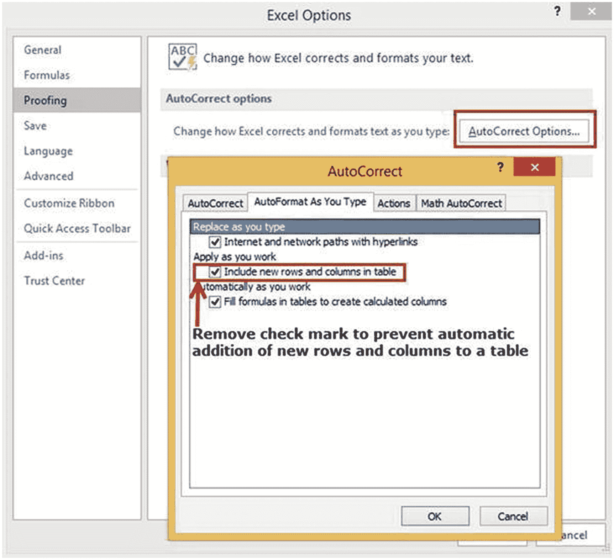

图 12-4

取消勾选`在表格中包括新行和列`

1.  点击`文件` ➤ `选项`。
2.  在左侧窗格中点击`校对`。
3.  在右侧窗格中点击`自动更正选项`按钮。
4.  点击`键入时自动套用格式`选项卡。
5.  取消勾选`工作中自动将新行和列包含在表格中`。见图 12-4。
6.  点击`确定`。
7.  点击`确定`。

## 练习 12-1：创建和使用表格

在本练习中，你将创建一个表格，然后对不同的列应用筛选，以便只查看你感兴趣的数据。

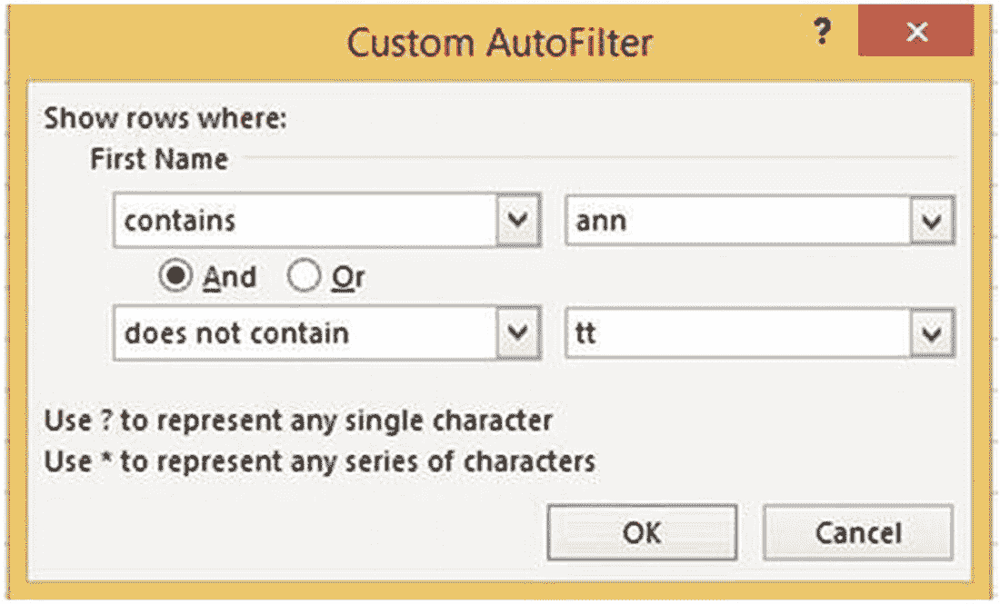

图 12-13

筛选“名”包含`ann`但不包含字母`tt`的记录

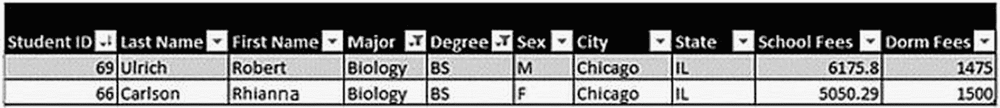

图 12-12

对“专业”筛选为“生物学”且“学位”筛选为“理学学士”的结果

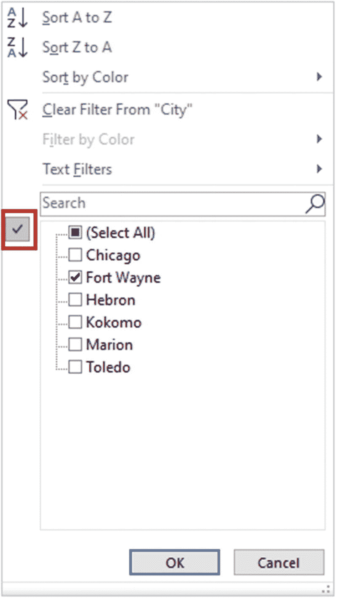

图 12-11

高亮显示的勾选标记表示该字段当前正被筛选

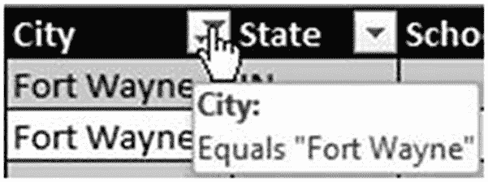

图 12-10

将光标移到筛选图标上以查看工具提示

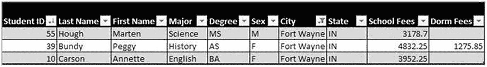

图 12-9

“城市”列已筛选为仅显示城市是“韦恩堡”的记录

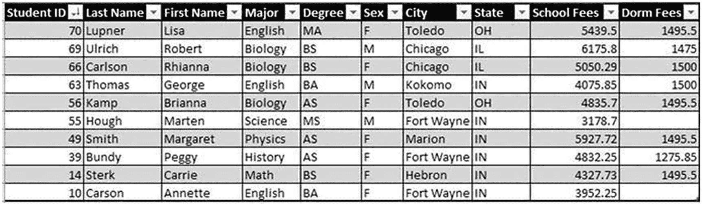

图 12-8

表格已排序，使得最高的学生 ID 显示在最前面

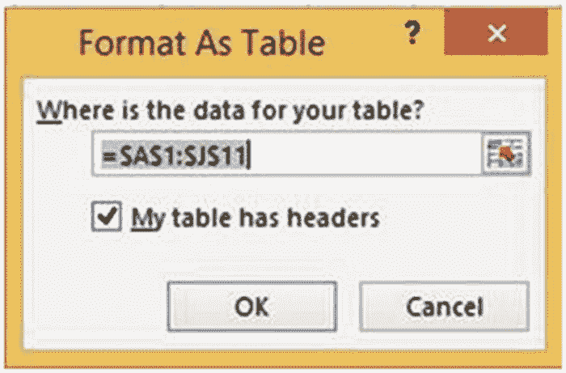

图 12-7

选择`表包含标题`

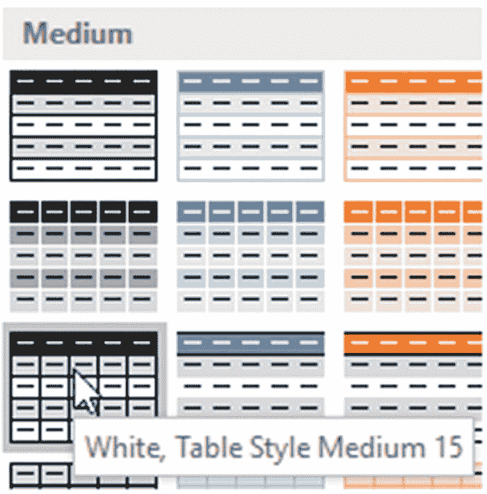

图 12-6

选择`表样式中等深浅 15`

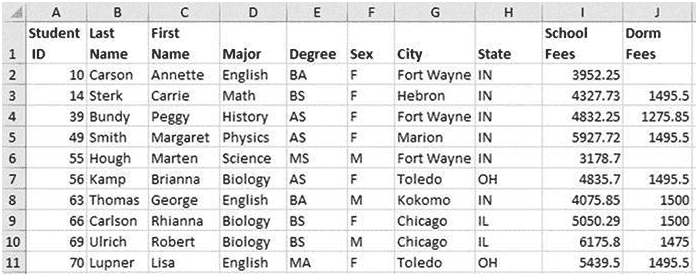

图 12-5

工作表“Students”上的数据

1.  点击“专业”右侧的`筛选`按钮。点击`从“专业”中清除筛选`。
2.  点击“学位”右侧的`筛选`按钮。点击`从“学位”中清除筛选`。
3.  让我们找出名字中包含`ann`但不包含字母`tt`的学生：
    1.  点击“名”右侧的下拉箭头。
    2.  选择`文本筛选`，然后点击`自定义筛选`。
    3.  点击第一个下拉框的下拉箭头，选择`包含`。
    4.  按`Tab`键，在下一个框中输入`ann`。
    5.  按`Tab`键。选择`与`。
    6.  点击下一个框的下拉箭头，选择`不包含`。

7.  按下`Tab`键。在框中输入`tt`。参见图 12-13。

8.  点击`OK`按钮。

1.  点击`Degree`右侧的下拉箭头。仅选择`BS`。点击`OK`按钮。两个按钮上均应出现筛选图标。仅显示同时满足这两个条件的记录。参见图 12-12。

1.  点击`Clear Filter from “City.”`。此时将显示所有数据。

2.  让我们仅查看攻读生物学专业学士学位的学生：
    1.  点击`Major`右侧的下拉箭头。

2.  取消勾选`(Select All)`。

3.  仅选择`Biology`。

4.  点击`OK`按钮。

1.  点击`City`右侧的`Filter`按钮。列数据的左侧会出现一个高亮显示的对勾标记。参见图 12-11。这表示该列正根据其一个或多个值进行筛选。

1.  `City`右侧的按钮现在显示一个筛选图标，以便我们轻松识别该列正在被筛选。将光标悬停在筛选图标上。工具提示会显示应用于该列的筛选条件。参见图 12-10。

1.  点击`City`右侧的下拉箭头。列表显示`City`列中的所有值。我们的表格很小，但如果该列包含数千个不同的城市，我们可以使用搜索框来查找目标城市。

2.  点击`(Select All)`复选框以取消勾选列表中的所有项目。

3.  选中`Fort Wayne`复选框。

4.  点击`OK`按钮。仅显示城市为`Fort Wayne`的记录。参见图 12-9。

1.  点击`Student ID`右侧的下拉箭头。点击`Sort Largest to Smallest`。表格将重新排列，使得`Student ID`最大的记录显示在最前面。参见图 12-8。

`Student ID`右侧的按钮上已添加了一个向下箭头图标。这表示该列已按从大到小排序。

1.  由于您已选定区域，Excel 只需您确认。由于表格中包含标题，您需要勾选`My table has headers`。参见图 12-7。点击`OK`按钮。

1.  选择单元格区域`A1:J11`。

2.  点击功能区上的`Home`选项卡。点击`Styles`组中的`Format as Table`按钮。

3.  点击`Medium`类别第三行中的第一个样式。这将是`White, Table Style Medium 15`。参见图 12-6。

1.  打开名为`Chapter12`的工作簿。点击名为`Students`的工作表。参见图 12-5。

Rhianna 和 Brianna 的记录被显示出来，因为她们的名字都包含`ann`。Annette 的记录未显示，因为虽然名字中包含`Ann`，但也包含了`tt`。参见图 12-14。

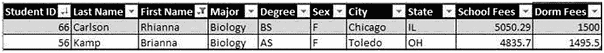

图 12-14：筛选“名字”的结果

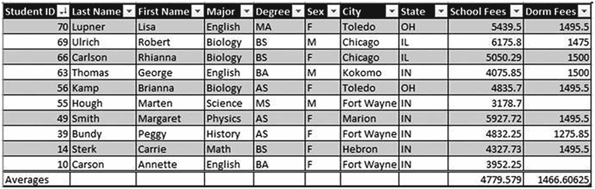

图 12-21：更改为平均值计算的结果

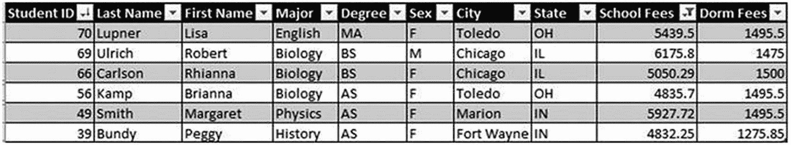

图 12-20：为“学费”选择“高于平均值”的结果

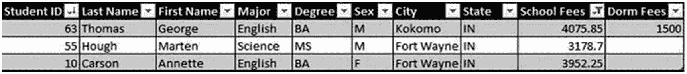

图 12-19：筛选出学费最低的 30% 的结果

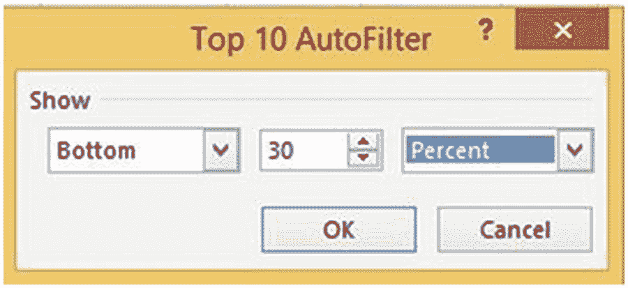

图 12-18：筛选最低 30% 的选项

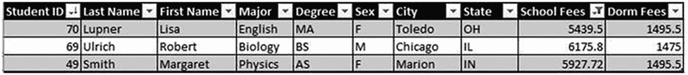

图 12-17：筛选出学费最高的前三名

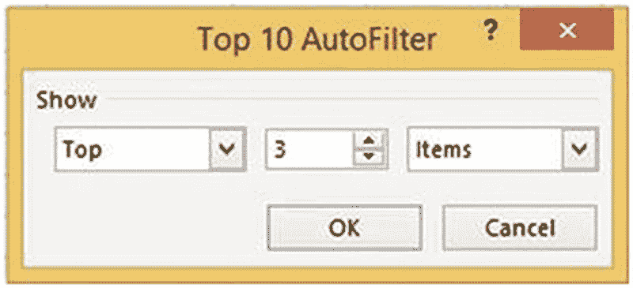

图 12-16：筛选前 3 项的选项

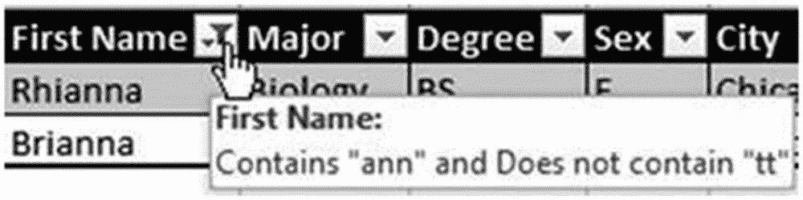

图 12-15：筛选条件的工具提示

1.  点击`School Fees`右侧的`Filter`按钮。点击`Clear Filter from “School Fees.”`

2.  右键点击表格中的任意单元格。在上下文菜单中选择`Table`，然后点击`Totals Row`。

3.  点击`J12`单元格中的总计值。点击该单元格右侧的下拉箭头。选择`Average`。

4.  点击`I12`单元格内部。点击该单元格右侧的下拉箭头。选择`Average`。

5.  将`A12`单元格中的文本从`Total`更改为`Averages`。参见图 12-21。

1.  点击`School Fees`右侧的`Filter`按钮。点击`Clear Filter from “School Fees.”`

2.  让我们找出与表中其他学生相比，学费高于平均水平的那些学生。点击`School Fees`右侧的下拉箭头。选择`Number Filters`。点击`Above Average`。图 12-20 显示了结果。

1.  点击`School Fees`右侧的`Filter`按钮。点击`Clear Filter from “School Fees.”`

2.  让我们找出学费最低的那 30%的学生：
    1.  点击`School Fees`右侧的下拉箭头。选择`Number Filters`。

2.  点击`Top 10`。

3.  在第一个框中，选择`Bottom`。在中间的框中，输入`30`。在第三个框中，选择`Percent`。参见图 12-18。

4.  点击`OK`。结果即为图 12-19 所示的最低 30%的学费。

1.  点击`First Name`右侧的`Filter`按钮。点击`Clear Filter from “First Name”`。

2.  让我们找出学费最高的三名学生：
    1.  点击`School Fees`右侧的下拉箭头。

2.  选择`Number Filters`。

3.  点击`Top 10`。您不限于只使用前 10 名。您可以输入想要显示的任意数量。您可以通过从第一个下拉框中选择`Bottom`来从底部选择项目。

4.  输入如图 12-16 所示的数据。

5.  点击`OK`。结果即为图 12-17 所示的学费最高的前三名。

1.  将光标悬停在`First Name`右侧的`Filter`按钮上。工具提示会显示应用于该列的筛选条件。参见图 12-15。

您已经学会了如何通过点击要筛选的列标题右侧的下拉箭头，然后仅选择要查看的值，来筛选表格中的数据。接下来，您将学习使用切片器进行筛选的替代方法。

## 使用切片器筛选数据

除了使用列标题旁的筛选按钮来筛选表格，你还可以创建切片器。切片器虽然无法提供表格筛选按钮的所有选项，但能让你更直观地查看已选中的内容。

**练习 12-2：使用切片器筛选数据**

在本练习中，你将创建两个切片器来筛选表格。

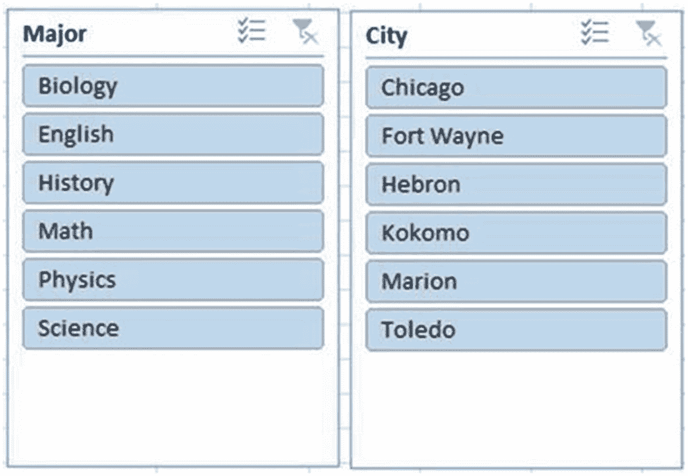

*图 12-23 专业和城市切片器*

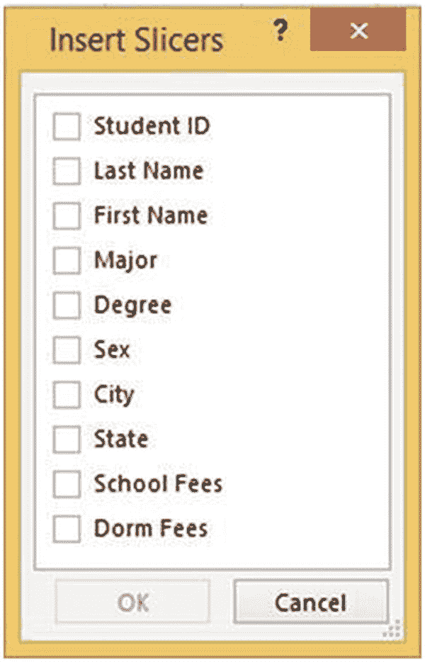

*图 12-22 插入切片器对话框*

1. 在“专业”切片器中单击 `Biology`。Excel 将只显示“生物学”专业的学生。“城市”切片器会高亮显示 `Chicago` 和 `Toledo`，这是因为“生物学”专业的学生来自这两个城市。
2. 在“专业”切片器中，点击右上角的“多选”按钮 ；这将允许你从切片器中选择多个项目。
3. 选择 `English`。这会将“英语”添加到已选中的“生物学”中。“城市”切片器现在会高亮显示 `Chicago`、`Fort Wayne`、`Kokomo` 和 `Toledo`，因为这些城市是“生物学”和“英语”专业学生的来源地。
4. 点击“专业”切片器右上角的“清除筛选器”按钮。
5. 在“城市”切片器中，点击 `Hebron`。将显示 `Carrie Sterk` 的记录。
6. 选择“专业”和“城市”。点击“确定”按钮。参见图 12-23。
7. 继续使用你在练习 12-1 中使用过的工作簿 `Chapter12`。点击表格内的任意位置。
8. 点击“设计”选项卡。在“工具”组中，点击“插入切片器”按钮。这将弹出“插入切片器”对话框。参见图 12-22。

**将表格转换回区域**

1. 右键点击表格中的任意单元格，然后选择“表格”，将表格转换回区域。
2. 点击“转换为区域”。
3. 系统会弹出一个消息框，询问你是否确认要将表格转换为区域。点击“是”按钮。

所有筛选按钮都会从列标题中移除。

你已经学会了如何创建表格、排序、筛选，以及将其转换回区域。接下来，你将学习如何使用现有主题和创建新主题来更改工作簿的外观。你可能希望创建自定义主题，以使你的文档或公司文档具有统一的外观。

## 使用主题

Excel 中的主题由颜色、标题和正文字体以及应用于工作表的图形效果组成。主题位于“页面布局”选项卡的“主题”组中。参见图 12-24。你也可以创建自己的主题。你可以使用主题来美化电子表格的外观，并使其具有统一的外观。例如，你可以为不同的项目应用不同的主题，或者你的公司可能决定始终使用同一个主题。Microsoft Word 和 PowerPoint 具有与 Excel 中相同的可用主题。

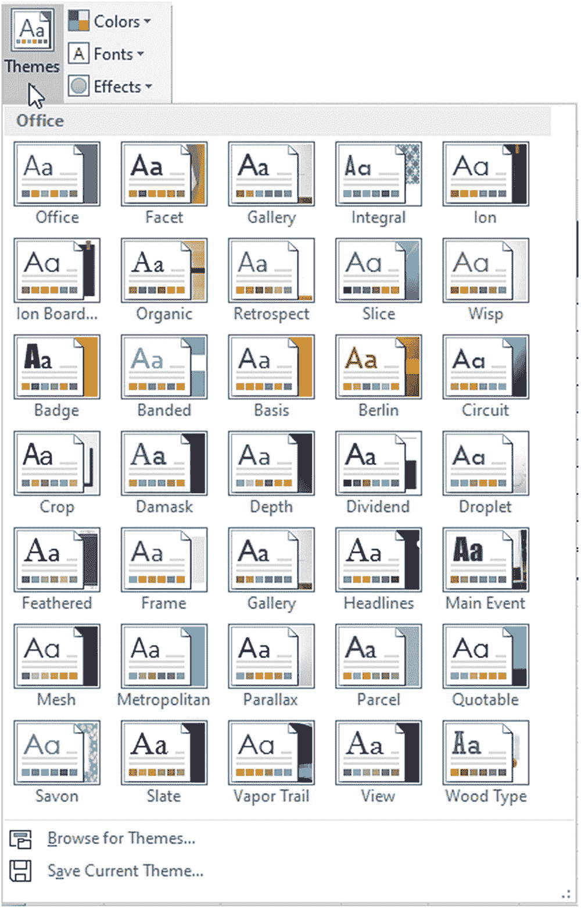

*图 12-24 主题库*

`Office` 是默认主题。

如果你点击“开始”选项卡“字体”组中 `Font`（字体）的下拉箭头，你会看到两个主题字体位于所有其他字体之上。参见图 12-25。

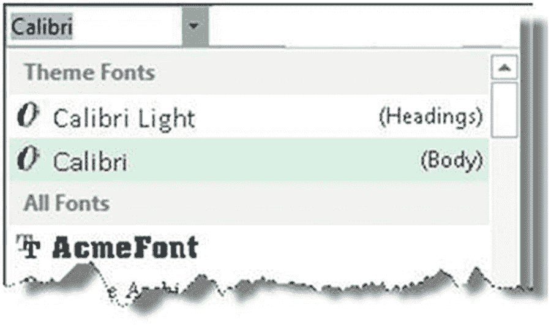

*图 12-25 主题字体是 `Calibri Light` 和 `Calibri`*

**练习 12-3：使用和创建主题**

在本练习中，你将使用现有主题来更改工作簿的外观。你还将创建自己的自定义主题。

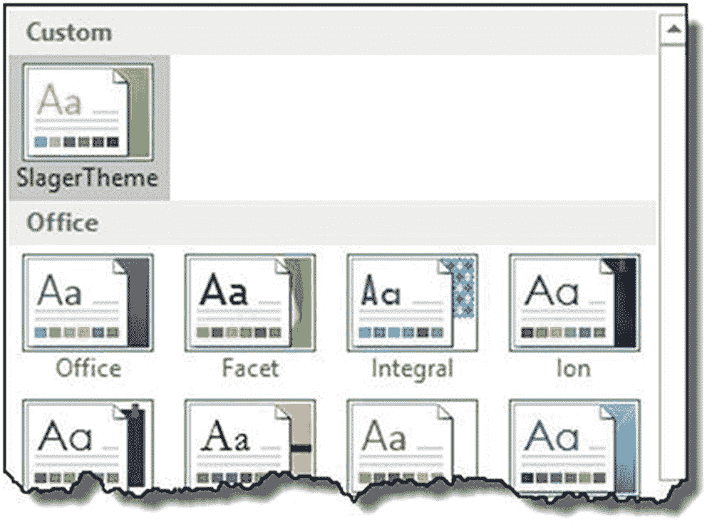

*图 12-29 你创建的主题会出现在主题库中其他主题的上方*

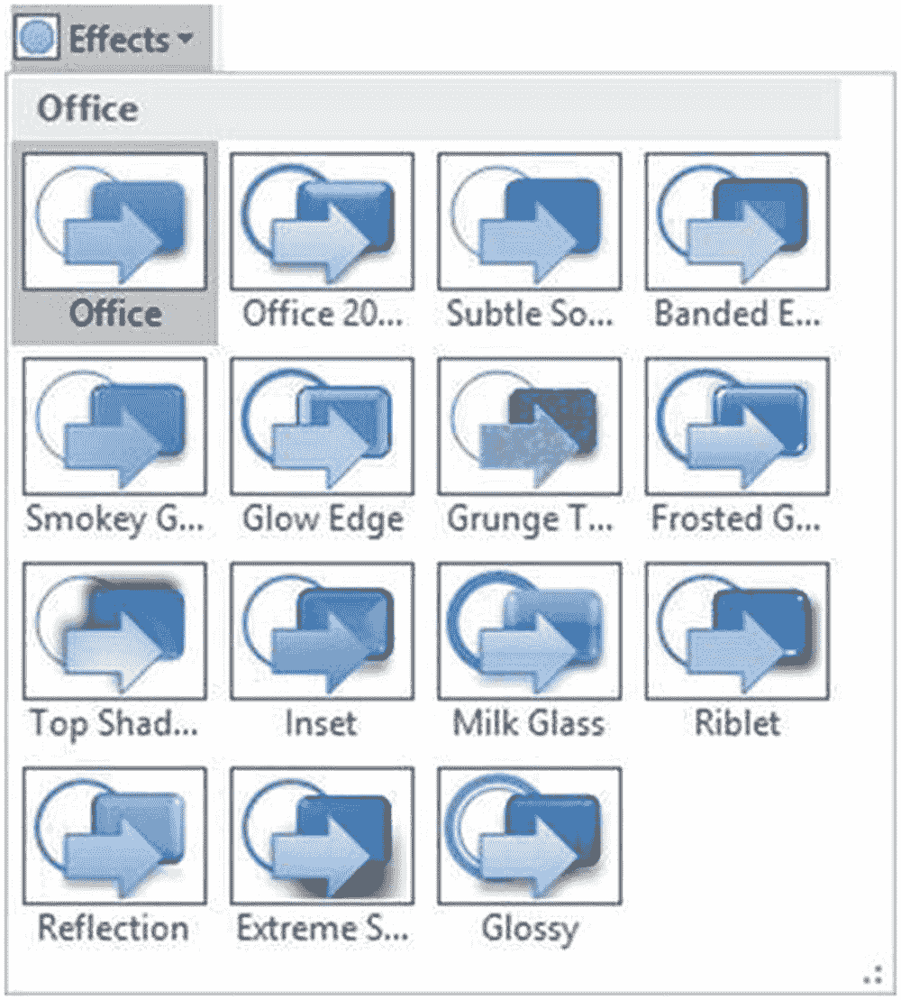

*图 12-28 Office 主题的主题效果*

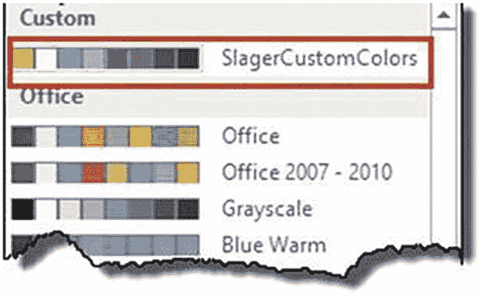

*图 12-27 你选择的主题颜色会出现在“自定义”下的顶部*

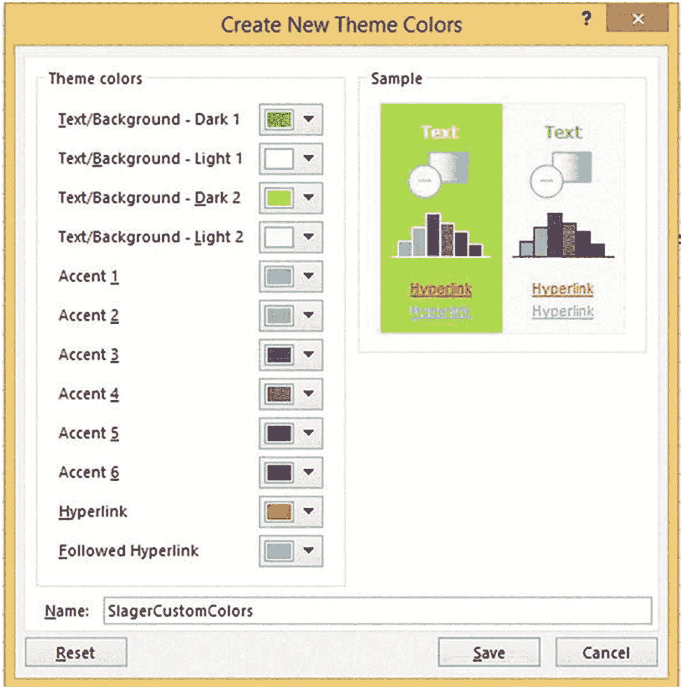

*图 12-26 主题颜色选项*

1. 点击 `Office` 主题。
2. 点击“主题”按钮。点击“保存当前主题”。为你的主题输入一个名称，然后点击“保存”按钮。你保存的主题包含当前在“主题颜色”、“主题字体”和“主题效果”中选择的内容。
3. 点击“主题”按钮。你的主题应该会出现在顶部的“自定义”组中，如图 12-29 所示。
4. 点击“主题颜色”按钮。你的自定义颜色应该会出现在顶部。参见图 12-27。

对于“主题字体”，你也可以执行相同的操作；可以选择一种字体，也可以创建“自定义字体”。你可以选择“主题效果”，但不能创建自定义效果。图 12-28 显示了默认“Office 主题”的“主题效果”库。效果提供了细微的差别，例如形状、SmartArt、图片、图表、表格和艺术字的边缘略有不同。

1. 打开 `Chapter12` 工作簿。选择“主题练习”工作表。
2. 点击功能区上的“页面布局”选项卡。
3. 在“主题”组中，点击“主题”按钮。将光标在不同主题上移动，同时观察每个主题的效果。
4. 点击功能区上的“开始”选项卡。在“字体”组中，注意字体是 `Calibri`，大小为 11。
5. 点击填充颜色的下拉箭头，观察可用的颜色。
6. 点击字体颜色的下拉箭头，观察可用的颜色。
7. 点击功能区上的“页面布局”选项卡。
8. 在“主题”组中，点击“主题”按钮。点击 `Savon` 主题。
9. 点击功能区上的“开始”选项卡。点击其中一个单元格。注意，默认字体现在是 `Century Goth`，大小为 11。点击填充颜色的下拉箭头。注意，主题颜色已经改变。点击字体颜色的下拉箭头。这里的主题颜色也已改变。
10. 点击功能区上的“页面布局”选项卡。点击“主题”按钮。选择 `Office`。
11. 一个主题由颜色、字体和效果组成。如果你不想更改整个主题，可以更改其中的一部分，例如只更改颜色。在“主题”组中，点击“颜色”按钮。选择“灰度”。
12. 点击功能区上的“开始”选项卡。你仍然拥有“Office 主题”的默认字体 `Calibri`，但如果你查看颜色填充或字体颜色中可用的颜色，它们将来自灰度调色板。
13. 点击功能区上的“页面布局”选项卡。在“主题”组中，点击“颜色”按钮。
14. 点击“自定义颜色”。将显示“新建主题颜色”窗口，你可以在其中选择要用于自定义颜色的颜色。选择一些颜色后，输入一个名称。使用你的姓名后跟 `CustomColors`。参见图 12-26。点击“保存”按钮。

你已经了解了如何通过主题应用格式。接下来，你将学习如何将样式应用于单元格。

## 应用与定义单元格样式

单元格样式提供了一种改善电子表格外观和可读性的方法。图 12-30 显示了单元格样式。可以通过单击“开始”选项卡“样式”组中的 `单元格样式` 按钮来访问它们。单元格样式分为五类：

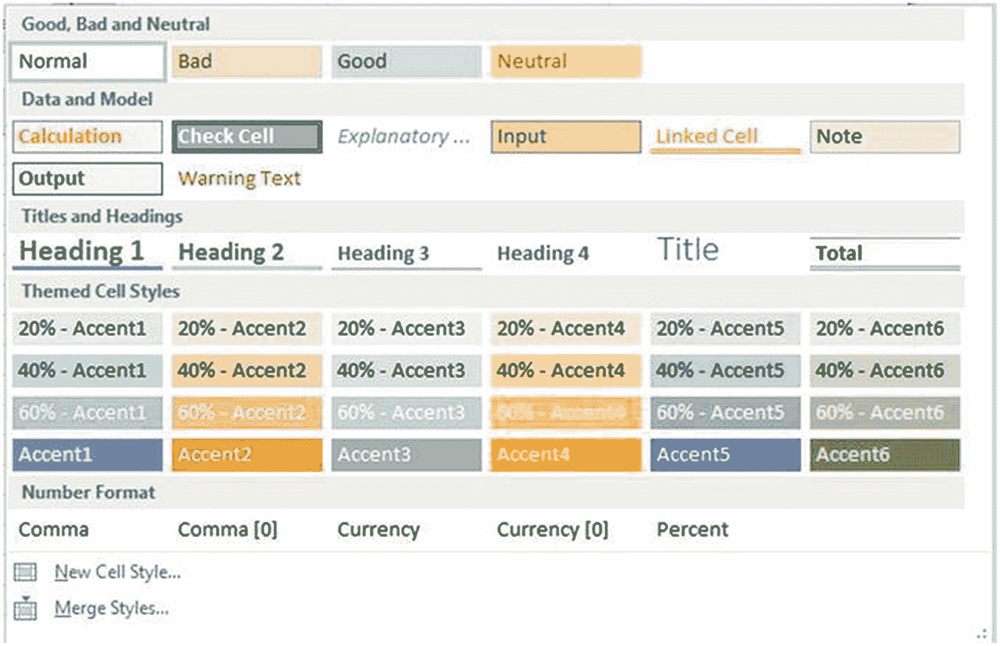

**图 12-30** 单元格样式

- 好、差和适中
- 数据和模型
- 标题和标题
- 主题单元格样式
- 数字格式

样式提供了一种简单的方法来为特定单元格提供一致的格式，例如那些包含公司认为的好消息的单元格和那些包含公司认为的坏消息的单元格、用于输入的单元格和用于输出的单元格、包含链接的单元格等。您还可以使用“主题单元格样式”，它们使用相同的颜色提供不同的透明度。这些预定义样式位于 `主页 ➤ 样式 ➤ 单元格样式`。主题单元格样式源自您当前使用的主题。如果您更改文档主题，您的主题单元格样式将会改变。通过首先选择要应用样式的单元格，然后从 `单元格样式` 库中单击相应的样式，即可将样式应用于工作表。样式的一个不错功能是，您可以在应用之前准确看到样式将如何影响您的电子表格。将鼠标悬停在任何样式上，即可获得它将如何影响电子表格的视觉预览。

如果 `单元格样式` 库中没有满足您需求的样式怎么办？没问题；只需创建您自己的样式。为此，请单击 `单元格样式` 库底部的 `新建单元格样式...`。这将打开 `样式` 对话框，您可以在其中为新样式指定名称。

可以通过显示 `单元格样式` 库、右键单击该样式，然后按 `Delete` 键来删除样式。

### 练习 12-3：使用和创建单元格样式

在本练习中，您将应用现有的单元格样式，然后创建一个新的单元格样式并应用它。

**注意** 如果您的 Excel 窗口已最大化，您将看到 `单元格样式` 库的一部分。如果没有，您将看到一个 `单元格样式` 按钮。单击 `单元格样式` 按钮将显示该库。如果只看到库的一部分，请单击 `更多` 按钮 。

1. 打开 `Workbook Chapter12`。单击 `单元格样式` 工作表标签。

2. 单击单元格 `A1`。打开 `单元格样式` 库（参见前面的注释）。最大化您的 Excel 窗口。

3. 在 `标题和标题` 组下，单击 `标题 1`。

4. 选择单元格 `A3:J3`。单击 `单元格样式` 的 `更多` 按钮。选择单元格样式 `20% - 强调文字颜色 5`。

5. 选择单元格 `I14:J14`。单击 `单元格样式` 的 `更多` 按钮 。选择单元格样式 `汇总`。

6. 选择单元格 `J8`。单击 `单元格样式` 的 `更多` 按钮。选择 `差` 单元格样式。

#### 创建新样式

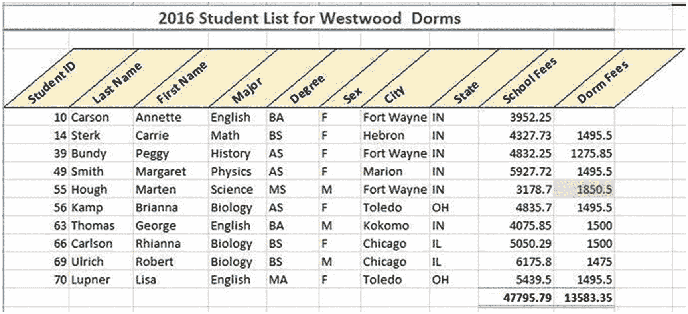

**图 12-32** 应用您创建的样式进行格式设置

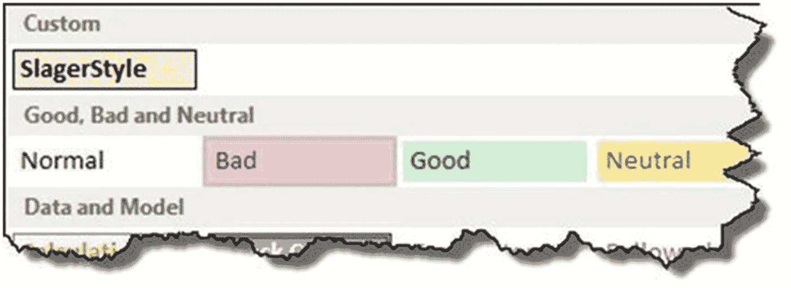

**图 12-31** 您创建的样式应位于 `自定义` 组中

1. 单击您创建的样式。见图 12-32。

2. 单击 `单元格样式` 的 `更多` 按钮。单击 `新建单元格样式`。

3. 单击 `格式` 按钮。

4. 选择 `对齐` 选项卡。将文本设置为 45 度。

5. 选择 `边框` 选项卡。选择浅蓝色。在 `预设` 中选择 `外边框`。

6. 选择 `填充` 选项卡。选择浅金色。

7. 选择 `字体` 选项卡。选择颜色 `黑色`。单击 `确定` 按钮。

8. 将 `样式` 窗口中的样式名称更改为您的姓氏后跟 `Style`，例如“`SlagerStyle`”。

9. 单击 `确定` 按钮。

10. 选择单元格 `A3:J3`。单击 `单元格样式` 的 `更多` 按钮。您创建的样式应位于 `自定义` 组中。见图 12-31。

您已学习了如何通过使用主题和单元格样式来应用一致格式。接下来，您将学习如何基于条件设置格式（例如，为一列中所有值超过 500 的单元格应用格式）。

## 条件格式

条件格式可根据单元格包含的值来设置其格式。此格式基于你所设定的条件。可以高亮显示你特别关注的单元格。你可以将条件格式应用于表格或任何数据区域。

如果电子表格中包含大量数据，它可以使重要的单元格脱颖而出，或者让你对某一列数值的范围有一个快速的视觉概览。

### 练习 12-4：创建条件格式

在此示例中，你将根据是否满足某些条件来创建格式。你将学习如何编辑、删除和创建新的格式规则。

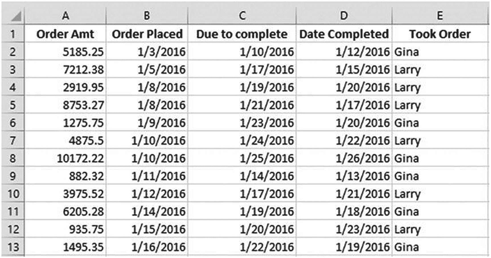

**图 12-33** “订单”工作表上的数据

1. 打开工作簿 `Chapter12`。
2. 单击 `Orders` 工作表。图 12-33 显示了数据。

#### 首/尾规则

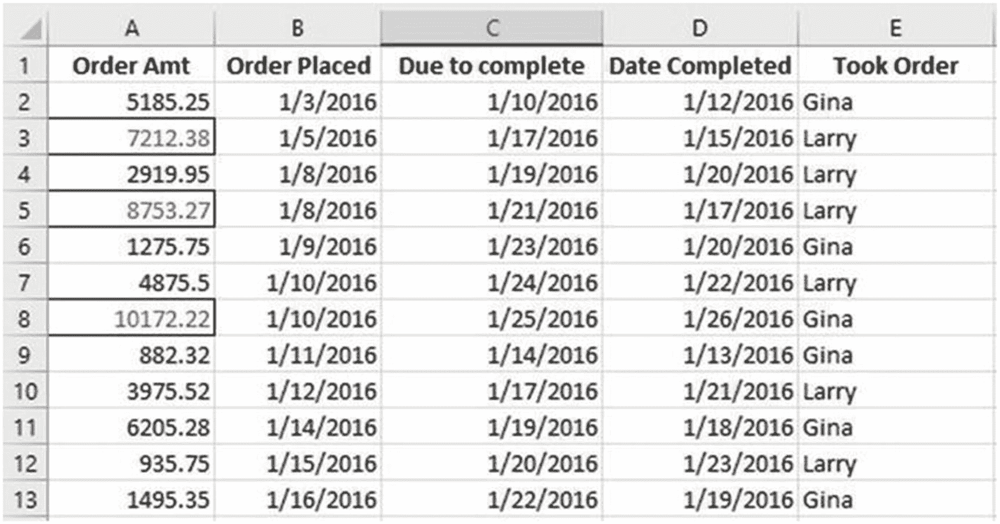

**图 12-34** 应用首/尾规则格式化后的效果

1. 选择单元格区域 `A2:A13`。
2. 在 `开始` 选项卡的 `样式` 组中，单击 `条件格式`。
3. 选择 `首/尾规则`。
4. 选择 `前 10%`。你并非仅限于 `前 10%`，可以输入任意数值。将 `10` 改为 `25` 即可显示前 25%。

前 25% 的单元格将使用你所选择的格式进行高亮显示。当前显示的是 `浅红色填充 深红色文本`。

单击下拉箭头，然后依次单击每个选项，观察其对所选区域的影响。重复此操作，直到你了解了每个选项的效果。最后，单击 `自定义格式`。

这将打开 `设置单元格格式` 窗口。你可以在任何选项卡中进行选择。

5. 单击 `字体` 选项卡。选择 `加粗`。单击颜色下拉箭头。选择 `紫色`。单击 `边框` 选项卡。选择 `外边框`。
6. 单击 `确定` 按钮。图 12-34 显示了结果。单击 `确定` 按钮。

#### 清除规则

接下来，你将清除为单元格区域 `A2:A13` 设置的规则。

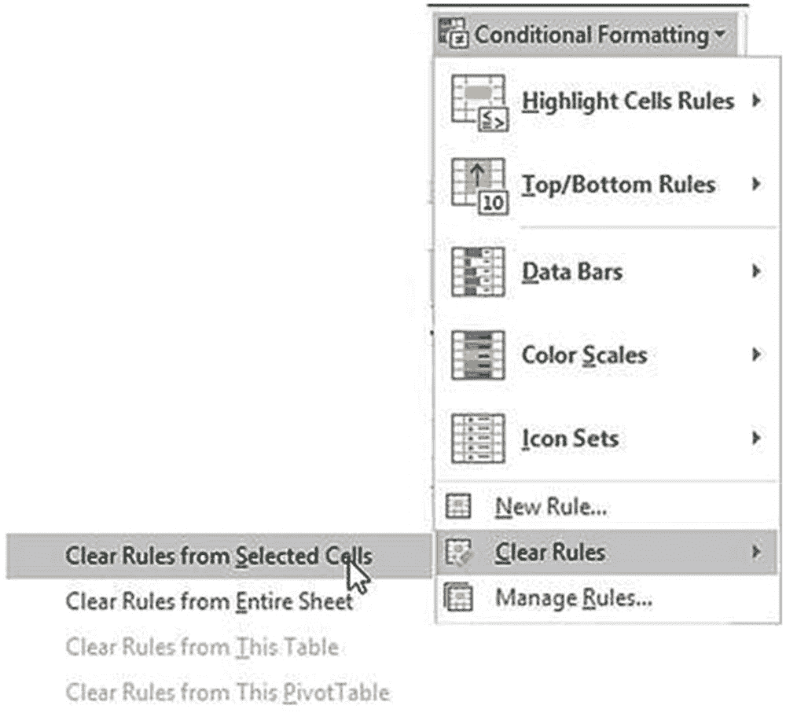

**图 12-35** 选择“从所选单元格中清除规则”

1. 在仍然选中单元格区域 `A2:A13` 的情况下，选择 `条件格式`，然后选择 `首/尾规则`，再选择 `低于平均值`。将格式保留为 `浅红色填充 深红色文本`。
2. 单击 `确定` 按钮。较小的数值应该会被高亮显示。单击一个空白单元格，以便查看结果。
3. 让我们再次清除规则。目前此工作表上仅有的规则就是针对单元格区域 `A2:A13` 的。单击 `条件格式`，然后选择 `清除规则`，再选择 `从整个工作表中清除规则`。

1. 在仍然选中单元格区域的情况下，单击 `条件格式`，选择 `清除规则`，然后选择 `从所选单元格中清除规则`。参见图 12-35。

#### 使用数据条突出显示

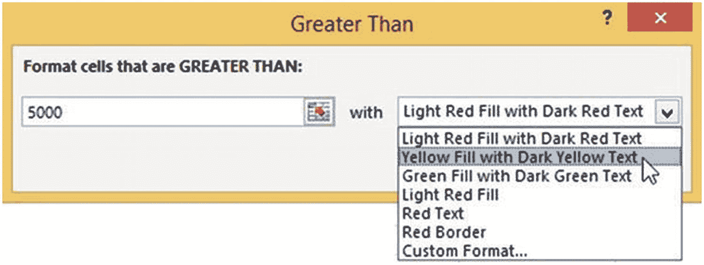

**图 12-38** 条件格式

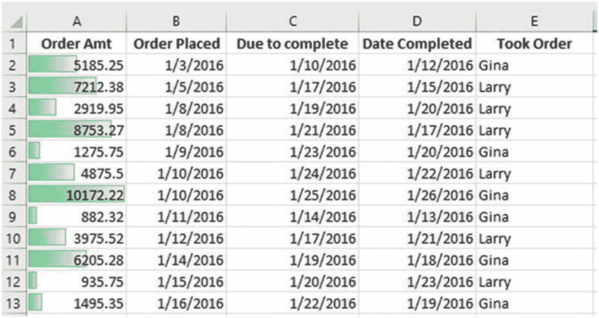

**图 12-37** 单元格中的数值越大，数据条越长

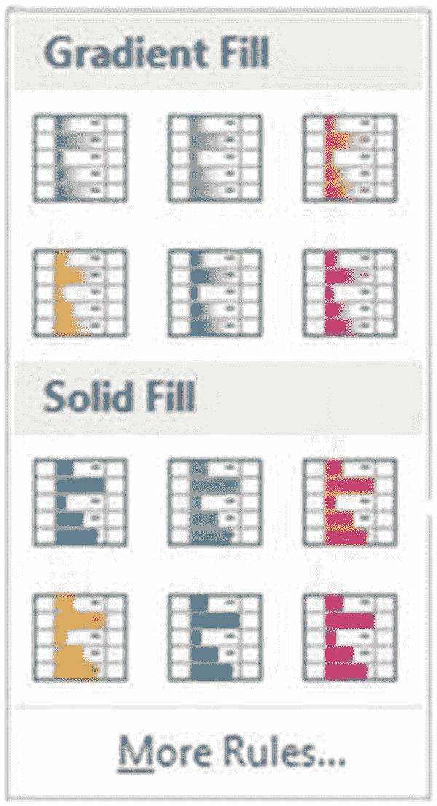

**图 12-36** 条件格式数据条

1. 区域内所有大于 `5000` 的数值都应该被高亮显示。单击 `确定` 按钮。

1. 在仍然选中单元格区域 `A2:A13` 的情况下，选择 `条件格式` ➤ `突出显示单元格规则` ➤ `大于`。在文本框中输入 `5000`，然后选择 `黄填充色深黄色文本`。参见图 12-38。

1. 选择单元格区域 `A2:A13`，选择 `条件格式`，然后选择 `数据条`。
2. 将鼠标移到每个 `渐变填充` 和 `实心填充` 颜色上。参见图 12-36。

单元格中的数值越大，数据条就越长。参见图 12-37。暂时不要选择任何一项。

**注意** 某些条件格式在列宽更宽时会更具效果。

#### 突出显示重复值或唯一值

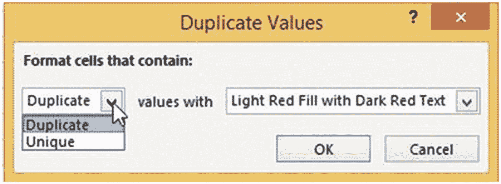

**图 12-39** 为重复值设置格式

1. 单击 `确定` 按钮。

1. 选择单元格区域 `B2:B13`。
2. 选择 `条件格式` ➤ `突出显示单元格规则` ➤ `重复值`。
3. 你可以高亮显示重复的单元格，也可以通过选择 `唯一` 来高亮显示那些不重复的单元格。参见图 12-39。选择 `重复`。

#### 突出显示介于其他两个值之间的值

1. 选择单元格区域 `C2:C13`。
2. 选择 `条件格式` ➤ `突出显示单元格规则` ➤ `介于`。
3. 在第一个日期框中输入 `1/15/2016`，在第二个日期框中输入 `1/19/2016`。单击格式下拉箭头，然后选择 `自定义格式`。
4. 单击 `字体` 选项卡，然后在 `字形` 中选择 `加粗`。
5. 单击 `填充` 选项卡，然后选择一种浅绿色。
6. 在 `设置单元格格式` 对话框中单击 `确定` 按钮。
7. 在 `介于` 对话框中单击 `确定` 按钮。

#### 突出显示大于另一列中对应值的值

我们想要突出显示那些未在截止日期前完成的订单的日期。因此，我们要高亮显示 D 列中日期大于 C 列中同一行日期的那些单元格。

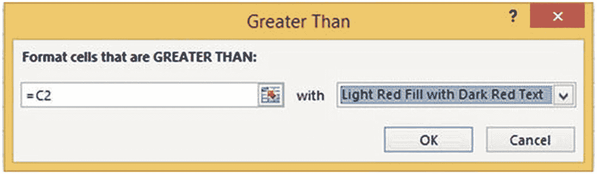

**图 12-40** 突出显示大于单元格 C2 中数值的值

1. 单击 `确定` 按钮。

2. 从 `D2` 向下拖动 `自动填充句柄` 至 `D13`。单击所选数据下方的 `自动填充选项` 按钮。选择 `仅填充格式`。

1. 选择单元格区域 `D2`。
2. 选择 `条件格式` ➤ `突出显示单元格规则` ➤ `大于`。
3. 当 `大于` 窗口中的 `D2` 日期处于高亮状态时，单击 `C2` 单元格。文本框会以绝对引用的形式显示单元格地址。因为我们需要复制此格式，所以选择文本并将其更改为 `=C2`。参见图 12-40。

#### 突出显示指定文本

1. 选择单元格区域 `E2:E13`。
2. 选择 `条件格式` ➤ `突出显示单元格规则` ➤ `文本包含`。在第一个文本框中保留 `Gina`。单击格式下拉箭头，然后选择 `红色文本`。
3. 单击 `确定` 按钮。

#### 编辑、删除和创建新规则

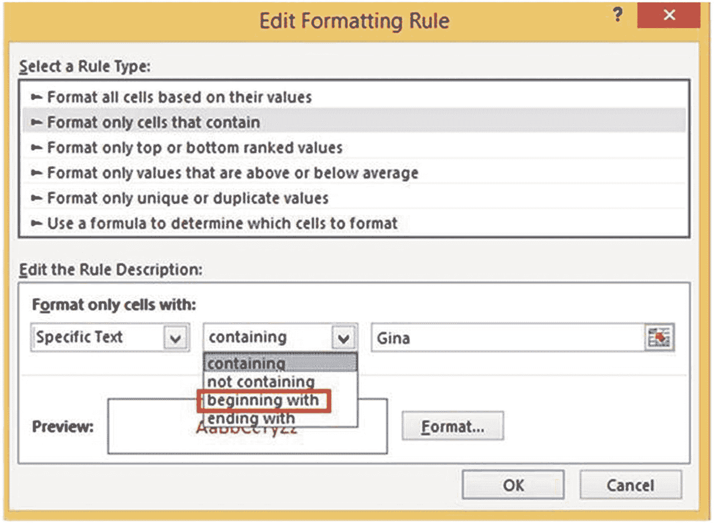

**图 12-41** 选择“始于”

1. 将 `Gina` 改为仅包含 `G`。（现在，任何名字以 `G` 开头的人都会被高亮显示。）
2. 单击 `格式` 按钮。
3. 单击 `字体` 选项卡。从 `字形` 中选择 `加粗 倾斜`。
4. 在 `设置单元格格式` 对话框中单击 `确定` 按钮。
5. 在 `编辑格式规则` 对话框中单击 `确定` 按钮。
6. 在 `条件格式规则管理器` 对话框中单击 `确定` 按钮。
7. 将单元格 `E3` 中的名字 `Larry` 改为 `Gary`。现在它应该会被高亮显示，因为它以 `G` 开头。

1. 单击 `条件格式`，然后选择 `管理规则`。
2. 单击 `显示格式规则` 的下拉箭头，然后选择 `当前工作表`。
3. 选择针对 `单元格值 包含 "Gina"` 的规则，然后单击 `编辑规则` 按钮。这里有更多选项可供使用。选择 `始于`。参见图 12-41。

#### 将条件格式应用于表格

您应用了条件格式，但如果添加了额外的数据行，会发生什么？条件格式会立即应用到所选规则范围下方的那些单元格，但日期列除外。对于日期列，请使用自动填充柄进行复制，然后单击自动填充选项按钮并选择“仅填充格式”。

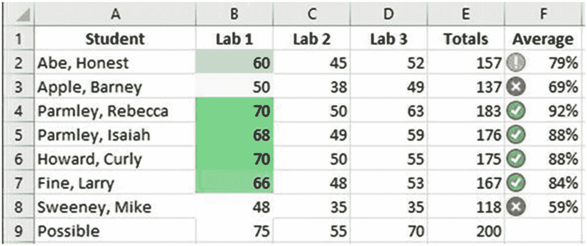

图 12-46 应用格式规则的结果

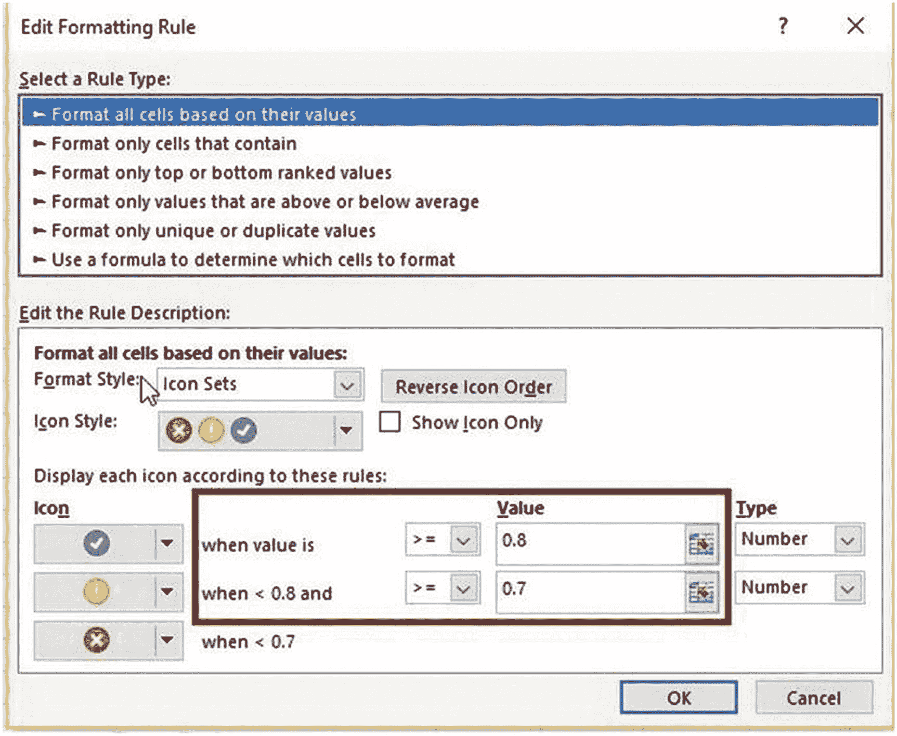

图 12-45 格式规则

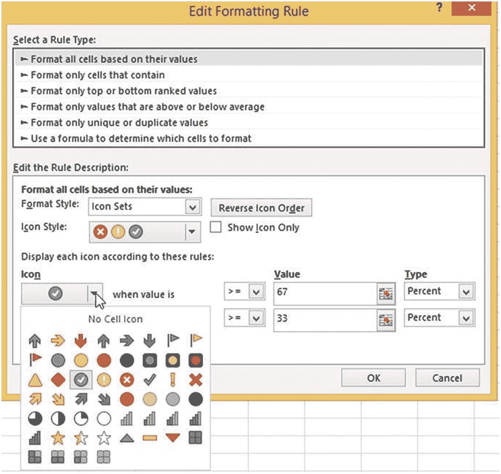

图 12-44 选择一个图标

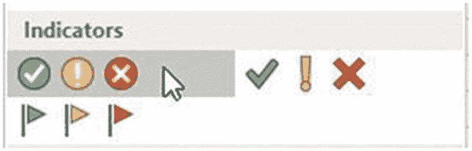

图 12-43 图标集中的“指示器”组

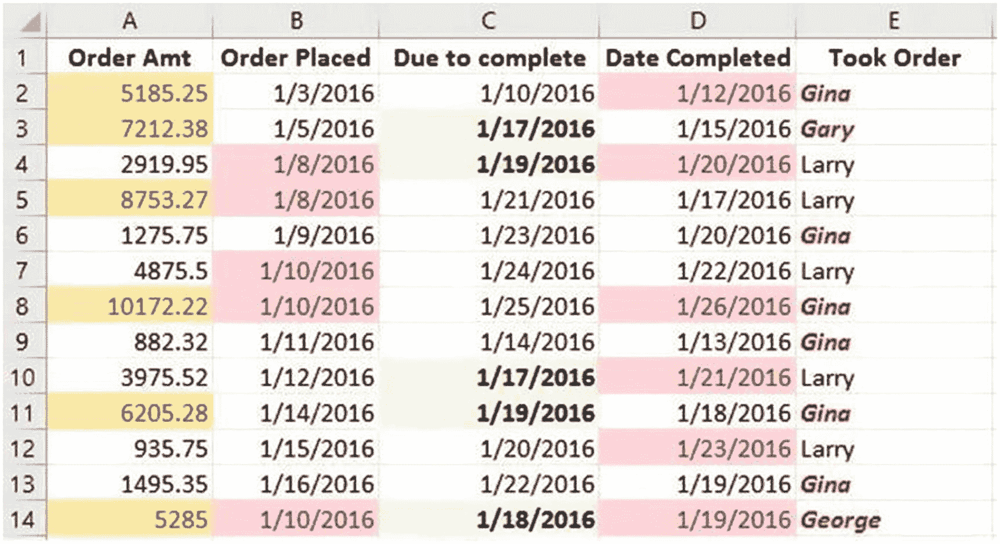

图 12-42 添加一个额外数据行的结果

1.  将单元格`D7`从`53`改为`44`。你的图标应该会变为黄色图标。

1.  单击“确定”。图 12-46 显示了结果。在“条件格式规则管理器”对话框中单击“确定”。

1.  将绿色和黄色图标的“类型”改为“数字”。“大于或等于”符号已选定。为绿色图标的值输入`.8`。

2.  为黄色图标的值输入`.7`。“大于或等于”符号应已选定。“类型”应为“数字”。按 `Tab` 键。

红色图标应显示，它将用于任何小于`.7`的值。见图 12-45。

1.  单击“条件格式”，然后选择“管理规则”。

2.  单击“图标集”，然后单击“编辑规则”按钮。

你不必使用同一个集合中的所有图标；你可以在不同图标之间进行选择。见图 12-44。

1.  单击“实验室成绩”工作表选项卡。

2.  选择单元格区域`B2:B8`。

3.  选择“条件格式”➤“色阶”。将鼠标悬停在每个选项上，查看它如何影响单元格背景颜色。

4.  选择一个选项。

我们想根据学生的分数高亮显示他们的平均分。评分等级如下：

90–100 A

80–89 B

70–79 C

60–69 D

0–59 F

5.  选择单元格区域`F2:F8`。

6.  单击“条件格式”，然后选择“图标集”。在“指示器”组中选择第一个选项。见图 12-43。

我们想使用一个带有绿色圆圈和勾选标记的图标来表示获得`A`或`B`的学生；一个带有感叹号的黄色圆圈图标表示获得`C`的学生；以及一个带有`X`的红色圆圈图标表示获得`D`或`F`的学生。

1.  选择单元格区域`A2:E14`。将自动填充柄向下拖到`E20`。单击自动填充选项按钮，并选择“仅填充格式”。为每一列添加一个满足条件规则的额外数据行。见图 12-42 中的第 14 行。

## 总结

Excel 中的主题由颜色、标题和正文字体以及应用于工作表的图形效果组成。您也可以创建自己的主题。您可以使用主题来增强电子表格的外观，并使其具有一致的外观。例如，您可以为不同的项目应用不同的主题，或者您的公司可能选择始终使用同一主题。Microsoft Word 和 PowerPoint 拥有与 Excel 中相同的主题。

Microsoft Office 主题由颜色库、标题和正文字体以及图形效果组成。您可以单击不同的主题，同时查看它们如何影响您的工作表。您可以选择最令您满意的一个，或者您的公司可以更进一步，创建自己的自定义公司或企业主题；这样做既是为了在组织内部营造一种持续的专业感，也是为外部沟通赋予品牌感。如果您找不到符合需求的主题，您可以通过从颜色、标题和正文字体以及图形效果库中进行选择来创建自己的主题。

您无需手动设置单元格格式，而是从预定义的单元格样式组中进行选择。这些组包括“好、差和一般”、“数据和模型”、“标题和标头”以及“数字格式”。与主题一样，单元格样式可以使您的工作表具有一致的外观，例如始终使标题、表头与汇总具有相同的外观。

您可以将工作表中的数据转换为表格，然后再将其转换回原始格式。通过选择要转换为表格的数据，然后单击功能区“样式”组中的“套用表格格式”按钮来创建表格。将数据转换为表格允许您通过单击列标题右侧的下拉箭头来筛选数据。然后，您可以选择要用于筛选的值，或创建自定义筛选；如果数据是文本，您可以选择“文本筛选”；如果数据是数字，您可以选择“数字筛选”。筛选表格数据的另一种方法是创建切片器。切片器让您无需使用表格筛选器即可精确查看正在筛选的内容。

您可以使用各种颜色或图标来设置单元格格式，以高亮显示特别重要的单元格。例如，您可以使用一个图标高亮显示值在前 20% 的单元格，使用另一个图标高亮显示值在中间 60% 的单元格，再使用另一个图标高亮显示值在最后 20% 的单元格。

下一章将介绍图表。Excel 使得将电子表格数据转换为图表变得非常简单。图表使您能轻松发现数据中可能无法察觉的趋势。

