# 13. 使用图表

如果没有图表，我们会怎样？图表不仅比原始数据更吸引我们的眼球，而且还能让我们更容易发现趋势。那句老话“一图胜千言”也同样适用于图表。管理者并不总想查看电子表格中的每一条记录；他们更愿意根据趋势来做决策，无论这些趋势是好是坏。通过观察趋势，管理层可以决定公司未来应采取哪些行动。图表可以汇总大量数据并显示数据之间的关系。图表使我们更容易看到诸如哪些产品线利润更高、一年中哪个时期最赚钱、公司的盈利能力是上升还是下降、哪些部门表现良好、哪些部门表现不佳等等信息。

阅读并完成本章内容后，您应该能够：

*   使用快捷键创建图表

*   更改图表类型

*   添加数据点

*   更改数据源

*   创建饼图

*   创建复合饼图

*   创建复合条饼图

*   创建具有多种数据图表类型的图表（组合图）

*   创建树状图

*   创建旭日图

*   创建漏斗图

*   创建地图

*   创建必应地图

*   创建迷你图

好的，作为一名高级文档工程师和翻译员，我将严格遵循您提供的注意事项和示例，将给定的英文文本翻译成高质量的中文。

## 图表类型

Excel 提供了多种多样的图表类型供您选择，以便最佳地展示您的数据。您应该使用哪种图表类型取决于您要绘制的数据。在创建图表之前，您需要确定希望图表传达什么信息。选定图表后，您可以通过更改其主题来更改整个图表的格式，也可以更改图表的各个组件。Excel 提供了多种不同的图表选项。稍后您会看到，Excel 会查看您选择的数据，进行**快速分析**，然后为您的数据提供**推荐**的图表类型。

功能区“`插入`”选项卡的“`图表`”组中显示了可用的图表类型。单击某图表类型旁边的向下箭头将显示该图表类型的可用变体。参见图 13-1。

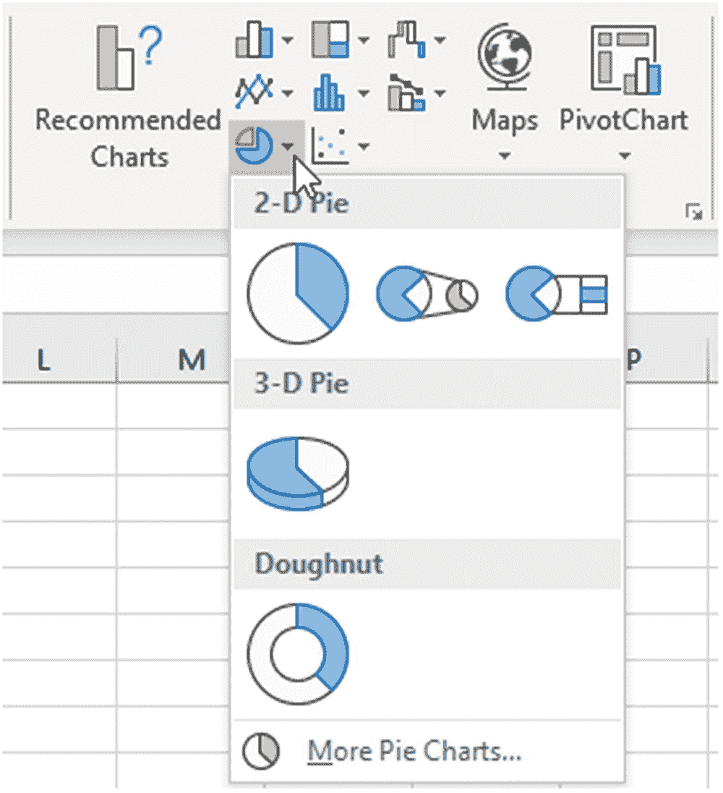

图 13-1

饼图的变体

单击“`图表`”组的对话框启动器，如图 13-2 所示，将弹出“`插入图表`”对话框（图 13-3）。

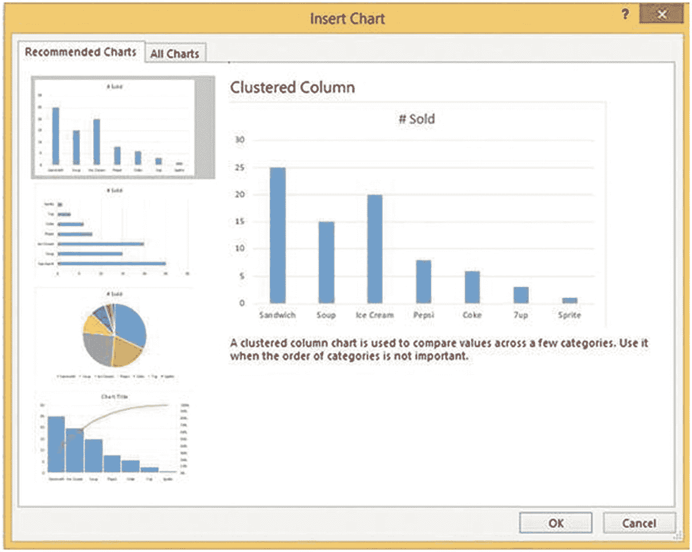

图 13-3

已选中“`推荐的图表`”选项卡的“`插入图表`”对话框

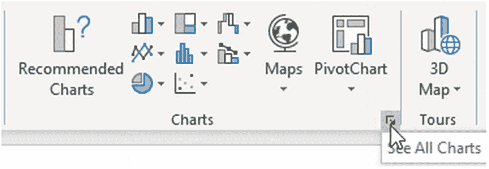

图 13-2

“`图表`”组

“`插入图表`”对话框有两个选项卡。“`推荐的图表`”选项卡会根据您当前在工作表中选定的数据，显示推荐的图表。参见图 13-3。此处显示的图表使用的是您已选定的数据。单击某个图表类型会显示该图表类型用途的描述。

推荐的图表只是一个建议。您不必使用 Excel 的建议。“`所有图表`”选项卡在左侧窗格中显示所有图表类型。单击左侧窗格中的某个图表类型，将在右侧窗格中显示该类型的所有变体。参见图 13-4。此处显示的图表使用的是您当前在工作表上选定的数据。在左侧窗格中，有一个选项可以查看您最近使用的图表。

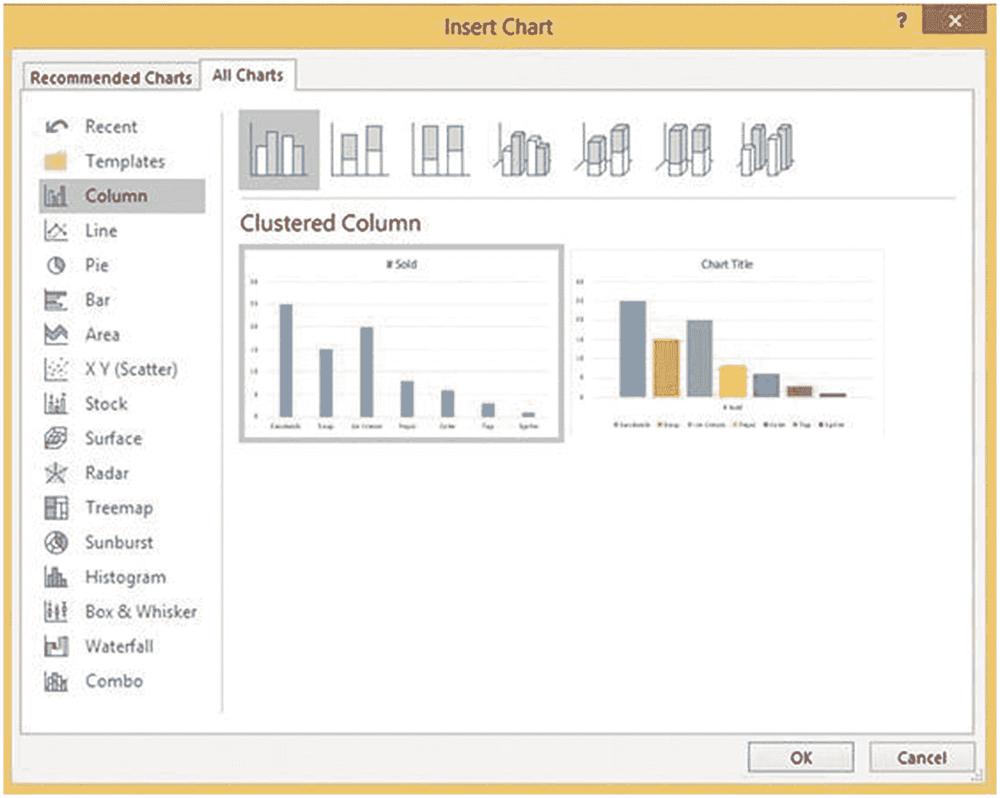

图 13-4

“`柱形图`”的变体

## 创建和修改图表

创建图表有多种方法，包括使用上一节中介绍的“`插入`”选项卡上的选项。创建默认的二维簇状条形图最简单的方法是，选择您要在图表中显示的数据，然后：

*   按 `Alt + F1` 将图表显示在数据所在的工作表上，或者
*   按 `F11` 将图表显示在单独的工作表上

创建图表后，您可以通过多种方式进行更改。您可以进行的一些更改包括：

*   图表类型
*   图表位置
*   图表样式
*   图表中显示的内容
*   交换行列
*   在图表中添加或移除项目
*   更改单个条形的颜色和外观
*   添加或移除图例、标题和数据表
*   绘图区的增量值

选定图表会在功能区中添加两个上下文选项卡。上下文选项卡“`设计`”和“`格式`”会出现在“`图表工具`”标题下。“`设计`”选项卡主要用于进行影响整个图表的更改，而“`布局`”选项卡则用于更改图表中各个元素的外观。

**注意** 不要过分追求让图表过于花哨或过度使用颜色等。最重要的是图表如何很好地传达您希望表达的信息，以及目标受众阅读和理解图表的难易程度。受众应该能够快速领会图表所传达的内容。

### 练习 13-1：创建和修改 Excel 图表

在本练习中，您将根据现有的“游戏销售”数据创建和修改柱形图和条形图。

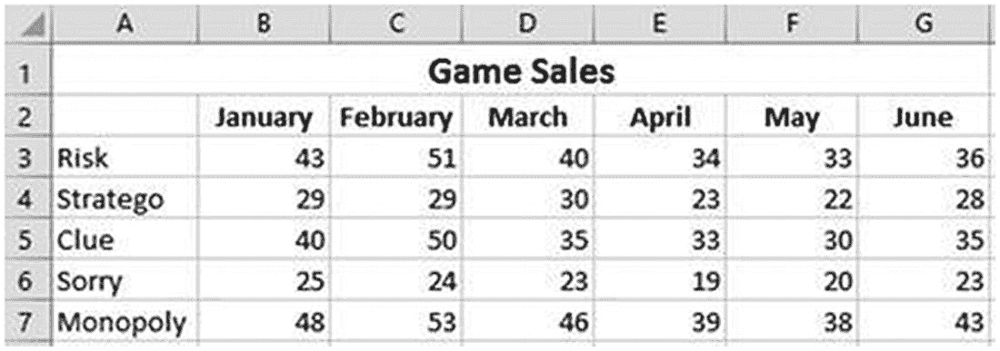

图 13-5

“`游戏销售`”选项卡上的数据

1.  选择单元格区域 `A2:G7`。按 `Alt + F1`。
2.  打开工作簿 `Chapter 13`。单击“`游戏销售`”选项卡。图 13-5 显示了数据。

您的图表位于一个可移动的框架中。将光标移到图表框架上。光标应显示为四个箭头 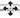。

3.  将图表拖放到您想要的任意位置。
4.  增大图表尺寸：将光标置于图表框架的右下角，然后按住 `Shift` 键，同时将光标向右下角拖动。按住 `Shift` 键可以使图表保持相同的宽长比。

选定图表后，Excel 会在功能区上显示两个新选项卡：“`设计`”和“`格式`”。这两个选项卡位于“`图表工具`”分组下。

**注意** 图表由许多不同的单独元素组成。具体包含哪些元素取决于图表类型和正在绘制的数据。

在功能区上，单击“`格式`”选项卡。在“`当前所选内容`”组中，“`图表元素`”下拉框会显示图表中当前选定的项目。

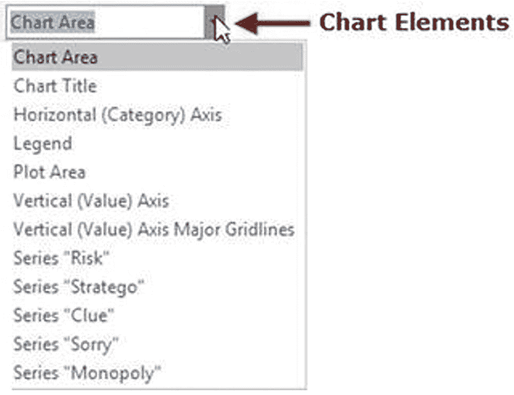

图 13-6

“`图表元素`”下拉框

5.  单击“`图表元素`”下拉框的向下箭头。参见图 13-6。

从“`图表元素`”列表中选择一个项目，将会在图表上选中该项目。

6.  从“`图表元素`”列表中选择“`绘图区`”。绘图区现在在图表中被选中。
7.  从“`图表元素`”列表中选择“`水平（类别）轴`”。图表上的月份现在被选中。

从“`图表元素`”列表中选择一个项目，将会在图表上选中该项目，反之亦然。

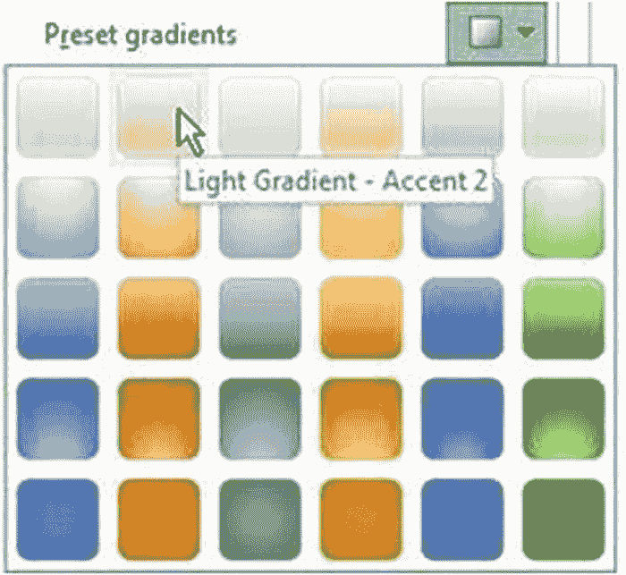

图 13-14

选择“`浅色渐变 – 强调文字颜色 2`”

8.  单击“`预设渐变`”的向下箭头。
9.  选择“`浅色渐变 – 强调文字颜色 2`”。参见图 13-14。

1.  在功能区（Ribbon）的“格式”（Format）选项卡中，位于“当前所选内容”（Current Selection）组，点击“图表元素”（Chart Elements）的下拉箭头，然后选择“图表区”（Chart Area）。
2.  在“当前所选内容”（Current Selection）组中，点击“设置所选内容格式”（Format Selection）按钮。
3.  在“设置图表区格式”（Format Chart Area）窗格中，选择“渐变填充”（Gradient fill）。见图 13-13。

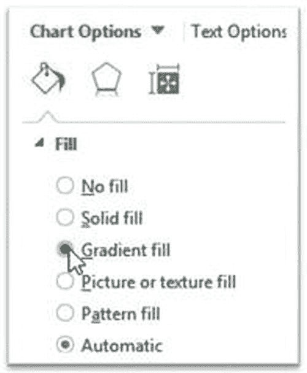

图 13-13：选择“渐变填充”

1.  点击“文字填充与轮廓”（Text Fill & Outline）并完成以下步骤：
    1.  展开“文字填充”（Text Fill）选项。
2.  选择“图案填充”（Pattern Fill）。
3.  将“前景色”（Foreground color）更改为“深红色”（Dark Red）。
4.  将“背景色”（Background color）更改为“黑色”（Black）。
5.  选择最后一行中的最后一个图案（实心菱形）。见图 13-12。

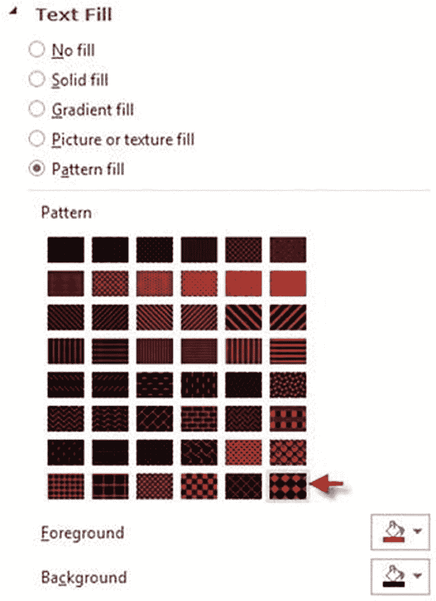

图 13-12：图案填充选项

1.  点击“大小与属性”（Size & Properties）按钮 。
2.  点击“自定义角度”（Custom angle）的下拉箭头，直到角度变为 -3。
3.  将“游戏销量”（Game Sales）图表标题拖动到图表的左侧。
4.  在“设置图表标题格式”（Format Chart Title）窗格上，点击“文本选项”（Text Options）。见图 13-11。

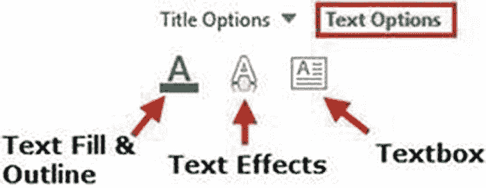

图 13-11：文本选项

1.  折叠“三维格式”（3-D Format）选项。
2.  展开“阴影”（Shadow）选项。创建阴影可以使对象看起来有跳出页面的立体感：
    1.  点击“预设”（Presets）的下拉箭头。
2.  共有三组：外部（Outer）、内部（Inner）和透视（Perspective）。点击第一行中的第一个选项（右下偏移 Offset Bottom Right）。
3.  将“距离”（Distance）滑块拖动到 21 pt。
4.  将“模糊”（blur）滑块拖动到 16 pt。

1.  折叠“填充”（Fill）。如果尚未展开，请展开“边框”（Border）。选择“无边框”（No line）之外的选项会弹出大量其他选项。
2.  选择“实线”（Solid line）。将边框的颜色更改为红色。
3.  通过将宽度（width）更改为 2.5，增加图表标题（Chart Title）周围边框的大小。
4.  通过将“复合类型”（Compound Type）更改为“双线”（Double），将边框更改为双线。
5.  通过将“连接类型”（Join type）更改为“圆角”（Round），使边框线条角变为圆角。
6.  点击“效果”（Effects）按钮 。有四种基本效果：阴影（Shadow）、发光（Glow）、柔化边缘（Soft Edges）和三维格式（3-D Format）。
7.  展开“三维格式”（3-D Format）选项。
8.  点击“顶部棱台”（Top bevel）的下拉箭头。选择“斜棱台”（Slant bevel）。见图 13-9。

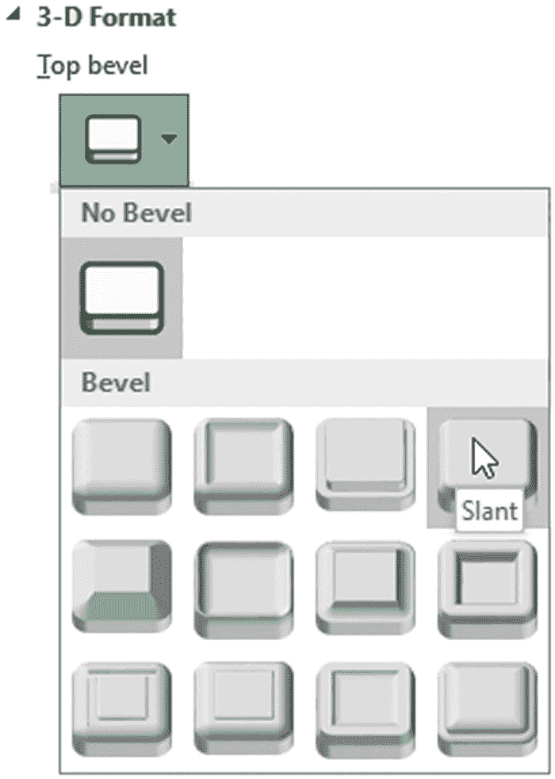

图 13-9：选择“斜棱台”

现在，图表标题应以三维外观显示。

图 13-10：图表标题现在具有三维外观

1.  点击“填充与线条”（Fill & Line）油漆桶图标。
2.  如果尚未展开，请展开“填充”（Fill）。点击“纯色填充”（Solid fill）。点击“纯色填充”会弹出“颜色”（Color）和“透明度”（Transparency）选项。
3.  从“颜色”（Color）选项中选取颜色“橙色，着色 2，浅色 60%”（Orange, Accent 2, Lighter 60%）。见图 13-8。

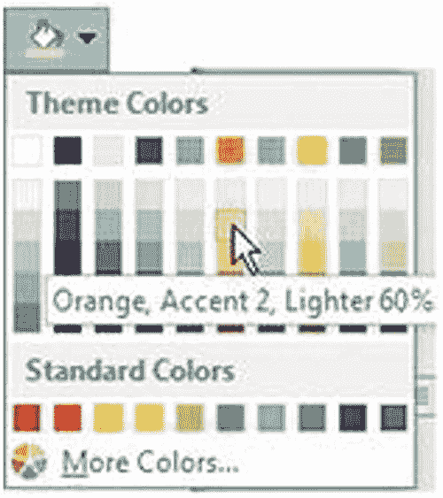

图 13-8：从主题颜色中选择“橙色，着色 2，浅色 60%”

4.  将“透明度”（Transparency）更改为 50%。

1.  在图表上点击“图表标题”（Chart Title）。查看“图表元素”（Chart Elements）下拉框，显示已选中“图表标题”。
2.  在图表上拖动以选中“图表标题”文本。输入“游戏销量”（Game Sales）。
3.  拖动以选中“游戏销量”（Game Sales）文本。右键点击“游戏销量”，然后选择“字体”（Font）。将字体大小更改为 18。点击“确定”（OK）按钮。
4.  在功能区（Ribbon）的“格式”（Format）选项卡中，位于“当前所选内容”（Current Selection）组，点击“设置所选内容格式”（Format Selection）。

点击“设置所选内容格式”（Format Selection）将设置“图表元素”（Chart Elements）下拉框中所选对象的格式。由于“图表标题”是当前对象，点击“设置所选内容格式”会弹出格式化图表标题的选项：
*   “标题选项”（Title Options）菜单包含影响图表标题区域内部但文本本身外部区域的选项。见图 13-7。

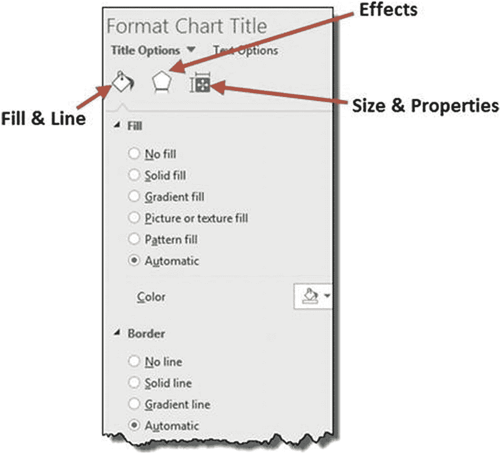

图 13-7：图表选项

*   “文本选项”（Text Options）菜单包含仅影响文本的选项。

图 13-15 显示了结果。

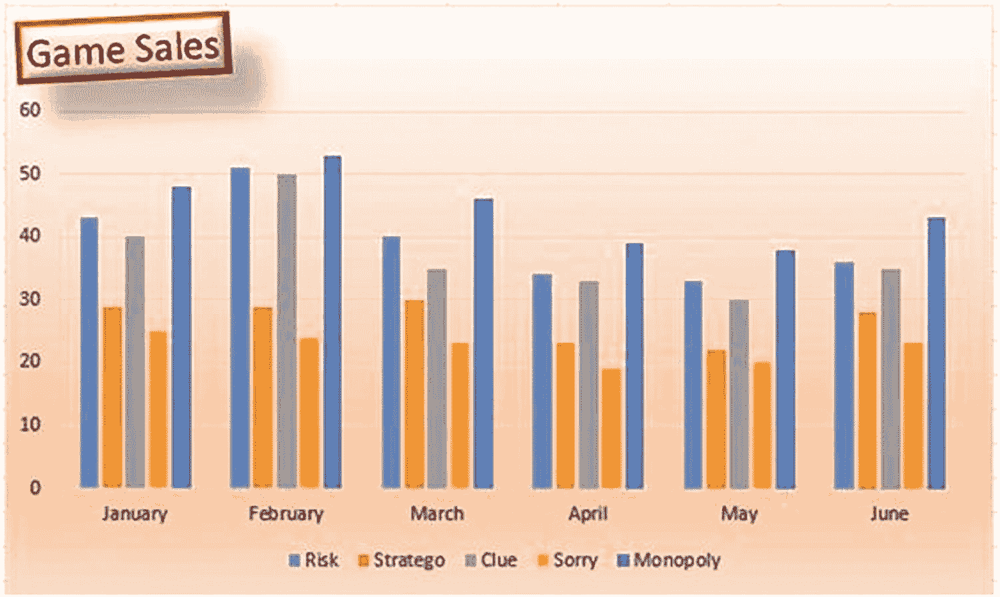

图 13-15：您的图表现在应如下图所示

1.  通过点击窗格右上角的 `X` 来关闭“设置所选内容格式”（Format Selection）窗格。
2.  从“图表元素”（Chart Elements）下拉框中选择“图例”（Legend）。图表底部的图例周围会出现一个边框。您可以通过拖动边框来移动图例，或通过使用其控制手柄来调整其大小。

**应用图表样式**

1.  选择“数据标签”（Data Labels）。每个柱形上方会显示数据标签值。
2.  选择“数据表”（Data Table）。数据表以电子表格形式显示各个值。这些值与柱形上方显示的数据标签值相同。通过取消选中数据标签前的复选框来消除数据标签。

1.  点击“图表元素”（Chart Elements）按钮。见图 13-19。

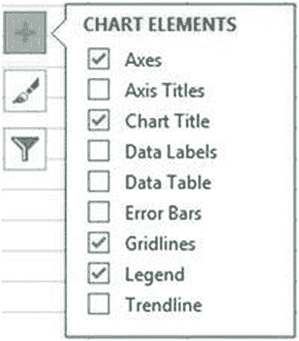

图 13-19：图表元素按钮选项

1.  将鼠标悬停在样式按钮上，同时注意图表的变化。工具提示会显示每个按钮的指定名称，例如样式 1（Style 1）、样式 2（Style 2）等。

点击“样式 6”（Style 6）按钮。当选中图表时，您会看到其右侧有三个按钮。见图 13-18。

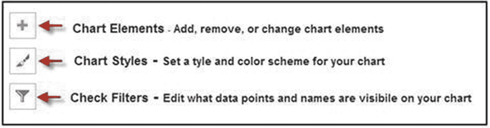

图 13-18：选中图表时，这三个按钮会显示在其右侧

如果您点击图表以外的任何位置，这三个按钮将不会显示。

1.  在“图表布局”（Chart Layouts）组中，点击“更多”（More）按钮（显示全部 Show All） 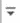 以查看所有样式。见图 13-17。

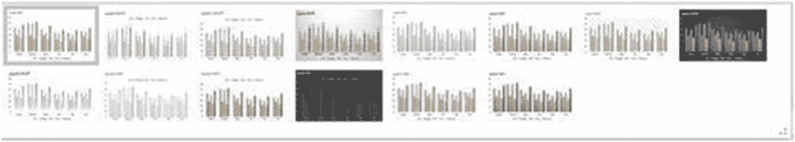

图 13-17：点击“更多”按钮后显示的图表（布局）

可用的预定义布局数量因图表类型而异。

1.  在功能区（Ribbon）的“图表工具”（Chart Tools）分组下，有“设计”（Design）选项卡和“格式”（Format）选项卡。点击“设计”（Design）选项卡。

Excel 提供了一系列预定义样式供您选择。样式按钮反映了当前图表的类型。由于我们使用的是条形图，样式按钮会显示条形图的样式。见图 13-16。在处理饼图时，样式按钮会显示饼图。

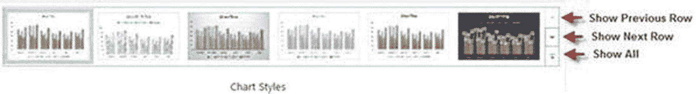

图 13-16：条形图

**更改图表样式**

1.  点击“坐标轴标题”（Axis Title）右侧的箭头。
2.  我们只想使用水平坐标轴标题，因此选择“主要水平坐标轴”（Primary Horizontal）。
3.  在图表上拖动以选中文本“坐标轴标题”（Axis Title），然后输入“每月游戏销量”（Games Sold per Month）。

1.  点击图表元素按钮。将光标悬停在选项上。注意每个图表元素右侧都有一个箭头。点击该箭头可以为该元素选择各种选项。当前未选择坐标轴标题和数据标签。将光标悬停在任何未选中的项目上，会显示该项目在图表中的外观。将光标悬停在坐标轴标题上。有水平坐标轴标题和垂直坐标轴标题。见图 13-21。

   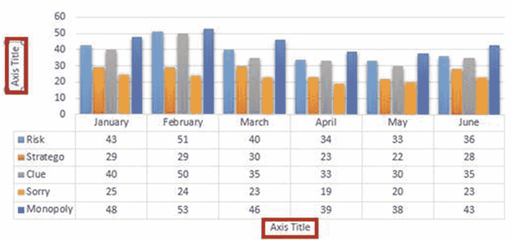

   **图 13-21**
   水平轴和垂直轴

2.  点击图表样式按钮。此处显示的内容取决于当前图表中的内容。由于当前图表中有一个数据表，此处显示的所有图表都包含一个数据表。

3.  在滚动浏览时，将光标悬停在每个图表上，查看每个选项对图表的影响。这些样式与功能区“数据”选项卡的“图表样式”组中显示的样式相同。

4.  选择样式 14。图 13-20 显示了结果。

   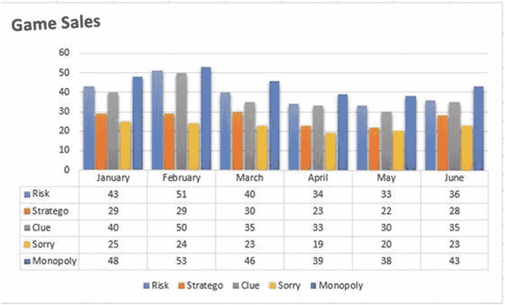

   **图 13-20**
   选择样式 14 后的结果

#### 快速布局

1.  将光标悬停在每个布局上，查看它们如何改变图表的外观。

2.  选择布局 3。

1.  在功能区“图表工具”下的“设计”选项卡中，点击“图表布局”组中的“快速布局”按钮。见图 13-22。

   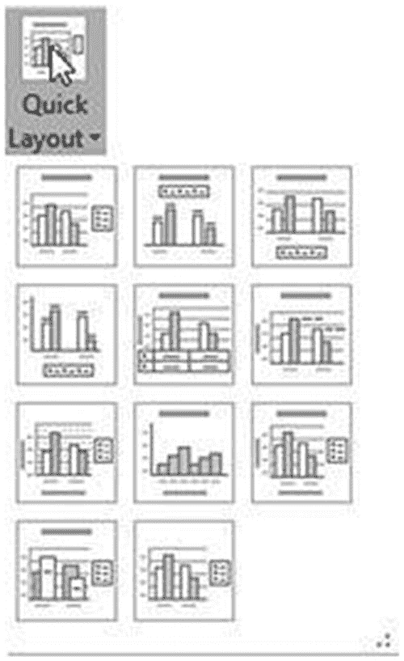

   **图 13-22**
   快速布局选项

Excel 包含许多预定义的布局，这些布局包含了图表元素的不同排列方式。

#### 更改图表类型

1.  点击“确定”按钮。

   图表现在应显示“Battleship”的月销售额。

2.  点击“选择数据源”对话框中的“确定”按钮。

1.  点击图表以将其选中。点击功能区上的“设计”选项卡。在“数据”组中，点击“选择数据”按钮。

2.  点击“添加”按钮。将显示“编辑数据系列”对话框。

3.  点击“系列名称”文本框。

4.  点击单元格 `A8` 中的单词 **Battleship**。

5.  删除“系列值”文本框中当前的文本。

6.  拖动选择单元格区域 `B8:G8`，以获取“Battleship”游戏的销售数据。见图 13-29。

   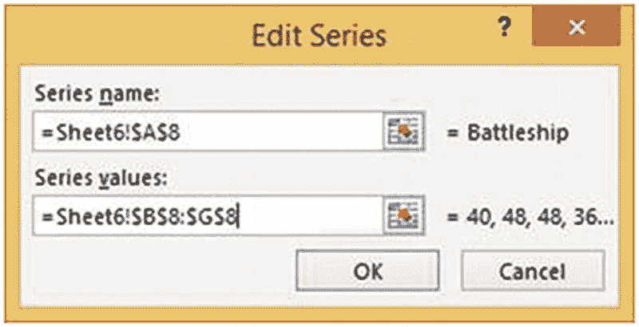

   **图 13-29**
   为“编辑数据系列”窗口输入的数据

1.  在选中“Risk”的情况下，持续点击图 13-27 中所示的下箭头，直到“Risk”成为系列中的最后一项。

   现在，“Risk”出现在条形图中每个月分组的最顶部。

2.  点击“Stratego”前面的复选框以将其取消选中。

3.  点击“六月”前面的复选框以将其取消选中。

4.  点击“确定”按钮。

   注意，电子表格数据没有发生任何更改，只有图表发生了变化。已从图表中移除“Stratego”的图例和图表系列，并且所有六月份的数据也已从图表中移除。

5.  让我们向电子表格添加另一个游戏。添加“Battleship”游戏所在的行，如图 13-28 所示。

   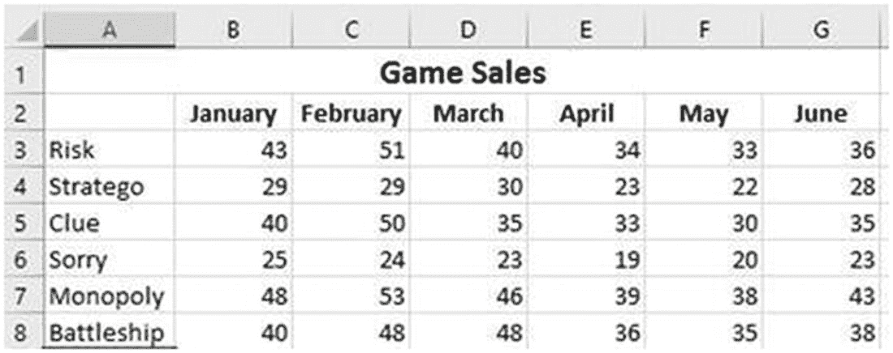

   **图 13-28**
   向工作表添加第 8 行数据

1.  右键单击图表底部的图例，然后选择“设置图例格式”。

2.  在“设置图例格式”窗格中选择“靠右”。

3.  在功能区“设计”选项卡的“数据”组中，点击“选择数据”按钮。这将打开“选择数据源”对话框，如图 13-26 所示。

   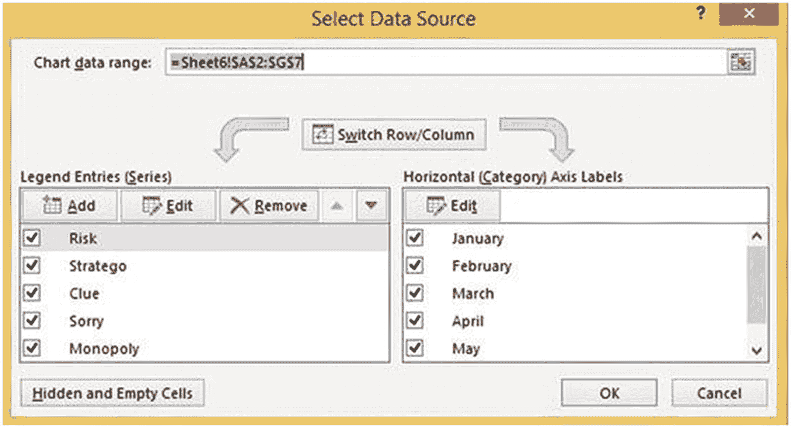

   **图 13-26**
   “选择数据源”对话框

“选择数据源”对话框为您提供了一个用于更改图表所依据的单元格区域的选项。这里还有一个按钮，用于切换行和列，就像您在之前步骤中所做的那样。

在“删除”按钮的右侧有一个向上和向下箭头。如图 13-27 所示，这些按钮用于向上或向下移动当前图例及其系列。

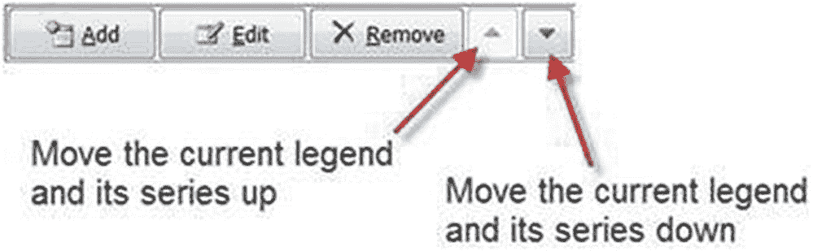

**图 13-27**
使用向上和向下按钮移动当前图例

最初，我们有一个柱形图，“Risk”游戏由每个月分组中的第一个柱形表示。当我们更改为条形图时，系列顺序被反转，“Risk”游戏成为每个月分组中的最后一个条形。这看起来很奇怪，但在“选择数据源”对话框中，“Risk”位于顶部，尽管它在条形图中显示在底部。

1.  在“数据”组中，点击“切换行/列”按钮。

   现在，电子表格中的列标题用于垂直轴，而行标题成为图例。见图 13-25。此图表可以更轻松地看出六个月期间每个单独游戏在销售额上的差异。

   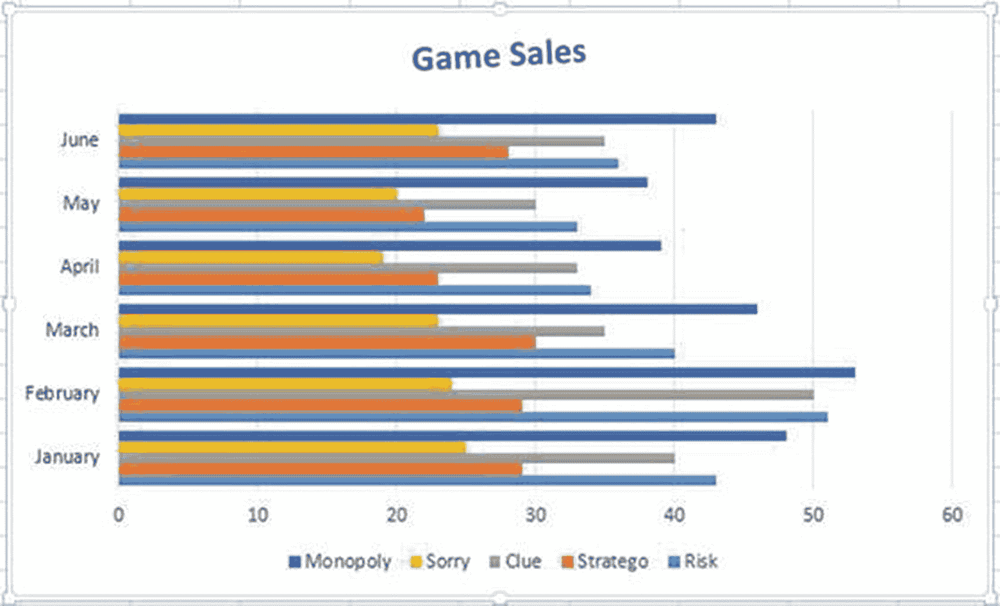

   **图 13-25**
   电子表格中的列标题作为垂直轴，行标题作为图例

1.  点击左窗格中的“条形图”。点击右上窗格中的第一个条形图，它是一个簇状条形图。

2.  下方窗格中出现两个簇状条形图。点击右侧的图表。

3.  点击“确定”按钮。见图 13-24。

   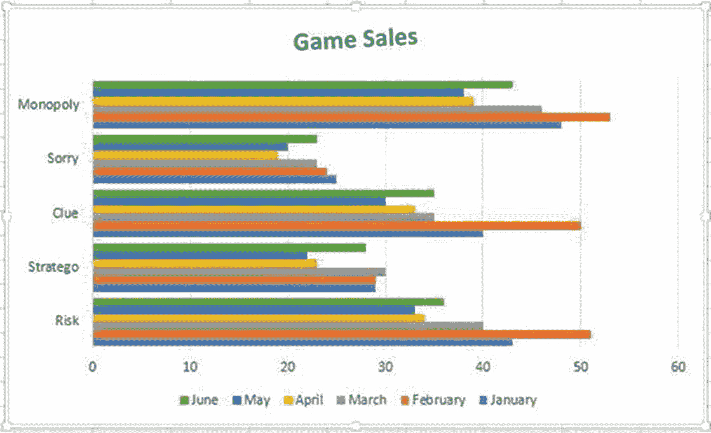

   **图 13-24**
   选择簇状条形图的结果

注意，“图表样式”组和“快速布局”中的按钮已更改，以反映图表现在是条形图。

1.  在功能区“设计”选项卡的“类型”组中，点击“更改图表类型”按钮。图表类别列表将出现在“更改图表类型”窗口的左窗格中。右上窗格包含左窗格中选定的图表类型的变体。

   点击其中一个变体将在右下窗格中显示结果。见图 13-23。右下窗格中有两个可用的图表。它们之间的区别在于，一个图表使用列标题作为水平轴，另一个图表使用行标题作为水平轴。将光标悬停在两个图表上；它们会放大，以便您更好地查看它们。

   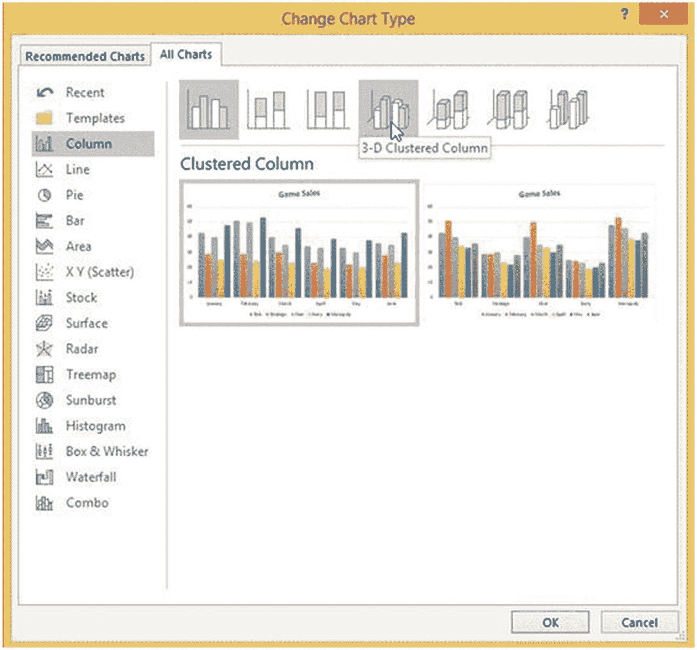

   **图 13-23**
   所选图表的可用图表显示在右下窗格中

#### 更改系列颜色

“Risk”和“Monopoly”的系列颜色非常接近，很难区分。我们将把“Risk”系列的颜色更改为红色。

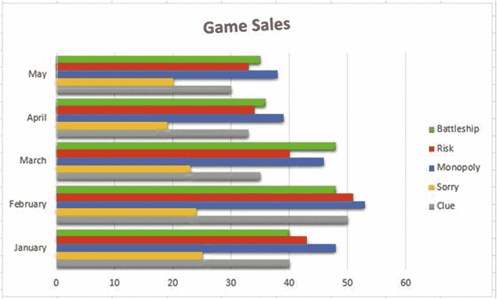

**图 13-30**
代表“Risk”的条形已更改为红色

1.  在功能区“格式”选项卡的“当前所选内容”组中，点击“图表元素”的下拉箭头，然后选择系列 `"Risk"`。

2.  在“当前所选内容”组中，点击“设置所选内容格式”按钮。

3.  在“设置数据系列格式”窗格中，单击“填充与线条”按钮。您可以将条形颜色设置为纯色、渐变色或使用图案或图片进行填充。

4.  选择“纯色填充”。

5.  从“颜色”按钮中选择红色。参见图 13-30。

您已了解如何创建柱形图和条形图。柱形图和条形图适用于多列数值数据。接下来，您将学习如何创建饼图。饼图应仅使用单列数值数据。

## 饼图

饼图用于显示百分比。整个圆代表 100%。数据系列中的每个项由饼图的一个扇区表示。每个扇区的大小显示了它占 100%的哪一部分。有时您可能会发现某个扇区中的信息需要进一步拆分为百分比。在这种情况下，您可以使用“复合饼图”子类型。在本节中，我们将首先介绍标准饼图，然后介绍复合饼图子类型。

### 标准饼图

在图 13-31 中，我们有十个水果。整个饼图代表我们水果的 100%。有五个香蕉，因此它们代表 5/10 即 50%的水果。因此，香蕉占饼图的一半。苹果的扇区占饼图大小的 30%。

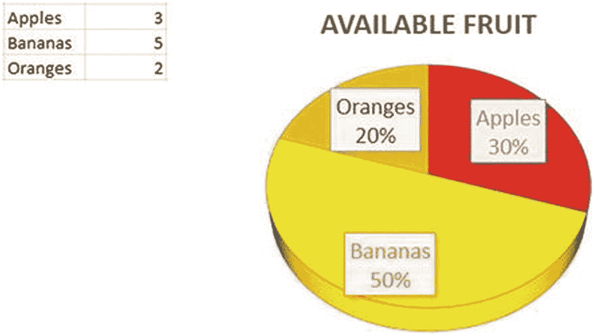

图 13-31

带标签的饼图

练习 13-2：创建饼图

在本练习中，您将根据 Dave’s Lunch Wagon 的数据创建一个饼图。饼图非常适合这些数据，因为只有一列标签数据和一列数值数据。

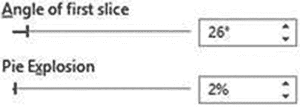

图 13-36

将“第一扇区起始角度”更改为 26，将“饼图分离程度”更改为 2%

1.  单击饼图区域的饼图部分。右侧窗格应切换为“设置数据系列格式”。

2.  单击“系列选项”按钮（上面有一个条形图图标）。将“第一扇区起始角度”滑块拖动到 26。这会将饼图旋转 26 度。

3.  要在饼图扇区之间创建一些间距，请将“饼图分离程度”更改为 2%。参见图 13-36。

1.  单击“文本选项”并完成以下操作：
    1.  单击“文本效果”按钮。

2.  展开“阴影”选项。

3.  单击“预设”的下拉箭头。

4.  单击“外部”组中的第二个阴影（向下偏移）。

5.  将“距离”滑块拖动到 12 磅。

1.  单击新的图表标题文本。

2.  单击图表右侧的“图表元素”按钮。

3.  将光标移至“图表标题”上。单击其右侧的箭头。选择“更多选项”。参见图 13-35。

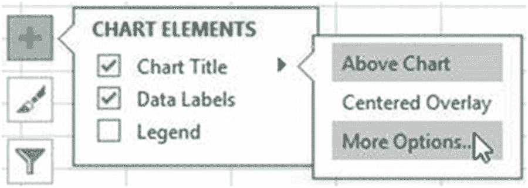

图 13-35

从图表标题选项中选择“更多选项”

“设置图表标题格式”窗格随即打开。有两个选项可供选择：“标题选项”影响图表标题区域内但文本本身之外的区域；“文本选项”仅影响文本。

1.  单击“图表标题”以将其选中。

2.  在功能区“开始”选项卡的“字体”组中，将字体大小更改为 28。

3.  拖动以选择“图表标题”文本。键入“Dave’s Chuck Wagon”。

如果标题显示为两行，则在按住 Shift 键的同时，将图表框架（而非图表标题）的右下角调整大小手柄向右下方拖动。直到“Dave’s Chuck Wagon”显示在一行上为止。参见图 13-34。

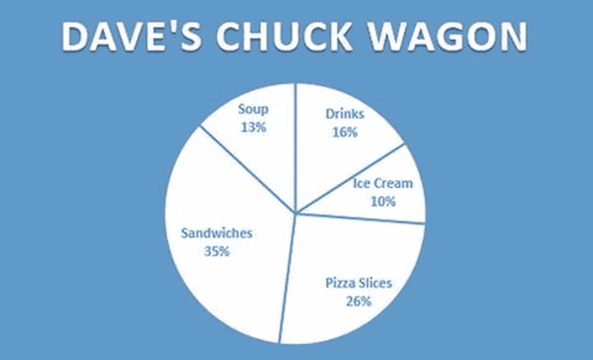

图 13-34

标题应显示在一行上

1.  单击“图表”。

Excel 建议为您选择的数据使用簇状柱形图、饼图或簇状条形图。如果您单击“簇状柱形图”按钮，Excel 将在当前工作表上使用所选数据创建一个簇状柱形图。

2.  将光标悬停在图表按钮上，以查看图表在所选数据下的效果。

3.  单击饼图。单击该图表。

4.  单击图表右侧的“图表样式”按钮。

“图表样式”框显示了显示当前图表类型的各种方式。让我们选择一个在每个饼图扇区上显示标签和百分比的图表。在每个饼图扇区上都有标签使得图例变得不必要。

5.  单击“饼图样式 10”，您可以在图 13-33 中看到它。

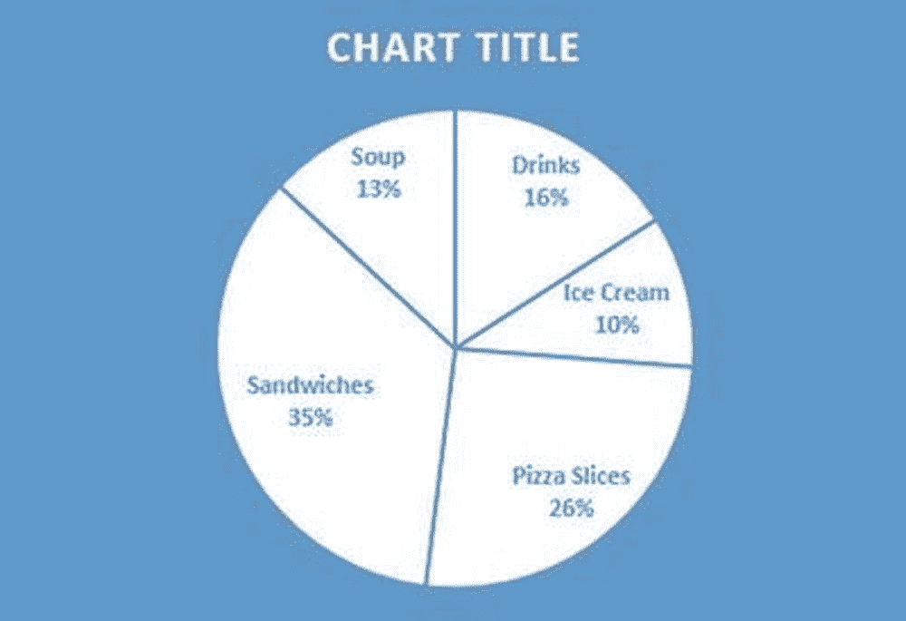

图 13-33

应用了饼图样式 10 的饼图

1.  打开工作簿第 13 章。选择名为“Pie”的工作表。

2.  选择单元格`A2:B6`。单击数据右下角的“快速分析”按钮。参见图 13-32。

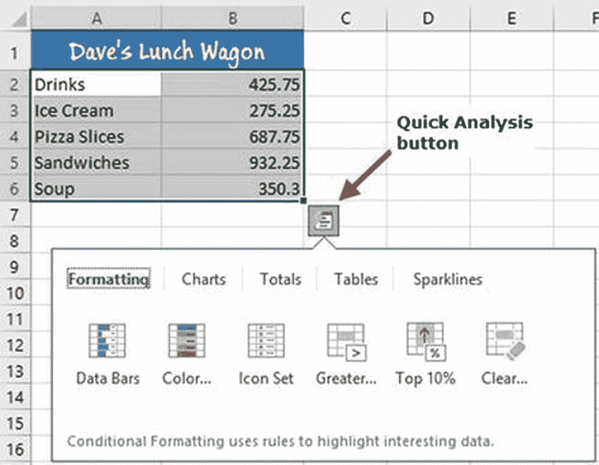

图 13-32

“快速分析”按钮的选项

结果应类似于图 13-37。

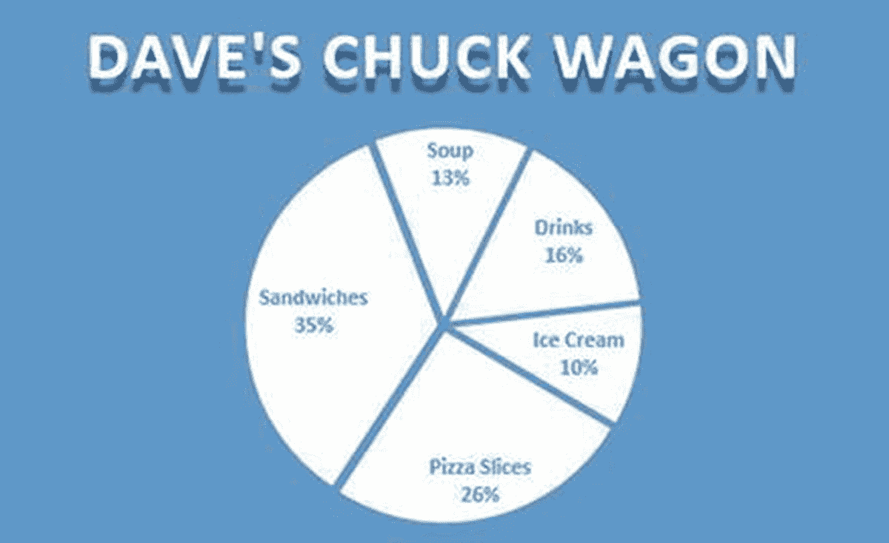

图 13-37

您的饼图现在应如下所示

### 饼图中的复合饼图子类型

`饼图中的复合饼图`会取饼图中的一个扇区，然后将该扇区分解为另一个饼图。这样做的一个原因是，你的饼图包含太多项目，其中一些扇区太小，难以辨认。另一个原因可能是，某个扇区代表一个你想进一步细分的类别。

安妮特经营一家汤品与三明治店。她希望查看饮料类别的细分情况，了解顾客本月购买了哪些类型的饮料。这可以通过将饮料类别的扇区从饼图中分离出来实现，这种操作称为**分离饼图**。你可以分离整个饼图，也可以分离单个扇区。

**练习 13-3：创建饼图子类型**

在此练习中，你将为一家三明治店创建饼图，以展示三明治、汤品、冰淇淋和饮料各自所占的销售百分比。该店还希望查看饮料销售的细分情况，了解百事可乐、可口可乐、七喜和雪碧各自的销售百分比。你将创建一个`饼图中的复合饼图`来显示不同类型饮料的数据，然后用`饼图中的复合条形图`来呈现相同的饮料数据。

1.  将`第二绘图区中的值`从 3 更改为 4。这会将百事可乐扇区移动到第二个图表。见图 13-45。

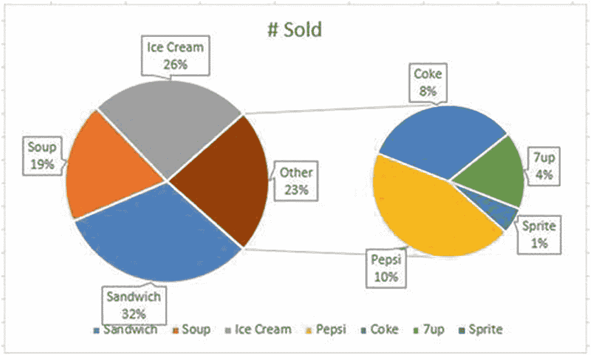

**图 13-45**  
将`第二绘图区中的值`从 3 改为 4，将百事可乐移至`饼图中的复合饼图`

1.  双击任一图表中的一个饼图扇区。此时电子表格右侧会显示`设置数据系列格式`窗格。
2.  单击`系列选项`按钮，如图 13-43 所示。

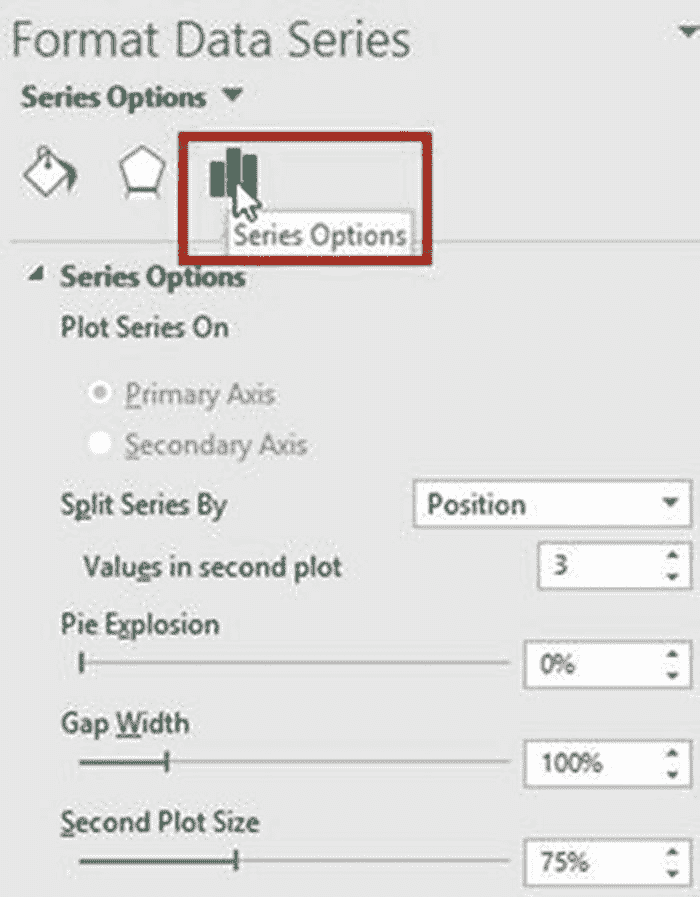

**图 13-43**  
选择`系列选项`

`系列分割依据`组合框有四个选项。见图 13-44。

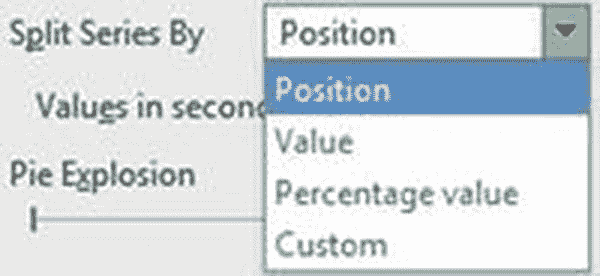

**图 13-44**  
`系列分割依据`的选项

`系列分割依据`的默认值为`位置`，组合框`第二绘图区中的值`的默认值为 3。这些默认设置会将列表中的最后三个项目放置在第二个图表中。

1.  单击图表。单击`图表元素`按钮 。
2.  将鼠标移到`数据标签`上，然后单击其右侧的箭头。
3.  选择`数据标注`。见图 13-41。

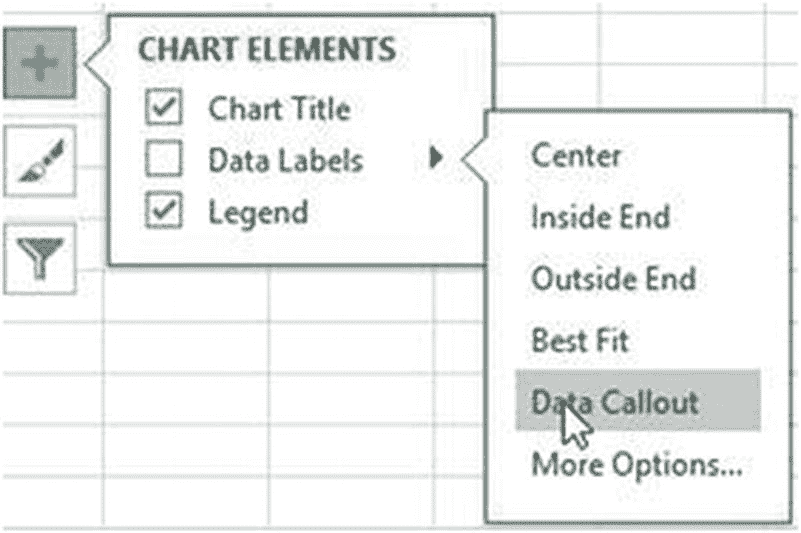

**图 13-41**  
从`数据标签`选项中选择`数据标注`

图 13-42 显示了结果。

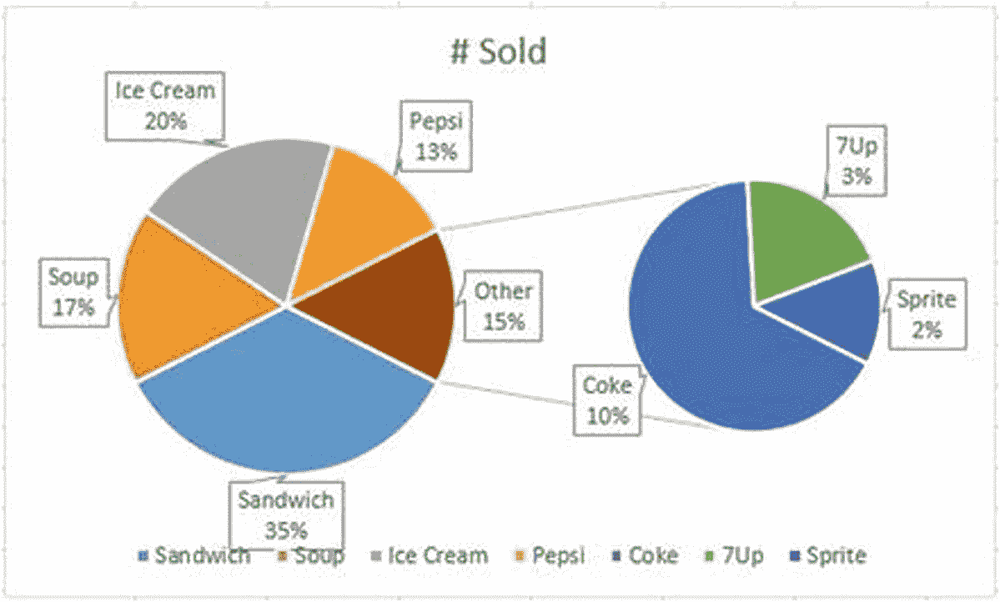

**图 13-42**  
你的图表现在应如图所示

1.  选择单元格区域 `A1:B8`。
2.  在功能区上的`插入`选项卡的`图表`组中，单击`饼图`按钮。
3.  在`二维饼图`区域中选择第二个选项（`饼图中的复合饼图`）。见图 13-39。

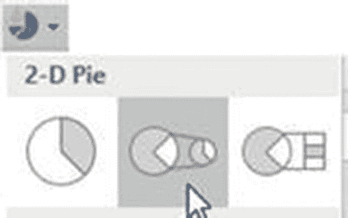

**图 13-39**  
选择`饼图中的复合饼图`选项

Excel 默认提取了最后三个项目，并将它们制成第二个图表。见图 13-40。我们需要将其更改为最后四个项目。

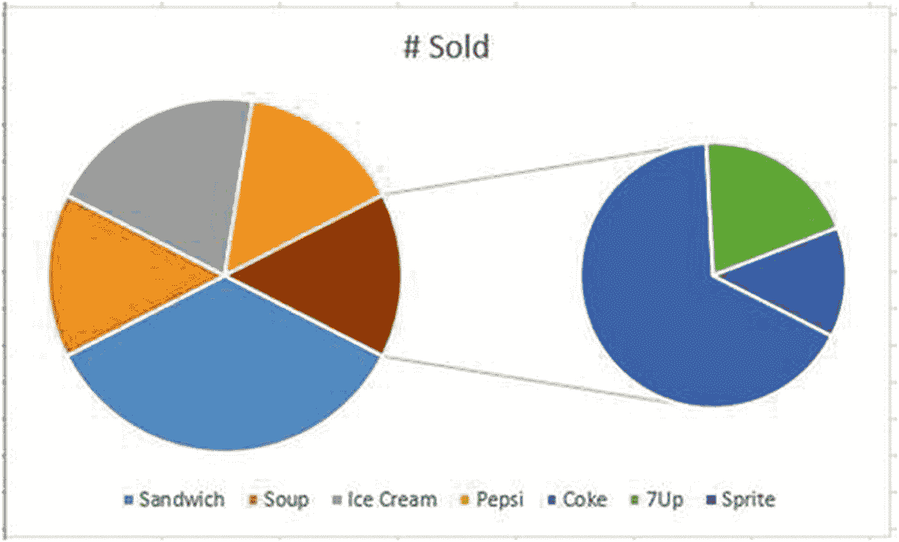

**图 13-40**

您的饼图现在应如下图所示。

1.  打开工作簿第 13 章。单击名为 `Pie of Pie` 的工作表标签。

图 13-38 显示了该工作表的数据。

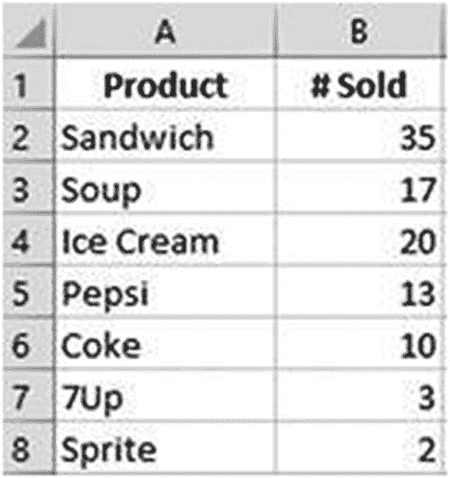

图 13-38

`Pie of Pie` 工作表上的数据

创建复合饼图时，Excel 会将所选区域末尾的数据项放入第二个饼图，因此您需要相应输入数据。

您也可以使用其他 `按以下值拆分系列` 选项，以获得与图 13-45 相同的结果。如果使用其他方法，则无需将要放入第二个图表的数据项放在列表底部。

### 将 `按以下值拆分系列` 的值更改为 `值`

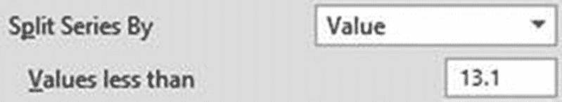

图 13-46

为 `按以下值拆分系列` 选择 `值`，然后在 `小于该值的值` 中输入 `14`

1.  单击“撤消”按钮或按 `Ctrl + Z`，以撤消将 `Pepsi` 移动到第二个图表的操作。

在本例中，您可以通过将 `按以下值拆分系列` 更改为 `值` 来获得相同的结果。当选择 `值` 时，Excel 会显示一个组合框，询问 `小于该值的值`。由于 `Pepsi` 的值为 `13`，因此您需要将该值更改为 `13.1`，才能将 `Pepsi` 扇形区移动到第二个图表。

2.  为 `按以下值拆分系列` 选择 `值`。

3.  在 `小于该值的值` 中输入 `13.1`。按 `Enter` 键。见图 13-46。

### 将 `按以下值拆分系列` 的值更改为 `百分比值`

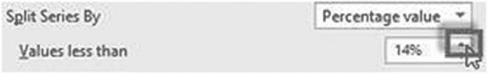

图 13-47

为 `按以下值拆分系列` 选择 `百分比值`，然后在 `小于该值的值` 中输入 `14`

1.  单击“撤消”按钮或按 `Ctrl + Z`，以从第二个图表中移除饮料数据项。

将 `按以下值拆分系列` 组合框的选项更改为 `百分比值` 后，会像选择 `值` 时一样显示 `小于该值的值` 组合框。图表上的 `Pepsi` 显示的百分比值为 `13%`。在本例中，由于电子表格数据使用了百分比值，因此数值和百分比是相同的。要将 `Pepsi` 扇形区移动到第二个图表，我们需要更改 `小于该值的值`。

2.  为 `按以下值拆分系列` 选择 `百分比值`。

3.  单击 `小于该值的值` 的上箭头，直到值变为 `14`。见图 13-47。

### 将 `按以下值拆分系列` 的值更改为 `自定义`

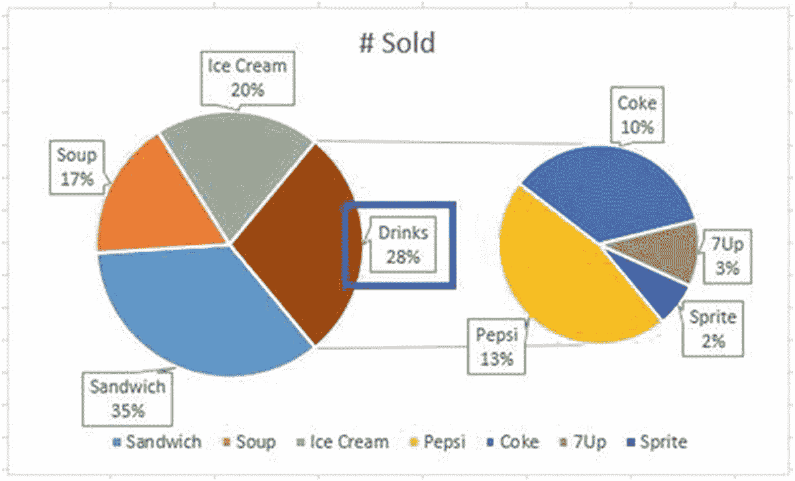

图 13-49

将 `其他` 一词更改为 `饮料`

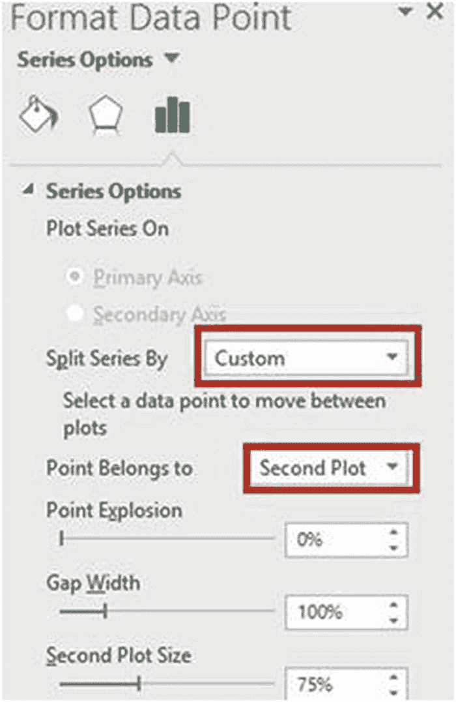

图 13-48

为 `按以下值拆分系列` 选择 `自定义`

1.  单击其中一个图表。然后在“设置数据系列格式”窗格中，尝试以下选项：
    *   `饼图分离程度` 用于设置饼图扇形区之间的间距。数值越大，图表分离得越开。

    *   `间隙宽度` 用于更改两个图表之间的间距大小。

    *   `第二绘图区大小` 用于更改第二个图表的大小。

2.  双击第一个图表上的 `Pepsi` 饼图扇形区。在 `点属于` 下拉框中，选择 `第二绘图区`。见图 13-48。

3.  图表显示这四种饮料属于 `其他` 扇形区。`其他` 这个词无法提供任何信息。选择 `其他` 一词，并将其更改为 `饮料`。见图 13-49。在空白区域单击。

4.  单击“撤消”按钮，撤消将 `Pepsi` 移动到第二个图表的操作。

您可以通过在 `按以下值拆分系列` 中选择 `自定义`，然后点击要移动到第二个图表的饼图扇形区，最后在 `点属于` 组合框中选择要移动到的目标图表，从而在图表之间移动扇形区。

5.  为 `按以下值拆分系列` 选择 `自定义`。

### 将复合饼图更改为复合条饼图

复合条饼图的工作方式与复合饼图相同。

图 13-50

选择第三个选项 `复合条饼图`

1.  选择图表框架。

2.  在功能区的 `插入` 选项卡的 `图表` 组中，单击饼图按钮。

3.  在 `二维饼图` 组中选择第三个选项（`复合条饼图`）。见图 13-50。

图 13-51 显示了结果。

图 13-51

您的图表应如下所示

您已经学习了如何创建饼图，甚至学习了如何将饼图的一个扇形区分解成另一个饼图或条形图。接下来，您将学习如何将两种图表类型组合到一个称为组合图的单一图表中。

## 组合图

组合图是在单个图表中组合多种图表类型而成的图表。最常见的组合图由一个系列柱形图和另一个系列折线图组成。图 13-52 展示了一个组合图示例，其中销售数据和预测销售数据显示在同一图表中。销售数据以柱形图形式展示，预测销售数据以折线图形式展示。这样便于直观地看出哪些预测销售额高于实际销售额，哪些低于实际销售额。创建组合图的另一个原因是当不同系列中的数值存在巨大差异时。

**图 13-52** 由柱形图和折线图构成的组合图

### 练习 13-4：创建组合图

在此示例中，您将创建一个由柱形图和折线图构成的组合图。观察图 13-53，您会发现这两列数据之间的数值存在巨大差异。正如您将要看到的，这种差异会阻碍我们创建准确的柱形图。

**图 13-53** 名为“Combination”的工作表中的数据

**图 13-54** 簇状柱形图

1. 选择单元格区域 `A1:C7`，并完成以下操作：
  1. 单击所选数据右下角的**快速分析**按钮。
  2. 单击**图表**选项卡。
  3. 单击**簇状柱形图**。图 13-54 显示了结果。

2. 打开工作簿第 13 章。选择名为“Combination”的工作表。图 13-53 显示了数据。

您可以看到此图表并不十分有用。“已售房屋数量”和“平均价格”的值之间存在过大差异。

**图 13-57** 垂直轴已应用“橙色，着色 2，深色 25%”

**图 13-56** 标题已更改的图表

**图 13-55** 选择“带标记的折线图”

3. 为了让用户能轻松看出与“平均价格”相关的数值位于右侧垂直轴上，我们让它们的颜色与折线图一致：
  1. 选择“次要垂直（值）轴”。参见图 13-57。
  2. 单击**开始**选项卡。
  3. 单击**字体颜色**的下拉按钮。
  4. 选择**橙色，着色 2，深色 25%**。
  5. 单击**加粗**按钮。参见图 13-57。

4. 单击**图表标题**。将文本更改为**已售房屋数量及其平均价格**。参见图 13-56。

5. 我们需要创建第二个垂直轴，用于显示与“平均价格”相关的值。左侧垂直轴则将显示与“已售房屋数量”相关的值：
  1. 勾选“平均价格”右侧的**次要坐标轴**复选框。
  2. 单击**确定**按钮。

6. 单击图表中的一个“平均价格”柱形，以选中“平均价格”系列。

7. 在“图表工具”功能区的**设计**选项卡下，单击**更改图表类型**。

8. 在**更改图表类型**窗口中，在左侧窗格中选择**组合图**。两个系列都会显示。“已售房屋数量”和“平均价格”都是簇状柱形图。

9. 单击“平均价格”右侧**簇状柱形图**的下拉箭头。在**折线图**组下，选择**带标记的折线图**。参见图 13-55。

您已学习了如何在单个组合图中组合两种图表类型。接下来，您将学习如何创建两种新的层次结构图表：树状图（Treemap）和旭日图（Sunburst）。

## 层次结构图

有时您会希望展示数据之间的层次结构关系。在本节中，我们将介绍两种常见的层次结构图类型：树状图（Treemap）和旭日图（Sunburst）。

### 树状图

树状图用于表示分层数据。该图表由矩形组成，矩形的大小表示与标签关联的值。图 13-59 展示了一个树状图示例。

**练习 13-5：创建树状图**

在本练习中，您将使用图 13-58 中的数据创建一个树状图。由于电子表格中的最大值为 1000，该数据项将由最大的矩形表示。代表产品的矩形将按州进行组织。

图 13-58：名为“Treemap”的工作表中的数据

图 13-62：在“彩色”组中选择第三行

图 13-61：将标题更改为横幅后的结果

图 13-60：从“标签选项”中选择“横幅”

图 13-59：树状图

1.  更改矩形的颜色：
    1.  单击功能区的“设计”选项卡。在“图表样式”组中，单击“`更改颜色`”按钮。
2.  将鼠标悬停在不同调色板上，查看它们对图表的影响。我们需要一个不包含灰色的调色板。选择“彩色”组中的第三行。参见图 13-62。

3.  右键单击图表上的任意一个矩形，然后选择**设置数据系列格式**。从“标签选项”中选择**横幅**。参见图 13-60。

图 13-61 显示了结果。

现在查看州名标题更容易了。由于密歇根州的数据项是灰色的，它们与州名标题融为一体，难以辨认。

4.  选择区域 `A2:C12`。在功能区的“插入”选项卡上，单击“图表”组右下角的**查看所有图表**按钮 。
5.  选择“所有图表”选项卡，然后在左侧窗格中选择“树状图”。单击“确定”按钮。参见图 13-59。最大的矩形代表最大的数值。

如果将标题（本例中为州名）转换为横幅，通常更易于阅读树状图。

6.  打开工作簿第 13 章。选择名为“Treemap”的工作表。

我们公司向五个州的加油站销售零食。图 13-58 显示了我们上周的利润。

树状图可以让我们快速了解这五个州不同产品的利润分布情况。

**注意：** 创建图表时无需选中标题。

您可能希望同时查看数值和标签。

图 13-69：选择一种纹理

图 13-68：为密歇根州选择了纹理背景

图 13-67：密歇根州被高亮显示，因为密歇根图例项被单击了一次，然后又单击了一次

图 13-66：标签和数值应显示在两行上

图 13-65：标签选项

图 13-64：标签选项

图 13-63：从“图表选项”中选择“数据标签”

7.  尝试更改单个矩形的颜色或纹理。

如果并非所有数据值都显示，您可能需要扩大图表的大小。

8.  双击其中一个密歇根州矩形，以重新选中所有密歇根州矩形。在“设置数据点格式”窗格中，单击“填充与线条”按钮（油漆桶图标）。
9.  展开“填充”组。
10. 选择**图片或纹理填充**。
11. 单击图 13-69 中显示的“纹理”下拉框。选择您想使用的任何纹理。

12. 单击一个密歇根州矩形，然后再次单击它。单击密歇根州组中的甜甜圈矩形。所有矩形都应变暗，除了密歇根州的甜甜圈矩形。单击一个空白单元格以取消矩形的变暗状态。

当选中一组矩形或单个矩形时，您可以将其背景更改为不同的颜色、渐变、图片或纹理。图 13-68 显示为密歇根州的一组矩形选择了纹理。您还可以通过单击功能区的“格式”选项卡，然后从“形状样式”组中选择一个选项来应用各种效果并更改其边框。

13. 在标签仍处于选中状态时，按 `Ctrl + B` 将文本加粗。
14. 单击“图表标题”。拖动鼠标选中它。输入**按州销售额**。

如果您单击一个州的某个矩形，然后再次单击同一个矩形，则所有与该州无关的矩形都会变暗。在图 13-67 中，图例项“密歇根州”被单击了两次。一旦选中了一个组，您可以单击单个矩形来选中它，或者通过单击另一个组的标题来选中它。如果您单击矩形内的某个标签，所有内容将再次被选中。

15. 白色文本可能难以辨认：
    1.  单击功能区的“开始”选项卡。
16. 单击“字体颜色”的下拉箭头，然后选择黑色。

17. 选择**值**。从“分隔符”下拉框中选择**新行**。选择“新行”会将标签和数值分别放在两行上，如图 13-66 所示。

18. 单击“标签选项”按钮。展开“标签选项”，以便您能看到如图 13-65 所示的选项。

19. 单击图表框架。单击功能区的“格式”选项卡。在“当前所选内容”组中，单击“设置所选内容格式”。在“设置图表区格式”窗格中，单击“图表选项”的下拉箭头，然后选择“数据标签”。参见图 13-63。

这将添加另一个选项按钮，即“标签选项”。参见图 13-64。

### 旭日图

与矩形式树状结构图类似，旭日图也是一种层级结构图。它并非使用矩形大小来表示数值，而是采用饼图扇区的大小。

旭日图相比矩形式树状结构图的一个优势在于，它可以展示更多列标签。在矩形式树状结构图的示例中，第一列（`状态`）用作标题，下一列（`产品`）用于表示各个矩形。如果我们想按照`状态`、`县`，再在县内按`产品`进行更细的划分，那么`县`这一层级在矩形式树状结构图中不会显示，但在旭日图中却可以显示。

使用与矩形式树状结构图相同的数据并选择相同的选项，让我们看看图 13-70 中旭日图的结果。

图 13-70

旭日图

旭日图清晰地显示印第安纳州是我们利润最高的州。从图中很容易看出，甜甜圈是我们在印第安纳州销售利润最高的商品。该图由内向外展开。最大的分组位于图的中心。细节部分距离中心最远。

密歇根州松饼的饼图扇区不够大，无法显示标签和数值。如果我们移除数值，松饼的标签就会变得可见。参见图 13-71。

图 13-71

移除数值为标签显示提供了更多空间

现在，密歇根州松饼利润的标签可见了。如果您想查看每个扇区对应的数值，只需将光标悬停在某个项目上即可。参见图 13-72。

图 13-72

将光标悬停在扇区上以查看对应的数值

### 练习 13-6：创建旭日图

本练习涵盖选择要在旭日图中表示的数据，以及选择图表部分并应用样式。

图 13-74

使用范围`A2:D15`创建的旭日图

图 13-73

名为`旭日图`的工作表中的数据

1.  选择单元格范围`A2:D15`并完成以下操作：
    1.  在功能区“插入”选项卡上，单击“图表”组的对话框启动器（查看所有图表）。
2.  单击“所有图表”选项卡。
3.  在左侧窗格中选择`旭日图`。单击“确定”按钮。
4.  放大图表。参见图 13-74。

1.  打开工作簿第 13 章。选择名为`旭日图`的工作表。

图 13-73 显示了数据。

旭日图让我们很容易看出，我们在北部地区销售的商品最多，并且印第安纳州和密歇根州是销量最大的州。

如果我们希望图表根据`毛额`列显示饼图扇区，该怎么办？

图 13-79

选中“北部”的旭日图

图 13-78

带有 3D 效果的旭日图

图 13-77

根据选中的范围`A2:C15`和`F2:F15`创建的旭日图

图 13-76

您的电子表格现在应如下所示

图 13-75

从“样式”组中选择`强调色 5`

1.  单击功能区的“设计”选项卡。在“图表布局”组中，单击“快速布局”按钮。选择“布局 5”。这会将`毛额`值添加到图表中。
2.  在“图表样式”组中，单击“更改颜色”按钮。选择“彩色调色板 3”。
3.  在 Excel 2016 中，选择“图表样式”组中的最后一个图表可使图表具有 3D 外观。此功能在较新版本中已不再可用，但我们将通过格式化使其具有某种 3D 外观。选择图表，然后在功能区的“设计”选项卡上，从“图表样式”组中选择最后一个图表选项。右键单击图表。选择“设置数据系列格式”。单击“效果”按钮。展开“阴影”。输入角度为 132。参见图 13-78。

与矩形式树状结构图一样，您可以通过在同一组的某个部分上双击两次来选择该组。然后，您可以通过单击一次来选择单个部分或其他组。如果您有意或无意地单击了标签，所有内容都将被重新选中。图 13-79 显示了选中的“北部”组。

1.  在功能区“插入”选项卡上，单击“图表”组的对话框启动器（查看所有图表）。
2.  单击“所有图表”选项卡。在左侧窗格中选择`旭日图`。单击“确定”按钮。
3.  放大图表。参见图 13-77。

我们在纽约市一个非常高端的地区以更高的价格销售产品，这使得我们的纽约饼图扇区比基于售出打数时大得多。

1.  删除旭日图。
2.  选择单元格范围`A2:C15`，按住`Ctrl`键，再选择单元格范围`F2:F15`。让我们对该范围应用单元格样式，以便轻松识别哪些列正被用于图表。
3.  在功能区的“开始”选项卡上的“样式”组中，单击“单元格样式”按钮。选择`强调色 5`。参见图 13-75。

您的电子表格应类似于图 13-76。

您已经学习了如何创建矩形式树状结构图和旭日图这两种层级结构图。层级结构图非常适合存在自然分组且数据按一定顺序组织的数据。

## 漏斗图

漏斗图因其外观而得名。漏斗图以宽条开始，后续每个条块逐渐变窄。漏斗图通常用于展示流程中各个阶段的值。漏斗图由两列数据构成：一列包含描述信息，另一列为数值。

创建漏斗图非常简单：只需选择数据，单击功能区“插入”选项卡，在“图表”组中点击“**插入瀑布图、漏斗图、股价图、曲面图或雷达图**”按钮，然后选择“漏斗图”。参见图 13-80。

图 13-80  
如何访问漏斗图

图 13-81 显示了用于创建图 13-82 中漏斗图的数据。

图 13-82  
漏斗图展示达到“毕业学生人数”的阶段

图 13-81  
漏斗图数据

你已经学习了如何创建漏斗图来展示流程中各阶段的值。接下来，你将了解 Excel 的两种地图图表：地图图和必应地图。必应地图不是“图表”组的一部分，而是一个加载项。在此对两者进行讨论，以便你比较并了解何时需要使用哪一种。

## 地图图

Excel 的新型地图图用于按国家/地区、州、县或邮政编码显示地理数据。你可以使用地图图来显示数值或分类数据。它用于展示地点及其相关的一个变量，例如某地点的人口、该区域的销售额、该区域的医院数量等。在此图表之后将讨论必应地图。两者的优缺点如下所示：

- 必应地图
  - 优点
    - 具有鸟瞰视图。可查看街道。
    - 可使用混合类型，例如使用包含邮政编码、州和国家的数据范围。
    - 可使用多个变量，例如，能够为各州绘制人口、收入和医院数量的图表。
  - 缺点
    - 只能表示数值数据，不能表示分类数据。
    - 无法像其他图表那样使用“设计”和“格式”选项卡中的命令。
- 地图图
  - 优点
    - 最大优势在于可以使用你处理过的其他图表的所有格式和设计工具。
    - 可以使用分类数据以及数值数据。
  - 缺点
    - 没有鸟瞰视图，且无法查看任何街道。
    - 不能使用混合类型。
    - 只能使用一个变量。

让我们看一个展示编写本书时发生的问题的地图，那就是冠状病毒。图 13-83 显示了一些州及其当前的冠状病毒病例数。

图 13-83  
冠状病毒数据

我们可以通过选择单元格区域 `A1:B7`，然后单击功能区“插入”选项卡来将此数据绘制成图表。在“图表”组中，有一个“地图”按钮。参见图 13-84。目前只有一种类型的地图图，即“着色地图图”。单击“更多地图图”仅允许你从可用的图表类型中选择一种。

图 13-84  
选择着色地图

选择地图数据并单击“着色地图”按钮后，Excel 会创建一个美国地图，图表中的各州以渐变色填充。参见图 13-85。颜色越深，冠状病毒病例数越多。图例显示了病例数，范围从最小值 (6) 到最大值 (93)。

图 13-85  
冠状病毒病例地图

你可以使用地图图来显示类别而非数值。每个类别将被分配一种颜色。图 13-86 显示了用于创建图 13-87 中地图的部分表格。

图 13-87  
使用类别的地图图

图 13-86  
地图的类别数据

你可以通过以下操作更改某个类别所代表的所有区域的颜色：

1. 单击图例以选中它。
2. 右键单击要更改颜色的类别。
3. 单击“填充颜色”按钮。
4. 选择一种颜色。

参见图 13-88。

图 13-88  
更改类别颜色

### 使用必应地图

使用 Excel 的必应地图，您可以在世界上任何地点创建数据的可视化表示。数据的第一列必须是地址、城市、州/省、国家、邮政编码、纬度/经度或其组合。之后的任何列都必须是数值数据。使用城市名的问题在于可能存在多个同名城市。您可以将城市与州/省或国家名称连接起来。

### 练习 13-7：使用必应地图

在本练习中，您将创建能反映不同城市收入的地图。

1.  点击 `X` 关闭启动消息。
2.  将光标置于地图图标上方的边框上，光标将会变成四个箭头。现在您可以随意拖动地图。

1.  打开第 13 章的工作簿。选择名为 `Maps` 的工作表。

此工作表中的示例使用 `Revenue` 作为数值。这些值可以是任何内容（例如，城市或州的人口、增长率、死亡率、公司在该地点工作的员工数量等）。

2.  点击功能区的 `Insert` 选项卡。在 `Add-ins` 组中，点击 `Bing Maps` 按钮。必应地图将会显示。参见图 13-89。

**图 13-89** 必应地图

**图 13-96** 放大的鸟瞰视图

**图 13-95** 饼图的数据

**图 13-94** 数值由饼图表示

**图 13-93** 选择饼图

**图 13-92** 图例标识不同收入列的颜色

**图 13-91** 印第安纳州的数据

**图 13-90** 圆圈代表该地点的收入金额

1.  选择单元格区域 `A19:B22`。点击 `Show Location` 按钮 。由于所有位置都在同一个城市，地图会放大显示。
2.  点击 `Settings` 按钮 。在 `Map Type` 下，选择 `Bird’s Eye`。点击圆圈内的箭头返回地图。进行放大。参见图 13-96。

1.  点击其中一个饼图。与该饼图关联的数据将会显示。参见图 13-95。点击关闭按钮。

1.  选择单元格区域 `A13:D17`。点击 `Show Location` 按钮 。
2.  点击 `Settings` 按钮 。在 `Multiple Data Point Display` 下选择 `Pie Chart`。参见图 13-93。Excel 允许您为三个饼图切片分别选择不同的颜色。
3.  挑选您喜欢的任何颜色。完成颜色选择后，点击圆圈内的箭头返回地图。

饼图将使用您选择的颜色显示。参见图 13-94。

1.  点击地图右上角的加号和减号按钮进行放大和缩小。如果您的鼠标有滚轮，可以使用它来进行缩放。按住鼠标左键并拖动即可移动到地图上的任意位置。

2.  选择单元格区域 `A6:C11`。点击 `Show Location` 按钮 。地图将在每个位置显示一个圆圈。参见图 13-92。由于我们提供了两列数值数据，它将第一列的值显示为外圈，第二列的值显示为内圈。地图会显示一个图例，说明哪种颜色对应哪个值。

在查看两个数值时，圆圈效果尚可，但使用超过两列时，就真的很难识别颜色了。您可以使用饼图来代替圆圈。

1.  点击其中一个圆圈。与该圆圈关联的数据将会显示。参见图 13-91。点击关闭按钮。

1.  如果您在边框上点击，会显示调整大小手柄。将光标移到调整大小手柄上时，它会变成一个双箭头。按住 `Shift` 键并拖动其中一个角手柄，可以使地图保持其比例。

2.  选择单元格区域 `A2:B4`。点击右上角的 `Show Location` 按钮。

在右上角。

必应会在三个州中的每一个州显示一个带有圆圈的地图。参见图 13-90。圆圈代表数值数据的数量。伊利诺伊州的金额最大，所以它的圆圈也最大。

这些地点不必是同一类型。可以混合使用城市、州、国家、邮政编码、地址等，如表 13-1 所示。

**表 13-1** 混合类型的地点

| 地点 | 收入 |
| --- | --- |
| Kentucky | 7500 |
| Chicago | 4500 |
| France | 5000 |
| Germany | 8000 |
| 46341 | 7000 |
| 550 N. Clinton St., Fort Wayne | 6000 |

1.  选择单元格区域 `A24:B30`。点击 `Show Location` 按钮 。
2.  点击地图边框选中地图，然后按 `Delete` 键删除地图。

接下来，您将学习如何创建代表一行数据并存储在单个单元格中的图表。

## 迷你图

迷你图是显示在单个单元格中的小型图表，用于突显单行或单列中的趋势。迷你图分为三种类型：折线图、柱形图和盈亏图。创建迷你图时，需先选中要放置迷你图的单元格，然后选择要创建的迷你图类型。`迷你图`组位于`插入`选项卡上，该组包含三个按钮：`折线图`、`柱形图`和`盈亏图`。见图 13-97。

**图 13-97**  
功能区的“迷你图”组

由于迷你图非常小，如果数值的差异不大，柱形图的大小可能与实际数值不成比例。放大包含迷你图的单元格可以更容易地观察趋势。

负值的柱形迷你图显示在单元格的下半部分。零值不会显示迷你图，而会在该位置留空。见图 13-98。

**图 13-98**  
负值的迷你图显示在单元格底部

盈亏迷你图显示数据是正值（赢）还是负值（亏）。见图 13-99。

**图 13-99**  
标识赢亏的迷你图

### 练习 13-8：创建迷你图

在本练习中，你将针对图 13-100 中的行数据创建迷你图。你将组合和取消组合迷你图，以便以不同方式对其中一些迷你图进行格式化。

**图 13-100**  
名为`迷你图`的工作表中的数据

**图 13-105**  
选择`迷你图样式着色 5，深色 50%`

**图 13-104**  
更改粗细会改变线条和字号

**图 13-103**  
为`标记颜色`选择紫色

**图 13-102**  
圆点代表最高点和最低点

**图 13-101**  
选择`迷你图样式彩色 #4`

1. 再次单击`迷你图颜色`按钮。在`主题颜色`中，选择`蓝色，着色 5，浅色 40%`。

2. 在`类型`组中，单击`柱形图`。接下来更改样式。单击`样式`的`更多`按钮。单击`迷你图样式着色 5，深色 50%`。见图 13-105。

1. 在`样式`组中，单击`标记颜色`按钮。将鼠标指针移至`负点`上方。从`标准色`中选择深红色。

2. 在`样式`组中，单击`迷你图颜色`按钮。将鼠标指针移至`粗细`上方。选择`4.5 磅粗细`。更改`粗细`会同时改变线条和点的大小。见图 13-104。

1. 取消勾选`高点`和`低点`。勾选`负点`。此时线条上的点代表具有负值的单元格。

2. 勾选`标记`。此时所有单元格均由线条上的点表示。

## 概述：在“样式”组中，单击“标记颜色”按钮。从“标准色”中选择紫色。参见图 13-103。

1.  拖动选中行标题 2、3、4、5 和 6。在功能区“开始”选项卡的“单元格”组中，单击“格式”按钮。
2.  单击“行高”。将行高更改为 22。单击“确定”按钮。
3.  将 F 列的列宽更改为 17.43。
4.  选中单元格区域`F2:F6`。
5.  单击功能区的“设计”选项卡。在“显示”组中，勾选“高点”和“低点”复选框。此时，迷你图线条上应显示代表最高点和最低点的点，如图 13-102 所示。

1.  在功能区的“插入”选项卡中，找到“迷你图”组，单击“折线”按钮。
2.  删除“数据范围”文本框中的任何文本。选择单元格区域`B2:E6`。
3.  删除“位置范围”文本框中的任何文本。选择单元格区域`F2:F6`。
4.  单击“确定”按钮。
5.  在“迷你图工具”上下文选项卡下，单击“设计”选项卡。在“样式”组中，单击向下箭头以查看更多线条颜色选项。选择最后一行中的“迷你图样式彩色 #4”。参见图 13-101。

1.  打开第 13 章的工作簿。选择名为`Sparklines`的工作表。图 13-100 显示了这些数据。

**取消组合迷你图**

图 13-107：已选择“最后一个点”

图 13-106：单击“取消组合”

1.  在“类型”组中，单击“折线”。
2.  在“显示”组中，取消勾选“标记”，并勾选“最后一个点”。参见图 13-107。

1.  你可能希望某些迷你图单元格的格式设置与其它单元格不同。您可以通过对迷你图单元格进行分组和取消分组来实现。
2.  选中单元格`F2`和`F3`。
3.  单击“取消组合”。参见图 13-106。

**分组迷你图**

1.  选中单元格区域`F2:F6`。单击“分组”按钮。
2.  取消勾选“最后一个点”。
3.  在“类型”组中，单击“盈亏”。

代表正值（赢）的点显示在单元格的上半部分。代表负值（亏）的点显示在单元格的下半部分。

**清除迷你图**

图 13-108：选择“清除选中的迷你图”

1.  单击单元格`F4`。
2.  单击“清除”按钮右侧的向下箭头，然后单击“清除选中的迷你图”。参见图 13-108。

**更改数据位置和迷你图的位置**

图 13-110：您的电子表格现在应如下所示

图 13-109：单击“折叠对话框”按钮

1.  选中单元格区域`C2:F6`。单击“展开对话框”按钮（向下箭头）。
2.  单击“位置范围”文本框右侧的“折叠对话框”按钮。
3.  选中单元格区域`B2:B6`。单击“展开对话框”按钮。
4.  单击“确定”按钮。参见图 13-110。

1.  右键单击列标题 B。选择“插入”。
2.  选中单元格区域`G2:G6`。
3.  在“迷你图工具”下，单击“设计”选项卡。
4.  在“迷你图”组中，单击“编辑数据”按钮的上半部分。
5.  单击“数据范围”文本框右侧的“折叠对话框”按钮。参见图 13-109。

## 章节总结

图表提供了一种快速查看大量数据的方式。它们使您能够轻松检查是否实现了目标并发现问题。使用哪种图表取决于您要表示的数据。您已经看到，柱形图和条形图可用于许多行的数值数据，而饼图仅表示一行数值数据。树状图和旭日图非常适合表示分层数据。迷你图存储在单个单元格中，并表示一行数据。如果使用迷你图，则需要使单元格足够大，以便可以轻松查看图表显示的内容。

饼图以饼图切片表示数据。饼图切片代表整个饼图的百分比。树状图使用矩形表示值，而旭日图使用饼图块表示值。迷你图可以使用三种图表类型之一：折线图、柱形图或盈亏图。饼图切片可以细分为另一个饼图或条形图，以便您可以查看用于创建它的所有项目。

组合图将两个图表合并为一个。它通常由一个系列的条形图和另一个系列的折线图组成。

必应地图和地图图表允许您绘制与地理区域相关的数据图表。

创建二维簇状条形图最快的方法是使用以下快捷键：

*   如果要让图表显示在与数据相同的工作表上，请按`Alt + F1`键。
*   如果希望图表出现在单独的工作表上，请按`F11`键。

下一章将详细介绍如何从各种源导入数据。

