# 15. 使用数据透视表和数据透视图

很少有人使用数据透视表，但他们可能错过了 Excel 中最强大的组件。学习它需要一点时间，但一旦你掌握了它，你将成为一个 Excel 高级用户，能够以你能想到的几乎任何形式对数据进行分组和汇总。你的老板会对你能够做到的事情感到惊讶。如果你是老板，你将会更加惊讶于自己的能力。数据透视表可以创建管理者希望看到的报告类型——这些报告不包含每一个细节，而是只包含他们在想查看时想看到的数据。

阅读并完成本章后，你应该能够：

*   创建数据透视表
*   从数据源创建数据透视图
*   从数据透视表创建数据透视图
*   重新排列和筛选数据透视表
*   从数据源创建多个数据透视表
*   清除、移动和删除数据透视表
*   使用切片器工具
*   使用时间间隔工具
*   筛选数据
*   创建关系数据库

## 使用数据透视表

它被称为数据透视表，是因为你可以**透视**数据，在行与列之间切换。你可以将现有数据动态重新排列成几乎无穷无尽的不同视图。通过将字段拖放到不同位置，你可以快速创建这些视图。随后，Excel 会自动重新计算结果，以匹配你所创建的视图。

你可以从已命名的表格或尚未声明为表格的数据区域创建数据透视表。从已命名的表格创建数据透视表的好处在于，你可以利用表格功能，例如在添加数据行时自动扩展表格。

Excel 会分析你的数据，然后显示“推荐的数据透视表”，供你选择符合需求的数据透视表。我们稍后会探讨此功能，但在第一次练习中，我们将从一个手动创建数据透视表的简单示例开始。

Work & Leisure 公司是一家连锁企业，在全国不同地区设有四家分店。该公司销售体育用品、户外家具和工具。图 15-1 中的电子表格显示了该公司在这些类别下销售的产品，以及上个月该产品的销售数量。

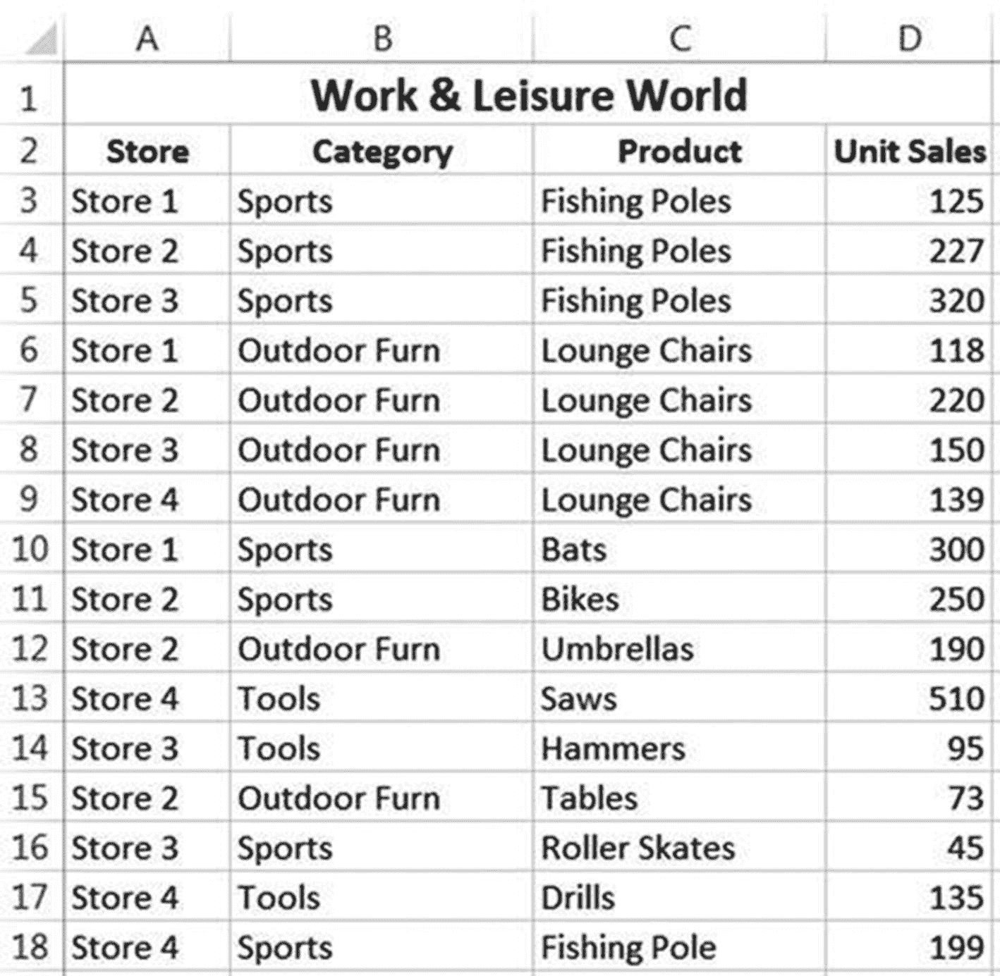

图 15-1

用于数据透视表的数据

## 练习 15-1：手动创建数据透视表

在本练习中，你将创建一个数据透视表。你将练习重新排序列和行数据、添加和删除字段、更改数据顺序、查看不同的数据汇总方式、筛选数据以及更改数据源位置。

1. 在“数据透视表字段”列表中，选中“类别”旁边的复选框。

默认情况下，“类别”会进入“行”区域，因为它包含文本。这些类别会以其在各自门店下的形式作为行显示在数据透视表中。即使这些类别在你使用的表格中未按顺序排列，它们在数据透视表中也会被放置到正确的顺序。此时，数据透视表会显示每家门店的总销售额、每个类别的销售额以及总计。

2. 选中“门店”字段的复选框。参见图 15-3。“门店”字段包含文本数据。包含文本的列默认会放入“行”区域。

3. 选中“销售数量”的复选框。“销售数量”字段包含数值数据。包含数值数据的列默认会放入“值”区域。

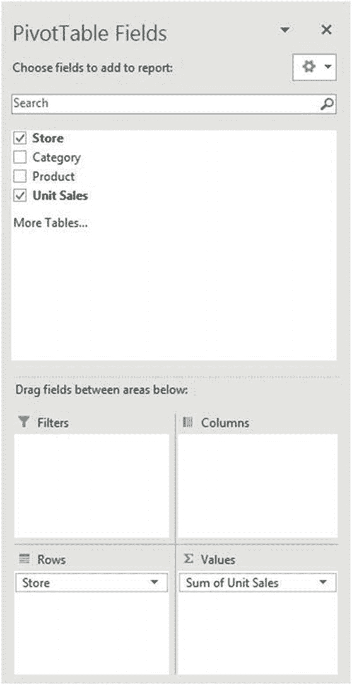

图 15-3

选择要在数据透视表中使用的字段

现在，数据透视表将每家门店显示在各自的行中，并汇总了每家门店的所有销售额。它还显示了一个总计，包含所有门店的销售总额。

**注意** 在执行此练习时，你可能需要使用状态栏上的缩放工具来同时查看整个电子表格和数据透视表。

4. “数据透视表字段”列表由五个独立区域组成。
   * “字段”区域：列出表格中所有列的名称，每个列名旁边都有一个复选框。
   * “筛选器”区域
   * “列”区域
   * “行”区域
   * “值”区域

5. 打开工作簿 `Chapter15_PivotTables`。

6. 选择名为 `PivotTable1` 的工作表。

7. 单击数据区域内的任意位置。单击功能区的“插入”选项卡。在“表格”组中，单击“数据透视表”按钮。

8. “创建数据透视表”对话框会显示，并已选中一个区域。该区域应包含单元格 `$A$2:$D$18`。参见图 15-2。如果文本框中显示的区域不是这个，请进行修改。

9. 将数据透视表报表的位置更改为“现有工作表”。

10. 在“位置”文本框中输入 `F2`。

11. 单击“确定”按钮。

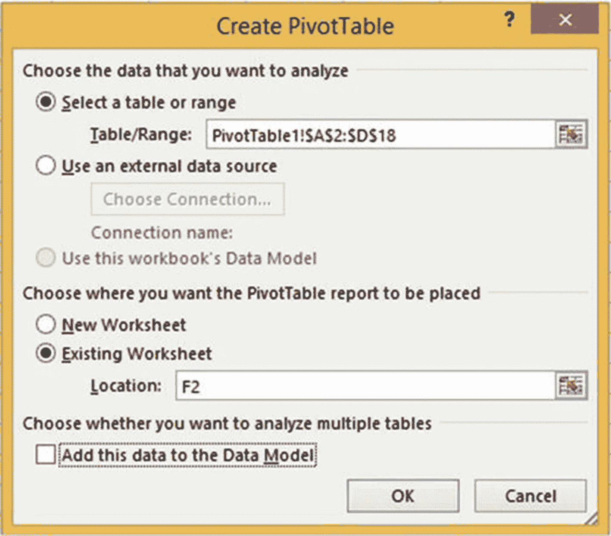

图 15-2

选择现有工作表

## 隐藏和显示数据透视表字段列表

只有当你选中数据透视表中的一个单元格时，数据透视表字段列表才会显示。选中数据透视表外任意位置的单元格，该窗格就会消失。

1. 单击单元格 `A2`。窗格消失。
2. 单击单元格 `F2`。窗格重新出现。

## 折叠和展开分组

请注意，每个店铺左侧都有减号。这些减号允许你折叠店铺下方显示的内容。

1. 单击加号以展开店铺 2 的详细信息。
2. 单击店铺 2 左侧的减号。

减号会变为加号。参见图 15-4。

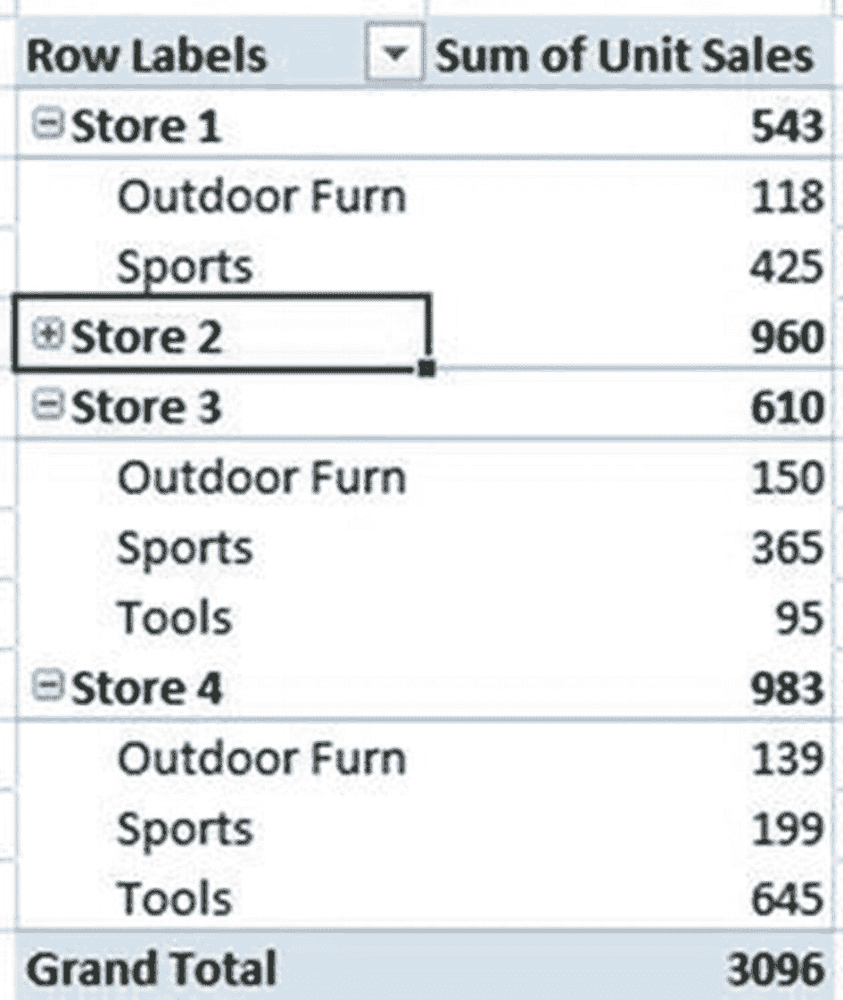

图 15-4

加号和减号可用于折叠和展开类别

## 查看字段值

你可以通过将鼠标移到数据透视表字段列表中的某个字段上，然后单击向下箭头，来查看该字段（列）中的所有不同值。

1. 单击“取消”按钮。
2. 将鼠标移到数据透视表字段列表中的“店铺”字段上。单击“店铺”右侧的向下箭头。参见图 15-5。这将显示“店铺”字段中的所有不同值。参见图 15-6。

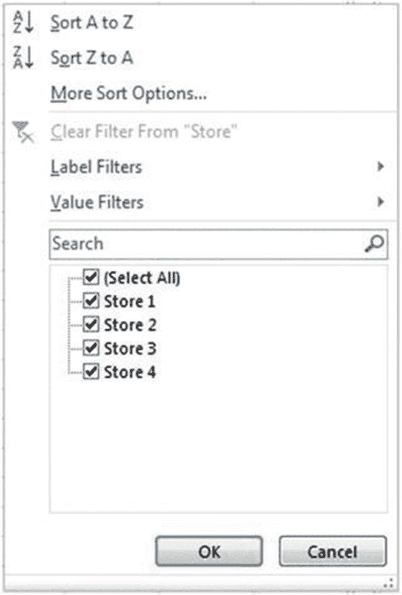

图 15-6

显示“店铺”字段中的所有不同值

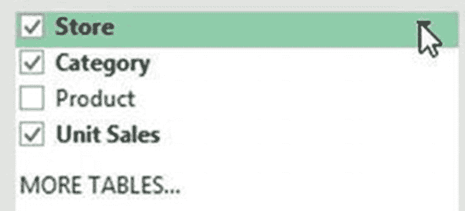

图 15-5

单击“店铺”右侧的向下箭头

## 筛选数据

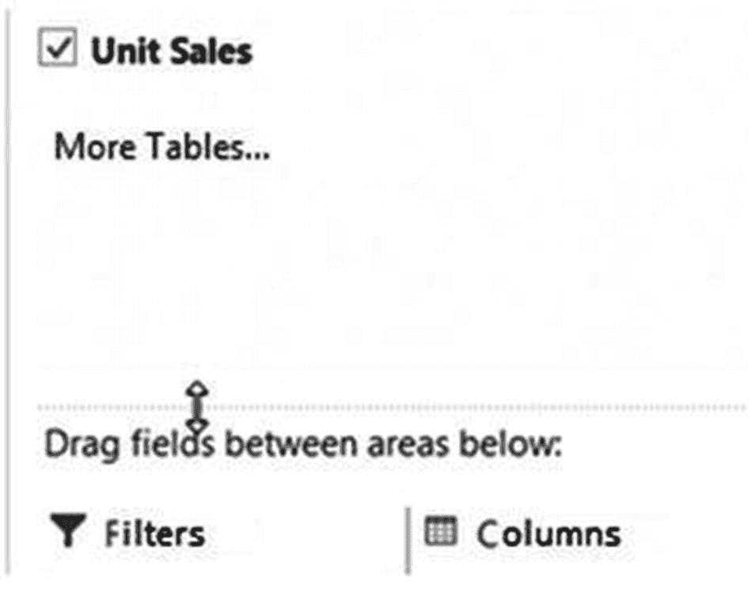

图 15-11

删除数据透视表字段列表和拖放区域之间的空间

1. 由于你当前选中了一个产品，因此会列出所有可用产品。单击“取消”按钮。
2. 在数据透视表中，单击店铺 1 下的“户外家具”。
3. 单击列标题“行标签”右侧的向下箭头。由于你选中了一个类别，因此会列出所有可用类别。单击“取消”按钮。
4. 单击店铺 1。单击列标题“行标签”右侧的向下箭头。由于你选中了一个店铺，因此会列出所有可用店铺。我们只想显示店铺 2 的销售额。单击除店铺 2 之外所有店铺旁边的复选框以取消选中它们。单击“确定”按钮。“行标签”右侧的向下箭头会变为筛选图标。
5. 通过单击“行标签”旁边的筛选图标，然后单击“全选”复选框，恢复显示所有店铺。（你也可以通过单击“从‘店铺’中清除筛选”来实现相同效果。）单击“确定”按钮。
6. 数据透视表字段列表中的字段与拖放区域之间可能会有一个较大的空白区域。这个区域可能会阻止你看到拖放区域中的所有字段。将光标移动到文本“在以下区域间拖动字段：”上方的虚线上。当光标变为双向箭头时，向上移动鼠标光标以删除部分空间。参见图 15-11。
7. 单击“从‘产品’中清除筛选”。这会将“蝙蝠”和“自行车”的值添加到数据透视表中。
8. 在数据透视表中，单击“户外家具”下的“躺椅”。
9. 单击“行标签”列标题右侧的向下箭头。参见图 15-10。

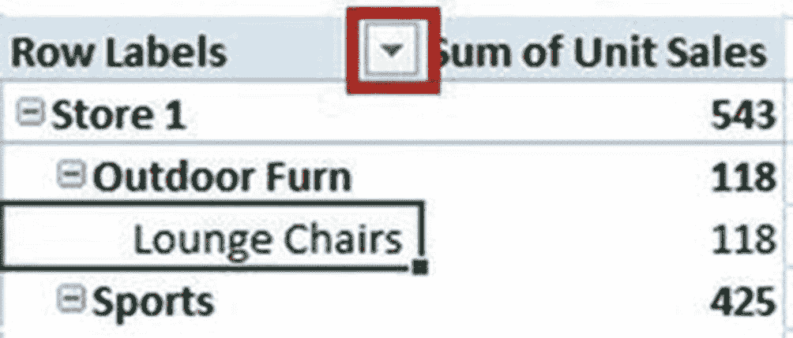

图 15-10

单击“行标签”列标题右侧的向下箭头

1.  点击`筛选`按钮。

2.  点击`选择`字段的下拉箭头，然后选择`产品`。参见图 15-9。

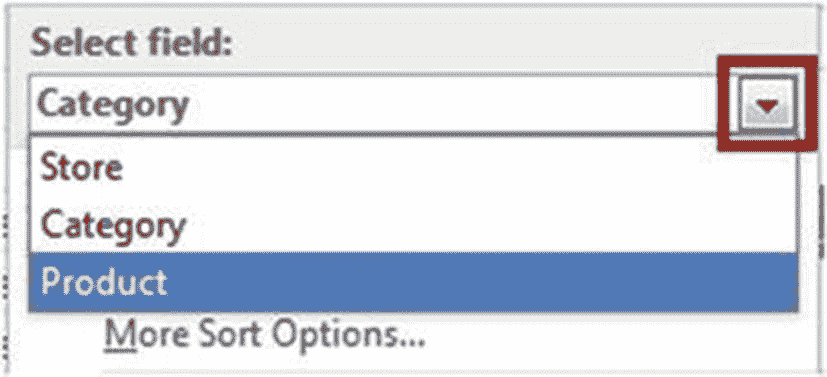

图 15-9

选择产品

1.  在`数据透视表字段`列表中，点击`产品`旁边的复选框。`产品`将按各自的类别显示在`数据透视表`中。如有需要，可加宽列宽。请注意，其中没有棒球棍和自行车。

`数据透视表`中的`行标签`标题旁边会出现一个`筛选`按钮。参见图 15-8。

2.  将鼠标移至`筛选`按钮上。系统会显示一条消息，告知您已基于`产品`字段手动对`数据透视表`应用了筛选。

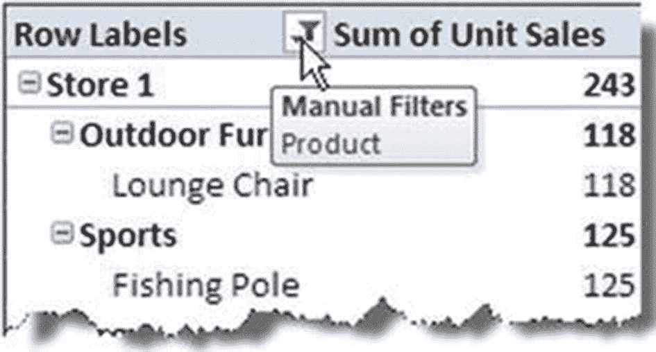

图 15-8

行标签标题旁边出现一个筛选按钮

1.  将鼠标光标移至`字段列表`中的“`产品`”一词上。点击`产品`右侧的下拉箭头。将显示表中所有产品的列表。

2.  点击棒球棍和自行车旁边的复选框，取消勾选。

3.  点击`确定`按钮。

该行上会出现一个筛选图标（图 15-7），提示您如果使用此字段，将不会显示所有项目。

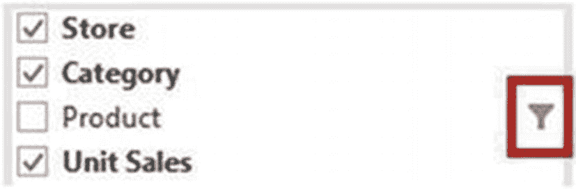

图 15-7

字段右侧的筛选图标告知您该字段已被筛选，因此该字段的部分项目将不会显示

由于`产品`字段尚未放入`数据透视表`中，执行筛选操作对`数据透视表`中当前显示的内容没有影响。

## 更改字段顺序

字段在`数据透视表字段`列表的`行`放置区中的放置顺序，会影响它们在`数据透视表`中的显示顺序。因此，您需要注意将项目拖放到放置区时的顺序。

1.  在此处，您可以筛选要显示的列。点击`工具`旁边的复选框将其取消勾选。点击`确定`按钮。`列标签`右侧的下拉箭头会变为筛选图标。

1.  查看`数据透视表`。现在，体育用品归于棒球棍之下，户外家具归于休闲椅之下。这是不正确的。

2.  将`类别`从`行`区域拖至`列`区域。现在，类别在`数据透视表`中作为列而非行显示。请注意`数据透视表`如何自动调整了总计。

3.  点击`数据透视表`中`列标签`右侧的下拉箭头。参见图 15-13。

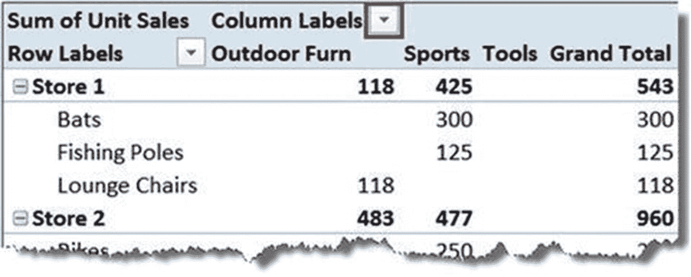

图 15-13

点击列标签右侧的下拉箭头

1.  在`行`区域中，将`产品`拖至`类别`上方。参见图 15-12。

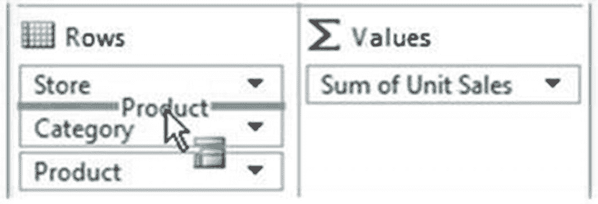

图 15-12

将产品拖至类别上方

## 从数据透视表中删除字段

从`数据透视表字段`列表的任一个放置区中删除字段，会将该字段从`数据透视表`中移除。

图 15-14

将字段拖过电子表格时，字段名称下方会显示一个 X

1.  将`类别`字段从`列`放置区拖到电子表格中。

2.  将字段拖过电子表格时，字段名称下方会显示一个 X。参见图 15-14。此时停止拖动。

`类别`字段的信息将从`数据透视表`中移除。

## 汇总值

“值”区域中的字段使用`Sum`函数进行汇总。图 15-15 显示“单位销售额”已被求和。

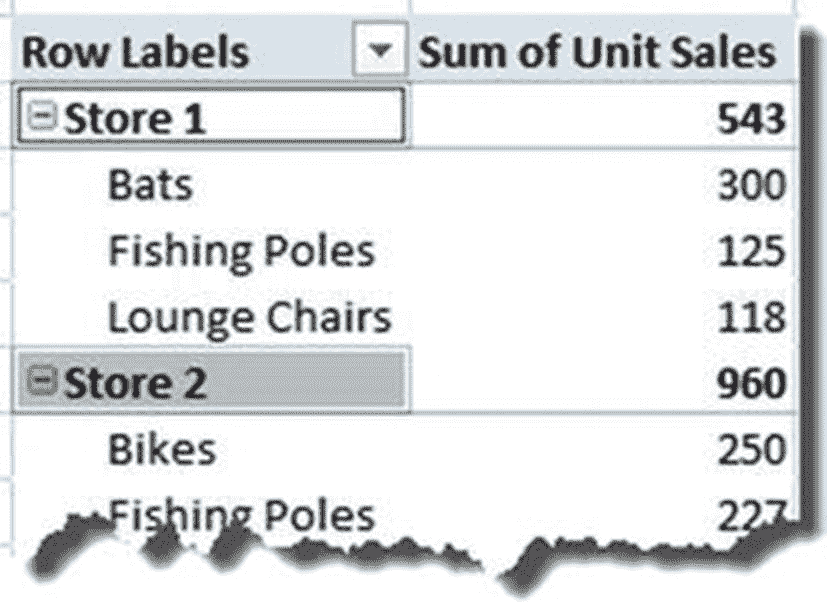

图 15-15

商店 1 中的值已求和。总和为 543。

可以通过右键单击数据透视表上的`Sum of Unit Sales`，然后选择`Summarize Values By`来更改计算类型。请参见图 15-16。

在这里，除了`Sum`函数之外，您还可以选择使用`Count`、`Average`、`Max`、`Min`或`Product`函数。

您很少会用到`Product`函数。它会将某个分组下的所有值相乘。例如，在图 15-15 中，它将通过计算 300 * 125 * 118 来确定商店 1 的乘积。您可以通过单击`More Options…`来查看其他可用函数，例如方差和标准差。

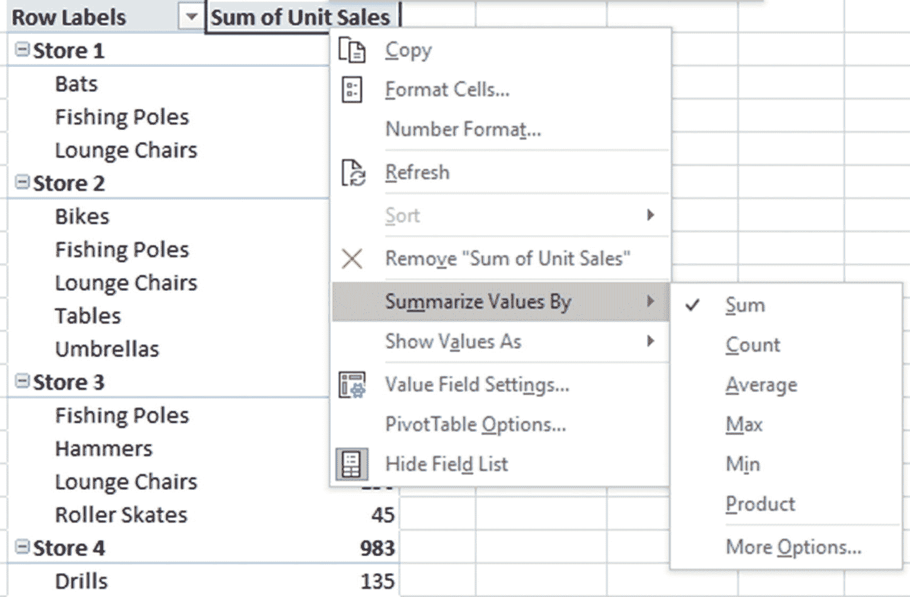

图 15-16

可以通过右键单击`Sum of Unit Sales`，然后选择`Summarize Values By`来更改计算类型。

1.  在数据透视表中右键单击`Sum of Unit Sales`，然后选择`Summarize Values By`。
2.  单击`Average`。现在每个“单位销售额”都变成了平均值，并且列标题也变为了`Average of Unit Sales`。
3.  尝试其他选项。

### 更改数据源位置

1.  单击`OK`按钮。您的数据透视表现在应包含您添加的记录。
2.  重新选择您的数据范围，使其包含您添加的两条记录（在选择时不要忘记包含列标题）。请参见图 15-19。

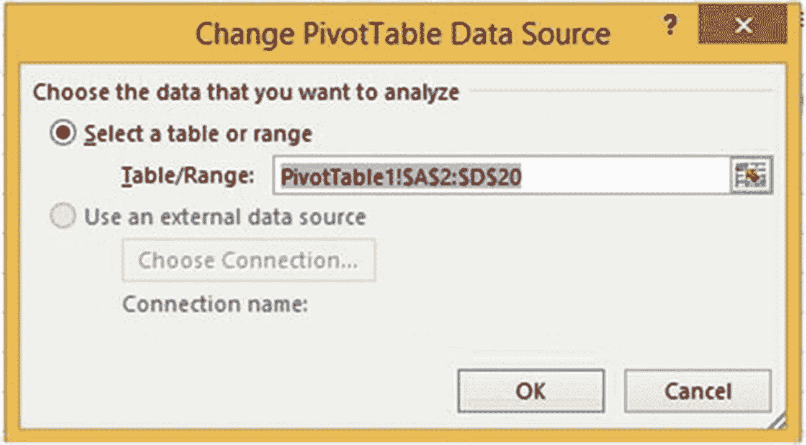

图 15-19

重新选择您的数据范围，使其包含您添加的两条记录。

3.  单击数据透视表中的任意位置。单击功能区上的`Analyze`选项卡，在`Data`组中，单击`Change Data Source`按钮的上半部分。请参见图 15-18。

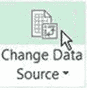

图 15-18

选择`Change Data Source`按钮的上半部分。

4.  将图 15-17 中的记录添加到工作表中。

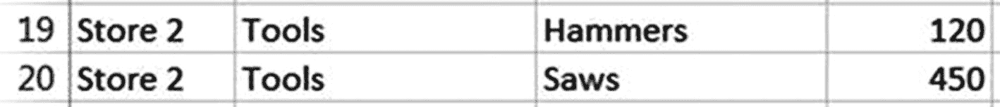

图 15-17

添加这两条记录。

您添加的记录并未添加到数据透视表中。因为我们为数据源选择了数据区域而不是表格，所以我们必须更改数据源的位置以包含这些新记录。

### 练习 15-2：使用推荐的数据透视表

在本练习中，您将根据所选表格数据查看 Excel 的推荐数据透视表格式。

1.  单击`Cancel`按钮。
2.  单击功能区上的`Insert`选项卡。在`Tables`组中，单击`Recommended PivotTables`按钮。这将打开与您在`Quick Analysis`中单击`More`选项时看到的相同的`Recommended PivotTables`对话框。
3.  在左侧窗格中选择最后一个数据透视表。单击`OK`按钮。
4.  新的数据透视表将在新工作表中创建。
5.  如果尚未打开，请打开工作簿`Chapter15_PivotTables`。
6.  选择名为`Recommended`的工作表。
7.  选择区域`A2:D20`。单击所选区域右下角的`Quick Analysis`按钮。
8.  从顶部选项卡中选择`Tables`。将光标移到四个推荐的数据透视表上。如果其中任何一个符合您的需求，您可以单击它，Excel 将在单独的工作表中创建该数据透视表。

4.  点击 `更多` 按钮。

左侧窗格包含六个推荐的数据透视表。在左侧窗格中点击任一数据透视表视图，右侧窗格会显示该数据透视表的放大视图。参见图 15-20。

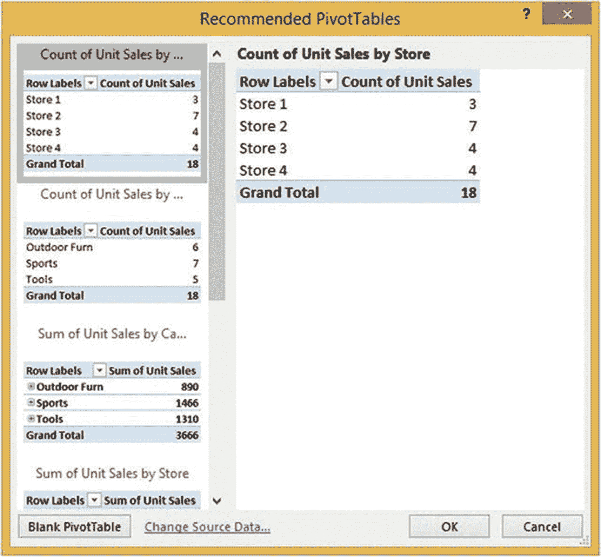

**图 15-20** 在左侧窗格中点击一个推荐的数据透视表，即可在右侧窗格中查看其放大视图

## 练习 15-3：在数据透视表中处理日期和时间

在本练习中，您将把电子表格中的数据转换为表格，然后将表格转换为数据透视表。您将练习对字段进行分组和取消分组。您还将学习如何使用`切片器`和`日程表`来分析数据。

我们的生产线全年在库存不足时开始制造收音机。生产线上的仪表显示已生产的产品数量。员工每 20 分钟读取一次仪表读数，然后将结果输入到电子表格中。这个电子表格涵盖了 2012 年和 2013 年。参见图 15-21。

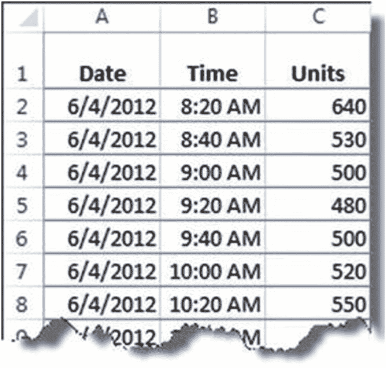

**图 15-21** 库存数据

1.  打开工作簿 `Chapter15_PivotTables`。
2.  选择 `DateTime` 工作表。
3.  通过以下操作选择电子表格中的所有数据：
    -   点击单元格 `A1` 内部。
    -   按住 `Ctrl` + `Shift` 键的同时，先按右箭头键，再按下箭头键。

### 将数据转换为表格

1.  确保已勾选`表包含标题`。点击`确定`按钮。
2.  点击功能区上的`开始`选项卡，然后在`样式`组中，点击`套用表格格式`按钮。
3.  在`浅色`分类的第二行中选择第二个表格（`表样式浅色 9`）。

`套用表格格式`对话框将显示，并已选定数据所在区域。参见图 15-22。

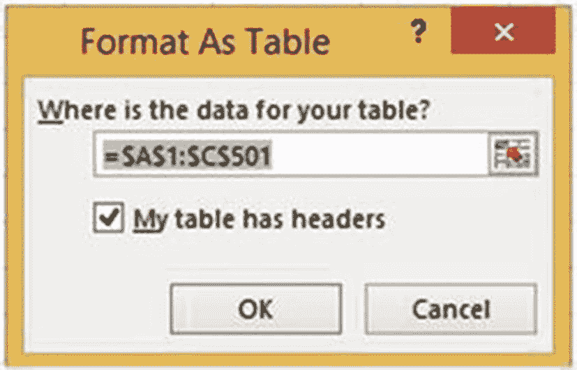

**图 15-22** `套用表格格式`对话框

### 更改表格名称

1.  点击功能区上的`设计`选项卡。
2.  在`属性`组中，将名称从`表 1`更改为`DateTimeTable`。

### 创建数据透视表

1.  我们希望折叠时间以便不显示它们。在数据透视表中点击任意一个`上午 8:00`。您可以点击任意一个时间。在功能区的`分析`选项卡中，在`活动字段`组内，点击`折叠字段`按钮。
2.  将`年份`和`日期`字段从`列`区域拖回`数据透视表字段`窗格的`行`区域，顺序如图 15-32 所示。

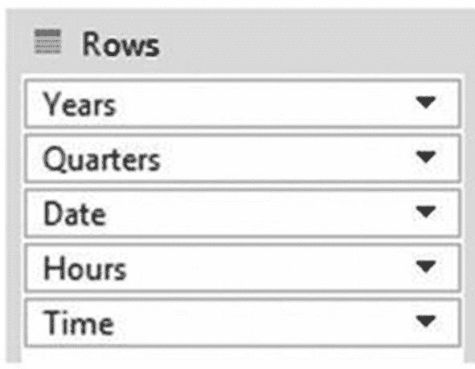

**图 15-32** `行`窗格

1.  在数据透视表中点击`Qtr1`。在功能区的`分析`选项卡中，在`活动字段`组内，点击`展开字段`按钮。参见图 15-31。

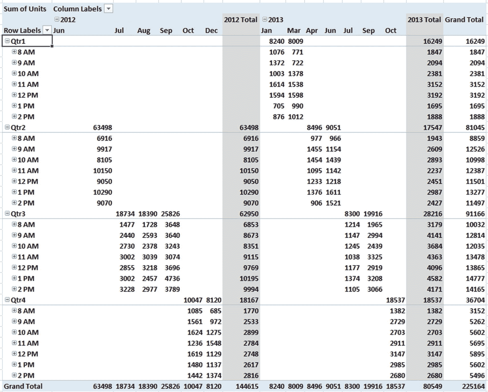

**图 15-31** 展开的季度视图

1.  点击`确定`按钮。图 15-30 显示了结果。

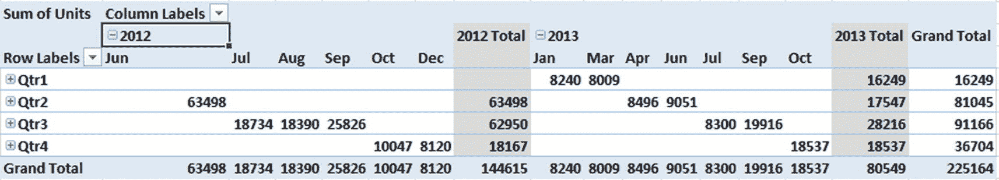

**图 15-30** 您的数据透视表现在应如下所示

1.  在`显示详细信息`对话框中点击`日期`。参见图 15-29。

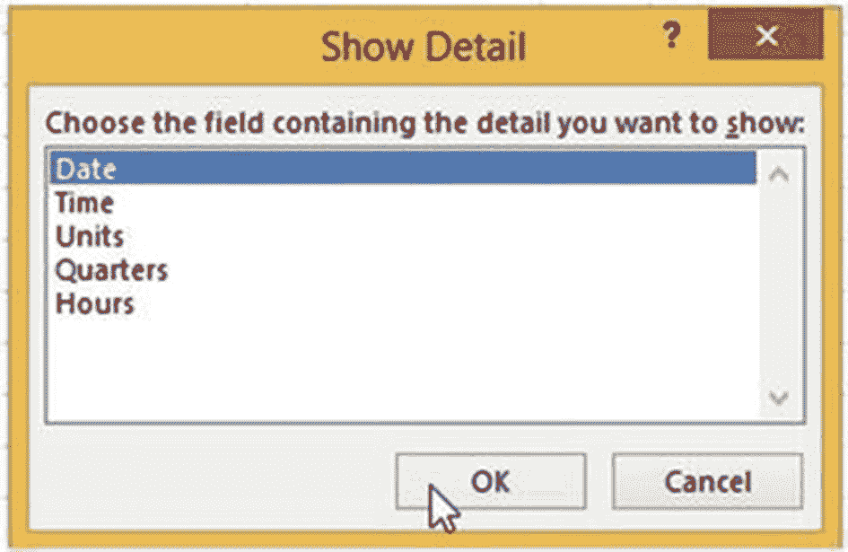

**图 15-29** 选择`日期`

1.  在数据透视表中点击`年份 2012`。
2.  点击功能区上的`分析`选项卡。在`活动字段`组内，点击`展开字段`按钮。参见图 15-28。

**图 15-28** 选择`展开字段`

1.  点击数据透视表中的任意位置。在`数据透视表字段`列表中，将`年份`从`行`区域拖到`列`区域。

现在您可以轻松比较 2012 年每个季度与 2013 年同季度的产品产量。参见图 15-27。

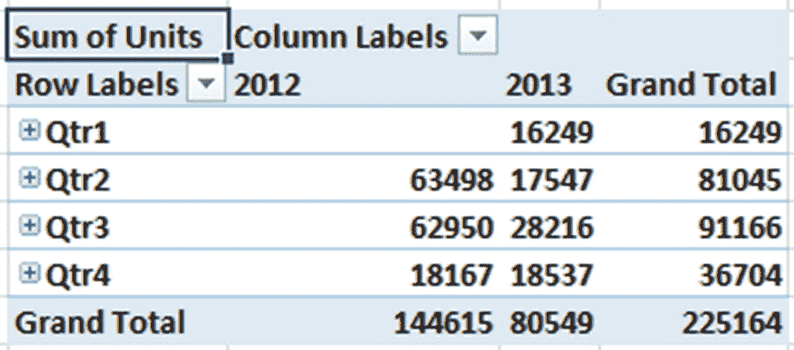

**图 15-27** 比较 2012 年的数值与 2013 年的数值

1.  点击`上午 8:00`左侧的减号将其折叠。每个月份下`上午 8:00`的时间段都会被折叠。
2.  右键点击 2012 下的任意`Qtr`。选择`展开/折叠`，然后选择`折叠整个字段`。结果如图 15-26 所示。

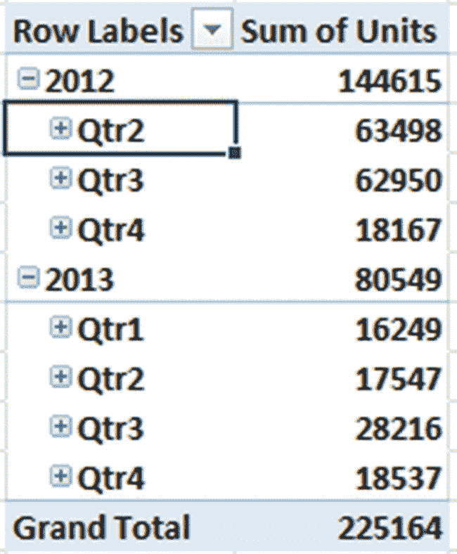

**图 15-26** 折叠的季度

1.  点击数据透视表中`上午 8:00`左侧的加号将其展开。每个月份下的`上午 8:00`时间段展开。20 分钟间隔的时间段及其对应产量显示出来。参见图 15-25。

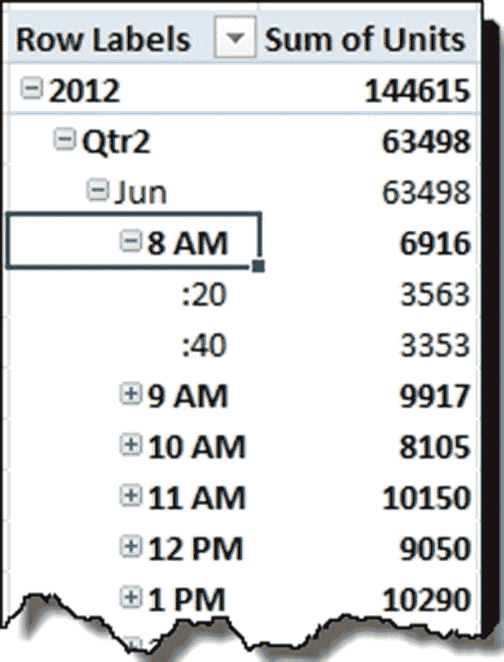

**图 15-25** 20 分钟间隔内的产品产量

1.  在`数据透视表字段`列表中选择`日期`。请注意，`数据透视表字段`列表中出现了两个新字段，它们原本并不是表格中的列。选择`日期`字段会添加`季度`和`年份`字段，并自动将它们选中。
2.  右键点击数据透视表中的 2012。选择`展开/折叠`。选择`展开整个字段`。
3.  右键点击数据透视表中 2012 下的`Qtr2`。选择`展开/折叠`。选择`展开整个字段`。您可以看到 Excel 将日期字段分解（取消分组）为年份和季度。您可以看到 Excel 能够智能识别哪些月份属于哪些季度。
4.  在`数据透视表字段`列表中选择`产品数量`。由于`产品数量`是数值字段，因此它被放置在`值`区域。由于数值字段默认执行求和操作，因此显示为`求和项：产品数量`。
5.  在`数据透视表字段`列表中选择`时间`。请注意，选择时间字段会创建一个`小时`字段，并且该字段会被自动选中。右键点击数据透视表中的`Qtr2`。选择`展开/折叠`。选择`展开整个字段`。数据透视表现在按小时显示时间以及每个小时的产品产量。参见图 15-24。

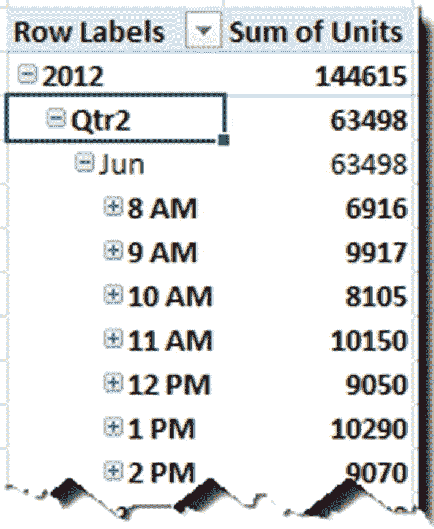

**图 15-24** 数据透视表按小时显示时间以及每个小时的产品产量

1.  点击数据区域内的任意位置。
2.  点击功能区上的`插入`选项卡；在`表格`组中，点击`数据透视表`按钮。
3.  我们将把数据透视表放在数据所在的同一个工作表中：

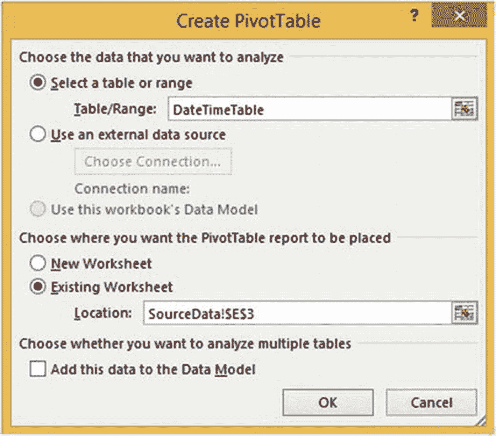

**图 15-23** 数据透视表将从当前工作表的 `E3` 单元格开始

1.  点击`现有工作表`单选按钮。
2.  将光标置于`位置`字段中。点击单元格 `E3`。参见图 15-23。
3.  点击`确定`按钮。

您的数据透视表现在应如图 15-33 所示。

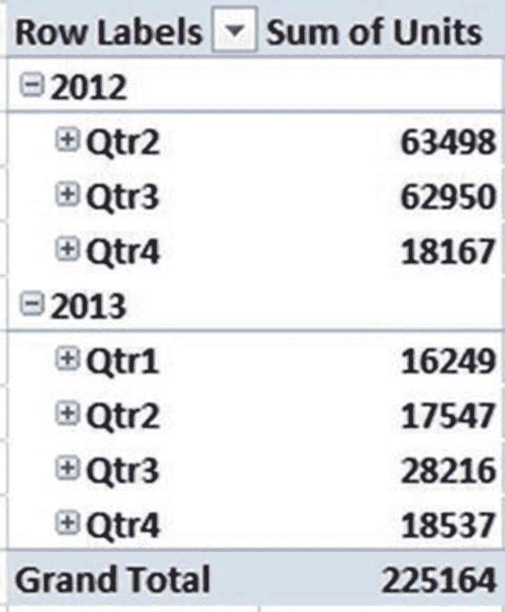

**图 15-33** 您的数据透视表现在应如下所示

### 分组和取消分组字段

1.  通过点击加号展开 2012 下的 `Qtr2`。

好的，作为高级文档工程师和翻译员，我将严格遵循您的注意事项和示例，为您翻译这篇关于数据透视表的英文文档。

2. 当您在`数据透视表字段`列表中选中`日期`字段时，Excel 会自动添加`年份`和`季度`字段。可以通过使用`取消组合`来移除这些字段：
    1. 在`数据透视表`中单击年份`2012`。
    2. 在功能区的`分析`选项卡的“组”中，单击`取消组合`按钮。

`年份`和`季度`已从`数据透视表`中移除。日期现在显示为源数据中的格式。请注意，`年份`和`季度`不再出现在`行`区域中。

1. 通过单击`报表布局`按钮，然后单击`不重复项目标签`来移除重复的日期。
2. 单击功能区的`设计`选项卡，然后在`布局`组中，单击`分类汇总`按钮。选择`不显示分类汇总`。`分类汇总`将从`数据透视表`中移除。
3. 再次单击`分类汇总`按钮。选择`在组的底部显示所有分类汇总`。分类汇总将显示在每个日期的底部。
4. 单击功能区的`设计`选项卡，然后在`布局`组中，单击`空行`按钮。选择`在每个项目后插入空行`。每个日期之间将出现一个空行。
5. 在`数据透视表`中单击日期`2012/6/4`。
6. 单击功能区的`分析`选项卡。在`活动字段`组中，单击`折叠字段`按钮。
7. 在功能区的`设计`选项卡的`布局`组中，单击`空行`按钮。选择`删除每个项目后的空行`。
8. 在功能区的`设计`选项卡的`数据透视表样式`组中，单击您喜欢的任一样式。
1. 单击`报表布局`按钮，然后单击`重复所有项目标签`。参见图 15-36。

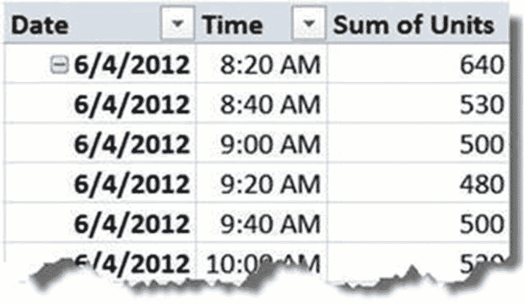
*图 15-36* 日期在列中重复显示

1. 单击`以大纲形式显示`。`大纲形式`将`日期`和`时间`字段分隔到单独的列中。`单位之和`显示在求和数据的顶部。
2. 再次单击`报表布局`按钮。单击`以表格形式显示`。

第一个`时间`和`单位`将出现在与`日期`相同的行上。`单位`的总计出现在每个`日期`的末尾，而不是顶部。图 15-35 显示了每种`报表布局`类型如何处理相同的数据。

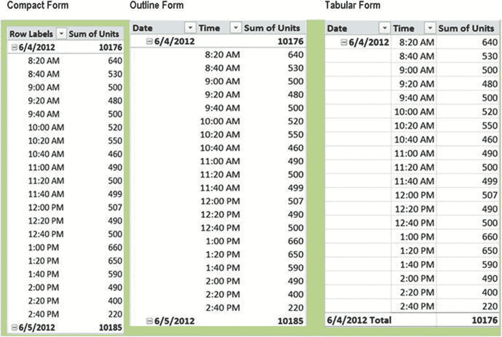
*图 15-35* 三种表格形式：压缩、大纲和表格

请注意，`压缩形式`不像`大纲`和`表格`形式那样显示单独的`日期`列。

1. 在`数据透视表`中单击一个时间点。
2. 单击功能区的`分析`选项卡。在“组”中，单击`取消组合`按钮。

`小时`数据（分隔的分钟）不再出现在`数据透视表`中。`时间`现在显示为源数据中的格式。请注意，`小时`不再出现在`行`区域或`数据透视表字段`列表中。

3. 单击功能区`设计`选项卡。在`布局`组中，单击`报表布局`按钮。参见图 15-34。

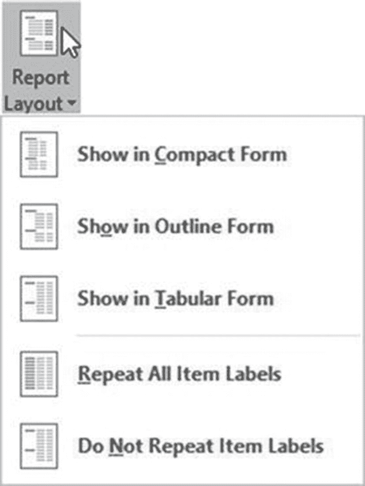
*图 15-34* 报表布局按钮下的选项

`数据透视表`当前以`压缩形式`显示。

### 向源数据添加记录并刷新数据透视表

当您添加新记录时，`数据透视表`不会自动更新以反映新记录。因为我们在使用表格，所以数据源无需更改；但是，仍需要刷新`数据透视表`。

1. 单击`数据透视表`上的任意位置。单击功能区的`分析`选项卡。在`筛选`组中，单击`插入日程表`。
2. 勾选`日期`。单击`确定`按钮。
3. `日程表`有一个水平滚动条。一直滚动到最左边。在`2012`下，单击`六月`。
4. 所有 2012 年 6 月的日期都会显示在`数据透视表`中。
1. 右键单击`数据透视表`中的一个日期。选择`展开/折叠`，然后选择`展开整个字段`。
2. 在`时间`切片器中单击`10:00 AM`。单击`多选`按钮。选择时间`10:20 AM`、`10:40 AM`和`11:00 AM`。参见图 15-41。

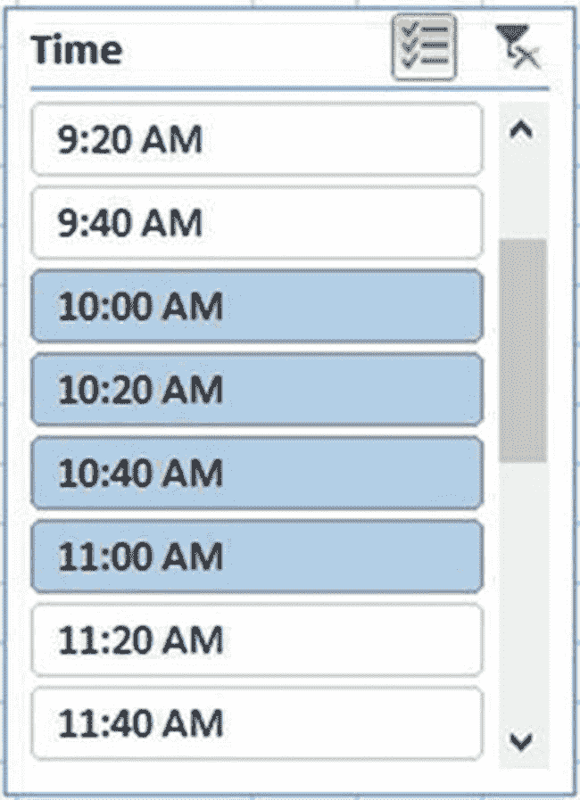
*图 15-41* 时间切片器

1. 单击筛选图标 。单击`多选`按钮。现在单击`2012/6/4`。请注意，因为您在未选中任何日期时单击了`多选`按钮，所以`2012/6/4`显示为白色，表示它未被选中。日期`2012/6/4`不再出现在您的数据透视表中。单击图 15-40 中显示为白色的其他日期，以从`数据透视表`中移除它们的数据。

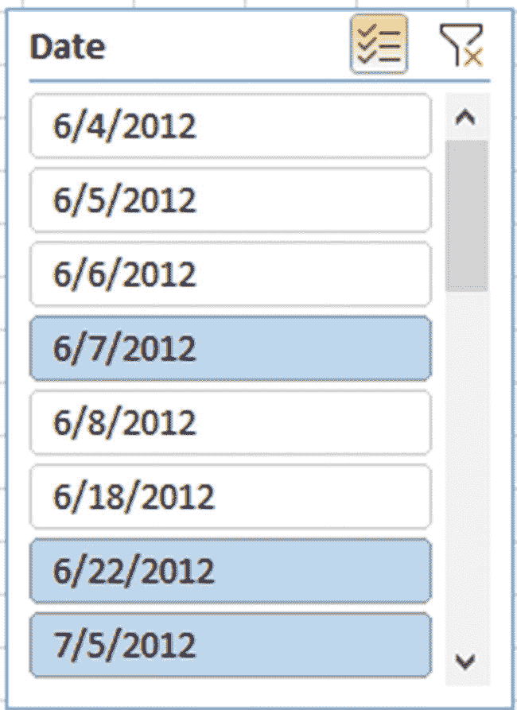
*图 15-40* 日期切片器

1. 单击`2013/10/7`旁边的减号。单击数据透视表中的任意位置。
2. 单击功能区的`分析`选项卡。在`筛选`组中，单击`插入切片器`。
3. 勾选`日期`和`时间`。单击`确定`按钮。
4. 在`日期`切片器中单击`2012/6/6`；仅显示`2012/6/6`的数据。切片器中的所有其他日期都将变为未选中状态。
5. 在`日期`切片器中单击`2012/6/4`。仅显示`2012/6/4`的数据，并且只有该日期在切片器中高亮显示。
6. 如果您想一次选择多个日期，则需要单击切片器右上角的`多选`按钮。单击`多选`按钮。
7. 选择图 15-39 中显示的其他四个日期。再次单击`多选`按钮将其关闭。

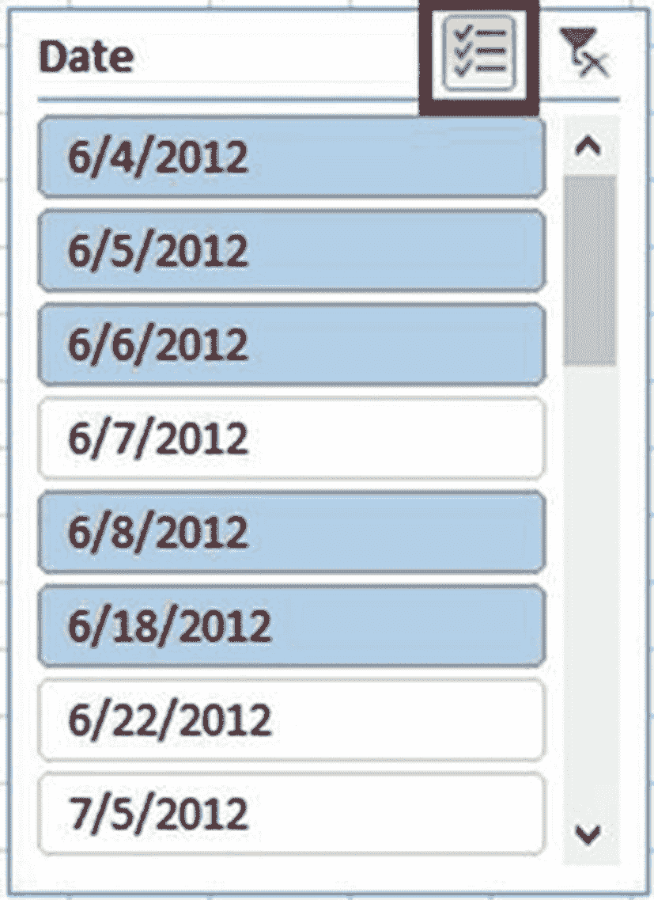
*图 15-39* 日期切片器

**注意** 如果您在切片器中单击了一个项目，然后再单击`多选`按钮，则所有其他项目都将变为未选中状态，然后您再单击所需的其他项目。如果您在单击`多选`按钮之前未单击任何项目，则您单击的项目实际上会变为未选中状态。

1. 单击`数据透视表`中的任意单元格。单击功能区的`分析`选项卡。在`数据`组中，单击`刷新`按钮的上半部分。

您添加的记录现在应出现在`数据透视表`的底部。参见图 15-38。

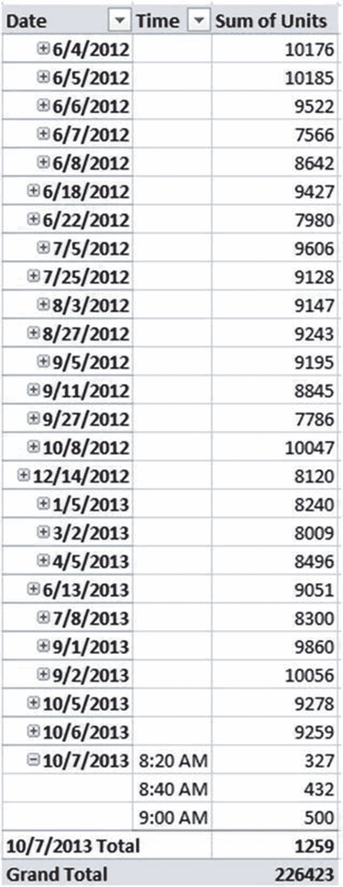
*图 15-38* 您添加的记录出现在数据透视表的底部

1. 将图 15-37 中的三条记录添加到源数据的底部。

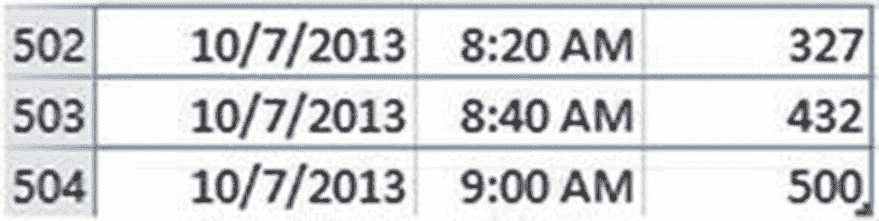
*图 15-37* 添加此数据

拖选六月、七月和八月。参见图 15-42。所有 2012 年六月、七月和八月的日期都会显示在`数据透视表`中。

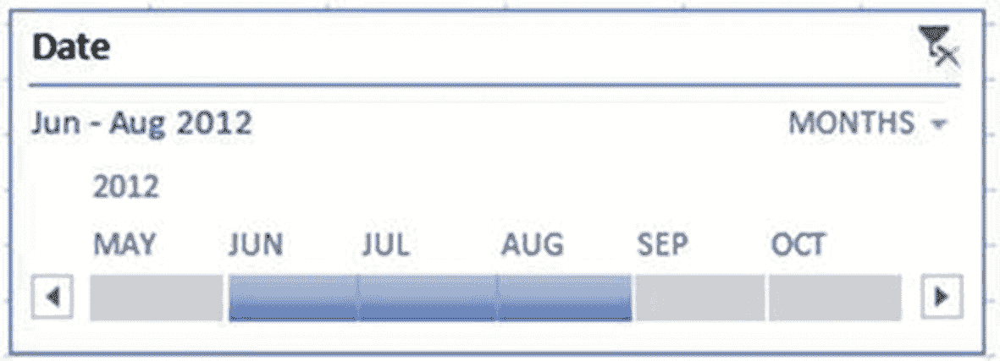
*图 15-42* 日程表

所有六月、七月和八月的日期都出现在`数据透视表`中。

您已经学会了如何创建`数据透视表`。您已经看到，可以在`数据透视表字段`窗格中将字段移动到不同区域，以控制行、列和汇总方式。您还了解了使用切片器或日程表来仅查看特定时间或日期的数据是多么容易。接下来，您将学习如何创建可筛选的图表。

## 创建数据透视图

数据透视图可以直接从数据源创建，也可以从数据透视表创建。数据透视图与其他图表的区别在于，数据透视图带有与之关联的筛选按钮，用户可以使用这些按钮仅在图表上查看其想要的内容。

### 练习 15-4：创建数据透视图

在本练习中，我们首先将从数据源创建一个数据透视图。然后，我们将从数据透视表创建一个。

1.  打开 `Chapter15_PivotTables` 工作簿。
2.  选择名为 `PivotChart` 的工作表。

#### 基于源数据创建数据透视图

1.  单击加号按钮。这将恢复显示所有产品。
2.  按 `Delete` 键删除数据透视图。
3.  单击数据透视表中的任意位置。单击功能区的 `Analyze` 选项卡。在 `Actions` 组中，单击 `Select` 按钮。
4.  选择 **Entire PivotTable**。按 `Delete` 键。
5.  单击 `State` 筛选按钮。选择 **Clear Filter from “State.”**
6.  单击 `Category` 筛选按钮。选择 **Clear Filter from “Category.”**
7.  单击 `Product` 筛选按钮。选择 **Clear Filter from “Product.”**

在右侧图表下方，有一个加号和减号按钮。加号按钮是 **Expand Entire Field** 按钮。减号按钮是 **Collapse Entire Field** 按钮。

8.  单击减号按钮。这将折叠所有产品数据。参见图 15-47。

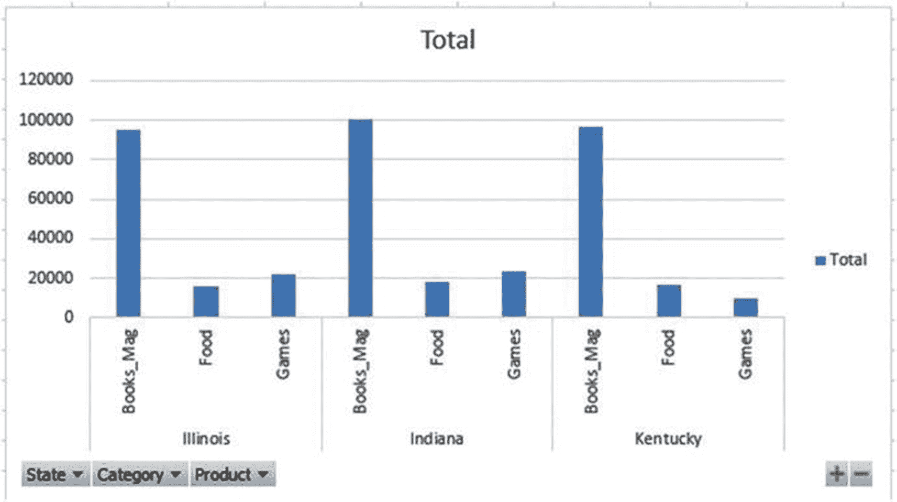

图 15-47：产品数据已被删除

9.  单击 `State` 筛选按钮。取消选中 Illinois 前面的复选框。单击 `OK` 按钮。现在，只显示 Indiana 和 Kentucky 的数据。
10. 单击 `Category` 筛选按钮。取消选中 `Books_Mag` 前面的复选框。单击 `OK` 按钮。
11. 单击 `Product` 筛选按钮。取消选中 Beverages 前面的复选框。单击 `OK` 按钮。您的数据透视图应如图 15-46 所示。

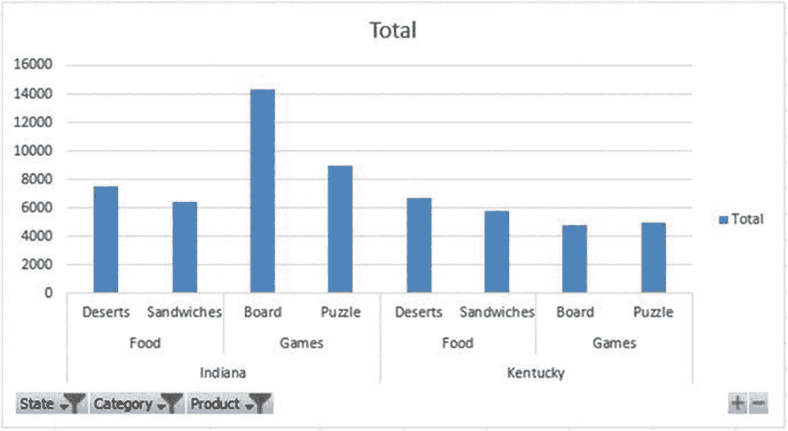

图 15-46：您的数据透视图现在应如下所示

**注意：** 当您创建数据透视图时，会同时创建一个数据透视表。当您对数据透视图进行更改时，会对数据透视表进行相同的更改。

12. 单击 `OK` 按钮。
13. 创建数据透视图的方式与创建数据透视表相同。在 `PivotChart Fields` 列表中选择 `State`、`Category`、`Product` 和 `Sales`。`State`、`Category` 和 `Product` 出现在 **Axis (Categories)** 区域中，并且由于 `Sales` 是数字字段，因此它作为 **Sum of Sales** 出现在 **Values** 区域中。
14. 放大图表的大小，以便您可以看到所有内容。图表下方有三个筛选按钮。参见图 15-45。

图 15-45：筛选按钮

15. 单击功能区的 `Insert` 选项卡。在 `Charts` 组中，单击 `PivotChart` 按钮的上半部分。将显示 `Create PivotChart` 对话框。
16. 选择 **Existing Worksheet**。单击 `Location` 文本框内部。单击单元格 `F2` 内部。参见图 15-44。

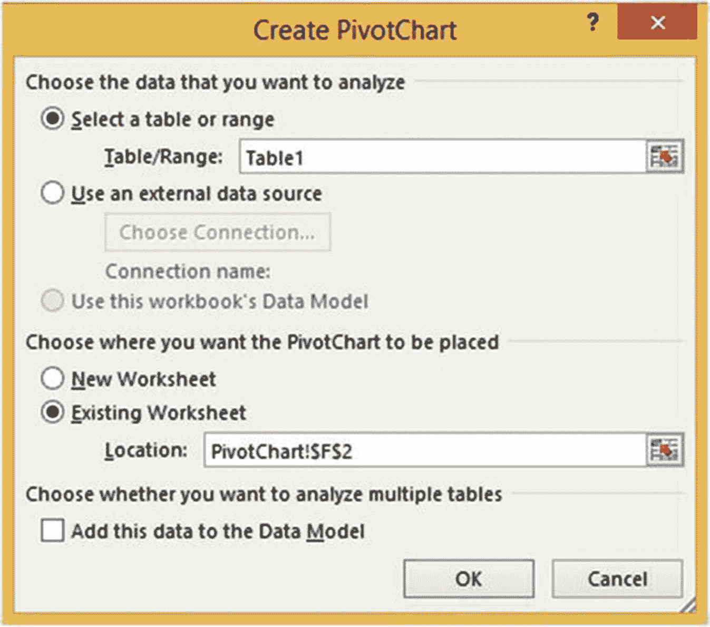

图 15-44：创建数据透视图对话框

17. 单击数据内的任意位置。单击功能区的 `Home` 选项卡。在 `Styles` 组中，单击 `Format As Table`。
18. 选择第二行中的第二种样式（**Table Style Light 9**）。
19. 为 `Format As Table` 单击 `Ok` 按钮。参见图 15-43。

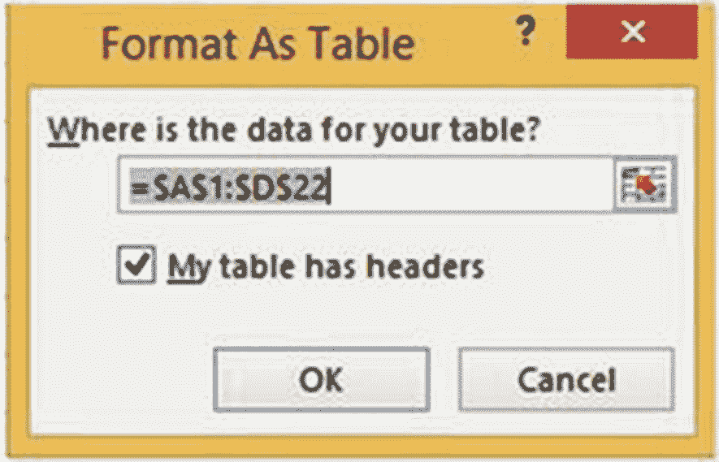

图 15-43：套用表格格式对话框

#### 基于数据透视表创建数据透视图

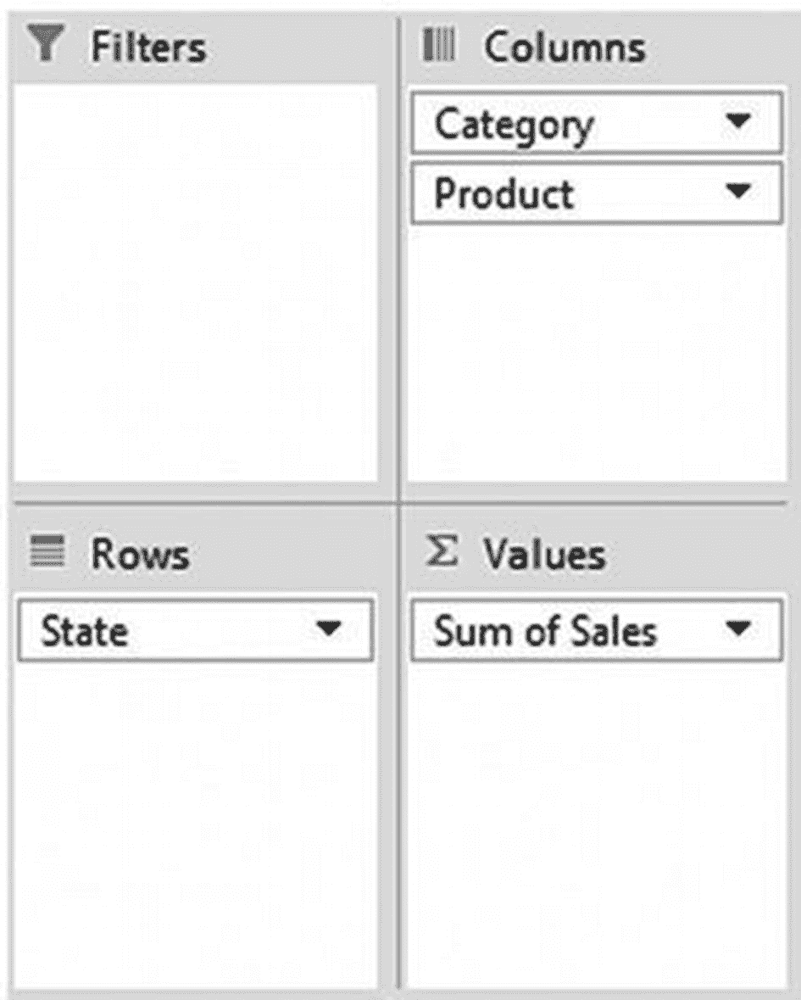

图 15-48：将“类别”和“产品”移至“列”区域

1.  单击表格数据中的任意位置。单击功能区的 `Insert` 选项卡。
2.  在 `Tables` 组中，单击 `PivotTable`。将显示 `Create PivotTable` 对话框。
3.  选择 **Existing Worksheet**。单击 `Location` 文本框内部。单击单元格 `F2` 内部。
4.  单击 `OK` 按钮。
5.  在 `PivotChart Fields` 列表中选择 `State`、`Category`、`Product` 和 `Sales` 字段。
6.  将 `Category` 和 `Product` 字段从 `Rows` 区域移动到 `Columns` 区域。参见图 15-48。

数据透视表应如图 15-49 所示。

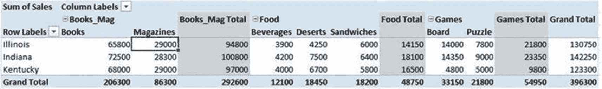

图 15-49：您的数据透视表现在应如下所示

7.  单击数据透视表上的任意位置。单击功能区的 `Analyze` 按钮。在 `Tools` 组中，单击 `PivotChart` 按钮。

将显示 `Insert Chart` 对话框。参见图 15-50。

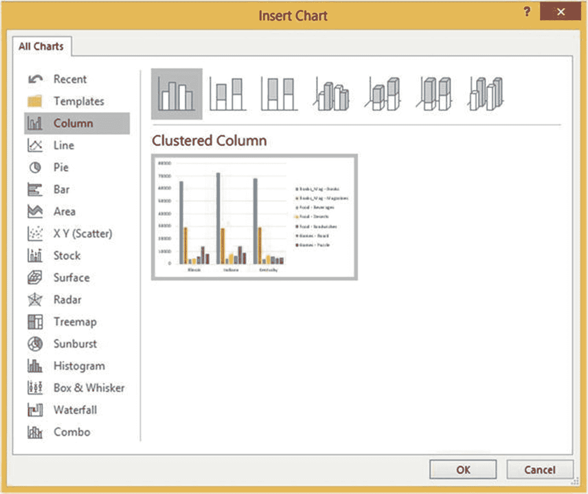

图 15-50：簇状柱形图

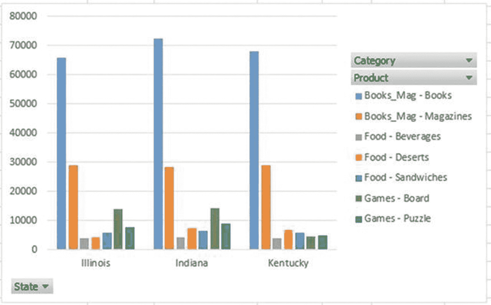

图 15-51：数据透视图

8.  保持选中 **Clustered Column** 图表。单击 `OK` 按钮。
9.  数据透视图显示出来。参见图 15-51。它基于数据透视表。它采用相同的格式。此处的结果与您从源数据创建的第一个数据透视图有很大不同。

### 从同一数据源创建多个数据透视表和数据透视图

可以从同一数据源创建多个具有不同结构的数据透视表。您可能希望创建多个数据透视表，以便同时查看数据的各种汇总视图。

1.  单击 `Finish` 按钮。
2.  在 `PivotTable Fields` 列表中，选择 `State`、`Category` 和 `Sales` 字段。
3.  将 `State` 字段从 **Axis (Categories)** 区域拖到 **Legend (Series)** 区域。
4.  关闭 `PivotChart Fields` 列表。
5.  单击 `Next` 按钮。
6.  选择 **Existing worksheet**。单击单元格 `F35`。参见图 15-54。

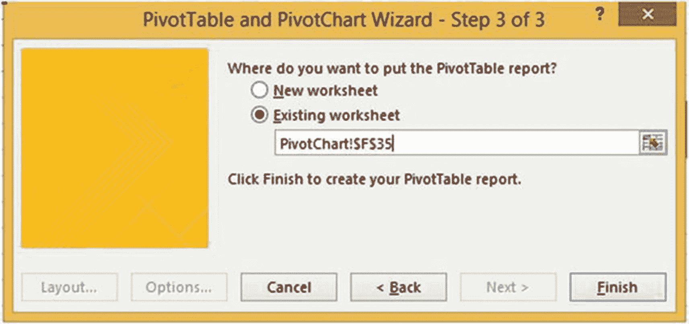

图 15-54：数据透视表和数据透视图向导 – 步骤 3 of 3

7.  向导的步骤 2 应具有如图 15-53 所示的区域。

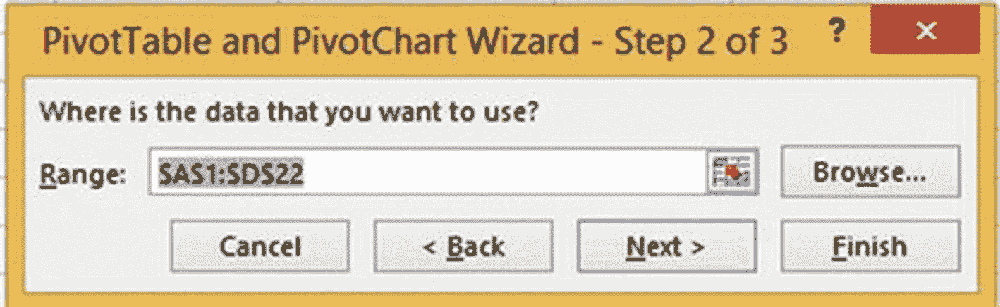

图 15-53：数据透视表和数据透视图向导 – 步骤 2 of 3

8.  单击源数据中的任意位置。
9.  通过依次按 `Alt` 键、`D` 键和 `P` 键来调出 `PivotTable and PivotChart Wizard`。（不要同时按下其中任何一个。）如果您不在向导的步骤 1 of 3，请按 `Back` 按钮直到您位于该步骤。
10. 保持选中 **Microsoft Excel list or database**。选择 **PivotChart report (with PivotTable report)**。参见图 15-52。单击 `Next` 按钮。

图 15-52：数据透视表和数据透视图向导 – 步骤 1 of 3

数据透视表现在应如图 15-55 所示。

图 15-55：您的数据透视表现在应如下所示

数据透视图现在应如图 15-56 所示。

**图 15-56**

此时，数据透视图应如下图所示。

**移动数据透视图和数据透视表**

您可以将光标移至数据透视图的边框，待光标变为四向箭头后，即可将其拖拽到任意位置。移动数据透视表有两种方法：若在同一工作表中移动，可使用拖放功能；或使用功能区上的`移动数据透视表`按钮。

1.  将光标移至数据透视表的任意边框。光标变为四向箭头，表示可以拖拽数据透视表。
2.  拖拽数据透视表，使其起始单元格为`G33`。可能需要加宽列宽。
3.  移动数据透视表的第二种方法：单击数据透视表中的任意位置。在`分析`选项卡的`操作`组中，点击`移动数据透视表`按钮。弹出`移动数据透视表`对话框。将光标置于`位置`文本框内，点击单元格`D34`，然后点击`确定`按钮。

1.  单击刚刚创建的数据透视表中的任意位置。
2.  在功能区上，单击`分析`选项卡。在`操作`组中，点击`选择`按钮，然后选择`整个数据透视表`。参见图 15-57。

**图 15-57**

从“选择”按钮中选择“整个数据透视表”

**清除数据透视表**

1.  在功能区的`操作`组中，点击`清除`按钮。
2.  选择`全部清除`。这将清除所有数据和标签，但数据透视表依然存在。

**删除数据透视表**

1.  按 `Ctrl + Z` 撤销清除操作。
2.  单击数据透视表中的任意单元格内部。
3.  在`操作`组中，点击`选择`按钮。选择`整个数据透视表`。
4.  按 `Delete` 键。

**删除数据透视图**

1.  单击数据透视图。
2.  按 `Delete` 键。

您已经学习了如何从源数据以及从数据透视表创建数据透视图。您还学习了如何从同一数据源创建不同的数据透视表，以及如何使用数据透视表和数据透视图向导。

接下来，您将学习如何从不同来源获取数据，并通过关键字段将它们链接起来。

## 在关系数据库上创建数据透视表

当您能将数据透视表应用于相互链接的多个文件时，它的功能会变得更加强大。您可以通过关系数据库来实现这一点。

当我们想到数据库时，通常会想到 Access、SQL Server、Oracle 等程序。我们可以将这些程序中的数据导入 Excel。然而，我们也可以直接在 Excel 中创建小型的关系数据库。关系数据库是通过一个公共字段链接多个表来创建的。这些表可以链接在一起，以创建一个数据透视表。

关系数据库由主表和明细表组成。如果您之前使用过 Access，可能对这个概念很熟悉。主表和明细文件中必须有一个公共字段，表通过该字段链接在一起。一个主记录对应一个或多个明细记录。

图 15-58 显示了一个“客户”表，图 15-59 显示了一个“订单”表。这两个表可以通过公共字段 `CustomerID` 进行链接。“客户”表中的每个客户都被分配了一个唯一的 `CustomerID`。每个客户可以下多个订单；因此，“订单”表中的 `CustomerID` 字段不是唯一的。我们将这两个表之间的这种关系称为一对多关系。用于链接表的字段称为键。唯一的公共字段称为主键。多端的公共字段称为外键。查看这两个表，您会发现 `CustomerID` 必须先存在于“客户”表中，然后才能在“订单”表中使用。

**图 15-59**

“订单”表

**图 15-58**

“客户”表

练习 15-5：在关系数据库上创建数据透视表

在本练习中，您将首先创建主表，然后创建明细表。接着，您将把两个表链接起来。最后，您将创建一个使用这两个链接表的数据透视表。

**创建主表**

1.  确保选中`表包含标题`，然后点击`确定`按钮。
2.  选中表格后，`设计`选项卡将变为活动状态。在`属性`组中，将`表名称`更改为 `Customer`，然后按 `Enter` 键。

1.  打开 `Chapter15_PivotTables`工作簿。选择名为 `Master` 的工作表。单击数据中的任意位置。
2.  点击功能区的`开始`选项卡。在`样式`组中，点击`套用表格格式`按钮。选择您喜欢的任何样式。

弹出`套用表格格式`对话框。参见图 15-60。

**图 15-60**

`套用表格格式`对话框

**创建明细表**

1.  点击名为 `Detail` 的工作表标签。单击数据中的任意位置。
2.  点击功能区的`开始`选项卡。在`样式`组中，点击`套用表格格式`按钮。选择您喜欢的任何样式。
3.  确保在`套用表格格式`对话框中选中`表包含标题`，然后点击`确定`按钮。
4.  选中表格后，`设计`选项卡将变为活动状态。在`属性`组中，将`表名称`更改为 `Orders`，然后按 `Enter` 键。

**链接表**

**图 15-62**

您在 Orders 与 Customer 之间创建的关系

1.  `管理关系`对话框显示了您刚刚创建的关系。点击`管理关系`对话框的关闭按钮。参见图 15-62。

1.  点击功能区的`数据`选项卡。在`数据工具`组中，点击`关系`按钮。
2.  点击`新建`按钮。

### 3. 在数据透视表报表部分定义表关系

`Customer` 表和 `Orders` 表均包含一个 `CustomerID` 字段，通过该字段可将它们关联在一起。客户表中的 `CustomerID` 字段是主键，而 `Orders` 表中的 `CustomerID` 字段是外键。按图 15-61 所示进行输入，然后单击**确定**按钮。

**图 15-61** “创建关系”对话框

1.  现在让我们重新排列字段：
    1.  将 `State` 从“行”区域拖至“筛选器”区域。
    2.  将 `Sum of CustomerID` 从“值”区域拖至“行”区域的顶部。
    3.  将 `Sum of OrderID` 从“值”区域拖至“行”区域的底部。

2.  现在，您可以使用两个表创建数据透视表。在“数据透视表字段”窗格中，从 `Customer` 表中选择字段 `CustomerID`、`City` 和 `State`。

3.  从 `Orders` 表中选择字段 `OrderID` 和 `Order Amount`。“数据透视表字段”列表的下半部分将如图 15-66 所示。

**图 15-66** 您的区域应如下所示

4.  在工作表右侧的“数据透视表字段”列表中，单词 `ACTIVE` 处于高亮状态。单词 `ACTIVE` 高亮显示是因为当前仅有一个表处于活动状态。单击单词 `ALL`。参见图 15-64。展开 `Customer` 和 `Orders` 表，以便查看它们的所有字段。

**图 15-64** 单击单词 ALL 查看两个表的所有字段

我们已经创建了表之间的关系，但如果我们没有创建该关系，并且您开始在数据透视表中添加那些没有关系就无法理解的字段，您将会看到如图 15-65 所示的消息。

**图 15-65** 可能出现的消息

单击**创建**按钮将会弹出您已经填写过的同一个“创建关系”对话框。

5.  单击功能区中的**插入**选项卡。在**表格**组中，单击**数据透视表**按钮。将显示“创建数据透视表”对话框。参见图 15-63。`表/区域`应为 `Orders`。

6.  对于选项**选择是要分析多个表**，请选择**将此数据添加到数据模型**。

7.  单击**确定**按钮。

**图 15-63** “创建数据透视表”对话框

各区域应如图 15-67 所示。

**图 15-67** 您的区域应如下所示

8.  单击功能区中的**设计**选项卡。在**布局**组中，单击**报表布局**按钮，然后选择**以大纲形式显示**。

生成的数据透视表应如图 15-68 所示。

**图 15-68** 您的数据透视表应如下所示

**注意** 没有 `CustomerID` 为 1、6 或 7 的客户的记录。这是因为 `Orders` 表中没有这些客户的记录。（他们没有下订单。）

9.  单击 `AZ`。单击**确定**按钮。仅显示亚利桑那州的数据。

10. 再次单击**筛选器**图标。单击 `IN`。单击**确定**按钮。仅显示印第安纳州的数据。

11. 再次单击**筛选器**图标。选中**选择多项**复选框。勾选您想要查看数据的那些州。

12. 现在您可以按**州**进行筛选。单击单元格 `B1` 中“全部”旁边的向下箭头。单击“全部”左侧的加号。参见图 15-69。您可以单击想要查看数据的州。

**图 15-69** 您的数据透视表应如下所示

## 总结

数据透视表在显示哪些数据、如何排列数据以及汇总哪些值方面为您提供了极大的灵活性。之所以称为数据透视表，是因为您可以透视数据，在行和列之间切换。

数据透视图相对于其他图表的一个优势在于它可被筛选。

可以直接在 Excel 中创建小型关系数据库。

下一章将介绍在工作簿中使用多媒体。多媒体是使用不同形式的交流方式。您将使用不同形式的文本、图表、图片、屏幕截图、音频和视频在工作簿中进行交流。

## 地理与股票数据类型

Excel 新增了两种数据类型，`Geography`（地理）和 `Stocks`（股票）。它们的工作方式类似。这两种数据类型位于功能区“数据”选项卡的“`Data Type`（数据类型）”组中，参见图 16-1。微软计划在未来增加更多的数据类型。

图 16-1：股票和地理数据类型

### 地理数据类型

我们先来看看 `Geography`（地理）。使用 `Geography` 数据类型，您可以收集有关国家、省份、地区、州、县、城市和城镇的数据。这些信息来源于维基百科和其他在线来源。您可以提取的数据取决于您所选的地理位置类型。您可以收集单个地理位置的信息，也可以同时收集大量地理位置列表的信息。

图 16-2 在单元格 A1 中显示了印第安纳州一个名为赫布伦的小镇名称。当我们选中该单元格并点击 `Geography` 按钮时，名称左侧会出现一个问号。Excel 显示这个问号是因为有许多名为赫布伦的城镇，它不知道您想使用哪一个。

图 16-2：问号表示确切位置未知

Excel 在单元格中放置问号的同时，会在工作表右侧显示一个`Data Selector`（数据选择器），参见图 16-3。`Data Selector`在名称左侧显示单元格地址，方便您识别 Excel 正在询问的是哪个单元格。您可以点击这些城镇中的任何一个来了解更多信息。名为赫布伦的城镇比此处显示的更多。要查看更多名为赫布伦的城镇，您可以点击放大镜图标，或点击窗口底部的“显示更多结果”。这些结果的显示顺序可能因时而异。

图 16-3：数据选择器

如果您点击某个城镇下方的“选择”，Excel 就会将该城镇确定为要收集信息的对象。我将选择印第安纳州波特县的赫布伦。如果您在未选择位置的情况下关闭了`Data Selector`，您可以随时点击单元格中的问号重新打开它。

当您做出选择后，Excel 会在单元格中放置地理数据类型图标。当单元格处于活动状态时，数据右侧会显示一个图标。将光标移到该图标上，您会看到工具提示“插入数据 将数据提取到单元格”，参见图 16-4。

图 16-4：数据类型工具提示

点击该图标将显示与您输入的位置类型相关的可用选项，参见图 16-5。第一个选项是`Admin Division 1`（一级行政区）。您可能会对列表顶部的 `Field`（字段）一词感到困惑。这是微软将其作为标题置于列表顶部，并非一个选项。

图 16-5：地理位置选项

选择“population”（人口）会将城镇的人口数量放入右侧单元格中。选择 `Admin Division 2`（二级行政区）会将县名放入右侧第一个空白单元格中，参见图 16-6。

图 16-6：已应用人口和二级行政区选项

`Geography` 数据类型图标显示的信息比单元格右侧出现的`Insert Data`（插入数据）图标更多。将光标移到 `Geography` 数据类型图标上会显示一个工具提示，提示内容为“显示卡片”。点击该图标会显示可滚动的`Card`（卡片），其中包含该位置的一张或多张图片及其相关信息。与`Insert Data`图标不同，`Card`会显示它正在检索的实际数据。例如，`Card`不仅仅显示 `Admin Division 1`，而是显示实际结果——Indiana（印第安纳州）。如果您滚动到`Card`的底部，您还会看到该位置的描述。`Card`还包含指向维基百科上该位置的可点击链接以及更多图片，参见图 16-7。当您将光标移到 `Card` 的字段上时，该字段的右侧会显示一个图标。点击该图标会将信息放入右侧第一个空白单元格中。例如，在图 16-7 中，点击`Admin Division`右侧的图标，我会将 Indiana 这个词放入赫布伦右侧的第一个空白单元格中。

图 16-7：卡片包含位置数据和链接

您可以通过输入城市名称，后跟逗号，再后跟州、省或地区来区分城市的位置。例如，在单元格中键入`Hebron, Indiana`可以明确您所指的城市。当您点击 `Geography` 按钮时，不会出现问号，因为 Excel 将确切知道您指的是哪个赫布伦。Excel 会删除逗号和 Indiana 字样，仅保留单元格中的`Hebron`。

在单元格中输入此内容  并点击 `Geography` 按钮会得到此结果 。

如果您选择了如图 16-8 所示的一系列印第安纳州城市和城镇，然后点击 `Geography` 按钮，Excel 将自动假定您想要的城市和城镇是印第安纳州境内的，并会在单元格中输入地理数据类型图标，而不是问号，参见图 16-9。

图 16-9：Excel 假定这些是印第安纳州的城市/城镇

图 16-8：印第安纳州城市/城镇列表

#### 在表格中使用地理数据类型

让我们将图 16-10 中的各州放入一个表格中：选中这些单元格，点击快速分析按钮，然后选择“表格”。

**图 16-10** 要转换为表格的数据

使用表格的优点包括：

-   可以一次性添加一列新数据。
-   列标题会自动创建。
-   由于数据在表格中，你可以轻松筛选数据，只看你想看的内容，例如只想查看收入中位数大于 50,000 的州。
-   当你添加其他位置时，它们会自动成为表格的一部分。

要将表格中的州转换为地理数据类型，首先选中包含州的单元格，然后在功能区“数据”选项卡的“数据类型”组中点击“地理”按钮。随后，每个单元格的州名左侧都会出现地理数据类型图标。只要光标位于某个表格单元格内，表格的右上方就会出现一个图标。该图标的工具提示显示为`添加列`。（当你点击一个不属于表格的数据类型单元格时，该图标的工具提示显示为`插入数据`。）点击`添加列`按钮会显示该位置的可用选项。请注意，在图 16-11 中，州的可用选项与市/镇的可用选项不同。每种地理位置类型都有其专属的选项。

**图 16-11** 州位置的可用选项

我将选择`人口`。`人口`标题以及每个州的人口数据会出现在右侧的列中。见图 16-12。

**图 16-12** 每个州的人口

点击肯塔基州的地理数据类型图标，然后从信息卡中选择`首府`。见图 16-13。

**图 16-13** 肯塔基州的信息卡

尽管我只从肯塔基州的信息卡中选择了`首府`，但 Excel 却输出了每个州的首府。见图 16-14。

**图 16-14** 每个州的首府

如果添加另一个州，它会自动采用地理数据类型。当在第 7 行输入田纳西州时，它会被自动分配地理数据类型，并且任何列的数据都会被自动填充。见图 16-15。

**图 16-15** 田纳西州的数据被自动添加

如果将单元格`A7`中的文本从田纳西州改为密苏里州，所有数据列都会自动更改，以反映密苏里州的数据。

假设你想获取一些城市、州和国家的面积和人口数据，如图 16-16 所示。由于你同时使用了城市、州和国家，当你点击`添加列`按钮时，所有这三种类型的字段选项都会显示出来。城市、州和国家都有面积和人口字段，这使得这可能成为现实。

**图 16-16** 城市、州和国家的面积与人口

现在你想了解一些额外的数据，比如`最大城市`和农业用地百分比。当添加这些字段时，某些单元格会出现`#FIELD!`错误。见图 16-17。城市不提供`最大城市`字段，而城市和州不提供`农业用地百分比`字段。如果你使用的地理位置中某个特定字段没有可用数据，也会发生这种情况。这不一定意味着存在错误，只是没有可用的数据而已。

**图 16-17** `#FIELD!` 意味着没有可用数据

当我点击伦敦左侧的地理数据类型图标时，信息卡会显示出来，我可以看到 Excel 假定我想要的是英国伦敦。如果这不是我想要的伦敦呢？右键单击该单元格，然后选择`数据类型`，再点击`更改`。见图 16-18。

**图 16-18** 更改位置

选择`更改`会调出数据选择器，然后就可以选择另一个伦敦了。

#### 在公式中使用地理位置数据

假设我们有以下三列数据，想要知道每个地理位置每平方公里居住的人口数量。在单元格 `D2` 中，我输入了一个等号，然后点击了单元格 `C2`。Excel 会自动填入 `[@Population]` 来代表该列。接着，我输入了除号，并点击了单元格 `B2`。请参见图 16-19。

图 16-19

使用数据类型数据创建公式

现在，当我按下 `Enter` 键时，Excel 会为所有位置填充数据。我输入了这一列的标题。请参见图 16-20。

图 16-20

在公式中使用数据类型数据的结果

### 练习 16-1：使用地理数据类型

#### 使用单个数据类型位置

1.  在功能区上的 `数据` 选项卡中，位于 `数据类型` 组内，点击 `地理`。由于两个都是州名，数据选择器不会显示；Excel 假定您指的是州。
2.  在单元格 `A4` 中输入 `肯塔基`。
3.  点击单元格 `A2` 中的 `地理数据类型` 图标。印第安纳州的州旗会显示在卡片的顶部。点击 `维基百科` 字样。您将被带到印第安纳州的维基百科网站。关闭浏览器。再次点击单元格 `A2` 中的地理图标。点击 `更多图片` 图标 。浏览器会打开，显示印第安纳州的图片。关闭浏览器。
4.  点击三个州中任意一个州的 `地理数据类型` 图标。选择哪一个州并不重要。点击 `人口`。然后点击右侧的 `提取` 图标。三个州的人口数据连同标题会被添加进来。调整列宽，以便您能看到所有数据。
5.  点击表格中的任一单元格。点击 `人口` 标题右侧的 `添加列` 图标。点击 `家庭收入中位数`。
6.  点击 `添加列` 图标。点击 `租金中位数`。
7.  点击 `添加列` 图标。点击 `人口：65 岁以上 (%)`。
8.  选中单元格 `D2`。右键单击选中的单元格，然后选择 `清除内容`。

#### 在表格中使用数据类型位置

在单元格 `A1` 中输入 `州`。在单元格 `A2` 中输入 `印第安纳州`。在单元格 `A3` 中输入 `伊利诺伊州`，然后按下 `Ctrl + Enter`。光标仍停留在单元格 `A3` 中时，点击功能区的 `开始` 选项卡。在 `样式` 组中，点击 `套用表格格式` 命令。在 `中等深浅` 组的第一行，点击第二个表格样式。确保勾选 `表包含标题` 复选框，然后点击 `确定` 按钮。请参见图 16-23。

图 16-23

带标题的“套用表格格式”

1.  点击印第安纳县内的印第安纳镇（注意不是它下方的 `选择`）。您会看到与该镇相关的数据。向下滚动到底部。您应该会看到对该镇的描述。这可以帮助您确认正在查看的内容。点击返回箭头返回 。现在，点击印第安纳县内印第安纳镇下方的 `选择`。`地理数据类型` 图标会出现在单元格中。点击该图标。向下滚动直到看到 `人口`。将光标移至 `人口` 上。点击右侧的图标。人口数据会显示在单元格 `E2` 中。
2.  假设您原本并不想获取镇的数据，而是想要获取县的数据。右键单击单元格 `D2`，选择 `数据类型`，然后点击 `更改`。现在，点击该县下方的 `选择`。注意观察，人口数字发生了变化，显示的是该县的人口数据。
3.  选中单元格 `D2` 和 `E2`。右键单击选中的单元格，然后选择 `清除内容`。

在单元格`D3`中输入`Indiana`。在功能区“数据”选项卡的“数据类型”组中，点击“地理”。在数据选择器中，输入`Indiana State`。通过添加`State`一词，消除了歧义，数据选择器将仅显示一个结果。参见图 16-22。

图 16-22：筛选数据选择器结果

只有一个`Indiana State`，也只有一个`Indiana County`，因此如果您输入`Indiana County`，它也只会显示一个结果。

1. 创建一个新工作簿。在单元格`D2`中输入`Indiana`，然后按`Ctrl + Enter`。在功能区“数据”选项卡的“数据类型”组中，点击“地理”。点击单元格`D2`中的“地理数据类型”图标。数据选择器将出现在电子表格右侧。在宾夕法尼亚州，有一个名为`Indiana`的城镇、县和镇区。参见图 16-21。

图 16-21：`Indiana`的数据选择器

**添加和更改数据类型**

1. 在单元格`A5`中输入`Michigan`。在单元格`A6`中输入`Ohio`。您为其他州选择的状态数据会自动填充到`Michigan`和`Ohio`中。
2. 将单元格`A5`中的`Michigan`更改为`Iowa`。数据会自动更新以反映状态更改。
3. 在单元格`F1`中输入`65 and Over`。选择单元格区域`C1:F1`。在功能区“开始”选项卡的“对齐”组中，点击“自动换行”。加宽各列，以确保您能看到所有数据。

**在公式中使用数据类型数据**

图 16-27：计算租金占收入百分比的结果公式

1. 按`Ctrl + Enter`。
2. 在功能区“开始”选项卡的“数字”组中，点击`%`。将自动填充柄向下拖动到`B15`。参见图 16-27。
1. 双击`Median gross rent`以选中它。
2. 输入`* 12`（这是月租金，因此需要将其乘以 12 以获得年租金）。
3. 输入除号。
4. 输入`A2`以调出字段选项。
5. 双击`Median household income`。完整的公式如图 16-26 所示。

图 16-26：计算租金占收入百分比的公式

1. 在单元格`A14`中输入`Indiana`，在单元格`A15`中输入`Illinois`。在单元格`B13`中输入`% of Income Spent on Rent`。对单元格`B13`应用“自动换行”。
2. 在单元格`B14`中输入一个`=`号。您可以点击单元格`A2`或其输入其单元格地址。当您这样做时，您将获得该州的所有字段选项。参见图 16-25。

图 16-25：在公式中使用可用的数据类型字段

1. 您已经有了 65 岁以上人口的百分比，但没有 65 岁以上人口的具体数量。您可以自行计算。在单元格`F2`中，输入`=`号以开始公式。点击单元格`B2`。输入`*`号进行乘法运算。点击单元格`E2`。按`Enter`键。
2. 选择单元格区域`F2:F6`。在功能区“开始”选项卡的“数字”组中，点击逗号样式。参见图 16-24。

图 16-24：使用逗号格式计算的“65 岁及以上”字段

假设您想了解在`Indiana`和`Illinois`州，家庭收入中用于租金的中位数百分比。您无需创建新的“地理”数据类型，因为您可以使用已创建的数据类型。

**格式化数据类型数据**

图 16-28：为“人口”创建数据条

1. 选择单元格区域`B1:B6`。点击快速分析图标。
2. 点击“数据条”。参见图 16-28。

**在地图中使用数据类型数据**

图 16-29：各州人口地图

1. 选择单元格区域`A1:B6`。
2. 在功能区“插入”选项卡的“图表”组中，点击“地图”。
3. 点击“填充地图”。
4. 点击“图表标题”。输入`Population`。
5. 图表有两个上下文菜单：“设计”和“格式”，位于“图表工具”下。点击“设计”选项卡。在“图表样式”组中，点击“更改颜色”。选择您想要的颜色。进行任何其他您想要的更改。参见图 16-29。

Excel 的“地理”数据类型可用于通过选择包含国家、省份、地区、州、县、城市和城镇相关数据的字段，将数据输入到单元格中。既然您已熟悉“地理”数据类型，您可以将同样的技能应用于“股票”数据类型。

### 股票

Excel 的股票数据类型与地理数据类型的工作方式相同。为了从股票数据类型中获取信息，您需要输入股票的代码、公司名称或基金名称。

股票的选项与基金的选项有所不同。我们先来看看输入公司名称的结果。如果您在单元格中输入 `Adobe`，公司名称左侧会出现一个问号，并且电子表格右侧会出现`数据选择器`，因为有许多不同的 `Adobe` 选项。第一个 `Adobe` 选项显示，该股票在纳斯达克证券交易所上市，其股票代码为 `ADBE`。请参见图 16‑30。与地理数据类型一样，您可以点击信息以查看数据卡，或点击`选择`来接受。

图 16‑30 使用 Adobe 进行数据选择

当您点击`选择`时，公司名称左侧会出现股票数据类型图标，而公司名称右侧会显示交易所的缩写和股票代码。请参见图 16‑31。

图 16‑31 添加到单元格中的股票数据类型图标和股票代码

如果您知道股票代码，则应该输入它而不是公司名称。这可能会缩小`数据选择器`中显示的选项数量。它甚至可能将数量限制为一个，在这种情况下，Excel 将确切知道您指的是哪只股票或基金；因此，它不会在单元格中输入问号，也不会显示`数据选择器`。有三个股票代码为 `ADBE` 的股票，因为它们位于三个不同的证券交易所：一个在纳斯达克交易所，一个在瑞士交易所，另一个在奥地利维也纳的维也纳证券交易所。请参见图 16‑32。

图 16‑32 三只具有相同股票代码的股票

Adobe 的数据卡会显示其公司徽标，但其他公司的数据卡可能不会。大多数公司数据卡会显示“维基百科”字样，并且在其公司徽标上带有一个图像图标。请参见图 16‑33。点击“维基百科”字样会显示该公司在维基百科中的信息。点击图像图标则会显示该公司的图像。

图 16‑33 指向公司信息和图像的链接

如果您将共同基金设为股票数据类型，您看到的字段将与股票的字段不同。共同基金有评级选项以及过去一周、一个月、三个月、一年、三年、五年和年初至今的回报率选项。请参见图 16‑34。

图 16‑34 共同基金字段

我们先从一个表格中的一些公司名称开始。请参见图 16‑35。

图 16‑35 表格中的公司名称

我首先要选中这些公司名称，然后在功能区“数据”选项卡的“数据类型”组中点击`股票`。这样做会将缩写的公司名称更改为其全称，并添加股票代码。请参见图 16‑36。Excel 无法确定 Ford 应使用什么，因此在其名称左侧放置了一个问号。

图 16‑36 带有股票代码的全称

点击问号会显示`数据选择器`。我将从纽约证券交易所 `F` 中选择 Ford。现在，我们可以通过点击`添加列`按钮开始选择我们的数据类型字段选项。请参见图 16‑37。

图 16‑37 点击`添加列`按钮添加字段

图 16‑38 显示了对价格、前收盘价、52 周最高价、52 周最低价、涨跌额和涨跌幅所做的字段选择。“涨跌额”和“涨跌幅”列中的某些值位于括号内。括号内的值是负值。

图 16‑38 点击`添加列`按钮后所做的字段选择

现在，我们可以进行一些计算，以计算每只股票的当前价值、我们股票的总现值、每只股票的盈亏额以及当日总盈亏。我们可以将这些计算放在表格的末尾，但让我们将它们放在从单元格 A11 开始的单独区域中。在前两列中，我们有公司名称以及我们在这些公司中拥有的股票数量。请参见图 16‑39。

图 16‑39 进行股票计算的相关设置

我们的第一个计算将是确定每只股票在前收盘价时的价值。我们将以等号开始单元格 C12 中的公式，然后点击单元格 C2。我们将添加乘号，然后点击单元格 B12。请参见图 16‑40。

图 16‑40 用于计算前收盘价时股票价值的公式

我们将向下拖动自动填充柄，以计算其他公司的前收盘价。请参见图 16‑41。

图 16‑41 向下拖动自动填充柄将公式复制到其他股票

当前价值是价格乘以股票数量，因此我们将在单元格 D12 中输入公式 `=B2*B12`。然后我们将自动填充柄向下拖动到单元格 D16。

盈亏额是涨跌额乘以股票数量，因此我们将在单元格 E12 中输入公式 `=F2*B12`。然后我们将自动填充柄向下拖动到单元格 E16。结果显示在图 16‑42 中。

图 16‑42 前收盘价、当前价值和盈亏额的结果

现在可以通过选择区域 `B17:E17`，然后在“开始”选项卡上点击`自动求和`来添加总计。对总计应用格式后，结果如图 16‑43 所示。我们可以看到当日收益为 992 美元。

图 16‑43

`AutoSum`用于计算第 17 行中的合计

股票期权表中的值并非静态。如果股市开盘，部分值（如价格、美元变动额和百分比变动额）会在一天中发生变化。如果股市开盘，可以刷新数据以获取当前值（存在 15 分钟延迟）。要更新数据，请单击功能区中的“数据”选项卡，然后在“查询和连接”组中单击`Refresh All`（全部刷新）。当表中的值更新后，任何使用该数据的计算结果也会随之更新。

图 16-44 显示了在输入表格后的第二天单击`Refresh All`（全部刷新）的结果。

图 16-44
单击`Refresh All`（全部刷新）后自动更新的股票值

### 练习 16-2：使用股票数据类型

#### 创建共同基金表

在此练习中，你将使用“股票”数据类型创建一个共同基金数据表。

1.  单击功能区中的“数据类型”选项卡，然后在“数据类型”组中单击`Stocks`（股票）。股票代码将转换为共同基金名称，并且股票数据类型符号会出现在基金名称的左侧。
2.  单击表格右上角出现的“添加列”按钮。选择`Return (1y)`（1 年回报率）。再次单击“添加列”按钮并选择`Return (3y)`（3 年回报率）。再单击一次“添加列”按钮并选择`Return (5y)`（5 年回报率）。
3.  你需要应用“自动换行”以使列标题可读。选中单元格区域`A1:E1`（你稍后将向 E 列添加数据）。右键单击选中的其中一个单元格，选择“设置单元格格式”。在“设置单元格格式”窗口中，单击“对齐”选项卡并选择“自动换行”。单击“确定”按钮。见图 16-47。

图 16-47
转换为股票数据类型、添加字段并设置标题文本自动换行

4.  选择单元格区域`A1:A6`，然后单击“快速分析”按钮。选择“表格”选项卡，然后单击“表格”图标。见图 16-46。

图 16-46
将数据转换为表格

5.  创建一个新工作表。
6.  输入包含共同基金名称或其股票代码的以下数据。将标题行中的“公司”加粗。见图 16-45。

图 16-45
在工作表中输入此数据

#### 创建计算

图 16-49
E 列包含向下复制的公式并添加了标题

7.  按`Enter`键，其他共同基金的数据将自动填充。你可以看到本月表现良好。如果该基金能在全年保持此收益率，那么 T Rowe Price Blue Chip 基金全年将实现 62.75%的增长。将 E 列的列标题更改为“调整后月度收益年化”。见图 16-49。
8.  有一个 1 个月期的回报选项。假设你想知道如果全年都保持相同的回报率，年化收益是多少。在单元格`E2`中输入等号（`=`）。单击单元格`A2`中的股票数据类型符号。双击`Return (1m)`（1 个月回报率）。输入星号（`*`）进行乘法运算，然后输入`12`。你的公式应如图 16-48 所示。

图 16-48
基于当前 1 个月回报率的年化回报率计算公式

> **注意：**
> 你可以通过右键单击单元格，然后选择“数据类型” > “转换为文本”来将数据类型更改回文本。仅当你希望拥有静态数据时才执行此操作。如果执行此操作，你将移除与数据的在线连接。你将无法刷新数据，并且包含使用该数据公式的单元格将显示`#FIELD!`错误。

## 总结

微软创建了两种新的数据类型：“地理”和“股票”，未来可能还会有更多数据类型。“地理”数据类型包含有关国家、省、地区、州、县、市和城镇的字段数据。“股票”数据类型包含有关股票、债券和共同基金的字段数据。这两种数据类型的工作方式相同。你可以从选项列表中仅显示所需数据，或者将数据用于公式。如果 Excel 无法识别你输入的地理位置或股票，单元格中会出现一个问号，并且“数据选择器”将显示一条消息，提示未找到该位置的结果。如果存在多个同名的位置或股票，单元格中也会出现一个问号。此时，你必须选择你所指的地理位置或股票。在“数据选择器”中单击某个位置，或单击单元格中的数据类型图标，将显示一个数据卡片，其中不仅包含可用数据的类型，还包括数据本身。“添加列”功能显示可用数据的类型，但不显示数据本身。你可以通过单击包含数据类型的单元格并选择要使用的字段选项，来创建使用数据类型的公式。

