# 第 17 章 使用多媒体增强工作簿

多媒体包括所有不同类型的媒体。你一直在使用文本媒体，但现在你可以向电子表格中添加图像、形状、剪贴画、视频和音频。多媒体可以通过增加电子表格的吸引力来帮助你吸引观众的注意力。SmartArt 提供了多种组织图和其他图表，你可以根据需要进行修改。你可以从网站或 Excel 示例中截取屏幕截图，然后将该截图放入当前工作表中。

阅读并完成本章学习后，你应该能够：

*   添加并编辑图像
*   使用 WordArt
*   添加并更改形状
*   截取整个窗口或其中的一部分并使其成为图像
*   使用 SmartArt
*   添加视频
*   使用音频

## 为工作表添加图片

你可以从计算机或互联网向工作表添加图片。在`插入`选项卡的`插图`组中有两个用于获取图片的按钮。`图片`按钮用于从计算机获取图片，而`联机图片`按钮则用于从互联网获取图片。见图 17-1。

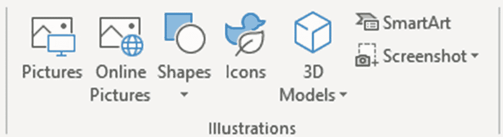

**图 17-1** 功能区中的`插图`组

如果单击`图片`按钮，Excel 会显示`插入图片`对话框，你可以通过它浏览并找到直接连接计算机或通过网络连接的任意驱动器上的图像。

如果单击`联机图片`按钮，你将看到一个显示图像类别的窗口。见图 17-2。你可以单击其中一个类别，然后从该类别中选择图像，或者在`搜索 Bing`文本框中输入搜索词。`Bing`是微软的搜索引擎。如果你想从`OneDrive`访问图像，可以单击`OneDrive`按钮。

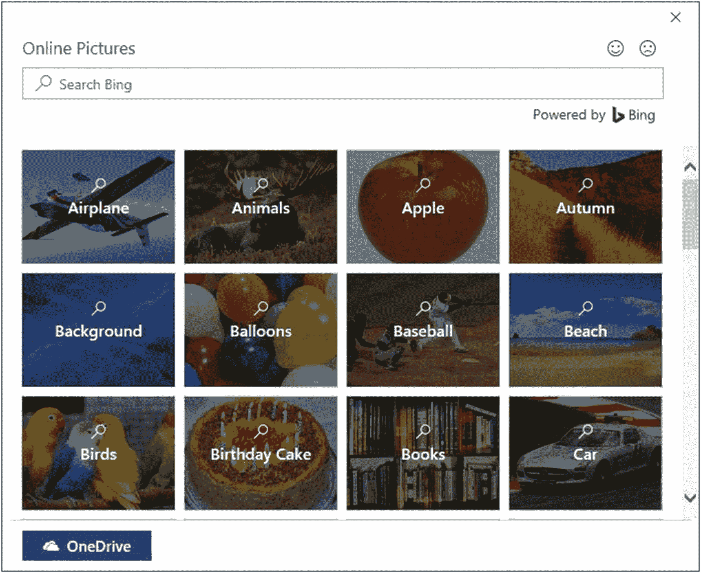

**图 17-2** `插入图片`窗口

在图 17-3 中，已输入搜索词`Dog`。如果你要使用基于知识共享许可协议的图像，请确保选中复选框。如果取消选中，你会看到更多图像，但使用其中部分图像需要付费。单击一个图像，再单击`插入`按钮，即可将其粘贴到工作表中。

**图 17-3** 已输入搜索词`dog`

你可以通过单击筛选按钮  来筛选显示的图像。图 17-4 显示了可用的筛选条件。

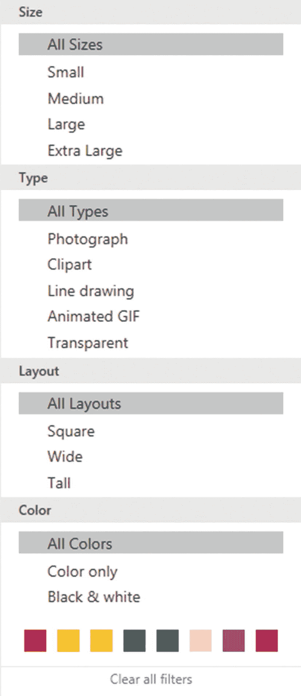

**图 17-4** 可用的筛选条件

筛选按钮并非对你当前看到的图片进行筛选；而是对互联网上可用的图片进行筛选。如果你应用了诸如“红色”的筛选条件，你将看到红色的狗图片，比如克利福德。你可以组合使用筛选条件。如果你想查看中等尺寸的黑白照片，你可以选中这三个筛选条件。

### 练习 17-1：从计算机添加图像

在本练习中，你将探索修改图像、为图像添加边框以及应用图片样式的各种方法。

**图 17-12** 发光效果

1. 单击`图片效果`。这里有七组不同的效果。将光标移到各个`图片效果`上，同时观察它们对工作表中选定图像的影响。图 17-12 中的图片应用了发光效果。

1. 在`图片样式`组中，单击`图片边框`按钮中的下拉箭头。选择红色，并将边框粗细更改为`3 pt`。见图 17-11。按`Ctrl + Z`移除边框。

**图 17-11** 粗细为`3 pt`的红色边框

1. 将光标移到各个样式上，同时观察它们对工作表中选定图像的影响。

图 17-10 展示了`图片样式`可以显示图像的一些不同方式。

**图 17-10** `图片样式`可以显示图像的不同方式

1. 在不改变图片外观的情况下创造戏剧性效果的最佳方法是使用`图片样式库`中的一种样式。见图 17-9。

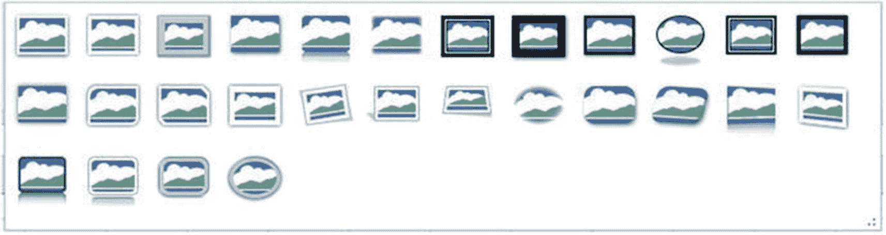

**图 17-9** `图片样式库`

1. 在`调整`组中，单击`艺术效果`按钮。将光标移到缩略图上，同时观察它们对工作表中选定图像的影响。图 17-8 展示了应用于图像的“铅笔素描”和“影印”特殊效果。

**图 17-8** 特殊效果：铅笔素描和影印

1. 在`调整`组中，单击`颜色`按钮。见图 17-7。此处的调整会影响图像的饱和度、色调和整体颜色。将光标移到缩略图上，同时观察它们对工作表中选定图像的影响。

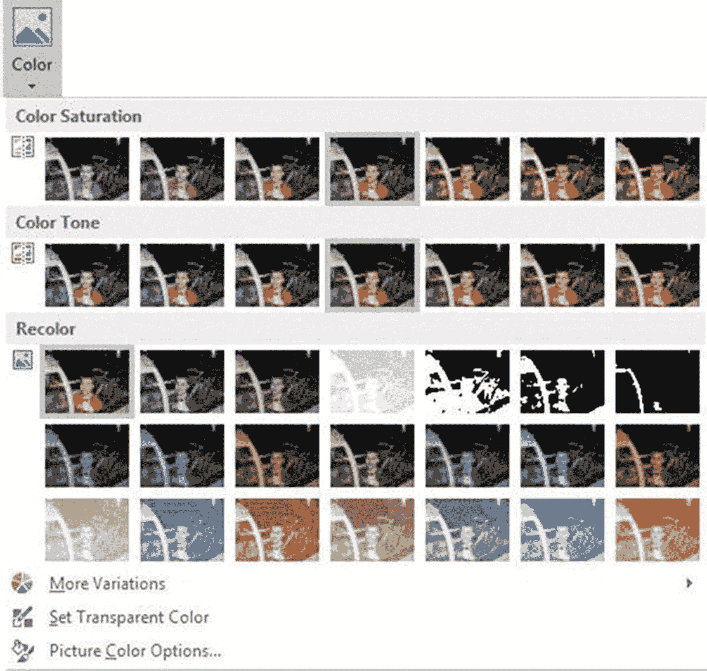

**图 17-7** 调整图像的整体颜色、饱和度和色调

1. 当你在工作表上选中一个图像时，功能区将显示一个`格式`选项卡。`格式`选项卡包含用于修改、调整大小、着色、旋转、裁剪、应用效果、添加边框等的所有选项。单击图像。单击功能区的`格式`选项卡。

2. 在`调整`组中，单击`更正`。更正库会显示你的图像缩略图，并带有不同程度的锐度、亮度和对比度。见图 17-6。`锐化/柔化`组中间和`亮度/对比度`组中间的图像带有一个边框。带有边框的图像代表你图像当前的显示效果。将光标移到缩略图上，同时观察它们对工作表中选定图像的影响。在`亮度/对比度`组中，向右移动，亮度增加。在该组中向下移动，对比度增加。如果要为选定的图像应用某种效果，请单击该缩略图。如果决定不喜欢该效果，可以按`Ctrl + Z`撤消操作。

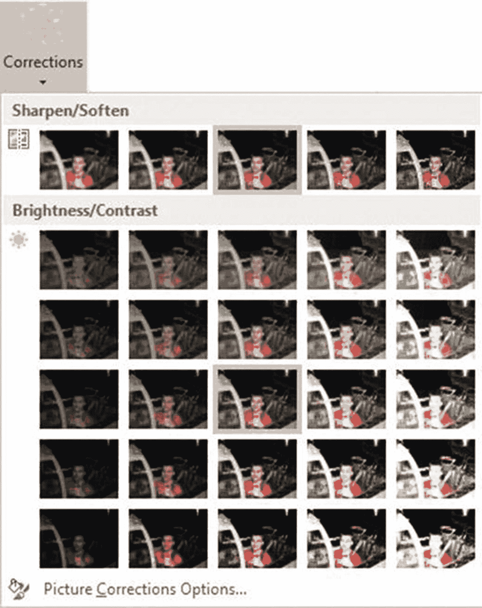

**图 17-6** `更正`库，你可以在其中改变锐度、亮度和对比度的级别

在`调整`组中，有一个`重设图片`按钮，它可以让你仅重设图片，或者同时将图片及其大小重设回插入时的原始状态。

1. 打开工作簿第 17 章。创建一个新的工作表。

2. 单击功能区的`插入`选项卡。在`插图`组中，单击`图片`。

3. 浏览到第 17 章的文件夹。找到`Pilot`图片。选择它，然后单击`插入`按钮。图 17-5 显示了该图片。

**图 17-5** `Pilot`图片

你已经学会了如何从计算机中保存的图像文件向工作表添加图像。如果你想要添加在网站上看到的图像，或者想要编写培训文档并需要来自 Excel、Word 或其他应用程序的图像，该怎么办？Excel 有一个名为`屏幕截图`的功能，可以让你捕获这些图像。

## 使用屏幕截图

使用`Screenshot`功能可以抓取整个窗口或窗口的一部分，并将其转换为图像。`Screenshot`按钮位于`插入`选项卡的`插图`组中。点击`Screenshot`按钮会打开所有可用窗口的缩略图视图。详见图 17-13。单击其中任意缩略图，即可捕获该窗口的全尺寸图像。

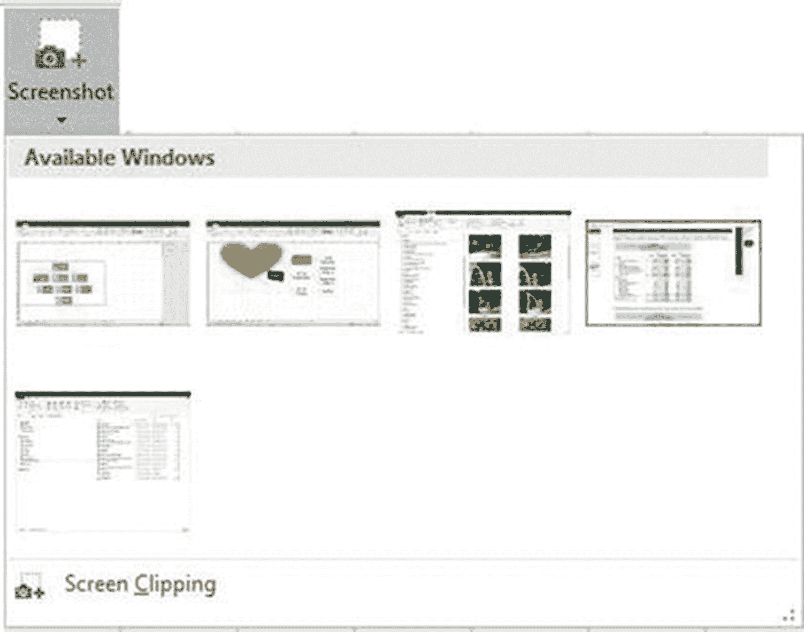

图 17-13

`Screenshot`可以捕获计算机上打开的其中一个窗口

如果只想抓取窗口的一部分，则需要先打开该窗口，然后再点击`屏幕剪辑`。点击`屏幕剪辑`后，`Excel`程序会最小化，正在捕获的窗口会变暗，光标变为十字准线。拖动鼠标时，图像中包含的区域会变亮。完成区域选择后，图像便会出现在工作表中。

练习 17-2：使用屏幕截图抓取图像

在本练习中，您将抓取网页的一部分，并将其存储到工作表中。然后，对捕获的图像应用图片样式。

1.  最大化`Excel`窗口。将捕获的图像移动到工作表窗口的中心。

2.  单击功能区的`格式`选项卡。在`图片样式`组中，从`样式`库中选择`投影矩形`。这将在图像的底部和右侧添加阴影。

1.  如果网页已最大化，请缩小窗口大小，以便您能同时看到网页浏览器中的`利润表`和`Excel`中的`插入`选项卡。

2.  单击功能区的`插入`选项卡。在`插图`组中，点击`Screenshot`按钮。

3.  点击窗口底部的`屏幕剪辑`。在进行屏幕剪辑时，`Excel`程序会隐藏。

4.  使用十字准线，在利润表上拖动。当您在利润表上拖动时，将被捕获图像包含的区域会高亮显示。详见图 17-15。释放鼠标后，高亮区域即成为一张图像，并存储在工作表中。

    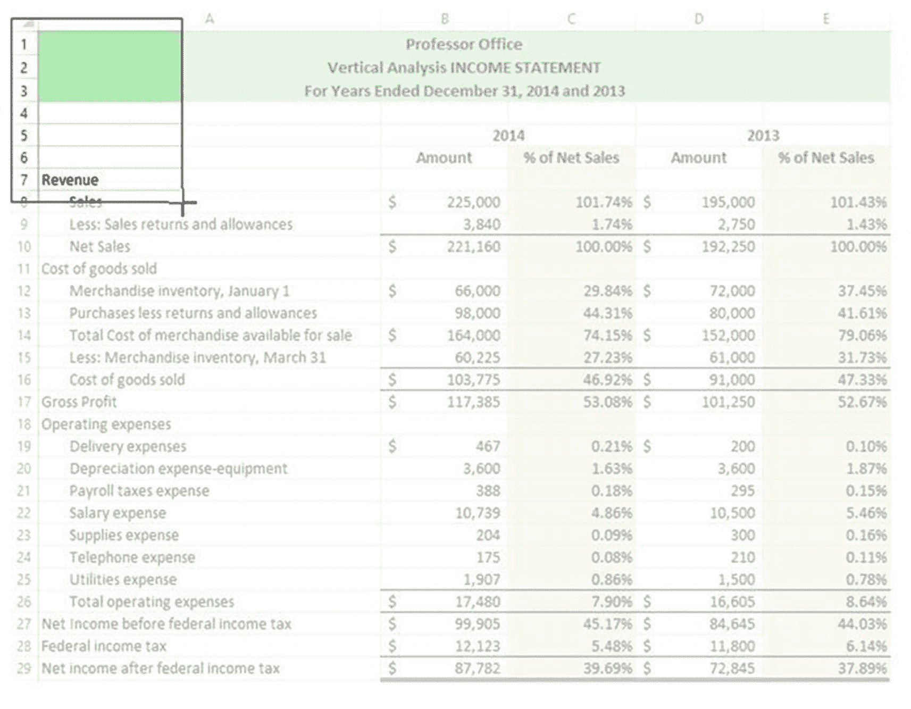

    图 17-15

    当您在利润表上拖动时，捕获图像中包含的区域会高亮显示

    屏幕剪辑是一张图像，因此所有可应用于图像的功能同样适用于屏幕剪辑。

1.  点击`Screenshot`工作表。

2.  关闭或最小化除`Excel`之外的所有打开窗口。

3.  点击单元格`A1`中的超链接。

4.  向下滚动网页，直到图 17-14 中显示的整个`利润表`可见。

    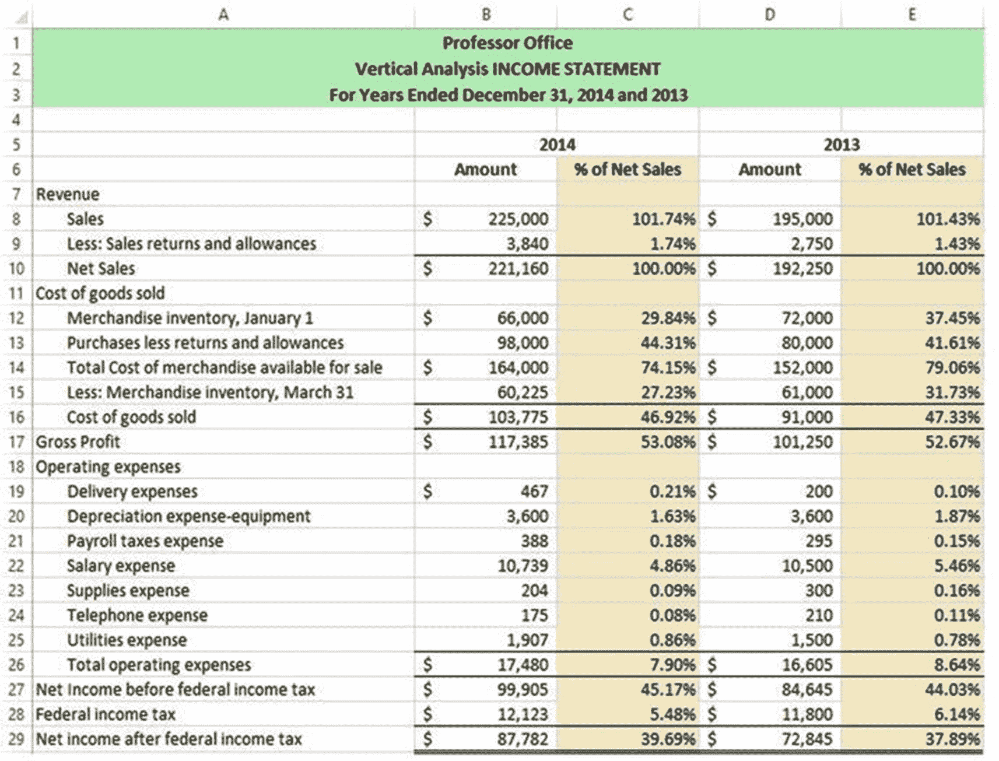

    图 17-14

    将使用`Screenshot`捕获的窗口

## 使用艺术字

`WordArt`是一种装饰性文本，您对其的控制程度远超普通文本。您可以扭曲`WordArt`文本、使其沿路径排列、更改其形状、添加 3D 效果、更改字体及背景等。

练习 17-3：使用艺术字

在本练习中，您将探索创建和更改`WordArt`的各种方法。创建一个新工作表。

图 17-18

使用了`宽松透视`效果的文本

1.  将光标移至不同颜色上，观察其对`WordArt`的效果。

2.  点击`纹理`。将光标移至每个`纹理`上，观察其对`WordArt`的效果。

3.  请注意，您甚至可以用`图片`填充文本。

4.  `渐变`效果取决于您当前使用的颜色。

我们不进行任何更改。

5.  在`艺术字样式`组中，点击`文本轮廓`的下拉箭头。您可以为轮廓选择一种颜色，然后通过更改粗细来调整轮廓尺寸。选择绿色作为轮廓颜色。再次点击`文本轮廓`的下拉箭头，选择粗细为 1 磅。

6.  在`艺术字样式`组中，点击`文本效果`。浏览`阴影`、`映像`和`发光`选项，观察它们对`WordArt`的影响。

7.  再次点击`文本效果`。点击`三维旋转`。将光标移至效果上时，可能无法看到预览效果。这似乎有些奇怪，但您必须先应用一个 3D 效果，之后才能通过移动光标查看不同的 3D 效果：
    1.  点击其中一个 3D 效果。

2.  再次点击功能区上的`文本效果`，然后重新选择`三维旋转`。现在，当您将光标移至每个效果上时，应该能看到效果了。

3.  选择`宽松透视`效果。详见图 17-18。

1.  选择第一行中的第一个`A`。

2.  输入`快乐音符音乐`。选中该文本。

`WordArt`使用`开始`选项卡上`字体`组中选定的字体类型。

3.  单击功能区的`开始`选项卡。在`字体`组中，点击`字体类型`的下拉箭头。将光标移至不同字体类型上，观察其对`WordArt`的影响。

4.  单击功能区的`格式`选项卡。在`艺术字样式`组中，点击`文本填充`的下拉箭头。详见图 17-17。

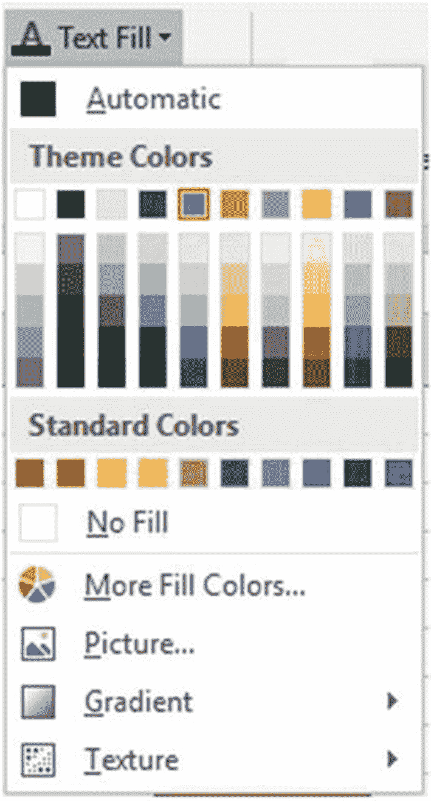

图 17-17

`文本填充`选项

1.  创建一个新工作表。

2.  单击功能区的`插入`选项卡。在`文本`组中，点击`WordArt`按钮。详见图 17-16。

图 17-16

`WordArt`

我们更改了文本，但也可以更改文本背后的背景。我们已经了解了`文本填充`、`文本轮廓`和`文本效果`。这些相同的选项也适用于背景。这些选项位于`形状样式`组中，分别称为`形状填充`、`形状轮廓`和`形状效果`。

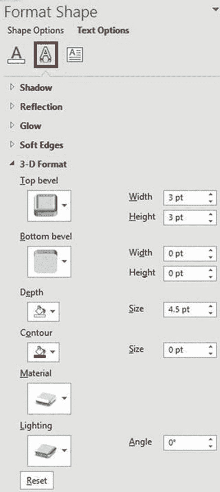

图 17-21

文本效果

1.  点击`文本效果`按钮。这里还有针对`材质`和`照明`的附加效果。详见图 17-21。浏览这些效果的每个选项。您需要逐个点击它们。这些选项在移动鼠标时不会显示变化。

1.  右键单击艺术字，选择 **设置文本效果格式**。这将打开“设置形状格式”窗格，且窗格顶部已选中“文本选项”。此处的许多选项与您已使用过的相同，但有些选项提供了对应用效果的更精细控制。您可以通过单击“文本填充与轮廓”按钮，然后展开“文本填充”来查看。请参见图 17-20。单击此窗格中的选项按钮，您将看到每个效果的更多控制选项。

  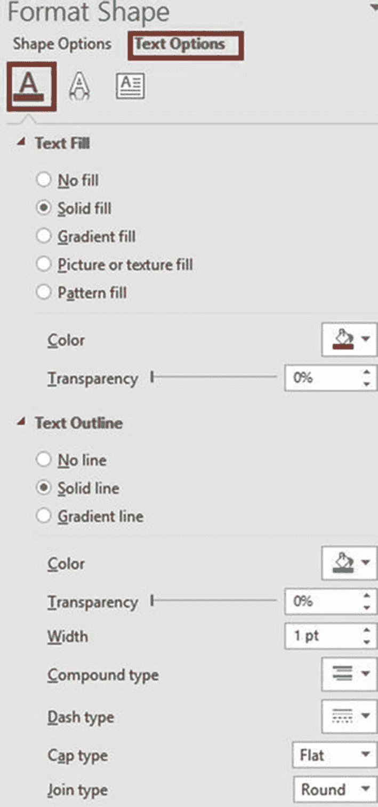

  **图 17-20** 文本选项对话框

2.  逐一浏览每个形状选项。您可能会创建出类似于图 17-19 的效果。

  

  **图 17-19** 看看您是否能创建出类似的效果

艺术字可以变形以遵循路径，或扭曲成真正吸引眼球的效果。

**练习 17-4：让艺术字跟随路径**

在本练习中，您将使文本围绕一个圆跟随路径。

1.  单击功能区上的“视图”选项卡。在“显示”组中，取消勾选“网格线”。

2.  在功能区的“艺术字样式”组中，单击“文本效果”。单击“转换”。在“跟随路径”下，单击第一个形状（上弯弧形）。

3.  单击功能区上的“插入”选项卡。在“文本”组中，单击“艺术字”。在库中选择第一个字母 **A**。

4.  将文本更改为 **Computer Tutorials**。

5.  在功能区的“大小”组中，将高度和宽度都更改为 3.94。

6.  在功能区的“艺术字样式”组中，单击“文本效果”。单击“转换”。在“跟随路径”下，单击第二个形状（下弯弧形）。

7.  拖动边框向上，使文本对齐在 **Professor Office** 文本下方，如图 17-23 所示。

8.  单击功能区上的“插入”选项卡。在“插图”组中，单击“形状”并选择椭圆。

9.  按住 `Shift` 键，同时单击鼠标左键并拖动，使其在文本内形成一个完美的圆形，如图 17-23 所示。

这可以用于制作徽标。您可以在圆内添加更多文本。您还可以通过应用 3D 或其他效果来美化这个圆形。

**图 17-23** 在文本内制作一个圆形

1.  创建一个新工作表。

2.  单击功能区上的“插入”选项卡。在“文本”组中，单击“艺术字”。在库中选择第一个字母 **A**。

3.  将文本更改为 **Professor Office**。

4.  在功能区的“大小”组中，将高度和宽度都更改为 3.94。

5.  拖动边框向上，使其靠近窗口顶部。请参见图 17-22。

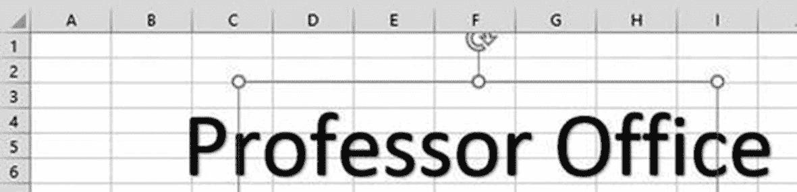

**图 17-22** 如图所示将边框向上拖动

## 添加和修改形状

Excel 提供了一个包含八个形状组的大型库。请参见图 17-24。还有一个组包含您最近使用过的形状。形状位于功能区“插入”选项卡的“插图”组中。要使用形状，请单击您希望放置的位置，然后拖动到所需大小。拖动时按住 `Shift` 键可以限制某些形状的移动；例如，线条将保持笔直，矩形将变成完美的正方形，椭圆将变成一个完美的圆形。您可以添加、修改和删除形状。

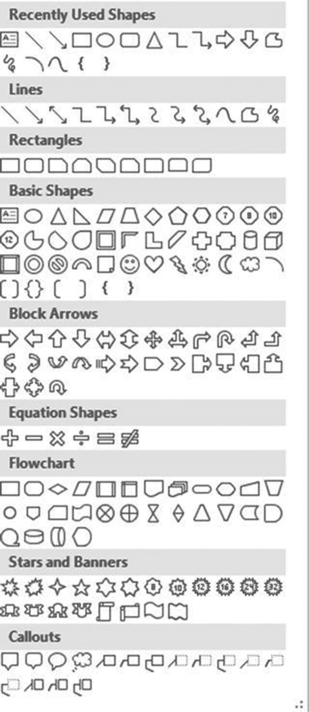

**图 17-24** 八个形状组的库

**练习 17-5：使用形状**

在本次练习中，我们将使用形状来创建流程图的一部分。请参见图 17-25。

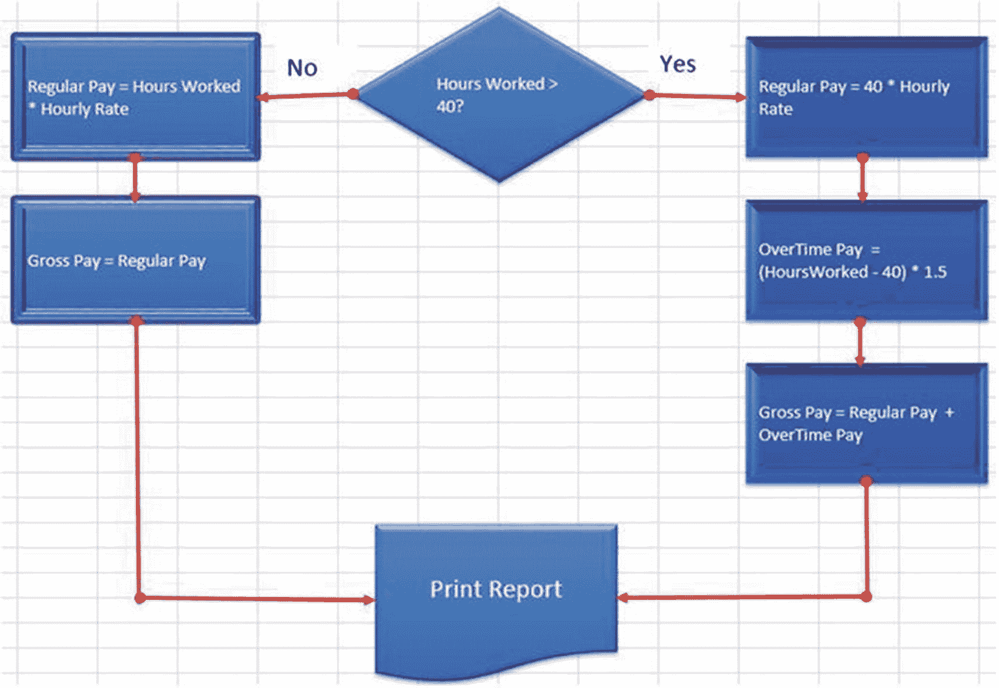

**图 17-25** 这将是本次练习的最终结果

1.  接下来，我们将在决策符号左侧添加文本 **No**，并在其右侧添加文本 **Yes**：
    1.  单击功能区上的“插入”选项卡。在“文本”组中，单击“文本框”。光标将变为一个向下箭头。

    2.  在决策符号左侧拖出一个矩形。在文本框中输入 **No**。

    3.  右键单击文本框，然后选择“设置形状格式”。在“线条”下，选择 **无线条** 选项。这将移除文本框边框。将文本的字体大小增加到 16。

    4.  单击文本框的外边框。按 `Ctrl + C` 复制它。按 `Ctrl + V` 粘贴它。将粘贴的文本框移动到决策符号的右侧。

    5.  将文本更改为 **Yes**。

    6.  进行任何必要的调整。

2.  现在您可以添加文本了：
    1.  单击左上角的矩形。

    2.  输入文本 **Regular Pay = Hours Worked * Hourly Rate**。

    3.  单击功能区上的“开始”选项卡。在“对齐方式”组中，单击“中部对齐”按钮。

    4.  以相同方式为其他形状输入并对齐文本。按如下方式输入文本：
        *   左侧第二个矩形：**Gross Pay = Regular Pay**

        *   决策形状：**Hours Worked > 40?**

        *   右侧第一个矩形：**Regular Pay = 40 * Hourly Rate**

        *   右侧第二个矩形：**OverTime Pay = (HoursWorked – 40) * 1.5**

        *   右侧第三个矩形：**Gross Pay = Regular Pay + OverTime Pay**

        *   文档形状：**Print Report**

    5.  增加文档形状中的字体大小。您的流程图应看起来像图 17-34 中所示。

  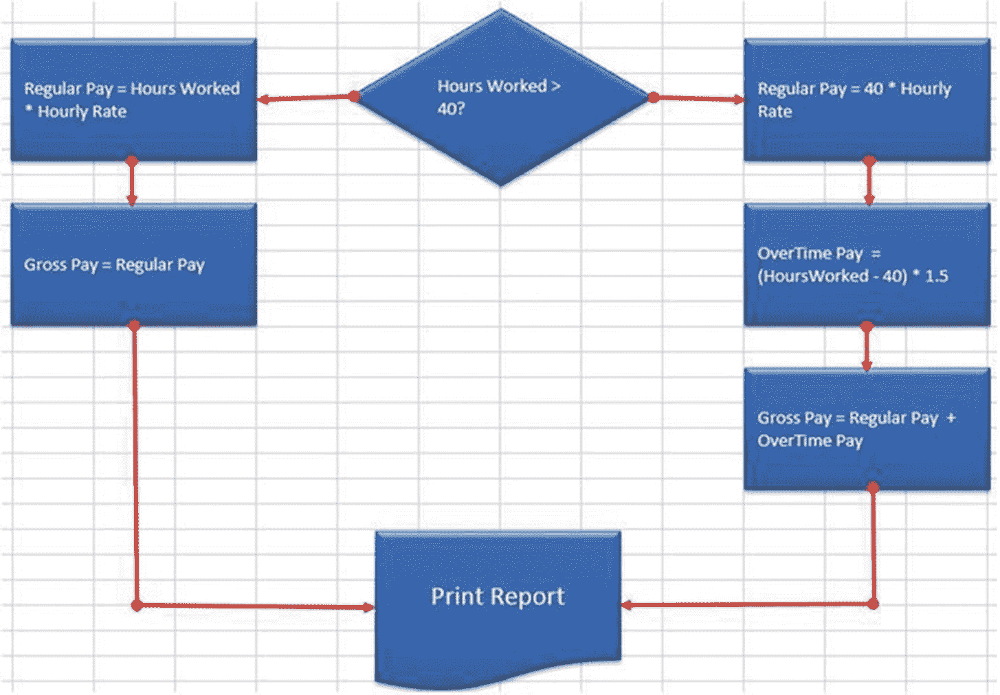

  **图 17-34** 您的流程图现在应类似于这样

3.  按 `Ctrl + C` 复制线条。按 `Ctrl + V` 粘贴它。拖动粘贴的线条，使其连接右下角的矩形与连接到文档图标的线条。更改大小以使其合适。进行任何其他必要的调整。您的流程图现在应看起来像图 17-33 中所示。

  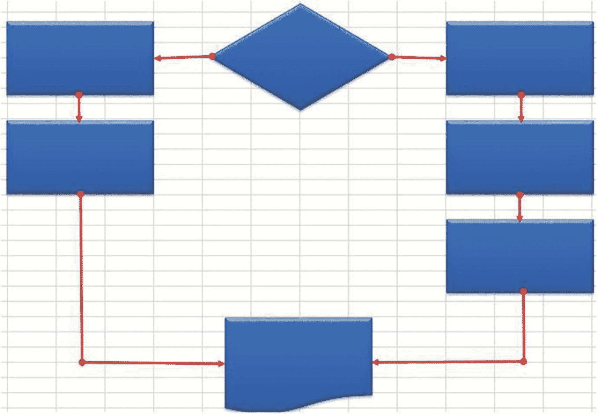

  **图 17-33** 您的流程图现在应类似于这样

4.  接下来，我们将绘制连接左右矩形与指向文档图标的箭头的直线：
    1.  单击功能区上的“插入”选项卡。在“插图”组中，单击“形状”。

    2.  在“线条”组中，单击第一条线（直线）。

    3.  从左侧第二个矩形向下画一条线，并将其连接到指向文档图标的箭头线上。由于您创建了一条默认带有箭头的线条，我们需要移除箭头。

4.  右键单击刚创建的线条，然后选择`设置形状格式`。`设置形状格式`窗格会出现在工作表的右侧。单击`填充与线条`按钮 。

5.  单击`末端箭头类型`，然后选择`无箭头`。见图 17-32。

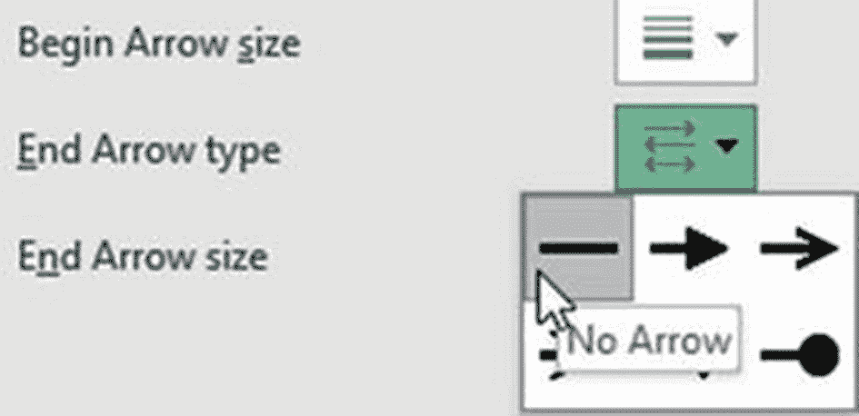

图 17-32

选择`无箭头`类型

1.  右键单击箭头，然后选择`设置为默认线条`。

2.  单击功能区中的`插入`选项卡。在`插图`组中，单击`形状`。形状中的第一个分组是`最近使用的形状`。箭头应该在这个组中。由于你对箭头的外观进行了修改并将其设置为默认线条，因此从这里选择的箭头线条将与你刚创建的箭头线条外观完全相同。

从`最近使用的形状`中选择箭头。

3.  如图 17-31 所示绘制箭头线条。你也可以通过复制粘贴箭头线条，然后将它们移动到所需位置，来加快操作速度，而无需每次都返回菜单。你可以旋转线条并调整其大小。如果它们不在你想要的精确位置，可以使用键盘上的箭头键微调其位置。

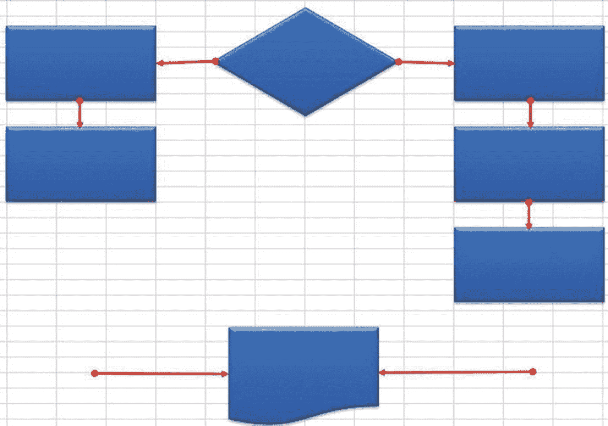

图 17-31

如图所示绘制箭头线条

1.  接下来，让我们设置箭头的格式：
    1.  单击箭头。
    2.  单击功能区中的`格式`选项卡。在`形状样式`组中，单击`形状轮廓`。
    3.  在`标准色`中，单击红色。
    4.  在`形状样式`组中，单击`形状轮廓`。单击`粗细`，然后选择`2.25 磅`。
    5.  在`形状样式`组中，单击`形状轮廓`。
    6.  单击`箭头`，然后选择一端为圆形、另一端为箭头的箭头样式。

2.  选中文档形状后，单击功能区中的`格式`选项卡。单击`样式`库的`其他`按钮。在`主题样式`组中，单击最后一行的蓝色。

3.  现在我们可以用箭头将形状连接起来：
    1.  单击功能区中的`插入`选项卡。
    2.  在`插图`组中，单击`形状`。
    3.  在线条组中，单击第二个图标（箭头）。
    4.  按住`Shift`键，从决策符号的右角向右边的矩形绘制箭头。
    5.  按住`Shift`键可以使箭头保持直线。

4.  按住`Ctrl`键，单击右侧的三个矩形。
5.  单击功能区中的`格式`选项卡。在`排列`组中，单击`对齐`按钮，然后选择`左对齐`。现在三个矩形的左边框应该对齐了。
6.  再次单击`对齐`按钮。这次选择`纵向分布`。这会使矩形在垂直方向上均匀分布。单击一个空白单元格以取消选择这三个矩形。
7.  按住`Ctrl`键，单击左侧的两个矩形。单击功能区中的`格式`选项卡。在`排列`组中，单击`对齐`按钮，然后选择`左对齐`。现在两个矩形的左边框应该对齐了。单击一个空白单元格以取消选择这两个矩形。
8.  按住`Ctrl`键，单击左侧的第二个矩形和右侧的第二个矩形。单击功能区中的`格式`选项卡。在`排列`组中，单击`对齐`按钮，然后选择`底端对齐`。
9.  单击功能区中的`插入`选项卡。在`插图`组中，单击`形状`。在`流程图`组中，单击`文档`图标。将光标放在文档形状左上角起始位置，然后将其拖出，使其位置和大小与图 17-30 中所示一致。

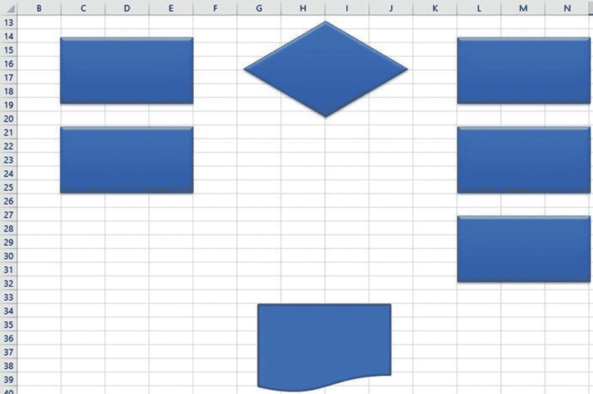

图 17-30

### 重新排版后的 Markdown 文档

拖拽文档图标，使其与下图所示大小和位置一致。

1.  选中矩形后，点击功能区中的**格式**选项卡。在**形状样式**组中，点击样式库的**更多**按钮。在**主题样式**组的最后一行中，点击蓝色样式。
2.  按 `Ctrl + C` 复制矩形。按 `Ctrl + V` 四次，创建四个矩形副本。
3.  拖拽这些矩形，使其位置如图 17-29 所示。无需担心精确位置，我们接下来会进行对齐。

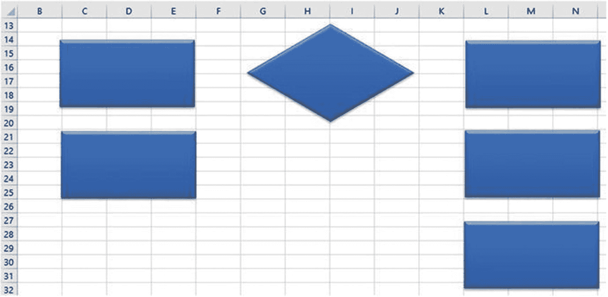
*图 17-29：拖拽矩形至如图所示位置。*

1.  移动矩形，使其如图 17-28 所示对齐。

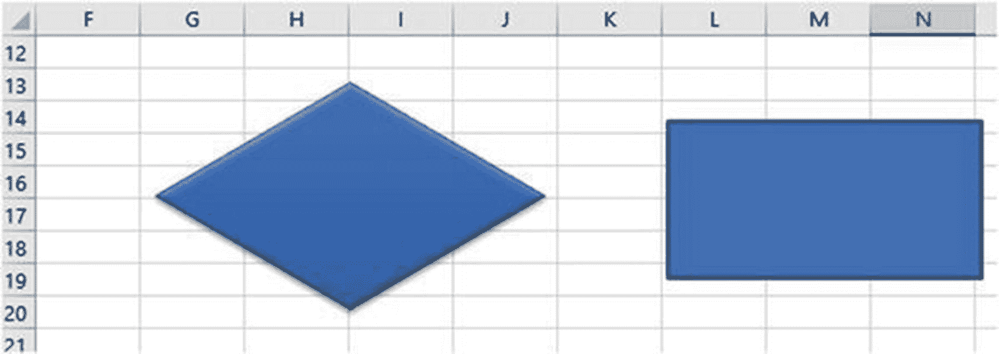
*图 17-28：将矩形与菱形如图所示对齐。*

1.  点击功能区中的**格式**选项卡。在**形状样式**组中，点击样式库的**更多**按钮。在**主题样式**组的最后一行中，点击蓝色样式。
2.  点击功能区中的**插入**选项卡。在**插图**组中，点击**形状**按钮。在**流程图**组中，点击第一个形状（即矩形）。点击希望矩形起始位置的左角。
3.  右键点击矩形，选择**大小和属性**。在**高度**中输入`1`，在**宽度**中输入`2`。参见图 17-27。

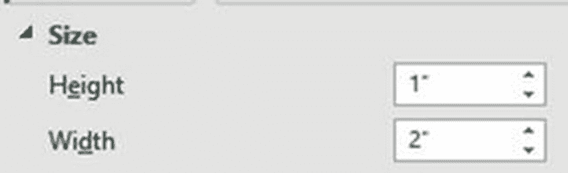
*图 17-27：输入高度和宽度。*

1.  创建一个新工作表，命名为 `Shapes`。
2.  点击功能区中的**插入**选项卡。在**插图**组中，点击**形状**按钮。
3.  在**流程图**组中选择**菱形**形状。光标会变为十字准线。
4.  点击第 12 行下方的网格线，以及 F 列和 G 列之间的网格线。按住 `Shift` 键的同时向右下方拖拽。将形状扩展到大约占据四列。参见图 17-26。

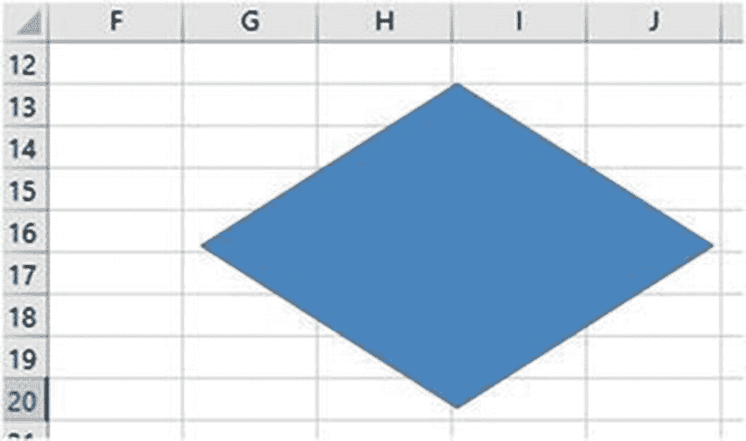
*图 17-26：您的形状应与图示大小和位置一致。*

### **组合与取消组合形状**

如果希望对多个对象应用相同的属性，可以将这些对象组合成一个组。移动其中一个对象时，整个组会一起移动。修改一个对象的属性时，Excel 会对组内所有对象进行相同的更改。

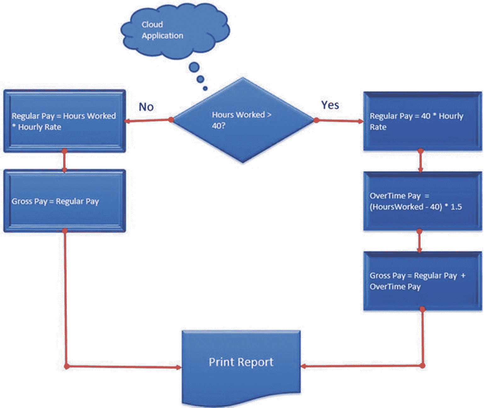
*图 17-38：创建一个云形形状。*

1.  点击功能区中的**格式**选项卡。在**排列**组中，点击**组合**按钮，然后选择`取消组合`。点击右侧的一个矩形，再次点击**组合**按钮，然后选择`取消组合`。
2.  关闭**选择窗格**。
3.  点击功能区中的**插入**选项卡。在**插图**组中，点击**形状**。在**标注**组中点击`云形标注`形状。在决策形状的左上方绘制标注。

标注有一个黄色圆圈作为其手柄之一。你可以将此圆圈拖向想要标注指向的对象。

4.  将黄色圆圈拖向决策符号。在标注形状中输入文字`云应用`，并对齐文本。
5.  你可以将任何形状更改为其他形状。让我们给这个云应用赋予一个云朵形状：
    1.  在**插入形状**组中，点击**编辑形状**按钮，然后选择**更改形状**，再选择`云形标注`。
    2.  将黄色圆圈从云形标注拖向决策形状。
    3.  根据需要调整标注的大小和形状。参见图 17-38。

1. 在“设置形状格式”窗格中：
    1. 单击“轮廓”并选择紫色。
2. 将轮廓大小更改为 5 磅。
3. 单击“顶部棱台”，然后选择“切口”。
4. 将宽度更改为 7，高度更改为 5。
1. 单击“效果”按钮。
2. 单击“三维格式”左侧的箭头以展开该组。单击“照明”，然后在“温暖”类别下选择“日落”。单击“顶部棱台”，然后选择“圆形”。
3. 在“选择”窗格中，单击两个左侧矩形的组合。将该组合的名称更改为`LeftRectangles`。请参见图 17-37。

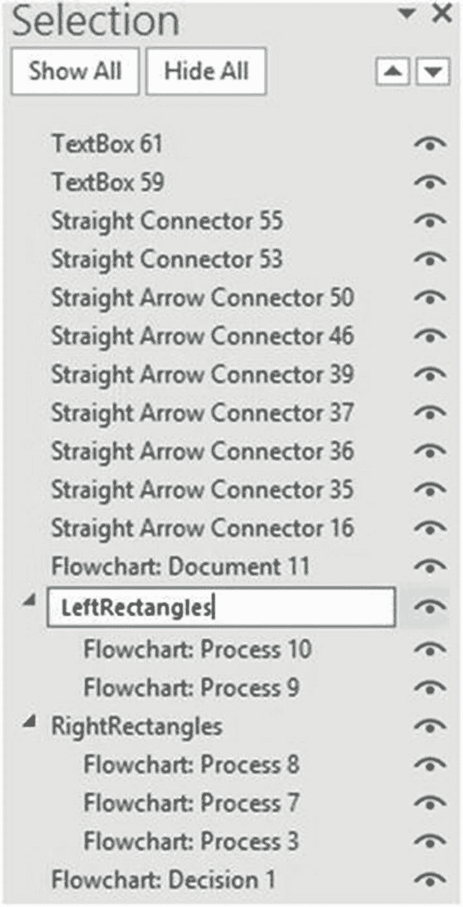

图 17-37：将组合的名称更改为`LeftRectangles`

1. 单击其中一个右侧矩形。该组合将被选中。您的组合名称将与图 17-35 中所示不同。单击右侧三个矩形的组合名称。再次单击该名称。将其更名为`RightRectangles`。
2. 单击第一个右侧矩形的眼睛图标。单击水平线将其恢复显示。单击`RightRectangles`组合的眼睛图标。单击水平线将该组合恢复显示。单击`RightRectangles`字样。
3. 单击功能区中的“格式”选项卡。在“形状样式”组中，单击“设置形状格式”按钮，该按钮将启动“设置形状格式”窗格。请参见图 17-36。

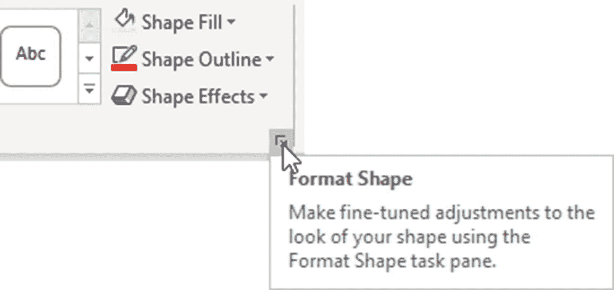

图 17-36：功能区的“形状样式”组

1. 单击右上角的矩形。按住`Ctrl`键，然后单击另外两个右侧矩形。
2. 单击功能区中的“格式”选项卡。在“排列”组中，单击“组合”按钮，然后选择“组合”。
3. 单击左上角的矩形。按住`Ctrl`键，然后单击另一个左侧矩形。
4. 单击功能区中的“格式”选项卡。在“排列”组中，单击“组合”按钮，然后选择“组合”。
5. 单击功能区中的“格式”选项卡。在“排列”组中，单击“选择窗格”按钮。该窗格将显示每个对象，并在其右侧带有一个眼睛图标。请参见图 17-35。单击眼睛图标会隐藏与其关联的对象。如果您单击组合右侧的眼睛图标，它将隐藏整个组合。隐藏的对象或组合会显示一条水平线。单击该水平线可重新显示对象。

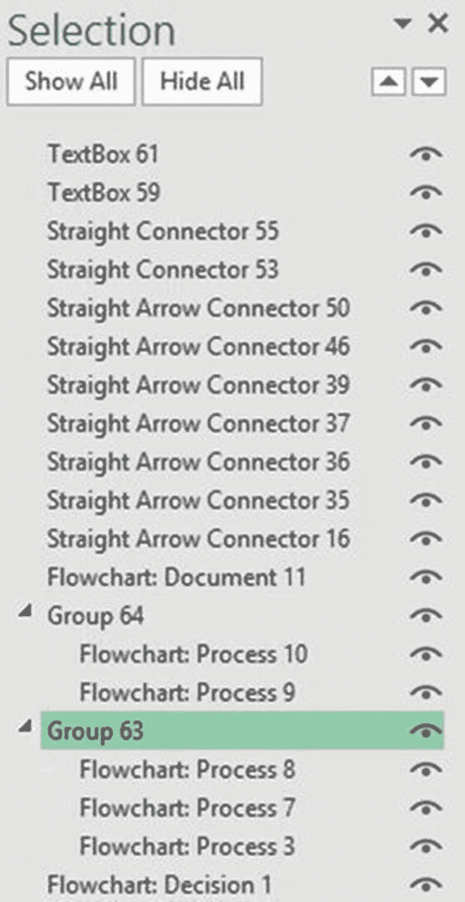

图 17-35：每个对象右侧都有一个眼睛图标

练习 17-6：更改形状的编辑点并将一个形状置于另一个形状之前

在此练习中，您将练习更改对象的形状以及将一个对象移动到另一个对象之前。

1. 在“排列”组中，单击“上移一层”按钮的上半部分。现在心形位于功能区之前。单击“下移一层”按钮的上半部分。横幅现在应位于心形之前。
1. 单击功能区中的“插入”选项卡。在“插图”组中，单击“形状”。在“星与旗帜”组中，单击第三个“飘带”（弯曲且向上倾斜）。
2. 在心形下方拖出横幅。
3. 将心形移动到横幅上方。由于心形是先添加的，它会移动到功能区后面。请参见图 17-40。

图 17-40：横幅应显示在心形前面

1. 创建一个新工作表。
2. 单击功能区中的“插入”选项卡。在“插图”组中，单击“形状”。
3. 在“基本形状”组中，单击“心形”。在工作表中间拖出心形。
4. 在“形状样式”组中，单击“形状填充”，然后选择红色。
5. 在“插入形状”组中，单击“编辑形状”按钮，然后选择“编辑顶点”。
6. 心形上添加了两个黑色小手柄。将光标移到顶部的手柄上，然后向上拖动。会出现两条线，每条线的末端有一个正方形。尝试移动这些正方形来更改心形的形状和大小。请参见图 17-39。

图 17-39：移动正方形以更改心形的形状和大小

练习 17-7：将图像转换为形状

在此练习中，您将使图像呈现圆形。

图 17-41：图片呈现圆形

1. 创建一个新工作表。
2. 单击功能区中的“插入”选项卡。在“插图”组中，单击“形状”按钮。
3. 在“基本形状”组中，单击“椭圆”。
4. 按住`Shift`键同时拖出椭圆；这将形成一个完美的圆形。
5. 单击“格式”选项卡。在“形状样式”组中，单击“形状填充”下拉箭头。
6. 选择“图片”。
7. 单击**“来自文件”**。浏览到图像文件`ShapeImage`。单击“插入”按钮。图片呈现圆形。请参见图 17-41。

在最后两节中，您学习了如何使用艺术字创建装饰性文本，这使您的文本更具影响力。您已经看到 Excel 提供了大量预定义形状，例如箭头、星形、横幅、标注等，您可以修改其形状和颜色。接下来，您将学习如何使用 SmartArt。SmartArt 通过将多个形状与文本相结合来创建各种可自定义的图表，从而将形状提升到另一个层次。共有九类图表，每类都包含许多可供选择的布局。您还可以将样式应用于这些布局。

## 使用 SmartArt

SmartArt 是可自定义图表的集合，分为流程、层次结构、矩阵、棱锥图等类别。`全部`类别显示了其他类别中的所有图表。您可以通过`插入`选项卡`插图`组中的`SmartArt`按钮访问“选择 SmartArt 图形”对话框，所有图表都会显示出来。请参见图 17-42。

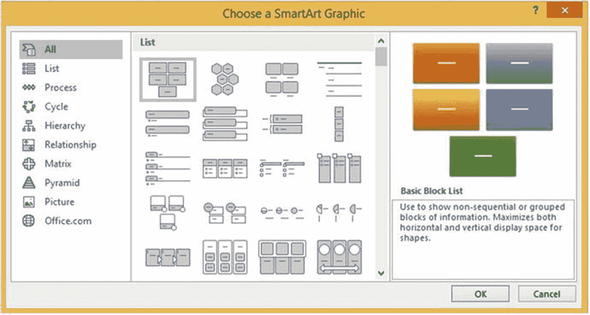

图 17-42

`全部`类别显示了其他类别中的所有图表

### 练习 17-8：创建组织结构图

最好在开始在 Excel 中创建图表之前，先在纸上画出您想要的图表样式。在此练习中，您将创建如图 17-43 所示的组织结构图。

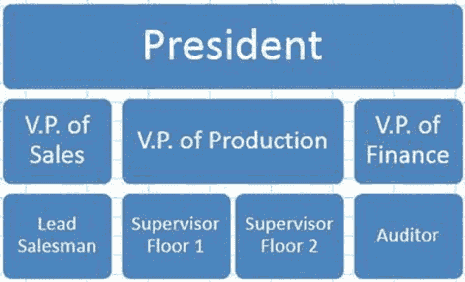

图 17-43

您将创建这个组织结构图

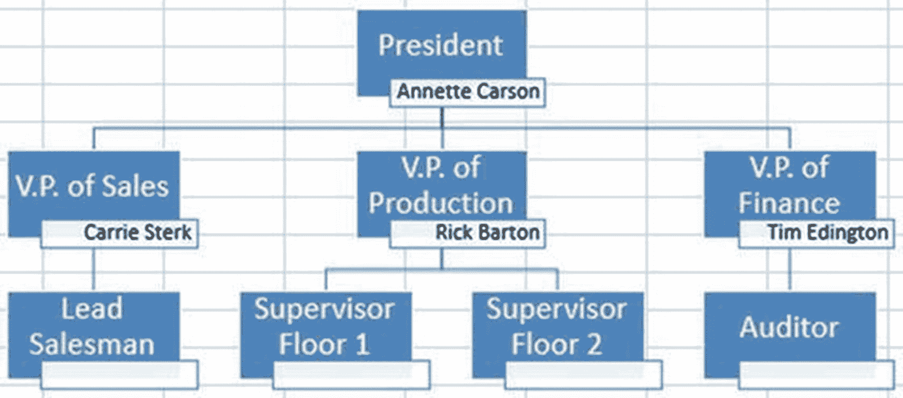

图 17-47

包含姓名和职务的组织结构图

1. 单击功能区中的`设计`选项卡。在`布局`组中，单击`其他`按钮  以查看完整布局库。
2. 单击第一行中的第三个图表。这是“姓名和职务组织结构图”。此图表的优点在于，除了输入每个职位的职务外，还可以输入担任该职位的人员姓名。只需单击每个文本框并输入姓名即可。请参见图 17-47。添加您自己的姓名。

1. 在`创建图形`组中，单击`降级`按钮。文本块将移回第三行。
2. 让我们使用另一种方法执行相同的功能。按住`Shift`键的同时按`Tab`键以升级文本块。
3. 按`Tab`键以降级文本块。
4. 按住`Shift`键的同时按`Tab`键以再次升级文本块。
5. 我们需要在第二行第二个文本框下方放置两个文本块。在`创建图形`组中，单击`添加形状`的下拉箭头按钮。选择**在下方添加形状**。
6. 单击文本窗格中的第二个文本块。在`创建图形`组中，单击`添加形状`的下拉箭头按钮。选择**在下方添加形状**。

现在，文本块的顺序已经符合我们要求，我们可以输入各职位的职务了。

7. 在图表或文本窗格中输入每个职位的职务。在其中任一位置输入职务都会自动同步到另一个位置。请参见图 17-46。

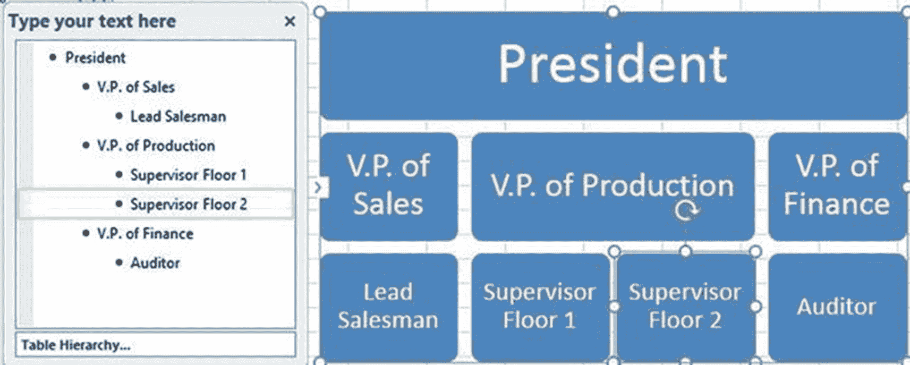

图 17-46

在窗格中输入文本，文本将出现在图表中，反之亦然

1. 单击文本窗格中的第三行文本。请参见图 17-45。单击功能区中的`设计`选项卡。在`创建图形`组中，单击`升级`按钮。

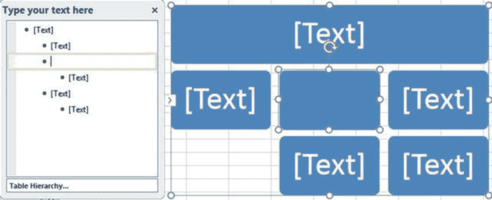

图 17-45

底行的文本块被移动到第二行

1. 创建一个新工作表。
2. 单击功能区中的`插入`选项卡。在`插图`组中，单击`SmartArt`。
3. 单击左侧窗格中的每个类别以查看不同的图表。`全部`组显示所有可用的图表。
4. 单击左侧窗格中的`层次结构`。单击右侧窗格中的`表格层次结构`。它是第二行中的最后一个图表。然后单击`确定`。

图表左侧会出现一个箭头按钮。请参见图 17-44。单击此按钮可以打开或关闭文本窗格。我们首先需要调整文本窗格，使其与我们想要的组织结构图外观相匹配。

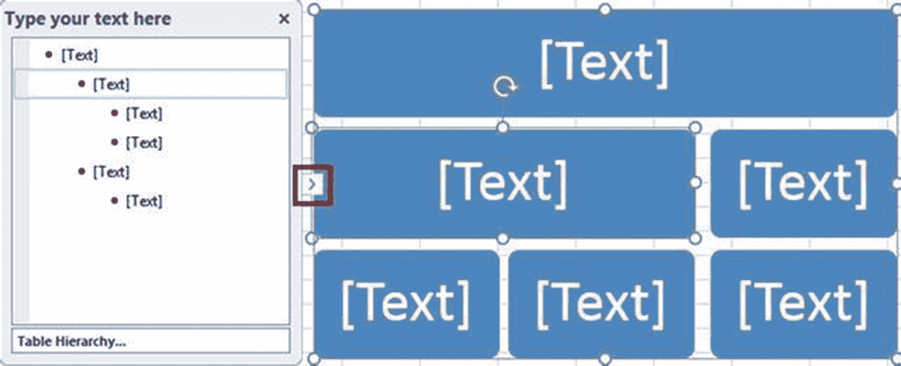

图 17-44

箭头按钮用于打开或关闭文本窗格

所有的网格线可能会分散注意力。您可以通过两种方法移除它们：一种是关闭网格线，另一种是使用填充。

### 通过关闭网格线移除网格线

1. 单击功能区中的`视图`选项卡。
2. 在`显示`组中，取消勾选“网格线”。

这将移除整个工作表的网格线。如果您不打算在工作表单元格中输入其他数据，这是最佳方法。

3. 在`显示`组中，勾选“网格线”以恢复网格线，供下一练习使用。

### 通过使用填充移除网格线

1. 单击总裁形状左侧或右侧的空白区域以选中整个组织结构图。单击功能区中的`设计`选项卡。
2. 单击布局的`其他`按钮。选择**水平标签层次结构**图表。
3. 单击功能区中的`设计`选项卡。在`SmartArt 样式`组中，单击`更改颜色`按钮。将光标悬停在库中的对象上，查看它们对图表的影响。
4. 选择“主题颜色(主要)”下的第一个对象。
5. 右键单击图表中的“总裁”形状。选择“更改形状”。
6. 在“星与旗帜”组中，选择“横卷形”。
7. 单击功能区中的`格式`选项卡。在`形状样式`组中，单击`形状填充`。选择您喜欢的颜色。请参见图 17-50。

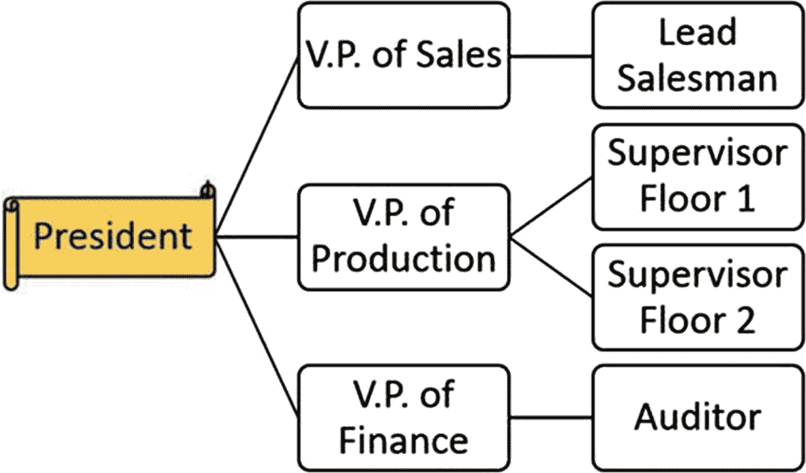

图 17-50

为形状填充选择一种颜色

1. 单击组织结构图的任意位置。
2. 单击功能区中的`设计`选项卡。在`布局`组中，单击第一行中的第二个图表。这是“图片组织结构图”。
3. 单击“总裁”的图片图标 。

这将弹出“插入图片”窗口，您可以在其中从计算机或 Internet 中选择图片。

4. 单击**来自文件**。浏览到“President”图片。单击`插入`按钮。
5. 对“销售副总裁”执行相同操作。使用图片 VPofSales。请参见图 17-49。

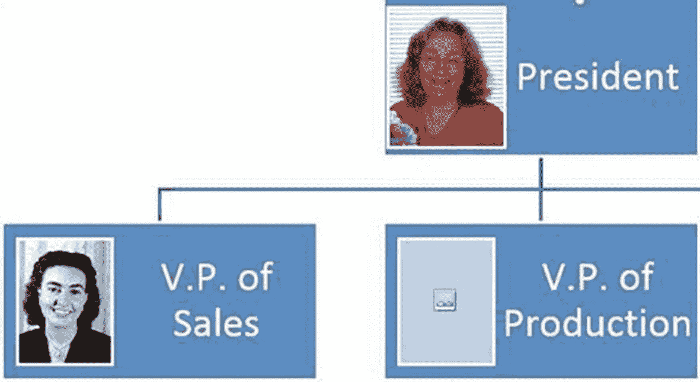

图 17-49

使用图片 VPofSales

1. 选中图表周围的所有单元格。
2. 单击功能区中的`开始`选项卡。
3. 在`字体`组中，单击`填充颜色`按钮，然后选择“白色”。
4. 单击边框的向下箭头，然后选择**粗框线**。请参见图 17-48。

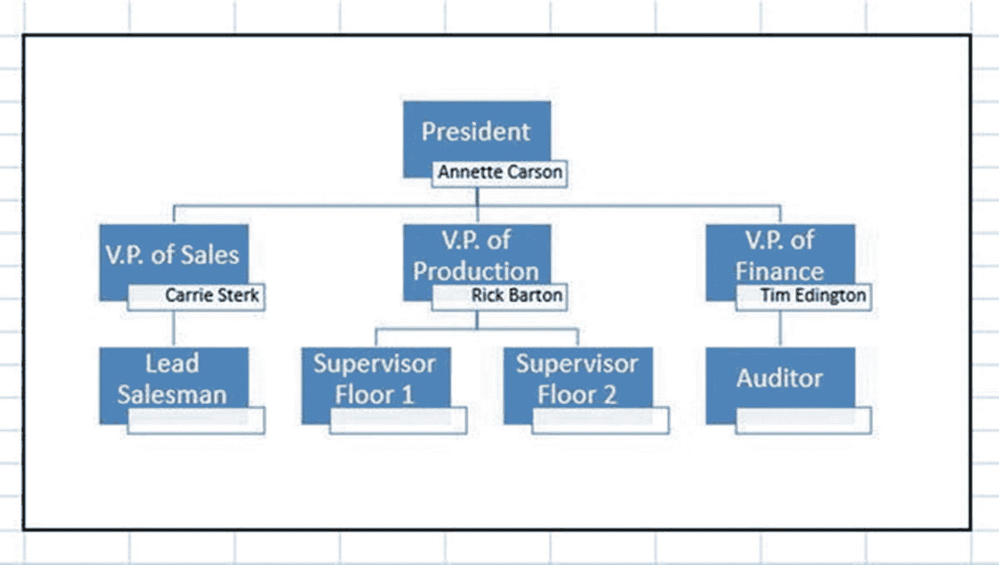

图 17-48

带有粗外框线的姓名和职务组织结构图

现在，组织结构图已符合我们的要求，我们可以从多种不同的布局选项中进行选择。

您已经学习了如何使用图像、形状和布局创建令人印象深刻的工作表。接下来，您将学习如何向工作表添加您自己或他人创建的音频和视频。

## 在工作表中插入声音

制作自己的音频是一个非常简单的过程。你可以购买一个物美价廉的麦克风，而如果你有笔记本电脑，它可能内置了麦克风。你可以向工作簿中添加音频，以提供操作指导、有关工作簿中数据的信息，或解释某些操作的原因。

你可以将音频文件嵌入到工作簿中，也可以创建指向该音频文件的链接。视频文件也同样如此。如果创建指向音频文件的链接，该文件并不作为工作簿的一部分存在。当播放音频文件时，Excel 会搜索你指定的位置（路径）中的文件。如果你将文件从该位置移走，Excel 将无法找到它。

通过以下步骤为工作表添加声音：

1.  选择要插入声音附近的单元格。
2.  确保显示功能区的`插入`选项卡。
3.  单击`文本`组中的`对象`工具。Excel 会显示`对象`对话框。
4.  单击`由文件创建`选项卡。
5.  使用对话框中的控件来定位你想要包含到文档中的声音文件。
6.  单击`确定`。文档中会插入一个看起来像扬声器的图标。

之后，你只需双击该扬声器图标即可收听声音文件。你也可以将图标移动到工作表上的其他位置。

### 练习 17-9：向工作表添加音频

在本练习中，你将把一个音频文件嵌入到工作表中。

1.  单击`打开`按钮。音频应开始播放。
2.  单击`浏览`按钮，然后找到文件 `ExcelAudioFile`。单击`插入`按钮。
3.  单击`确定`按钮。由于你没有选择`链接到文件`，因此该文件将被嵌入到你的工作簿中。
4.  双击`音频`图标。参见图 17-52。

   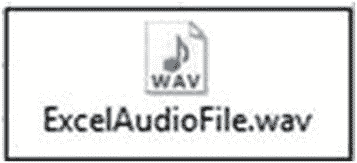

   **图 17-52**  
   如果要播放音频文件，请双击此图标

   此时会打开`打开包内容`对话框。参见图 17-53。

   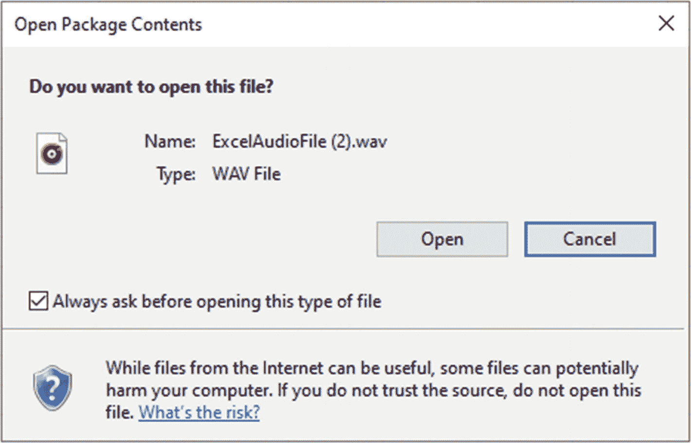

   **图 17-53**  
   `打开包内容`对话框

5.  向工作簿添加一个新工作表。
6.  单击功能区的`插入`选项卡。在`文本`组中，单击`对象`按钮。此时显示`对象`对话框。
7.  单击`由文件创建`选项卡。参见图 17-51。

   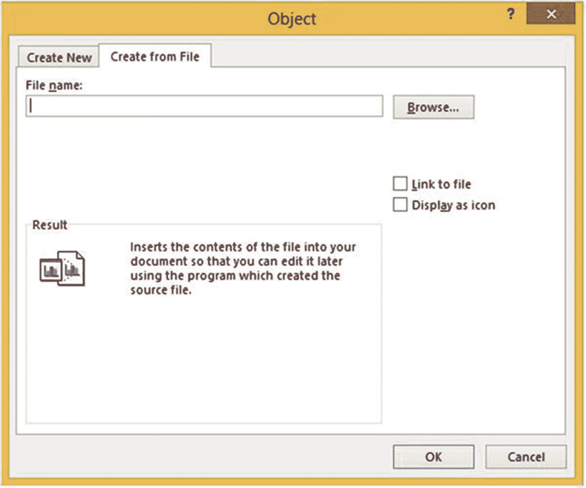

   **图 17-51**  
   `对象`对话框中的`由文件创建`选项卡

## 在工作表中插入视频

为了在 Excel 中播放视频文件，你需要有一个可以播放视频的软件程序，例如 Windows Media Player。

与音频文件一样，视频文件可以嵌入到工作表中，也可以链接到工作表中。如前所述，链接文件的问题在于，如果在创建链接后移动了该文件，或者将其分发给他人，Excel 将无法找到它。如果你选择不链接文件，该文件将成为工作簿的一部分。如果视频文件很大，你的工作簿自然会占用更多空间。

视频和音频文件添加到工作表中的方法相同。

### 练习 17-10：向工作表添加视频

在本练习中，你将把一个视频文件嵌入到工作表中。

1.  `打开包内容`对话框打开。单击`打开`按钮。视频文件将在计算机的默认视频播放器中开始播放。
2.  将光标放置在你希望显示视频文件图标的位置。
3.  单击功能区的`插入`选项卡。在`文本`组中，单击`对象`按钮。此时显示`对象`对话框。
4.  单击`由文件创建`选项卡。
5.  单击`浏览`按钮，然后找到文件 `Transpose`。单击`确定`按钮。
6.  双击`视频`图标。参见图 17-54。

   

   **图 17-54**  
   双击`视频`图标以开始播放视频

## 总结

你已经了解了多媒体如何带来视觉冲击，以及如何提高用户掌握你想要传达的信息的速度。多媒体使你的工作表看起来更精美、更专业，同时也赋予你更强大的能力来传达你的信息。

你可以从计算机或互联网向工作表中添加图片。你已经了解了如何通过让文本沿路径排列，使用艺术字创建徽标。

截图可用于捕获整个屏幕或来自网站或其他应用程序的选定部分，然后将该捕获内容放置在当前工作表中。捕获的内容会以图像形式添加到工作表中。你可以像修改其他任何图像一样修改它。

你已经学会了如何使用形状和 SmartArt 创建流程图、组织结构图和其他类型的布局。你可以添加、修改和删除多种形状。

添加音频和视频非常简单。你可以将文件嵌入到工作簿中，也可以链接到它们。你可以购买一个物美价廉的麦克风来录制你的音频笔记。为了在 Excel 中播放视频文件，你需要有一个可以播放视频的软件程序，例如 Windows Media Player。

在下一章中，你将看到操作图标的各种方法。你将学习如何使用新的 3D 图像以及如何使用能够让你对不同的对象组合进行组合和取消组合的对象组。

