# 图标、3D 图像与对象组合

Excel 提供了数百个图标供你使用。图标和 SVG 文件可以转换为形状。然后，图标或 SVG 文件中的每个独立形状都可以单独或一起移动、旋转、设置格式、复制或删除。Excel 2019 还引入了可 360 度旋转的 3D 图像。

阅读并学习完本章后，你将能够：

- 将图标和 SVG 文件转换为形状
- 处理图标或 SVG 文件中的各个组成部分
- 使用 3D 对象
- 更改对象的可见性
- 更改对象的顺序
- 对对象进行组合、取消组合和重新组合

Excel 的图标位于功能区“插入”选项卡的“插图”组中。见图 18-1。

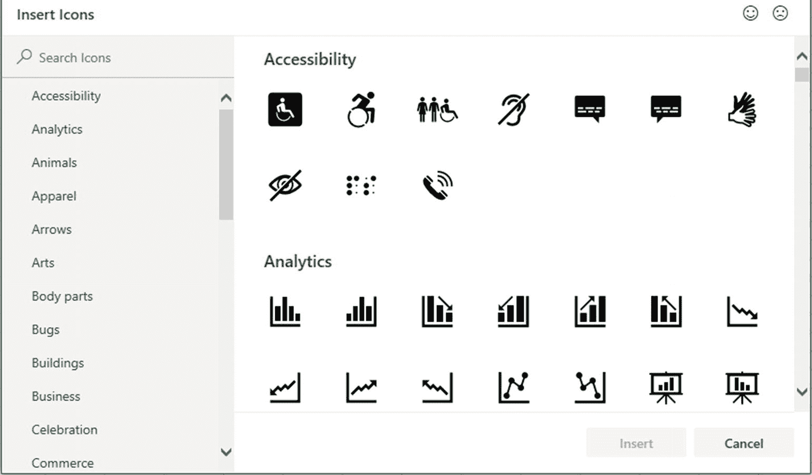

**图 18-1** 图标

要查找你需要的图标，请点击不同的类别。你也可以通过滚动浏览图标来找到所需图标。另一种查找图标的方法是输入搜索关键词。我将输入关键词 *phone*。见图 18-2。

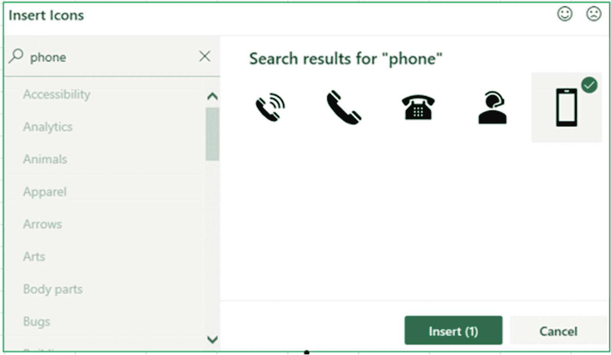

**图 18-2** 搜索“电话”

当你选择一个图标时，其右上角会出现一个复选标记。“插入”按钮会显示你将插入的图标数量。点击“插入”按钮会将选中的图标放置到你的工作表中。见图 18-3。你可以通过向外拖动右下角的手柄来放大电话，同时保持图像比例不变。

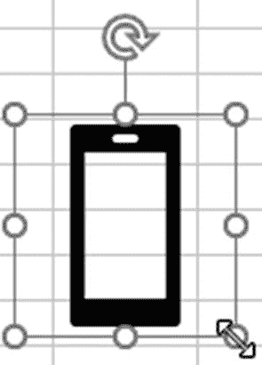

**图 18-3** 更改图标大小

我们希望创建一个如图 18-4 所示的图像。

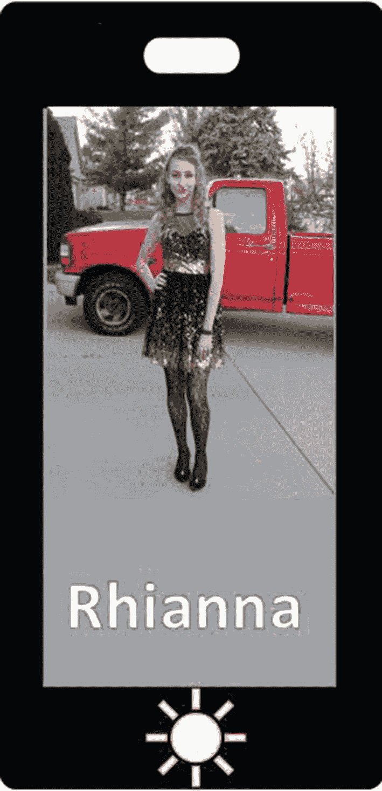

**图 18-4** 待复制的图像

我们需要将电话内部变为灰色。为此，我们需要添加一个矩形形状来填充电话内部，然后将其填充为灰色。我们可以点击功能区的“插入”选项卡，点击“形状”，然后选择矩形形状。拖动该形状使其填充电话内部。然后，我们转到“开始”选项卡，使用“填充颜色”将矩形填充为灰色。接下来，我们将点击功能区的“插入”选项卡，点击“图片”，然后选择一张图像。然后可以调整图像大小以适合电话。名称“Rhianna”是使用艺术字创建的。艺术字位于功能区“插入”选项卡的“文本”组中。我们只需选择想要的样式，输入名称，将其拖到所需位置，选择文本，并更改字体大小使其合适。见图 18-5。

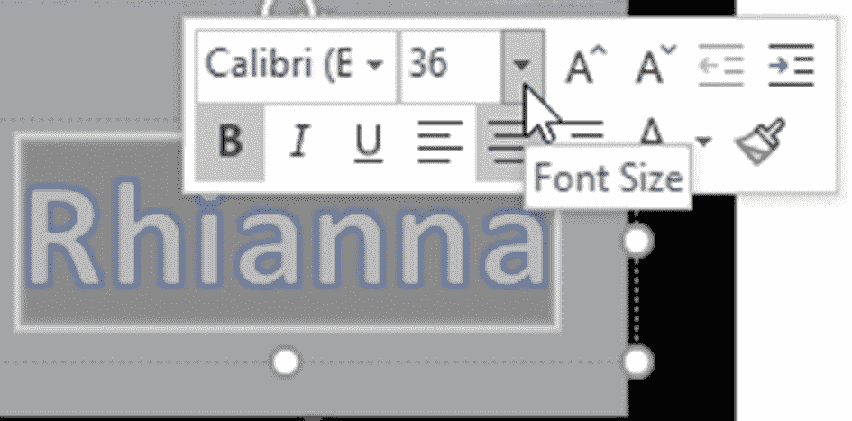

**图 18-5** 更改艺术字的字体大小

现在，我们可以在底部添加太阳。太阳是另一个图标。可以使用与电话相同的流程来创建它。点击功能区的“图标”按钮，然后在搜索框中输入单词 *sun*，点击我们想要使用的太阳图标，然后点击“插入”按钮。可以调整图标大小并将其拖动到任何你想要的位置。太阳的颜色可以更改为金色；为此，我们可以右键点击太阳，点击“填充颜色”图标，然后选择一种金色。

## 组合与取消组合图标、图像、形状和艺术字

图像现在已完成，但如果你移动我们创建的任何对象，它们将与其他对象分开移动。我们希望所有对象被当作一个整体电话来对待。要组合所有对象，请点击其中一个对象，然后按住 `Ctrl` 键同时点击其他对象。右键点击并选择“组合”，然后再次选择“组合”。见图 18-6。

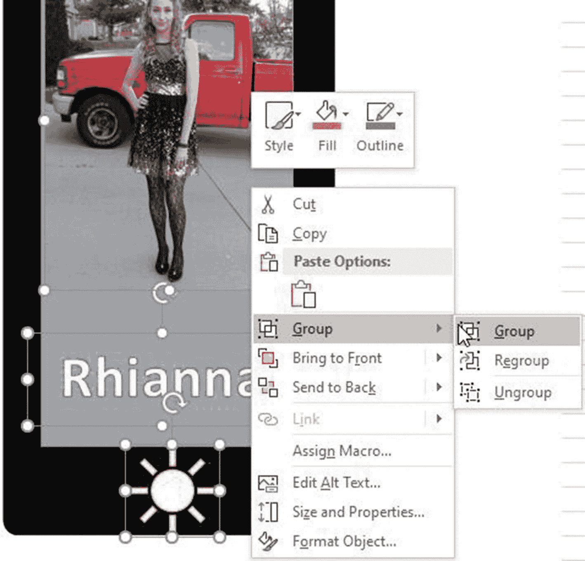

**图 18-6** 组合对象

现在，当你移动或旋转电话时，所有对象将一起移动。见图 18-7。

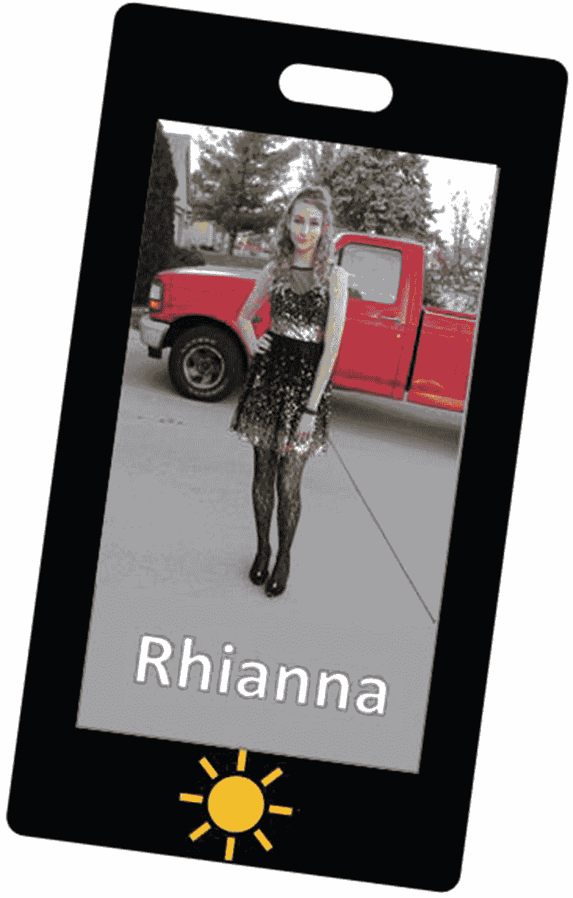

**图 18-7** 组合后的对象一起移动

各个对象仍然可以单独选中，并且可以单独或一起设置格式。如果我选中电话图标和矩形形状，功能区将在“绘图工具”上下文选项卡下显示一个“格式”选项卡。然后，你可以应用任何形状样式或形状效果。图 18-8 显示了对电话和矩形形状应用了蓝色填充颜色。

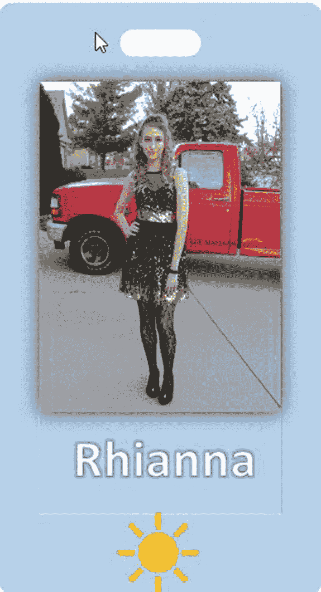

**图 18-8** 对电话和矩形形状应用蓝色填充颜色

你可以对整个电话应用图片样式，或者点击图像并仅对其应用图片样式。你可以通过选中要取消组合的对象，然后右键点击“组合”并选择“取消组合”，来取消组合部分或所有对象。

### 练习 18-1：将图标转换为形状

在本练习中，你将创建一个如图 18-9 所示的农夫图标。

**图 18-9** 本练习中要创建的图像

开始一个新工作表。点击功能区的“插入”选项卡。在“插图”组中，点击“图标”。花些时间滚动浏览图标。点击左上角的“搜索图标”。输入单词 *farmer*。Excel 会显示三个与农夫相关的图标。见图 18-10。

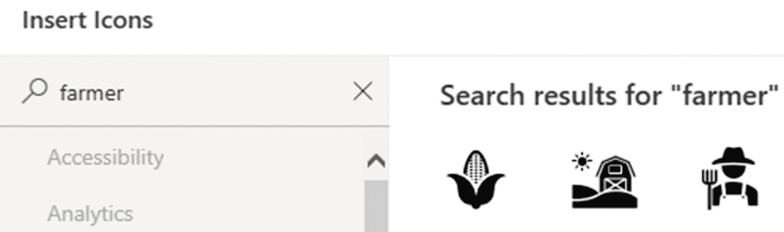

**图 18-10** 输入 farmer 进行搜索时可用的图标

点击农夫图标。点击“插入图标”窗口右下角的“插入”按钮，将图标放置到你的工作表上。你可以将图标拖动到任何位置，并使用调整大小手柄来调整其大小。你可以应用任何图形样式。你可以应用任何所需的颜色。你可以应用任何图形效果。

#### 将图标转换为形状

1. 为了将图标分离成独立的形状，你必须选中图标，然后点击功能区的“格式”选项卡，并在“更改”组中选择“转换为形状”。Excel 会要求你确认是否要将图标转换为绘图对象。点击“是”按钮。

2. 农夫现在变成了六个独立的形状。点击他的帽子以将其选中。每当你点击一个形状时，会显示一个旋转按钮。你可以使用此按钮向任一方向旋转形状。使用此按钮倾斜农夫的帽子。在帽子仍处于选中状态时，点击“填充颜色”的下拉箭头，然后选择一种蓝色。

3. 选中干草叉。在功能区上，点击“绘图工具”下的“格式”选项卡。在“形状样式”中，选择一种金色渐变填充。转到“形状效果”，然后选择一种 3-D 旋转效果。

4. 通过点击构成农夫身体的形状，然后在“开始”选项卡中选择白色字体颜色，来向农夫添加文本。键入 `Farmer`。

5. 干草叉不需要了。点击干草叉，然后按键盘上的 `Delete` 键。

#### 添加其他形状

## 在 Excel 中对对象进行组合、取消组合和重新组合

### 为农夫添加眼睛

1. 这位农夫真的需要一些眼睛。在功能区 `插入` 选项卡的 `插图` 组中，单击 `形状`。选择椭圆形。在农夫的脸上拖出一个圆形作为左眼。按住 `Ctrl` 键（光标应显示加号）并将左眼向右拖动，创建右眼。

### 组合对象

1. 将农夫稍微拖动一下。注意他的眼睛并没有随之移动。将眼睛与农夫组合可以解决这个问题。选中农夫后，按住 `Ctrl` 键并单击每一只眼睛。然后，右键单击并选择 `组合`，接着再选择 `组合`。这样就将这些形状组合在一起了。现在移动农夫，他的眼睛应该会随之移动。

### 在其他位置使用形状

1. 假设您只想在另一个区域使用帽子。双击帽子以将其选中。右键单击帽子并选择 `复制`。转到电子表格上的另一个位置，右键单击并选择一个粘贴选项。

---

### 练习 18-2: 组合、取消组合和重新组合

在本课中，我们将学习如何组合、取消组合和重新组合多个图标。

**图 18-12** – 通过创建彩色背景来突出显示图像

1. 在已经选中农夫的情况下，按住 `Ctrl` 键并单击谷仓。现在两个图标都已选中，通过单击功能区 `图形工具` 标题下的 `格式` 选项卡，然后在 `更改` 组中单击 `转换为形状` 按钮，将图标更改为形状。Excel 会要求确认将这些图标转换为绘图对象。单击 `是` 按钮。

2. 您需要将这两个图标视为一个整体。为此，需要将它们组合在一起。单击功能区的 `格式` 选项卡，在 `排列` 组中单击 `组合` 按钮，然后选择 `组合`；或者您也可以右键单击，然后选择 `组合`。

3. 由于它们现在被视为一个整体，可以一起移动。如果您更改其中一个的大小，另一个的大小也会随之更改。移动农夫或谷仓，两者应该一起移动。任何应用的格式都会同时应用于两者。单击功能区的 `格式` 选项卡。单击 `形状样式` 的下拉箭头。将光标拖过它们，注意它对农夫和谷仓产生的效果。尝试对 `形状效果` 执行相同操作。

4. 单击 `组合` 按钮并选择 `取消组合`。它们仍然组合在一起；您必须单击其他区域才能取消选择它们。

5. 接下来，您将更改谷仓及其屋顶的颜色。双击谷仓，然后按住 `Ctrl` 键并单击屋顶。要更改颜色，请单击 `形状填充颜色` 下拉箭头并选择红色。

6. 接下来，您将把太阳及其光线更改为黄色。单击其中一条光线，然后按住 `Ctrl` 键并单击太阳和其他光线。将 `形状填充颜色` 更改为黄色。如果您漏选了任何光线，请选中它们，然后选择 `形状填充颜色`。

7. 为了突出显示图像，您可以给背景上色。单击太阳上方和左侧的一个单元格，然后拖过其他单元格，使其形成一个覆盖两个图像的矩形。单击 `开始` 选项卡上 `填充颜色` 的下拉箭头，选择金色。见图 18-12。

1. 使用一个新工作表。在功能区 `插入` 选项卡的 `插图` 组中，单击 `图标` 按钮。在搜索区域输入 `farmer`。

符合搜索条件的图标会显示出来。单击谷仓和农夫。

Excel 会在这些图标旁边分别打上对勾，以便您轻松识别已选中的图标。右下角的 `插入` 按钮括号内有一个 `2`，表明您将向电子表格中插入两个图标。单击 `插入` 按钮。图标会相互重叠。单击其他区域取消选中它们。将它们拖到电子表格的中央，但彼此保持一定距离。

2. 单击谷仓并调整其大小。单击农夫并调整其大小。图标的大小和位置应如图 18-11 所示。

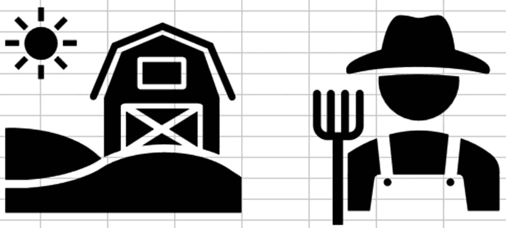

**图 18-11** – 图标的大小和位置

现在，您已经练习了将图标转换为形状，以及操作和着色这些形状。您可以对 SVG 文件执行完全相同的操作。SVG 文件是可缩放矢量图形文件。SVG 文件的优点之一是它们可以放大到任意大小而不会损失任何质量。文件名的扩展名为 `.svg`。您可以从互联网上找到大量免费可下载的 SVG 文件。只需搜索 `SVG files` 即可。

## 3D

Excel 已增加了显示可旋转 3D 模型的功能。3D 模型可在 Word、Excel 或 PowerPoint 中使用。这些 3D 模型位于功能区（Ribbon）的“插入”选项卡的“插图”组中。

你可以从计算机或 OneDrive 上的文件中选择一个 3D 模型，也可以从在线源获取模型。如果单击“从在线源”，你将看到分类的 3D 模型组。参见图 18-13。前三个组是动画组。（你的显示可能与示例不同。你可能没有动画组。这是本书出版时 Office 365 的外观。）

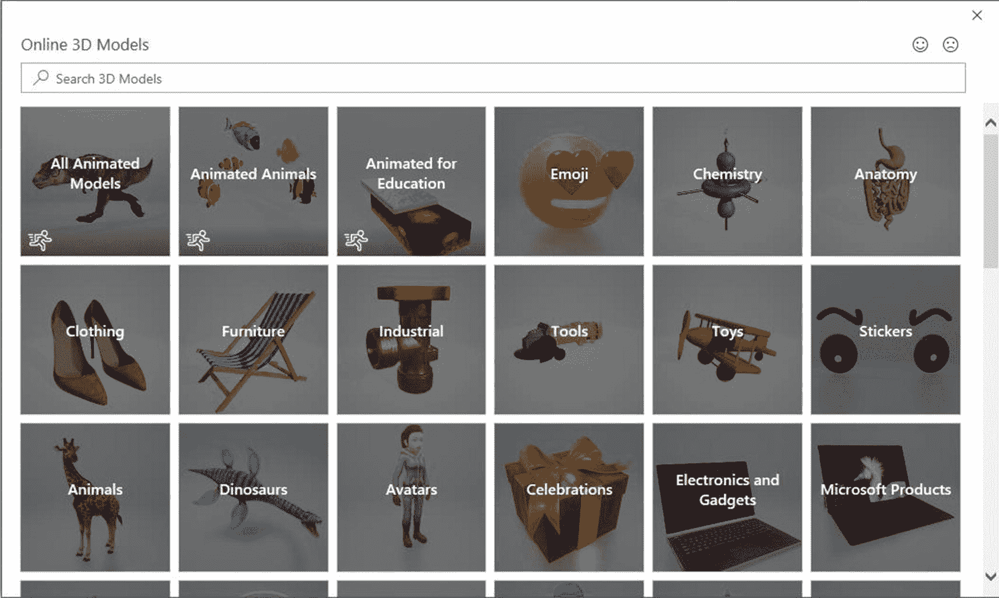

图 18-13
3D 图像类别

如果你想要一个在这些组中不可用的模型，你可以在文本框中输入你想要的内容，然后按 Enter 键。输入你想要的单数形式。例如，输入 `house`，而不是 `houses`，否则你可能得不到任何结果。有时你可能需要输入复数形式，例如如果你想要 `legs` 而不是一条 `leg`。有许多可用的程序允许你创建 3D 图像或将图像转换为 3D 图像，例如 Microsoft 的 Paint 3D。

图 18-14 显示了从“医疗”组中选择的大脑和心脏。

图 18-14
选中后堆叠的 3D 图像

当你引入多个 3D 对象时，它们会被放置在一起。你需要取消选中它们，以便可以单独移动它们。单击电子表格中的另一个位置将取消选中它们。然后你可以将对象拖动到你想要的位置。

当选中一个 3D 模型时，你会在模型中心看到一个旋转图标。参见图 18-15。你可以单击此旋转图标，向任何方向（上、下、左、右）旋转心脏。

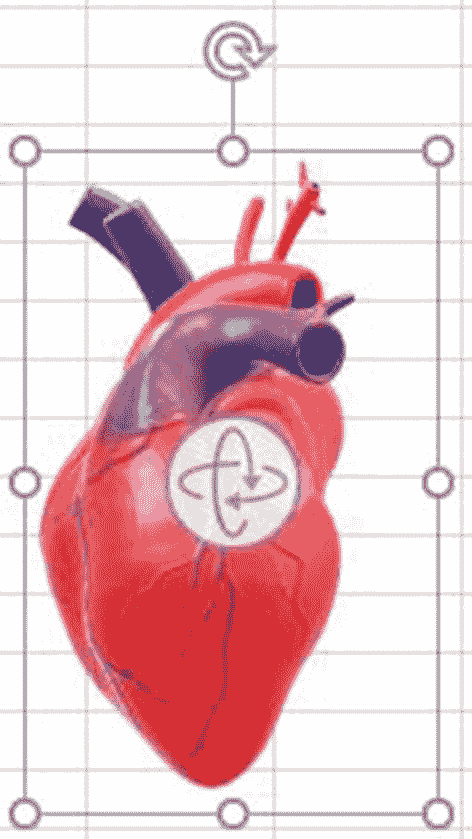

图 18-15
心脏中心的旋转图标

当你选中一个 3D 模型时，你会在功能区上方看到标签“3D 模型工具”。在该标签下方是名为“格式”的上下文相关选项卡。除了旋转 3D 模型之外，你可能在功能区的 3D 模型视图中发现模型已经处于你想要的位置。参见图 18-16。

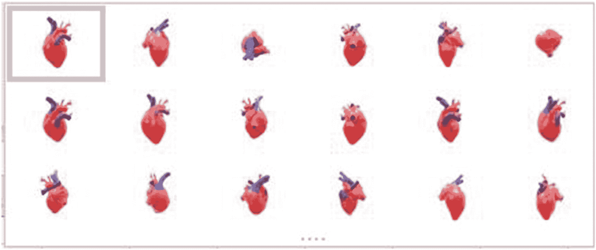

图 18-16
可选择的已旋转 3D 模型视图

你可以通过单击其中一个 3D 模型，然后按住 `Ctrl` 键并单击另一个来对它们进行分组。当两个模型都被选中时，你可以右键单击，然后选择“组合”，再选择“组合”。当对象被分组后，两个模型周围会出现一个边框。参见图 18-17。

图 18-17
分组对象周围出现边框

如果你想要同时移动两个对象，请拖动外部边框。如果你想要同时旋转两个对象，请使用外部边框上的旋转器。3D 模型中心旋转器一次只能用于一个模型。

你可以将任何类型的图像对象组合在一起。你可以组合图片、图标、形状、3D 图像、SmartArt、图表、地图和艺术字。你也可以将这些对象中的任何一个相互叠放。那么，如何控制哪个对象显示在另一个对象的顶部呢？你可以使用“排列”组中的“上移一层”和“下移一层”按钮，但如果你处理的对象很多，你会发现使用“选择窗格”按钮更容易，它不仅可以控制对象的显示顺序，还可以查看它们是如何分组的，甚至可以控制它们是否可见。

### 练习 18-3：使用 3D 和其他对象以及选择窗格

在本练习中，你将使用图标、形状和 3D 对象。你将分组、取消分组并重新分组对象。你将学习如何使用“选择窗格”来更改对象的可见性和排列。

1.  单击最大的树形。在功能区的“开始”选项卡的“字体”组中，单击“颜色填充”的下拉箭头，然后选择一种绿色。

2.  拖动较小的树形，使其覆盖大树形的一部分。在“选择窗格”中，单击“树”组中的顶层形状，然后点击向下箭头按钮（“下移一层”）。这会改变对象的顺序。点击向上箭头按钮（“上移一层”）将较小树形放回前面。你也可以在“选择窗格”中拖动对象来更改其顺序。

3.  单击单词“Zebra”（斑马）。将其拖到顶部或使用上箭头键。“斑马”图像移动到树和 3D 树的前面。将 3D 树拖到“海龟”组上方。参见图 18-23。

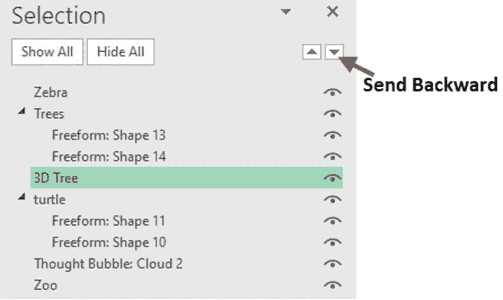

图 18-23
移动对象名称以更改其顺序

4.  你可以通过在“选择窗格”中单击其名称来选择对象。单击名称“海龟”。在功能区上下文相关的“格式”选项卡上的“图形工具”下的“更改”组中，单击“转换为形状”。如果出现消息询问你是否要将其转换为 Microsoft Office 绘图对象，请单击“是”按钮。

5.  在“选择窗格”中单击名称“树”。单击“转换为形状”。“选择窗格”显示“树”和“海龟”各由两个独立的形状组成。参见图 18-22。

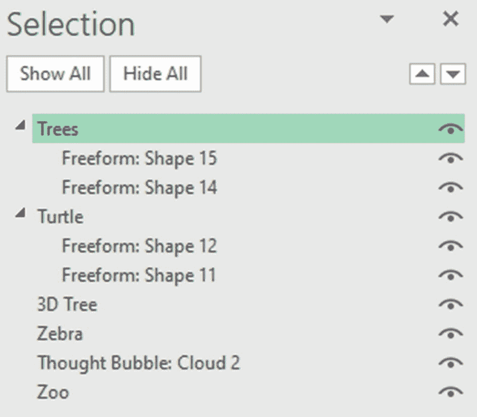

图 18-22
“树”和“海龟”由独立对象组成

6.  在功能区的“插入”选项卡上，单击“图标”。在“动物”组中，单击海龟。在“风景”组中，单击双树。单击“插入”按钮。单击一个空白单元格以取消选中这两个对象。移动它们并调整它们的大小，使其如图 18-21 所示。在“选择窗格”中将对象的名称更改为 `Turtle` 和 `Trees`。

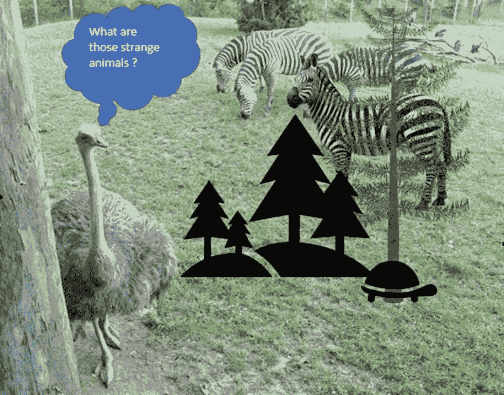

图 18-21
将海龟和树添加到图像中

7.  在功能区的“插入”选项卡的“插图”组中，单击“3D 模型”按钮的上半部分。在搜索框中输入 `zebra`，然后按 Enter 键。单击看起来像图 18-20 中的斑马。单击窗口底部的“插入”按钮。将斑马拖动到图 18-20 所示的位置。尝试旋转它。单击功能区上不同的 3D 模型视图。在“选择窗格”中单击对象的名称。删除文本并输入 `Zebra` 作为名称。

8.  在功能区的“插入”选项卡的“插图”组中，单击“3D 模型”按钮的上半部分。单击“花卉和植物”类别。单击松树。单击“插入”按钮。拖动树，使其位于 3D 斑马的前面。拖动大小手柄以增大树的大小。

在`Selection Pane`中，将对象重命名为`3D Tree`。

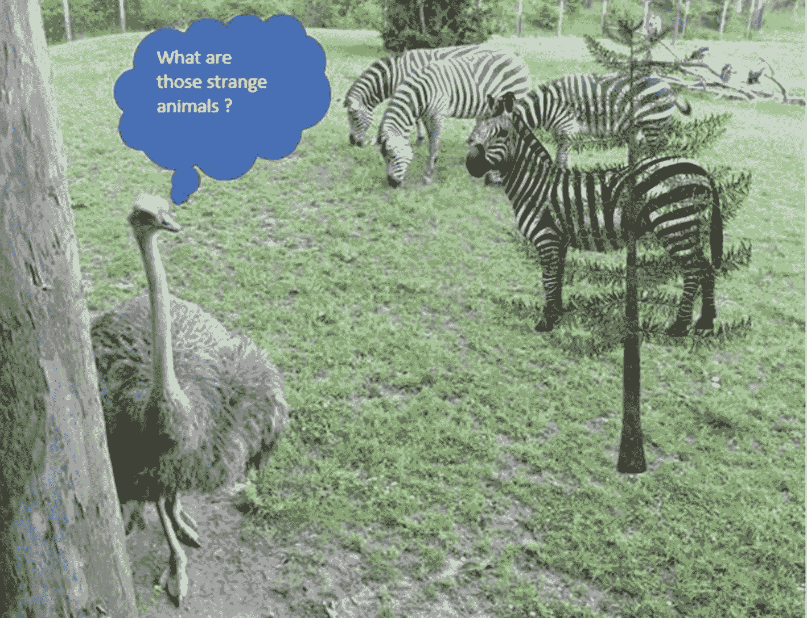

**图 18-20**
向图像中添加了 3D 斑马和 3D 树

1.  在功能区（Ribbon）的`Home`选项卡的`Editing`组中，点击`Find & Select`，然后选择`Selection Pane`。`Selection Pane`中有两个对象：图片和`Thought Bubble`。你最后添加的对象会放置在`Selection Pane`的顶部。请参阅图 18-19。每个对象对面都有一个眼睛图标。点击`Thought Bubble`的眼睛图标。该对象消失，眼睛图标变为一条水平线。点击该水平线，`Thought Bubble`重新出现，眼睛图标也恢复。

    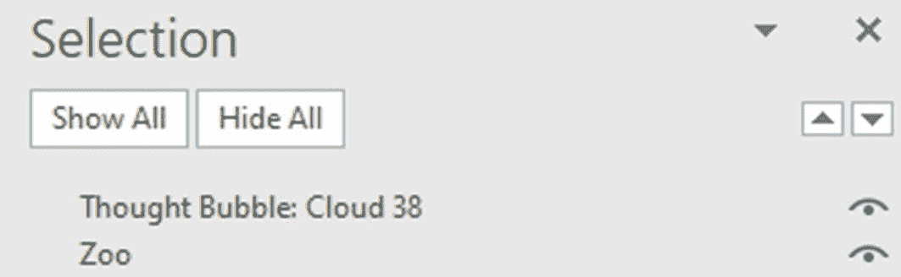

    **图 18-19**
    包含可见性可更改的对象的 Selection 窗格

2.  打开工作簿`Chapter18`。工作表`Sheet 1`包含一张动物园图片。在功能区的`Insert`选项卡的`Illustrations`组中，点击`Shapes`。在`Callouts`组中，点击`Thought Bubble Cloud`。光标变为十字准线。拖动云朵形状，使其看起来像是从鸵鸟那里冒出来的。输入“What are those strange animals?”。请参阅图 18-18。你可能需要调整云朵的大小，以使文本按你想要的方式排列。

    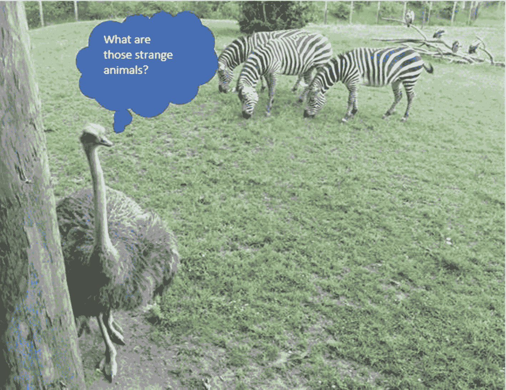

    **图 18-18**
    带有想法气泡形状的图片

现在，黑色小树出现在绿色树木的前面。斑马出现在 3D 树的前面，而 3D 树又出现在乌龟的前面。结果如图 18-24 所示。

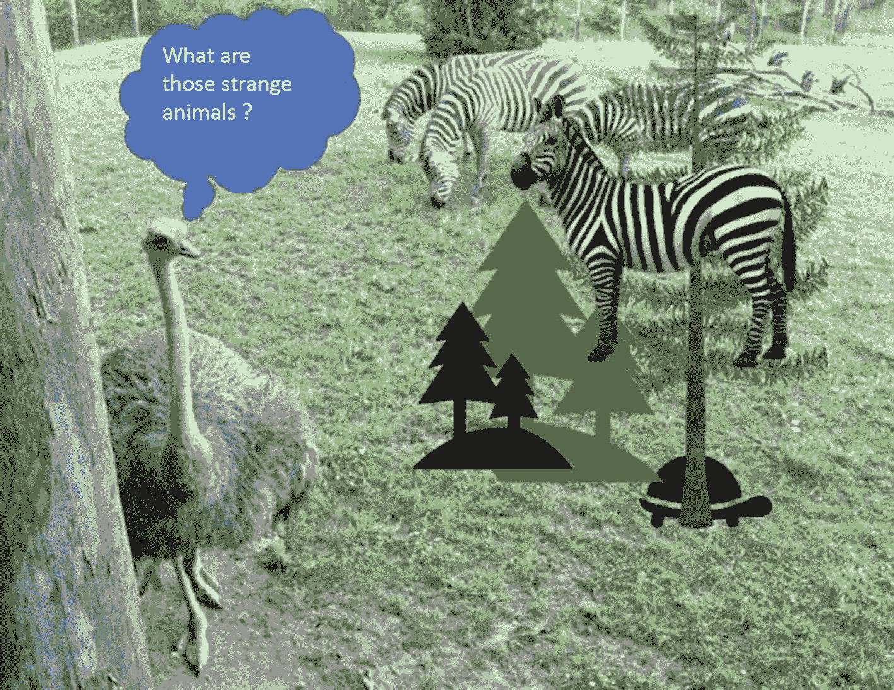

**图 18-24**
在 Selection 窗格中更改对象顺序的结果

3.  按住`Ctrl`键，在`Selection Pane`中点击每个对象（当你点击一个组标题，例如`Turtle`或`Trees`时，你将选中该组中的所有对象）。右键点击图片，选择`Group`，然后选择`Group`。移动图片。所有对象会一起移动。

4.  右键点击图片，选择`Group`，然后选择`Ungroup`。点击一个空白单元格。移动图片，对象不会随图片移动。

5.  右键点击图片，选择`Group`，然后选择`Regroup`。移动图片，对象再次随图片移动。

6.  练习移除和恢复对象的可见性。练习对部分对象进行分组、取消分组和重新分组。练习更改对象的顺序。

## 总结

本章讲解了如何单独以及组合使用各种类型的对象。你学习了如何将图标转换为形状。同样的过程也适用于将 SVG 文件转换为形状。你学习了如何使用右键菜单或`Selections Pane`进行分组、取消分组和重新分组。你还学习了如何使用`Selection Pane`更改对象的可见性和顺序。你了解到，可以从已添加的 3D 对象中选择旋转的 3D 模型视图，或者更改 3D 对象的大小并自由旋转它们，使其达到你想要的视觉效果。

在下一章中，你将学习如何创建宏。宏是一种快捷方式，可以消除为频繁执行的任务重复相同步骤的需要。

