# 19. 使用宏自动执行任务

对于你发现自己需要反复执行的任务，宏可以极大地节省时间。宏使你能够录制通常用于执行任务的系列步骤、存储这些步骤，并在需要时自动重新运行它们。通过为宏分配快捷键，可以快速激活它们。如果你认为自己可能会忘记宏的关联快捷键，则可以将其存储在`Quick Access Toolbar`中。你还可以将宏附加到按钮和其他对象上。

阅读并完成本章内容后，你将能够：

*   创建使用绝对单元格引用的宏
*   创建使用相对单元格引用的宏
*   为按钮分配宏
*   为`Quick Access Toolbar`分配宏
*   为形状分配宏
*   创建并更新个人工作簿
*   保存启用宏的工作簿
*   使用 VBA（`Visual Basics for Applications`）开发环境
*   编辑宏

## 创建（录制）宏

简单的宏可以使用宏录制器创建。更复杂的宏则需要在宏编辑器中创建。宏录制器会记录从你开始录制到停止录制期间的所有按键和鼠标点击操作。由于它会记录你所做的所有操作，因此除了与你要执行的任务直接相关的操作外，请不要点击任何其他单元格或执行任何步骤。

可以从以下三个位置启动宏录制器：
- 在 `View`（视图）选项卡的 `Macros`（宏）组中，点击 `Macros`（宏）按钮上的下拉箭头，然后选择 `Record Macro`（录制宏）。
- 在 `Developer`（开发工具）选项卡的 `Code`（代码）组中，点击 `Record Macro`（录制宏）。
- 在状态栏上，点击 `Macro Start Recording`（宏录制开始）按钮。

启动录制器后，会打开一个 `Record Macro`（录制宏）对话框。你需要在其中输入宏的名称、快捷键以及宏的存储位置；还可以提供宏的描述，以便日后能够记住其用途。参见图 19-1。

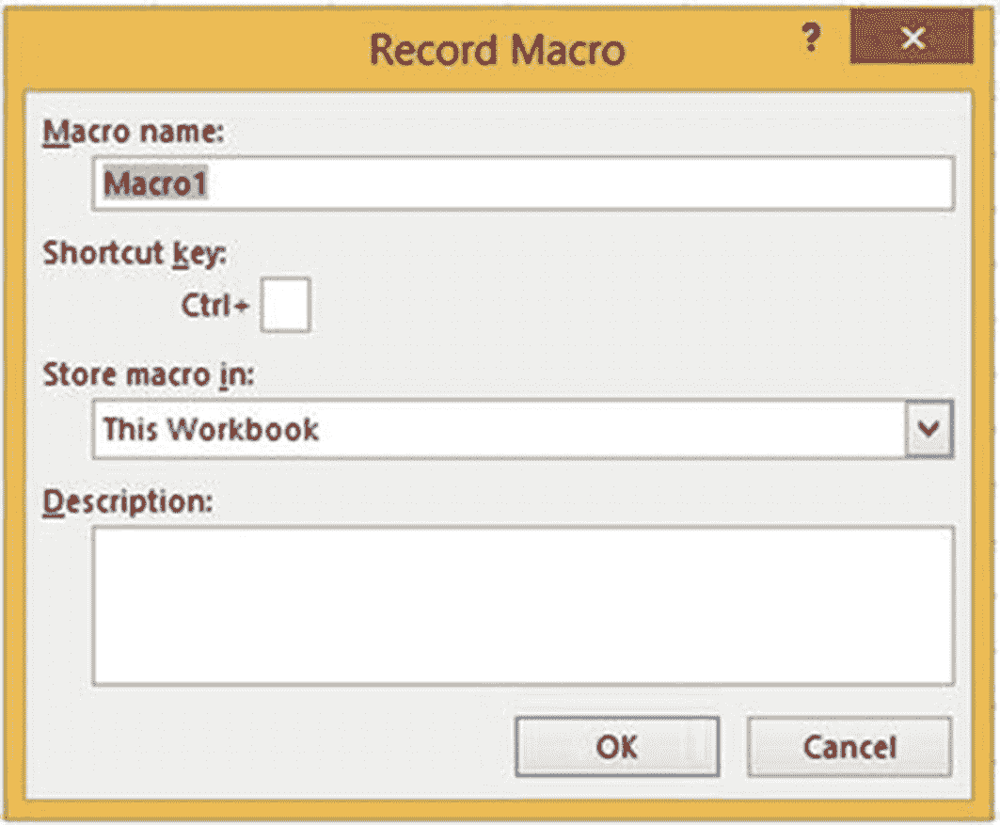
**图 19-1：录制宏前需要进行的设置**

宏可以存储在三个位置：
- 当前工作簿
- 新工作簿
- 个人宏工作簿

如果你希望宏在其他工作簿中也可用，请选择 `Personal Macro Workbook`（个人宏工作簿）。在你将宏保存到个人宏工作簿之前，它是不存在的。Excel 会将文件保存为 `PERSONAL.xlsb`。此工作簿是隐藏的，并且在每次启动 Excel 时会自动打开。

### 练习 19-1：创建一个简单的宏

我们将创建的宏会对单元格应用格式设置。我们将使用状态栏上的 `Start Recording`（开始录制）按钮。

#### 录制宏

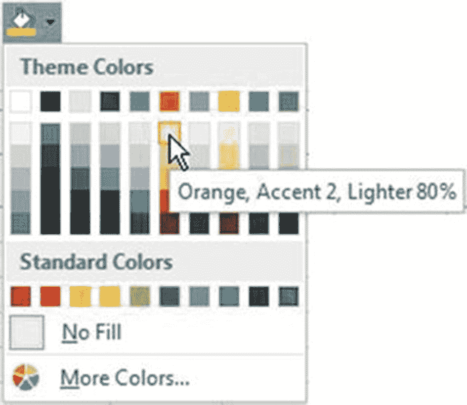
**图 19-2：将填充颜色更改为橙色，着色 2，浅色 80%**

1.  点击状态栏上的 `Macro Stop Recording`（宏停止录制）按钮。
2.  查看状态栏上是否有 `Macro Start Recording`（宏录制开始）按钮。如果没有，则右键点击状态栏，选择 `Macro Recording`（宏录制）选项，然后按 (Esc) 键隐藏该选项窗口。
3.  点击单元格 `A1`。
4.  点击状态栏上的 `Macro Recording`（宏录制）按钮。此时会打开 `Record Macro`（录制宏）对话框。
5.  宏名称不能包含空格。在宏名称框中输入 `FormatEntry`。
6.  快捷键当前显示为 `Ctrl +` 并带有一个文本框，你需要在其中输入将与 `Ctrl` 键组合使用的按键。如果你输入小写字母，Excel 要求你使用 `Ctrl` 键和你输入的字母作为快捷键。不幸的是，几乎所有使用 `Ctrl` 键加小写字母的快捷键都已被 Excel 占用，因此我们只会使用大写字母。如果你输入大写字母，Excel 会在快捷键中添加一个 `Shift` 键；因此，你需要输入 `Ctrl + Shift +` 你输入的字母作为快捷键。
7.  点击文本框内部，然后输入 `Shift + F`。
8.  点击 `Store Macro in`（宏存放在）下拉框的下拉箭头，然后选择 `This Workbook`（当前工作簿），因为我们只想在当前工作簿中使用该宏。
9.  在描述框中，输入 `这是我的第一个宏。它将加粗、设置为斜体、将字体大小更改为 16，并将背景颜色更改为橙色。`。
10. 点击 `OK`（确定）按钮。
11. 从现在开始直到你点击 `Stop Recording`（停止录制）按钮期间，你的每一次按键和鼠标点击都会被记录下来，所以除了此处指示的操作外，不要点击任何其他单元格或命令按钮。你可以通过 `Macro Start Recording`（宏录制开始）按钮变为 `Macro Stop Recording`（宏停止录制）按钮来判断正在录制宏。查看你的状态栏；应该会显示 `Macro Stop Recording`（宏停止录制）按钮。
12. 在功能区上的 `Home`（开始）选项卡的 `Font`（字体）组中，点击 `Bold`（加粗）和 `Italics`（斜体）按钮。将字体大小更改为 16。将 `Fill Color`（填充颜色）更改为橙色，着色 2，浅色 80%。参见图 19-2。
13. 创建一个新工作簿：
    1.  点击 `File`（文件）选项卡，然后选择 `Save As`（另存为）。
    2.  选择要存储工作簿的位置。
    3.  在文件名框中输入 `Macro_Practice`。
    4.  在 `Save As type`（保存类型）中选择 `Excel Workbook`（Excel 工作簿）。
    5.  点击 `Save`（保存）按钮。

#### 播放宏

1.  点击单元格 `C2`。
2.  输入 `Hello`。
3.  按 `Ctrl + Enter`。
4.  按下你为此宏创建的快捷键 `Ctrl + Shift + F`。
5.  录制期间使用的所有按键操作现在都会回放，并且 `C2` 中的文本会按照宏中的定义进行格式化。

## 保存启用宏的工作簿

包含宏的工作簿必须使用与其他工作簿不同的文件格式进行保存。不包含宏的工作簿通常保存为 `.xlsx` 扩展名。启用宏的工作簿需要保存为 `.xlsm` 扩展名。

### 练习 19-3：保存启用宏的工作簿

我们最初将 `Macro_Practice` 工作簿保存为 Excel 工作簿，但自那次保存后，我们向其中添加了宏。如果我们尝试再次将其保存为 Excel 工作簿，将会收到一条警告消息，指出如果继续此保存操作，将会丢失保存到此工作簿中的所有宏。

1.  点击 `Save`（保存）按钮。
2.  点击 `No`（否）按钮。
3.  点击 `Save as type`（保存类型）的下拉箭头，然后选择 `Excel Macro-Enabled Workbook`（Excel 启用宏的工作簿）。参见图 19-6。
4.  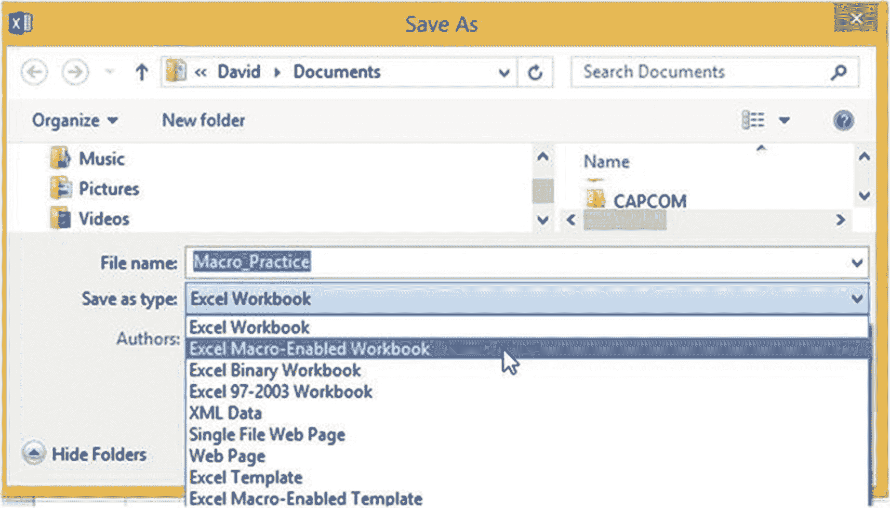
    **图 19-6：选择 Excel 启用宏的工作簿**
5.  点击快速访问工具栏上的 `Save`（保存）按钮。参见图 19-5。
6.  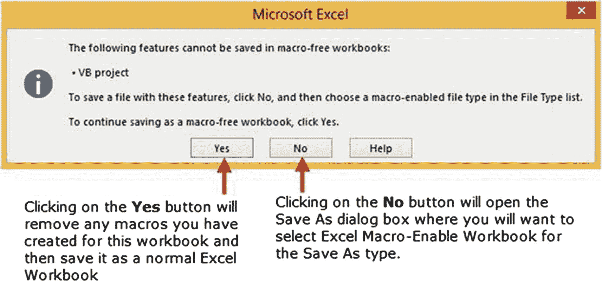
    **图 19-5：尝试将工作簿保存为普通工作簿而非启用宏的工作簿时显示的警告消息**
7.  该工作簿已保存为启用宏的工作簿，并且文件名末尾添加了 `.xlsm` 扩展名。保存到该工作簿的宏将来可供使用。

## 将宏添加到快速访问工具栏及其他对象

到目前为止，我们已经了解了可以通过键入快捷键来运行宏，以及如何通过 `Macros`（宏）按钮运行宏。为了便于快速访问，你可以将宏添加到快速访问工具栏，或者将其附加到按钮或其他对象上。

### 练习 19-5：将单个宏分配到快速访问工具栏

我们将把你刚刚创建的 `RelativeReferencing` 宏分配到快速访问工具栏。

1.  选择你想要与宏关联的任意按钮。你选择的这个按钮将被放置在快速访问工具栏上。点击**修改按钮**对话框中的**确定**按钮。

2.  点击**Excel 选项**对话框中的**确定**按钮。

3.  点击单元格 `A11`。点击你在快速访问工具栏上刚刚创建的按钮。`RelativeReferencing` 宏就会运行。

4.  在**自定义快速访问工具栏**下拉菜单中，选择**用于所有文档（默认）**。下拉菜单的另一个选项是，仅当在使用当前工作簿时，才将宏放入快速访问工具栏。

5.  点击**修改**按钮。这会调出**修改按钮**对话框。参见图 19-10。
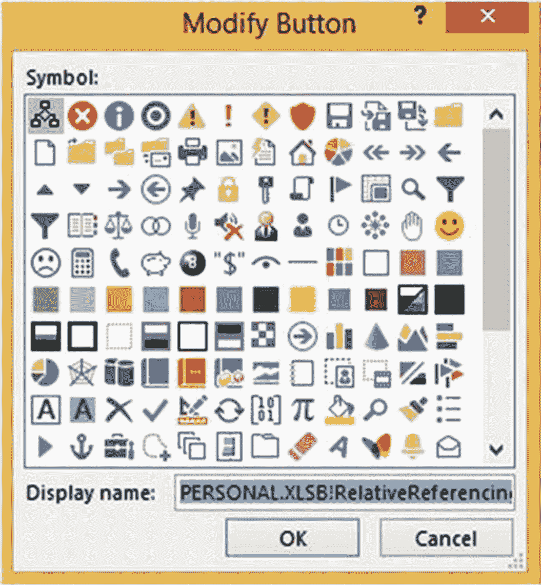
图 19-10 修改按钮对话框

6.  从左侧窗格中，选择**快速访问工具栏**。

7.  在**从下列位置选择命令**下拉菜单中，选择**宏**。

8.  选择 `PERSONAL.XLSB!RelativeReferencing`。点击**添加**按钮。

注意：因为我们将宏 `RelativeReferencing` 保存到了个人工作簿中，所以它可以在我们所有的 Excel 工作簿中使用。

9.  创建一个新工作簿。

10. 右键单击快速访问工具栏。选择**自定义快速访问工具栏**。参见图 19-9。
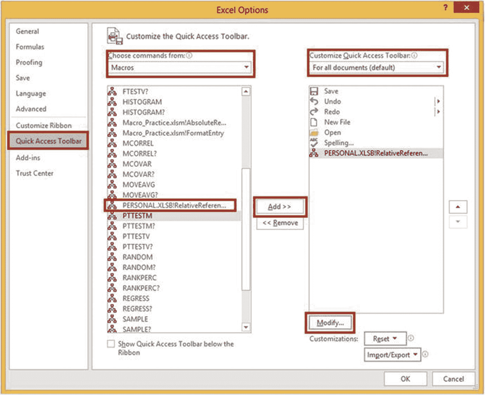
图 19-9 Excel 选项对话框

到目前为止，我们已经了解了可以通过 `Macros`（宏）按钮或键入快捷键来运行宏。你还学习了如何通过将宏添加到快速访问工具栏来快速访问它。在下一个练习中，你将把一个宏分配到一个形状上，你可以点击该形状来启动宏。

### 练习 19-6：将宏分配到形状

在本练习中，你将把一个宏分配到一个形状上。

1.  右键单击形状的中心。选择**指定宏**。选择 `PERSONAL.XLSB!RelativeReferencing`，然后点击**确定**按钮。

2.  点击一个空单元格以取消选择该形状。

3.  点击你想要启动宏的单元格，然后点击该形状。

4.  在形状上输入**相对引用**。拖动鼠标选中这些文本。将文本加粗并增大字号，直到它看起来与图 19-13 中的样式类似。点击一个空单元格以取消选择它。

图 19-13 让你的横幅看起来像这样

5.  从单元格 `G2` 开始拖拽出形状，使其大小与图 19-13 类似。

6.  点击功能区上的**开始**选项卡。在**对齐方式**组中，点击中部对齐按钮和居中对齐按钮。参见图 19-12。

图 19-12 功能区的对齐方式组

7.  创建一个新工作表。

8.  点击功能区上的**插入**选项卡。在**插图**组中，点击**形状**按钮。

9.  在**流程图**组中，点击**流程图：纸带**图标。参见图 19-11。
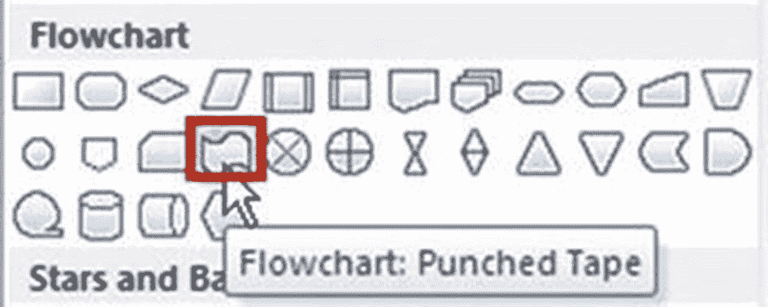
图 19-11 选择流程图：纸带图标

`Macros`（宏）按钮位于功能区的**视图**选项卡上。这意味着当你想查看宏或需要指定相对引用时，必须点击**视图**选项卡。为了使这些功能在任何活动的功能区选项卡下都可用，我们将在下一个练习中将 `Macro`（宏）按钮添加到快速访问工具栏。

### 练习 19-7：将宏按钮分配到快速访问工具栏

我们将把 `Macros`（宏）按钮放在工具栏上，这样你就不必每次想运行或编辑宏时都去点击**视图**选项卡了。

1.  点击功能区上的**文件**选项卡。点击**选项**。

2.  从左侧窗格中，选择**快速访问工具栏**。

3.  在**从下列位置选择命令**下拉菜单中，选择**常用命令**。

4.  滚动到列表底部，找到 `View Macros`（查看宏）。选择 `View Macros`（查看宏）。点击**添加**按钮。

5.  点击**确定**按钮。

6.  点击快速访问工具栏上的 `View Macros`（查看宏）按钮。点击**取消**按钮。

### 将开发工具选项卡添加到功能区

如果你正在编写 VBA 代码或为按钮指定宏，你需要在 Visual Basic 环境中进行，该环境只能通过功能区的**开发工具**选项卡访问。如果你的功能区上没有看到**开发工具**选项卡，则需要按照以下步骤添加它：
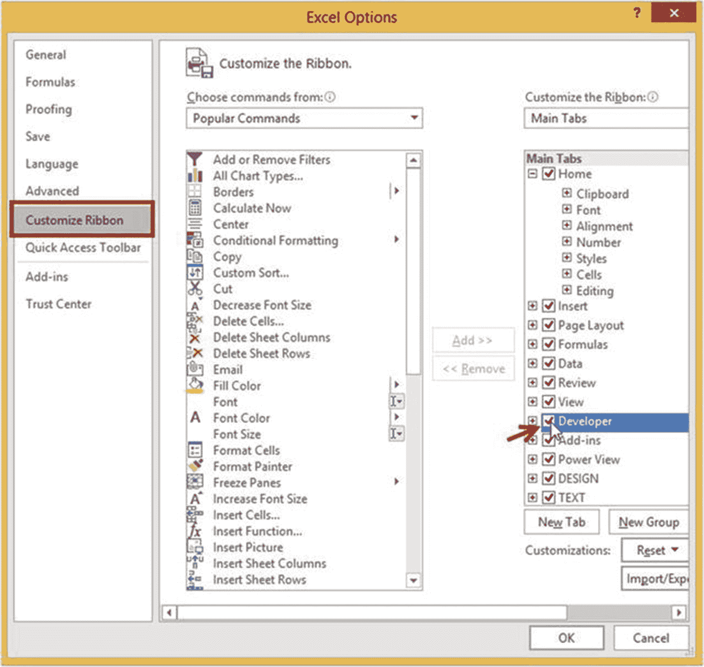
图 19-14 选择开发工具

1.  点击功能区上的**文件**选项卡。在左侧窗格中选择**选项**，打开**Excel 选项**对话框。

2.  在左侧窗格中点击**自定义功能区**。在右侧窗格中选择**开发工具**。点击**确定**按钮。参见图 19-14。

现在你应该能在功能区上看到一个**开发工具**选项卡了。

### 练习 19-8：将宏分配到按钮

我们将把同一个宏分配到一个按钮上。

1.  选择第一个表单控件，即按钮。将光标向下移动到电子表格区域。光标将变为十字准线。

2.  从单元格 `C2` 开始，向右下方拖拽，直到你创建一个足够大的按钮区域。

3.  出现**指定宏**对话框。点击 `PERSONAL.XLSB!RelativeReferencing`。点击**确定**按钮。

4.  右键点击该按钮并选择**编辑文字**。将按钮上的文字从 `Button 1` 改为 `Practice`（练习）。

5.  点击任意空单元格以取消选择该按钮。点击你刚刚创建的按钮。

6.  创建一个新工作表。

7.  在功能区上，点击**开发工具**选项卡。在**控件**组中，点击**插入**按钮。

Excel 有两种类型的控件：表单控件和 ActiveX 控件。这两种类型都包含一些相同的控件。你可以将宏分配给表单控件，但不能分配给 ActiveX 控件。参见图 19-15。
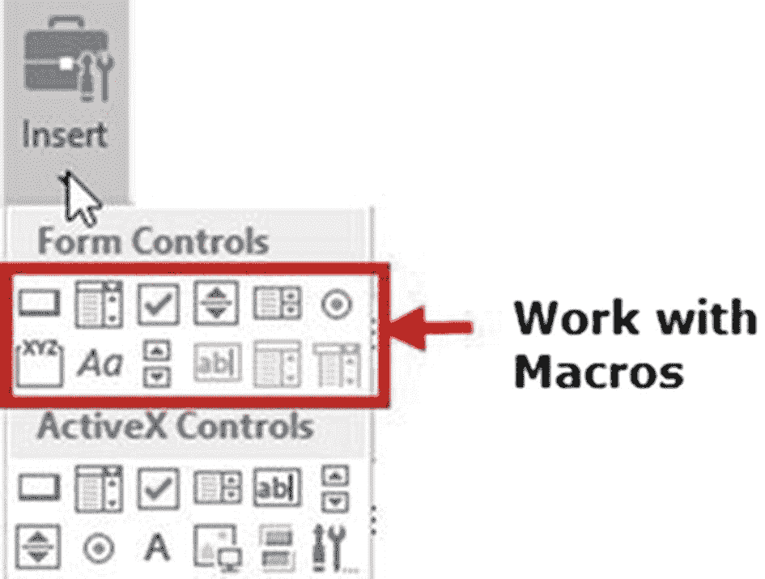
图 19-15 表单控件

## 与他人共享个人工作簿

你可以在其他计算机上使用个人工作簿（`Personal.xlsb`），或通过电子邮件发送该文件或将其复制到外部驱动器与他人共享，然后他们可以将该文件复制到自己计算机上的 `XLSTART` 文件夹中。

## 查看 VBA 代码

录制宏时，您实际上是在创建 VBA 代码。VBA 是一种编程语言，全称为 **Visual Basic for Applications**。研究录制宏时生成的代码结果是学习 VBA 的好方法。

您创建的每个宏的代码都存储在各自独立的代码块中，这些代码块称为过程。一个过程以关键字 `Sub` 开头，以关键字 `End Sub` 结尾。`Sub` 是 **Subroutine（子程序）** 的缩写。过程通常也被称为**子程序**。

### 练习 19-9：编辑宏生成的代码

在本练习中，我们将修改您在练习 19-3 中创建的 `AbsoluteReference` 宏所生成的代码。我们将更改代码，使宏在您启动宏所在的行重复相同的文本模式。

注意：为了让练习 19-3 生效，本可以使用**相对引用**而非绝对引用，但我希望您了解宏是如何由 VBA 代码驱动的，以及如何对其进行修改。如果您想成为 VBA 专家，市面上有专门讲解此主题的书籍。

1.  将语句 `Range("B4").Select` 更改为 `ActiveCell.Select`。

2.  将语句 `Range("C4").Select` 更改为 `ActiveCell.Offset(0, 1).Select`。

# 总结

## 修改Offset方法参数

范围`C4`相对于单元格`B4`向右偏移一列；因此，我们需要代码反映从活动单元格向右移动一列的操作。我们可以使用`Offset`方法来实现。`Offset`方法使用两个参数：第一个参数是行，第二个参数是列。我们希望所有数据都显示在同一行，因此不想改变活动单元格的行。所以，我们将行参数设为`0`以保持当前位置，并将列参数设为`1`以向右移动一列。

3.  将语句`Range("E4").Select`更改为`ActiveCell.Offset(0, 2).Select`。

范围`E4`相对于单元格`C4`向右偏移两列。我们也希望代码从活动单元格向右移动两列。因此，我们将`Offset`方法的列参数设为`2`。

4.  将语句`Range("G4").Select`更改为`ActiveCell.Offset(0, 2).Select`。

范围`G4`相对于单元格`E4`向右偏移两列。我们也希望代码从活动单元格向右移动两列。因此，我们将`Offset`方法的列参数设为`2`。您的代码应如下所示：

```
    ActiveCell.Select
    ActiveCell.FormulaR1C1 = "Excel"
    ActiveCell.Offset(0, 1).Select
    ActiveCell.FormulaR1C1 = "2019"
    ActiveCell.Offset(0, 2).Select
    ActiveCell.FormulaR1C1 = "Macro"
    ActiveCell.Offset(0, 2).Select
    Selection.FormulaR1C1 = "Tutorial"
```

完成编辑代码后，您可以返回工作表进行测试。您可以通过单击工具栏上的 Excel  按钮返回工作表，或者按`Alt + F11`。按`Alt + F11`可以在VBA编辑器和工作表之间来回切换。

5.  按`Alt + F11`。

6.  单击单元格`C6`内部。按下您创建的快捷键：`Ctrl + Shift + A`。

尝试在不同的行和不同的起始列运行宏。模式应保持不变。

本练习解决了您在练习 19-2 中遇到的问题。当然，您本可以通过创建“相对单元格引用”宏而非“绝对单元格引用”宏来避免该问题。

1.  打开您在练习 19-3 中保存的`Macro_Practice`工作簿。您可能需要单击“启用内容”。在功能区上，单击“视图”选项卡。在“宏”组中，单击“宏”按钮的上半部分。

2.  在“宏”对话框中，选择`AbsoluteReference`。

3.  单击“编辑”按钮。您现在位于VBA编辑器中。在此处，您将找到Excel为您创建的`FormatEntry`和`AbsoluteReference`宏生成VBA代码。`图 19-16`中的代码会出现在您的VBA编辑器窗口中，对应`AbsoluteReference`宏。

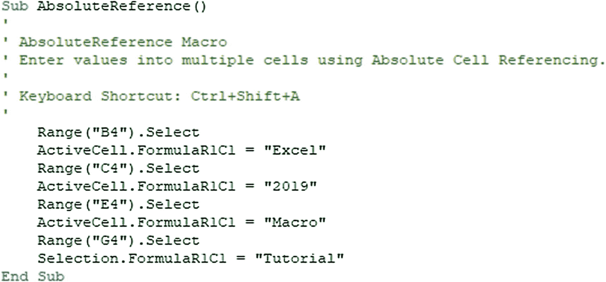

`图 19-16` `AbsoluteReference`宏的代码

您可以修改代码以改变宏的工作方式。请注意，代码位于`Sub`和`End Sub`语句之间。`Sub`语句使用的名称是您分配给宏的名称。`Sub`语句之后是几行以单引号开头的行。这些行显示为绿色。它们是注释行。运行宏时会忽略这些行，它们仅作为辅助，帮助您记住关于宏的重要信息。

接下来是执行宏步骤的代码语句。请注意，单元格地址位于`Range`语句中。这些语句会选择这些确切的单元格。这就是为什么运行宏时，数据会输入到与最初完全相同的单元格中。

我们将修改代码，使得第一个使用的单元格不再是单元格`B4`，而是您启动宏时所在的任意单元格。

## 从代码创建宏

宏并非必须录制后再播放。你可以在Visual Basic编辑器的代码窗口中手动将宏编写为过程。你仍然可以为手动编写的宏分配快捷键和说明，也可以将它们分配给按钮、剪贴画、图像、形状等对象。

过程存储在模块中。一个模块可以包含多个过程。宏会自动存储在编号的模块中。你创建的第一个宏将存储在`Module1`中。之后创建的每个宏也会存储在此处，直到你关闭工作簿。当你重新打开工作簿并创建一个新宏时，它将被存储在`Module2`中。每当你关闭并重新打开工作簿时，你创建的任何新宏都将存储在一个新模块中，该模块的名称将按顺序分配下一个编号。

### 练习 19-10：从代码创建宏

有时，仅仅一个简单的宏就能显著提升工作表的功能。在本练习中，我们将创建`图 19-17`中的时间线。以倾斜角度输入文本可以节省空间且看起来不错，但你必须歪着头才能查看。如果能在不改变当前数据布局的情况下，以水平格式查看大单元格中的垂直文本，那该多好啊？这正是我们将要添加到时间线中的功能。本练习程序将允许用户单击一个包含倾斜显示文本的单元格，然后使用快捷键或单击按钮，将数据复制到以水平格式显示数据的单元格中。

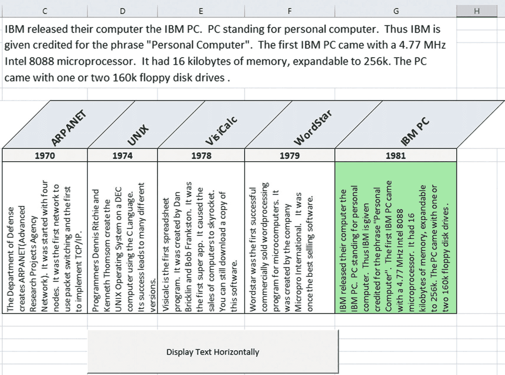

`图 19-17` 你将创建此时间线

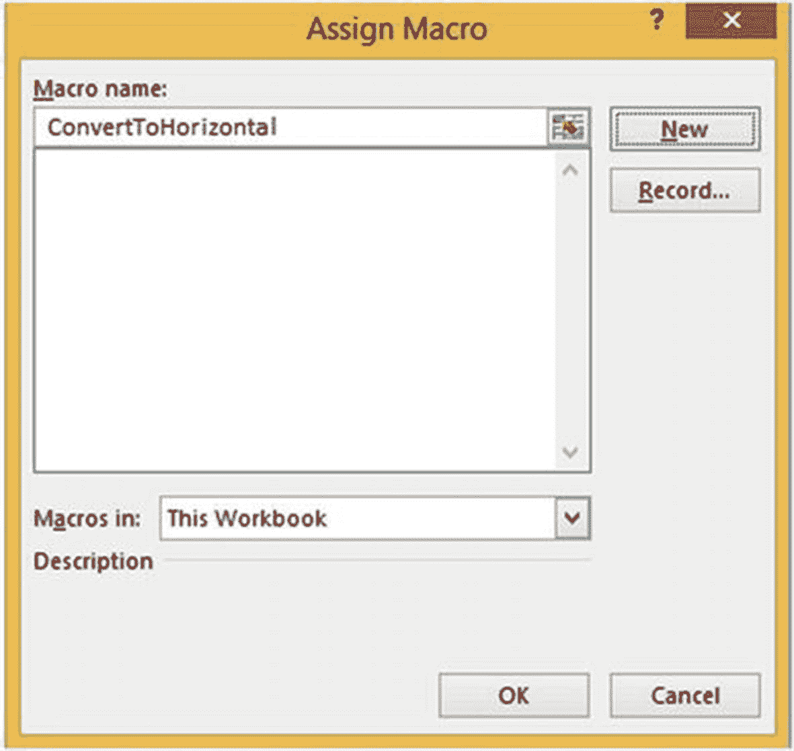

`图 19-18` 在“指定宏”窗口中单击“新建”按钮

1.  打开工作簿“第 19 章”。

2.  单击功能区中的“开发工具”选项卡。在“控件”组中，单击“插入”按钮。

3.  在“表单控件”区域中单击“按钮”控件。将光标移动到时间线下方，拖出一个按钮，使其位置和大小与`图 19-17`中所示一致。

4.  弹出“指定宏”按钮对话框。按照`图 19-18`填写字段：

    1.  将**宏名**更改为`ConvertToHorizontal`。

    2.  将**宏位置**更改为“当前工作簿”。

    3.  单击“新建”按钮。

你现在处于VBA编码区域。模块代码窗口中显示以下代码：

```
Sub ConvertToHorizontal()
End Sub
```

5.  单击宏窗口的“取消”按钮。

6.  单击范围`C7:G7`中的一个单元格。按`Ctrl + Shift + T`。`ConvertToHorizontal`宏运行，并生成如`图 19-17`之前所示格式的时间线。

7.  完成`图 19-20`所示的“宏选项”对话框：

    1.  对于快捷键，按住Shift键并按T。

    2.  对于说明，输入“以水平格式显示文本”。

    3.  单击“确定”按钮。

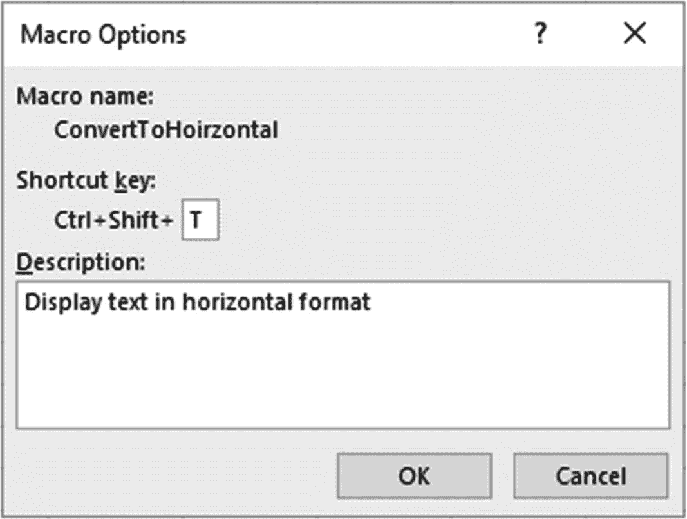

`图 19-20` 为快捷键输入T

8.  将以下代码放在两行`Sub`之间：

```
    '将单元格范围 C7:G7 的背景颜色设为白色
    Range("C7:G7").Interior.Color = RGB(255, 255, 255)
    '将所选单元格的背景颜色设为绿色
    ActiveCell.Interior.Color = RGB(110, 255, 170)
    '从当前单元格获取数据并显示在单元格 C1 中
    Range("C1") = ActiveCell
```

9.  按`Alt + F11`返回工作表。

10. 单击按钮文本前面。拖动选中文本，然后输入**水平显示文本**。单击一个空白单元格以取消选中该按钮。

11. 单击单元格`G7`。单击你创建的按钮。

单元格`G7`中的文本应以水平格式出现在单元格`C1`中。

12. 单击单元格`C7`。单击你创建的按钮。

单元格`C7`中的文本应以水平格式出现在单元格`C1`中。

13. 在“开发工具”选项卡的“代码”组中，单击“宏”按钮。单击“宏”对话框上的“选项”按钮。见`图 19-19`。

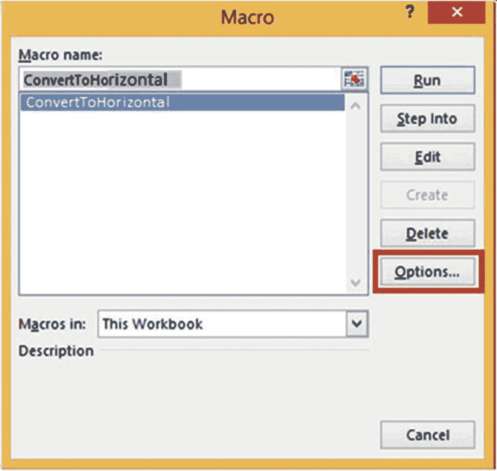

`图 19-19` 从“宏”对话框中选择“选项”

如果你发现自己需要反复执行相同的步骤，那么创建一个宏可以为你节省一些时间。宏可以通过快捷键来播放。宏也可以通过单击你为其指定的按钮或其他对象来播放。

你希望在所有工作簿中可用或与他人共享的宏，应存储在 `Personal.xlsb` 工作簿中。该工作簿保持隐藏状态，直到你单击“取消隐藏”按钮。

创建宏时可以使用相对寻址或绝对单元格引用。当创建的宏仅影响单个单元格时，绝对单元格引用效果不错，但如果宏影响多个单元格，你很可能需要使用相对单元格寻址。

Excel 会将你创建的宏转换为 Visual Basic for Applications 代码。此代码是可编辑的。你无需创建宏即可生成 VBA 代码。你可以从头开始创建自己的 VBA 代码。当你掌握了 VBA 之后，你会发现你更经常自己编写代码，而不是让 Excel 为你生成。