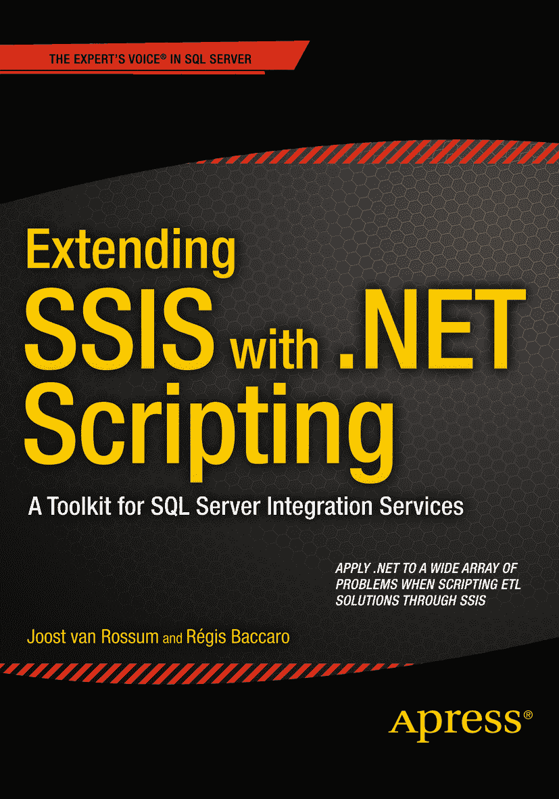

Joost van Rossum 与 Régis Baccaro

# 使用 .NET 脚本扩展 SSIS

## SQL Server 集成服务工具包

本文中作者提及的任何源代码或其他补充材料，读者可在 [`www.apress.com`](http://www.apress.com/) 获取。如需详细了解如何找到本书的源代码，请访问 [`www.apress.com/source-code/`](http://www.apress.com/source-code/)。

ISBN 978-1-4842-0639-3

电子书 ISBN 978-1-4842-0638-6

DOI 10.1007/978-1-4842-0638-6

© Apress 2015

使用 .NET 脚本扩展 SSIS

常务董事：Welmoed Spahr

首席编辑：Jonathan Gennick

开发编辑：Douglas Pundick

技术审校：John Welch

编辑委员会：Steve Anglin、Mark Beckner、Gary Cornell、Louise Corrigan、Jim DeWolf、Jonathan Gennick、Robert Hutchinson、Michelle Lowman、James Markham、Susan McDermott、Matthew Moodie、Jeffrey Pepper、Douglas Pundick、Ben Renow-Clarke、Gwenan Spearing、Matt Wade、Steve Weiss

协调编辑：Jill Balzano

文字编辑：Kim Burton-Weisman

排版：SPi Global

索引编制：SPi Global

插图：SPi Global

封面设计：Anna Ishchenko

如需了解翻译信息，请发送电子邮件至 `rights@apress.com`，或访问 [`www.apress.com`](http://www.apress.com/)。

Apress 与 friends of ED 书籍可批量购买用于学术、企业或促销用途。大多数书籍也提供电子书版本和许可证。更多信息请参考我们的特别批量销售-电子书授权网页：[`www.apress.com/bulk-sales`](http://www.apress.com/bulk-sales)。

本作品受版权保护。出版商保留所有权利，涉及全部或部分材料，具体包括翻译、重印、插图复用、朗诵、广播、微缩胶片复制或任何其他物理形式的复制，以及电子改编、计算机软件或目前已知或今后开发的类似或不同方法的信息传输或存储检索。法律保留的例外情况包括：与评论或学术分析相关的简短摘录，或专门为输入并执行于计算机系统、仅供购买者专用而提供的材料。本出版物或其部分的复制仅允许在出版商所在地现行版权法的规定下进行，且使用许可必须始终从 Springer 获取。使用许可可通过版权清算中心的 RightsLink 获得。违反行为将根据相应版权法被起诉。

本书中可能出现商标名称、标识和图像。对于商标名称、标识或图像的每次出现，我们并非均使用商标符号，而是仅以编辑方式使用这些名称、标识和图像，以维护商标所有者的利益，并无意侵犯商标权。本出版物中使用的商品名称、商标、服务标记和类似术语，即使未被明确标识，也不应被视为对其是否受专有权利保护的立场表达。

尽管本书中的建议和信息在出版时被认为是真实和准确的，但作者、编辑和出版商均不对可能存在的任何错误或遗漏承担法律责任。出版商对本书所含材料不作任何明示或暗示的保证。

本书通过 Springer Science+Business Media New York 在全球图书贸易中发行，地址：233 Spring Street, 6th Floor, New York, NY 10013。电话：1-800-SPRINGER，传真：(201) 348-4505，电子邮件：`orders-ny@springer-sbm.com`，或访问 `www.springeronline.com`。

Apress Media, LLC 是一家加利福尼亚有限责任公司，其唯一成员（所有者）是 Springer Science + Business Media Finance Inc（SSBM Finance Inc）。SSBM Finance Inc 是一家特拉华州公司。

## 引言

Microsoft SQL Server 集成服务（SSIS）是数据集成、数据整合和数据转换领域的领先工具之一。ETL 开发人员、数据库管理员和数据分析师使用它在 ETL（提取、加载和转换）过程中提取、转换和加载数据，或执行维护任务。虽然有很多现成的任务、源、转换和目标组件可以满足大多数人的需求，但它们永远无法覆盖所有人的全部需求。

有时，你需要针对自己的情况使用非常具体的功能，而这些功能对大多数人来说并无用处；或者 ICT 领域的持续发展速度远快于你正在使用的 SSIS 版本；当然，有时你也会纳闷为什么微软没有包含 ZIP 任务、SFTP 任务或 XML 目标组件。这正是本书的写作目的。