# 5. 文件属性

电子补充材料 本章的在线版本 (`doi:10.1007/978-1-4842-0638-6_5`) 包含补充材料，仅供授权用户使用。

SSIS 内置的文件系统任务可执行基本的文件操作，例如复制、移动和删除。然而，有时（尤其是在数据传输场景中），你可能希望找到最新的文件，或者检查文件是否被锁定或是否为只读。在这些情况下，脚本任务在从 .NET 库（如 `System.IO.File`）获取帮助时非常有用。本章介绍了在脚本任务中处理文件的一些非常常见的用法示例。

### 获取所有属性

如图 5-1 所示，内置的文件系统任务适用于复制/移动文件和目录，以及设置属性，但它无法处理诸如按修改日期排序等文件属性。

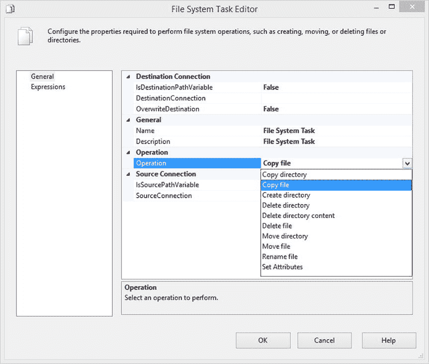

图 5-1. 内置文件系统任务的操作

其局限性之一在于，你无法读取所有的文件属性（即文件系统信息，如只读标志或权限）和特性（即文件本身的元数据）。该内置任务使用 `System.IO.File` 和 `System.IO.Directory` 作为操作核心，但这两个命名空间包含了更多功能，当你在 .NET 脚本中直接使用它们时，这些功能也能派上用场。

在本节中，你将学习如何从 .NET 脚本中读取文件和目录的属性及特性。本章使用的脚本采用了 `System.IO.File` 和 `System.IO.Directory`，它们存在于 .NET 框架的所有版本中（存在一些细微差别）。

通常，文件包含详细的属性，例如属性、创建日期、修改日期、所有者、文件大小等。图 5-2 展示了如何查看文件属性。

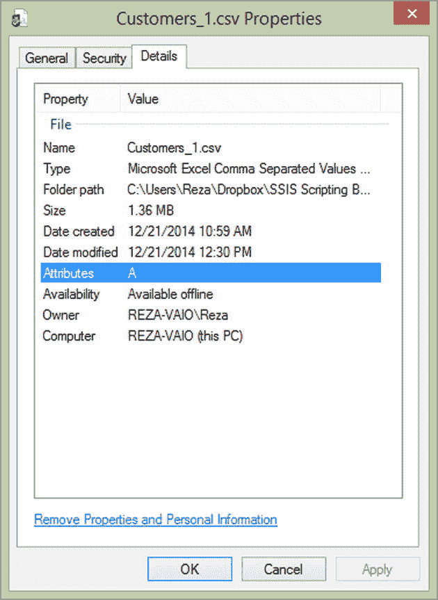

图 5-2. 文件属性

内置的文件系统任务不会提供这些信息。在实际的 ETL 或数据转换场景中，你需要查找最近修改的文件、属于特定所有者的所有文件，或仅查找小于特定大小的文件。因此，读取文件属性详细信息的能力至关重要，幸运的是，通过几行 .NET 脚本代码即可实现。

#### 检查文件是否存在

强烈建议在任何文件操作之前检查文件是否存在。这有助于在文件不存在时降低错误捕获的风险。检查文件是否存在非常简单；`System.IO.File` 为此提供了一个方法：`Exists`。该方法以文件路径作为输入，并返回一个布尔值，指示文件是否存在。

```csharp
string FilePath = @"C:\APRESS\SSIS Scripting Book\02_Code\Chapter 05\Source Files\Customers_1.csv";

if (System.IO.File.Exists(FilePath))
{ \\ 一些代码
}
```

在上述代码中，字符串开头使用了 `@` 字符，以避免与原本需要转义的字符（如 `"` 或 `\`）发生冲突，因为这些字符在代码中是保留字符。

此处的示例使用 `System.IO.File` 类来确定给定文件是否存在于磁盘上。其他类和方法也很有用。表 5-1 列出了其中一些。

表 5-1. 处理文件时有用的方法和属性

| 方法或属性名称 | 类名 | 数据类型 |
| --- | --- | --- |
| `Name` | `System.IO.FileInfo` | `String` |
| `Extension` | `System.IO.FileInfo` | `String` |
| `Directory.FullName` | `System.IO.FileInfo` | `System.IO.Directory` |
| `CreationTime` | `System.IO.FileInfo` | `Datetime` |
| `LastWriteTime` | `System.IO.FileInfo` | `Datetime` |
| `GetAccessControl(filePath)` | `System.IO.File` | `FileSecurity` |
| `FileAttributes` | `System.IO.File` | `FileAttributes` |
| `FileSize` | `System.IO.FileInfo` | `FileInfo` |

#### 文件名、扩展名和路径

在 SSIS 中，利用完整的文件名和路径，可以找到文件名、扩展名和文件路径。要找到这些信息，你需要使用文件路径中最后一个反斜杠的位置，以及字符串中最后一个点的位置。

例如，如果你有一个名为 `strFilePath` 的变量，用于存储完整的文件路径，可以使用以下表达式获取文件名：

`REVERSE(SUBSTRING(REVERSE( @[User::strFilePath] ), 1, FINDSTRING(REVERSE( @[User::strFilePath] ),"\\", 1)-1))`

这是一个不太易读的解决方案！.NET 通过使用 `System.IO.FileInfo` 提供了一个可读性更高且更优雅的解决方案。

#### 文件创建与修改时间

`System.IO.FileInfo` 还提供了四个属性，用于读取文件的创建时间和最后修改时间。关于创建时间，有两个属性：`CreationTime` 和 `CreationTimeUtc`。同样，修改时间也有对应的 UTC 和本地时间属性：`LastWriteTime` 和 `LastWriteTimeUtc`。

#### 文件所有者

关于文件所有者的信息，可以通过 `System.IO.File` 类的 `GetAccessControl` 方法获取。该方法以文件路径作为输入参数，并返回一个 `FileSecurity` 类型的对象。该对象有一个用于获取文件所有者的方法：`GetOwner`。`GetOwner` 返回用户的安全标识符（SID），然后可以将其转换为网络账户。

#### 文件属性和只读状态

`GetAttributes` 是 `System.IO.File` 类中的一个方法，它返回文件属性的枚举。`System.IO.FileInfo` 中还有一个 `IsReadOnly` 属性，它返回一个布尔值，指示文件的 `ReadOnly` 属性。

#### 文件大小

你可以通过 `System.IO.FileInfo` 对象的 `Length` 属性读取文件的大小。长度值以字节为单位返回，因此如果你想将其转换为千字节、兆字节或其他单位，需要在获取该值后进行转换。

#### 所提文件属性的示例

为了使以下脚本正常工作，你首先需要添加对 `System.Security.Principal` 命名空间的引用。

以下代码显示了本示例中使用的脚本任务的 `Main` 方法。图 5-3 显示了 `FireInformation` 事件的输出窗口：

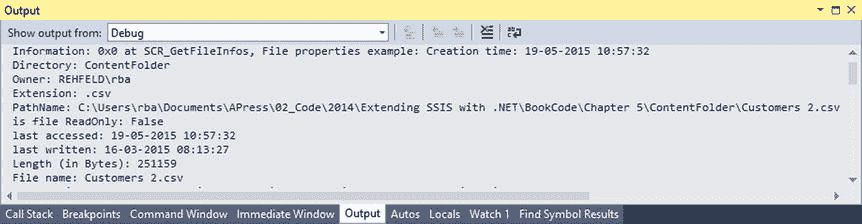

图 5-3. 包含 FireInformation 文本和文件属性的输出窗口

# 获取文件信息与文件操作

```csharp
public void Main()
{
    string FilePath = @"C:\APRESS\SSIS Scripting Book\02_Code\Chapter 05\Source Files\Customers_1.csv";

    //检查文件是否存在
    if (File.Exists(strFilePath))
    {
        //获取文件信息
        FileInfo objFileInfo = new FileInfo(strFilePath);

        //获取创建时间
        DateTime createdTime = objFileInfo.CreationTime;

        // 文件的长度（以字节为单位）
        long FileLength = objFileInfo.Length;

        //获取文件名（含扩展名）
        string fileName = objFileInfo.Name;

        //获取目录
        string Directory = objFileInfo.Directory.Name;

        //获取文件路径和名称
        string PathAndName = objFileInfo.FullName;

        //获取文件的扩展名
        string Extension = objFileInfo.Extension;

        //文件是否为只读？
        bool isReadOnly = objFileInfo.IsReadOnly;

        //上次打开文件的时间（及日期）
        DateTime lastAccessTime = objFileInfo.LastAccessTime;

        //上次写入文件的时间（及日期）
        DateTime lastWriteTime = objFileInfo.LastWriteTime;

        //获取所有者
        string owner = System.IO.File.GetAccessControl(strFilePath).GetOwner(typeof(System.Security.Principal.NTAccount)).ToString();

        string status = "创建时间: " + createdTime.ToString() + Environment.NewLine +
            "目录: " + Directory + Environment.NewLine +
            "所有者: " + owner + Environment.NewLine +
            "扩展名: " + Extension + Environment.NewLine +
            "路径名称: " + PathAndName + Environment.NewLine +
            "文件是否只读: " + isReadOnly.ToString() + Environment.NewLine +
            "上次访问时间: " + lastAccessTime.ToString() + Environment.NewLine +
            "上次写入时间: " + lastWriteTime.ToString() + Environment.NewLine +
            "大小（字节）: " + FileLength.ToString() + Environment.NewLine +
            "文件名: " + fileName;

        bool fireagain = false;
        Dts.Events.FireInformation(0, "文件属性示例", status, string.Empty, 0, ref fireagain);
    }
}
```

## 删除早于 X 天的文件

如果你熟悉 SSIS 中的 `Foreach 循环容器`，就会知道其中有一个用于遍历目录中文件的枚举器，称为 `Foreach 文件枚举器`。该选项在大多数场景下都适用，但有时你也希望进行条件搜索（例如在文件夹中），以查找在特定日期范围内修改过的文件。或者你可能想要读取某些无法通过 `文件系统任务` 实现的文件夹属性。在处理文件夹时，`System.IO.Directory` 和 `System.IO.DirectoryInfo` 能为你提供最大的实用性。

条件循环的一个例子是遍历那些早于 X 天前的文件。通过一个 `脚本任务` 和几行 .NET 代码，你可以遍历目录中的文件，检查它们的 `LastWriteTime`，然后删除所有最后修改时间早于 X 天前的文件。

以下示例在包中使用了两个变量：一个用于 `FolderPath`，另一个用于 `DaysToKeep`。图 5-4 显示了变量定义。

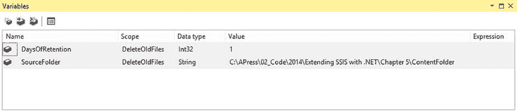

**图 5-4.** 变量定义

使用一个 `脚本任务` 来接受这两个变量作为输入参数。图 5-5 显示了 `脚本任务` 的输入参数。

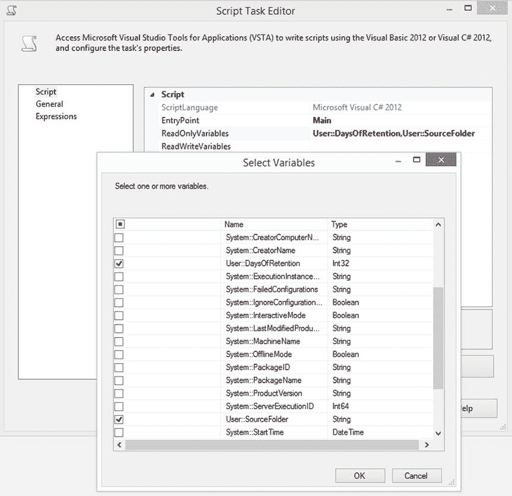

**图 5-5.** 脚本任务的输入参数

> **注意：** 完整代码包含在本书的可下载代码中。在以下内容中，仅突出显示了相关部分。

首先，两行代码从包中读取输入变量的值（还有其他读取包变量值的方法，会在后续章节中描述）：

```csharp
string DirectoryPath = Dts.Variables["User::FolderPath"].Value.ToString();
int DaysToKeep=(int) Dts.Variables["User::DaysToKeep"].Value;
```

在检查目录是否存在之后，将现有文件列表提取到一个字符串数组中。这一防御性编程代码行允许你在目录不存在时采取其他操作。

```csharp
//检查目录是否存在
if (System.IO.Directory.Exists(DirectoryPath))
{
    //读取文件
    string[] files=System.IO.Directory.GetFiles(DirectoryPath);
```

然后在循环结构中，逐个检查所有文件，为指定的文件路径创建一个 `FileInfo` 对象。

```csharp
    //遍历文件
    foreach (var file in files)
    {
        //读取文件信息
        System.IO.FileInfo finf = new System.IO.FileInfo(file);
```

接着，`FileInfo` 对象能够返回文件的 `LastWriteTime`。使用 `TimeSpan` 对象来识别文件的 `LastWriteTime` 与当前日期之间的差值，这表示文件自上次修改以来已经过了多久。如果距离上次修改日期的天数大于 `DaysToKeep` 的值，则删除该文件。`TimeSpan` 是一个表示时间间隔的结构。

```csharp
        //计算文件创建日期与今天的差值
        TimeSpan span = DateTime.Now.Subtract(finf.LastWriteTime);
        //将差值与 DaysToKeep 变量进行比较
        if ((int)span.TotalDays>DaysToKeep)
        {
            //删除旧文件
            System.IO.File.Delete(file);
        }
```

以下是完整的代码：

### 检查文件是否被锁定

ETL 流程或数据传输流程可能会因为作为数据源的一个（或多个）文件处于打开或使用状态而导致文件被锁定，从而失败。因此，在您的 ETL 方案中加入检查文件是否被锁定的环节至关重要。幸运的是，通过几行 `C#` 或 `VB.NET` 代码，您就能判断一个文件是否被锁定。

在本示例中，您将使用一个名为 `FilePath` 的变量来存储文件路径，然后在脚本中检查该文件是否存在；检查结果会存储在另一个名为 `Exists` 的包变量中。接着，您会检查文件是否被锁定，如果文件被锁定，则一个名为 `IsLocked` 的变量会被赋值为 `true`。针对文件进行此项检查的结果将用于后续操作的优先约束：

- 如果文件存在且未被锁定，则将其移至归档文件夹。
- 如果文件不存在或已被锁定，则将此情况记录到日志表中，记录内容包括检查的日期时间以及文件存在性和锁定状态。

1.  添加两个变量，如图 5-8 所示。将 `FilePath` 变量的值设置为 `Customers_1.csv` 文件。

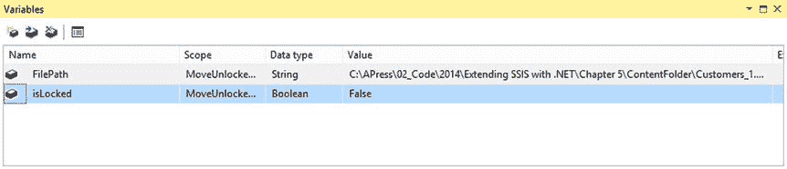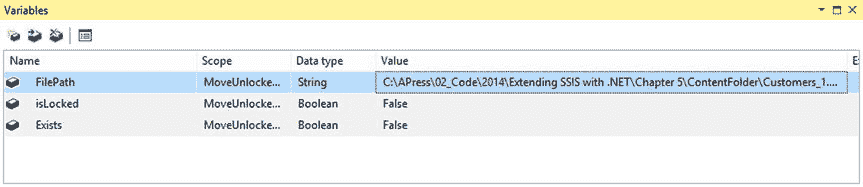

**图 5-8.** 变量

图 5-8 显示了包中使用的变量。

2.  在控制流中添加一个新的脚本任务。将语言设置为 `C#` 或 `VB.NET`。其中 `FilePath` 变量为 `ReadOnlyVariables`（因为您只想读取它），而 `Exists` 和 `IsLocked` 为 `ReadWriteVariables`（因为您要向这些变量中写入数据），如图 5-9 所示。

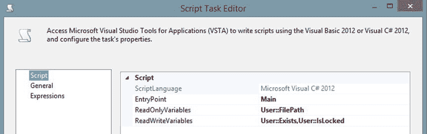

**图 5-9.** 为脚本任务定义输入变量

3.  单击 **编辑脚本…** 按钮。在脚本编辑器的命名空间区域，添加一行 `System.IO`。如需自定义命名空间，请添加以下内容：

    ```csharp
    using System.IO;
    ```

    在 `VB.NET` 中，添加以下内容：

    ```vbnet
    Imports System.IO
    ```

4.  在 `Main` 方法中，检查文件是否存在：

    ```csharp
    string filepath = Dts.Variables["User::FilePath"].Value.ToString();
    bool exists = Dts.Variables["User::Exists"].Value;
    ```

    以下是 `VB.NET` 版本：

    ```vbnet
    Dim filepath As String = Dts.Variables("User::FilePath").Value.ToString()
    Dim exists As Boolean = File.Exists(filepath)
    ```

5.  相应地设置 `Exists` 包变量：

    ```csharp
    if (File.Exists(filepath))
    {
        Dts.Variables["User::Exists"].Value = true;
        // 其余代码将写在这里
    }
    else
    {
        Dts.Variables["User::Exists"].Value = false;
    }
    ```

    以下是 `VB.NET` 版本：

    ```vbnet
    If exists Then
        Dts.Variables("User::Exists").Value = True
        ' 其余代码将写在这里
    Else
        Dts.Variables("User::Exists").Value = False
    End If
    ```

6.  如果文件存在，您需要检查它是否被锁定，因此定义一个 `FileStream` 变量并尝试填充它。如果您遇到类型为 `IOException` 的错误，则意味着文件已被锁定，无法读取或写入，或者有进程正在使用它。

    ```csharp
    FileStream fs = null;
    try
    {
        fs = File.Open(filepath, FileMode.Open, FileAccess.ReadWrite, FileShare.None);
    }
    catch (IOException ex)
    {
        Dts.Variables["User::IsLocked"].Value = true;
    }
    ```

    以下是 `VB.NET` 版本：

    ```vbnet
    Dim fs As FileStream = Nothing
    Try
        fs = File.Open(filepath, FileMode.Open, FileAccess.ReadWrite, FileShare.None)
    Catch ex As IOException
        Dts.Variables("User::IsLocked").Value = True
    End Try
    ```

7.  如果文件成功打开，它将返回一个 `FileStream` 类型的对象，这意味着文件未被锁定。使用 `finally` 块可确保在脚本任务退出前释放该文件。

    ```csharp
    Finally
    {
        if (fs != null)
        {
            fs.Close();
            Dts.Variables["User::IsLocked"].Value = false;
        }
    }
    ```

    以下是 `VB.NET` 版本：

    ```vbnet
    If Not (fs Is Nothing) Then
        fs.Close()
        Dts.Variables("User::IsLocked").Value = False
    End If
    ```

### 移动文件

之前的脚本已经识别出文件是否存在或是否被锁定，`Exists` 和 `IsLocked` 包变量也会相应地显示这些值。通过检查这些值，你可以采取必要操作：移动文件或不移动。

你需要定义一个名为 `Archive` 的连接管理器，用于指定移动文件的存储位置。完成后，在脚本任务之后添加一个文件系统任务，并连接一个从脚本任务到该任务的优先约束。接着，进入任务编辑器，分配正确的连接以将文件移动到归档文件夹，如图 5-10 所示。

'读取参数
Dim DirectoryPath As String = Dts.Variables("User::FolderPath").Value.ToString
Dim DaysToKeep As Integer = Convert.ToInt32(Dts.Variables("User::DaysToKeep").Value)

'检查目录是否存在
If System.IO.Directory.Exists(DirectoryPath) Then

    '获取目录中的文件
    Dim files() As String = System.IO.Directory.GetFiles(DirectoryPath)

    '遍历文件
    For Each file As String In files

        '读取文件信息
        Dim finf As System.IO.FileInfo = New System.IO.FileInfo(file)

        '计算文件修改日期与今天的差值
        Dim span As TimeSpan = DateTime.Now.Subtract(finf.LastWriteTime)

        '将差值与 DaysToKeep 变量进行比较
        If Convert.ToInt32(span.TotalDays) > DaysToKeep Then

            '删除旧文件
            System.IO.File.Delete(file)

        End If
    Next
End If

Dts.TaskResult = ScriptResults.Success

> **注意：** 屏幕截图显示的是 2014 年 12 月 22 日的一个运行示例，因此你预计两个较旧的文件将被删除。如果你想自行运行此包，建议使用更近的日期；否则，所有文件都将被移动/删除。

图 5-6 显示了运行包之前示例目录中的文件列表。

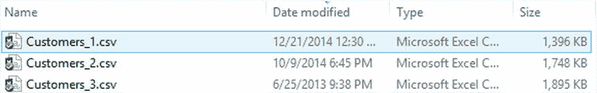

**图 5-6.** 目录中的所有文件列表

图 5-7 显示了运行包后同一个文件夹的情况。

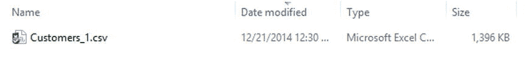

**图 5-7.** 运行包后剩余的文件

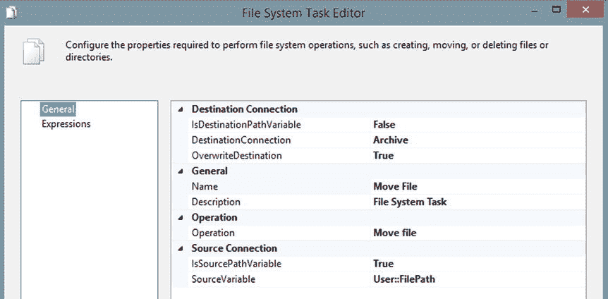

图 5-10. 配置“文件系统任务编辑器”以移动文件

右键单击脚本任务和文件系统任务之间的优先约束。从上下文菜单中选择“编辑”。在“优先约束编辑器”中，将“求值操作”更改为“表达式和约束”。确认值为“成功”，并编写以下表达式来检查文件是否存在且未被锁定：

`@[User::Exists] && !(@[User::IsLocked])`

图 5-11 显示了已填写表达式的“优先约束编辑器”。

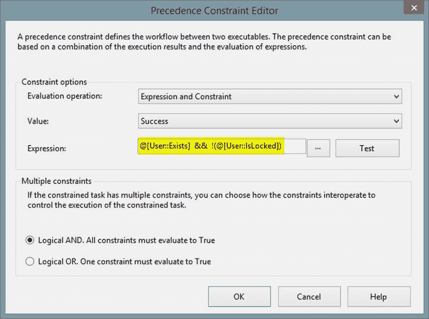

图 5-11. 文件存在且未被锁定

如果文件不存在或已被锁定，你需要将此状态（包含日期和时间）记录到数据库的日志表中；在本例中，数据库为`Apress_SSIS_Scripting`。运行以下脚本以创建`FileCheckLog`表（在 Management Studio 中运行该脚本）。

> **注意：** 表创建脚本也包含在第 5 章的源代码中。

```sql
CREATE TABLE [dbo].FileCheckLog NOT NULL,
    [FilePath] varchar NULL,
    [Locked] [bit] NULL,
    [Exists] [bit] NULL,
    [CheckedDateTime] [datetime] NULL,
    CONSTRAINT [PK_FileCheckLog] PRIMARY KEY CLUSTERED
    (
        [ID] ASC
    )WITH (PAD_INDEX = OFF, STATISTICS_NORECOMPUTE = OFF, IGNORE_DUP_KEY = OFF, ALLOW_ROW_LOCKS = ON, ALLOW_PAGE_LOCKS = ON) ON [PRIMARY]
) ON [PRIMARY]
```

在包的控制流中，添加一个执行 SQL 任务，并将其配置为向`FileCheckLog`表插入一条日志记录。

你需要一个 OLE DB 连接管理器，指向创建了上述表的数据库。

以下是“执行 SQL 任务编辑器”的其他必需属性：

*   `SQLSourceType` = 直接输入
*   `ConnectionType` = OLE DB
*   `SQLStatement` = `insert into FileCheckLog (FilePath, Locked, [Exists], CheckedDateTime) values (?,?,?,getdate())`

图 5-12 列出了所有属性。

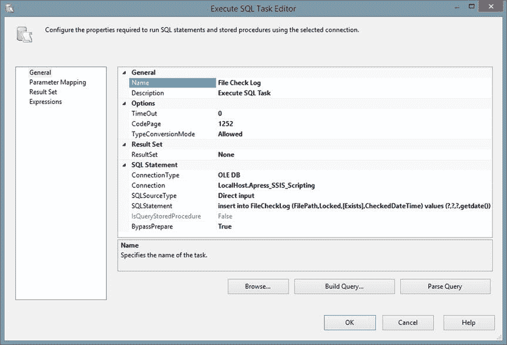

图 5-12. 配置执行 SQL 任务以写入日志条目

由于`FilePath`、`Locked`状态和`Exists`状态来自包变量，请转到“参数映射”选项卡并添加映射，如图 5-13 所示。

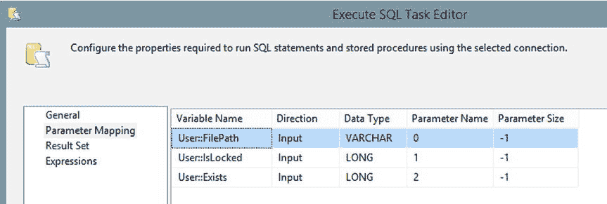

图 5-13. 文件检查日志的参数映射

由于此示例中使用了 OLE DB 连接，参数名称应从 0 开始索引（`0`、`1`、`2`……）。要详细了解其他连接类型的参数名称，请阅读 [`http://msdn.microsoft.com/en-us/library/ms140355.aspx`](http://msdn.microsoft.com/en-us/library/ms140355.aspx) 上的文章。

将脚本任务的“成功”优先约束连接到执行 SQL 任务。转到“优先约束编辑器”窗口进行配置（参见图 5-14），并判断文件是否不存在或已被锁定。表达式为：`!(@[User::Exists]) && @[User::IsLocked]`。

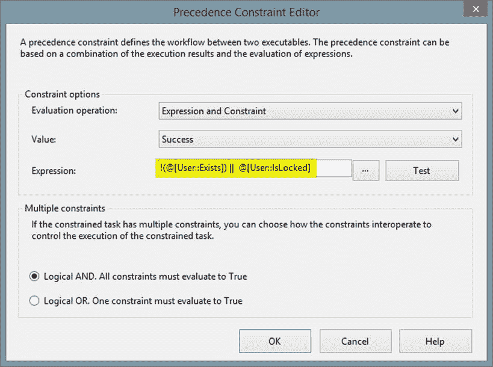

图 5-14. 检查文件是否不存在或已被锁定

图 5-15 显示了该包的控制流架构（即添加了一个注释以更清楚地解释行为）。

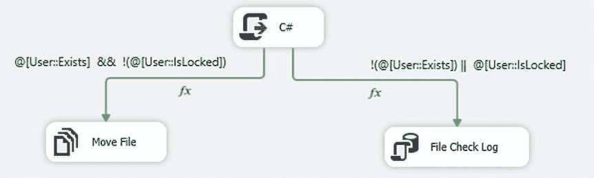

图 5-15. “检查文件是否锁定”包的控制流架构

现在可以运行并测试该示例了。如果在未打开`Customers_1.csv`文件的情况下运行代码，你会看到控制流沿着路径到达“移动文件”任务，并且该文件将被移动到归档目录。

> **注意：** 在记事本中打开文件不会锁定它；而在 Excel 中打开则会将其锁定。不同程序对文件锁定的行为有所不同。

如果文件正在被读取，或由于其他原因被锁定，控制流将沿着路径到达“文件检查日志”，并向`FileCheckLog`表添加一条条目，其中包含有关文件状态以及操作日期和时间的相应信息。图 5-16 说明了该流程，图 5-17 显示了生成的日志条目。

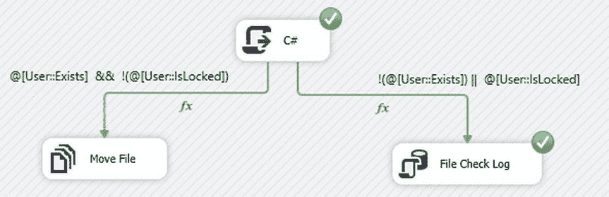

图 5-16. 检测到锁定的文件


图 5-17. 已添加到`FileCheckLog`表的日志条目

你可以在数据传输场景中使用本练习中学到的方法来判断文件是否被锁定。

## Foreach 循环有序文件枚举器

SSIS 控制流中有一个名为“Foreach 循环”的容器。Foreach 循环允许你开发一个控制流，该控制流循环遍历枚举器的各项。共有七种枚举器类型，其中包括用于循环遍历目录中文件的“文件枚举器”，以及用于循环遍历对象变量中数据表记录的“ADO 枚举器”。

文件枚举器提供基本的搜索功能，例如基于文件名或扩展名的掩码，或遍历子文件夹的能力。但是，有些需求无法通过内置的文件枚举器处理；例如，当你需要按特定顺序（例如按创建日期，即希望基于其日期时间顺序将文件加载到数据库中）加载文件夹中的文件时。

在下一节中，你将学习如何使用脚本（你在本章前面的示例中已经熟悉了其中的大部分内容）来增强 Foreach 循环容器的功能，以创建一个包含列和行的数据表，然后将该数据表用作 Foreach 循环中枚举的源对象。

### Foreach 有序文件枚举器

在此示例中，你将遍历指定目录中的`.csv`文件，并根据其创建日期和时间顺序加载它们。你将归档每个文件，然后在操作结束时将一条日志条目写入文件加载表。

创建包变量，并将目录路径设置为本书代码包中包含`.csv`文件的文件夹。

以下是所使用的值和名称列表。请根据你的设置进行相应修改。如图 5-18 所示。

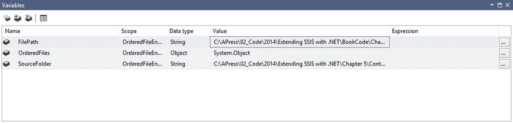

图 5-18. 变量定义

*   `FilePath` (String): `C:\APress\02_Code\2014\Extending SSIS with .NET\BookCode\Chapter 5\ContentFolder\Customer.csv`
*   `OrderedeFiles` (Object): 默认为`System.Object`
*   `SourceFolder` (String): `C:\APress\02_Code\2014\Extending SSIS with .NET\Chapter 5\ContentFolder`

创建一个脚本任务，将`User::SourceFolder`设置为`ReadOnlyVariables`，将`User::OrderedFiles`设置为`ReadWriteVariables`，如图 5-19 所示。

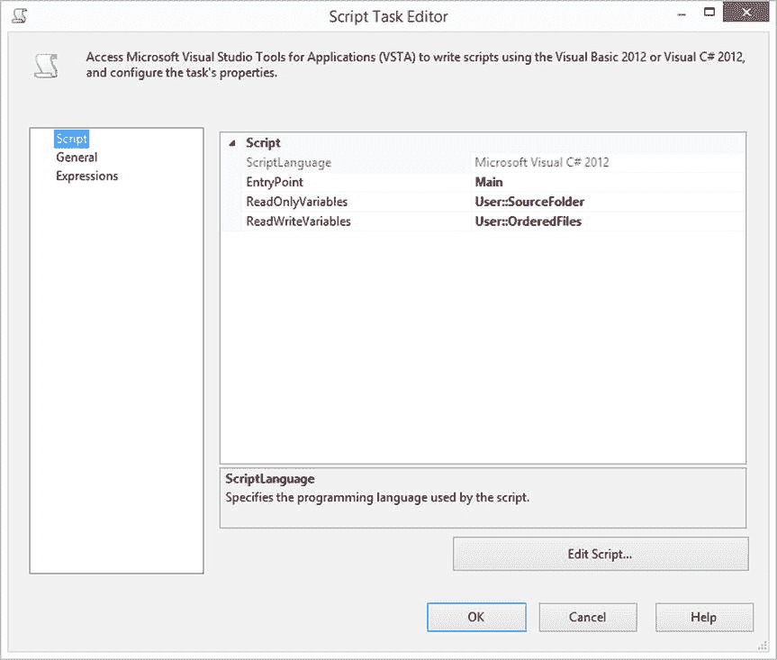

图 5-19. 设置变量

选择语言，然后点击“编辑脚本”打开脚本编辑器。

将`System.IO`命名空间添加到“命名空间 (C#)”或“Imports (VB)”区域。自定义命名空间应如下所示：

```csharp
using System.IO;
```

在 VB.NET 中则为：

```vb
Imports System.IO
```

#### 创建数据集

# 使用`DataSet`在.NET脚本中处理和排序文件

## 在 `Main` 方法中，创建一个 `DataSet` 对象。

一个数据集对象可以包含一个或多个数据表。

```csharp
DataSet dsUnsorted = new DataSet();
```

在 VB.NET 中相应代码为：

```vb
Dim dsUnsorted As New DataSet()
```

添加一个用于保存文件信息的数据表：

```csharp
DataTable filelistTable = dsUnsorted.Tables.Add();
```

添加表之后，可以向表中添加列，并为列指定名称和数据类型：

```csharp
filelistTable.Columns.Add("FilePath", typeof(string));
filelistTable.Columns.Add("FileName", typeof(string));
filelistTable.Columns.Add("FileDate", typeof(DateTime));
```

在 VB.NET 中相应代码为：

```vb
Dim filelistTable As DataTable = dsUnsorted.Tables.Add()
filelistTable.Columns.Add("FilePath", GetType(String))
filelistTable.Columns.Add("FileName", GetType(String))
filelistTable.Columns.Add("FileDate", GetType(DateTime))
```

#### 加载文件

读取目录中的所有文件，并将它们加载到一个字符串数组中：

```csharp
string[] allFiles = Directory.GetFiles(Dts.Variables["User::DirectoryPath"].Value.ToString());
```

在 VB.NET 中相应代码为：

```vb
Dim allFiles As String() = Directory.GetFiles(Dts.Variables("User::DirectoryPath").Value.ToString())
```

遍历数组中的每个文件，然后创建每个文件的 `FileInfo` 对象。接下来，在数据表中插入一条新记录，其中包含从 `FileInfo` 对象加载的信息。

```csharp
FileInfo fileInfo;
foreach (string currentFile in allFiles)
{
    fileInfo = new FileInfo(currentFile);
    // 列: FilePath, FileName, FileDate
    filelistTable.Rows.Add(fileInfo.FullName, fileInfo.Name, fileInfo.CreationTime);
}
```

在 VB.NET 中相应代码为：

```vb
Dim fileInfo As FileInfo
For Each currentFile As String In allFiles
    fileInfo = New FileInfo(currentFile)
    ' 列: FilePath, FileName, FileDate
    filelistTable.Rows.Add(fileInfo.FullName, fileInfo.Name, fileInfo.CreationTime)
Next
```

根据所需的筛选条件和文件顺序（本例中为 `FileDate ASC`）定义一组新的 `DataRow`：

```csharp
DataRow[] rows = dsUnsorted.Tables[0].Select("FileName like '*.csv'", "FileDate ASC");
```

在 VB.NET 中相应代码为：

```vb
Dim rows As DataRow() = dsUnsorted.Tables(0).Select
```

创建一个新的数据集和一个仅包含 `FilePath` 列的数据表（此新数据集将用于存储有序且经过筛选的列表）：

```csharp
DataSet dsSorted = new DataSet();
DataTable filelistTableSorted = dsSorted.Tables.Add();
filelistTableSorted.Columns.Add("FilePath", typeof(string));
```

在 VB.NET 中相应代码为：

```vb
Dim dsSorted As New DataSet()
Dim filelistTableSorted As DataTable = dsSorted.Tables.Add()
filelistTableSorted.Columns.Add("FilePath", GetType(String))
```

#### 向数据集添加行

在 `foreach` 循环中，将行逐一添加到新数据表中：

```csharp
foreach (DataRow row in rows)
{
    filelistTableSorted.Rows.Add(row["FilePath"].ToString());
}
```

在 VB.NET 中相应代码为：

```vb
For Each row As DataRow In rows
    filelistTableSorted.Rows.Add(row("FilePath").ToString())
Next
```

#### 写入结果

将结果数据集写入 `FileList` 包变量：

```csharp
Dts.Variables["User::OrderedFiles"].Value = dsSorted;
```

在 VB.NET 中相应代码为：

```vb
Dts.Variables("User::OrderedFiles").Value = dsSorted
```

**注**

此示例的代码可在本书的源代码/下载区域获取，网址为 [`www.apress.com`](http://www.apress.com)。另一种方法是使用通用列表（generic list）代替数据集，然后对其进行排序。

#### 整合所有步骤

保存并关闭脚本。在脚本任务之后添加一个 Foreach 循环容器，并建立一条优先约束，将脚本任务连接到 `foreach` 循环。

将 Foreach 循环的枚举器设置为 ADO 枚举器。选择 `User::OrderedFiles` 变量作为 ADO 对象源变量，如图 5-20 所示。

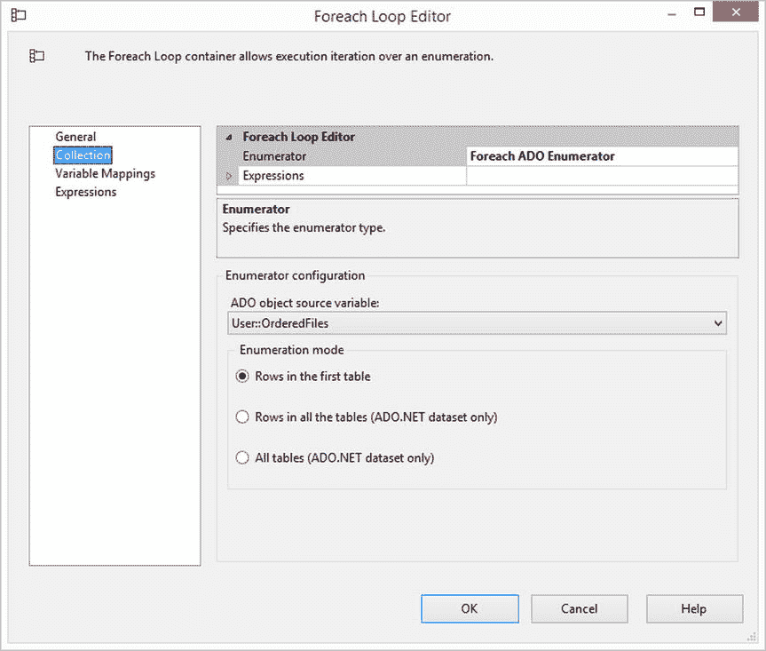

图 5-20. Foreach ADO 枚举器

转到“变量映射”页面，将 `User::FilePath` 变量映射到索引 0。（数据集表中的列按其从 0 开始的顺序进行索引）。单击“确定”关闭 Foreach 循环编辑器，如图 5-21 所示。

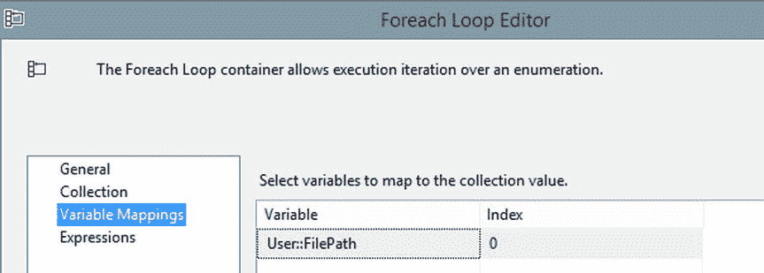

图 5-21. Foreach 循环编辑器的变量映射配置

使用 `Apress_SSIS_Scripting` 数据库中第 1 章的 Customer 表。

在 Foreach 循环容器内添加一个数据流任务 – `DFT_OrderedFiles`。在“数据流”选项卡中，添加一个平面文件源。创建一个平面文件连接管理器，指向源代码文件夹中的 `.csv` 文件：

`C:\APress\02_Code\2014\Extending SSIS with .NET\BookCode\Chapter 5\ContentFolder\Customers.csv`

保持其他配置不变，使其看起来如图 5-22 所示。

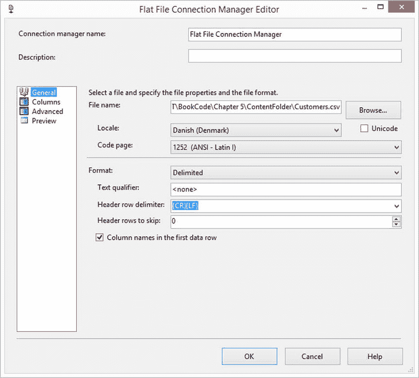

图 5-22. 文件连接管理器配置

点击左窗格中的“列”项目以生成列映射。点击“确定”关闭编辑器。

在数据流任务中，添加一个 OLE DB 目标，连接到 `Apress_SSIS_Scripting` 数据库和 Customer 表。使用默认映射。将其连接到源，如图 5-23 所示。

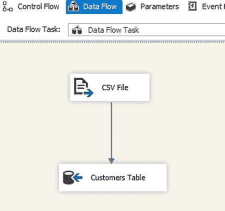

图 5-23. 数据流架构

在 Foreach 循环容器内部，数据流任务之后，添加一个文件系统任务。将其连接到数据流任务的输出。打开文件系统任务编辑器，并按图 5-24 所示进行配置。

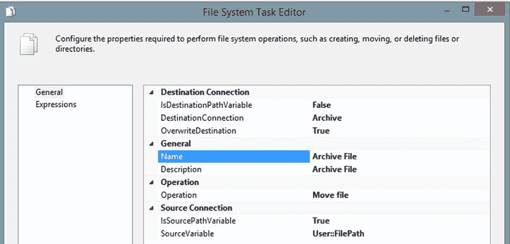

图 5-24. 用于归档文件的文件系统任务编辑器

创建一个`FileLoadLog`表，用于存储将文件加载到数据库的相关信息。在SSMS中的`Apress_SSIS_Scripting`数据库中运行以下脚本：

```sql
CREATE TABLE [dbo].FileLoadLog NOT NULL,
[FilePath] varchar NULL,
[LoadDateTime] [datetime] NULL,
) ON [PRIMARY]
```

在“存档文件”任务之后添加一个执行SQL任务。为“存档文件”任务添加一个优先约束。编写一个INSERT命令，将日志条目添加到`FileLoadLog`表中，如下所示：

```sql
INSERT INTO FileLoadLog (FilePath,LoadDateTime) values (?,getdate())
```

图5-25显示了最终的任务配置。

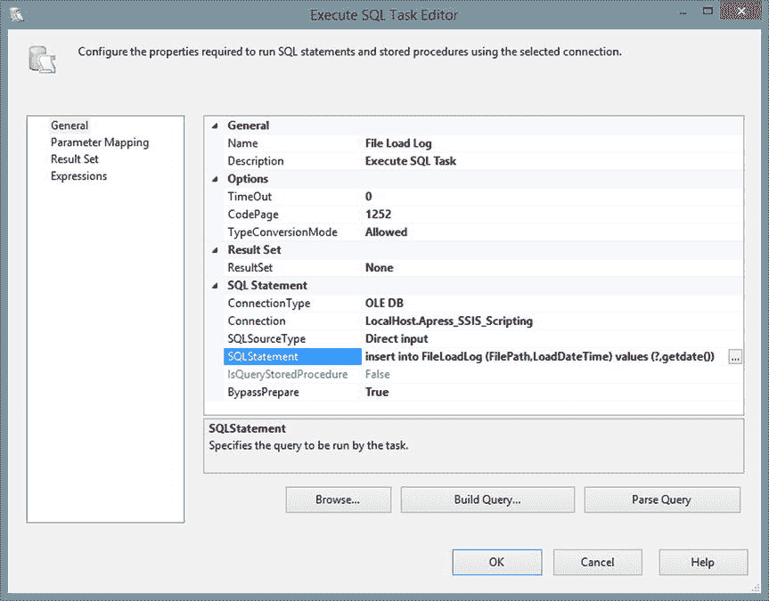

图 5-25. 文件加载日志执行SQL任务配置

在“参数映射”页面上，将`User::FilePath`变量设置为参数名称0，数据类型为`VARCHAR`，如图5-26所示。

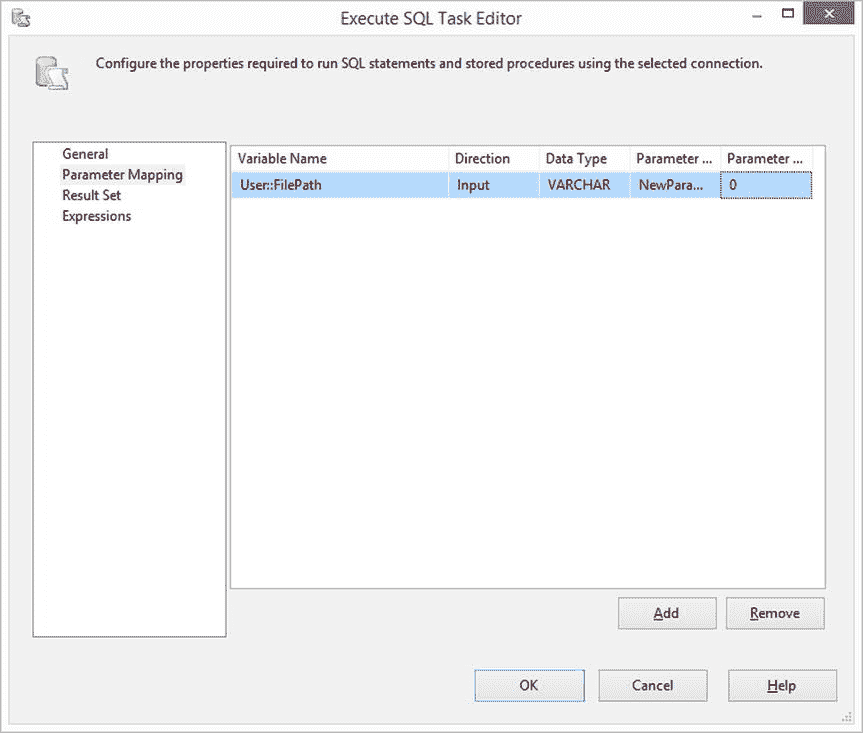

图 5-26. 参数映射

图5-27显示了包的完整布局。

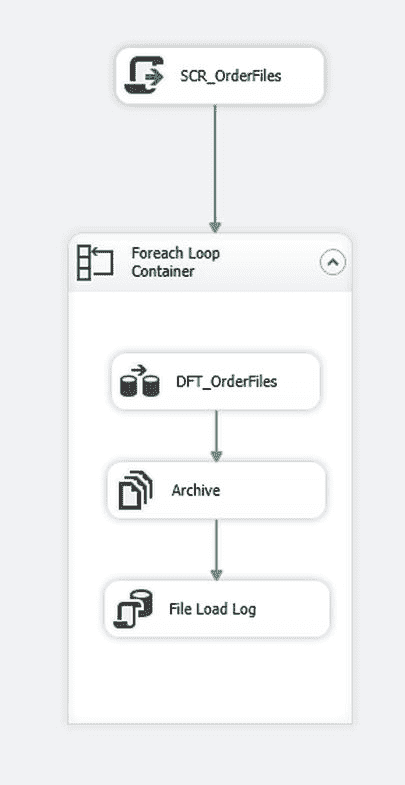

图 5-27. 包04的架构 - Foreach有序文件枚举器

运行该包。你将看到源文件夹中的所有文件都被加载到数据库中，然后移动到归档文件夹。它们将在`FileLoadLog`中写入条目日志，如图5-28所示。

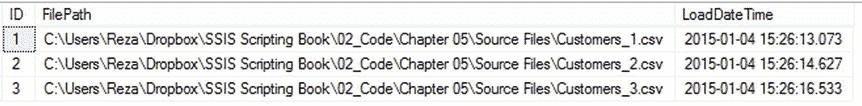

图 5-28. `FileLoadLog`表中的结果

注意：此示例未检查文件是否被锁定或正在使用。如果你希望在ETL场景中添加该检查，只需将其与本章第一个示例中的代码结合即可。

在本例中，你学习了如何自定义枚举中的文件顺序，然后通过包变量传递所需的有序数据集，并在包的其余部分中使用它。

### 总结

在本章中，你学习了`System.IO`类，例如`File`、`FileInfo`和`Directory`。你学习了如何使用这些类的方法和属性来增强你的SSIS包实现。你还学习了一些场景，在这些场景中，你可以通过结合代码和内置任务（如Foreach有序文件枚举器）来扩展你的SSIS包。你学习了如何使用脚本任务检查文件是否被锁定或正在使用，并将结果状态返回到包变量中，以便在SSIS包中进行进一步检查。在下一章中，你将学习如何使用SSIS和脚本在互联网和Web上工作。


