# 第 1 章 SSIS 与脚本入门

电子补充材料 本章的在线版本（doi:`10.1007/978-1-4842-0638-6_1`）包含补充材料，仅供授权用户使用。

本章将引导您完成一个简单场景，您将使用 `.NET` 脚本实现所需功能。希望您能了解使用 `.NET` 脚本实现场景是多么简单而强大。每个 `.NET` 版本都会新增功能。您还将了解这些版本如何与 `SSIS` 版本相关联。

在本章中，您将学习如何使用 `SSIS` 执行基本任务，以及如何利用脚本简化这些基本任务。

## 使用 SSIS 内置组件执行基本操作

边做边学通常是理解功能最简便的方式。因此，让我们先看看如何通过 `.NET` 脚本构建一个基本操作。但在开始之前，我们先设定场景，正式介绍 `SSIS`。

### 什么是 SSIS？

`SQL Server Integration Services (SSIS)` 是 `SQL Server` 的一项服务。其历史始于 `SQL Server 2000` 中的 `DTS`（数据转换服务）。`SSIS` 首次随 `SQL Server 2005` 发布，此后在 `SQL Server` 的每个版本中（2008、2008 R2、2012，以及本书撰写时的 2014）都得到了增强。`SSIS` 是 `BI`（商业智能）开发人员进行 `ETL`（数据提取、转换和加载）的首选工具。`SQL` 开发人员用它进行数据转换，`DBA` 用它自动化部分管理任务，程序员则用它避免编写大量代码。

一个 `SSIS` 项目包含一个或多个包。`SSIS` 项目在 `Business Intelligence Development Studio (BIDS)` 中开发，较新版本则在安装了 `BI` 模板的 `SQL Server Data Tools (SSDT)` 中开发。开发 `SSIS` 包所需的工具可能让人有些困惑。因此，为了彻底澄清，以下是关于 `SSDT` 的事实，以便您能快速上手并创建第一个 `SSIS` 包：

*   `SSDT` 作为 `SQL Server` 平台的免费组件提供，所有 `SQL Server` 用户均可使用。它支持 `SQL Server 2005`、2008、2008 R2、2012、2014 和 `Azure`。

*   `SSDT` 完整版本及更新可在线获取：[`https://msdn.microsoft.com/en-us/library/mt204009.aspx`](https://msdn.microsoft.com/en-us/library/mt204009.aspx)。

*   `SSDT` 可以独立安装，也可与 `Visual Studio` 一同安装。

要使用 `SSIS` 包，您需要下载与 `SSDT` 版本匹配的 `BI` 模板。

*   `SSDT 2012`：[`https://www.microsoft.com/en-us/download/details.aspx?id=36843`](https://www.microsoft.com/en-us/download/details.aspx?id=36843)

*   `SSDT 2014`：[`https://www.microsoft.com/en-us/download/details.aspx?id=42313`](https://www.microsoft.com/en-us/download/details.aspx?id=42313)

以下是一些下载不同版本 `BIDS` 和 `SSDT` 的有用链接。本书重点介绍 `SSDT 2013`。

*   `BIDS 2005`：[`http://www.microsoft.com/en-us/download/details.aspx?id=19413`](http://www.microsoft.com/en-us/download/details.aspx?id=19413). `SQL Server 2005` 的 Express 版不包含 `BIDS`。

*   `BIDS 2008` 和 `2008 R2` 需要 `Visual Studio 2010`。

此网页 [`https://msdn.microsoft.com/en-us/data/hh297027`](https://msdn.microsoft.com/en-us/data/hh297027) 总结了多种下载方式，但所列版本可能有些令人困惑。

### 开发工具

图 1-1 展示了 `SSDT` 的不同元素（`BIDS` 具有相同的默认布局，但颜色不同）。

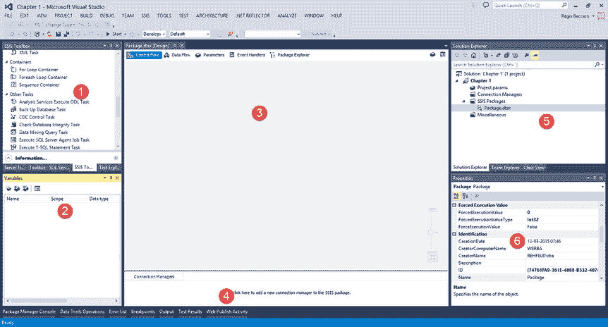

图 1-1. `SSDT` 开发工作室

图 1-1 中的标注突出显示了界面的以下区域和方面：

*   `SSIS 工具箱`：包含所有可用组件和任务。
*   变量窗格：可在此创建新变量并编辑现有变量。
*   主设计窗格：可在此添加组件和任务，处理包参数（`SSIS 2012` 及更高版本）并定义事件处理程序。
*   连接管理器窗格：用于管理当前 `SSIS` 包到外部资源的所有连接。
*   解决方案资源管理器：用于管理解决方案、项目、文件、连接管理器以及项目内的项目参数。
*   属性窗格：列出并管理所选对象的所有属性。

### 控制流任务

一个 `SSIS` 包包含一个控制流，并可选择包含一个或多个数据流。`SSIS` 提供三种类型的控制流元素：

*   提供包结构的容器
*   提供功能的任务
*   连接可执行文件的优先约束

图 1-2 展示了设计器窗格中控制流的示例。

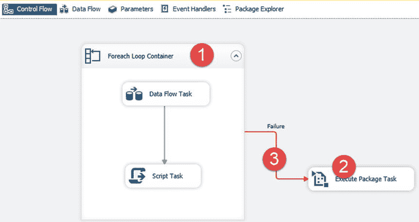

图 1-2. 控制流设计区域

以下是图 1-2 中的标注：

*   一个提供包结构并管理控制流功能的容器。
*   一个实现功能的任务。
*   一个定义执行流的优先约束。

> **注意**
>
> 随着 `SSIS` 新版本的发布，会出现新的控制流任务，其图形布局也略有不同。

图 1-3 展示了 `SSIS 工具箱` 中可用的控制流任务示例。

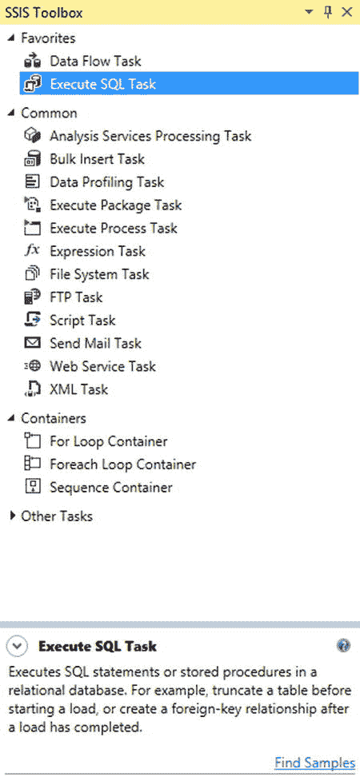

图 1-3. 控制流任务

如前所述，控制流任务包含三种类型的元素：用于结构的容器、用于连接可执行文件的优先约束，以及提供功能的任务。在提供功能的任务中，有用于数据库操作的元素，例如 `执行 SQL 任务`、`大容量插入任务` 和 `Analysis Services 处理任务`；用于操作外部系统的元素包括 `文件系统任务` 和 `Web 服务任务`；数据库管理任务包括 `备份数据库任务` 和 `收缩数据库任务`。`执行包任务` 用于调用其他包。`数据流任务` 通过多种转换管理源与目标之间的数据传输。`脚本任务` 用于编写 `.NET` 脚本（这也是本书的主要主题之一）。

所有可用控制流任务的列表位于 [`http://msdn.microsoft.com/en-us/library/ms139892.aspx`](http://msdn.microsoft.com/en-us/library/ms139892.aspx)。

另外值得注意的是，控制流中还有一些可用于分组和循环的结构元素。有关 `SSIS` 中容器的更多信息，请访问 [`https://msdn.microsoft.com/en-us/library/ms137728.aspx`](https://msdn.microsoft.com/en-us/library/ms137728.aspx)。

### 数据流组件

数据流可能是 `SSIS` 中最重要的任务。数据流是定义数据通过多种转换从一个或多个源传输到一个或多个目标的任务。数据流是构建 `ETL` 和数据集成解决方案的基石。数据流和控制流之间存在根本区别。控制流使用优先约束来结构化流程，而数据流组件则使用数据路径将数据从一个元素流向另一个元素。如图 1-4 所示。

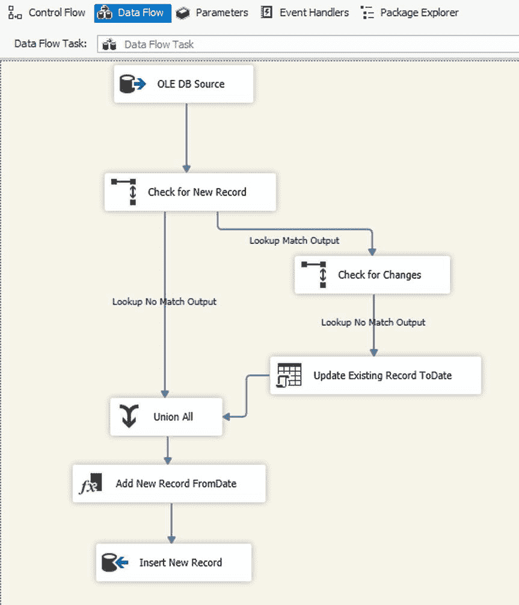

图 1-4. 数据流设计窗格

如前所述，`ETL` 包含三个主要阶段：提取、转换和加载。这三个阶段可以与数据流的组件类型相对应。

#### 提取

# ETL流程与SSIS组件

第一阶段旨在根据不同的数据提供者，从不同的数据源获取数据。源数据可以来自`SQL Server`、`DB2`、`Oracle`、`MySQL`等数据库，也可以来自文本文件、`XML`数据集、`Excel`文件等。图 1-5 展示了`SSIS`数据流任务中可用的源组件列表（此列表针对`SQL Server 2012/2014`，早期版本略有不同）。

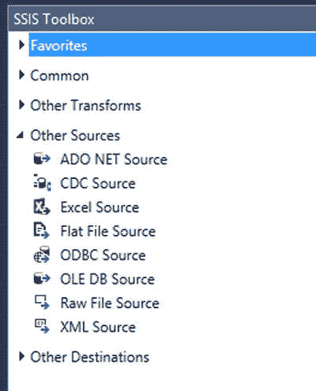

图 1-5. 数据流中的源组件

## 转换

`ETL`的第二阶段，也可能是最具挑战性的阶段，是在从源中提取数据后对其进行转换。`SSIS`数据流中有多种可用的转换；本书无法一一详述。一些最常用的转换包括：创建新列或替换现有列（派生列）、转换数据（数据转换）、不同类型的连接（查找）、数据透视与逆透视、以及数据集的合并与排序。图 1-6 展示了`SQL Server 2012/2014`的`SSIS`中可用的一些数据转换组件。您可以在 [`http://msdn.microsoft.com/en-us/library/ms141713.aspx`](http://msdn.microsoft.com/en-us/library/ms141713.aspx) 找到完整列表。

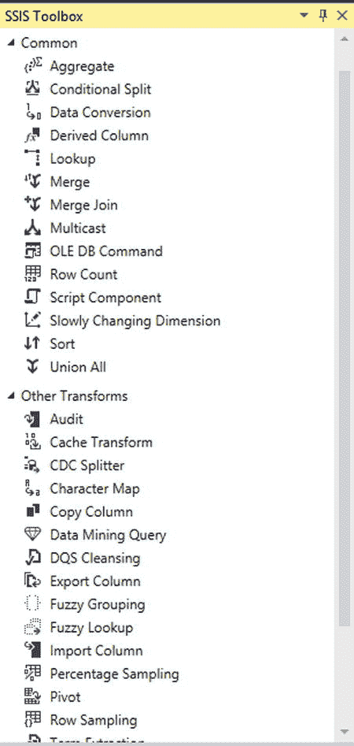

图 1-6. 数据流中的转换组件

## 加载（目标）

`ETL`的最后阶段是将数据加载到目标中。与存在多种可用源的方式类似，也存在多种目标。图 1-7 是`SQL Server 2012/2014`的截图，显示了一些可用的目标。

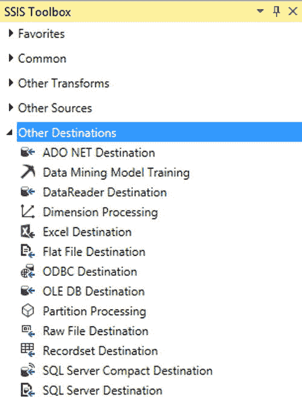

图 1-7. `SSIS`中的目标组件

### 示例 1：将 `.csv` 文件加载到数据库

以下示例是对使用`SSIS`任务和组件的介绍。本示例的目的是构建一个简单的`SSIS`包，并说明如何通过使用脚本更好地实现某些功能。它还指出了哪些功能只能通过`SSIS`中的脚本来实现。

**注意：** 本示例对应的包名为`Package1.dtsx`，您可以在第 1 章的代码中找到它。

在此练习中，您将把一个`.csv`文件加载到数据库中。在`SQL Server Management Studio (SSMS)`中，使用默认的`SQL Server`实例，通过以下脚本创建一个名为`Apress_SSIS_Scripting`的数据库：

```sql
CREATE DATABASE [Apress_SSIS_Scripting]
CONTAINMENT = NONE
```

在`Apress_SSIS_Scripting`数据库中，使用以下脚本创建一个表：

```sql
USE [Apress_SSIS_Scripting]
GO

CREATE TABLE [dbo].[Customer](
    [CustomerKey] [int] NOT NULL,
    [GeographyKey] [int] NULL,
    [CustomerAlternateKey] [nvarchar](15) NOT NULL,
    [Title] [nvarchar](8) NULL,
    [FirstName] [nvarchar](50) NULL,
    [MiddleName] [nvarchar](50) NULL,
    [LastName] [nvarchar](50) NULL,
    [NameStyle] [bit] NULL,
    [BirthDate] [datetime] NULL,
    [MaritalStatus] [nchar](1) NULL,
    [Suffix] [nvarchar](10) NULL,
    [Gender] [nchar](1) NULL,
    [EmailAddress] [nvarchar](50) NULL,
    [YearlyIncome] [money] NULL,
    [TotalChildren] [int] NULL,
    [NumberChildrenAtHome] [int] NULL,
    [EnglishEducation] [nvarchar](40) NULL,
    [SpanishEducation] [nvarchar](40) NULL,
    [FrenchEducation] [nvarchar](40) NULL,
    [EnglishOccupation] [nvarchar](100) NULL,
    [SpanishOccupation] [nvarchar](100) NULL,
    [FrenchOccupation] [nvarchar](100) NULL,
    [HouseOwnerFlag] [nchar](1) NULL,
    [NumberCarsOwned] [int] NULL,
    [AddressLine1] [nvarchar](120) NULL,
    [AddressLine2] [nvarchar](120) NULL,
    [Phone] [nvarchar](20) NULL,
    [DateFirstPurchase] [datetime] NULL,
    [CommuteDistance] [nvarchar](15) NULL,
    [SourceFile] [nvarchar](100) NULL
) ON [PRIMARY]
```

打开`SSDT`或`BIDS`并创建一个新的`SSIS`项目，如图 1-8a 所示。在新的`SSIS`包（默认创建）中，从`SSIS`工具箱将一个数据流任务拖放到主窗格中，然后双击它以进入数据流选项卡。图 1-8b 展示了如何在`Visual Studio 2013`的`SSDT-BI`中创建新的`SSIS`项目。

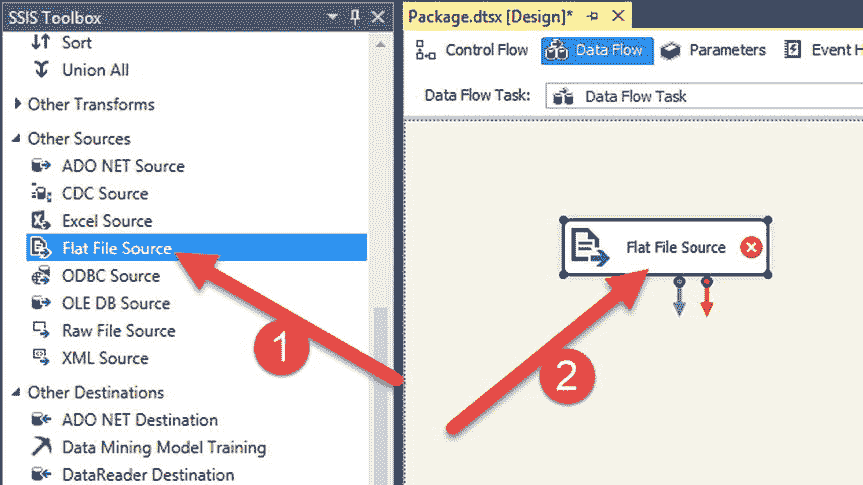

图 1-8b. 创建平面文件源

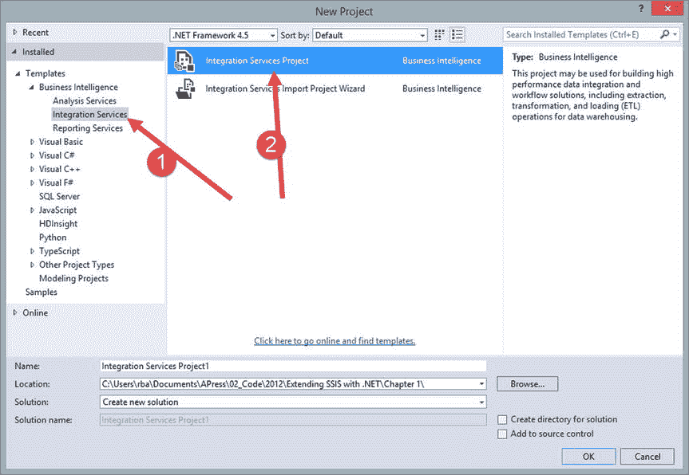

图 1-8a. 平面文件连接管理器

在设计图面上拖放一个数据流任务并双击它。在数据流任务中，拖放一个平面文件源并双击它以打开其属性对话框。

单击“新建”以创建一个新的平面文件连接管理器，指向本书源代码包中位于`Chapter 01\Source Files\Customers.csv`的`.csv`文件。

配置平面文件连接管理器的“常规”选项卡，如图 1-9 所示。

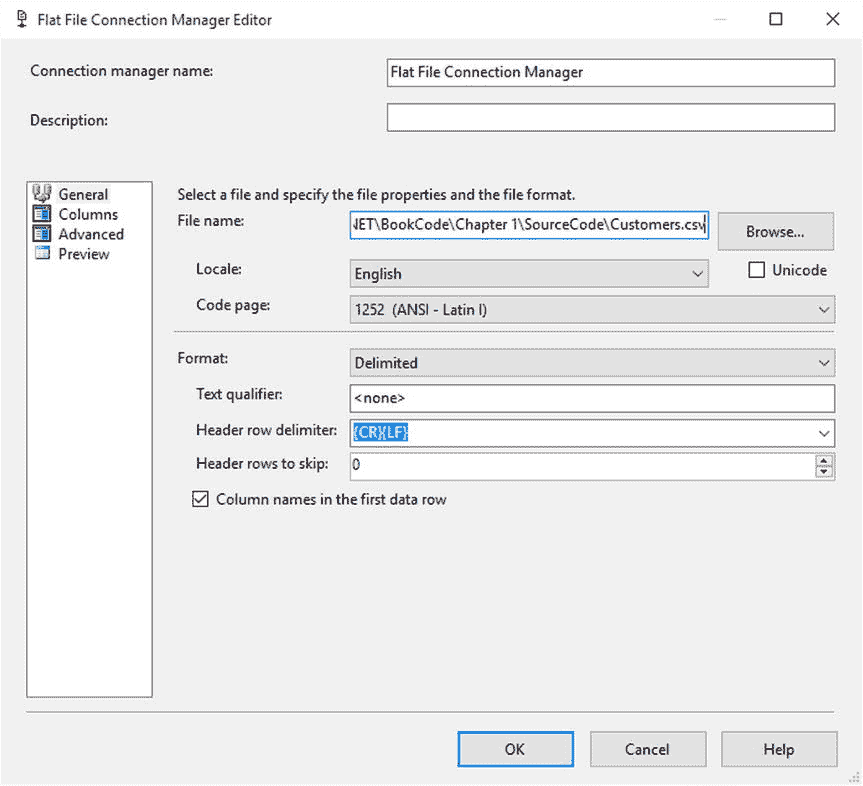

图 1-9. 平面文件连接管理器

单击“列”页面以从文件中加载可用列。单击“确定”并关闭平面文件连接管理器编辑器。在平面文件源编辑器中，从源中选择“保留空值”选项，以处理数据流中的空值。

单击“确定”关闭平面文件源编辑器。

在平面文件源之后创建一个`OLE DB`目标，并将数据路径从平面文件源连接到该组件。选择平面文件数据输出（而非错误输出）。双击`OLE DB`目标并创建一个`OLE DB`连接管理器，该管理器指向您在第 1 步中创建的数据库。图 1-10 显示了指向本地`SQL Server`实例的连接管理器（您的实例名称可能不同）。

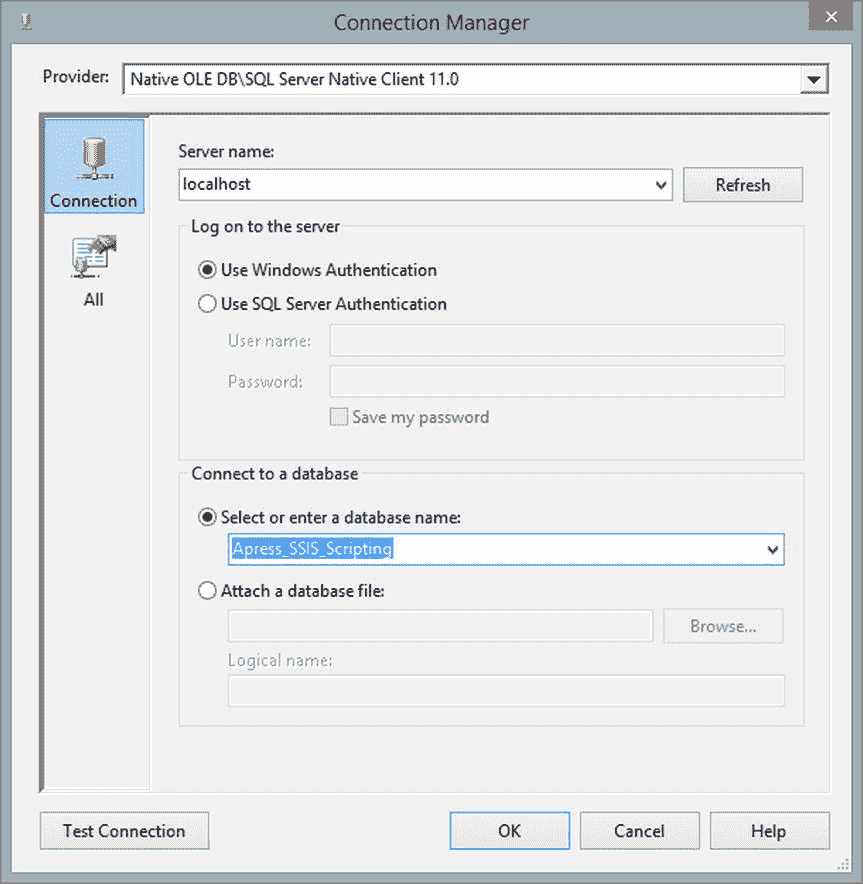

图 1-10. 创建 `OLE DB` 连接

在表/视图下拉菜单中选择`[dbo].[Customer]`，如图 1-11 所示。

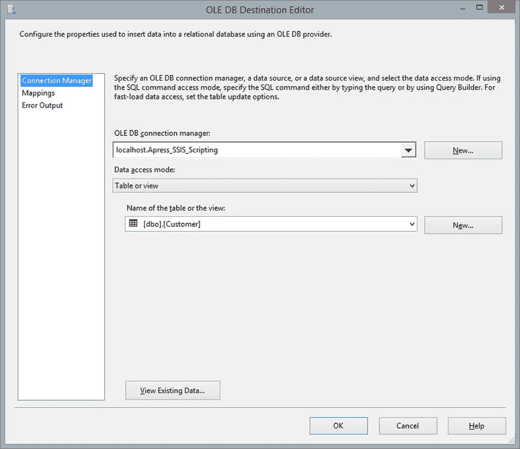

图 1-11. `OLE DB` 目标编辑器配置

单击左侧窗格中的“映射”项，并确保每一列都已映射，如图 1-12 所示。

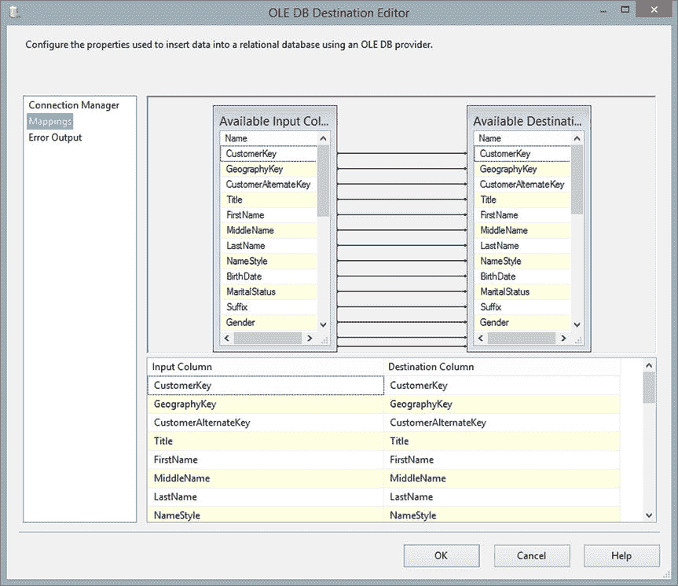

图 1-12. 目标组件中的列映射

在解决方案资源管理器中右键单击该包，并通过单击“执行包”菜单项来执行它。您将看到 1,000 行数据已成功从`.csv`文件传输到数据库表中（参见图 1-13）。

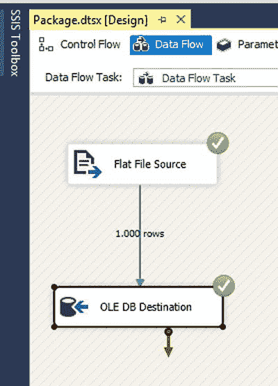

图 1-13. 执行结果

### 使用 SSIS 内置组件组合执行操作

## 实验一：数据流与控制流入门

在前一节中，您学习了如何创建一个包含源和目标组件的简单数据流任务。您还了解了 SSIS 如何帮助减少编程和编码工作。在之前的实验室中，您通过拖放和用户界面上的简单配置完成了任务。本实验的目的之一（除了作为入门介绍外）是为了说明 SSIS 如何轻松帮助减少数据传输和合并的开发时间。

在接下来的部分中，您将演练一个示例，其中 SSIS 通过内置组件帮助构建解决方案。您将使用与之前相同的数据流任务，并添加一个 `Foreach` 循环容器和一个表达式任务。您还将向包中添加一个变量，以使这些组件能够以更动态的方式相互通信。

`Foreach` 循环容器在包中定义了一个重复的控制流。循环实现与编程语言中的 `For` 循环非常相似。该容器枚举集合中的每个项。在此示例中，您将使用文件枚举器来循环遍历指定目录中的所有文件。

表达式任务（仅在 SSIS 2012 及更高版本中可用）在运行时创建并计算表达式的值。表达式任务使用 SSIS 表达式语言。该语言包含用于处理日期、字符串、数字和转换数据类型等操作的运算符和函数。该语言的完整描述可在`http://msdn.microsoft.com/en-us/library/ms137547.aspx`找到。在本实验中，您将编写一个表达式来比较两个变量的值，以查找最新的文件。

## 示例 2：使用内置组件查找文件夹中的文件并将其加载到数据库

请在 SSMS 中运行以下代码以清空目标表：

```sql
TRUNCATE TABLE dbo.Customer
```

复制并粘贴上一个示例中的包。转到控制流设计器，然后将一个 `Foreach` 循环容器拖放到主设计区域。

创建一个具有数据类型的新变量，并按图 1-14 所示进行命名。如果看不到变量窗口，请右键单击控制流中的空白区域，然后从上下文菜单中选择“变量”。

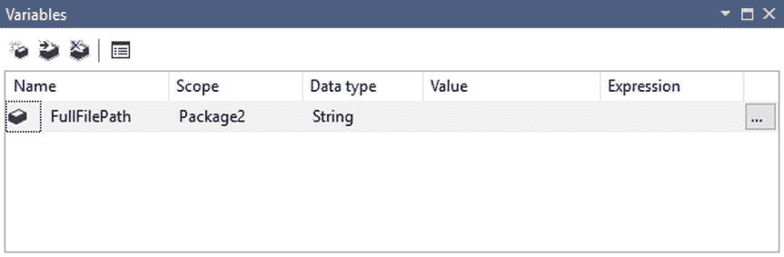

图 1-14. 变量定义

转到 `Foreach` 循环编辑器（双击 `Foreach` 循环容器），然后转到“集合”页面。将枚举器设置为 `Foreach` 文件枚举器，该枚举器会显示其选项。然后将文件夹设置为 [Chapter 01](http://dx.doi.org/10.1007/978-1-4842-0638-6_01)\Source Files（来自本书的源代码包），并确保您获取了完全限定的文件名，如图 1-15 所示。

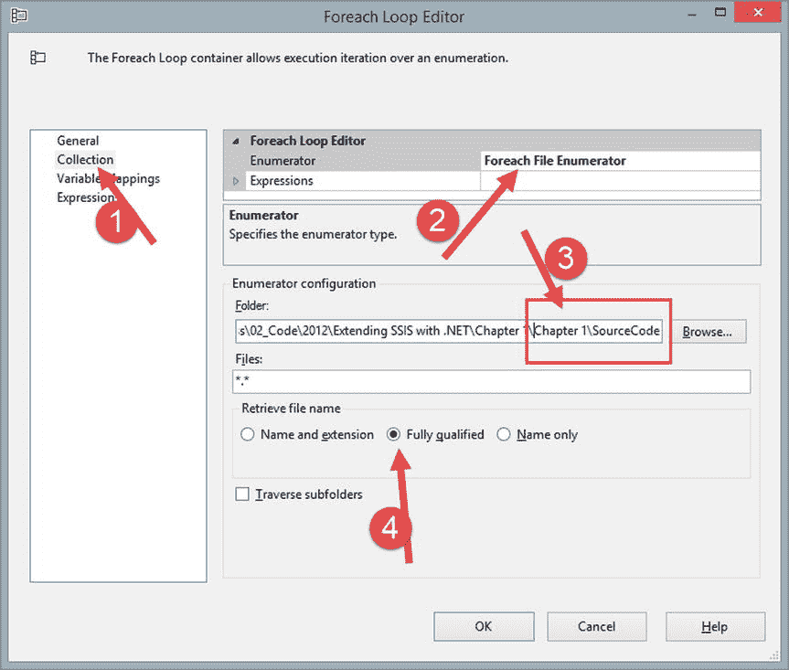

图 1-15. Foreach 文件枚举器

为了实现更精细的筛选，您可以在“文件”字段中添加通配符（例如 `*.csv`）。

转到“变量映射”页面，然后从“变量”列中选择 `User::FullFilePath`。确保索引为 0（本次自动设置），如图 1-16 所示。

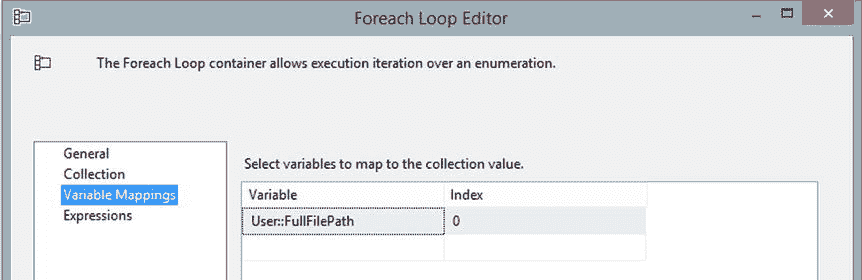

图 1-16. 变量映射

单击“确定”关闭 `Foreach` 循环编辑器。

将上一章中的数据流任务和文件目标拖放到 `Foreach` 循环容器中，使其看起来如图 1-17 所示。

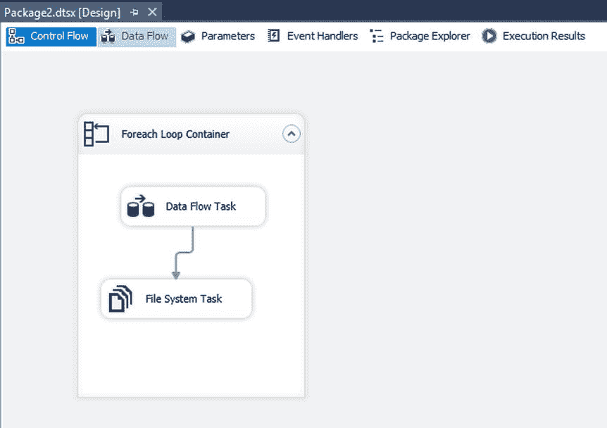

图 1-17. 控制流布局

双击打开数据流任务。它应该看起来如图 1-18 所示。

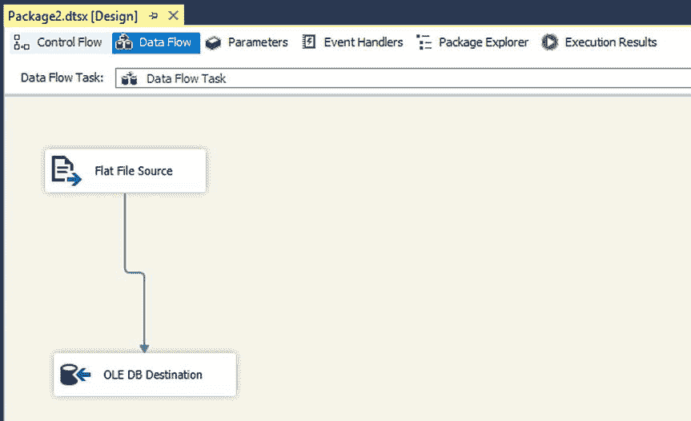

图 1-18. 数据流任务

在连接窗格中，右键单击平面文件连接管理器，然后从上下文菜单中选择“属性”。这将打开“属性”工具窗口。单击属性列表中的“表达式”项，然后单击右侧出现的省略号按钮以打开“属性表达式编辑器”。

选择 `ConnectionString` 属性，并在“表达式”框中输入 `@[User::FullFilePath]`。（现在此连接基于 `Foreach` 循环容器中选定的文件名变为动态连接。）您看到的内容应该如图 1-19 所示。

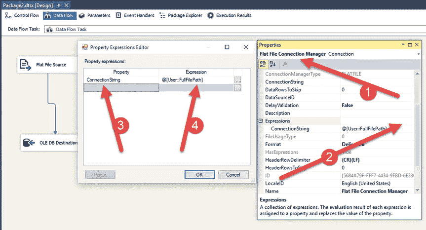

图 1-19. 数据流布局

双击 `Foreach` 循环容器内的文件系统任务以打开其编辑器。设置配置，将文件从 `User::FullFilePath` 源变量移动到“存档”文件夹。（对于目标连接，请为现有文件夹创建一个新连接，并从本书的源代码包中选择“存档”文件夹。）详细配置如图 1-20 所示。

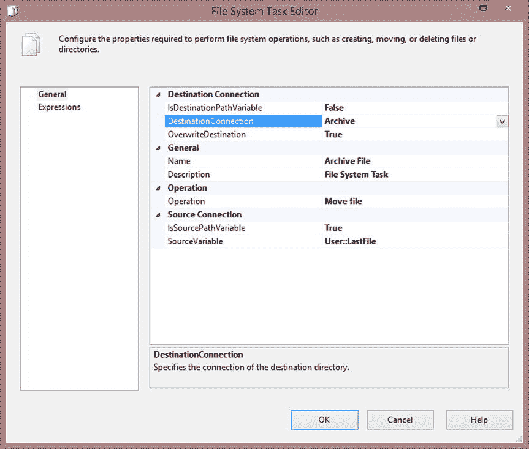

图 1-20. 文件系统任务编辑器

关闭文件系统任务编辑器。此任务旁仍存在一个红色停止图标。转到“属性”窗口，并将 `DelayValidation` 属性设置为 `True`。发生这种情况是因为所使用的变量仅在运行时才填充。当 SSIS 在设计时验证值时，会失败，但在运行时将成功。

**注意**

在执行任务之前，您可能希望清空目标表，因为 `CustomerKey` 列中可能存在一些重复值。请使用以下命令：

```sql
TRUNCATE TABLE [Apress_SSIS_Scripting].[dbo].[Customer]
```

执行该包并检查客户表中的记录。您将看到所有客户文件中的数据都已加载，并且存档文件夹中包含已加载的文件（见图 1-21）。

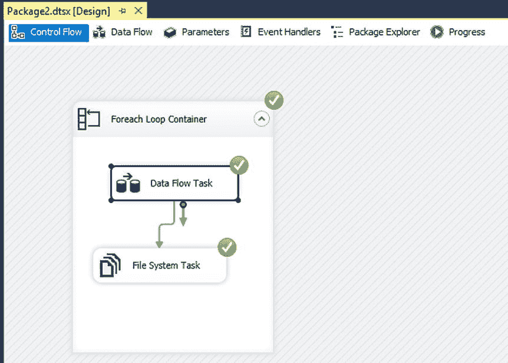

图 1-21. 包执行成功

## .NET 脚本让生活更轻松

在前一节中，您看到了如何使用 SSIS 组件和任务来解决问题。您找到了文件，然后加载并归档了它们。现在考虑一下，您只想根据某些属性（例如修改日期）来查找最新的文件。不幸的是，SSIS 中没有允许您执行此操作的内置组件。这时，SSIS 脚本就派上用场了。

在下一节中，您将创建一个脚本任务和一个 .NET 脚本来查找最新修改的文件。包的其余部分将保持不变。找到最新修改的文件后，您将把它加载到客户表中并归档。

脚本任务是一个控制流任务，允许您编写 .NET 脚本。然后，您可以通过将脚本任务放置在控制流中的某个位置并设置优先级约束来设置该 .NET 脚本的执行顺序。

本节旨在作为入门介绍；因此，本实验的某些部分将在本书后面更详细地介绍。本节的目的在于让您对脚本任务有一个基本的了解。

## 示例 3：查找最新修改的 .csv 文件

在此示例中，你将通过脚本在源文件夹中找到最新修改的 `.csv` 文件，并使用内置组件将其加载到数据库中。

打开上一个示例的 SSIS 包，将数据流任务和文件系统任务移出 `Foreach` 循环容器，并删除该容器，使其外观如图 1-22 所示。

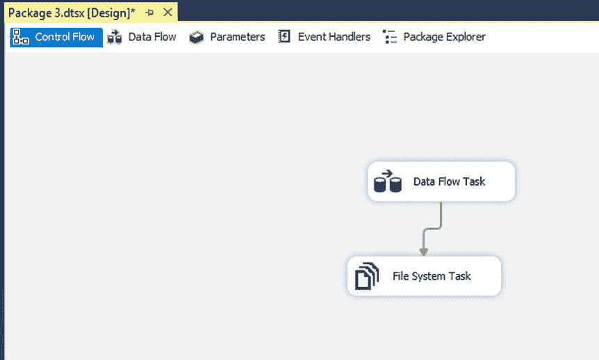

图 1-22. 清理后的包

移除 `FileFullPath` 变量。

如有必要，将客户文件从 Archive 文件夹移回源文件夹。使用以下代码清空客户表：

```sql
TRUNCATE TABLE [Apress_SSIS_Scripting].[dbo].[Customer]
```

添加一个脚本任务。双击该脚本任务打开脚本任务编辑器。将脚本语言保留为 C#。在“ReadWriteVariables”中选择 `User::FullFilePath`，如图 1-23 所示。

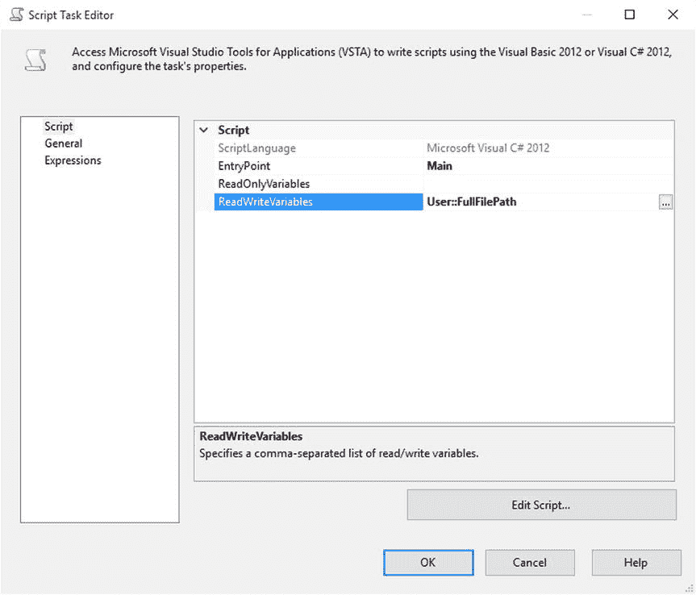

图 1-23. 脚本任务编辑器

单击“编辑脚本...”按钮。此时会打开一个新的 Visual Studio 窗口，其中包含一个 C# 项目和一个自动生成的名称。主区域中会打开 `ScriptMain.cs` 文件（参见图 1-24）。

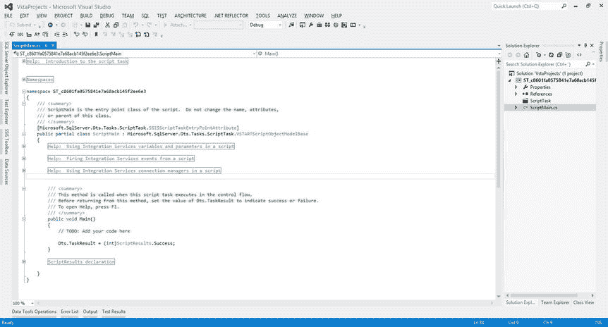

图 1-24. 脚本编辑器

将 `Main` 方法的内容替换为以下脚本：

```
# 第1章 使用脚本任务扩展SSIS

本章将介绍脚本任务和脚本组件，它们是使用SQL Server Integration Services (SSIS) 构建包时可以使用的两个非常重要的工具。脚本任务和脚本组件可以让你使用Microsoft Visual Studio for Applications (VSTA) 环境中的C#或VB.NET编程语言来编写自定义代码。

## 示例：使用脚本任务查找最后修改的文件

考虑以下场景：你有一个包含客户列表的CSV文件，并且每天都会向文件夹中添加一个新文件。你想要创建一个SSIS包，该包可以打开最新版本的文件，加载数据，然后将该文件移动到存档文件夹中。虽然可以使用SSIS中的内置组件（如`Foreach`循环容器和`FileSystemTask`）来完成此操作，但有一个更直接的方法，那就是使用`ScriptTask`。

### 编写并配置脚本任务

在`ScriptTask`中，你可以访问文件系统以找到最后修改的文件，而无需遍历整个文件夹。

打开VSTA编辑器并粘贴以下代码：

```csharp
public void Main()
{
    // TODO: 在此处添加代码
    string[] files = System.IO.Directory.GetFiles(@"C:\APress\02_Code\2014\Extending SSIS with .NET\BookCode\Chapter 1\SourceCode");
    System.IO.FileInfo finf;
    DateTime lastDate = new DateTime();
    string lastFile = string.Empty;

    foreach (string f in files)
    {
        finf = new System.IO.FileInfo(f);
        //让我们找到最后一个文件，且仅为 csv 文件
        if (finf.LastWriteTime > lastDate && finf.Name.Contains("csv"))
        {
            lastDate = finf.CreationTime;
            lastFile = f;
        }
    }

    Dts.Variables["User::FullFilePath"].Value = lastFile;
    Dts.TaskResult = (int)ScriptResults.Success;
    Dts.TaskResult = (int)ScriptResults.Success;
}
```

关闭VSTA编辑器（单击右上角的X按钮）保存脚本。关闭脚本任务编辑器。

使用成功优先约束将脚本任务连接到数据流任务。

执行包。你将看到`Customer_2.csv`被加载到客户表中，并移动到存档文件夹，因为该文件是最后修改的文件（参见图1-25）。

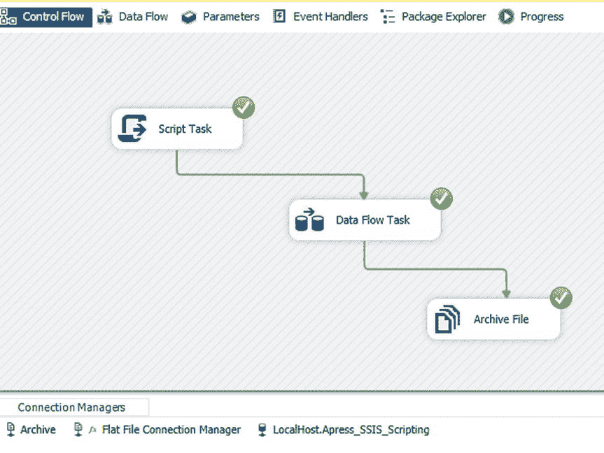

图1-25. 控制流布局

**注意**：你可能需要在记事本中打开`Customer_2.csv`并重新保存，以修改其时间戳，因为下载的所有文件都具有相同的时间戳。

你已经看到脚本任务和脚本在SSIS中是多么有用。在本实验中，你使用C#代码遍历源文件夹中的文件，并找到最后修改的文件——这是纯SSIS内置任务无法完成的操作。然后，你使用数据流将文件中的数据传输到SQL Server数据库表，这在SSIS中比通过脚本实现要容易得多。SSIS与脚本的结合非常重要；它极大地扩展了你所构建的SSIS包的能力。

在本书中，你将学习SSIS中的脚本示例，并学习如何基于脚本创建自定义任务，以便在其他包和项目中重用。

### SSIS版本与.NET库限制

每个SSIS版本都与特定版本的.NET库兼容。SSIS 2005是第一个支持某个.NET Framework版本的SSIS版本。表1-1列出了SSIS版本及其支持的.NET Framework版本。

表1-1. SSIS版本及其支持的.NET Framework版本

| SSIS版本 | 支持的.NET Framework版本 |
|---|---|
| 2005 | 2.0 |
| 2008和2008 R2 | 2.0到3.5 |
| 2012 | 首选4.0，但兼容2.0到4.0 |
| 2014 | 5 |

### 编程语言：C#或VB.NET

由于.NET编程语言在转换为机器指令之前会被编译为中间语言（MSIL），因此所有.NET Framework元素均可用于C#和VB.NET。这意味着你可以使用C#或VB.NET编写SSIS脚本任务和组件。本书中的大多数示例都涵盖了这两种语言。有关.NET Framework及其编程语言的更多信息，请参见第3章。

选择脚本语言主要取决于个人偏好。互联网上提供的示例大多使用C#编写；本书的作者也更喜欢C#。但如果你更习惯使用VB.NET，也可以放心使用。SSIS 2005仅支持VB.NET。

### 总结

在本章中，你学习了SSIS的基础知识，它是SQL Server的组件之一。你了解了SSIS在实现数据整合和ETL场景方面的实用性。你还学会了如何通过使用脚本任务来扩展SSIS的能力。
```