# 6. 在互联网和 Web 上工作

电子补充材料 本章的在线版本 (doi:[10.1007/978-1-4842-0638-6_6](http://dx.doi.org/10.1007/978-1-4842-0638-6_6)) 包含补充材料，可供授权用户使用。

Web 是数据的重要来源。数据可能来自位于网站或 (S)FTP 服务器上的文件。在本章中，你将学习如何通过 Web 处理文件、如何下载文件以及如何使用 FTP 和 SFTP。本章中的场景无法使用内置任务（例如 FTP 任务）轻松完成。

## 发送 HTML 格式的电子邮件

开箱即用的发送邮件任务的一个缺点是它不支持 HTML 格式的电子邮件。关联的 SMTP 连接管理器不支持更高级的设置，例如更改端口和设置基本凭据。不过，脚本任务可以在这里帮助你。

另一种方法是使用调用 `sp_send_dbmail` 的执行 SQL 任务，但脚本任务提供了更多可能性，并且你无需请求数据库管理员 (DBA) 在数据库中启用此功能。

### SMTP 连接管理器

为了存储 SMTP 服务器地址，我们使用图 6-1 中所示的 SMTP 连接管理器。你可以通过右键单击连接管理器窗格，选择“新建连接”，然后选择 SMTP 来添加它。输入服务器地址，并可选择更改其他设置。确保连接管理器的名称是 SMTP Mail Server。你可以更改它，但请记得也要在脚本中进行更改。另一种方法是在下一步中使用额外的 SSIS 字符串变量来存储 SMTP 服务器名称或 IP 地址。

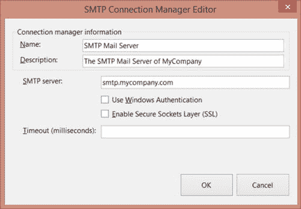

图 6-1. SMTP 连接管理器

如果你的公司或提供商没有 SMTP 服务器，那么你可以搜索公共 SMTP 服务器，例如 `gmail.com` 或 `outlook.com`，但通常它们需要身份验证或具有其他限制。

注意：如果发送 HTML 格式的电子邮件是你使用脚本任务的唯一原因，那么最佳实践是使用 SMTP 连接管理器。如果你还想更改端口或凭据，那么同时使用变量和 SMTP 连接管理器作为脚本任务的输入可能会有些混乱。

### 变量

要存储电子邮件中的发件人、收件人、主题和正文，你需要四个 `String` 变量，如图 6-2 所示。如果你还想更改默认端口号，则需要一个额外的 `Integer` 变量。添加身份验证时也是如此，为此需要额外的 `String` 变量来存储用户名和密码。

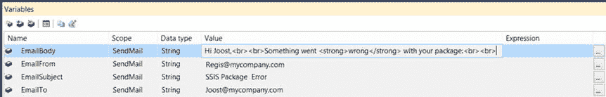

图 6-2. 用于存储电子邮件各部分的字符串变量

### 脚本任务

向控制流（或者事件处理程序之一，如果你更喜欢的话）添加一个脚本任务，并为其指定一个合适的名称，例如 `SCR - 发送错误邮件`。你不需要额外的任务来测试这个，但你可以将其与数据流任务连接，并设置一个错误优先级约束。编辑脚本任务，并添加上一步中的变量，如图 6-3 所示。将这些变量设置为 `ReadOnlyVariables`，以便可以在脚本代码中使用它们。

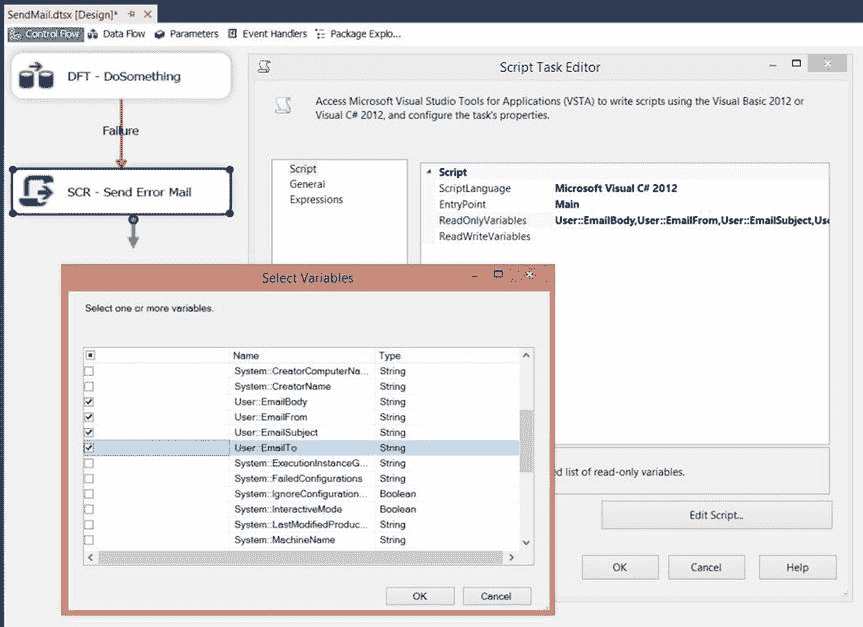

图 6-3. 向脚本任务添加变量（或参数）

### 代码

点击 **编辑脚本...** 按钮打开 VSTA 环境。首先，添加额外的命名空间以简化代码：

```csharp
#region customNamespaces
using System.Net;
using System.Net.Mail;
#endregion
```

这是 VB.NET 代码：

```vbnet
#Region "customNamespaces"
Imports System.Net
Imports System.Net.Mail
#End Region
```

现在是时候将以下代码添加到你的 `Main` 方法中了。有一些代码行被注释掉了，用于提供额外功能的代码，例如更改端口号或添加凭据。

```csharp
public void Main()
{
    // 将 SSIS 变量存储在 .Net 变量中。你可以跳过此步骤，
    // 并在实际的邮件代码中直接调用 SSIS 变量以减少代码行数，
    // 但这样做会让代码看起来更有条理。
    String SendMailFrom = Dts.Variables["EmailFrom"].Value.ToString();
    String SendMailTo = Dts.Variables["EmailTo"].Value.ToString();
    String SendMailSubject = Dts.Variables["EmailSubject"].Value.ToString();
    String SendMailBody = Dts.Variables["EmailBody"].Value.ToString();
    
    // 获取 SMTP 连接管理器并读取其属性
    ConnectionManager mySmtpConn = Dts.Connections["SMTP Mail Server"];
    string SmtpServer = mySmtpConn.Properties["SmtpServer"]
        .GetValue(mySmtpConn).ToString();
    int Timeout = Convert.ToInt32(mySmtpConn.Properties["Timeout"]
        .GetValue(mySmtpConn));
    bool EnableSsl = Convert.ToBoolean(mySmtpConn
        .Properties["EnableSsl"].GetValue(mySmtpConn));
    bool UseWinAut = Convert.ToBoolean(mySmtpConn
        .Properties["UseWindowsAuthentication"]
        .GetValue(mySmtpConn));
    
    // 创建一封电子邮件并将格式更改为 HTML
    MailMessage myHtmlFormattedMail = new MailMessage(SendMailFrom
        , SendMailTo
        , SendMailSubject
        , SendMailBody);
    myHtmlFormattedMail.IsBodyHtml = true;
    
    // 创建一个 SMTP 客户端来发送电子邮件
    SmtpClient mySmtpClient = new SmtpClient(SmtpServer);
    mySmtpClient.EnableSsl = EnableSsl;
    mySmtpClient.UseDefaultCredentials = UseWinAut;
    
    // 检查其他属性，例如端口号
    // mySmtpClient.Port = 587; // 从变量获取值
    // 或使用用户名/电子邮件和密码的凭据
    // mySmtpClient.Credentials = new NetworkCredential("username", "password");
    
    // 尝试发送电子邮件
    try
    {
        // 发送电子邮件
        mySmtpClient.Send(myHtmlFormattedMail);
        // 成功关闭脚本任务
        Dts.TaskResult = (int)ScriptResults.Success;
    }
    catch (Exception ex)
    {
        // 为日志记录触发错误
        string Error = "Error: " + ex.Message + " ";
        Error += ((ex.InnerException != null) ? ex.InnerException.Message : "");
        Dts.Events.FireError(0, "Send Mail Task", Error, string.Empty, 0);
        // 失败关闭脚本任务
        Dts.TaskResult = (int)ScriptResults.Failure;
    }
}
```

这是 VB.Net 代码：

```markdown
## 从 Web 服务器下载文件

使用 FTP 任务从 FTP 服务器下载文件很容易，但有时你需要从 Web 服务器获取文件。这个例子展示了如何使用脚本任务来实现这一点。登录或其他手动操作超出了本书的范围。一个简单的起点是公开可下载的文件。出于测试目的，你可以使用以下 URL：[`https://sites.google.com/site/ssisblogspot/products.csv`](https://sites.google.com/site/ssisblogspot/products.csv)。

### 数据流任务

起始情况是一个简单的数据流任务，如图 6-5 所示，它读取一个平面文件，但你需要刷新该平面文件并从网站下载一个新版本。你将使用名为 `Products` 的平面文件连接管理器来确定下载位置。有一个入门包可用，其中已经包含了数据流。

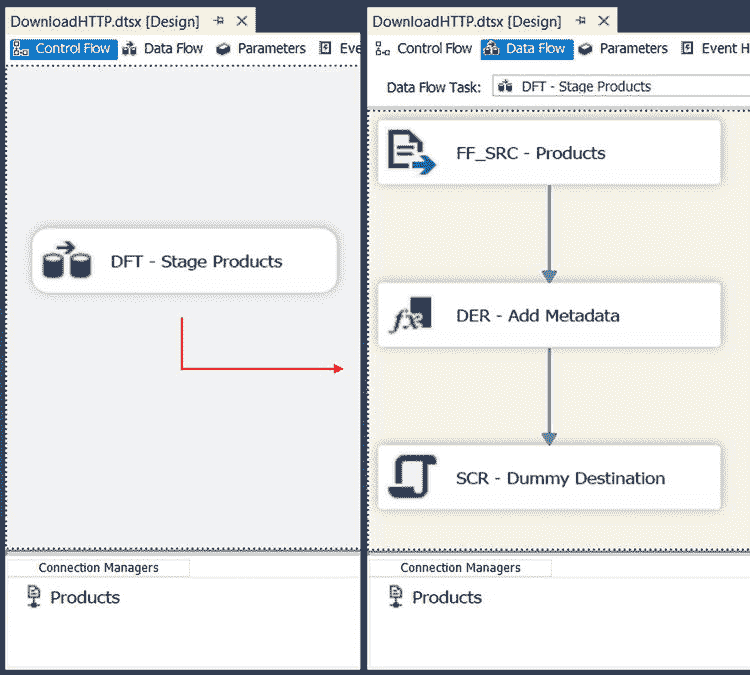

图 6-5. 带有平面文件源的简单数据流任务

### HTTP 连接管理器

要存储源文件的 URL，请使用 HTTP 连接管理器。在此示例中，只需填写要下载的文件的 URL；其他所有值均保留为默认值。示例如图 6-6 所示。

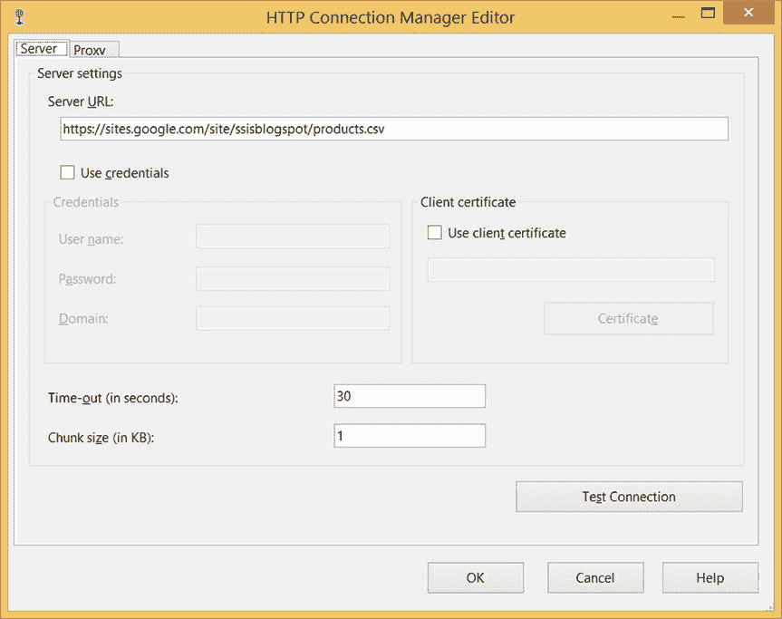

图 6-6. 包含下载 URL 的 HTTP 连接管理器

### 脚本任务

现在，在数据流任务上方添加一个脚本任务，并用优先约束将其连接起来。编辑该脚本任务。为其指定一个合适的名称，例如 `SCR – Download Products`，并选择你的脚本语言。之后，单击 `Edit Script...` 按钮打开 VSTA 环境。你应该会看到如图 6-7 所示的流程。

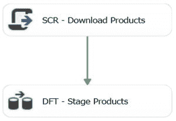

图 6-7. 添加脚本任务

### 代码

现在，转到 `Main` 方法并添加以下代码：

```vbnet
Public Sub Main()
    ' 将 SSIS 变量存储在 .Net 变量中。你可以跳过此步骤，
    ' 并在实际的邮件代码中直接调用 SSIS 变量以减少代码行数，
    ' 但这样做会让代码看起来更有条理。
    Dim SendMailFrom As String = Dts.Variables("EmailFrom").Value.ToString()
    Dim SendMailTo As String = Dts.Variables("EmailTo").Value.ToString()
    Dim SendMailSubject As String = Dts.Variables("EmailSubject").Value _
        .ToString()
    Dim SendMailBody As String = Dts.Variables("EmailBody").Value.ToString()
    
    ' 获取 SMTP 连接管理器并读取其属性
    Dim mySmtpConn As ConnectionManager = Dts.Connections("SMTP Mail Server")
    Dim SmtpServer As String = mySmtpConn.Properties("SmtpServer") _
        .GetValue(mySmtpConn).ToString()
    Dim Timeout As Integer = Convert.ToInt32(mySmtpConn.Properties("Timeout") _
        .GetValue(mySmtpConn))
    Dim EnableSsl As Boolean = Convert.ToBoolean(mySmtpConn _
        .Properties("EnableSsl") _
        .GetValue(mySmtpConn))
    Dim UseWinAut As Boolean = Convert.ToBoolean(mySmtpConn _
        .Properties("UseWindowsAuthentication") _
        .GetValue(mySmtpConn))
    
    ' 创建一封电子邮件并将格式更改为 HTML
    Dim myHtmlFormattedMail As New MailMessage(SendMailFrom _
        , SendMailTo _
        , SendMailSubject _
        , SendMailBody)
    myHtmlFormattedMail.IsBodyHtml = True
    
    ' 创建一个 SMTP 客户端来发送电子邮件
    Dim mySmtpClient As New SmtpClient(SmtpServer)
    mySmtpClient.EnableSsl = EnableSsl
    mySmtpClient.UseDefaultCredentials = UseWinAut
    
    ' 检查其他属性，例如端口号
    ' mySmtpClient.Port = 587; // 从变量获取值
    ' 或使用用户名/电子邮件和密码的凭据
    ' mySmtpClient.Credentials = New NetworkCredential("username", "password")
    
    ' 尝试发送电子邮件
    Try
        ' 发送电子邮件
        mySmtpClient.Send(myHtmlFormattedMail)
        ' 成功关闭脚本任务
        Dts.TaskResult = ScriptResults.Success
    Catch ex As Exception
        ' 为日志记录触发错误
        Dim ErrorStr As String = "Error: " + ex.Message & " "
        ErrorStr = ErrorStr + ex.InnerException.Message.Replace(vbNullString, "")
        Dts.Events.FireError(0, "Send Mail Task", ErrorStr, String.Empty, 0)
        ' 失败关闭脚本任务
        Dts.TaskResult = ScriptResults.Failure
    End Try
End Sub
```

#### 结果

现在关闭脚本任务并执行它来查看结果。你应该会看到一张图片和一条消息，如图 6-4 所示。

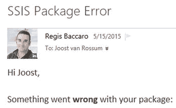

图 6-4. 来自 Régis 的电子邮件
```

```
public void Main()
{
  // 获取你新添加的 HTTP 连接管理器
  Object HTTPConnectionManager =
              Dts.Connections["WebProducts"].AcquireConnection(null);
  // 创建一个新连接
  HttpClientConnection WebProductConnection =
                            new HttpClientConnection(HTTPConnectionManager);
  // 从平面文件连接管理器中获取位置
  string DownloadLocation = Dts.Connections["Products"].
                            AcquireConnection(Dts.Transaction).ToString();
  try
  {
    // 记录下载开始（可选）
    bool fireAgain = true;
    Dts.Events.FireInformation(0, "Download", "Downloading " +
          WebProductConnection.ServerURL, string.Empty, 0, ref fireAgain);
    // 下载文件并替换当前的 CSV 文件
    WebProductConnection.DownloadFile(DownloadLocation, true);
    // 记录下载结束（可选）
    Dts.Events.FireInformation(0, "Download", "Saved " + DownloadLocation,
                               string.Empty, 0, ref fireAgain);
    // 成功退出脚本任务
    Dts.TaskResult = (int)ScriptResults.Success;
  }
  catch (Exception ex)
  {
    // 记录下载失败原因
    Dts.Events.FireError(0, "Download", "Failed: " + ex.Message, string.Empty, 0);
    // 非成功退出脚本任务
    Dts.TaskResult = (int)ScriptResults.Failure;
  }
}
```

以下是 VB.Net 代码：

```
Public Sub Main()
  ' 获取你新添加的 HTTP 连接管理器
  Dim HTTPConnectionManager As [Object] = _
          Dts.Connections("WebProducts").AcquireConnection(Nothing)
  ' 创建一个新连接
  Dim WebProductConnection As New HttpClientConnection(HTTPConnectionManager)
  ' 从平面文件连接管理器中获取位置
  Dim DownloadLocation As String = _
          Dts.Connections("Products"). _
          AcquireConnection(Dts.Transaction).ToString()
  Try
    ' 记录下载开始（可选）
    Dim fireAgain As Boolean = True
    Dts.Events.FireInformation(0, "Download", "Downloading " + _
            WebProductConnection.ServerURL, String.Empty, 0, fireAgain)
    ' 下载文件并替换当前的 CSV 文件
    WebProductConnection.DownloadFile(DownloadLocation, True)
    ' 记录下载结束（可选）
    Dts.Events.FireInformation(0, "Download", "Saved " & DownloadLocation, _
            String.Empty, 0, fireAgain)
    ' 成功退出脚本任务
    Dts.TaskResult = ScriptResults.Success
  Catch ex As Exception
    ' 记录下载失败原因
    Dts.Events.FireError(0, "Download", "Failed: " + ex.Message, _
          String.Empty, 0)
    ' 非成功退出脚本任务
    Dts.TaskResult = ScriptResults.Failure
  End Try
End Sub
```

现在，关闭脚本任务并执行它以查看结果。

## 从 FTP 服务器下载最新文件

FTP 任务是一个常用的任务，用于从 FTP 服务器下载特定文件。但如果你想从 FTP 文件夹下载最新文件，而又不知道确切文件名，该怎么办？开箱即用的 FTP 任务无法实现这一点。在此示例中，你使用通配符过滤器来选择所有合适的文件，然后遍历这些文件以确定最新文件。此示例适用于基于 Windows 的 FTP 服务器。如果有多个文件具有相同的最大文件日期，你只会得到一个。

### 变量

在大多数情况下，最好使用连接管理器将登录信息传递给脚本，但在本例中，你需要密码，而由于密码是敏感属性，无法从 FTP 连接管理器对象中提取。在这种情况下，你将使用变量（或参数）来存储连接数据。准备就绪后，请务必从密码变量中移除该值。用配置替换其值，否则密码将在你的包中可见。

首先，创建五个 SSIS 字符串变量，并用你自有 FTP 服务器中的正确连接数据填充它们。名称和示例值如图 6-8 所示。

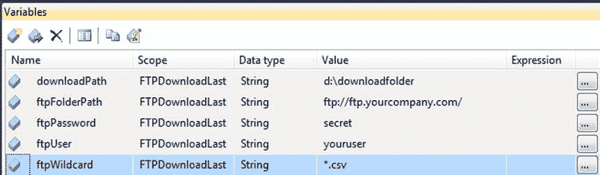

图 6-8. SSIS 字符串变量

### 脚本任务

向控制流添加一个脚本任务，用于下载最新文件。为其指定一个合适的名称，例如 `SCR – Get Latest FTP File`。接下来，编辑它并将这五个 SSIS 字符串变量添加为 `ReadOnlyVariables`。参见图 6-9。

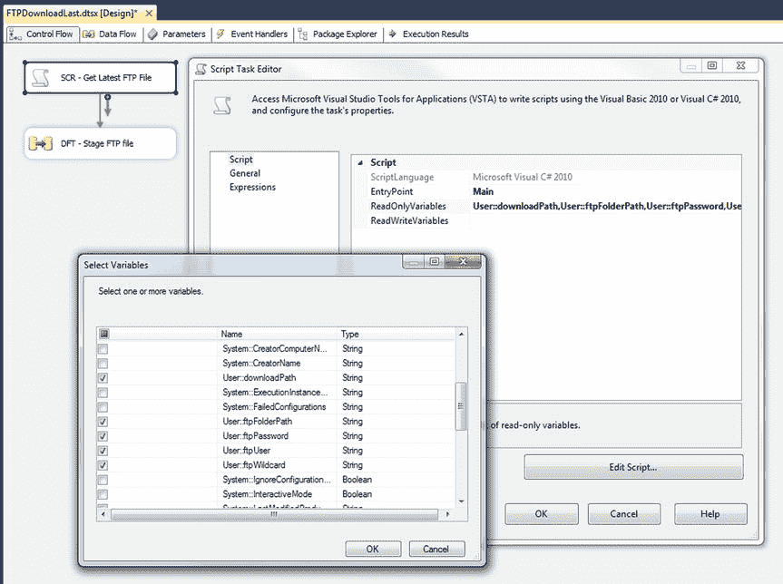

图 6-9. 脚本任务及其只读变量

### 脚本部分

现在点击**编辑脚本...**按钮打开 VSTA 环境。首先，添加额外的命名空间来精简代码。

```
#region customNamespaces
using System.Globalization;
using System.IO;
using System.Text.RegularExpressions;
#endregion
```

以下是 VB.NET 代码：

```
#Region "customNamespaces"
Imports System.Globalization
Imports System.IO
Imports System.Text.RegularExpressions
#End Region
```

现在，将以下代码添加到 `Main` 方法中；同时将两个额外的方法添加到类中。第一个自定义方法用于确定 FTP 服务器上的最新文件。请确保该方法中的 `ListDirectoryDetails` 输出格式与你的服务器一致；否则，你需要更改日期时间格式。第二个自定义方法用于从 FTP 服务器下载文件。
```

# 获取FTP最新文件并下载

```csharp
public void Main()
{
    // 用于存储 FTP 连接数据的字符串变量
    string ftpFolderPath = Dts.Variables["User::ftpFolderPath"].Value.ToString();
    string ftpUser = Dts.Variables["User::ftpUser"].Value.ToString();
    string ftpPassword = Dts.Variables["User::ftpPassword"].Value.ToString();
    string ftpWildcard = Dts.Variables["User::ftpWildcard"].Value.ToString();
    string downloadFolder = Dts.Variables["User::downloadPath"].Value.ToString();

    try
    {
        // 确定最新文件
        string latestFile = GetLatestFile(ftpFolderPath, ftpUser, ftpPassword, ftpWildcard);

        // 现在，你可以填充一个 SSIS 字符串变量（参见第 4 章）并使用
        // FTP 任务来下载文件，或者使用一段代码来
        // 下载它。
        DownloadFile(latestFile, ftpUser, ftpPassword, downloadFolder);

        // 脚本任务成功
        Dts.TaskResult = (int)ScriptResults.Success;
    }
    catch (Exception ex)
    {
        // 未找到文件
        Dts.Events.FireError(0, "最新文件", ex.Message + Environment.NewLine + ex.InnerException.Message, string.Empty, 0);

        // 脚本任务失败
        Dts.TaskResult = (int)ScriptResults.Failure;
    }
}
```

## 确定最新文件的方法

```csharp
private string GetLatestFile(string ftpFolderPath,
                             string ftpUser,
                             string ftpPassword,
                             string ftpWildcard)
{
    // 用于检查最大日期的 DateTime 变量
    DateTime highestDateTime = Convert.ToDateTime("1-1-1900");

    // 用于存储最新文件的字符串变量
    string fileWithHighestDate = "";

    // 创建一个 FTP Web 请求
    FtpWebRequest ftpRequest;
    ftpRequest = (FtpWebRequest)FtpWebRequest.Create(ftpFolderPath);

    // 提供凭据并设置属性
    ftpRequest.Credentials = new NetworkCredential(ftpUser, ftpPassword);
    ftpRequest.UseBinary = true;
    ftpRequest.UsePassive = true;
    ftpRequest.KeepAlive = true;

    // 指定 FTP 请求的类型。该类型
    // 返回包含文件详细信息的字符串。
    // 对于基于 Windows 的 FTP 站点，格式如下：
    // 08-09-14  07:35PM               435279 fileA.csv
    // 08-10-15  07:34PM               443808 fileB.csv
    // 08-11-16  07:33PM               424118 fileC.csv
    // 07-06-13  03:53PM       <DIR>          foldername
    ftpRequest.Method = WebRequestMethods.Ftp.ListDirectoryDetails;

    // 尝试连接服务器
    try
    {
        // 建立连接并返回通信
        FtpWebResponse ftpResponse;
        ftpResponse = (FtpWebResponse)ftpRequest.GetResponse();

        // 创建流并获取 FTP 服务器的响应流
        Stream ftpStream;
        ftpStream = ftpResponse.GetResponseStream();

        // 将流放入流读取器
        StreamReader ftpReader = new StreamReader(ftpStream);

        // 设置日期时间格式：08-09-14 07:35PM
        // 确保你的 FTP 服务器使用相同的格式
        string dtFormat = "MM-dd-yy hh:mmtt";
        CultureInfo ci = CultureInfo.InvariantCulture;

        // 读取响应的每一行，并检查
        // 哪个文件是最新的
        while (ftpReader.Peek() != -1)
        {
            // 将一行响应内容存入变量
            string textLine = ftpReader.ReadLine();

            // 如果你想要检查行布局，可以
            // 添加类似下面的代码，并注释掉
            // while 循环及其之后代码的其余部分：
            // MessageBox.Show(textLine);

            // 删除所有重复的空格
            textLine = Regex.Replace(textLine, @"\s+", " ");

            // 以空格分隔 textLine 并填充数组
            string[] fileDetails = textLine.Split(" ".ToCharArray());

            // 将通配符转换为正则表达式模式
            string wildcardPattern = "^" + Regex.Escape(ftpWildcard).Replace("\\*", ".*").Replace("\\?", ".") + "$";

            // 创建通配符正则表达式
            Regex wildcardRegex = new Regex(wildcardPattern, RegexOptions.IgnoreCase);

            // 检查文件是否匹配通配符，并跳过子文件夹
            if (wildcardRegex.IsMatch(fileDetails[3]) && !fileDetails[2].Trim().ToLower().Equals("<dir>"))
            {
                // 将日期和时间列组合成文件日期时间字符串
                string fileDateTxt = fileDetails[0] + " " + fileDetails[1];
                DateTime fileDate = DateTime.ParseExact(fileDateTxt, dtFormat, ci);

                // 检查当前文件是否为最新文件
                if (fileDate > highestDateTime)
                {
                    // 如果是，则替换最新文件的变量
                    highestDateTime = date;
                    fileWithHighestDate = fileDetails[3];
                }
            }
        }

        // 资源清理
        ftpReader.Close();
        ftpStream.Close();
        ftpResponse.Close();
        ftpRequest = null;
    }
    catch (Exception ex)
    {
        // 处理异常，例如记录日志或抛出异常
        throw new Exception("获取最新文件失败", ex);
    }

    return fileWithHighestDate;
}
```

```csharp
catch (Exception ex)
{
    // FTP 响应或峰值错误
    throw new Exception("FTP 响应或峰值时出错", ex);
}
```

```csharp
if (fileWithHighestDate.Equals(""))
{
    // 未找到文件
    throw new Exception("未找到匹配通配符的文件");
}

return ftpFolderPath + fileWithHighestDate;
```

```csharp
// 下载文件的方法
private void DownloadFile(string ftpFilePath, string ftpUser, string ftpPassword, string downloadFolder)
{
    // 创建一个 FTP Web 请求
    FtpWebRequest ftpRequest;
    ftpRequest = (FtpWebRequest)FtpWebRequest.Create(ftpFilePath);

    // 提供凭据并设置参数
    ftpRequest.Credentials = new NetworkCredential(ftpUser, ftpPassword);
    ftpRequest.UseBinary = true;
    ftpRequest.UsePassive = true;
    ftpRequest.KeepAlive = true;

    // 指定 FTP 请求的类型
    ftpRequest.Method = WebRequestMethods.Ftp.DownloadFile;

    // 尝试连接到服务器
    try
    {
        // 建立连接并返回通信
        FtpWebResponse ftpResponse;
        ftpResponse = (FtpWebResponse)ftpRequest.GetResponse();

        // 创建流并获取 FTP 服务器的响应流
        Stream ftpStream;
        ftpStream = ftpResponse.GetResponseStream();

        // 确定 FTP 路径中的文件名
        string downloadFile = Path.Combine(downloadFolder, Path.GetFileName(ftpFilePath));

        // 指定缓冲区大小
        int bufferSize = 2048;

        // 创建文件流以保存 FTP 文件
        FileStream localFileStream = new FileStream(downloadFile, FileMode.Create);

        // 创建缓冲区用于下载数据
        byte[] byteBuffer = new byte[bufferSize];

        // 整数变量，用于存储读取的字节数
        int bytesRead = ftpStream.Read(byteBuffer, 0, bufferSize);

        // 开始下载，直到所有字节下载完毕
        while (bytesRead > 0)
        {
            // 将当前缓冲区写入本地文件
            localFileStream.Write(byteBuffer, 0, bytesRead);
            // 下载下一个缓冲区
            bytesRead = ftpStream.Read(byteBuffer, 0, bufferSize);
        }

        // 资源清理
        localFileStream.Close();
        ftpStream.Close();
        ftpResponse.Close();
        ftpRequest = null;
    }
    catch (Exception ex)
    {
        // FTP 响应或峰值错误
        throw new Exception("FTP 响应或峰值时出错", ex);
    }
}
```

以下是 VB.NET 代码：

```vbnet
Public Sub Main()
    ' 用于存储 FTP 连接数据的字符串变量
    Dim ftpFolderPath As String = _
        Dts.Variables("User::ftpFolderPath").Value.ToString()
    Dim ftpUser As String = Dts.Variables("User::ftpUser").Value.ToString()
    Dim ftpPassword As String = _
        Dts.Variables("User::ftpPassword").Value.ToString()
    Dim ftpWildcard As String = _
        Dts.Variables("User::ftpWildcard").Value.ToString()
    Dim downloadFolder As String = _
        Dts.Variables("User::downloadPath").Value.ToString()

    Try
        ' 确定最新文件
        Dim latestFile As String = `GetLatestFile`(ftpFolderPath, _
                                                  ftpUser, _
                                                  ftpPassword, _
                                                  ftpWildcard)

        ' 现在您可以填充 SSIS 字符串变量（参见第 4 章）并使用
        ' FTP 任务下载文件，或者您可以使用一段代码来
```

```vbnet
' 下载文件。
DownloadFile(latestFile, ftpUser, ftpPassword, downloadFolder)

' 脚本任务成功
Dts.TaskResult = ScriptResults.Success

Catch ex As Exception
    ' 未找到文件
    Dts.Events.FireError(0, "最近的文件", ex.Message & _
                         Environment.NewLine & ex.InnerException.Message, _
                         String.Empty, 0)
    ' 脚本任务失败
    Dts.TaskResult = ScriptResults.Failure
End Try

End Sub

' 确定最新文件的方法
Private Function GetLatestFile(ftpFolderPath As String, ftpUser As String, ftpPassword As String, ftpWildcard As String) As String
    ' 用于检查最新日期的 DateTime 变量
    Dim highestDateTime As DateTime = Convert.ToDateTime("1-1-1900")
    ' 用于存储最新文件的字符串变量
    Dim fileWithHighestDate As String = ""

    ' 创建 FTP Web 请求
    Dim ftpRequest As FtpWebRequest
    ftpRequest = DirectCast(FtpWebRequest.Create(ftpFolderPath), FtpWebRequest)
    ' 提供凭据并设置相关选项
    ftpRequest.Credentials = New NetworkCredential(ftpUser, ftpPassword)
    ftpRequest.UseBinary = True
    ftpRequest.UsePassive = True
    ftpRequest.KeepAlive = True

    ' 指定 FTP 请求的类型。此类型
    ' 会返回包含文件详细信息的字符串。
    ' 对于基于 Windows 的 FTP 站点，格式通常如下：
    ' 08-09-14  07:35PM               435279 fileA.csv
    ' 08-10-15  07:34PM               443808 fileB.csv
    ' 08-11-16  07:33PM               424118 fileC.csv
    ' 07-06-13  03:53PM       <DIR>          foldername
    ftpRequest.Method = WebRequestMethods.Ftp.ListDirectoryDetails

    ' 尝试连接到服务器
    Try
        ' 建立连接并返回通信对象
        Dim ftpResponse As FtpWebResponse
        ftpResponse = DirectCast(ftpRequest.GetResponse(), FtpWebResponse)
        ' 创建流并获取 FTP 服务器的响应流
        Dim ftpStream As Stream
        ftpStream = ftpResponse.GetResponseStream()
        ' 将流放入 StreamReader 中
        Dim ftpReader As New StreamReader(ftpStream)

        ' 设置日期时间格式：08-09-14 07:35PM
        Dim dtFormat As String = "MM-dd-yy hh:mmtt"
        Dim ci As CultureInfo = CultureInfo.InvariantCulture

        ' 读取响应的每一行，并检查
        ' 哪个文件是最新的
        While ftpReader.Peek() <> -1
            ' 将一行的响应内容存入变量
            Dim textLine As String = ftpReader.ReadLine()

            ' 如果你想检查行的布局，可以
            ' 添加类似下面的代码，并将 While 循环内
            ' 及其后的其余代码注释掉：
            ' MessageBox.Show(textLine);

            ' 移除所有重复的空格
            textLine = Regex.Replace(textLine, "\s+", " ")

            ' 按空格分割 textLine 并填充数组
            Dim fileDetails As String() = textLine.Split(" ".ToCharArray())

            ' 将通配符转换为正则表达式模式
            Dim wildcardPattern As String = "^" & _
                Regex.Escape(ftpWildcard).Replace("\*", ".*") _
                .Replace("\?", ".") & "$"
            ' 创建通配符正则表达式
            Dim wildcardRegex As New Regex(wildcardPattern, RegexOptions.IgnoreCase)

            ' 检查文件是否匹配通配符，并跳过子文件夹
            If wildcardRegex.IsMatch(fileDetails(3)) AndAlso _
               Not fileDetails(2).Trim().ToLower().Equals("<dir>") Then
                ' 使用日期和时间列组合成文件日期时间
                Dim fileDateTxt As String = fileDetails(0) & " " & fileDetails(1)
                Dim fileDate As DateTime = DateTime.ParseExact(fileDateTxt, _
                                                               dtFormat, ci)

                ' 检查当前文件是否是最新的
                If fileDate > highestDateTime Then
                    ' 如果是，则替换最新文件的变量
                    highestDateTime = fileDate
                    fileWithHighestDate = fileDetails(3)
                End If
            End If
        End While

        ' 资源清理
        ftpReader.Close()
        ftpStream.Close()
        ftpResponse.Close()
        ftpRequest = Nothing

    Catch ex As Exception
        ' FTP 响应或 Peek 出错
        Throw New Exception("FTP 响应或 Peek 出错", ex)
    End Try

    If fileWithHighestDate.Equals("") Then
        ' 未找到文件
        Throw New Exception("未找到匹配通配符的文件")
    End If

    Return ftpFolderPath & fileWithHighestDate
End Function

' 下载文件的方法
Private Sub DownloadFile(ftpFilePath As String, ftpUser As String, ftpPassword As String, downloadFolder As String)
    ' 创建 FTP Web 请求
    Dim ftpRequest As FtpWebRequest
    ftpRequest = DirectCast(FtpWebRequest.Create(ftpFilePath), FtpWebRequest)
    ' 提供凭据并设置相关选项
    ftpRequest.Credentials = New NetworkCredential(ftpUser, ftpPassword)
    ftpRequest.UseBinary = True
    ftpRequest.UsePassive = True
    ftpRequest.KeepAlive = True

    ' 指定 FTP 请求的类型
    ftpRequest.Method = WebRequestMethods.Ftp.DownloadFile

    ' 尝试连接到服务器
    Try
        ' 建立连接并返回通信对象
        Dim ftpResponse As FtpWebResponse
        ftpResponse = DirectCast(ftpRequest.GetResponse(), FtpWebResponse)
        ' 创建流并获取 FTP 服务器的响应流
        Dim ftpStream As Stream
        ftpStream = ftpResponse.GetResponseStream()

        ' 确定 FTP 路径中的文件名
        Dim downloadFilePath As String = Path.Combine(downloadFolder, _
                                                      Path.GetFileName(ftpFilePath))

        ' 指定缓冲区大小
        Dim bufferSize As Integer = 2048
        ' 创建文件流以保存下载的 FTP 文件
        Dim localFileStream As New FileStream(downloadFilePath, FileMode.Create)
        ' 创建缓冲区用于下载数据
        Dim byteBuffer As Byte() = New Byte(bufferSize - 1) {}
        ' 用于存储已读取字节数的整数变量
        Dim bytesRead As Integer = ftpStream.Read(byteBuffer, 0, bufferSize)

        ' 开始下载，直到所有字节下载完成
        While bytesRead > 0
            ' 将当前缓冲区写入本地文件
            localFileStream.Write(byteBuffer, 0, bytesRead)
            ' 下载下一个缓冲区
            bytesRead = ftpStream.Read(byteBuffer, 0, bufferSize)
        End While

        ' 资源清理
        localFileStream.Close()
        ftpStream.Close()
        ftpResponse.Close()
        ftpRequest = Nothing

    Catch ex As Exception
        ' FTP 响应或 Peek 出错
        Throw New Exception("FTP 响应或 Peek 出错", ex)
    End Try
End Sub
```

### 结果

现在关闭脚本任务并执行它，即可查看结果。符合条件的`最新`文件将被下载。如果你想在其后添加一个数据流任务来处理该最新文件，则需要在连接管理器中知道文件名和路径。最简单的方法是在`Main`方法中将该路径写入 SSIS 字符串变量，示例如下：

```
Dts.Variables["NewestFile"].Value = Path.Combine(downloadFolder, latestFile);
```

以下是 VB.NET 代码：

```
Dts.Variables("NewestFile").Value = Path.Combine(downloadFolder, latestFile)
```

### 从 SFTP 服务器下载文件

SSIS FTP 任务不支持安全 FTP，.NET Framework 本身也不支持。因此，本示例需要在脚本任务中使用第三方 SFTP 库。市面上有很多商业库可供选择，但本示例将使用 CodePlex 上的 SSH.NET 库（`http://sshnet.codeplex.com`）。

CodePlex 是微软的开源项目托管站点。虽然所有项目都是开源项目，但在使用某个程序集或代码片段之前，请检查项目许可证。某些项目对商业使用有限制。

#### 下载与安装

访问 `http://sshnet.codeplex.com`，下载合适的 SSHNet 二进制文件（SSIS 2008 使用 SSHNet .NET 3.5 二进制文件，SSIS 2012 及更高版本使用 SSHNet .NET 4.0 二进制文件）。通过 Visual Studio 命令提示符，可以使用 `gacutil` 将该库添加到全局程序集缓存：`gacutil -i Renci.SshNet.dll`（请参阅第 4 章）。之后，即可在脚本任务中使用该库。

#### 变量

大多数情况下，使用连接管理器是更优的选择，但由于没有可用的 SFTP 连接管理器，你需要使用变量（或参数）。在本示例中，你将使用变量来存储连接数据。准备好后，请务必从变量值中移除敏感数据，例如密码和密钥。将这些值替换为配置项；否则，它们将在你的包中可见。

首先，创建五个 SSIS 字符串变量，并用正确的连接数据填充它们。表 6-1 描述了这些变量及其用途。图 6-10 显示了已填充数据的变量。

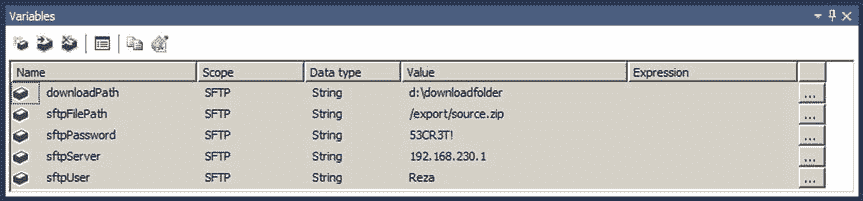

图 6-10. SFTP 连接变量：下载

表 6-1. 用于存储连接数据的变量

| 名称 | 数据类型 | 描述 |
| --- | --- | --- |
| `sftpServer` | String | 包含 SFTP 服务器的名称或 IP 地址 |
| `sftpUser` | String | 包含有权访问 SFTP 服务器的用户名 |
| `sftpPassword` | String | 对应的密码 |
| `sftpFilePath` | String | 你需要下载的文件路径：`/export/source.zip` |
| `downloadPath` | String | 本地下载文件夹的路径：`d:\downloadfolder` |

#### 脚本任务

在控制流中添加一个脚本任务，用于从 SFTP 服务器下载文件。为其指定一个合适的名称，例如 `SCR – Download SFTP File`。然后，编辑该脚本任务，并将五个 SSIS 字符串变量添加为 `ReadOnlyVariables`。图 6-11 显示了添加变量的对话框。

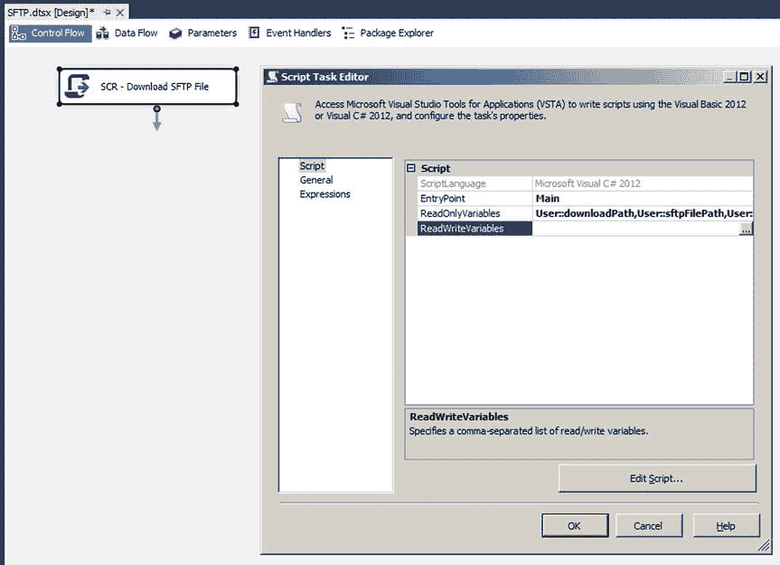

图 6-11. 添加只读锁定变量

#### 添加引用

编辑脚本任务，并添加对位于全局程序集缓存 (GAC) 中的 `Renci.SshNet.dll` 程序集的新引用（更多信息请参见第 4 章）。该位置可能因程序集版本而异，但看起来应该类似这样：

```
C:\Windows\Microsoft.NET\assembly\GAC_MSIL\Renci.SshNet\v4.0_2014.4.6.0__1cee9f8bde3db106\
```

图 6-12 显示了在引用管理器对话框中已添加的引用。

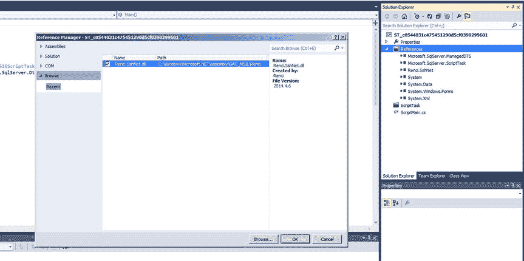

图 6-12. 添加对 SFTP 程序集 (C#) 的引用提示

你使用的是 Visual Studio 2010 或更早版本吗？添加引用后，别忘了按下“全部保存”按钮；否则，下次打开脚本任务时，该引用将消失。

#### 代码

现在点击“编辑脚本...”按钮以打开 VSTA 环境。首先，添加额外的命名空间以简化代码。

```csharp
#region customNamespaces

using System.IO;
using Renci.SshNet;

#endregion
```

以下是 VB.NET 代码：

```vb
#Region "customNamespaces"

Imports System.IO
Imports Renci.SshNet

#End Region
```

然后将以下代码添加到你的 `Main` 方法中：

```csharp
public void Main()
{
  // 将 SSIS 变量的值存储到局部变量中
  string sftpServer = Dts.Variables["User::sftpServer"].Value.ToString();
  string sftpUser = Dts.Variables["User::sftpUser"].Value.ToString();
  string sftpPassword = Dts.Variables["User::sftpPassword"].Value.ToString();
  string sftpFilePath = Dts.Variables["User::sftpFilePath"].Value.ToString();
  string downloadPath = Dts.Variables["User::downloadPath"].Value.ToString();

  try
  {
    // 指定 SFTP 连接
    using (SftpClient mySftpClient = new SftpClient(sftpServer,
                                                    sftpUser,
                                                    sftpPassword))
    {
      // 连接到服务器
      mySftpClient.Connect();

      // 组合远程文件名和下载路径
      string localFilePath = Path.GetFileName(sftpFilePath);
      localFilePath = Path.Combine(downloadPath, localFilePath);

      // 为本地文件创建文件流
      using (Stream localFile = File.OpenWrite(localFilePath))
      {
        // 下载远程文件并存储到文件流中
        mySftpClient.DownloadFile(sftpFilePath, localFile);

        // 清理
        localFile.Dispose();
      }

      // 断开连接并清理
      mySftpClient.Disconnect();
      mySftpClient.Dispose();
    }

    // 脚本任务成功
    Dts.TaskResult = (int)ScriptResults.Success;
  }
  catch (Exception ex)
  {
    // 触发错误消息
    Dts.Events.FireError(-1, "SFTP Download", ex.Message, string.Empty, 0);

    // 脚本任务失败
    Dts.TaskResult = (int)ScriptResults.Failure;
  }
}
```

以下是 VB.NET 代码：

```vb
Public Sub Main()
    ' 将 SSIS 变量的值存储到局部变量中
    Dim sftpServer As String = Dts.Variables("User::sftpServer").Value.ToString()
    Dim sftpUser As String = Dts.Variables("User::sftpUser").Value.ToString()
    Dim sftpPassword As String = Dts.Variables("User::sftpPassword").Value.ToString()
    Dim sftpFilePath As String = Dts.Variables("User::sftpFilePath").Value.ToString()
    Dim downloadPath As String = Dts.Variables("User::downloadPath").Value.ToString()

    Try
        ' 指定 SFTP 连接
        Using mySftpClient As New SftpClient(sftpServer, sftpUser, sftpPassword)
            ' 连接到服务器
            mySftpClient.Connect()

            ' 组合远程文件名和下载路径
            Dim localFilePath As String = Path.GetFileName(sftpFilePath)
            localFilePath = Path.Combine(downloadPath, localFilePath)

            ' 为本地文件创建文件流
            Using localFile As Stream = File.OpenWrite(localFilePath)
                ' 下载远程文件并存储到文件流中
                mySftpClient.DownloadFile(sftpFilePath, localFile)

                ' 清理
                localFile.Dispose()
            End Using

            ' 断开连接并清理
            mySftpClient.Disconnect()
            mySftpClient.Dispose()
        End Using

        ' 脚本任务成功
        Dts.TaskResult = CInt(ScriptResults.Success)
    Catch ex As Exception
        ' 触发错误消息
        Dts.Events.FireError(-1, "SFTP Download", ex.Message, String.Empty, 0)

        ' 脚本任务失败
        Dts.TaskResult = CInt(ScriptResults.Failure)
    End Try
End Sub
```

## 下载（VB.NET 示例）

以下是VB.NET代码示例，用于通过SFTP下载文件：

```vb
Public Sub Main()
  ' 将 SSIS 变量的值存储到局部变量中
  Dim sftpServer As String = Dts.Variables("User::sftpServer").Value.ToString()
  Dim sftpUser As String = Dts.Variables("User::sftpUser").Value.ToString()
  Dim sftpPassword As String = _
                      Dts.Variables("User::sftpPassword").Value.ToString()
  Dim sftpFilePath As String = _
                      Dts.Variables("User::sftpFilePath").Value.ToString()
  Dim downloadPath As String = _
                      Dts.Variables("User::downloadPath").Value.ToString()

  Try
    ' 指定 SFTP 连接并连接到服务器
    Using mySftpClient As New SftpClient(sftpServer, sftpUser, sftpPassword)
      mySftpClient.Connect()

      ' 组合远程文件名和下载路径
      Dim localFilePath As String = Path.GetFileName(sftpFilePath)
      localFilePath = Path.Combine(downloadPath, localFilePath)

      ' 为本地文件创建文件流
      Using localFile As Stream = File.OpenWrite(localFilePath)
        ' 下载远程文件并存储到文件流中
        mySftpClient.DownloadFile(sftpFilePath, localFile)

        ' 清理
        localFile.Dispose()
      End Using

      ' 断开连接并清理
      mySftpClient.Disconnect()
      mySftpClient.Dispose()
    End Using

    ' 脚本任务成功
    Dts.TaskResult = ScriptResults.Success
  Catch ex As Exception
    ' 触发错误消息
    Dts.Events.FireError(-1, "SFTP Download", ex.Message, String.Empty, 0)

    ' 脚本任务失败
    Dts.TaskResult = ScriptResults.Failure
  End Try
End Sub
```

## 上传

如果你想通过 SFTP 上传文件（而非下载），那么你需要更改几个变量，当然，代码也需要更改。其余步骤类似。表 6-2 描述了所需的变量，图 6-13 显示了已填充数据的变量。

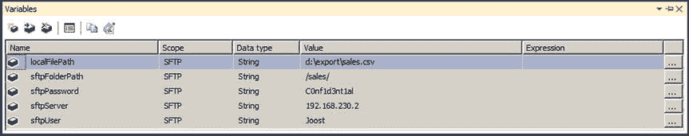

图 6-13. SFTP 连接变量：上传

表 6-2. SFTP 连接变量的描述

| 名称 | 数据类型 | 描述 |
| --- | --- | --- |
| `sftpServer` | String | 包含 SFTP 服务器的名称或 IP 地址 |
| `sftpUser` | String | 包含有权访问 SFTP 服务器的用户名 |
| `sftpPassword` | String | 对应的密码 |
| `sftpFolderPath` | String | SFTP 服务器上用于存储文件的文件夹路径：`/export/` |
| `localFilePath` | String | 你要上传的本地文件路径：`d:\somefile.txt` |

### 代码：上传

首先，添加额外的命名空间以缩短代码长度。

```
#region customNamespaces
using System.IO;
using Renci.SshNet;
#endregion
```

以下是 VB.NET 代码：

```
#Region "customNamespaces"
Imports System.IO
Imports Renci.SshNet
#End Region
```

现在，你可以将以下代码添加到 `Main` 方法中：

```csharp
public void Main()
{
  // 将 SSIS 变量的值存储到本地变量中
  string sftpServer = Dts.Variables["User::sftpServer"].Value.ToString();
  string sftpUser = Dts.Variables["User::sftpUser"].Value.ToString();
  string sftpPassword = Dts.Variables["User::sftpPassword"].Value.ToString();
  string sftpFolderPath = Dts.Variables["User::sftpFolderPath"].Value.ToString();
  string localFilePath = Dts.Variables["User::localFilePath"].Value.ToString();

  try
  {
    // 指定 SFTP 连接
    using (SftpClient mySftpClient = new SftpClient(sftpServer, sftpUser, sftpPassword))
    {
      // 连接到服务器
      mySftpClient.Connect();

      // 以流方式处理本地文件
      using (Stream localFile = File.OpenRead(localFilePath))
      {
        // 组合本地文件名和 SFTP 文件夹路径
        string remoteFilePath = Path.GetFileName(localFilePath);
        remoteFilePath = Path.Combine(sftpFolderPath, remoteFilePath);

        // 将本地文件上传到 SFTP 服务器（并覆盖）
        mySftpClient.UploadFile(localFile, remoteFilePath, true);

        // 清理资源
        localFile.Dispose();
      }

      // 断开连接并清理资源
      mySftpClient.Disconnect();
      mySftpClient.Dispose();
    }

    // 脚本任务成功
    Dts.TaskResult = (int)ScriptResults.Success;
  }
  catch (Exception ex)
  {
    // 触发错误消息
    Dts.Events.FireError(-1, "SFTP Upload", ex.Message, string.Empty, 0);

    // 脚本任务失败
    Dts.TaskResult = (int)ScriptResults.Failure;
  }
}
```

以下是 VB.NET 代码：

```vb
Public Sub Main()
  ' 将 SSIS 变量的值存储到本地变量中
  Dim sftpServer As String = Dts.Variables("User::sftpServer").Value.ToString()
  Dim sftpUser As String = Dts.Variables("User::sftpUser").Value.ToString()
  Dim sftpPassword As String = Dts.Variables("User::sftpPassword").Value.ToString()
  Dim sftpFolderPath As String = Dts.Variables("User::sftpFolderPath").Value.ToString()
  Dim localFilePath As String = Dts.Variables("User::localFilePath").Value.ToString()

  Try
    ' 指定 SFTP 连接
    Using mySftpClient As New SftpClient(sftpServer, sftpUser, sftpPassword)
      ' 连接到服务器
      mySftpClient.Connect()

      ' 以流方式处理本地文件
      Using localFile As Stream = File.OpenRead(localFilePath)
        ' 组合本地文件名和 SFTP 文件夹路径
        Dim remoteFilePath As String = Path.GetFileName(localFilePath)
        remoteFilePath = Path.Combine(sftpFolderPath, remoteFilePath)

        ' 将本地文件上传到 SFTP 服务器（并覆盖）
        mySftpClient.UploadFile(localFile, remoteFilePath, True)

        ' 清理资源
        localFile.Dispose()
      End Using

      ' 断开连接并清理资源
      mySftpClient.Disconnect()
      mySftpClient.Dispose()
    End Using

    ' 脚本任务成功
    Dts.TaskResult = ScriptResults.Success
  Catch ex As Exception
    ' 触发错误消息
    Dts.Events.FireError(-1, "SFTP Upload", ex.Message, String.Empty, 0)

    ' 脚本任务失败
    Dts.TaskResult = ScriptResults.Failure
  End Try
End Sub
```

```
```
Public Sub Main()
  ' 将 SSIS 变量的值存储到本地变量中
  Dim sftpServer As String = Dts.Variables("User::sftpServer").Value.ToString()
  Dim sftpUser As String = Dts.Variables("User::sftpUser").Value.ToString()
  Dim sftpPassword As String = Dts.Variables("User::sftpPassword").Value.ToString()
  Dim sftpFolderPath As String = Dts.Variables("User::sftpFolderPath").Value.ToString()
  Dim localFilePath As String = Dts.Variables("User::localFilePath").Value.ToString()

  Try
    ' 指定 SFTP 连接
    Using mySftpClient As New SftpClient(sftpServer, sftpUser, sftpPassword)
      ' 连接到服务器
      mySftpClient.Connect()

      ' 以流方式处理本地文件
      Using localFile As Stream = File.OpenRead(localFilePath)
        ' 组合本地文件名和 SFTP 文件夹路径
        Dim remoteFilePath As String = Path.GetFileName(localFilePath)
        remoteFilePath = Path.Combine(sftpFolderPath, remoteFilePath)

        ' 将本地文件上传到 SFTP 服务器（并覆盖）
        mySftpClient.UploadFile(localFile, remoteFilePath, True)

        ' 清理资源
        localFile.Dispose()
      End Using

      ' 断开连接并清理资源
      mySftpClient.Disconnect()
      mySftpClient.Dispose()
    End Using

    ' 脚本任务成功
    Dts.TaskResult = ScriptResults.Success

  Catch ex As Exception
    ' 触发错误消息
    Dts.Events.FireError(-1, "SFTP Upload", ex.Message, String.Empty, 0)

    ' 脚本任务失败
    Dts.TaskResult = ScriptResults.Failure
  End Try
End Sub
```

### 结果

现在关闭脚本任务并执行它以查看结果。在上传示例中，如果你已经使用了连接管理器（例如数据流），也可以将 `localFilePath` 变量替换为连接管理器。有关连接管理器的代码示例，请参见第 4 章。


### 总结

在本章中，你学习了如何在基于 Web 的任务中使用脚本任务，而内置任务在这方面往往力不从心。你还首次体验了第三方程序集的使用。


