# 2. 脚本任务与脚本组件

电子补充材料：本章的在线版本 (doi:[10.​1007/​978-1-4842-0638-6_​2](http://dx.doi.org/10.1007/978-1-4842-0638-6_2)) 包含补充材料，仅供授权用户使用。

在 SSIS 中，.NET 脚本可以编写在脚本任务或脚本组件中。脚本任务和脚本组件的目的是，当现成的任务和组件无法满足你的需求时，通过你自己的自定义代码来扩展 SSIS 的功能。脚本任务和脚本组件之间还有更多相似之处。它们都有一个通用的编辑器，如图 2-1 所示，用于指定脚本语言和变量使用等属性。并且它们都有一个 VSTA 编辑器，用于编写 Visual C# 或 Visual Basic 代码。

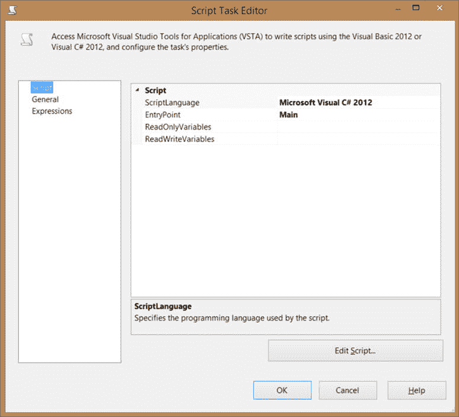

图 2-1. 通用脚本任务编辑器

**注意**：从 SSIS 2008 开始，脚本任务和脚本组件的代码都会被预编译为二进制代码并存储在包中，以允许更快的执行。

在互联网上的各种 SSIS 论坛中，脚本任务和脚本组件常常被混淆，因为它们外观相似并且共享所有这些特性，但实际上它们有着本质上的不同。脚本任务是 SSIS 控制流的一部分，用于执行特定任务，例如检查文件大小、解压缩源文件，或发送格式化的电子邮件通知分析师多维数据集已成功处理。脚本任务几乎可以执行任何操作，但不用于基于行的转换或操作。那是脚本组件的用途。图 2-2 展示了脚本组件编辑器。

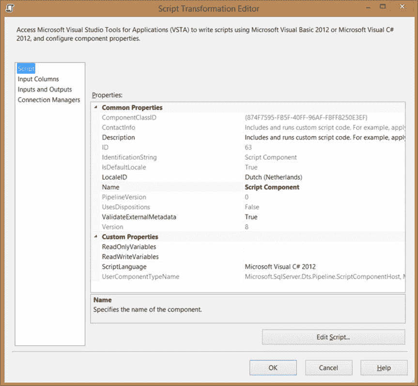

图 2-2. 通用脚本组件编辑器

脚本组件是 SSIS 数据流任务的一部分。它可以用作源、转换或目标。对于基于行的转换或操作（例如验证电子邮件地址或加密敏感列值），转换类型可能是最流行的类型。

## 脚本任务简介

为了展示`脚本任务`的可能性，我们先看一个非常简化的示例；但在读完本书后，你将能够创建出更复杂、更稳定的版本。在第一个案例中，我们将在`数据流任务`处理平面文件之前检查其文件大小。当文件大小为零字节时，我们向负责人发送一封电子邮件。

### 包设计

创建一个使用平面文件作为数据源的`数据流任务`。对于本例，数据流具体做什么并不重要，但请确保`平面文件连接管理器`的名称为`myFlatFile`。同时添加一个`发送邮件任务`用于发送错误邮件。然后添加`脚本任务`，并将其与`数据流任务`和`发送邮件任务`连接起来。将`发送邮件任务`的前置约束更改为`失败`。最终效果应类似图 2-3。你也可以使用解决方案文件夹中的脚本任务起始包。

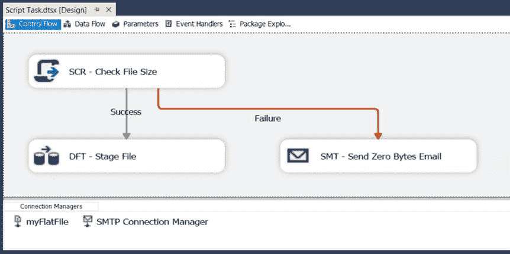

图 2-3. 用于检查文件大小的脚本任务

### 编辑脚本任务

现在编辑`脚本任务`：双击或右键单击它，然后选择“编辑”。在第一个名为“脚本”的选项卡中，选择你的脚本语言（`C#`或`VB.NET`），如图 2-4 所示。你无需更改`脚本任务`的任何其他选项。在同一选项卡中，找到右下角的`编辑脚本...`按钮并单击，打开 VSTA 环境，在其中添加你的`.NET`代码。此时将打开一个新的 Visual Studio 窗口。

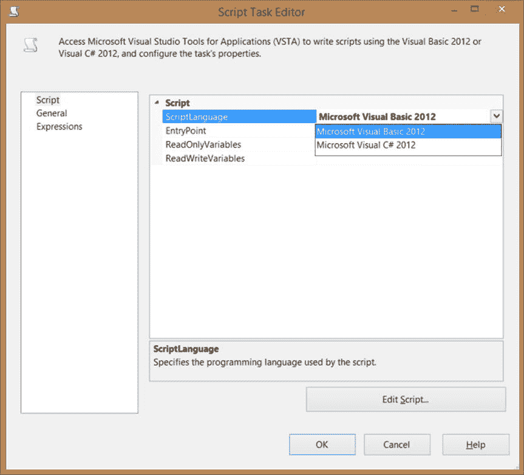

图 2-4. 脚本任务：选择`ScriptLanguage`并点击`Edit Script…`

#### 脚本

打开 VSTA 环境后，你会看到大量生成的代码。如果选择了`C#`，请找到名为`Main`的方法。它应该类似这样：

```
public void Main()
{
    // TODO: Add your code here
    Dts.TaskResult = (int)ScriptResults.Success;
}
```

现在用以下代码替换它。然后关闭新打开的 Visual Studio 窗口，返回`脚本任务编辑器`。单击“确定”关闭。

```
public void Main()
{
    // 从平面文件连接管理器中获取文件路径并赋值给变量
    string filePath;
    filePath = Dts.Connections["myFlatFile"].ConnectionString;

    // 使用 FileInfo 类检查文件长度
    System.IO.FileInfo fi = new System.IO.FileInfo(filePath);

    // 如果文件长度不大于零，则使脚本任务失败
    if (fi.Length > 0)
    {
        Dts.TaskResult = (int)ScriptResults.Success;
    }
    else
    {
        Dts.TaskResult = (int)ScriptResults.Failure;
    }
}
```

如果选择了`VB.NET`，请找到名为`Main`的方法。它应该类似这样：

```
Public Sub Main()
    '
    ' Add your code here
    '
    Dts.TaskResult = ScriptResults.Success
End Sub
```

用以下代码替换它。然后关闭新打开的 Visual Studio 窗口，返回`脚本任务编辑器`。单击“确定”关闭。

```
Public Sub Main()
    ' 从平面文件连接管理器中获取文件路径并赋值给变量
    Dim filePath As String
    filePath = Dts.Connections("myFlatFile").ConnectionString

    ' 使用 FileInfo 类检查文件长度
    Dim fi As System.IO.FileInfo = New System.IO.FileInfo(filePath)

    ' 如果文件长度不大于零，则使脚本任务失败
    If (fi.Length > 0) Then
        Dts.TaskResult = ScriptResults.Success
    Else
        Dts.TaskResult = ScriptResults.Failure
    End If
End Sub
```

#### 测试

至此，你已完成编码部分。在第 4 章及后续章节中，你将学习如何扩展此示例代码，加入其他文件属性、日志记录和错误处理功能。

请确保`数据流任务`和`发送邮件任务`能正常工作。同时确保`平面文件连接管理器`中指定的文本文件包含数据。如果没有 SMTP 服务器，可以将`发送邮件任务`替换为其他任务，例如`执行 SQL 任务`。现在运行包。如果文件包含数据，则`脚本任务`应成功执行并继续运行数据流。示例如图 2-5 所示。

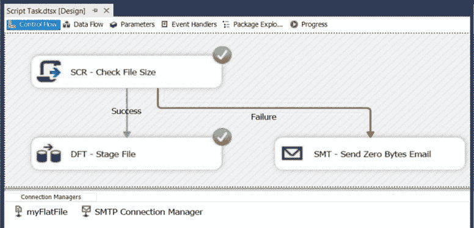

图 2-5. 第一个`脚本任务`在文本文件非空时的运行结果

在记事本中打开该文本文件，删除所有文本。保存文件，然后再次运行包。此时`脚本任务`应失败并继续运行`发送邮件任务`。图 2-6 展示了这一行为。

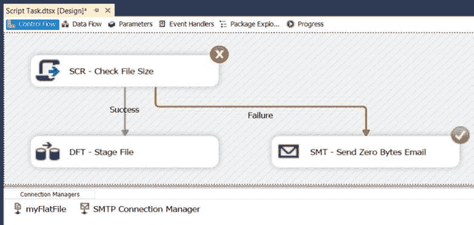

图 2-6. 第一个`脚本任务`在文本文件为空时的运行结果

## 脚本组件简介

为了介绍`脚本组件`，我们将在`数据流任务`中添加一个代理键列。代理键是自动递增的行号，类似于 SQL Server 表中的标识列。同样，这是一个非常简化的示例，在阅读本书后你将能够对其进行扩展。

### 平面文件

在本例中，你将使用一个包含几种自行车类型的文本文件作为数据流的数据源。在数据流中添加一个`平面文件源`组件，如图 2-7 所示。指定一个连接管理器，该管理器指向包含以下内容的文本文件：

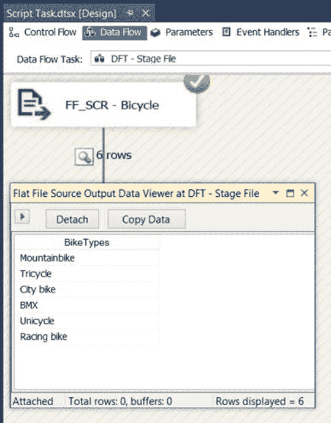

图 2-7. 包含`平面文件源`的数据流任务

```
BikeTypes
Mountainbike
City bike
BMX
Unicycle
Racing bike
```

#### 脚本组件

在数据流任务中添加一个脚本组件，并在“脚本组件类型”中选择“转换”，如图 2-8 所示。接下来，将平面文件源连接到新建的脚本组件。

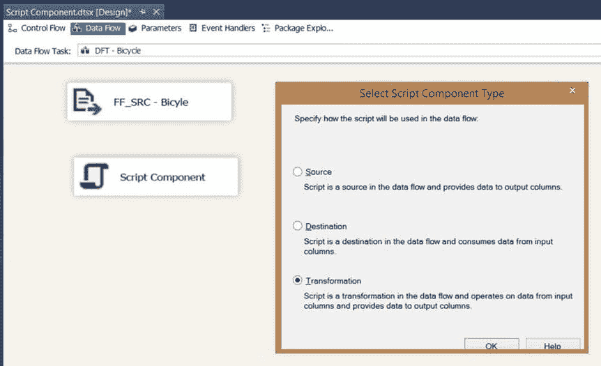

**图 2-8.** 脚本组件类型：转换

为其指定一个有用的名称（例如 `SCR – Add Surrogate Key`）后，可以通过双击或右键单击脚本组件并选择**编辑**来对其进行编辑。第 9 章将详细讨论所有选项和页面。现在，请转到第一个名为**脚本**的页面，并在**自定义属性**下选择您偏好的脚本语言（`C#` 或 `VB.NET`）。

接下来，转到第三个页面**输入和输出**，在“**输入和输出：**”树状视图中展开 `Output 0`。然后点击**输出列**。单击**添加列**按钮以添加新的输出列；将其命名为 `BikeId`。新列存储数字，因此请确保其 `DataType` 为“四字节有符号整数”。您可以在窗口右侧的**数据类型属性**中更改 `DataType`（参见图 2-9）。

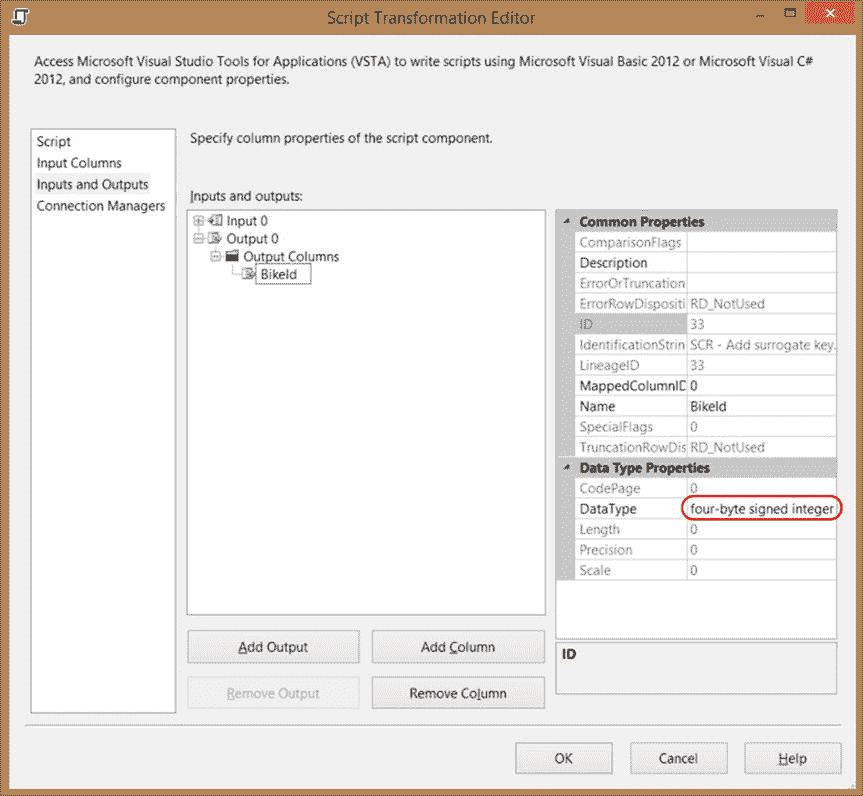

**图 2-9.** 脚本组件：添加新输出列并设置数据类型

添加新输出列后，返回**脚本**页面并单击**编辑脚本…**按钮。此时会打开一个新的 Visual Studio 窗口，其中包含所谓的 VSTA 环境。

您会看到大量生成的代码。首先，找到名为 `Input0_ProcessInputRow` 的方法。根据所选语言，代码应类似于以下内容：

```csharp
public override void Input0_ProcessInputRow(Input0Buffer Row)
```

而 `VB.NET` 代码应如下所示：

```vb.net
Public Overrides Sub Input0_ProcessInputRow(ByVal Row As Input0Buffer)
```

将以下五行代码（包括一个空行和两个注释行）添加到此方法中。最终结果应如下所示：

```csharp
public override void Input0_ProcessInputRow(Input0Buffer Row)
{
    // 递增数值
    rowNumber++;

    // 将值赋给新的输出列
    Row.BikeId = rowNumber;
}
```

以下是 `VB.NET` 代码：

```vb.net
Public Overrides Sub Input0_ProcessInputRow(ByVal Row As Input0Buffer)
    ' 递增数值
    rowNumber = rowNumber + 1

    ' 将值赋给新的输出列
    Row.BikeId = rowNumber
End Sub
```

您会在 `rowNumber` 下方看到一些红色波浪线，表示存在错误。现在，在 `Input0_ProcessInputRow` 方法的注释行上方添加以下代码。在 `C#` 中，注释以斜杠开头。在 `VB.NET` 中，注释以单引号开头。

```csharp
// 用于跟踪行号数值的整数变量
int rowNumber = 0;
```

以下是 `VB.NET` 代码：

```vb.net
' 用于跟踪行号数值的整数变量
Dim rowNumber As Int32 = 0
```

还有另外两个方法，名为 `PreExecute` 和 `PostExecute`。您可以删除它们，也可以保持原样。在这个最初的示例中您不会用到它们。最终结果应类似于以下代码，其中移除了帮助文本，更改了注释，并删除了不必要的预处理和后处理方法，以使代码简洁清晰：

```csharp
#region 命名空间
using System;
using System.Data;
using Microsoft.SqlServer.Dts.Pipeline.Wrapper;
using Microsoft.SqlServer.Dts.Runtime.Wrapper;
#endregion

/// <summary>
/// 这是用于添加代码的类。
/// 请勿更改此类的名称、属性或父类。
/// </summary>
[Microsoft.SqlServer.Dts.Pipeline.SSISScriptComponentEntryPointAttribute]
public class ScriptMain : UserComponent
{
    // 用于跟踪行号数值的整数变量
    int rowNumber = 0;

    /// <summary>
    /// 对于从 Input0 通过组件的每一行，
    /// 都会调用一次此方法。
    ///
    /// 递增并将变量赋给新的输出列
    /// </summary>
    /// <param name="Row">当前正在通过组件的行</param>
    public override void Input0_ProcessInputRow(Input0Buffer Row)
    {
        // 递增数值
        rowNumber++;

        // 将值赋给新的输出列
        Row.BikeId = rowNumber;
    }
}
```

以下是 `VB.NET` 代码：

```vb.net
#Region "导入"
Imports System
Imports System.Data
Imports System.Math
Imports Microsoft.SqlServer.Dts.Pipeline.Wrapper
Imports Microsoft.SqlServer.Dts.Runtime.Wrapper
#End Region

' 这是用于添加代码的类。
' 请勿更改此类的名称、属性或父类。
<Microsoft.SqlServer.Dts.Pipeline.SSISScriptComponentEntryPointAttribute> _
<CLSCompliant(False)> _
Public Class ScriptMain
    Inherits UserComponent

    ' 用于跟踪行号数值的整数变量
    Dim rowNumber As Int32 = 0

    '对于从 Input0 通过组件的每一行，
    '都会调用一次此方法。
    '
    '递增并将变量赋给新的输出列
    Public Overrides Sub Input0_ProcessInputRow(ByVal Row As Input0Buffer)
        ' 递增数值
        rowNumber = rowNumber + 1

        ' 将值赋给新的输出列
        Row.BikeId = rowNumber
    End Sub
End Class
```

> **注：** 生成的代码因 SSIS 版本而异，因此文本或位置可能存在一些变化。

仅用三行代码，您就创建了一个完美的代理键。您可以对此代码进行扩展，例如，添加一个变量起始编号和增量。第 11 章将继续介绍这个示例。

现在，您可以关闭 VSTA 环境和脚本组件编辑器。接下来就可以进行测试了。在新的脚本组件之后添加一个虚拟的派生列，这样您就可以添加一个数据查看器来查看脚本运行结果。然后执行数据流任务，并在数据查看器中检查结果。结果应类似于图 2-10。

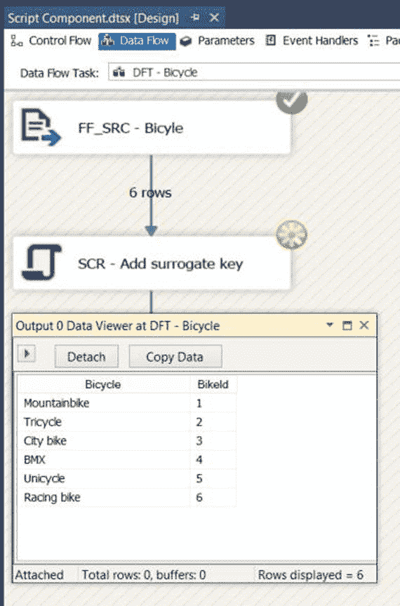

**图 2-10.** 添加的新代理键

## 何时使用脚本任务/组件

两个入门示例虽然非常简单，但已经展示了脚本作为 SSIS 补充功能的实用性。不过，使用它们也存在一些缺点。最显著的弊端是**可维护性**。你可能拥有出色的编码技能，但与你合作同一项目的同事或在你完成后负责维护包的人却未必如此。事实上，许多 SSIS 开发人员和管理员根本不具备任何 `C#` 或 `VB.NET` 编码技能。

另一个缺点是**清晰度**。当你看到“发送邮件任务”或“执行包任务”时，一眼就能看出该任务的作用以及编辑时的预期内容。而对于脚本任务，你只能看到开发者赋予它的名称，然后很可能仍需编辑脚本任务并研究代码才能了解其具体功能。`SCR – Unzip File`（脚本任务-解压文件）看起来非常直接，但压缩文件在哪儿？它会解压缩所有文件吗？解压后的文件放在哪里？之后它会删除、移动还是忽略原始的压缩文件？数据流任务转换也存在同样的问题。“合并联接”或“条件拆分”非常清晰，但对于 `SCR – Validate Email`（脚本任务-验证电子邮件），你可能想知道它如何验证电子邮件地址，以及它对无效电子邮件地址的处理方式。

使用脚本任务和脚本组件的条件非常简单：**仅在它们比内置任务和组件更具优势时才使用**。非必要不使用。用脚本任务删除单个文件并非好主意，因为使用文件系统任务即可轻松完成。但如果你想删除文件夹中所有 `*.txt` 和 `*.csv` 文件呢？你可以使用两个包含文件系统任务的 `Foreach` 循环容器来删除文件，但在单个脚本任务中完成此操作会更简单、更快捷。如果你想删除所有七天前的文件呢？那么你只能使用脚本任务，因为用内置任务很难实现。

此外，当需要在多个包中使用同一脚本时，不应使用脚本任务或脚本组件。修复用于多个包的脚本组件中的错误或为其添加功能可能非常烦人且耗时。在这种情况下，应考虑创建自定义任务或转换。第 16 章到第 19 章将解释具体操作方法。

### 生成代码

当代码存在语法错误时，Visual Studio 会通过多种方式发出警告。首先，代码下方会出现红色波浪线。如图 2-11 所示，可在 `ConnectionStrings` 标识符下方看到这些波浪线。将鼠标指针移至错误处时，界面会显示错误消息。

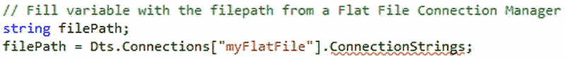

图 2-11. `ConnectionStrings` 下方的红色波浪线表示存在错误

某些错误（例如 `C#` 中缺少分号）不太明显，尤其是在大型脚本中。关闭脚本任务或脚本组件编辑器时，Visual Studio 会再次发出警告，如图 2-12 所示。如果忽略此错误，则带叉号的著名红色圆圈会指示该错误。

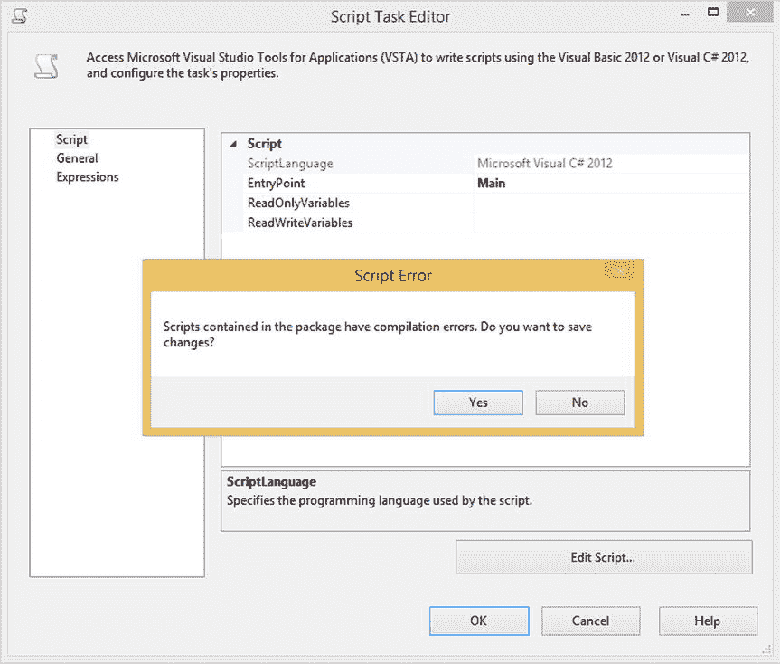

图 2-12. 由于脚本包含错误而导致编译错误

为确保在关闭 VSTA 环境前代码语法正确，可以在 Visual Studio 的`生成`菜单中生成代码（见图 2-13）。任何错误都会显示在“错误”窗格中。点击这些错误消息可跳转到代码中的实际错误位置。

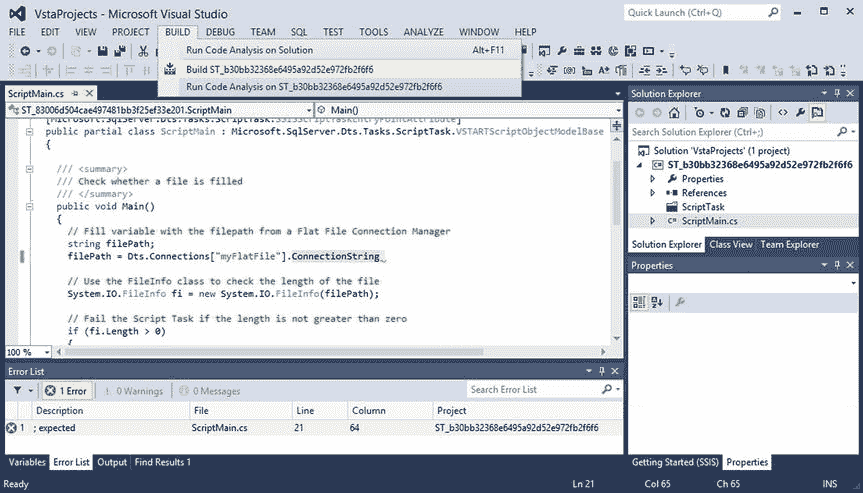

图 2-13. 生成代码以检查语法错误

### 在 Visual Studio 中进行调试

当 .NET 代码语法正确但运行异常，或收到模糊的运行时错误（例如 `Exception has been thrown by the target of an invocation`（已引发调用的目标引发的异常）或 `Object reference not set to an instance of an object`（未将对象引用设置到对象的实例））时，你需要找出代码问题所在。图 2-14 显示了此类错误的示例。

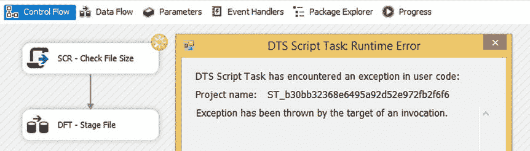

图 2-14. 对大多数人来说这是一个模糊的错误

找出问题的最简单方法是在代码中设置断点进行调试，然后重新运行代码以查看出错位置。断点是在某行代码上添加的一个点，用于在执行时有意在该行暂停脚本。调试器会暂停执行，随后你可以逐行运行代码，查看作用域内所有属性的值。其工作原理类似于数据流中的数据查看器。添加数据查看器时，数据流会暂停，你可以查看所有行的值。

但在继续之前，你应该知道并非所有版本的 SSIS 都支持脚本任务和脚本组件的断点。要在 SSIS 2012 之前的版本中的脚本任务中使用断点，首先需要像图 2-15 所示那样将 SSIS 项目切换到 32 位，否则断点将不起作用。在解决方案资源管理器中右键单击，转到项目属性。选择“属性”。这将打开一个包含项目相关属性的新窗口。现在转到“调试”页面，在“调试选项”下找到 `Run64BitRuntime` 属性。将其设置为 `False`，然后单击“确定”，以便项目在 32 位模式下运行。现在断点就能生效了。

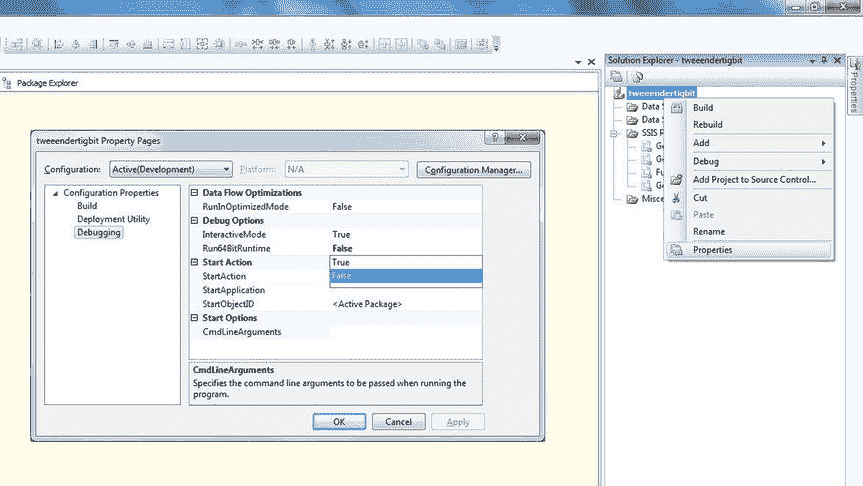

图 2-15. 将 SSIS 2008 项目切换到 32 位

不幸的是，在脚本组件中设置断点仅适用于 SSIS 2012 及更高版本。存在一些替代方法（例如触发事件和跟踪日志记录）来实现某种形式的调试。本章稍后会介绍这些方法。

#### 脚本任务

首先，从一个检查文件大小是否至少为 1 字节的脚本任务示例开始。我们创建了一个名为 `debug.dtsx` 的包并包含了此脚本，但故意在其中添加了一个错误。尝试找出该错误并进行修正。脚本可以成功生成，但在运行时却出现错误：调用的目标引发了异常。参见图 2-16。

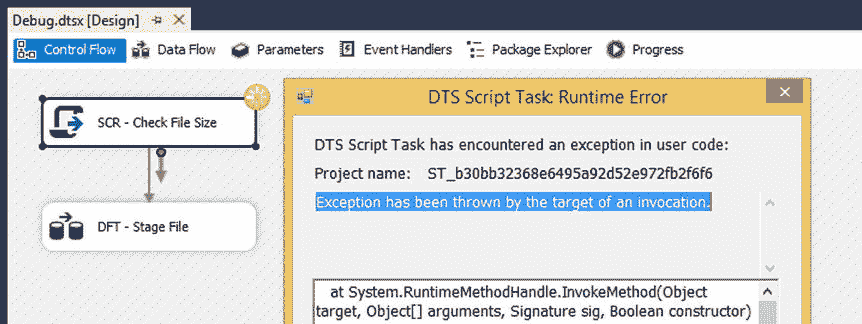

图 2-16. 我们故意添加的错误

你应该编辑脚本任务并点击 `编辑脚本…` 按钮，在 VSTA 环境中查看代码。转到希望调试器中断的代码行。这可以是 `Main` 方法的第一行代码，也可以是你怀疑脚本将失败位置的前一行。在 `调试` 菜单中，可以找到 `切换断点` 选项，如图 2-17 所示，你也可以按 `F9` 键或单击左侧的浅灰色列来添加断点。不能在空行或注释行上添加断点。

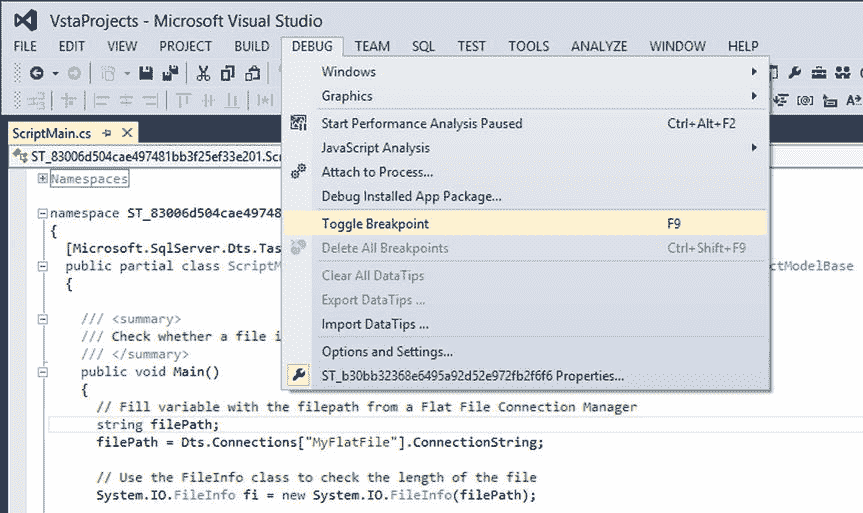

图 2-17. 在脚本任务中添加断点

添加断点时，它在代码中清晰可见。会添加一个红色圆点和红色背景颜色，你可以在图 2-18 中看到它们。当你关闭脚本任务编辑器时，任务中也会添加相同的红色圆点，如图 2-19 所示。你可以在代码中添加多个断点，但不要过度，避免在每一行都添加断点。

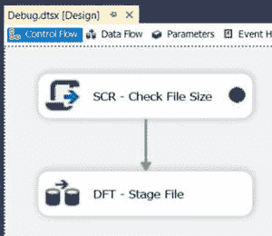

图 2-19. 包含断点的脚本任务

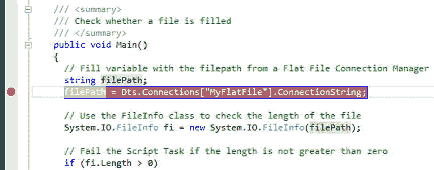

图 2-18. 已添加断点

现在，你可以运行整个包，或者仅运行带有断点的脚本任务来开始调试。当有多个脚本任务都带有断点时，调试器一次只能调试一个。如果通过执行包任务来执行子包，则子包中的断点将被忽略。执行后，VSTA 环境会打开，并且一个黄色标记指示调试器暂停的位置。这个黄色标记就是你在图 2-20 中看到的高亮显示。此高亮行是下一个要执行的语句。现在将鼠标光标悬停在变量上，即可查看其当前值。

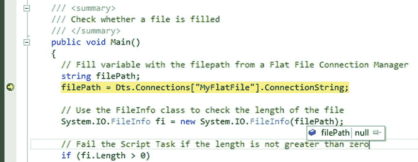

图 2-20. 命中断点并暂停执行

通过按 `调试… 逐过程`（`F10`），当前选中的代码行会被执行。黄色标记会移动到下一行代码，然后你可以再次检查变量值。你可以重复此操作，直到没有剩余代码行。你也可以按 `F5`（继续），然后代码会继续执行，直到下一个断点，或者如果没有更多断点，则执行到脚本的末尾。

到目前为止，你可能已经找到了脚本中的错误。我们的错误如图 2-21 所示。它告诉我们找不到 `MyFlatFile`。进一步研究发现，平面文件的名称不是以大写字母开头的，并且代码是区分大小写的。

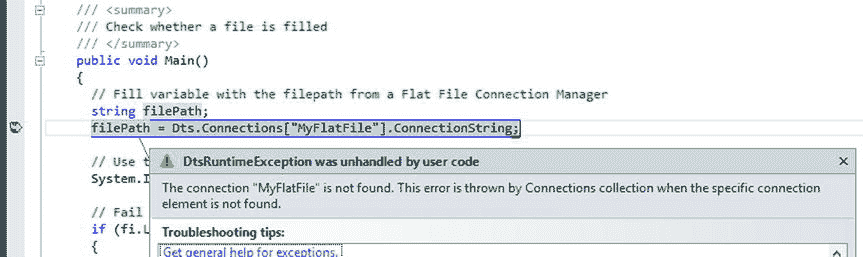

图 2-21. 含义更明确的错误消息

你还可以对变量或一段代码添加监视。从示例中选择 `filePath` 变量。右键单击它并选择 `添加监视`，如图 2-22 所示。该变量会被添加到 `监视` 窗口中。现在，你可以通过按 `F10` 键逐步执行代码，在 `监视` 窗口中查看值的变化，而无需将鼠标指针悬停在变量上。如果 `监视` 窗口不可见，请转到 `调试` 菜单，选择 `窗口 > 监视 > 监视 1`，或按 `Ctrl + Alt + W, 1`。

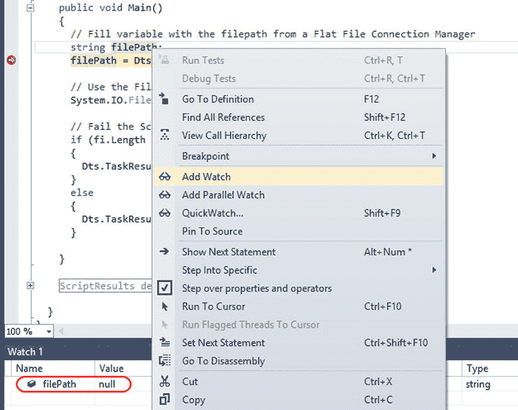

图 2-22. 向脚本任务添加监视

#### 脚本组件

在本示例中，我们将使用同一个 `debug.dtsx` 包中提供的简化版代理键脚本。调试脚本组件的工作方式与脚本任务基本相同，但某些方法会被多次执行。编辑脚本组件，点击`编辑脚本…` 按钮，打开包含代理键脚本的 VSTA 环境。在 `Input0_ProcessInputRow` 方法中选择一行代码，并添加一个断点，如图 2-23 所示。该断点在 VSTA 环境中会清晰可见，但与脚本任务不同，它不会显示在转换本身之上。

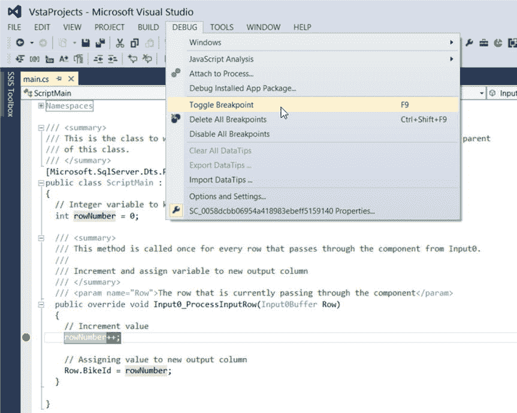

图 2-23. 在脚本组件中添加断点

现在关闭 VSTA 环境，执行数据流任务或整个包。因为你在 `ProcessInputRow` 方法中添加了断点，而该方法会对每一行执行，调试器在处理完第一行后会继续处理第二行，并持续处理直到所有行都处理完毕。尝试按 `F5`（继续），然后检查 `rowNumber` 变量的值。重复此操作，直到所有行都被处理。监视功能在脚本组件中同样有效。例如，选中 `rowNumber` 变量，右键单击，然后添加监视。图 2-24 展示了结果。

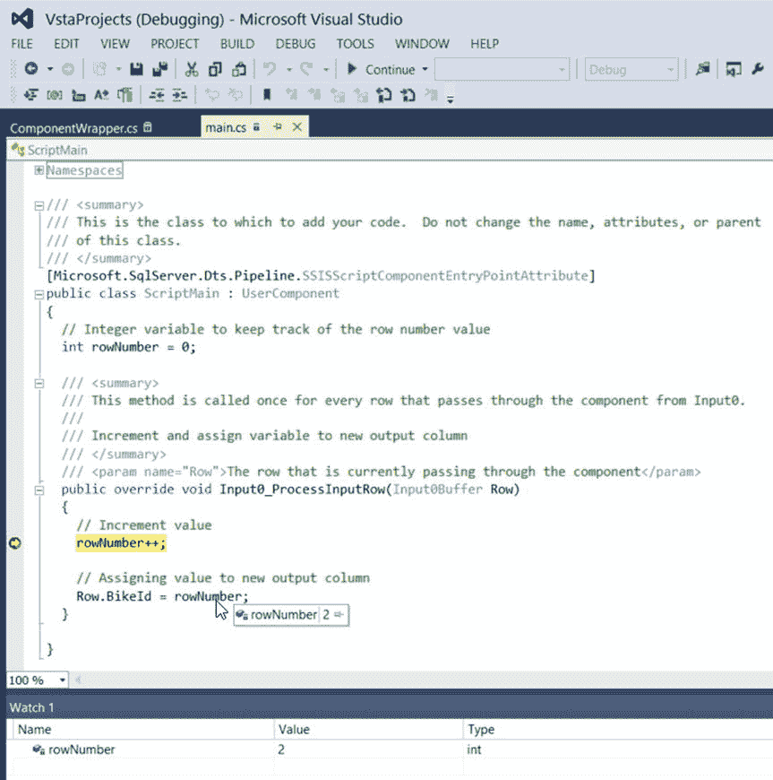

图 2-24. 脚本组件中的监视

当使用 SSIS 2012 之前的版本时，无法在脚本组件中使用断点。有一些变通方法可以实现某种形式的调试。传统而简易的消息框是一种显示值的快速方法。

消息框虽然实用且经典，但在处理大量记录时可能会变得有些烦人。没有人愿意点击“确定” 10,000 次。此外，在代码投入生产环境时，你也有可能不小心遗漏一个消息框。

下面的代码示例实现了一个用于调试的消息框。图 2-25 展示了使用消息框显示当前行号的效果。

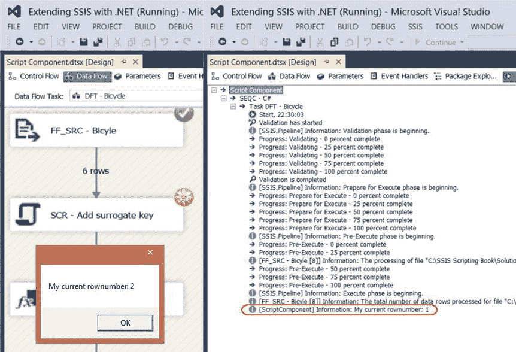

图 2-25. 调试替代结果

```
public override void Input0_ProcessInputRow(Input0Buffer Row)
{
    // 递增值
    rowNumber++;
    // 用于快速而粗糙的调试变通方案的消息框
    System.Windows.Forms.MessageBox.Show(rowNumber.ToString());
    // 将值分配给新的输出列
    Row.BikeId = rowNumber;
}
```

一个更好的替代方案是触发事件，在“执行结果”选项卡中显示该值。触发事件将在第 4 章中更深入地介绍。

```
public override void Input0_ProcessInputRow(Input0Buffer Row)
{
    // 递增值
    rowNumber++;
    // 为更优雅的调试变通方案触发事件
    bool fireAgain = true;
    this.ComponentMetaData.FireInformation(0, "ScriptComponent",
        "我当前的行号: " +
        rowNumber.ToString(),
        string.Empty, 0, ref fireAgain);
    // 将值分配给新的输出列
    Row.BikeId = rowNumber;
}
```

另一个替代断点的好方法是向监听器写入跟踪消息。你可以使用像 DebugView 这样的免费工具（[`http://technet.microsoft.com/en-us/sysinternals/bb896647.aspx`](http://technet.microsoft.com/en-us/sysinternals/bb896647.aspx)）来捕获这些消息。

以下是代码示例，图 2-26 展示了写入的跟踪输出。

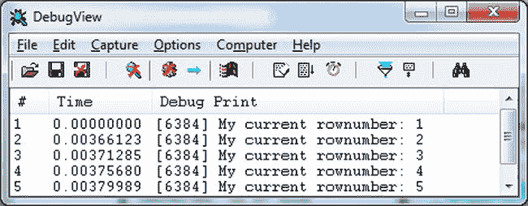

图 2-26. 使用 DebugView 查看跟踪消息

```
public override void Input0_ProcessInputRow(Input0Buffer Row)
{
    // 递增值
    rowNumber++;
    // 写入跟踪消息并使用 DebugView 查看它们
    System.Diagnostics.Trace.WriteLine("我当前的行号: " +
        rowNumber.ToString());
    // 将值分配给新的输出列
    Row.BikeId = rowNumber;
}
```

### 总结

本章解释了脚本任务与脚本组件之间的区别。它还展示了一些非常基础的示例，让您了解通过编码可以实现什么。并且解释了如何解决脚本中的错误。下一章将解释一些 C# 和 VB.NET 的基础知识。