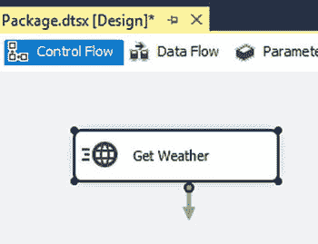
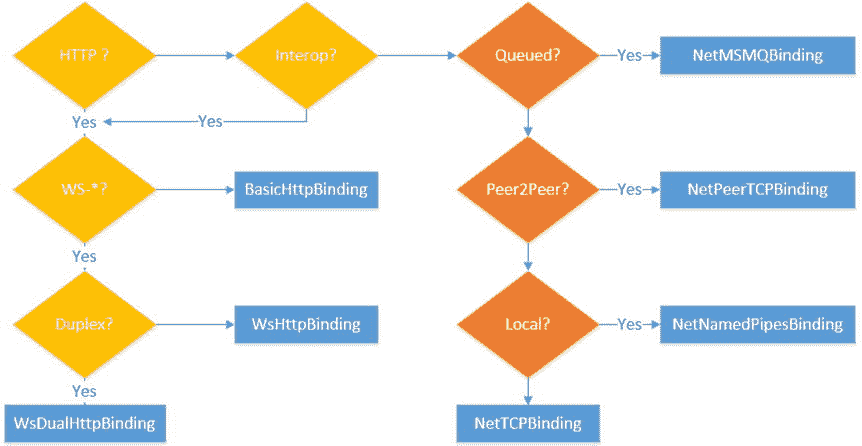
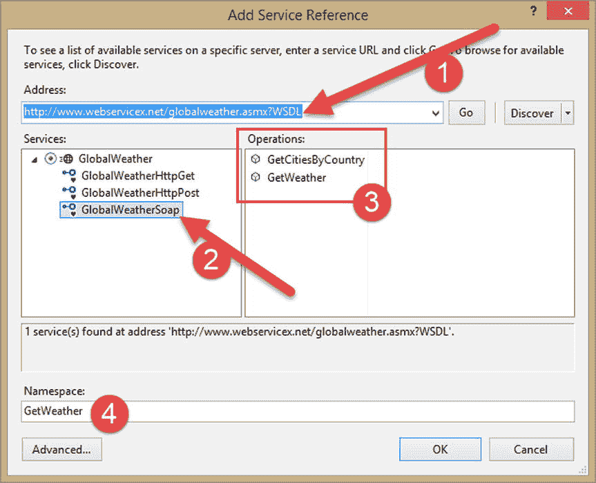
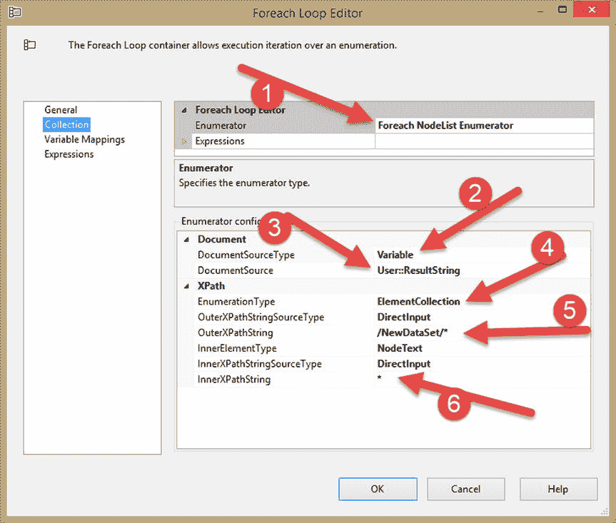
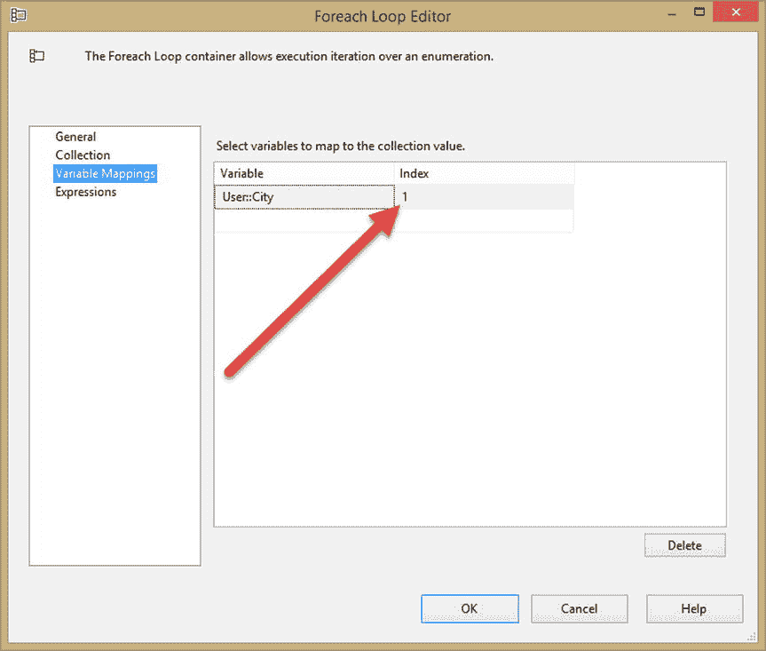
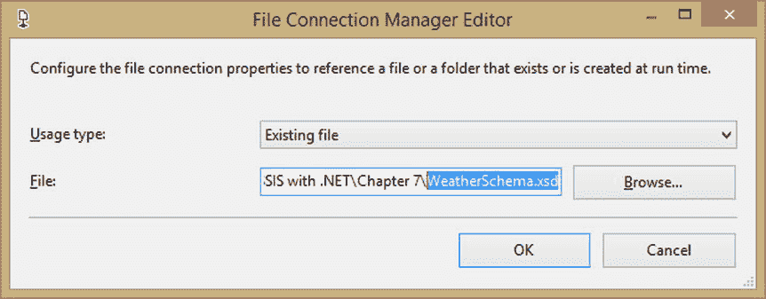

# 7. 使用 Web 服务和 XML

电子补充材料 本章的在线版本 (doi:[10.1007/978-1-4842-0638-6_7](http://dx.doi.org/10.1007/978-1-4842-0638-6_7)) 包含补充材料，仅供授权用户使用。

根据万维网联盟 (W3C) 的定义，Web 服务是一种软件系统，旨在支持网络中机器与机器之间的可互操作交互。此外，W3C 规定，Web 服务必须具有描述的接口，其他系统通过简单对象访问协议 (SOAP) 与该 Web 服务进行交互，通常通过 HTTP 并使用 XML 序列化。这个简短介绍清楚地表明，没有 XML 就没有 Web 服务。在 SSIS 中，你可以使用脚本任务和 .NET Framework（即使用 .NET 和 Windows Communication Foundation）来使用 Web 服务。

## Windows Communication Foundation

Windows Communication Foundation (WCF) 是一个用于构建面向服务的应用程序的框架。WCF 简化了 Web 服务的开发和运用，因为它提供了一种可管理的方法来创建 Web 服务和 Web 服务客户端。

WCF 提供以下功能：
- 面向服务
- 安全性
- 互操作性
- 多种消息模式
- 服务元数据
- 数据协定
- 多种传输和编码方式
- 持久、可靠和排队的消息
- 事务
- 支持 REST 和 AJAX
- 可扩展性

关于 WCF 的论述已经很多；这是一个非常广泛的课题。如需更多信息，你可以在 MSDN 上阅读相关内容：[`https://msdn.microsoft.com/en-us/library/ms730846(v=vs.110).aspx`](https://msdn.microsoft.com/en-us/library/ms730846(v=vs.110).aspx)，或阅读 Nishith Pathak 所著的 *Pro WCF 4*（Apress，2011 年）。

## Web 服务

在 SSIS 中，有一个内置的 Web 服务任务可用于调用 Web 服务。该组件非常简单直接。你可以将结果保存到文件或变量，如图 7-1 所示。



**图 7-1.** 内置的 Web 服务任务

正如你在前几章中多次看到的，有时 SSIS 中内置任务的功能并不足够；这时你就需要脚本的灵活性和强大功能。

假设你想调用一个通过 NetTCP 而非 HTTP 进行通信的 WCF Web 服务。NetTCP 的优势在于二进制编码通信，并支持通过 TCP 协议进行进程间和跨计算机通信。标准 Web 服务任务不提供此选项。

图 7-2 是一个示意图，显示了在何种情况下使用何种协议。在所有 HTTP 不可行的情况下，你需要使用脚本任务组件来调用你的 Web 服务。



**图 7-2.** WCF 协议图表

### 创建变量

你需要以下变量才能开始操作：
- `City`：字符串类型，用于存储城市名称
- `Country`：字符串类型，用于存储国家名称
- `ResultString`：字符串类型，用于存储来自 Web 服务调用的 XML 结果
- `WeatherServiceURL`：也是字符串类型，用于存储 Web 服务 URL。将 Web 服务 URL 地址保存在变量中的主要优势是，你无需打开包即可更改它。例如，当 Web 服务（或包）从开发环境进入生产环境时，你可能希望控制使用哪个地址；实现此目的的一种方法是使用参数或动态配置它。

### 脚本

创建一个新的脚本任务组件，将其命名为`SCR_GetWeather`。添加之前创建的四个变量。`City`、`Country`和`ResultString`应设为`ReadWrite`，而`WeatherServiceURL`应设为`ReadOnly`。

### 服务引用

处理 Web 服务时，需要生成一个协定。这可以通过在 VSTA 项目中添加服务引用来实现。服务引用会生成调用 Web 服务所需的接口，其中包含可供调用的方法和类型。

> **注意：** 此功能仅在 SQL Server 2008 及更高版本的 SSIS 中可用。在此之前，VSTA 不支持添加服务引用。

添加服务引用时，有几个需要注意的地方。在下面的示例中，你将使用对[`http://www.webservicex.net/globalweather.asmx?WSDL`](http://www.webservicex.net/globalweather.asmx?WSDL)上天气 Web 服务的引用。

最初，没有`Service Reference`文件夹——只有`Reference`文件夹。你需要添加一个服务引用，该文件夹才会显示。要添加对 Web 服务的引用，请在 VSTA 解决方案资源管理器中右键单击`Reference`文件夹，然后选择`添加服务引用`。这将打开如图 7-3 所示的对话框窗口。



**图 7-3.** 添加服务引用对话框

以下是图 7-3 所示的`添加服务引用`对话框中需要完成的步骤：
- 输入要连接的 Web 服务的地址。
- 在`服务`中，由于你使用的是 WCF，请选择 SOAP 实现。
- 在`操作`中，你可以选择两种方法。
- 输入一个命名空间，这是你从脚本中调用服务时将使用的名称。

填写完对话框后，按下`确定`按钮。在此过程中，VSTA 会生成使用 Web 服务所需的元数据。所有用于调用 Web 服务的方法、属性、签名、接口及其他构件都会自动生成。

> **注意：** 由于这是自动生成的代码，你不应对其进行修改，因为刷新服务引用后，更改将会丢失。

如果你想了解元数据是如何生成的，并探究 Web 服务的本质，可以查看自动生成的文件。大多数情况下，这并非必需，因为 VSTA 提供了必要的 IntelliSense 来调用服务。与代码文件一起，一个`app.config`文件也会被添加到项目中，其中包含协定和 Web 服务绑定所需的信息。

以下是天气 Web 服务引用的`app.config`：
```
<?xml version="1.0" encoding="utf-8" ?>
<configuration>
  <system.serviceModel>
    <bindings>
      <basicHttpBinding>
        <binding name="GetCitiesByCountry" />
      </basicHttpBinding>
    </bindings>
    <client>
      <endpoint address="http://www.webservicex.net/globalweather.asmx"
          binding="basicHttpBinding" bindingConfiguration="GlobalWeatherSoap"
          contract="GetCitiesByCountry.GlobalWeatherSoap" name="GlobalWeatherSoap" />
    </client>
  </system.serviceModel>
</configuration>
```

#### 自定义命名空间

`System.ServiceModel` 是所有 WCF 实现所在的命名空间。你需要将其添加到命名空间区域；或者更好的做法是，添加一个自定义命名空间区域，如下所示：
```
#region CustomNamespace
using System.ServiceModel;
using System.Xml;
using ST_1211e492c97246a9947e241a0234dce6.GetWeather;
using System.IO;
#endregion
```
`System.ServiceModel` 首次引入于 .NET Framework 3.0。

> **注意：** 如果你使用的是较旧版本的 .NET Framework，则需要手动生成 WSDL、`.disco` 文件、XSD 模式及其他构件。有关如何执行此操作的更多信息，请访问[`https://msdn.microsoft.com/en-us/library/7h3ystb6%28v=vs.80%29.aspx`](https://msdn.microsoft.com/en-us/library/7h3ystb6%28v=vs.80%29.aspx)。

### 配置还是非配置

# 生成代码后，情况会变得稍微复杂一些，因为有两种调用 WCF Web 服务的方法。现在你有两个选项进行配置和调试：修改一堆`.config`文件，或者在 C#/VB.NET 中进行配置。前者可移植性最好，而后者最适合调试。以下将介绍这两种解决方案。

## 解决方案 1：修改 .config 文件

此解决方案包括两个步骤。

### 调试所需的更改

调试时，你需要修改`DtsDebugHost.exe.Config`文件。`DtsDebugHost.exe`是 SSDT 在调试模式下执行包时使用的文件。因此，需要修改其`.config`文件，以反映对 VSTA 项目中`app.config`所做的更改。该文件可在 64 位文件夹和 32 位文件夹中找到。SSDT 仅支持 32 位，但调试器支持两种模式，这使得事情更加混乱。在项目属性的`调试`窗格中可以更改`Run64BitRuntime`。在 SQL Server 2014 安装中，该文件位于`C:\Program Files\Microsoft SQL Server\120\DTS\Binn`。

### 调试完成后的更改

这一部分或许应该称为“我的`app.config`在哪里？”，因为根据你调用包的方式，可能需要更改其他几个文件。

- `DTExec.exe.config`：用于调用包的独立`DTExec.exe`应用程序的`.config`文件。它同时具有 32 位和 64 位版本；在 SQL Server 2014 中，位于`C:\ProgramFiles\MicrosoftSQLServer\120\DTS\Binn`。
- `DtsHost.exe.config`：SQL Server 代理在调用包时使用的文件。该文件有 32 位和 64 位版本。在 SQL Server 2014 上，通常位于`C:\ProgramFiles\MicrosoftSQLServer\120\DTS\Binn`。
- `DTExecUI.exe.config`：`DTExec.exe`用户界面使用的文件。在 SQL Server 2014 安装中，通常也位于`C:\ProgramFiles\MicrosoftSQLServer\120\DTS\Binn`。
- `ISServer.exe.config`：在使用包部署模型并从 SSMS 执行包时，SSISDB 和`ISServer.exe`使用的文件。该文件位于`C:\Program Files\Microsoft SQL Server\120\DTS\Binn`。

可以想象，保持所有这些文件同步更新是相当困难的。

表 7-1 列出了所有文件及其位置。

**表 7-1.** `.config`文件及其位置

| 文件名 | 32 位 | 64 位 |
| --- | --- | --- |
| `DtsDebugHost.exe.config` | `C:\Program Files (x86)\Microsoft SQL Server\120\DTS\Binn` | `C:\Program Files\Microsoft SQL Server\120\DTS\Binn` |
| `DTExec.exe.config` | `C:\Program Files (x86))\Microsoft SQL Server\120\DTS\Binn` | `C:\Program Files\Microsoft SQL Server\120\DTS\Binn` |
| `DtsHost.exe.config` | `C:\Program Files (x86))\Microsoft SQL Server\120\DTS\Binn` | `C:\Program Files\Microsoft SQL Server\120\DTS\Binn` |
| `ISServer.exe.config` | `C:\Program Files (x86))\Microsoft SQL Server\120\DTS\Binn` | `C:\Program Files\Microsoft SQL Server\120\DTS\Binn` |

> **注意：** 名为`120`的文件夹对应 SQL Server 2014，`110`对应 SQL Server 2012，`100`对应 SQL Server 2008。

由此引入在脚本任务中实现 Web 服务调用的解决方案 2。

## 解决方案 2：代码内方法

使用此方法，你无需更改任何一个`.config`文件。这也是一种无需保持多个`.config`文件同步更新的同时，轻松了解如何配置和调用 Web 服务的方法。唯一的缺点是，如果服务更改了其终结点地址或身份验证方法，则需要重新编译脚本。

代码基本上是`.config`文件中所述内容的 C# 或 VB.NET 表现形式。`GetWeather`应用程序的代码如下所示。

## 代码

> **注意**：以下代码片段展示了脚本的不同部分。完整脚本将在下文展示；同时也可在第 7 章的源代码中找到。

所使用的`ChannelFactory`类型是添加 Web 服务引用时生成的接口。此处为`GlobalWeatherSoap`公共接口。

```csharp
// 使用 Web 服务的类型创建 Channel Factory。
ChannelFactory<GlobalWeatherSoap> channelFactory = null;
```

以下是 VB.NET 中的写法：

```vb
' 创建正确类型的 ChannelFactory
Dim channelFactory As ChannelFactory(Of GlobalWeatherSoap) = Nothing
```

你还需要一个变量来存储终结点，以便后续使用。

```csharp
EndpointAddress ep = null;
```

以下是 VB.NET 中的写法：

```vb
Dim ep As EndpointAddress = Nothing
```

要调用 Web 服务，你需要一个终结点地址，这基本上就是添加服务引用时使用的地址。使用变量可以提高灵活性。

```csharp
// 指定地址是什么
string epAdr = "http://www.webservicex.net/globalweather.asmx";
```

以下是 VB.NET 中的写法：

```vb
' 指定地址是什么
Dim epAdr As String = "http://www.webservicex.net/globalweather.asmx"
```

之后，你可以开始指定要使用的绑定，并创建用于`ChannelFactory`的终结点：

```csharp
// 获取正确的绑定
BasicHttpBinding httpb = new BasicHttpBinding();
channelFactory = new ChannelFactory<GlobalWeatherSoap>(httpb);
// 使用我们的地址创建必要的终结点
ep = new EndpointAddress(epAdr);
```

以下是 VB.NET 中的写法：

```vb
' 获取正确的绑定
Dim httpb As New BasicHttpBinding()
channelFactory = New ChannelFactory(Of GlobalWeatherSoap)(httpb)
' 使用我们的地址创建必要的终结点
ep = New EndpointAddress(epAdr)
```

一旦准备好这些元素，你就可以进入 Web 服务的重要部分：调用服务本身并获取结果。

```csharp
// 准备创建 Web 服务的表示
GlobalWeatherSoap weatherSvcObj = channelFactory.CreateChannel(ep);
// 获取某个国家的地理信息
string result = weatherSvcObj.GetCitiesByCountry("France");
// 将结果保存到变量中供以后使用。
Dts.Variables["ResultString"].Value = result;
```

以下是 VB.NET 中的写法：

```vb
' 使用我们的地址创建必要的终结点
' 准备创建 Web 服务的表示
Dim weatherSvcObj As GlobalWeatherSoap = channelFactory.CreateChannel(ep)
' 获取某个国家的地理信息
Dim result As String = weatherSvcObj.GetCitiesByCountry("France")
' 将结果保存到变量中供以后使用。
Dts.Variables("ResultString").Value = result
```

由于 Web 服务通常不受你控制，因此最好做好处理错误的准备，因为沿着连接终结点路径的许多地方都可能出错。所以，`try-catch`在这里非常必要。

以下是 C# 中完整的 `Main` 方法：

```csharp
// 创建正确类型的 ChannelFactory – 需要 using 才能在代码中使用服务引用
// 在我们的例子中为：
// using ST_751e10ef586a4cd9ac45c6d1c84c526c.GetWeather;
ChannelFactory<GlobalWeatherSoap> channelFactory = null;
EndpointAddress ep = null;
string City = Dts.Variables["City"].Value.ToString();
string Country = Dts.Variables["Country"].Value.ToString();

// 指定地址是什么
string epAdr = Dts.Variables["WeatherServiceURL"].Value.ToString();

try
{
    // 获取正确的绑定
    BasicHttpBinding httpb = new BasicHttpBinding();
    channelFactory = new ChannelFactory<GlobalWeatherSoap>(httpb);
    // 使用我们的地址创建必要的终结点
    ep = new EndpointAddress(epAdr);
    // 准备创建 Web 服务的表示
    GlobalWeatherSoap weatherSvcObj = channelFactory.CreateChannel(ep);
    // 获取某个国家的地理信息
    string result = weatherSvcObj.GetWeather(City, Country);
    //// 确保处理的是 XML 文档
    // XmlDocument doc = new XmlDocument();
    // doc.LoadXml(result);
    ValidateXML(result);
    // 将结果保存到变量中供以后使用。
    Dts.Variables["ResultString"].Value = result;
    MessageBox.Show(result);
}
catch (Exception ex)
{
    Dts.TaskResult = (int)ScriptResults.Failure;
    throw ex;
}
```

以下是 VB.NET 中的写法：

```vb
' 创建正确类型的 ChannelFactory – 需要 using 才能在代码中使用服务引用
' 在我们的例子中为：
' using ST_751e10ef586a4cd9ac45c6d1c84c526c.GetWeather;
Dim channelFactory As ChannelFactory(Of GlobalWeatherSoap) = Nothing
Dim ep As EndpointAddress = Nothing
Dim City As String = Dts.Variables("City").Value.ToString()
Dim Country As String = Dts.Variables("Country").Value.ToString()

' 指定地址是什么
Dim epAdr As String = Dts.Variables("WeatherServiceURL").Value.ToString()

Try
    ' 获取正确的绑定
    Dim httpb As New BasicHttpBinding()
    channelFactory = New ChannelFactory(Of GlobalWeatherSoap)(httpb)
    ' 使用我们的地址创建必要的终结点
    ep = New EndpointAddress(epAdr)
    ' 准备创建 Web 服务的表示
    Dim weatherSvcObj As GlobalWeatherSoap = channelFactory.CreateChannel(ep)
    ' 获取某个国家的地理信息
    Dim result As String = weatherSvcObj.GetWeather(City, Country)
    '/确保处理的是 XML 文档
    ' XmlDocument doc = new XmlDocument();
    ' doc.LoadXml(result);
    ValidateXML(result)
    ' 将结果保存到变量中供以后使用。
    Dts.Variables("ResultString").Value = result
    MessageBox.Show(result)
Catch ex As Exception
    Dts.TaskResult = CInt(ScriptResults.Failure)
    Throw ex
End Try
```

一旦你按照此处的说明调用了 Web 服务，你应该会得到类似于以下的结果（为简洁起见已缩短）：

```xml
<NewDataSet>
  <Table>
    <Country>France</Country>
    <City>Le Touquet</City>
  </Table>
  <Table>
    <Country>France</Country>
    <City>Agen</City>
  </Table>
  ...
</NewDataSet>
```

现在，你已经获得了一个表示法国城市（该 Web 服务提供其天气数据）的 XML 结构，接下来需要遍历每个 `City` 元素，并获取每个城市的天气。

#### 用于处理 XML 的 Foreach 循环

在创建 Foreach 循环容器时，需要指定所处理的枚举类型。该容器需要在脚本上设置一个优先约束。图 7-4 显示了该容器的集合设置。



**图 7-4.** Foreach 循环容器集合设置

以下是对图 7-4 中标注的说明：

1. 你想要遍历一个节点列表 (`NodeList`)，以获取 XML 节点列表中的每个城市。

2. 节点列表在变量中指定。

3. 保存 XML 的变量名称（类型为 `string` 或甚至 `Object`，因为所有类型都继承自 `Object` 类型）。

4. 枚举类型是元素集合 (`element collection`)。

5. 元素的位置。从根节点（由第一个 `/` 指示）开始，向下逐节点遍历（由第二个 `/` 指示）。

6. 节点中的每个元素都是基于索引的，并在 Foreach 循环编辑器的下一个窗格中指定。

现在你可以在 XML 文档的 `<Table>` 元素上进行循环，接下来需要获取所需的元素。在本例中，即 `<City>` 元素。它是在 Foreach 循环编辑器的“变量映射”(`Variable Mappings`) 中指定的。

##### 变量映射

变量映射基于 XML 节点中元素的索引。

在此案例中，您有一个名为 `<Table>` 的节点，其结构如下：

```xml
<Table>
    <Country>France</Country>   ß 索引 0
    <City>Le Touquet</City>     ß 索引 1
</Table>
```

由于国家/地区已保存在某个变量中，您只需获取城市（索引 1）。图 7-5 展示了变量映射。



**图 7-5.** Foreach 循环编辑器中的“变量映射”窗格

至此，Foreach 循环中的所有内容均已设置完毕，您可以遍历 XML 节点列表并获取每个城市名称。这演示了如何针对架构验证 XML。

### 针对架构验证 XML

在处理 XML 文档之前，验证内容并确保所提供的 XML 能够遵循其所应表示的架构，通常非常有用。XML 架构语法和用法超出了本书的讨论范围，但这部分信息非常有趣且实用；如果您想了解有关该主题的更多信息，建议参考以下内容：

- W3C 架构推荐标准：[`www.w3.org/TR/xmlschema-1/`](http://www.w3.org/TR/xmlschema-1/)

# 关于 XML 架构

- 关于 XML 架构的更多信息，请访问 MSDN（位于 `System.XML.Schema` 命名空间）：[`https://msdn.microsoft.com/en-us/library/System.Xml.Schema(v=vs.110).aspx`](https://msdn.microsoft.com/en-us/library/System.Xml.Schema(v=vs.110).aspx)

XML 架构可以包含以声明方式包含在架构中的子部分；这些子部分被称为架构 `include` 元素，如下所示：

```xml
<xs:include schemaLocation="CityWeather_include.xsd"/>
```

`schemaLocation` 属性指向要包含的文件。其他属性包括 `id` 和“任意属性”。

> **注意：** `include` 元素用于将具有相同目标命名空间的多个架构添加到文档中。

XML 源能够处理架构的 `include` 元素。但如果您使用 XML 任务，则会失败，并收到一条说明 `include` 元素不是有效元素的语句。这正是脚本任务的用武之地。在以下示例中，您将使用两个架构以及来自 GetWeather Web 服务的 XML 输入，该服务针对您选择的国家/地区返回所有城市。

第一个架构用于验证 `WeatherSchema.xsd` 中的 `<CurrentWeather>` 元素。

```xml
<?xml version="1.0"?>
<xs:schema xmlns:xs="http://www.w3.org/2001/XMLSchema">
  <xs:include schemaLocation="CityWeather_include.xsd"/>
  <xs:element name="CurrentWeather">
    <xs:complexType>
      <xs:sequence>
        <xs:element name="Location" type="LimitedString" />
        <xs:element name="Time" type="xs:string" />
        <xs:element name="Wind" type="xs:string" />
        <xs:element name="Visibility" type="xs:string" />
        <xs:element name="Temperature" type="xs:string" />
        <xs:element name="DewPoint" type="xs:string" />
        <xs:element name="RelativeHumidity" type="xs:string" />
        <xs:element name="Pressure" type="xs:string" />
        <xs:element name="Status" type="xs:string" />
      </xs:sequence>
    </xs:complexType>
  </xs:element>
</xs:schema>
```

第二个架构是包含在第一个架构中的：`CityWeather_include.xsd`。

```xml
<?xml version="1.0"?>
<xs:schema xmlns:xs="http://www.w3.org/2001/XMLSchema">
  <xs:simpleType name="LimitedString">
    <xs:restriction base="xs:string">
      <xs:maxLength value="200" />
    </xs:restriction>
  </xs:simpleType>
</xs:schema>
```

它定义了一个名为 `LimitedString` 的字符串类型的长度。该长度不应超过 200 个字符。

用于验证的 XML 如下所示：

```xml
<?xml version="1.0" encoding="utf-8"?>
<CurrentWeather>
  <Location>Le Touquet, France (LFAT) 50-31N 001-37E 14M</Location>
  <Time>Apr 27, 2015 - 04:00 PM EDT / 2015.04.27 2000 UTC</Time>
  <Wind> from the NNW (330 degrees) at 3 MPH (3 KT):0</Wind>
  <Visibility> greater than 7 mile(s):0</Visibility>
  <Temperature> 46 F (8 C)</Temperature>
  <DewPoint> 33 F (1 C)</DewPoint>
  <RelativeHumidity> 61%</RelativeHumidity>
  <Pressure> 29.91 in. Hg (1013 hPa)</Pressure>
  <Status>Success</Status>
</CurrentWeather>
```

如您所见，它包含了架构中指定的所有元素。

## 使用架构验证 XML

有多种不同的方法来验证 XML。让我们来看一个相对简单的方法，通过连接来获取架构文件。

### 连接

首先，您需要连接到架构文件，因此为此创建一个名为 `WeatherSchema` 的连接管理器，如图 7-6 所示。



**图 7-6.** 指向 XSD 文件的连接管理器

您不需要为第二个架构创建连接管理器，因为它以声明方式包含在第一个架构中。

### 代码

在 Foreach 循环内部添加一个脚本任务，并按如下方式配置其变量：

- 只读变量：`User::City` 和 `User::Country`
- 读写变量：`User::ResultString`

选择要使用的语言（C# 或 VB.NET）后，单击 **编辑脚本...** 并按照“服务引用”部分所述，创建对 GetWeather 服务的服务引用。将该引用命名为 `GetWeather`。

#### 自定义命名空间

你需要引用以下命名空间。这是 C# 的写法：

```csharp
#region CustomNamespace
using System.ServiceModel;
using System.Xml;
using ST_1211e492c97246a9947e241a0234dce6.GetWeather;
using System.IO;
#endregion
```

这是 VB.NET 的写法：

```vb
#Region "CustomNameSpace"
Imports ST_64feb36f55b24388a6c2553c036e36a6.GetWeather
Imports System.ServiceModel
Imports System.Xml
#End Region
```

**注意**

`ST_1211e492c97246a9947e241a0234dce6` 是作者项目自动生成的名称，在你的脚本中会有所不同。我们引用它只是为了在必须使用 Web 服务引用自动生成的命名空间时，使代码更具可读性。

调用 Web 服务相当直接。

## C# 调用示例

```csharp
string City = Dts.Variables["City"].Value.ToString();
string Country = Dts.Variables["Country"].Value.ToString();
//Create a ChannelFactory of the right type
ChannelFactory<GlobalWeatherSoap> channelFactory = null;
EndpointAddress ep = null;
//Specify what the address is
string epAdr = Dts.Variables["WeatherServiceURL"].Value.ToString();
try
  {
     //Get the right binding
     BasicHttpBinding httpb = new BasicHttpBinding();
     channelFactory = new ChannelFactory<GlobalWeatherSoap>(httpb);
     //The necessary endpoint with our address
     ep = new EndpointAddress(epAdr);
     //Ready to create the representation of the web svc
     GlobalWeatherSoap weatherSvcObj = channelFactory.CreateChannel(ep);
     //Getting some geographic info about a country
     string result = weatherSvcObj.GetWeather(City, Country);
     //Calling the validation method
     ValidateXML(result);
     //Save the result in a variable for later use.
     Dts.Variables["ResultString"].Value = result;
     Boolean fireagain = false;
     Dts.Events.FireInformation(0,"Calling web service",result,String.Empty,0, ref fireagain);
   }
   catch (Exception ex)
   {
     Dts.TaskResult = (int)ScriptResults.Failure;
     throw ex;
   }
```

## VB.NET 调用示例

```vbnet
'Create a ChannelFactory of the right type
Dim channelFactory As ChannelFactory(Of GlobalWeatherSoap) = Nothing
Dim ep As EndpointAddress = Nothing
'Specify what the address is
Dim epAdr As String = Dts.Variables("WeatherServiceURL").Value.ToString
Dim city As String = Dts.Variables("City").Value.ToString
Dim country As String = Dts.Variables("Country").Value.ToString
Try
    'Get the right binding
    Dim httpb As New BasicHttpBinding()
    channelFactory = New ChannelFactory(Of GlobalWeatherSoap)(httpb)
    'The necessary endpoint with our address
    ep = New EndpointAddress(epAdr)
    'Ready to create the representation of the web svc
    Dim weatherSvcObj As GlobalWeatherSoap = channelFactory.CreateChannel(ep)
    'Getting some weather info about the city
    Dim result As String = weatherSvcObj.GetWeather(city, country)
    Validate(result)
    'Save the result in a variable for later use.
    Dts.Variables("ResultString").Value = result
    Dim fireagain As [Boolean] = False
   Dts.Events.FireInformation(0, "Calling web service", result, [String].Empty, 0, fireagain)
Catch ex As Exception
    Dts.TaskResult = CInt(ScriptResults.Failure)
    Throw ex
End Try
```

## 验证 XML

在代码中，你添加了一个名为 `ValidateXML` 的方法，该方法接收一个字符串作为输入，并根据提供的架构对 XML 进行验证。以下是该方法的完整代码：

```csharp
private void ValidateXML(string xmlToValidate)
{
// Try reading the XML file using the XSD. Use the
// Connection Manager to get the path from the XML file
try
{
    // create object for the XSD file that will be used
    // for validating the XML file. Use the Connection
    // Manager to get the path from the XSD file.
    XmlReaderSettings xmlrs = new XmlReaderSettings();
    xmlrs.ValidationType = ValidationType.Schema;
    xmlrs.Schemas.Add(null, Dts.Connections["WeatherSchema"].ConnectionString);
    xmlrs.Schemas.Compile();
    XmlReader xmlr = XmlReader.Create(new StringReader(xmlToValidate),xmlrs);
    while (xmlr.Read())
    {
    }
    // The XML file was succesfully read.
    // Close XML file
    xmlr.Close();
}
catch (Exception ex)
{
    // Validation failed, throw error
    Dts.Events.FireError(-1, "Validate XML", "Validation error: " + ex.Message, string.Empty, 0);
}
}
```

以下是 `ValidateXML` 方法的 VB.NET 写法：

```vbnet
Private Sub ValidateXML(xmlToValidate As String)
    ' Try reading the XML file using the XSD. Use the
    ' Connection Manager to get the path from the XML file
    Try
        ' create object for the XSD file that will be used
        ' for validating the XML file. Use the Connection
        ' Manager to get the path from the XSD file.
        Dim xmlrs As New XmlReaderSettings()
        xmlrs.ValidationType = ValidationType.Schema
        xmlrs.Schemas.Add(Nothing, Dts.Connections("WeatherSchema").ConnectionString)
        xmlrs.Schemas.Compile()
        Dim xmlr As XmlReader = XmlReader.Create(New StringReader(xmlToValidate), xmlrs)
        While xmlr.Read()
        End While
        ' The XML file was succesfully read.
        ' Close XML file
        xmlr.Close()
    Catch ex As Exception
        ' Validation failed, throw error
        Dts.Events.FireError(-1, "Validate XML", "Validation error: " & ex.Message, String.Empty, 0)
    End Try
End Sub
```

```
Private Sub ValidateXML(xmlToValidate As String)
        ' Try reading the XML file using the XSD. Use the
        ' Connection Manager to get the path from the XML file
        Try
                ' create object for the XSD file that will be used
                ' for validating the XML file. Use the Connection
                ' Manager to get the path from the XSD file.
                Dim xmlrs As New XmlReaderSettings()
                xmlrs.ValidationType = ValidationType.Schema
                xmlrs.Schemas.Add(Nothing, Dts.Connections("WeatherSchema").ConnectionString)
                xmlrs.Schemas.Compile()
                Dim xmlr As XmlReader = XmlReader.Create(New StringReader(xmlToValidate), xmlrs)
                While xmlr.Read()
                End While
                ' The XML file was succesfully read.
                ' Close XML file
                xmlr.Close()
        Catch ex As Exception
                ' Validation failed, throw error
        Dts.Events.FireError(-1, "Validate XML", "Validation error: " + ex.Message, String.Empty, 0)
        End Try
End Sub
```

XML 验证中的关键元素包括要添加到 `XmlReaderSettings` 对象中的架构。

```csharp
xmlrs.Schemas.Add(null, Dts.Connections["WeatherSchema"].ConnectionString);
```

（这是 VB.NET 中的写法）：

```vb.net
xmlrs.Schemas.Add(Nothing, Dts.Connections("WeatherSchema").ConnectionString)
```

以及将 `XmlReaderSettings` 添加到 `XmlReader` 中，从而强制其根据架构进行验证。

```csharp
XmlReader xmlr = XmlReader.Create(new StringReader(xmlToValidate), xmlrs);
```

以下是 VB.NET 中的写法：

```vb.net
Dim xmlr As XmlReader = XmlReader.Create(New System.IO.StreamReader(xmltoValidate), xmlrs)
```

如果你要读取一个文件，而不是将 XML 字符串传递给 `XmlReader.Create` 方法，代码会更直接（无需使用 `System.IO` 命名空间），`XmlReader` 将如下所示：

```csharp
XmlReader xmlr = XmlReader.Create(pathToXmlFile, xmlrs);
```

这是 VB.NET 中的写法：

```vb.net
Dim xmlr As XmlReader = XmlReader.Create(PathtoXmlFile, xmlrs)
```

如果你现在运行包，它将能够通过验证而不会出现任何错误。但是，如果你修改 `CityWeather_include.xsd` 文件，并将 `maxLength` 从 200 改为 10，你将看到以下错误：

```
Error: 0xFFFFFFFF at SCR_GetCityWeather_CSharp, Validate XML: Validation error: The 'Location' element is invalid - The value 'Le Touquet, France (LFAT) 50-31N 001-37E 14M' is invalid according to its datatype 'LimitedString' - The actual length is greater than the MaxLength value.
```

本章的完整代码和所有文件可在第 7 章的书籍解决方案中找到。

## 总结

在本章中，你学习了在 Web 服务任务无法解决问题的情况下，如何使用脚本任务。你还了解了如何在 XML 任务无法实现的方式下验证 XML。此外，你探索了需要和生成了哪类 `.config` 文件，并找到了避免这种情况的方法。下次在 SSIS 中处理 XML 和 Web 服务时，请务必牢记这一点。

