# 4. 脚本任务

**电子补充材料** 本章的在线版本 (doi:[10.1007/978-1-4842-0638-6_4](http://dx.doi.org/10.1007/978-1-4842-0638-6_4)) 包含补充材料，可供授权用户使用。

如果您想通过 SFTP（SSH 文件传输协议）工作，或者想自动发送高度自定义的电子邮件、对文件应用密码、检查文件属性（如创建日期和修改日期），那么脚本任务是您的最佳选择之一。本章将深入探讨脚本任务及其一些最常见的用法，包括如何将其与变量和连接管理器一起使用，如何将其用于日志记录和错误处理，以及如何引用自定义程序集。

### 编辑器

当您将脚本任务添加到控制流并进行编辑时，首先必须选择脚本语言：C# 或 VB.NET（见图 4-1）。如果您仍在使用 SSIS 2005，则只能选择 VB.NET。此选项是一次性的。点击“编辑脚本...”按钮后，此选项将变为灰色，您无法再更改脚本语言。更改它的唯一方法是删除整个脚本任务，向控制流添加一个新的脚本任务，然后重新开始。

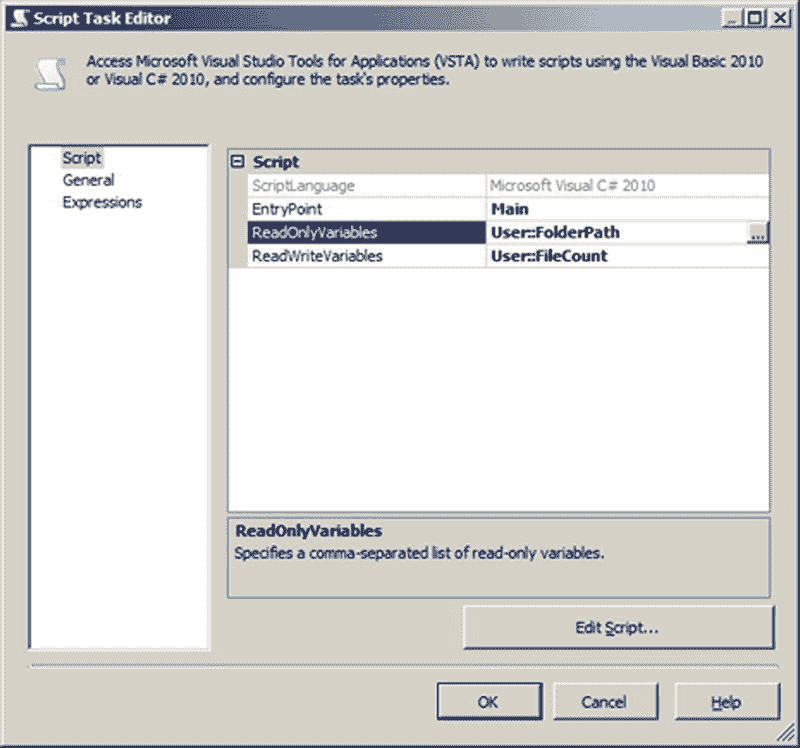

**图 4-1.** 脚本任务编辑器

您可以根据自己的偏好更改默认编程语言。在 Visual Studio 中，转到 `工具` 菜单并选择 `选项...`。展开 `商业智能设计器` 部分，然后展开 `集成服务设计器`。默认语言选项出现在右侧（见图 4-2）。

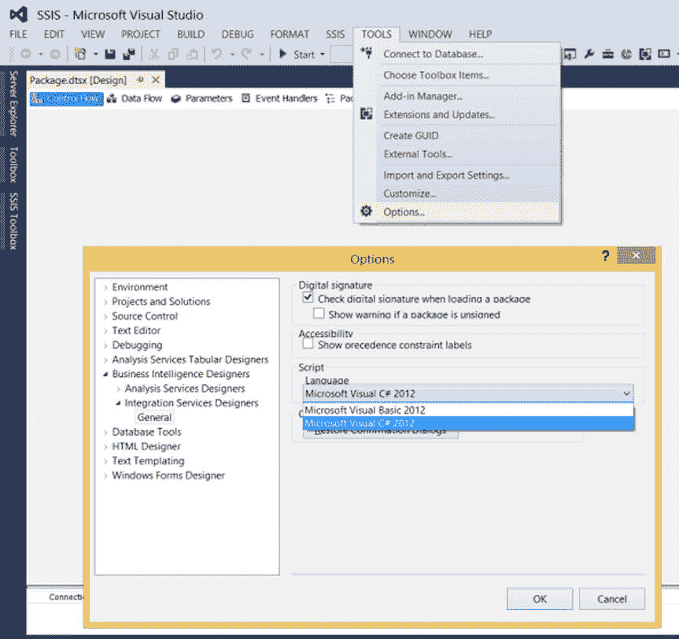

**图 4-2.** 更改默认脚本语言

编辑器中的第二个属性是 `入口点`。使用此属性，您可以更改将成为脚本起点的方法的名称。默认是 `Main` 方法。除非有充分的理由，否则更改它可能会给其他人带来一些困惑。`ReadOnlyVariables` 和 `ReadWriteVariables` 允许您读取和更改脚本任务代码中的变量，但如果您使用的是项目部署模型（自 SSIS 2012 起可用），您也可以使用它们来读取包和项目参数。您可以手动输入变量名称，也可以使用弹出窗口。这些字段是可选的，但本章后面将提供更多信息和示例。

### 脚本布局

点击“编辑脚本...”按钮会启动 VSTA 编辑器，使您能够编写 .NET 代码。该编辑器是 Visual Studio 在 VSTA 项目中的一个新实例，支持 C# 或 VB.NET 代码。VSTA 代表 Visual Studio Tools for Applications（应用程序级 Visual Studio 工具）。如果您仍在使用 SSIS 2005，那么 VSA（Visual Studio for Applications，应用程序级 Visual Studio）编辑器仅支持您编写 VB.NET 代码。VSA 编辑器是 Visual Studio 的精简版，缺少许多功能，包括编写 C# 代码的能力。

首次为脚本任务启动 VSTA 编辑器时，它会生成默认代码以帮助您入门。VSTA 环境包含三个主要部分（见图 4-3）。

- A. **ScriptMain**：您在其中键入代码的编辑器。关闭 VSTA 环境时会自动保存。

- B. **解决方案资源管理器**：在此部分，您可以向其他 .NET 库（例如 LINQ 或自定义库）添加额外引用。您还可以更改项目属性（例如目标框架），并可选择添加额外的 C# 或 VB.NET 文件。更改应通过“全部保存”按钮保存；否则，关闭 VSTA 编辑器时更改将丢失。

- C. **属性**：此处您可以查看在解决方案资源管理器中所选项目的属性。例如，您可以查看（临时）VSTA 项目在磁盘上的存储位置。

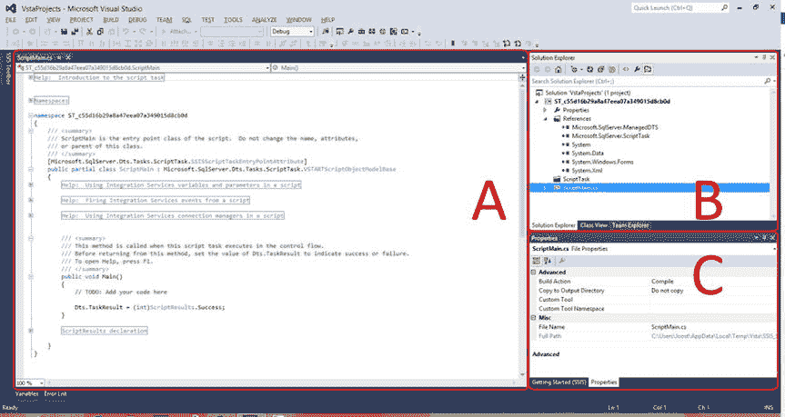

图 4-3. 脚本任务的 VSTA 编辑器

A 部分中的脚本是自动生成的，其代码因 SSIS 版本以及脚本语言而异（见图 4-4 和 4-5）。

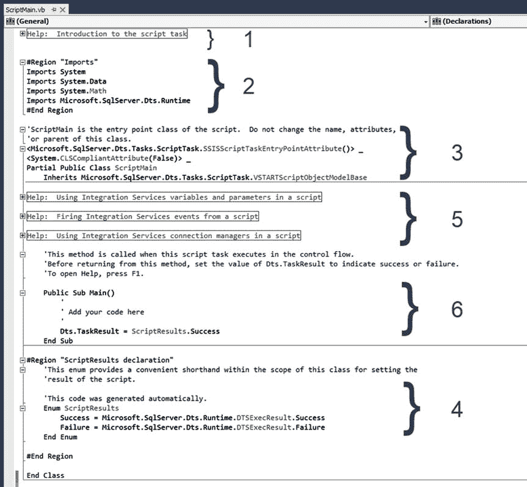

图 4-5. 2012 版 VB.NET 脚本任务代码

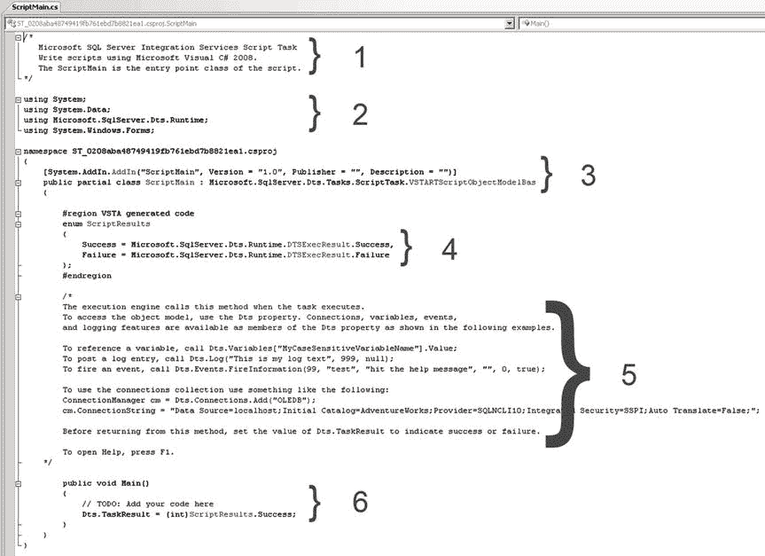

图 4-4. SSIS 2008 版 C# 脚本任务代码

脚本任务始终以一个通用注释开头。其文本随 SSIS 版本变化。请删除这些注释，或者更好的做法是，用关于文件/脚本的有用注释替换它们。您为什么使用脚本任务？您的代码在做什么？在 2012 版本中，添加了区域以使代码更有条理。您也可以手动将它们添加到 SSIS 2008 脚本中。

```
#region Help: Introduction to the script task
/* 脚本任务允许您在 Integration Services 控制流的上下文中，
* 执行几乎任何在 .Net 应用程序中可以完成的操作。
*
* 展开其他带有“Help”前缀的区域，
* 了解在此脚本任务中使用 Integration Services 功能的特定方法示例。
*/
#endregion
```

这是 VB.NET 代码：

```
#Region "Help:  Introduction to the script task"
'脚本任务允许您在 Integration Services 控制流的上下文中，
'执行几乎任何在 .Net 应用程序中可以完成的操作。
'展开其他带有“Help”前缀的区域，
'了解在此脚本任务中使用 Integration Services 功能的特定方法示例。
#End Region
```

接下来的部分是 `using` 指令或 `import` 语句。在 C# 中它们被称为 `using` 指令，在 VB.NET 中被称为 `Imports` 语句。例如：

```
#region Namespaces
using System;
using System.Data;
using Microsoft.SqlServer.Dts.Runtime;
using System.Windows.Forms;
#endregion
```

这里是 VB.NET 代码：

```
#Region "Imports"
Imports System
Imports System.Data
Imports System.Math
Imports Microsoft.SqlServer.Dts.Runtime
#End Region
```

包含哪些命名空间因 SSIS 版本甚至脚本语言而异。您可以添加额外的 `using`/`imports` 以使代码更简洁。它们允许在给定命名空间中使用类型。有关 .NET 基础的更多信息，请参见第 3 章。

第三部分是命名空间和类声明。这些是自动生成的。除非您是经验丰富的 .NET 开发人员且有充分理由，否则不要更改它们。

```
namespace ST_abfa556bdb974f78a26e3c3af4606e6e
{
    /// <summary>
    /// ScriptMain 是脚本的入口点类。请勿更改此类的名称、属性或父类。
    /// </summary>
    [Microsoft.SqlServer.Dts.Tasks.ScriptTask.SSISScriptTaskEntryPointAttribute]
    public partial class ScriptMain : Microsoft.SqlServer.Dts.Tasks.ScriptTask.VSTARTScriptObjectModelBase
    {
```

这里是 VB.NET 代码：

```
'ScriptMain 是脚本的入口点类。请勿更改此类的名称、属性或父类。
<Microsoft.SqlServer.Dts.Tasks.ScriptTask.SSISScriptTaskEntryPointAttribute()> _
<System.CLSCompliantAttribute(False)> _
Partial Public Class ScriptMain
    Inherits Microsoft.SqlServer.Dts.Tasks.ScriptTask.VSTARTScriptObjectModelBase
```

接下来是脚本结果声明（在 SSIS 2012 中，这些被移到了脚本底部；它们在 SSIS 2005 中不存在）。这段自动生成的代码用于为脚本任务分配结果：成功或失败。请勿更改。为节省篇幅，本书示例不显示此代码，但您不能将其从实际代码中删除！

## 脚本任务结构概述

以下是 `ScriptMain` 类的框架，其中包含主要的代码区域。

```csharp
#region ScriptResults declaration
/// <summary>
/// 此枚举在此类范围内为设置脚本结果提供方便的简写。
///
/// 此代码是自动生成的。
/// </summary>
enum ScriptResults
{
    Success = Microsoft.SqlServer.Dts.Runtime.DTSExecResult.Success,
    Failure = Microsoft.SqlServer.Dts.Runtime.DTSExecResult.Failure
};
#endregion
```

这是 VB.NET 代码：

```vbnet
#Region "ScriptResults declaration"
'此枚举在此类范围内为设置脚本结果提供方便的简写。
'此代码是自动生成的。
Enum ScriptResults
    Success = Microsoft.SqlServer.Dts.Runtime.DTSExecResult.Success
    Failure = Microsoft.SqlServer.Dts.Runtime.DTSExecResult.Failure
End Enum
#End Region
```

第五部分由帮助文本和示例代码组成。您可以保留、删除或将其改为关于您的类及其方法的一般注释。

最后一部分是 `Main` 方法。这是在运行脚本任务时启动的方法，也是您添加自定义代码的地方。`Main` 方法应始终返回 `ScriptResults.Success` 或 `ScriptResults.Failure`。在 SSIS 2005 中，您会看到不同的语法。脚本任务成功时，使用 `Dts.TaskResult = Dts.TaskResult.Success`；脚本任务失败时，使用 `Dts.TaskResult = Dts.TaskResult.Failure`。

## 变量与参数

SSIS 2012 的包变量引入了可在脚本任务中使用的参数。您可以使用它们来避免在脚本中硬编码值，或者调整脚本中的变量值，以便在其他任务或表达式中使用。有两种不同的方法。在此示例中，您将统计一个文件夹中的文件数量。文件夹路径将由字符串变量或参数提供，文件数量将存储在一个整数变量中。

注意：参数是只读的。您无法更改它们，如果尝试更改，将会出现以下错误：`Exception has been thrown by the target of an invocation.`

首先，创建一个名为 `variables.dtsx` 的新包，并在控制流中添加一个脚本任务。为脚本任务取一个有用的名称，如 `SCR – Count Files`。接下来，创建一个字符串变量（或字符串包参数，或字符串项目参数），将其命名为 `FolderPath`，并填入一个现有目录的路径。同时创建一个名为 `FileCount` 的整数（`Int32`）变量，用于存储文件数量。图 4-6 显示了这两个变量。

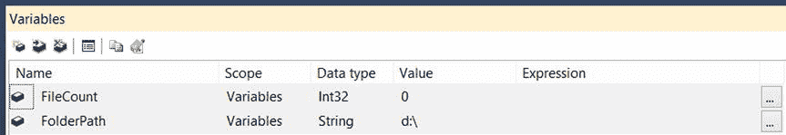

图 4-6. 为 `FileCount` 和 `FolderPath` 使用变量

### 方法 1：`ReadOnlyVariables` 和 `ReadWriteVariables`

对于第一种方法，您需要在脚本任务编辑器中填写 `ReadOnlyVariables` 和 `ReadWriteVariables` 属性，以便这些变量在运行时被脚本任务锁定。可以通过键入名称或使用选择窗口（点击选中字段时出现的带三个点的按钮）来完成。将字符串变量名称 `FolderPath`（或其中一个字符串参数）添加为只读变量，并将整数变量 `FileCount` 添加为读写变量。

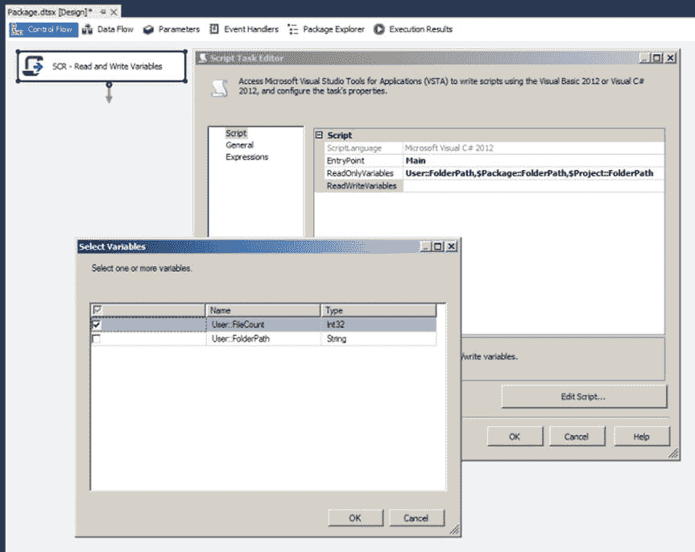

图 4-7. 选择您想要使用的变量（或参数）

填写完 `ReadOnlyVariables` 和 `ReadWriteVariables` 属性后，您可以单击 `Edit Script...` 按钮打开 VSTA 环境。首先，在顶部为 `System.IO` 添加一个额外的 `using`/`Imports` 语句，以便您能够执行 IO 操作，例如统计文件夹中的所有文件。

```csharp
using System.IO;
```

以下是 VB.NET 代码：

```vbnet
Imports System.IO
```

接下来，将实际代码添加到 `Main` 方法中。首先，您需要从变量中获取文件夹路径并将其存储在一个本地 .NET 变量中。

```csharp
string myFolder = Dts.Variables["User::FolderPath"].Value.ToString();
```

以下是 VB.NET 代码：

```vbnet
Dim myFolder As String = Dts.Variables("User::FolderPath").Value.ToString()
```

然后，您需要在实际的文件计数代码中使用该本地变量，并将文件计数直接存储到 SSIS 整数变量 `FileCount` 中。

```csharp
Dts.Variables["User::FileCount"].Value = Directory.GetFiles(myFolder, "*.*",
SearchOption.TopDirectoryOnly).Length;
```

以下是 VB.NET 代码：

```vbnet
Dts.Variables("User::FileCount").Value = Directory.GetFiles(myFolder, "*.*", _
SearchOption.TopDirectoryOnly).Length
```

现在，您的整个脚本应该类似于以下代码，但命名空间的名称会有所不同，因为它是自动生成的。并且此代码中未显示 `ScriptResults` 声明。

```csharp
#region Namespaces
using System;
using System.Data;
using Microsoft.SqlServer.Dts.Runtime;
using System.Windows.Forms;
#endregion

#region customNamespaces
using System.IO;
#endregion

namespace ST_a0107ad99e244d5ca57c869184dd6a52
{
    /// <summary>
    /// 这是一个关于如何在脚本任务中使用变量和参数的示例。
    /// 它从变量或参数中获取一个文件夹。统计其中的文件数量，
    /// 并将文件计数填充到读写整数变量中。
    /// </summary>
    [Microsoft.SqlServer.Dts.Tasks.ScriptTask.SSISScriptTaskEntryPointAttribute]
    public partial class ScriptMain : Microsoft.SqlServer.Dts.Tasks.ScriptTask.VSTARTScriptObjectModelBase
    {
        /// <summary>
        /// 获取文件夹并统计其中的文件数量。
        /// 将文件计数传递给 SSIS 变量。
        /// </summary>
        public void Main()
        {
            // 首先创建一个 .NET 字符串变量来存储路径。在本示例中有点多余，
            // 但您可以添加额外的步骤，例如验证文件夹是否存在。
            // 然后选择您想要用来获取路径的变量或参数。
            // 在这里我使用了变量。
            string myFolder = Dts.Variables["User::FolderPath"].Value.ToString();

            // 如果您更倾向于使用参数，则可以使用以下代码行之一
            // 来代替上面的变量行。这三行代码中应取消注释一行。
            //string myFolder = Dts.Variables["$Package::FolderPath"].Value.ToString();
            //string myFolder = Dts.Variables["$Project::FolderPath"].Value.ToString();

            // 从 myFolder 中获取文件计数，并将该数字
            // 存储在 SSIS 整数变量中。
            Dts.Variables["User::FileCount"].Value = Directory.GetFiles(myFolder, "*.*",
                SearchOption.TopDirectoryOnly).Length;

            // 以成功结果关闭脚本。
            Dts.TaskResult = (int)ScriptResults.Success;
        }
    }
}
```

以下是 VB.NET 代码：

```vb
#Region "Imports"
Imports System
Imports System.Data
Imports System.Math
Imports Microsoft.SqlServer.Dts.Runtime
#End Region

#region customNamespaces
Imports System.IO
#endregion

<Microsoft.SqlServer.Dts.Tasks.ScriptTask.SSISScriptTaskEntryPointAttribute()> _
<System.CLSCompliantAttribute(False)> _
Partial Public Class ScriptMain
    Inherits Microsoft.SqlServer.Dts.Tasks.ScriptTask.VSTARTScriptObjectModelBase

    Public Sub Main()
        ' First create a .NET string variable to store the path in. A little
        ' redundant in this example but you could add extra steps to for
        ' example validate the existance of the folder. Then choose which
        ' variable or parameter you want to use to get the path from. In this
        ' case I used the variable
        Dim myFolder As String = Dts.Variables("User::FolderPath").Value.ToString()

        ' If you rather want to use a parameter then use one of these codelines instead
        ' of the variable line above. One of the three lines should be uncommented.
        ' string myFolder = Dts.Variables("$Package::FolderPath").Value.ToString()
        ' string myFolder = Dts.Variables("$Project::FolderPath").Value.ToString()

        ' Get the file count from the my folder and store that number in the SSIS
        ' integer variable.
        Dts.Variables("User::FileCount").Value = Directory.GetFiles(myFolder, "*.*", _
        SearchOption.TopDirectoryOnly).Length

        ' Close the script with result success.
        Dts.TaskResult = ScriptResults.Success
    End Sub
End Class
```

这是一个关于如何在脚本任务中使用变量和参数的示例。它从一个变量或参数中获取文件夹路径，统计其中的文件数量，并将文件计数填充到可读写的整数变量中。

当将大量代码复制粘贴到其他脚本任务时，也可以检查变量是否存在于 `ReadOnlyVariables` 和 `ReadWriteVariables` 集合中，如果不存在，则记录有意义的错误信息：

```csharp
if (Dts.Variables.Contains("FileCount"))
{
    // Get the file count from the my folder and store that number in the SSIS integer variable.
    Dts.Variables["User::FileCount"].Value = Directory.GetFiles(myFolder, "*.*",
    SearchOption.TopDirectoryOnly).Length;
}
else
{
    // Handle error
}
```

以下是 VB.NET 代码：

```vb
If (Dts.Variables.Contains("FileCount")) Then
    ' Get the file count from the my folder and store that number in the SSIS integer variable.
    Dts.Variables("User::FileCount").Value = Directory.GetFiles(myFolder, "*.*",  _
    SearchOption.TopDirectoryOnly).Length
Else
    ' Handle error
End If
```

也可以遍历添加到 `ReadOnlyVariables` 和 `ReadWriteVariables` 属性中的变量集合。在此示例中，使用了消息框，但在后续段落中，您将看到一种更优雅的方式来显示变量：

# SSIS脚本任务中的变量处理

## 遍历变量和参数

```csharp
foreach (Variable myVar in Dts.Variables)
{
    MessageBox.Show(myVar.Namespace + "::" + myVar.Name);
}
```

以下是 VB.NET 代码：

```vbnet
For Each myVar As Variable In Dts.Variables
    MessageBox.Show(myVar.Namespace & "::" & myVar.Name)
Next
```

然而，无法遍历所有包变量和参数，因为脚本任务不支持枚举所有变量和参数的列表。您始终需要硬编码变量名称，除非您硬编码对包的引用，然后才能遍历所有包变量和参数。您应该注意，在这种情况下，会在内存中创建包的第二个实例。如果您想尝试此代码，请更改包的文件路径。

```csharp
Microsoft.SqlServer.Dts.Runtime.Application app = new Microsoft.SqlServer.Dts.Runtime.Application();
Package myPackage = app.LoadPackage(@"Y:\SSIS\Variables.dtsx", null);
// Loop through package variables and parameters
foreach (Variable myVar in myPackage.Variables)
{
    // Filter System variables
    if (!myVar.Namespace.Equals("System"))
    {
        MessageBox.Show(myVar.Name);
    }
}
```

以下是 VB.NET 代码：

```vbnet
Dim app As Microsoft.SqlServer.Dts.Runtime.Application = _
New Microsoft.SqlServer.Dts.Runtime.Application()
Dim myPackage As Package = app.LoadPackage("Y:\SSIS\Variables.dtsx", Nothing)
' Loop through package variables and parameters
For Each myVar As Variable In myPackage.Variables
    ' Filter System variables
    If Not myVar.Namespace.Equals("System") Then
        MessageBox.Show(myVar.Name)
    End If
Next
```

如果要获取敏感参数的值，则需要稍微修改代码。不要使用`.Value.toString()`，而需要使用`.GetSensitiveValue().ToString()`。但请注意，您现在有责任防止意外泄露密码等敏感值。

```csharp
// Create string variable to store the parameter value
string mySecretPassword = Dts.Variables["$Package::MySecretPassword"].GetSensitiveValue().ToString();
// Show the parameter value with a messagebox
MessageBox.Show("Your secret password is " + mySecretPassword);
```

以下是 VB.NET 代码：

```vbnet
' Create string variable to store the parameter value
Dim mySecretPassword as string = _
Dts.Variables("$Package::MySecretPassword").GetSensitiveValue().ToString()
' Show the parameter value with a messagebox
MessageBox.Show("Your secret password is " + mySecretPassword)
```

## 变量分配器方法

对于第二种方法，你不会在脚本任务编辑器中使用`ReadOnlyVariables`和`ReadWriteVariables`属性。取而代之的是，你使用变量分配器并通过`LockForRead`和`LockForWrite`方法来锁定脚本中的变量。这与之前的方法不同，但最终效果是一样的。

在`variables.dtsx`包中添加一个新的脚本任务，并将其连接到现有的脚本任务，以确保两个脚本任务不会同时执行；否则，它们都会试图锁定相同的变量。

编辑该脚本任务并打开 VSTA 环境。在顶部添加一个额外的`using`/`import`，用于`System.IO`，这样你就可以执行 IO 操作，例如统计文件夹中的所有文件。

```csharp
using System.IO;
```

以下是 VB.NET 代码：

```vbnet
Imports System.IO
```

现在转到`Main`方法，并添加以下代码行来通过代码锁定变量。`FolderPath`变量被锁定为读取，`FileCount`变量被锁定为写入。

```csharp
Dts.VariableDispenser.LockForRead("User::FolderPath");
Dts.VariableDispenser.LockForWrite("User::FileCount");
```

以下是 VB.NET 代码：

```vbnet
Dts.VariableDispenser.LockForRead("User::FolderPath")
Dts.VariableDispenser.LockForWrite("User::FileCount")
```

然后读取`FolderPath`变量并将其内容存储在一个本地字符串变量中。

```csharp
Variables vars = null;
Dts.VariableDispenser.GetVariables(ref vars);
string myFolder = vars["User::FolderPath"].Value.ToString();
```

以下是 VB.NET 代码：

```vbnet
Dim vars As Variables = Nothing
Dts.VariableDispenser.GetVariables(vars)
Dim myFolder As String = vars("User::FolderPath").Value.ToString()
```

下一步是统计文件夹中的文件数量，并将其存储在 SSIS 整数变量`FileCount`中。

```csharp
vars["User::FileCount"].Value = Directory.GetFiles(myFolder, "*.*", SearchOption.TopDirectoryOnly).Length;
```

以下是 VB.NET 代码：

```vbnet
vars("User::FileCount").Value = Directory.GetFiles(myFolder, "*.*", SearchOption.TopDirectoryOnly).Length
```

现在最后一部分：释放变量上的锁。

```csharp
vars.Unlock();
```

以下是 VB.NET 代码：

```vbnet
vars.Unlock()
```

最终的代码应该类似这样：

# 在 Script Task 中使用变量和参数

本文档将演示如何在 SSIS 脚本任务中使用变量和参数。

## C# 代码示例

以下是一个 C# 示例，展示了如何从变量或参数中获取文件夹路径，统计其中的文件数量，并将结果填充到 SSIS 变量中。

```csharp
#region Namespaces
using System;
using System.Data;
using Microsoft.SqlServer.Dts.Runtime;
using System.Windows.Forms;
#endregion

#region customNamespaces
using System.IO;
#endregion

namespace ST_fb03c633e7fc4e20a58e8e1ffc40b68e
{
    /// <summary>
    /// This is an example on how to use variables and parameters in a Script
    /// Task. It gets a folder from a variable or parameter. Counts the number
    /// of files in it and fill the read write integer variable with the file
    /// count.
    /// </summary>
    [Microsoft.SqlServer.Dts.Tasks.ScriptTask.SSISScriptTaskEntryPointAttribute]
    public partial class `ScriptMain` : Microsoft.SqlServer.Dts.Tasks.ScriptTask.VSTARTScriptObjectModelBase
    {
        /// <summary>
        /// Get folder and count the number of files in it. Pass te file count to
        /// the SSIS variable
        /// </summary>
        public void `Main`()
        {
            // Lock variables for read or for write
            Dts.`VariableDispenser`.`LockForRead`("User::FolderPath");
            Dts.`VariableDispenser`.`LockForWrite`("User::FileCount");

            // If you want to use a parameter instead of a variable then change the code to one of these lines.
            //Dts.`VariableDispenser`.`LockForRead`("$Package::FolderPath");
            //Dts.`VariableDispenser`.`LockForRead`("$Project::FolderPath");

            // Create a variable 'container' to store variables
            `Variables` vars = null;

            // Add variables from the VariableDispenser to the variables container
            Dts.`VariableDispenser`.`GetVariables`(ref vars);

            // First create a .NET string variable to store the path in. A little
            // redundant in this example but you could add extra steps to for
            // example validate the existance of the folder. Then choose which
            // variable or parameter you want to use to get the path from. In
            // this case I used the variable
            string myFolder = vars["User::FolderPath"].`Value`.`ToString`();

            // 使用参数而非变量的替代方法相同。仅需使用以下三行之一。
            //string myFolder = vars["$Package::FolderPath"].`Value`.`ToString`();
            //string myFolder = vars["$Project::FolderPath"].`Value`.`ToString`();
            // 从我的文件夹中获取文件计数，并将该数字存储到
            // SSIS 整数变量中。
            vars["User::FileCount"].`Value` = `Directory.GetFiles`(myFolder, "*.*",
                `SearchOption.TopDirectoryOnly`).`Length`;
            // 释放锁
            vars.`Unlock`();
            // 以成功结果关闭脚本
            Dts.`TaskResult` = (int)`ScriptResults.Success`;
        }
    }
}
```

## VB.NET 代码示例

以下是相同功能的 VB.NET 实现。

```vbnet
#Region "Imports"
Imports System
Imports System.Data
Imports System.Math
Imports Microsoft.SqlServer.Dts.Runtime
#End Region

#Region "customNamespaces"
Imports System.IO
#End Region

' 这是一个关于如何在脚本任务中使用变量和参数的示例。
' 它从变量或参数中获取文件夹路径，统计其中的文件数量，
' 并将文件计数填充到读写整数变量中。
<Microsoft.SqlServer.Dts.Tasks.ScriptTask.SSISScriptTaskEntryPointAttribute()> _
<System.CLSCompliantAttribute(False)> _
Partial Public Class `ScriptMain`
    Inherits Microsoft.SqlServer.Dts.Tasks.ScriptTask.VSTARTScriptObjectModelBase

    ' 获取文件夹并统计其中的文件数量，将文件计数传递给 SSIS 变量
    Public Sub `Main`()
        ' 锁定变量以供读取或写入
        Dts.`VariableDispenser`.`LockForRead`("User::FolderPath")
        Dts.`VariableDispenser`.`LockForRead`("$Package::FolderPath")
        Dts.`VariableDispenser`.`LockForRead`("$Project::FolderPath")
        Dts.`VariableDispenser`.`LockForWrite`("User::FileCount")

        ' 创建一个变量“容器”来存储变量
        Dim vars As `Variables` = Nothing

        ' 从 VariableDispenser 将变量添加到变量容器中
        Dts.`VariableDispenser`.`GetVariables`(vars)

        ' 首先创建一个 .NET 字符串变量来存储路径。在本示例中虽然有些冗余，
        ' 但您可以添加额外步骤，例如验证文件夹是否存在。
        ' 然后选择要用来获取路径的变量或参数。此处我使用了变量。
        Dim myFolder As String = vars("User::FolderPath").`Value`.`ToString`()

        ' 从我的文件夹中获取文件计数，并将该数字存储到
        ' SSIS 整数变量中。
        vars("User::FileCount").`Value` = `Directory.GetFiles`(myFolder, "*.*", _
            `SearchOption.TopDirectoryOnly`).`Length`

        ' 释放锁
        vars.`Unlock`()

        ' 以成功结果关闭脚本
        Dts.`TaskResult` = `ScriptResults.Success`
    End Sub
End Class
```

如果只需锁定一个变量进行读取或写入，可以使用 `LockOneForRead` 和 `LockOneForWrite` 方法。这样代码会少一些，但结果类似。这里仅展示 `Main` 方法中的替代代码。额外的 using/import 语句与之前相同。

```csharp
public void Main()
{
    // 创建一个变量“容器”来存储变量
    Variables vars = null;

    // 锁定变量以供读取，并将其添加到变量“容器”中
    Dts.VariableDispenser.LockOneForRead("User::FolderPath", ref vars);

    // 首先创建一个 .NET 字符串变量来存储路径。在本示例中虽然有些冗余，
    // 但您可以添加额外步骤，例如验证文件夹是否存在。
    // 然后选择要用来获取路径的变量或参数。此处我使用了变量
    string myFolder = vars["User::FolderPath"].Value.ToString();

    // 释放锁
    vars.Unlock();

    // 锁定变量以供写入，并将其添加到变量容器中
    Dts.VariableDispenser.LockOneForWrite("User::FileCount", ref vars);

    // 从我的文件夹中获取文件计数，并将该数字存储到
    // SSIS 整数变量中。
    vars["User::FileCount"].Value = Directory.GetFiles(myFolder, "*.*",
        SearchOption.TopDirectoryOnly).Length;

    // 释放锁
    vars.Unlock();

    // 以成功结果关闭脚本
    Dts.TaskResult = (int)ScriptResults.Success;
}
```

以下是 VB.NET 代码：

```vbnet
Public Sub Main()
    ' 创建一个变量“容器”来存储变量
    Dim vars As Variables = Nothing

    ' 锁定变量以供读取，并将其添加到变量“容器”中
    Dts.VariableDispenser.LockOneForRead("User::FolderPath", vars)
    ' Dts.VariableDispenser.LockOneForRead("$Package::FolderPath", vars)
    ' Dts.VariableDispenser.LockOneForRead("$Project::FolderPath", vars)

    ' 首先创建一个 .NET 字符串变量来存储路径。在本示例中虽然有些冗余，
    ' 但您可以添加额外步骤，例如验证文件夹是否存在。
    ' 然后选择要用来获取路径的变量或参数。此处我使用了变量
    Dim myFolder As String = vars("User::FolderPath").Value.ToString()

    ' 释放锁
    vars.Unlock()

    ' 锁定变量以供写入，并将其添加到变量“容器”中
    Dts.VariableDispenser.LockOneForWrite("User::FileCount", vars)

    ' 从我的文件夹中获取文件计数，并将该数字存储到
    ' SSIS 整数变量中。
    vars("User::FileCount").Value = Directory.GetFiles(myFolder, "*.*", SearchOption.TopDirectoryOnly).Length

    ' 释放锁
    vars.Unlock()

    ' 以成功结果关闭脚本
    Dts.TaskResult = ScriptResults.Success
End Sub
```

## 两种方法的优缺点

使用变量分配器方法时，在锁定和解锁变量方面有更多控制权。其最大缺点是无法快速查看正在使用哪些变量，必须检查整个代码。另一个缺点是完成相同功能需要更多代码。因此，第一种方法应是首选方法。并且，使用第一种方法时也可以手动解锁变量：

```csharp
if (Dts.Variables.Count > 0)
{
    Dts.Variables.Unlock();
}
```

以下是 VB.NET 代码：

```vbnet
If (Dts.Variables.Count > 0) Then
    Dts.Variables.Unlock()
End If
```

## 父包变量

父包是指通过执行包任务执行另一个包（子包）的包。在子包中，可以通过脚本任务读取和写入父包中的变量，但这些变量仅在运行时模式下可用，在设计时模式下不可用。这意味着无法使用选择窗口，但可以手动输入。在脚本任务中，两种方法都可用于读取/写入父包变量。

但有一个缺点：如果没有适当的错误处理，在没有父包的情况下将无法运行子包，因为它期望的变量不可用。读取父包变量的另一种方法是使用父包配置，但这种方式仅支持读取，不支持写入。

## 引用程序集

有时你会在多个脚本任务中重复使用同一段代码。如果由于某种原因需要更改这段代码，则必须编辑所有使用该代码的脚本任务。为避免这种情况，可以创建程序集并在脚本任务中引用它。程序集是一段可供 .NET 应用程序使用的预编译代码。你可以创建程序集来存储常用的方法。如果需要更改其中某个方法，则只需更改程序集（而无需更改所有脚本任务）。

第三方公司（包括 Microsoft）也可以为你创建程序集；例如，用于解压缩文件或通过 SFTP 下载文件的程序集。因此，你无需重复造轮子。在后续的某些章节中，你将学习如何使用这些第三方程序集。在本章中，你将学习如何创建一个简单的程序集并在脚本任务中使用它。

### 创建程序集

若要创建自己的程序集，则需要使用 Visual Studio 的“完整”版本，或者至少是支持 C# 或 VB.NET 项目的版本（仅限 BIDS 或 SSDT BI 是不够的）。在此示例中，你将创建一个包含用于验证电子邮件地址格式方法的程序集。启动 Visual Studio 并创建一个名为 `myMethodsForSSIS` 的新类库项目。此模板可在 Visual Basic 和 Visual C# 下找到（参见图 4-8）。确保选择了正确的 .NET Framework 版本（参见表 4-1）；否则将无法引用它。通过一些额外步骤，可以引用较低版本的 .NET，但无法引用更高 .NET 版本的程序集。

**表 4-1.** 选择正确的 .NET Framework 版本

| SSIS 版本 | 支持的框架 |
| --- | --- |
| 2005 | 2.0 |
| 2008 (R2) | 2.0 => 3.5 |
| 2012 | 2.0 => 4.0 |
| 2014 | 2.0 => 4.5.1 |

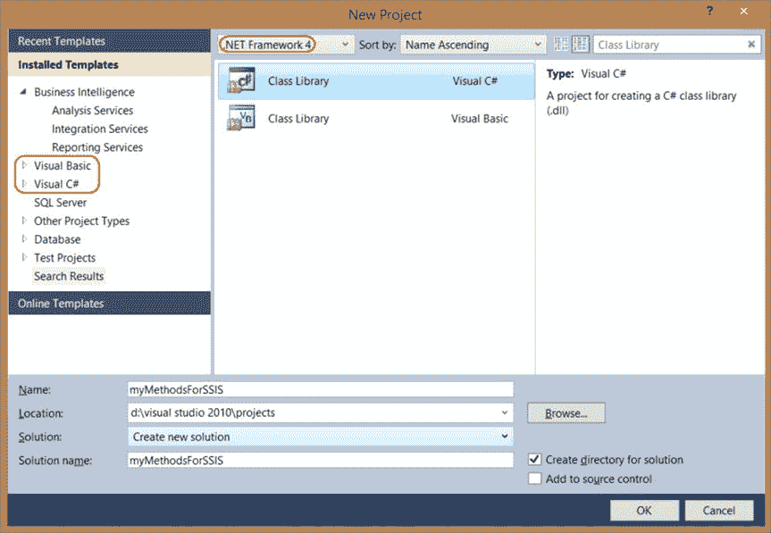

**图 4-8.** 新建类库项目

创建新项目时，`Class1.cs` 或 `Class1.vb` 文件几乎是空的。首先在 `Class1` 文件的顶部添加 `usings` 或 `imports`。C# 文件已经有一些 `using` 语句，但 VB.NET 文件没有。它们位于项目属性中，但为了保持示例一致，我们也将其添加到文件中。

```csharp
using System;
using System.Collections.Generic;
using System.Linq;
using System.Text;
using System.Text.RegularExpressions;   // 已添加
```

这是 VB.NET 代码：

```vb
Imports System
Imports System.Collections.Generic
Imports System.Linq
Imports System.Text
Imports System.Text.RegularExpressions  ' 已添加
```

下一步是命名空间和类声明。你将使用一个包含静态方法的静态类，以便在脚本任务中直接调用这些方法。VB.NET 中静态类的等价物是包含函数的模块。有关静态类的更多信息，请参阅 [`http://msdn.microsoft.com/en-us/library/79b3xss3.aspx`](http://msdn.microsoft.com/en-us/library/79b3xss3.aspx)。有关模块的更多信息，请参阅 [`http://msdn.microsoft.com/en-us/library/aaxss7da.aspx`](http://msdn.microsoft.com/en-us/library/aaxss7da.aspx)。类名/模块名为 `EmailMethods`，命名空间为 `myMethodsForSSIS`。

```csharp
namespace myMethodsForSSIS
{
    // 一个包含电子邮件方法的静态类
    public static class EmailMethods
    {
    }
}
```

这是 VB.NET 代码：

```vb
Namespace myMethodsForSSIS
    ' 一个包含电子邮件方法的模块
    Public Module EmailMethods
    End Module
End Namespace
```

代码的最后一步是将一个用于验证电子邮件地址格式的公共静态方法添加到 C# 类，或将一个公共函数添加到 VB.NET 模块。它被命名为 `IsCorrectEmail`，接收一个电子邮件地址作为输入并返回布尔值 `true` 或 `false`，指示格式是否正确。你可以从本书附带的源代码中复制该方法。完成后，完整代码如下所示。

```csharp
using System;
using System.Collections.Generic;
using System.Linq;
using System.Text;
using System.Text.RegularExpressions;   // 已添加

namespace myMethodsForSSIS
{
    // 一个包含电子邮件方法的静态类
    public static class EmailMethods
    {
        // 一个通过正则表达式模式验证电子邮件地址的布尔方法。
        public static bool IsCorrectEmail(String emailAddress)
        {
            // 电子邮件地址的正则表达式模式
            string emailAddressPattern = @"^(([^<>()[\]\\.,;:\s@\""]+"
                + @"(\.[^<>()[\]\\.,;:\s@\""]+)*)|(\"".+\""))@"
                + @"((\[[0-9]{1,3}\.[0-9]{1,3}\.[0-9]{1,3}"
                + @"\.[0-9]{1,3}\])|(([a-zA-Z\-0-9]+\.)+"
                + @"[a-zA-Z]{2,}))$";

            // 使用模式创建一个正则表达式对象
            Regex emailAddressRegex = new Regex(emailAddressPattern);

            // 检查是否匹配并返回该值（布尔值）
            return emailAddressRegex.IsMatch(emailAddress);
        }
    }
}
```

这是 VB.NET 代码：

```vb
Imports System.Collections.Generic
Imports System.Linq
Imports System.Text
Imports System.Text.RegularExpressions  ' 已添加

Namespace myMethodsForSSIS
    ' 一个包含电子邮件方法的模块
    Public Module EmailMethods
        ' 一个通过正则表达式模式验证电子邮件地址的布尔方法。
        Public Function IsCorrectEmail(emailAddress As [String]) As Boolean
            ' 电子邮件地址的正则表达式模式
            Dim emailAddressPattern As String = "^(([^<>()[\]\\.,;:\s@\""]+" &
                "(\.[^<>()[\]\\.,;:\s@\""]+)*)|(\"".+\""))@" &
                "((\[[0-9]{1,3}\.[0-9]{1,3}\.[0-9]{1,3}" &
                "\.[0-9]{1,3}\])|(([a-zA-Z\-0-9]+\.)+" &
                "[a-zA-Z]{2,}))$"

            ' 使用模式创建一个正则表达式对象
            Dim emailAddressRegex As New Regex(emailAddressPattern)

            ' 检查是否匹配并返回该值（布尔值）
            Return emailAddressRegex.IsMatch(emailAddress)
        End Function
    End Module
End Namespace
```

### 强名称

在 SSIS 脚本任务中使用新程序集之前，必须先为其赋予强名称。进入项目属性，然后转到“签名”页面。选中“为程序集签名”复选框，然后在下拉列表中添加一个新的密钥文件。此示例的名称为 `PublicPrivateKeyFile.snk`，签名算法为 `sha256RSA`，不设置密码（参见图 4-9）。单击“确定”按钮后，新的密钥文件将在解决方案资源管理器中可见。

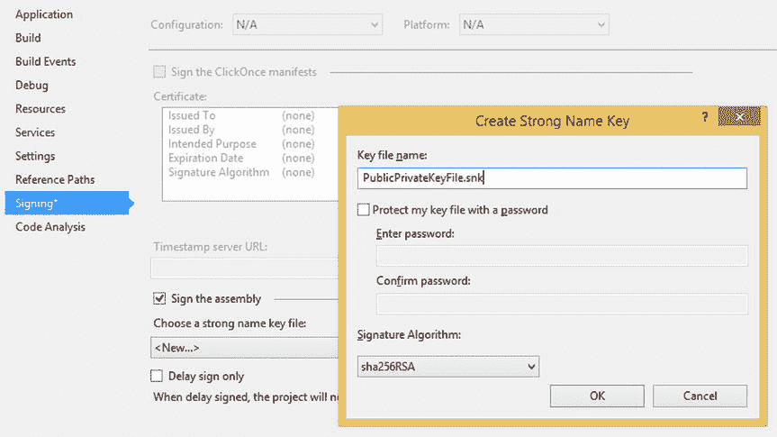

**图 4-9.** 添加密钥文件（C# 项目，VB.NET 与此类似）

现在关闭项目属性，并将项目生成为 Release 版本，而不是默认的 Debug 模式。你可以在 Visual Studio 工具栏中进行更改。生成项目时，程序集将使用此新密钥文件进行签名。

**注意：**添加强名称并非安全措施，它仅提供唯一标识。

### 全局程序集缓存

准备程序集的最后一步是将其添加到 SSIS 计算机的全局程序集缓存 (GAC) 中。SSIS 只能使用通过 GAC 可用的程序集。以管理员身份打开 Visual Studio（2008/2010 等）命令提示符；否则无法将程序集添加到 GAC。进入项目的 `Bin\Release` 文件夹，你将在此处找到新创建的程序集的 `.dll` 文件。执行以下命令将其添加到 GAC（参见图 4-10）：

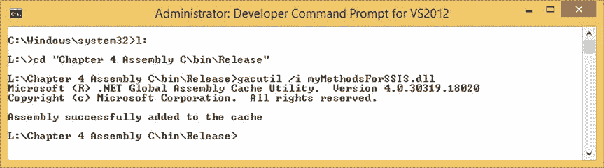

**图 4-10.** .NET 全局程序集缓存实用工具

```
gacutil /i myMethodsForSSIS.dll
```

如果服务器上没有 `gacutil`（通常服务器未安装 Visual Studio 时会出现此情况），则可以使用 PowerShell 部署程序集（本书附带的源代码中提供了示例脚本），或者可以在 Visual Studio 中创建一个安装和部署项目来为程序集创建安装程序。根据 Visual Studio 版本，安装程序项目位于**其他项目类型** > **安装程序** > **部署项目**中。对于 Visual Studio 2013 及更高版本，你需要下载此项目模板：[`https://visualstudiogallery.msdn.microsoft.com/9abe329c-9bba-44a1-be59-0fbf6151054d`](https://visualstudiogallery.msdn.microsoft.com/9abe329c-9bba-44a1-be59-0fbf6151054d)。

### 生成事件

如果你不想在每次更改程序集后都通过命令提示符将其添加到 GAC，你也可以在 Visual Studio 项目中添加一个生成后事件。在解决方案资源管理器中右键单击你的程序集项目，进入其属性。对于 C#，你可以转到“生成事件”选项卡，找到生成后事件命令行（见图 4-11）。对于 VB.NET，你需要转到“编译”选项卡，点击右下角的“生成事件”按钮，然后找到相同的生成后事件命令行（见图 4-12）。

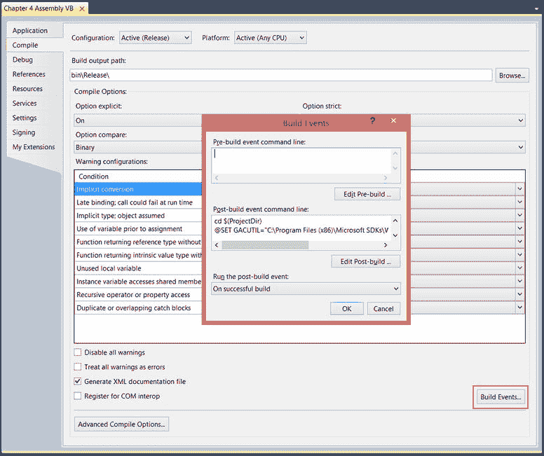

图 4-12. VB.NET 的生成后事件

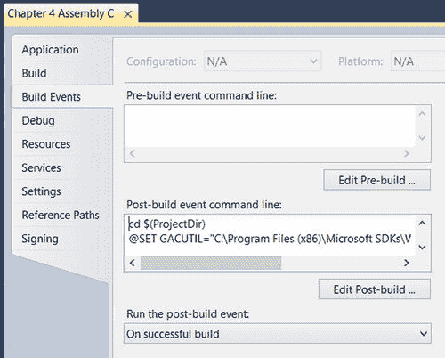

图 4-11. C# 的生成后事件

现在复制以下命令，但请修改 `gacutil` 的路径。该路径取决于 .NET Framework 的版本，甚至 Windows 的版本。此示例适用于 Windows 7 上的 .NET 3.5。

```
cd $(ProjectDir)

@SET GACUTIL="C:\Program Files (x86)\Microsoft SDKs\Windows\v7.0A\bin\gacutil.exe"

Echo 将 dll 安装到 GAC 中

Echo $(OutDir)

Echo $(TargetFileName)

%GACUTIL% -if "$(OutDir)$(TargetFileName)"
```

以下是一些备选路径：

```
C:\Program Files (x86)\Microsoft SDKs\Windows\v7.0A\Bin\NETFX 4.0 Tools\gacutil.exe (Win7 上的 .NET 4.0)

C:\Program Files (x86)\Microsoft SDKs\Windows\v8.1A\bin\NETFX 4.5.1 Tools\gacutil.exe (Win8.1 上的 .NET 4.5.1)
```

现在，你可以通过生成程序集项目来将其添加到 GAC，但你需要以管理员身份运行 Visual Studio，否则无法生效。要在脚本任务中使用该程序集，你还需要考虑实际 dll 文件的位置。对于 SSIS 2005，必须将 `.dll` 文件放入 SQL Server 的 Assemblies 文件夹：`C:\Program Files\Microsoft SQL Server\90\SDK\Assemblies\`。对于较新版本，你可以将其放在任何位置。你可以手动完成此操作，但也可以向生成后事件添加一些额外的行：

```
@SET DLLDIR="C:\Program Files (x86)\Microsoft SQL Server\100\DTS\Assemblies\"

Echo 将文件复制到 Assemblies

copy "$(OutDir)$(TargetFileName)" %DLLDIR%
```

### 在脚本任务中添加引用

现在，你可以在脚本任务中添加对新创建程序集的引用。对于 C#，在解决方案资源管理器中右键单击“引用”，然后选择“添加引用”（见图 4-13）。对于 VB.NET，在解决方案资源管理器中右键单击项目，然后选择“添加引用”（见图 4-14）。现在浏览到你的 `.dll` 文件，然后点击“确定”以添加它。“浏览”按钮的位置因 Visual Studio 版本而异。添加新引用后，你需要点击“全部保存”以保存内部项目及其新引用。在较新版本的 Visual Studio（2014）中，这个强制的“全部保存”步骤不再是必需的。

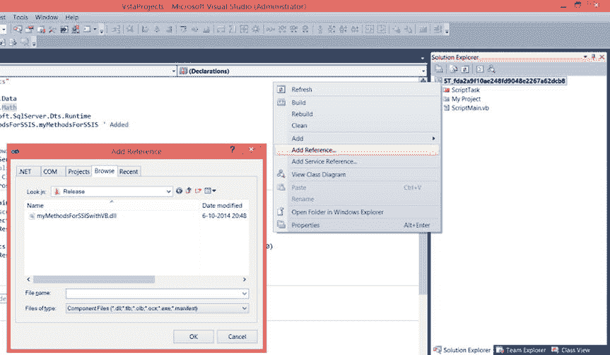

图 4-14. 在 VB.NET 脚本任务中添加引用

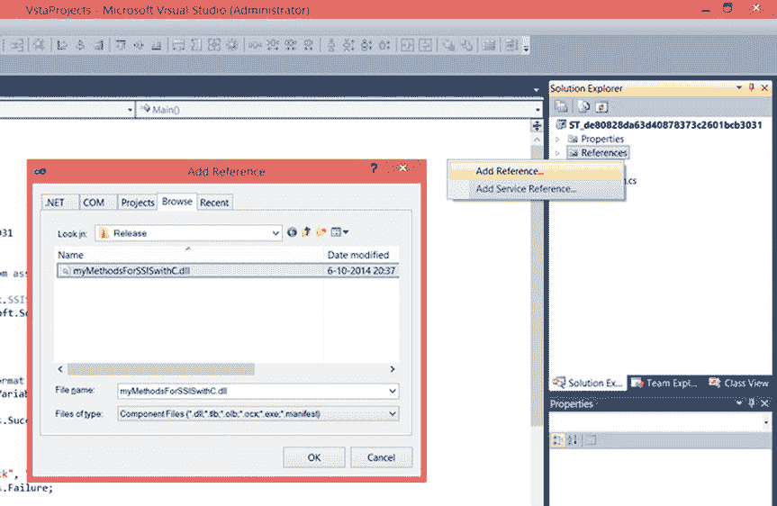

图 4-13. 在 C#脚本任务中添加引用

**注意**：添加对第三方程序集的引用与添加对你自己程序集的引用方式相同。

### 使用程序集的示例代码

以下是在脚本任务中使用该程序集的示例代码。要测试此代码，你首先需要创建一个名为 `emailaddress` 的 SSIS 字符串变量，并用有效的电子邮件地址填充它。然后添加一个新的脚本任务，并在脚本任务编辑器中选择该字符串变量作为 `ReadOnlyVariable`。

现在进入 VSTA 环境，并将程序集 `myMethodsForSSIS` 添加为引用。为了编写更紧凑的代码，你可以添加一个额外的 `using`/`import`。请注意，在 VB.NET 代码中导入 VB 程序集的方式略有不同。

```
#region customNamespaces

using myMethodsForSSIS;

#endregion
```

这是 VB.NET 代码：

```
#region customNamespaces

Imports myMethodsForSSIS.myMethodsForSSIS

#End Region
```

现在是在 `Main` 方法中的实际代码。脚本使用一个变量作为电子邮件方法的参数，该方法使用正则表达式检查格式。如果格式正确，则脚本任务成功。如果不正确，则脚本任务失败，同时还会触发一个错误事件，说明脚本任务失败的原因。有关为了日志记录目的而触发事件的详细说明，请参阅本章的最后一部分。

```
public void Main()
{
  // 从变量中获取电子邮件地址
  string email = Dts.Variables["User::emailaddress"].Value.ToString();

  // 如果电子邮件的格式不正确，则让脚本任务失败
  if (EmailMethods.IsCorrectEmail(email))
  {
    Dts.TaskResult = (int)ScriptResults.Success;
  }
  else
  {
    // 通过触发错误事件来显示脚本任务失败的原因
    Dts.Events.FireError(0, "电子邮件检查", "格式不正确:" + email, string.Empty, 0);
    Dts.TaskResult = (int)ScriptResults.Failure;
  }
}
```

这是 VB.NET 代码：

```
Public Sub Main()
  ' 从变量中获取电子邮件地址
  Dim email As String = Dts.Variables("User::emailaddress").Value.ToString()

  ' 如果电子邮件地址的格式不正确，则让脚本任务失败
  If (IsCorrectEmail(email)) Then
    Dts.TaskResult = ScriptResults.Success
  Else
    Dts.Events.FireError(0, "电子邮件检查", "格式不正确:" + email, String.Empty, 0)
    Dts.TaskResult = ScriptResults.Failure
  End If
End Sub
```

### 连接管理器

集成服务使用连接管理器来提供对各种数据源的访问，例如平面文件和数据库，也包括 Web 服务器或 FTP 服务器，或消息队列。你可以在脚本任务中使用这些连接管理器，以避免硬编码的路径和连接字符串。如果以正确的方式使用，你甚至可以让他们参与 MSDTC 事务，但仅限于支持它的连接管理器。

#### 文件连接管理器

首先，我们来介绍用于文件和文件夹的连接管理器，例如文件、平面文件和 Excel。在脚本任务中使用连接管理器有两种不同的方法。第一种方法是仅从连接管理器中获取属性，例如从平面文件连接管理器中获取 `ConnectionString` 属性，或从 Excel 连接管理器中获取 `ExcelFilePath` 属性。

在第一个代码示例中，您需要一个指向现有文本文件的文件或平面文件连接管理器。只要连接管理器名为 `myFlatFile` 并且文件中包含一些数据，其内容就无关紧要。脚本将获取文件路径，并通过检查文件大小来判断文件是否包含数据。它使用了 `System.IO` 命名空间中的 `FileInfo`，您需要将其添加为 `using`/`import` 指令。

```
#region customNamespaces
using System.IO;
#endregion
```

以下是 VB.NET 代码：

```
#region customNamespaces
Imports System.IO
#End Region
```

现在来看 `Main` 方法中的实际代码：

# SSIS脚本任务连接字符串处理

以下是使用C#和VB.NET获取连接字符串的不同方法。

## 平面文件连接字符串

### C# 实现
```csharp
public void Main()
{
    // 声明字符串变量，并用平面文件的连接字符串填充它。
    string filePath = Dts.Connections["myFlatFile"].ConnectionString;

    // 声明文件信息对象，并用字符串变量中的文件路径填充它。
    // 然后将实际文件大小填充到一个 bigint 变量中，用于下一个 if 语句
    FileInfo fi = new FileInfo(filePath);
    Int64 length = fi.Length;

    // 当文件大小为 0 字节时，使脚本失败
    if (length.Equals(0))
    {
        Dts.TaskResult = (int)ScriptResults.Failure;
    }
    else
    {
        Dts.TaskResult = (int)ScriptResults.Success;
    }
}
```

### VB.NET 实现
```vbnet
Public Sub Main()
    ' 声明字符串变量，并用平面文件的连接字符串填充它。
    Dim filePath As String = Dts.Connections("myFlatFile").ConnectionString

    ' 声明文件信息对象，并用字符串变量中的文件路径填充它。
    ' 然后将实际文件大小填充到一个 bigint 变量中，用于下一个 if 语句
    Dim fi As FileInfo = New FileInfo(filePath)
    Dim length As Int64 = fi.Length

    ' 当文件大小为 0 字节时，使脚本失败
    If (length.Equals(0)) Then
        Dts.TaskResult = ScriptResults.Failure
    Else
        Dts.TaskResult = ScriptResults.Success
    End If
End Sub
```

## Excel 文件连接字符串

当您使用 Excel 文件时，不能使用整个 `ConnectionString` 属性，因为它包含的不仅仅是文件路径。下一个示例通过使用子字符串方法，从名为 `myExcel` 的 Excel 连接管理器的连接字符串中提取文件路径。它被存储在一个字符串变量中，您可以在实际代码中使用该变量。

### C# 实现
```csharp
// 声明字符串变量，并用 Excel 文件的连接字符串填充它。
string filePath = Dts.Connections["myExcel"].ConnectionString;

// 对于 Excel 连接，您只需要连接字符串的一部分：
// ======================================================================
// Provider=Microsoft.Jet.OLEDB.4.0;Data Source=D:\MyExcelFile.xls;
// Extended Properties="Excel 8.0;HDR=YES";
// Provider=Microsoft.ACE.OLEDB.12.0;Data Source=D:\MyExcelFile.xlsx;
// Extended Properties="Excel 12.0 XML;HDR=YES";
// ======================================================================
// 您只需要 'Source=' 之后到下一个分号 (;) 之前的部分
filePath = filePath.Substring(filePath.IndexOf("Source=") + 6);
filePath = filePath.Substring(1, filePath.IndexOf(";") - 1);
```

### VB.NET 实现
```vbnet
' 声明字符串变量，并用 Excel 文件的连接字符串填充它。
Dim filePath As String = Dts.Connections("myExcel").ConnectionString

' 对于 Excel 连接，您只需要连接字符串的一部分：
' ======================================================================
' Provider=Microsoft.Jet.OLEDB.4.0;Data Source=D:\MyExcelFile.xls;
' Extended Properties="Excel 8.0;HDR=YES";
' Provider=Microsoft.ACE.OLEDB.12.0;Data Source=D:\MyExcelFile.xlsx;
' Extended Properties="Excel 12.0 XML;HDR=YES";
' ======================================================================
' 您只需要 'Source=' 之后到下一个分号 (;) 之前的部分
filePath = filePath.Substring(filePath.IndexOf("Source=") + 6)
filePath = filePath.Substring(1, filePath.IndexOf(";") - 1)
```

## 使用连接管理器属性

另一个技巧是先创建一个连接管理器变量，并用对 Excel 连接管理器的引用来填充它。然后，您可以读取 `ExcelFilePath` 属性来获取文件路径，而不是完整的连接字符串。然后它将文件路径存储在一个字符串变量中，您可以在实际代码中使用该变量。

### C# 实现
```csharp
// 获取 Excel 连接管理器以读取其属性
ConnectionManager myExcelConn = Dts.Connections["myExcel"];

// 声明字符串变量，并用 Excel 连接管理器的 ExcelFilePath 属性填充它。
string filePath = myExcelConn.Properties["ExcelFilePath"].GetValue(myExcelConn).ToString();
```

### VB.NET 实现
```vbnet
' 获取 Excel 连接管理器以读取其属性
Dim myExcelConn As ConnectionManager = Dts.Connections("myExcel")

' 声明字符串变量，并用 Excel 连接管理器的 ExcelFilePath 属性填充它。
Dim filePath As String = myExcelConn.Properties("ExcelFilePath").GetValue(myExcelConn).ToString()
```

## 使用 AcquireConnection 方法

第一种方法的一个很大缺点是它不会验证连接管理器上的表达式。如果您在 `Foreach` 循环容器中使用它，可能会导致一些意外结果。通过使用 `AcquireConnection` 方法，您可以克服这个问题，因为它会强制 SSIS 重新评估连接管理器上的任何表达式。以下两个示例用平面文件的文件路径填充了同一个字符串变量：

### C# 实现
```csharp
// 声明字符串变量，并用平面文件的连接字符串填充它。
string filePath = Dts.Connections["myFlatFile"].AcquireConnection(Dts.Transaction).ToString();

// 或者一个稍微复杂一些但适用于更多连接管理器类型的版本
// 声明对象变量以引用连接管理器
object rawConnection = Dts.Connections["myFlatFile"].AcquireConnection(Dts.Transaction);

// 声明字符串变量，并用平面文件的连接字符串填充它。
string filePath = rawConnection.ToString();
```

### VB.NET 实现
```vbnet
' 声明字符串变量，并用平面文件的连接字符串填充它。
Dim filePath As String = Dts.Connections("myFlatFile").AcquireConnection(Dts.Transaction).ToString()

' 或者一个稍微复杂一些但适用于更多连接管理器类型的版本
' 声明对象变量以引用连接管理器
Dim rawConnection As Object = Dts.Connections("myFlatFile").AcquireConnection(Dts.Transaction)

' 声明字符串变量，并用平面文件的连接字符串填充它。
Dim filePath As String = rawConnection.ToString()
```

```markdown
```vbnet
' 声明字符串变量，并用平面文件的连接字符串填充它。
Dim filePath As String = Dts.Connections("myFlatFile").AcquireConnection(Dts.Transaction).ToString()

' 或者一个稍微复杂一些但适用于更多连接管理器类型的版本
' 声明对象变量以存储连接管理器
Dim rawConnection As Object = Dts.Connections("myFlatFile").AcquireConnection(Dts.Transaction)

' 声明字符串变量，并用平面文件的连接字符串填充它。
Dim filePath As String = rawConnection.ToString()

' 还有，可选地手动释放连接管理器，以让 SSIS 知道您已完成操作
Dts.Connections("myFlatFile").ReleaseConnection(rawConnection)
```

> **注意**：如果您不想使用 MSDTC 事务，则可以将 `AcquireConnection` 的参数 `Dts.Transaction` 替换为 `null`。

对于`OLE DB`和`ADO.NET 连接管理器`也可以采用相同的方法，但要注意在`脚本任务`中使用数据库连接管理器。如果可以使用`执行 SQL 任务`（例如执行查询或存储过程），则不要不必要地使用它们。在`脚本任务`中连接数据库的首选连接管理器是`ADO.NET 连接管理器`。`OLE DB`也可以使用，但难度要大得多，并且有一些限制，例如无法传递当前事务，并且不遵守`保留同一连接`属性。这是因为`脚本任务`具有托管代码，可以更好地与其他托管代码交互，而`OLE DB`提供程序是使用非托管代码制作的。

以下代码是在`脚本任务`中使用数据库连接管理器的一个非常简化的示例。使用`执行 SQL 任务`可以更轻松地完成此操作，但本书后面将介绍更复杂的示例。在此示例中，您在`ReadWriteVariables`属性中添加了一个名为`sqlServerVersion`的 SSIS 字符串变量。它将被`脚本任务`填充 SQL Server 版本信息。另外，请确保您的包中有一个名为`myADONETConnection`的`ADO.NET 连接管理器`。

此示例使用`SqlClient`程序集，您将添加它作为使用/导入以缩短代码。

```csharp
#region customNamespaces
using System.Data.SqlClient;
#endregion
```

以下是 VB.NET 代码：

```vbnet
#region customNamespaces
Imports System.Data.SqlClient
#End Region
```

现在来看`Main`方法中的实际代码。

```csharp
public void Main()
{
    // 声明一个 SqlClient 连接，并将您的 ADO.NET 连接管理器分配到此连接。
    SqlConnection myADONETConnection = (SqlConnection)
    Dts.Connections["myADONETConnection"].AcquireConnection(Dts.Transaction);

    // 使用查询创建字符串变量
    string myQueryText = "SELECT @@version as SqlVersion";

    // 创建一个 SqlClient 命令以在其中存储查询。本例中是一个获取 SQL 版本的简单查询
    SqlCommand myQuery = new SqlCommand(myQueryText, myADONETConnection);

    // 执行查询并将结果存储在 SqlClient 数据读取器对象中
    SqlDataReader myQueryResult = myQuery.ExecuteReader();

    // 转到数据读取器的第一条记录
    myQueryResult.Read();

    // 将 'SqlVersion' 列的值存储在 SSIS 字符串变量中
    Dts.Variables["User::sqlServerVersion"].Value = myQueryResult["SqlVersion"].ToString();

    // 成功关闭脚本任务
    Dts.TaskResult = (int)ScriptResults.Success;
}
```

这是 VB.NET 代码：

```vbnet
Public Sub Main()
    ' 声明一个 SqlClient 连接，并将您的 ADO.NET 连接管理器分配到此连接
    Dim myADONETConnection As SqlConnection = DirectCast(Dts.Connections("myADONETConnection") _
    .AcquireConnection(Dts.Transaction), SqlConnection)

    ' 使用查询创建字符串变量
    Dim myQueryText As String = "SELECT @@version as SqlVersion"

    ' 创建一个 SqlClient 命令以在其中存储查询。本例中是一个获取 SQL 版本的简单查询
    Dim myQuery As SqlCommand = New SqlCommand(myQueryText, myADONETConnection)

    ' 执行查询并将结果存储在 SqlClient 数据读取器对象中
    Dim myQueryResult As SqlDataReader = myQuery.ExecuteReader()

    ' 转到数据读取器的第一条记录
    myQueryResult.Read()

    ' 将 SqlVersion 列的值存储在 SSIS 字符串变量中
    Dts.Variables("User::sqlServerVersion").Value = myQueryResult("SqlVersion").ToString()

    ' 成功关闭脚本任务
    Dts.TaskResult = ScriptResults.Success
End Sub
```

正如我之前所说，让`OLE DB`版本正常工作要困难得多。`AcquireConnection`方法不能用于`OLE DB`连接管理器，因为它返回一个本机`COM`对象。在此示例中，您需要一个名为`myOLEDBConnection`的`OLE DB 连接管理器`，以及在`ReadWriteVariable`属性中与上一个示例相同的`sqlServerVersion`字符串变量。解决方法是，将`OLE DB`连接管理器的`InnerObject`强制转换为`IDTSConnectionManagerDatabaseParameters100`接口（SSIS 2005 使用 90 而不是 100）。为此，您首先必须在 VSTA 项目中添加对`Microsoft.SqlServer.DTSRuntimeWrap.dll`的引用。该程序集可以在 GAC 64 位文件夹中找到。文件夹路径应类似于：`C:\Windows\Microsoft.NET\assembly\GAC_64\Microsoft.SqlServer.DTSRuntimeWrap\v4.0_11.0.0.0__89845dcd8080cc91\`。

对于 C#，转到 VSTA 项目的解决方案资源管理器，右键单击“引用”。选择“添加引用”以打开“添加引用”窗口（参见图 4-15）。您可以在较新版本的 Visual Studio 中搜索它，或浏览到它。在“浏览”选项卡中，您可以浏览到正确的文件夹。选择程序集并单击“确定”以添加新引用。添加引用后，如果您使用的是 Visual Studio 2010 或更低版本，则必须单击“全部保存”按钮！

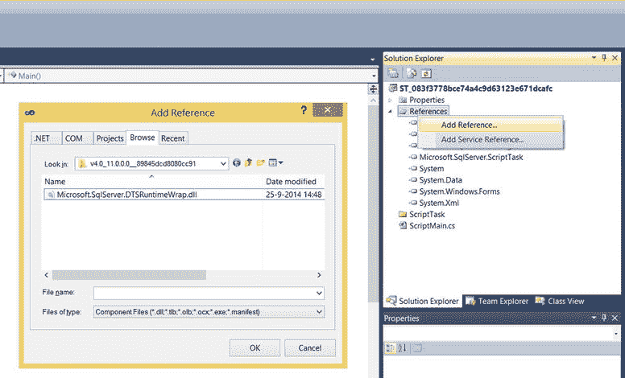

**图 4-15.** 在 C# 项目中添加对`DTSRuntimeWrap.dll`的引用

对于 VB.NET，转到 VSTA 项目的解决方案资源管理器，右键单击该项目。选择“添加引用”以打开“添加引用”窗口（参见图 4-16）。在“浏览”选项卡中，您可以浏览到正确的文件夹。选择程序集并单击“确定”以添加新引用。添加引用后，必须单击“全部保存”按钮！

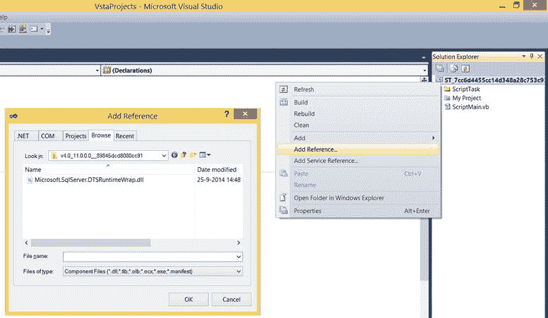

**图 4-16.** 在 VB 项目中添加对`DTSRuntimeWrap.dll`的引用

添加两个额外的 using/imports 以缩短代码：一个用于`OLE DB`，另一个用于新添加的引用。
```

### C# 代码示例

```csharp
#region customNamespaces
using System.Data.SqlClientOleDb;
using Microsoft.SqlServer.Dts.Runtime.Wrapper;
#endregion
```

以下是 VB.NET 代码：

```vb
#region customNamespaces
Imports System.Data.SqlClient
using Microsoft.SqlServer.Dts.Runtime.Wrapper
#End Region
```

接下来是`Main`方法的实际代码。主要的代码差异主要体现在代码的开头部分。其余部分看起来与 ADO.NET 示例非常相似。

```csharp
public void Main()
{
    // 将连接存储在连接管理器对象中
    ConnectionManager myConnectionManager = Dts.Connections["myOLEDBConnection"];

    // 将连接管理器的 InnerObject 强制转换为
    // IDTSConnectionManagerDatabaseParameters100
    // 接口（SSIS 2005 使用 90 而不是 100）。
    IDTSConnectionManagerDatabaseParameters100 cmParams;
    cmParams = myConnectionManager.InnerObject as IDTSConnectionManagerDatabaseParameters100;

    // 从 IDTSConnectionManagerDatabaseParameters100 对象获取连接
    OleDbConnection myConnection = cmParams.GetConnectionForSchema() as OleDbConnection;

    // 使用查询创建字符串变量
    string myQueryText = "SELECT @@version as SqlVersion";

    // 创建一个新的 OleDbCommand 对象以在其中存储查询。
    OleDbCommand myQuery = new OleDbCommand(myQueryText, myConnection);

    // 执行查询并将结果存储在 OleDb DataReader 对象中
    OleDbDataReader myQueryResult = myQuery.ExecuteReader();

    // 转到数据读取器的第一条记录
    myQueryResult.Read();

    // 将 SqlVersion 列的值存储在 SSIS
    // 字符串变量中
    Dts.Variables["User::sqlServerVersion"].Value = myQueryResult["SqlVersion"].ToString();

    // 成功关闭脚本任务
    Dts.TaskResult = (int)ScriptResults.Success;
}
```

以下是 VB.NET 代码：

```vb
Public Sub Main()
    ' 将连接存储在连接管理器对象中
    Dim myConnectionManager As ConnectionManager = Dts.Connections("myOLEDBConnection")

    ' 将连接管理器的 InnerObject 强制转换为
    ' IDTSConnectionManagerDatabaseParameters100
    ' 接口（SSIS 2005 使用 90 而不是 100）。
    Dim cmParams As IDTSConnectionManagerDatabaseParameters100
    cmParams = CType(myConnectionManager.InnerObject, IDTSConnectionManagerDatabaseParameters100)

    ' 从 IDTSConnectionManagerDatabaseParameters100 对象获取连接
    Dim myConnection As OleDbConnection = CType(cmParams.GetConnectionForSchema(), OleDbConnection)

    ' 使用查询创建字符串变量
    Dim myQueryText As String = "SELECT @@version as SqlVersion"

    ' 创建一个新的 OleDbCommand 对象以在其中存储查询。
    Dim myQuery As OleDbCommand = New OleDbCommand(myQueryText, myConnection)

    ' 执行查询并将结果存储在 OleDb DataReader 对象中
    Dim myQueryResult As OleDbDataReader = myQuery.ExecuteReader()

    ' 转到数据读取器的第一条记录
    myQueryResult.Read()

    ' 将 SqlVersion 列的值存储在 SSIS 字符串变量中
    Dts.Variables("User::sqlServerVersion").Value = myQueryResult("SqlVersion").ToString()

    ' 成功关闭脚本任务
    Dts.TaskResult = ScriptResults.Success
End Sub
```

以下是根据您的要求翻译的中文版本：

```vb
Dim myConnectionManager As ConnectionManager = Dts.Connections("myOLEDBConnection")
' 将连接管理器的 InnerObject 转换为 IDTSConnectionManagerDatabaseParameters100
' 接口（SSIS 2005 使用 90 而非 100）。
Dim cmParams As IDTSConnectionManagerDatabaseParameters100
cmParams = TryCast(myConnectionManager.InnerObject, IDTSConnectionManagerDatabaseParameters100)
' 从 IDTSConnectionManagerDatabaseParameters100 对象获取连接
Dim myConnection As OleDbConnection = DirectCast(cmParams.GetConnectionForSchema(), OleDbConnection)
' 创建一个新的 OleDbCommand 对象以存储查询。
Dim myQuery As OleDbCommand = New OleDbCommand("SELECT @@version as SqlVersion", myConnection)
' 执行查询并将结果存储在 OleDb DataReader 对象中
Dim myQueryResult As OleDbDataReader = myQuery.ExecuteReader()
' 移动到 DataReader 的第一条记录
myQueryResult.Read()
' 将 SqlVersion 列的值存储在 SSIS 字符串变量中
Dts.Variables("User::sqlServerVersion").Value = myQueryResult("SqlVersion").ToString()
' 成功关闭脚本任务
Dts.TaskResult = ScriptResults.Success
End Sub
```

> **注意：** 如果不希望使用这种复杂的方法，也可以直接使用 OLE DB 连接管理器的 `ConnectionString` 属性来创建新连接。

### 日志记录事件

当你想将脚本任务的消息记录到 SSIS 日志时，必须通过代码引发事件。这些消息是否显示在日志中取决于所选的日志级别（项目部署）或日志记录配置（包部署）。脚本任务可以通过调用 `Dts` 对象的 `Events` 属性上的事件触发方法来引发事件。在此示例中，你将检查文件连接管理器中的文件是否存在且包含数据。

创建一个名为 `myFile` 的文件或平面文件连接管理器，指向一个任意文本文件。文件内容无关紧要。由于你将尝试获取某些文件属性，因此需要 `System.IO` 程序集。你需要将其添加到 using/imports 中。

```csharp
#region customNamespaces
using System.IO;
#endregion
```

以下是 VB.NET 代码：

接下来是`Main`方法的实际代码。首先从连接管理器获取文件路径，然后检查文件是否存在且包含数据。

```csharp
public void Main()
{
    // 从文件连接管理器获取文件路径并存储在字符串变量中
    string filePath = Dts.Connections["myFile"].AcquireConnection(Dts.Transaction).ToString();

    // 使用文件路径变量创建 FileInfo 对象
    FileInfo fi = new FileInfo(filePath);

    // 检查文件是否存在
    if (fi.Exists)
    {
        // 文件存在，但检查大小
        if (fi.Length > 0)
        {
            // 布尔变量，指示相同事件是否可以触发多次
            bool fireAgain = true;

            // 文件存在且包含数据。触发 Information 事件
            Dts.Events.FireInformation(0, "Script Task File Check", "File exists and contains data.",
                string.Empty, 0, ref fireAgain);
        }
        else
        {
            // 文件存在但不包含数据。触发 Warning 事件
            Dts.Events.FireWarning(0, "Script Task File Check", "File exists, but contains no data.", string.Empty, 0);
        }

        // 成功完成脚本任务
        Dts.TaskResult = (int)ScriptResults.Success;
    }
    else
    {
        // 文件不存在。触发 Error 事件并让脚本任务失败
        Dts.Events.FireError(0, "Script Task File Check", "File doesn't exists.", string.Empty, 0);

        // 脚本任务失败
        Dts.TaskResult = (int)ScriptResults.Failure;
    }
}
```

以下是 VB.NET 代码：

```vb
Public Sub Main()
    ' 从文件连接管理器获取文件路径并存储在字符串变量中
    Dim filePath As String = Dts.Connections("myFile").AcquireConnection(Dts.Transaction).ToString()

    ' 使用文件路径变量创建 FileInfo 对象
    Dim fi As FileInfo = New FileInfo(filePath)

    ' 检查文件是否存在
    If (fi.Exists) Then
        ' 文件存在，但检查大小
        If (fi.Length > 0) Then
            ' 布尔变量，指示相同事件是否可以触发多次
            Dim fireAgain As Boolean = True

            ' 文件存在且包含数据。触发 Information 事件
            Dts.Events.FireInformation(0, "Script Task File Check", "File exists and contains data.", _
                String.Empty, 0, fireAgain)
        Else
            ' 文件存在但不包含数据。触发 Warning 事件
            Dts.Events.FireWarning(0, "Script Task File Check", "File exists, but contains no data.", _
                String.Empty, 0)
        End If

        ' 成功完成脚本任务
        Dts.TaskResult = ScriptResults.Success
    Else
        ' 文件不存在。触发 Error 事件并让脚本任务失败
        Dts.Events.FireError(0, "Script Task File Check", "File doesn't exists.", String.Empty, 0)

        ' 脚本任务失败
        Dts.TaskResult = ScriptResults.Failure
    End If
End Sub
```

现在，你可以通过清空或删除连接管理器中引用的文件来测试脚本，然后运行包并查看“执行结果”选项卡。除了常见的`FireInformation`、`FireWarning`和`FireError`之外，还有更多可用的触发事件方法，但它们使用较少：

- `FireBreakpointHit`：引发一个事件，指示脚本任务中的断点已命中。
- `FireCustomEvents`：引发自定义事件。
- `FireProgress`：引发一个显示脚本任务进度的事件。
- `FileQueryCancel`：引发一个指示脚本任务是否应提前关闭的事件。

> **注意：** 由于触发事件开销较大，不应过度使用。某些触发事件方法包含一个布尔参数`fireAgain`，用于抑制相同事件的多次触发。

### FireCustomEvents

有时候你会遇到 SSIS 缺乏完整 ETL 解决方案所提供的某些企业功能的情况，例如当你想实现一个自定义的元数据驱动日志记录解决方案时。

假设你想集中配置所有正在运行包的日志记录设置。日志记录逻辑如何处理必须对所有子包透明。包唯一需要做的是通过触发自定义事件来通知主包。在主包上处理此问题的一个好方法是使用事件处理功能。有几种类型的事件可供你使用（参见图 4-17）。

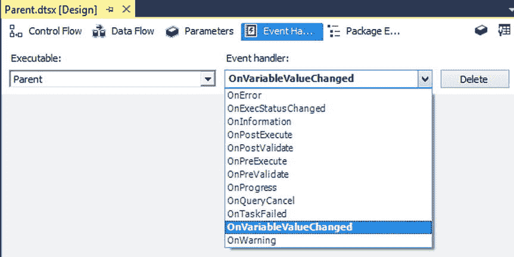

**图 4-17.** 可供使用的事件

本示例中，`OnVariableValueChanged`是一个很好的候选事件，原因如下：

- 它包含一些可以直接使用的内置变量。
- 即使变量发生变化，它也不会自动触发。

基本上，你希望能够通过使用父包的事件处理程序来捕获子包中触发的自定义事件。让我们从构建子包开始。

### 子包

创建一个名为`Child`的新 SSIS 包，并向其中添加一个名为`SCR_FireCustomEvent`的脚本任务。事件的代码很简单，它只做一件事：获取包中一些可用的变量，并将它们作为事件触发。

#### 脚本

在该类的`Main`方法中，添加以下代码：

```
// 触发一次或多次
bool fireAgain = false;

// 我们希望在自定义事件中展示的值
object[] parameters = new object[] { "This is the value I want to log", "Second value to log", DateTime.Now.ToLongDateString(), "More value to log" };

// 触发正确的事件类型：OnVariableValueChanged
Dts.Events.FireCustomEvent("OnVariableValueChanged", "", ref parameters, "", ref fireAgain);

Dts.TaskResult = (int)ScriptResults.Success;
```

以及 VB.NET 代码：

## 父包

如你所见，这非常简单。你只需调用 SSIS 方法 `FireCustomEvent`，并指定：

- 要触发的事件的名称：`OnVariableValueChanged`
- 事件文本，你不需要它，因此为 `""`
- 一个包含字符串参数的对象数组（也可以是其他类型）
- 子组件的名称（不需要）
- 关于是否再次触发事件的指令，此处为 `false`

这就是脚本任务所需的全部内容。

现在，我们来创建第二个名为 `Parent` 的包。

该包用于调用子包；因此，你需要一个“执行包任务”，并将子包指定为目标，如图 4-18 所示。

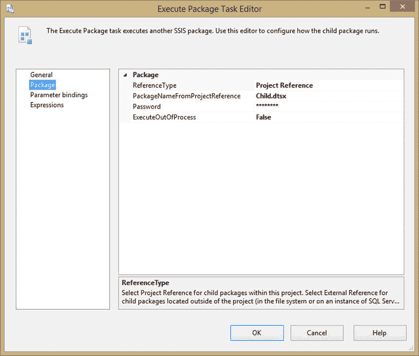

图 4-18. 执行包任务编辑器

在包设计图面的“事件处理程序”选项卡上，从下拉列表中选择 `OnVariableValueChanged` 事件。这将为此特定事件打开设计器图面，你可以在事件处理程序图面上放置一个“脚本组件”（见图 4-19）。

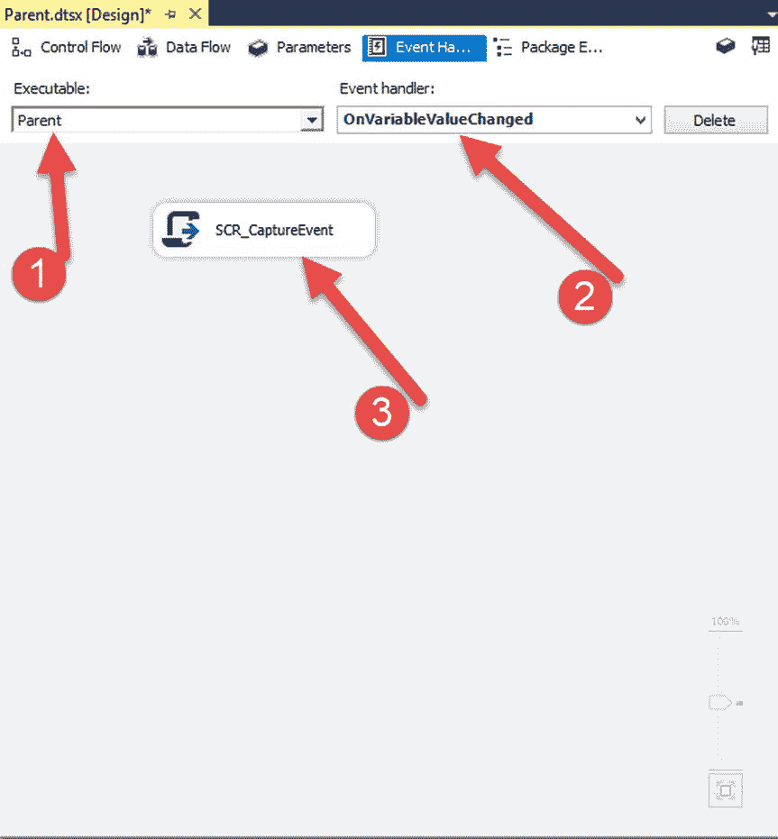

图 4-19. 配置事件处理程序

以下是图 4-19 的标注：可执行文件设置为顶层元素（包）。事件处理程序是 `OnVariableValueChanged`。你使用脚本任务来捕获此事件。

### 脚本任务

你在事件处理程序图面上添加了一个脚本任务，并将其命名为 `SCR_CaptureEvent`。

在脚本内部，你需要将一些可用的系统变量设置为只读：

- `System::TaskName`
- `System::SourceName`
- `System::VariableDescription`
- `System::VariableID`
- `System::VariableName`
- `System::VariableValue`

最后四个变量就是你用来自子包的对象数组填充的变量。

### 代码

你通过单击脚本组件编辑器“脚本”页面上的 `编辑脚本...` 按钮来打开脚本。接下来，向 `Main` 方法中添加以下代码行：

```
//构建一个字符串，用于获取子包触发的事件中的变量值
string result = "VariableName: " + Dts.Variables["System::VariableName"].Value.ToString() +
Environment.NewLine;

result += "VariableID: " + Dts.Variables["System::VariableID"].Value.ToString() + Environment.NewLine;

result += "VariableDescription: " + Dts.Variables["System::VariableDescription"].Value.ToString() + Environment.NewLine;

result += "VariableValue: " + Dts.Variables["System::VariableValue"].Value.ToString() +
Environment.NewLine;

result += "TaskName: " + Dts.Variables["System::TaskName"].Value.ToString() + Environment.NewLine;

result += "SourceName: " + Dts.Variables["System::SourceName"].Value.ToString();

//以消息框形式显示字符串值
MessageBox.Show(result);
```

以及 VB.NET 代码：

```
'构建一个字符串，用于获取子包触发的事件中的变量值
Dim result As String = "VariableName: " + Dts.Variables("System::VariableName").Value.ToString() + Environment.NewLine

result += "VariableID: " + Dts.Variables("System::VariableID").Value.ToString() + Environment.NewLine

result += "VariableDescription: " + Dts.Variables("System::VariableDescription").Value.ToString() + Environment.NewLine

result += "VariableValue: " + Dts.Variables("System::VariableValue").Value.ToString() + _
Environment.NewLine

result += "TaskName: " + Dts.Variables("System::TaskName").Value.ToString() + Environment.NewLine

result += "SourceName: " + Dts.Variables("System::SourceName").Value.ToString()

'以消息框形式显示字符串值
MessageBox.Show(result)
```

运行父包会调用子包，子包随后会触发一个自定义事件，该事件被父包的事件处理程序捕获，并显示图 4-20 中的结果。

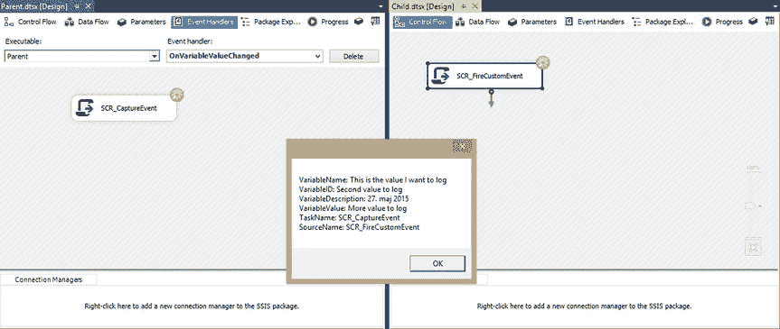

图 4-20. 运行包的结果

在这个示例中，我们保持得非常简单，但创建一个元数据框架来控制日志记录或使用 `FireCustomEvent` 实现自定义审计也并非难事。

### 总结

在本章中，你学习了脚本任务的基本功能，例如使用变量和连接管理器避免在脚本中硬编码值，以及通过触发事件来记录有用的信息。并且你了解了如何引用自定义或第三方程序集。

在接下来的几章中，你将会看到所有常见问题的解决方案。结合本章脚本任务的知识，现在你可以通过添加日志记录或使用不同的连接管理器来自定义这些示例。