## 11. 脚本组件转换

电子补充材料 本章的在线版本 (`doi:10.1007/978-1-4842-0638-6_11`) 包含补充材料，可供授权用户使用。

使用标准转换可以完成很多事情，但有时脚本组件提供了更简单的解决方案。例如，在派生列中实现嵌套的 `if` 结构是可能的，但如果你有很多层级或条件，它会变得难以阅读和维护。并且某些功能在开箱即用的组件中是不可用的。本章展示了脚本组件有用的一些情况。

### 脚本组件转换

脚本组件转换的基本结构是让你能够逐行访问来自上游的数据。针对输出的转换会应用于输入中的每一行。这种转换也可以以非同步方式发生，这意味着输入中的每一行不需要在输出行中都有匹配项（它们可以在输出中产生零行或多行）。例如，一个文件夹名称输入行可以返回多个包含该文件夹中文件名的输出行。输出设置的控制是在脚本组件的“输入和输出”窗格中完成的，如图 11-1 所示。

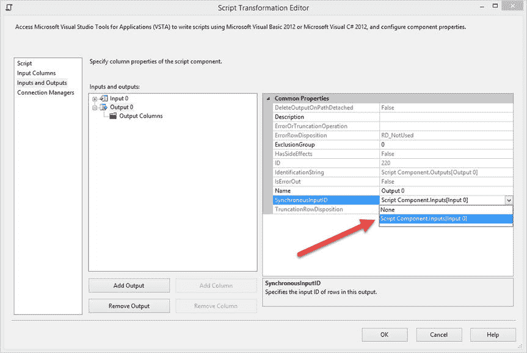

图 11-1. 脚本组件同步输入

如果一个组件有多个输入，你可以创建多个输出并匹配输入和输出，甚至添加一些异步输出。

### ProperCase

有时你会得到格式非常糟糕的数据，而且你没有机会访问数据源来重新格式化它。你可能希望对它应用适当的首字母大写格式。在下面的例子中，你有一个客户表，其中的 `FirstName` 和 `LastName` 列都是大写字母。你希望将它们重新格式化为适当的大小写格式。

有一个名为 `StrConv` 的 VB.NET 函数可以为你转换大小写。在 C# 中，这稍微复杂一些。你首先向包中添加一个数据流任务，然后使用源助手来获取数据。

#### 数据源

为简化操作，在 `APRESS_SSIS_Scripting` 数据库中创建一个名为 `Chapter_11` 的表，定义如下：

```
CREATE TABLE [dbo].Chapter_11 NOT NULL,
    [FirstName] nvarchar NULL,
    [LastName] nvarchar NULL,
    [YearlyIncome] [int] NULL,
    [TeamName] varchar NULL
) ON [PRIMARY]
```

该表需填充一些全大写的名字和姓氏，作为数据源。

```
INSERT INTO [dbo].[Chapter_11] ([FirstName], [LastName]) VALUES (N'JON', N'YANG')
INSERT INTO [dbo].[Chapter_11] ([FirstName], [LastName]) VALUES (N'EUGENE', N'HUANG')
INSERT INTO [dbo].[Chapter_11] ([FirstName], [LastName]) VALUES (N'RUBEN', N'TORRES')
INSERT INTO [dbo].[Chapter_11] ([FirstName], [LastName]) VALUES (N'CHRISTY', N'ZHU')
INSERT INTO [dbo].[Chapter_11] ([FirstName], [LastName]) VALUES (N'ELIZABETH', N'JOHNSON')
INSERT INTO [dbo].[Chapter_11] ([FirstName], [LastName]) VALUES (N'JULIO', N'RUIZ')
INSERT INTO [dbo].[Chapter_11] ([FirstName], [LastName]) VALUES (N'JANET', N'ALVAREZ')
```

> **注意：** 第 11 章的源代码包含表架构和填充表的脚本。

#### 脚本转换

首先，在包的设计界面上添加一个数据流任务。在此数据流任务中，添加一个 `OLE DB` 源组件，指向刚创建的表：`Chapter_11`。

添加一个名为 `SCR_TRA_ProperCasing` 的脚本组件，如图 11-2 所示。在“输入”窗格中，勾选要更改的列，并将其使用类型更改为 `ReadWrite`（默认是 `ReadOnly`）。将脚本组件连接到 `OLE DB` 源组件的输出。

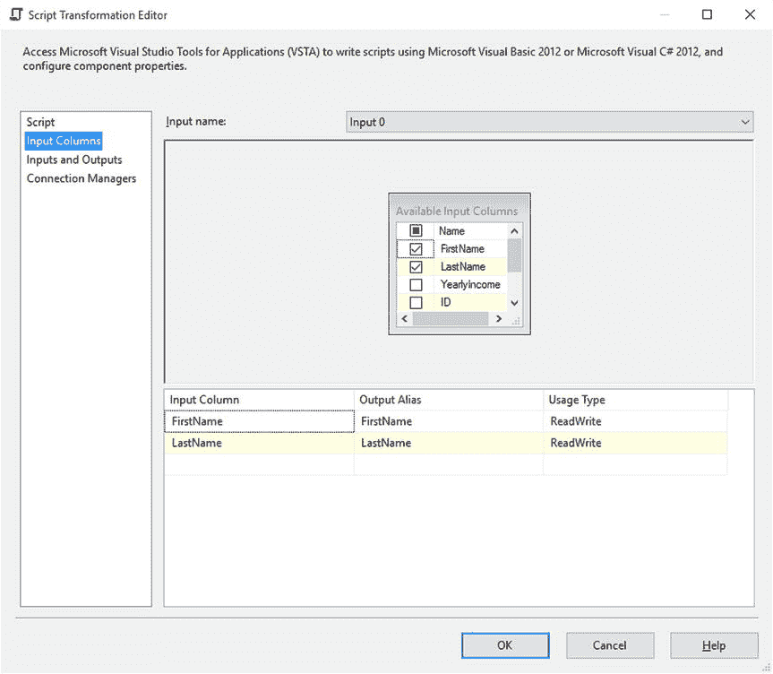

图 11-2. `ReadWrite` 变量

在创建的 `VSTA` 脚本中，需要找到 `Input0_ProcessInputRow` 方法并执行一些字符串转换。

`C#` 没有内置方法将字符串转换为 `ProperCase`，因此需要自行实现。最简单的方法可能是先将所有字符转换为小写，然后对小写字符串应用 `TitleCase` 方法。

```
//先转换为小写
string firstName = Row.FirstName.ToLower();
string lastName = Row.LastName.ToLower();

//实际的 Proper Casing 转换
Row.FirstName = new System.Globalization.CultureInfo("en").TextInfo.ToTitleCase(firstName);
Row.LastName = new System.Globalization.CultureInfo("en").TextInfo.ToTitleCase(lastName);
```

> **注意：** 另一种方法是在自定义命名空间中添加对 `Visual Basic` DLL 的引用，然后从 `C#` 调用 `VBScript` 方法。但我们认为，混合编程语言并非优雅方式。

`VB.NET` 中的解决方案与 `C#` 类似：

```
Row.FirstName = StrConv(Row.FirstName, VbStrConv.ProperCase)
Row.LastName = StrConv(Row.LastName, VbStrConv.ProperCase)
```

编写完脚本后，可以向数据流中添加一个多播组件，并将其连接到脚本组件的输出。在两者之间的连接中添加数据查看器；图 11-3 显示了结果。

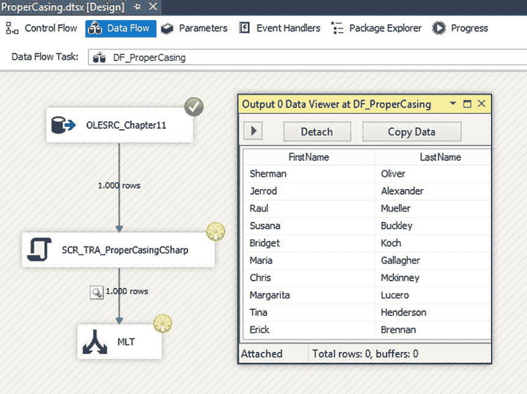

图 11-3. Proper casing

### 加密与解密数据

有时需要从表或文件中提取数据，但希望在导出前对数据进行加密，以保护敏感信息不被泄露。例如，社会保险号、密码或薪资。之后可能需要解密数据以显示原始值。

为此，使用前面示例中创建的表的 `YearlyIncome` 列，该列需要加密，并在某时刻解密。

然后向表中添加一些数据：

```
INSERT INTO [dbo].[Chapter_11] ([FirstName], [LastName], [YearlyIncome]) VALUES (N'Leonardo', N'Mc Cormick', 145872)
INSERT INTO [dbo].[Chapter_11] ([FirstName], [LastName], [YearlyIncome]) VALUES (N'Josh', N'Cortez', 292927)
INSERT INTO [dbo].[Chapter_11] ([FirstName], [LastName], [YearlyIncome]) VALUES (N'Andres', N'Wall', 318002)
INSERT INTO [dbo].[Chapter_11] ([FirstName], [LastName], [YearlyIncome]) VALUES (N'Leonard', N'Chambers', 255004)
INSERT INTO [dbo].[Chapter_11] ([FirstName], [LastName], [YearlyIncome]) VALUES (N'Miguel', N'Kelly', 71128)
INSERT INTO [dbo].[Chapter_11] ([FirstName], [LastName], [YearlyIncome]) VALUES (N'Jerry', N'Fox', 180525)
```

#### 解决方案包

在一个名为 `EncryptDecrypt` 的新包中，添加一个数据流任务 `DFT_EncryptData`。在此数据流任务中，添加一个名为 `OLE_SRC_GetDataToEncrypt` 的 `OLE DB` 源组件。将源连接指向 第 11 章 的表，并选择所有列，如图 11-4 所示。

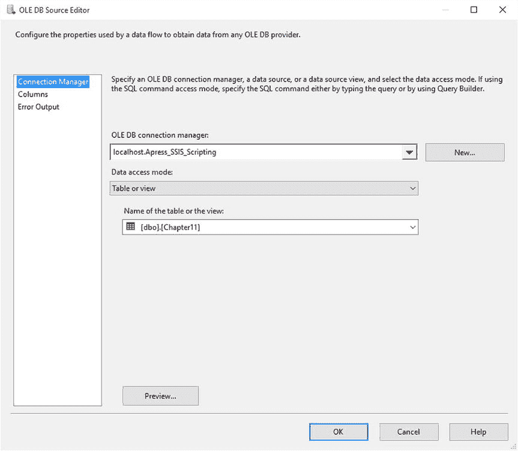
*图 11-4. OLE DB 源连接窗口*

.NET Framework 支持两种加密方式：对称加密和非对称加密。

它们使用不同的过程执行。对称加密在流上执行，因此适用于加密大量数据。非对称加密在少量字节上执行，因此仅适用于小数据量。由于我们逐行处理单个列，因此将使用非对称加密。

对称加密通常用于加密整个文件。

第 8 章包含一些关于使用脚本任务加密和解密整个文件的注意事项。

#### 变量

加密首先需要一个加密密钥。创建一个名为 `EncryptionKey` 的字符串变量，并使用经典的包含所有字母的句子为其赋值：`"The quick fox jumps over the lazy dog."`。

配置好 OLE DB 源后，接下来添加一个用于转换的脚本组件；将其命名为 `SCR_TRA_EncryptIncome`。

在组件的“脚本”页面中，将 `User::EncryptionKey` 变量添加为 `Read-only`，如图 11-5 所示。

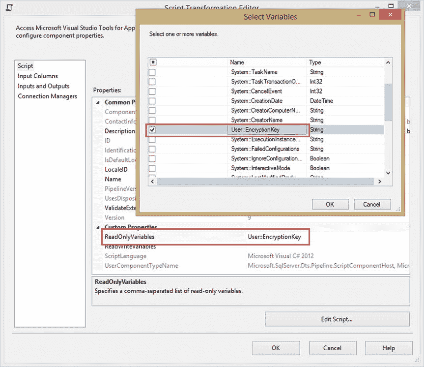
*图 11-5. ReadOnly 变量*

在组件的“输入列”页面中，选择 `YearlyIncome`，即要加密的列（见图 11-6）。

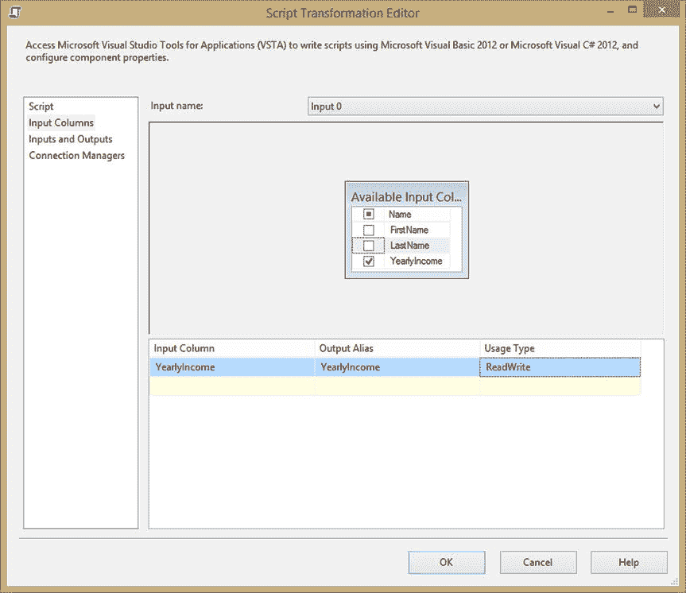
*图 11-6. 脚本转换编辑器输入页面*

#### 脚本

点击 **Edit Script...** 按钮启动 VSTA。首先，可以移除自动生成类中不需要的方法：`PreExecute` 和 `PostExecute`。

接下来添加加密和解密文本所需的命名空间。以下是 C# 脚本的开头部分：

```csharp
#region CustomNamespaces
using System.IO;
using System.Security.Cryptography;
#endregion
```

以下是 VB.NET 版本：

```vbnet
Imports System.IO
Imports System.Security.Cryptography
```

在脚本中添加两个方法：一个用于加密，一个用于解密。它们都接受两个参数：一个待加密字符串和一个加密密钥字符串。

这两个方法具有相同的接口：

```csharp
public static string Encrypt(string clearText, string Password)
public static string Decrypt(string cipherText, string Password)
```

在 VB.NET 中，可以按如下方式添加这两个方法：

```vbnet
Public Shared Function Encrypt(ByVal clearText As String, ByVal Password As String)
Public Shared Function Decrypt(ByVal cipherText As String, ByVal Password As String)
```

#### 为密码加盐

`Encrypt` 和 `Decrypt` 方法的核心思路是传入一个密码和一个密码盐，并利用密码盐从密码中派生密钥。当然，在 `Encrypt` 方法和 `Decrypt` 方法中使用的盐必须是相同的。这一步是在类级别完成的，而不是在方法中，因为只需要在类实例化时执行一次。

在 C# 中，密码盐定义如下：

```csharp
// 使用加盐技术从密码创建密钥和 IV
PasswordDeriveBytes pdb = new PasswordDeriveBytes(Password, new byte[] { 0x49, 0x76, 0x61, 0x6e, 0x20, 0x4d, 0x65, 0x64, 0x76, 0x65, 0x64, 0x65, 0x76 });
```

VB.NET 读者可以在代码中编写以下内容：

```vbnet
' 使用加盐技术从密码创建密钥和 IV
Dim pdb As New PasswordDeriveBytes(Password, New Byte() {&H49, &H76, &H61, &H6E, &H20, &H4D, &H65, &H64, &H76, &H65, &H64, &H65, &H76})
```

#### 加密流

然后，您需要创建一个 `CryptoStream`，它包含一个目标流（`MemoryStream`）、一个加密算法（为简单起见，这里使用 Rijndael 算法，但也可以使用其他算法）以及流模式。在加密和解密值时，`CryptoStreamMode` 都设置为 `Write`。

以下是在 C# 中创建该流的代码：

```csharp
// 创建一个 CryptoStream
CryptoStream cs = new CryptoStream(ms, alg.CreateDecryptor(), CryptoStreamMode.Write);
```

VB.NET 的实现如下：

```vbnet
' 创建一个 CryptoStream
Dim cs As CryptoStream = New CryptoStream(ms, alg.CreateEncryptor(), CryptoStreamMode.Write)
```

加密和解密之间的唯一区别在于操作写入 `MemoryStream` 之后。

#### 加密数据

对于加密，您需要将字节数组转换为 Base64 字符串。在 C# 中通过以下方式实现：

```csharp
// 将加密数据作为字符串返回
return Convert.ToBase64String(encryptedData);
```

使用以下代码在 VB.NET 中执行相同的转换：

```vbnet
' 将加密数据作为字符串返回
Encrypt = Convert.ToBase64String(encryptedData)
```

#### 解密数据

对于解密，您需要将内容转换回普通的人类可读字符串。在 C# 中，编写如下代码：

```csharp
// 将解密数据作为字符串返回
return System.Text.Encoding.Unicode.GetString(decryptedData);
```

而在 VB.NET 中，您可以这样编写：

```vbnet
' 将解密数据作为字符串返回
Decrypt = System.Text.Encoding.Unicode.GetString(decryptedData)
```

**注意**
完整的脚本可在第 11 章的可下载代码中找到。

如果您向脚本组件转换的输出添加一个多播，您就可以添加一个数据查看器并检查返回的数据，以确保所有内容都按预期解密。图 11-7 展示了脚本的结果。

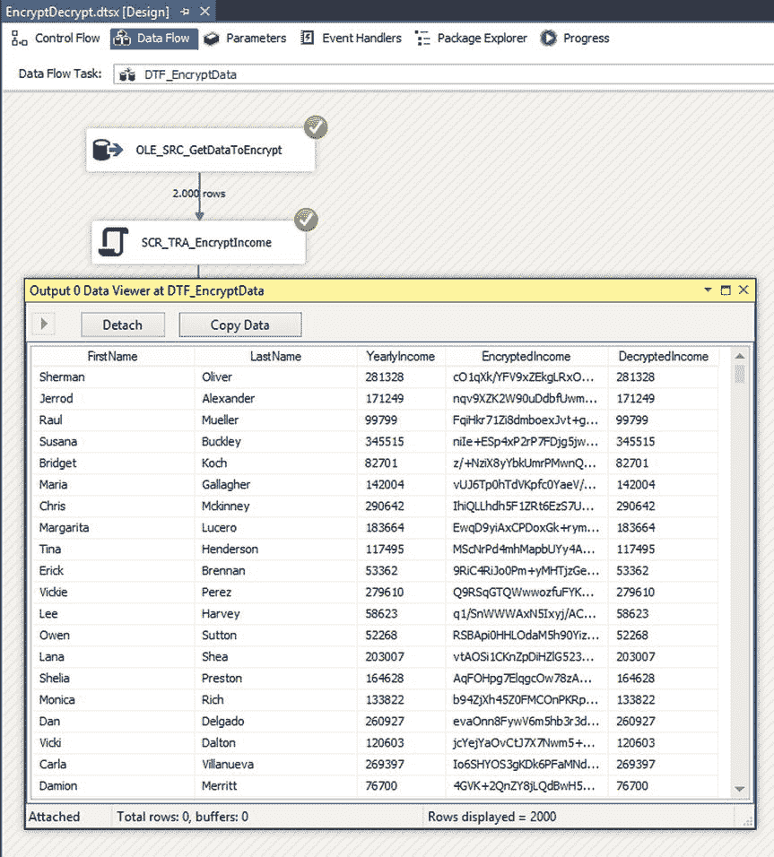
**图 11-7.** 加密和解密的收入

加密和解密可以通过多种不同的方式进行。我们仅仅触及了这个主题的表面，单靠一个例子远不足以全面阐述。如果您对 .NET 中加密功能的更多信息感兴趣，我们建议您进一步查阅 MSDN 上的系统密码命名空间，网址为 [msdn.microsoft.com/en-us/library/System.Security.Cryptography(v=vs.110).aspx](https://msdn.microsoft.com/en-us/library/System.Security.Cryptography(v=vs.110).aspx)。

### 比较行

继续使用员工收入的例子，假设每个员工都属于一个团队，您希望能够检查谁在团队中收入最高，以及收入最高的成员与团队其他成员之间的收入差距。

让我们将员工分配到十个不同的团队中。

```sql
UPDATE dbo.Chapter11 SET TeamName = 'Team ' + CAST(RIGHT(ID,1) AS VARCHAR(1))
```

在一个空白包的设计界面上，添加一个名为 `DFT_CompareRows` 的数据流。在此数据流中，添加一个 OLE DB 源连接，并连接到 `APRESS_SSIS_Scripting` 数据库。为了进行逐行比较，您需要首先按 `TeamName` 排序输入，然后按 `Income` 排序，因此您需要将数据访问模式设置为 SQL 命令，并将命令文本设置如下：

```
SELECT [FirstName]
      ,[LastName]
      ,[YearlyIncome]
      ,[ID]
      ,[TeamName]
  FROM [dbo].[Chapter 11]
ORDER BY TeamName, YearlyIncome DESC
```

在“列”页面上，选择所有列，如图 11-8 所示。

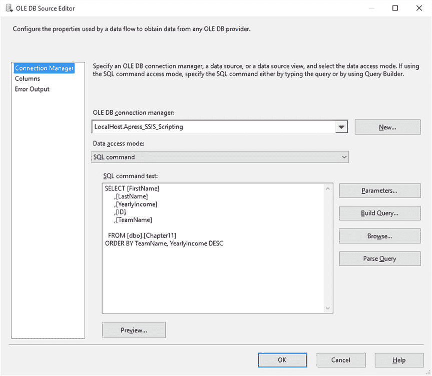  
`图 11-8.` OLE DB 源编辑器

然后，您在数据流中添加一个用于转换的脚本组件（重命名为 `SCR_TRA_CompareRows`），并将其连接到 OLE DB 源输出。

在“脚本组件输入列”页面上，您需要将 `YearlyIncome` 和 `TeamName` 添加为只读输入列，因为您在脚本中会用到它们。

接下来，为 `Output0` 添加两个类型为 `DT_I4`（四字节有符号整数）的列，分别命名为 `HighestIncome` 和 `IncomeDifference`。这些是您将在脚本中写入的列。

在组件的“脚本”页面上单击 `编辑脚本…`，然后启动 VSTA。首先，删除您不使用的 `PostExecute` 和 `PreExecute` 方法。此处重要的方法是 `Input0_ProcessInputRow`，您可以在其中对通过的数据进行逐行比较。

因为输入已排序，您可以放心逐行比较的操作会成功。在这类脚本中，这是一个非常重要的点。输入是否已排序对于比较的成功至关重要。

以下是用于比较行的 C# 版本脚本：

```
// 将当前行与上一行进行比较
if (Row.TeamName == teamname)
{
    // 匹配，将收入与上一行的收入进行比较
    Row.IncomeDifference = Row.YearlyIncome - highestincome;
}
else
{
    // TeamName 不匹配，这是新团队的第一行
    highestincome = Row.YearlyIncome;
}
// 将当前行的值存储到变量中，供下一行使用。
teamname = Row.TeamName;
Row.HighestIncome = highestincome;
```

而 VB.NET 中的代码如下：

```
' 将当前行与上一行进行比较
If Row.TeamName = teamname Then
    ' 匹配，将收入与上一行的收入进行比较
    Row.IncomeDifference = Row.YearlyIncome - highestincome
Else
    ' TeamName 不匹配，这是新团队的第一行
    highestincome = Row.YearlyIncome
End If
' 将当前行的值存储到变量中，供下一行使用。
teamname = Row.TeamName
Row.HighestIncome = highestincome
```

通过向数据流添加一个多播和一个数据查看器，您可以检查脚本是否正常工作。图 11-9 展示了比本章源代码中更大的数据样本的结果。

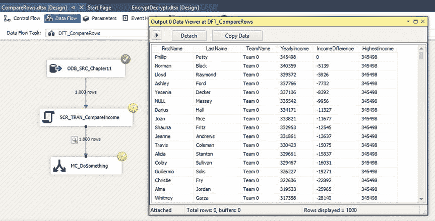  
`图 11-9.` 带有结果的数据查看器

### IsNumeric

.NET Framework 具备多种检测数据类型、空值等功能。尽管 SQL Server 2012 允许使用 `TryCast` 等部分功能，但由于我们并非总能使用最新版本的 SQL Server，因此并非总有条件使用此方法。这时，脚本组件的功能就派上了用场。

为便于演示，我们使用一个仅包含单列数据的简易文本文件作为输入。数据如下：

`TextNumber`

`1`

`42`

`3`

`4`

`Hello world!`

`7`

`I love SSIS`

如你所见，其中有一些行并非数值型。

数值检测的实现非常简单。在界面上添加一个新包和一个数据流。

在该数据流中，添加平面文件源：`FFS_TextNumbers`，并创建一个指向上述文本文档的连接管理器。所有配置保留默认值。点击“列”页面确认数值。图 11-10 展示了平面文件连接管理器的设置。

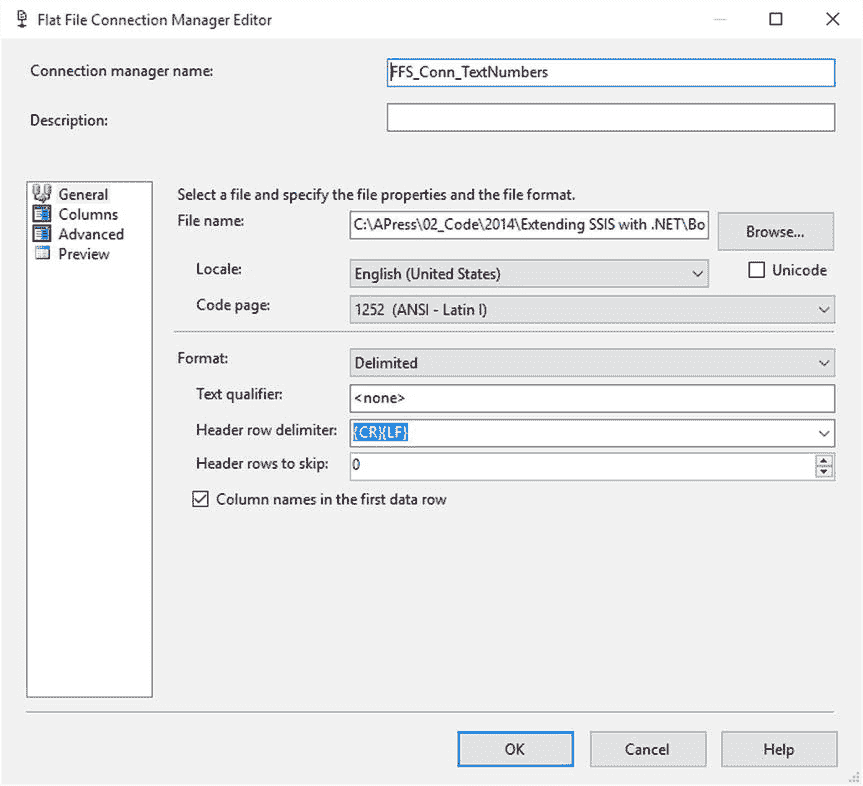  
`图 11-10.` 平面文件连接管理器编辑器

有了平面文件源后，添加一个用于转换的脚本组件，命名为 `SCR_TRA_TextNumber`。

在组件的“输入”页面，将 `TextNumber` 列设为“只读”。

在“输入和输出列”页面，添加一个布尔类型（`DT_BOOL`）的输出列 `isNumeric`，用于存储结果。

在“脚本”页面点击“编辑脚本...”按钮后，移除不需要的 `PreExecute` 和 `PostExecute` 方法，并在 `Input0_ProcessInputRow` 方法中添加以下两行代码：

```
//检查值是否为数值型
int result;
Row.isNumeric = Int32.TryParse(Row.TextNumber, out result);
```

如果使用 VB.NET 编写，则添加以下两行：

```
Dim result As Int32
' 如果解析成功则返回 true，否则返回 false
Row.isNumeric = Int32.TryParse(Row.TextNumber, result)
```

确实既简单又强大。结果如图 11-11 所示。

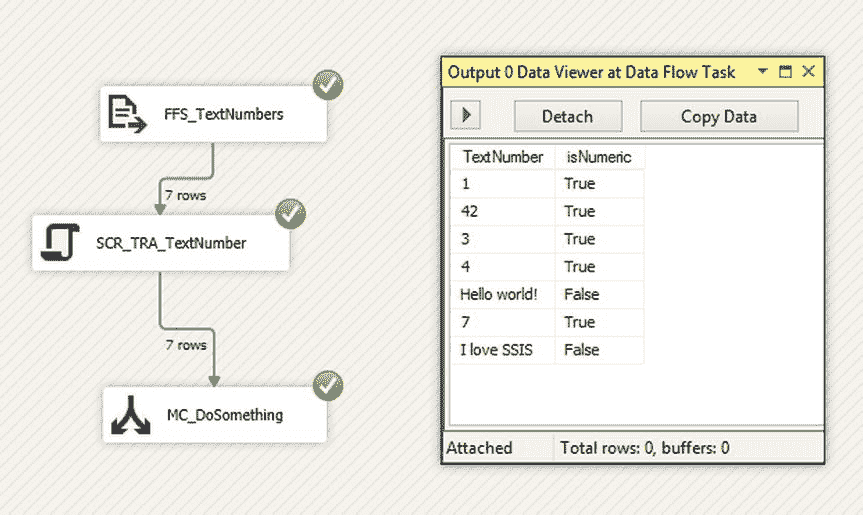  
`图 11-11.` `Int32.TryParse` 方法的执行结果

### 创建代理键

在某些情况下，你需要在数据流中生成一个唯一的连续数字作为某种键。它还可用于排名、消除重复项等。当数据来自半结构化源（例如，一个没有连续标识或行号信息的文本文件）时，脚本转换是理想的解决方案。

我们继续以上一节检测数值的示例为基础进行构建。假设你想确保所有获取的数值行都添加一个行号。

注意：如果你尚未了解上一节的解决方案，可以从本书网站下载代码。

在名为 `SCR_TRA_TextNumber` 的脚本组件的“输入和输出列”页面中，添加一个四字节有符号整数（`DT_I4`）类型的输出列，命名为 `RowNumber`。

点击“编辑脚本...”按钮打开脚本。在 C# 解决方案中，在类声明的正下方添加以下代码行：

```
int rownumber = 0; // 在类级别定义，每行都会保留其值
```

VB.NET 读者请执行以下操作：

```
Dim rownumber As Integer = 0
```

将 `Input0_ProcessInputrow` 方法中的现有代码替换为以下内容：

```
int result;
bool isNumeric = Int32.TryParse(Row.TextNumber, out result);
if (isNumeric)
{
    Row.isNumeric = isNumeric;
    rownumber++;
    Row.RowNumber = rownumber;
}
```

如果使用 VB.NET，请编写以下代码：

```
Dim result As Integer
Dim isNumeric As Boolean = Int32.TryParse(Row.TextNumber, result)
If isNumeric Then
        Row.isNumeric = isNumeric
        rownumber += 1
        Row.RowNumber = rownumber
End If
```

运行包时，你可以看到所有数值行都添加了连续的行号。所有非数值行的 `RowNumber` 列值均为 0。结果如图 11-12 所示。

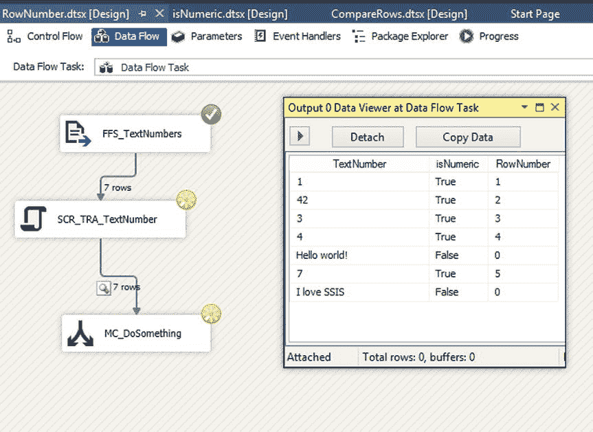  
`图 11-12.` `RowNumber` 附加到数值行

脚本组件再次帮你完成了对数据执行的、非直接或 SSIS 中不可用的任务。

### 创建 GUID

SSIS 中没有内置函数或表达式可用于创建新的 GUID。如果你已有以字符串形式存储的 GUID，则可以在派生列中使用强制转换将其转换为真正的 GUID 数据类型；或者，如果你有 SQL Server 数据源，则可以在源查询中使用 `NEWID()` 函数。

就像上一个创建 `RowNumber` 的示例一样，你可以使用 .NET 中的脚本组件通过一行代码创建一个 GUID。

#### 创建包

首先创建一个新的 SSIS 包，并在界面上添加一个数据流。在此数据流中，添加一个指向先前示例中文件的平面文件源连接，如图 11-13 所示。


图 11-13. 平面文件连接管理器配置

#### 添加脚本组件

在源之后添加一个脚本组件，并将脚本类型选择为“转换”。将其连接到其他组件，并命名为 `SCR_CreateGUID`。在“输入和输出”页面，转到“输出 0”，选择“输出列”，然后添加一个名为 `RowGUID` 的新列。将其类型更改为 `DT_GUID`（唯一标识符），如图 11-14 所示。

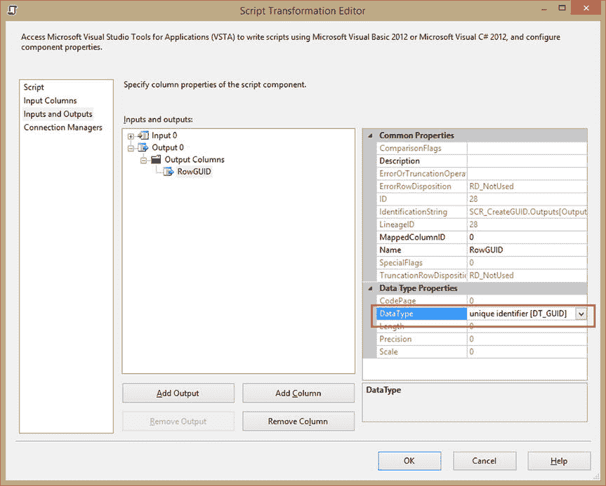
图 11-14. 添加新输出列

在组件的“脚本”页面，点击“编辑脚本...”。在 VSTA 编辑器中，移除你不需要的 `PreExecute` 和 `PostExecute` 方法。在 `Input0_ProcessInputRow` 方法中，添加一行 C# 代码来创建一个随机 GUID 并将其赋值给你之前创建的列。

```
//创建并分配一个 GUID
Row.RowGUID = Guid.NewGuid();
```

在 VB.NET 中，代码如下：

```
' 使用 SSIS 创建全局唯一标识符
Row.Guid2 = System.Guid.NewGuid()
```

#### 结果

关闭 VSTA 编辑器和脚本转换编辑器。向数据流添加一个多播，并将其连接到脚本组件。如果添加数据查看器（右键单击脚本组件和多播之间的连接），你应该会看到如图 11-15 所示的结果。由于 GUID 是全局唯一的，每次运行生成的 GUID 都应不同。

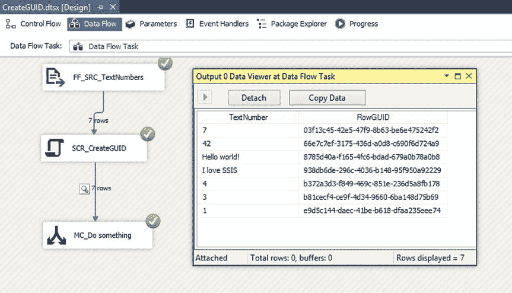
图 11-15. 新添加的 GUID 列

### 条件多播

处理 SSIS 包中的事实表时，你可能需要处理空值。此外，一个需求可能是出于审计目的记录空值行。使用内置组件可以实现这一点，但这非常繁琐，因为它涉及条件拆分、多个多播和一个 Union All 组件。

此时，脚本组件具备多个输出的功能就非常实用了。这种方法有两个好处。第一个好处是，你可以比使用大量条件转换更优雅地处理复杂的 `if` 语句；在一个脚本中处理所有条件比多个 SSIS 条件表达式更具可读性。第二个好处是，单行数据可以被重定向到多个输出，无需使用多播。

在以下示例中，你将遍历表的所有行，并将其中一些行重定向到输出以用于审计，因为某些列的值是错误的（你也可以检查值是否超过阈值、质量不佳，或任何其他想保存特定数据行的特殊原因；但这不属于此示例的内容）。

#### 数据源

对于数据源，你使用之前用过的第 11 章 数据。此表中包含一些员工的收入信息。由于公司今年业绩非常好，管理层决定将所有员工的收入提高 20%，同时指出所有年收入低于 20 万美元的员工。

首先，向一个空白包中添加一个数据流。在此数据流中，添加一个 OLE DB 源，连接到书籍代码中的 chapter 11 表。

> **注意**
> 此示例的完整代码可在本书网站上获取。

选择表中所有可用的列。

#### 脚本

添加一个脚本组件，并在“脚本类型”对话框中选择“转换”。将组件重命名为 `SCR_EnsureIncomeRaise`，并将数据源的输出连接到其输入。

在脚本组件的“输入列”页面上，选择 `YearlyIncome` 作为只读输入列。

在脚本组件的“输入和输出”页面上，将第一个输出重命名为 `GiveARaise`，并添加第二个名为 `LessThan200K` 的输出。

还需要执行几个步骤来确保输出按预期工作。首先，你需要将两个输出的 `ExclusionGroup` 属性都更改为 1（或其他非零值）。

默认情况下，所有输入行都被定向到所有可用输出，除非你指明要将每一行重定向到某个特定输出。这是通过为输出的 `ExclusionGroup` 属性指定一个非零值来实现的。该整数值具体是多少并不重要，但对于所有指定的输出组，该值必须相同。

配置如图 11-16 所示。

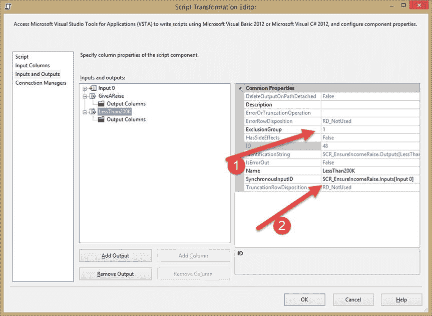
图 11-16. 输出配置

以下是该配置的详细说明：

- `ExclusionGroup` 设置为 1，并且对于所有输出，该值必须相同。

- 将 `SynchronousOuputID` 设置为 0（无）会创建异步输出，其中输出行与输入行没有任何关系，从而创建新的内存缓冲区并将值复制到其中。由于并非输出缓冲区中的所有行都会进入此输出，这使得我们可以实现条件重定向。

设置完成后，通过单击“脚本”页面上的 `Edit Script...` 打开脚本编辑器。移除 `PreExecute` 和 `PostExecute` 方法。然后输入以下 C# 代码：

```
// 在脚本的 Input0_ProcessInputRow 方法中添加以下几行代码：
if (Row.YearlyIncome < 200000)
{
    Row.DirectRowToLessThan200K();
}
Row.DirectRowToGiveARaise();
```

或者以下 VB.NET 代码：

```
If Row.YearlyIncome < 200000 Then
    Row.DirectRowToLessThan200K()
End If

Row.DirectRowToGiveARaise()
```

指示脚本仅将 `YearlyIncome` 小于 20 万的行用于一个输出，而将所有行用于另一个输出。如你所见，该逻辑非常易于实现，并且比使用 SSIS 条件拆分更具可读性。

关闭脚本组件，并向数据流中添加一个派生列 `DER_GiveARaise`。该派生列用于将 `YearlyIncome` 提高（并替换）20%。配置如图 11-17 所示。

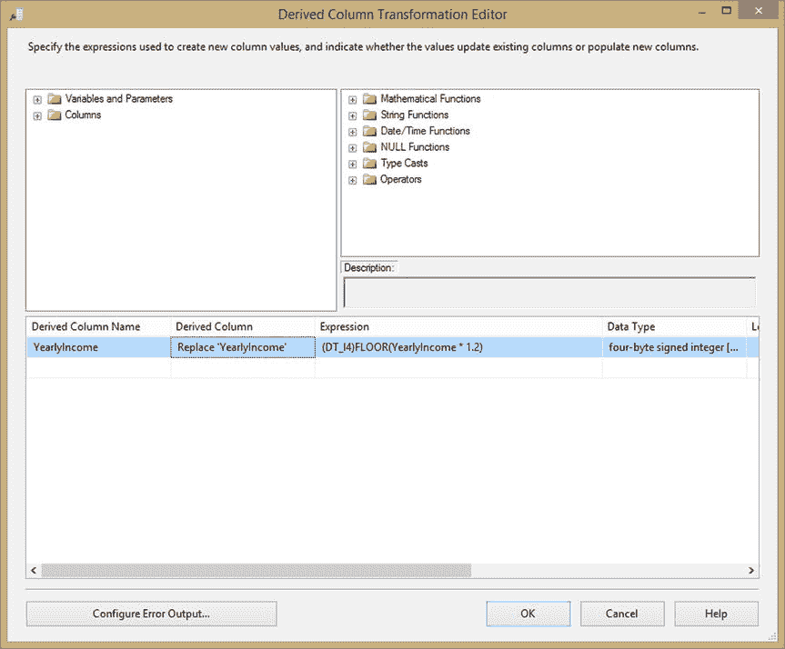
图 11-17. 使用派生列提高 20%

将派生列的输入连接到脚本组件的 `GiveARaise` 输出。

完成后，向派生列的输出添加一个多播，并向脚本组件的 `LessThan200K` 输出添加另一个多播。通过向多播连接添加数据查看器，你可以看到 `YearlyIncome` 符合脚本组件中条件的行，以及收入提高后的行。

图 11-18 显示了收入提高后的数据查看器。

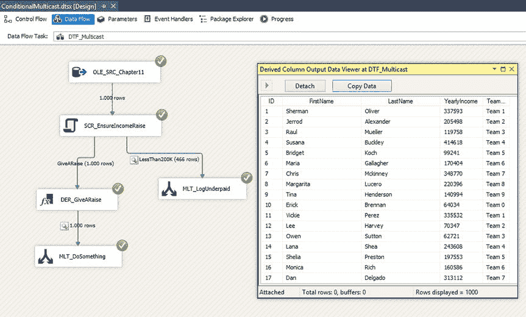
图 11-18. 所有收入提高 20%

### 总结

在本章中，你看到了几个示例，说明脚本组件可以执行 SSIS 中原本无法完成的任务。你还看到了脚本组件比内置任务更灵活、更易于使用和理解的示例。

# 脚本组件作为目标

电子补充材料 本章的在线版本 (doi:[10.1007/978-1-4842-0638-6_12](http://dx.doi.org/10.1007/978-1-4842-0638-6_12)) 包含补充材料，仅供授权用户使用。

本章重点介绍脚本组件作为目标。虽然有很多现成的目标可用，但有时你需要一些特殊的目标——例如包含额外页眉和页脚的自定义平面文件、跨多行的记录，以及 XML 目标。
但在将脚本组件用作目标时请务必小心。由于记录是逐行处理的，因此，通过存储过程调用或大量单条查询命令将大量数据插入数据库可能不是个好主意。启用快速加载的 OLE DB 目标可能快得多；如果你确实需要存储过程调用，那么 `OLE DB` 命令更易于理解和维护。但对于自定义文本文件，脚本组件作为目标非常有用。Web 服务对于脚本组件目标也有实际用途。第 15 章中提供了一些 Web 服务示例。

## 带页眉和页脚的基本平面文件目标

第一个示例是一个基本的平面文件目标。它与常规平面文件目标非常相似，但增加了额外的页眉和页脚。你可以轻松地根据自身需求扩展此示例。

### 创建文件连接管理器

由于你不想在脚本中对平面文件的路径进行硬编码，因此将使用文件连接管理器。创建一个指向现有或不存在的文件的文件连接管理器。示例请参见图 12-1。

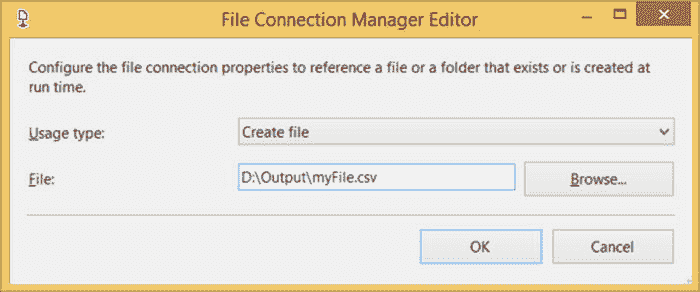

图 12-1. 指向 CSV 文件的文件连接管理器

### 数据源

在本示例中，你将使用第 10 章的随机测试数据作为数据源。你可以使用入门包，也可以使用自己的数据作为数据源。以下是输出的列：

-   `FirstName`（`DT_STR`，1252，50）
-   `LastName`（`DT_STR`，1252，50）
-   `EmployeeId`（`DT_I4`）
-   `DateOfBirth`（`DT_DATE`）
-   `Salary`（`DT_NUMERIC`，6，2）
-   `Gender`（`DT_STR`，1252，1）

图 12-2 展示了本章示例的随机数据源入门包。

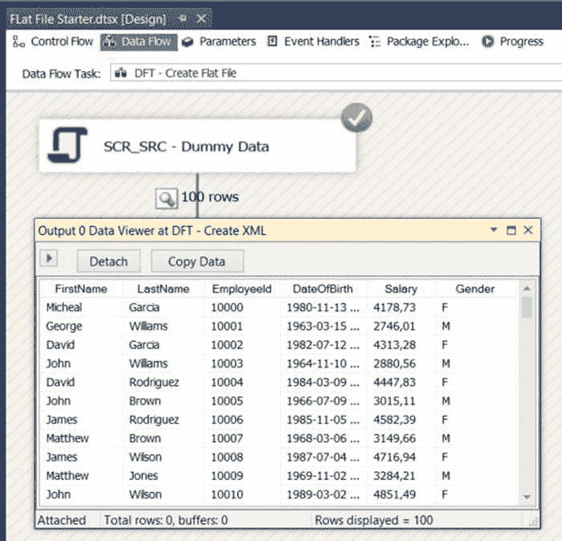

图 12-2. 随机数据源入门包

### 脚本组件

将一个脚本组件拖到数据流的设计界面上，然后选择 `Destination`（目标）类型，如图 12-3 所示。为其指定一个合适的名称，并将其连接到数据流中的最后一个转换。

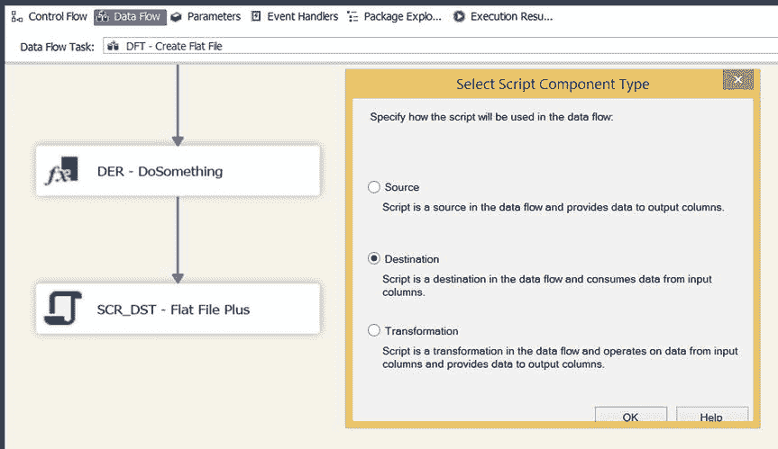

图 12-3. 脚本组件类型：目标

### 添加入站列

编辑脚本组件，转到 `Input Columns`（入站列）页面。选择 `.csv` 文件中需要的所有列，如图 12-4 所示。以数字或标点符号开头的列应在 `Output Alias`（输出别名）列中进行重命名，因为这些列会在脚本代码中被移除。

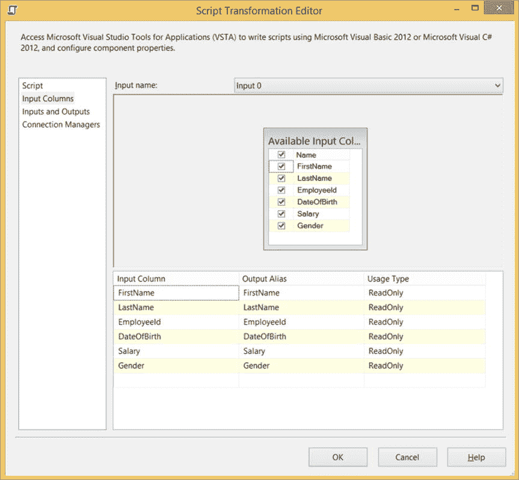

图 12-4. 选择所需的入站列

以下是入站列：

-   `FirstName`
-   `LastName`
-   `EmployeeId`
-   `DateOfBirth`
-   `Salary`
-   `Gender`

### 选择连接管理器

转到 `Connection Manager`（连接管理器）页面，选择新创建的文件连接管理器。如图 12-5 所示添加后，将其命名为 `myFile`。你也可以通过下拉列表添加一个新的连接管理器。

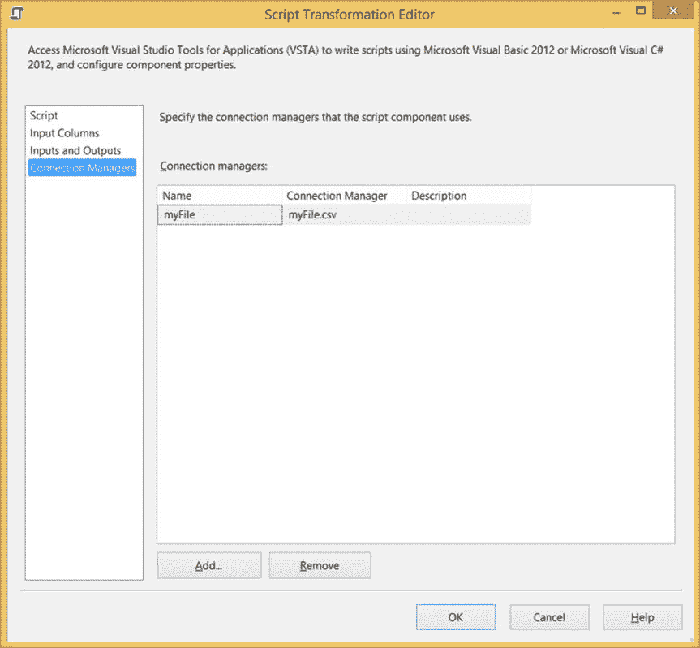

图 12-5. 添加连接管理器

### 代码

现在，你可以回到 `Script`（脚本）页面，点击 `Edit Script...`（编辑脚本...）按钮打开 `VSTA` 环境。首先，你需要添加一个额外的命名空间来简化代码。

```csharp
#region CustomNamespace
using System.IO;
#endregion
```

这是 VB.NET 代码：

```vbnet
#Region "CustomNamespace"
Imports System.IO
#End Region
```

接下来，你需要几个类变量来存储 CSV 数据和页脚信息。

```csharp
// 指向 CSV 文件的流
private StreamWriter textWriter;

// 用于定义列分隔符的字符串变量
private string ColumnDelimiter = ";";

// 用于跟踪行数的计数器
private int TotalRows = 0;

// 用于统计总薪水的十进制变量
private decimal TotalSalary = 0;
```

以下是 VB.NET 代码：

```vbnet
' 指向 CSV 文件的流
Private textWriter As StreamWriter

' 用于定义列分隔符的字符串变量
Private ColumnDelimiter As String = ";"

' 用于跟踪行数的计数器
Private TotalRows As Integer = 0

' 用于统计总薪水的十进制变量
Private TotalSalary As Decimal = 0
```

在 `PreExecute` 方法中，你要打开流并开始写入标头。但此时还不能写入总计、计数或求和信息，因为还没有得到相关数据。

```csharp
public override void PreExecute()
{
    // 创建一个新的 CSV 文件，并使用
    // 连接管理器中的文件路径
    textWriter = new StreamWriter(
        this.Connections.myFile.AcquireConnection(null).ToString());

    // 写入包含当前日期的标头
    textWriter.WriteLine("ExportDate: " + DateTime.Now.ToShortDateString());

    // 写入包含列名的标头
    textWriter.Write("EmployeeId" + ColumnDelimiter);
    textWriter.Write("FirstName" + ColumnDelimiter);
    textWriter.Write("LastName" + ColumnDelimiter);
    textWriter.Write("DateOfBirth" + ColumnDelimiter);
    textWriter.Write("Gender" + ColumnDelimiter);
    textWriter.WriteLine("Salary");
}
```

这是 VB.NET 代码：

```vbnet
Public Overrides Sub PreExecute()

    ' 创建一个新的 CSV 文件，并使用
    ' 连接管理器中的文件路径
    textWriter = New StreamWriter( _
        Me.Connections.myFile.AcquireConnection(Nothing).ToString())

    ' 写入包含当前日期的标头
    textWriter.WriteLine("ExportDate: " + DateTime.Now.ToShortDateString())

    ' 写入包含列名的标头
    textWriter.Write(Convert.ToString("EmployeeId") & ColumnDelimiter)
    textWriter.Write(Convert.ToString("FirstName") & ColumnDelimiter)
    textWriter.Write(Convert.ToString("LastName") & ColumnDelimiter)
    textWriter.Write(Convert.ToString("DateOfBirth") & ColumnDelimiter)
    textWriter.Write(Convert.ToString("Gender") & ColumnDelimiter)
    textWriter.WriteLine("Salary")

End Sub
```

在`PostExecute`方法中，你需要添加页脚并关闭`.csv`文件。在脚本的这个阶段，你可以使用总计和求和值，因为`Input0_ProcessInputRow`方法已经计算出了这些值。

```csharp
public override void PostExecute()
{
    // 添加页脚
    textWriter.WriteLine("Rows: " + TotalRows.ToString());
    textWriter.WriteLine("Total Salary: " + TotalSalary.ToString());

    // 关闭文件
    textWriter.Close();
}
```

以下是 VB.NET 代码：

```vbnet
Public Overrides Sub PostExecute()

    ' 添加页脚
    textWriter.WriteLine("Rows: " + TotalRows.ToString())
    textWriter.WriteLine("Total Salary: " + TotalSalary.ToString())

    ' 关闭文件
    textWriter.Close()

End Sub
```

在`Input0_ProcessInputRow`方法中，你需要处理所有记录。每个列值与列分隔符组合，被写入到`.csv`文件中。最后一列使用`WriteLine`而非`Write`来添加行分隔符。在这里，你也可以计算可在页脚中使用的项目。

```csharp
public override void Input0_ProcessInputRow(Input0Buffer Row)
{
    // 使用列分隔符写入列值
    textWriter.Write(Row.EmployeeId.ToString() + ColumnDelimiter);
    textWriter.Write(Row.FirstName.ToString() + ColumnDelimiter);
    textWriter.Write(Row.LastName.ToString() + ColumnDelimiter);
    textWriter.Write(Row.DateOfBirth.ToShortDateString() + ColumnDelimiter);
    textWriter.Write(Row.Gender.ToString() + ColumnDelimiter);

    // 对最后一列使用 WriteLine 作为行分隔符
    textWriter.WriteLine(Row.Salary.ToString());

    // 用于页脚的计算
    TotalRows++;
    TotalSalary = TotalSalary + Row.Salary;
}
```

这是 VB.NET 代码：

```vbnet
Public Overrides Sub Input0_ProcessInputRow(ByVal Row As Input0Buffer)

    ' 使用列分隔符写入列值
    textWriter.Write(Row.EmployeeId.ToString() & ColumnDelimiter)
    textWriter.Write(Row.FirstName.ToString() & ColumnDelimiter)
    textWriter.Write(Row.LastName.ToString() & ColumnDelimiter)
    textWriter.Write(Row.DateOfBirth.ToShortDateString() & ColumnDelimiter)
    textWriter.Write(Row.Gender.ToString() & ColumnDelimiter)

    ' 对最后一列使用 WriteLine 作为行分隔符
    textWriter.WriteLine(Row.Salary.ToString())

    ' 用于页脚的计算
    TotalRows += 1
    TotalSalary = TotalSalary + Row.Salary

End Sub
```

### 结果

现在运行包并检查平面文件的结果。请注意，这是一个非常基础的示例，但非常容易根据你的需求进行扩展。图 12-6 展示了本章示例的结果。

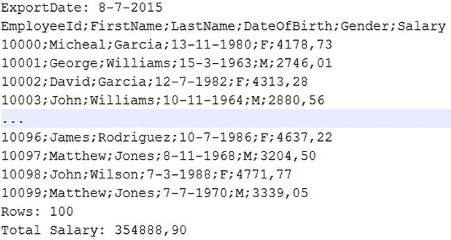

图 12-6. 文本文件的一部分

## 基本 XML 目标

遗憾的是，目前仍没有现成的 XML 文件目标可用。如果你的源是 SQL Server 表，则可以在 OLE DB 源组件中使用 `FOR XML` 查询，然后将结果写入无标题的平面文件目标。如果你使用不同的源或进行了大量转换，则 `FOR XML` 查询不再适用。此时，脚本组件可以帮你解决问题。

### 创建文件连接管理器

由于你不希望在脚本中对 XML 文件的路径进行硬编码，因此将使用文件连接管理器。创建一个指向现有或非现有文件的文件连接管理器。图 12-7 显示了一个示例。

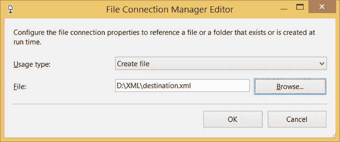

图 12-7. 指向 XML 文件的文件连接管理器

### 源

在此示例中，你使用的是之前平面文件目标示例中的随机测试数据，这些数据来自第 10 章。以下是输出列：

- `FirstName` (`DT_STR`, 1252, 50)
- `LastName` (`DT_STR`, 1252, 50)
- `EmployeeId` (`DT_I4`)
- `DateOfBirth` (`DT_DATE`)
- `Salary` (`DT_NUMERIC`, 6, 2)
- `Gender` (`DT_STR`, 1252, 1)

### 脚本组件

将一个“脚本组件”拖到数据流的设计图面上，然后选择“目标”作为类型，如图 12-8 所示。为其指定一个合适的名称，并将其连接到数据流中的最后一个转换。

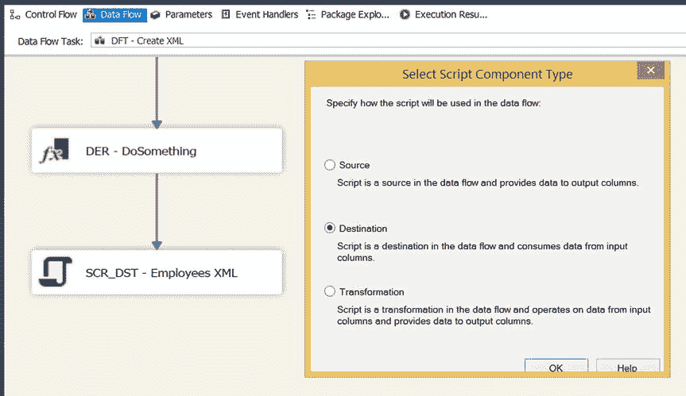

图 12-8. 脚本组件类型：目标

### 输入列

编辑脚本组件并转到“输入列”页面。选择 XML 中需要的所有列，如图 12-9 所示。以数字或标点符号开头的列应在“输出别名”列中重命名，因为这些列会在脚本代码中被移除。


图 12-9. 选择所需的输入列

以下是输入列：

- `FirstName`
- `LastName`
- `EmployeeId`
- `DateOfBirth`
- `Salary`
- `Gender`

### 选择连接管理器

转到“连接管理器”页面并选择新创建的文件连接管理器。添加后（如图 12-10 所示），将其命名为 `xmlFile`。你也可以通过下拉列表添加新的连接管理器。

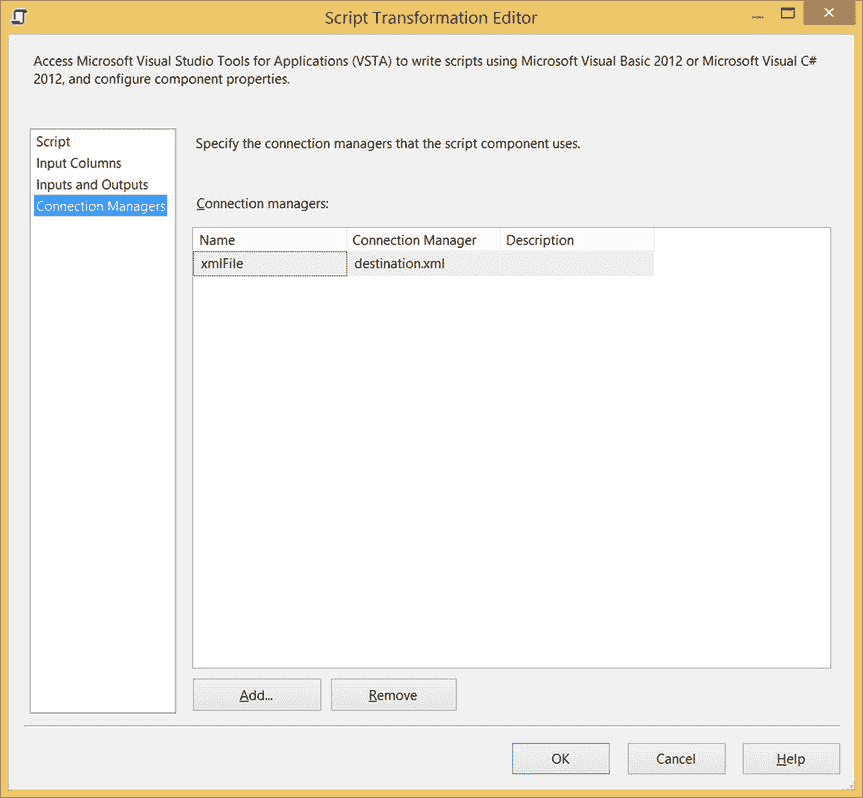

图 12-10. 添加连接管理器

### 代码

现在，你可以回到“脚本”页面，单击“编辑脚本...”按钮打开 VSTA 环境。首先，你需要添加一个额外的命名空间以简化代码。

```csharp
#region CustomNamespace

using System.Xml;

#endregion
```

以下是 VB.NET 代码：

```vbnet
#Region "CustomNamespace"

Imports System.Xml

#End Region
```

接下来，你需要一个用于存储 XML 数据的类变量。在此示例中，你使用 `XmlTextWriter` 命名空间。

```csharp
// XmlTextWriter (stream) object to write the XML
XmlTextWriter textWriter;
```

这是 VB.NET 代码：

```vbnet
' File stream object to write the XML
Private xmlFile As StreamWriter
```

在 `PreExecute` 方法中，你打开流并开始写入 XML 结构的开始标签。

## 结果

现在运行包并检查 XML 文件的结果。（图 12-11 显示了我们的结果）。这是一个非常基础的示例，没有错误处理，也没有转义像 `<` 和 `>` 这样的受限字符。并且，如果列很多，可能会非常耗时。第 14 章 展示了一个更灵活的示例，它会遍历列集合。

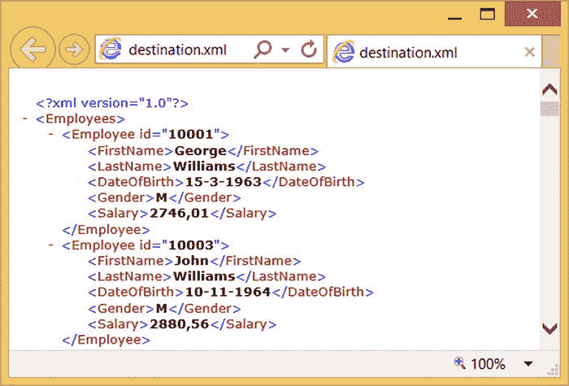

图 12-11. 在 Internet Explorer 中查看的 XML 文件

以下是 `PreExecute` 方法的 C# 代码：

```csharp
public override void PreExecute()
{
    // Create a new XML document and use the
    // filepath in the connection as XML-file
    textWriter = new XmlTextWriter(this.Connections.
    xmlFile.AcquireConnection(null).ToString(), null);
    // Start writing the XML document:
    textWriter.WriteStartDocument();
    // Create root element <Employees>
    textWriter.WriteStartElement("Employees");
}
```

以下是 `PreExecute` 方法的 VB.NET 代码：

```vbnet
Public Overrides Sub PreExecute()
    ' Create a new XML document and use the
    ' filepath in the connection as XML-file
    textWriter = New XmlTextWriter(Me.Connections. _
    xmlFile.AcquireConnection(Nothing).ToString(), _
    System.Text.Encoding.Default)
    ' Start writing the XML document:
    textWriter.WriteStartDocument()
    ' Create root element <Employees>
    textWriter.WriteStartElement("Employees")
End Sub
```

在 `PostExecute` 方法中，你关闭 XML 标签并清理资源。

`PostExecute` 方法的 C# 代码如下：

```csharp
public override void PostExecute()
{
    // Close root element: </Employees>
    textWriter.WriteEndElement();
    // Stop writing the XML document
    textWriter.WriteEndDocument();
    // Close document and clean up resources
    textWriter.Close();
}
```

`PostExecute` 方法的 VB.NET 代码：

```vbnet
Public Overrides Sub PostExecute()
    'Close root element: </Employees>
    textWriter.WriteEndElement()
    'Stop writing the XML document
    textWriter.WriteEndDocument()
    'Close document and clean up resources
    textWriter.Close()
End Sub
```

在 `Input0_ProcessInputRow` 方法中，你处理所有记录。每个列都作为 `Employee` 的一个元素提及，但 `ID` 列作为 `Employee` 的一个属性使用。

`Input0_ProcessInputRow` 方法的 C# 代码：

```csharp
public override void Input0_ProcessInputRow(Input0Buffer Row)
{
    // Opening tag employee with ID as attribute
    textWriter.WriteStartElement("Employee");
    textWriter.WriteStartAttribute("id");
    textWriter.WriteString(Row.EmployeeId.ToString());
    textWriter.WriteEndAttribute();
    // Writing elements within the Employee tag
    textWriter.WriteStartElement("FirstName");
    textWriter.WriteString(Row.FirstName.ToString());
    textWriter.WriteEndElement();
    textWriter.WriteStartElement("LastName");
    textWriter.WriteString(Row.LastName.ToString());
    textWriter.WriteEndElement();
    textWriter.WriteStartElement("DateOfBirth");
    textWriter.WriteString(Row.DateOfBirth.ToShortDateString());
    textWriter.WriteEndElement();
    textWriter.WriteStartElement("Gender");
    textWriter.WriteString(Row.Gender.ToString());
    textWriter.WriteEndElement();
    textWriter.WriteStartElement("Salary");
    textWriter.WriteString(Row.Salary.ToString());
    textWriter.WriteEndElement();
    // Closing tag employee
    textWriter.WriteEndElement();
}
```

`Input0_ProcessInputRow` 方法的 VB.NET 代码：

```vbnet
Public Overrides Sub Input0_ProcessInputRow(ByVal Row As Input0Buffer)
    ' Write opening tag for row with id property
    xmlFile.WriteLine("<Employee id=""" & Row.EmployeeId.ToString() & """>")
    ' Extra columns
    xmlFile.WriteLine("<FirstName>" & Row.FirstName.ToString() _
    & "</FirstName>")
    xmlFile.WriteLine("<LastName>" & Row.LastName.ToString() & "</LastName>")
    xmlFile.WriteLine("<DateOfBirth>" & Row.DateOfBirth.ToShortDateString() _
    & "</DateOfBirth>")
    xmlFile.WriteLine("<Gender>" & Row.Gender.ToString() & "</Gender>")
    xmlFile.WriteLine("<Salary>" & Row.Salary.ToString() & "</Salary>")
    ' Closing tag for row
    xmlFile.WriteLine("</Employee>")
End Sub
```

## 总结

在本章中，你学习了如何使用脚本组件创建自己的文本文件（`.csv` 和 `.xml`）。虽然非常基础，但易于扩展。如果列很多，这两种方法可能都比较耗时，但在第 14 章中，你将学习如何使用反射来遍历所有列。

## 13. 正则表达式

电子补充材料 本章的在线版本（doi:[10.​1007/​978-1-4842-0638-6_​13](http://dx.doi.org/10.1007/978-1-4842-0638-6_13)）包含补充材料，供授权用户使用。

许多 ETL 应用程序和流程通常处理字符串或需要解析大量文本；你常会遇到需要从文本块中剥离某些元素，或验证电子邮件地址格式是否有效的情况。

正则表达式提供了一种灵活、强大且高效的处理文本的方法。正则表达式模式匹配引擎使你能够：

- 解析大量文本以查找特定的字符模式

- 验证文本以确保其符合预定义模式

- 提取、编辑或删除文本子串，并将这些子串添加到集合中以生成报告

正则表达式的核心是其引擎，在.NET Framework 中由`System.Text.RegularExpression.Regex`对象表示。

使用正则表达式处理文本要求正则表达式引擎至少有两个参数：

- 要在文本中查找的正则表达式模式

- 用于解析正则表达式模式的文本

关于正则表达式对象模型的更多信息，请参阅 MSDN 上的[`https://msdn.microsoft.com/en-us/library/30wbz966(v=vs.110).aspx`](https://msdn.microsoft.com/en-us/library/30wbz966(v=vs.110).aspx)。

如前所述，正则表达式是引擎尝试匹配的模式。一个模式由以下三个部分中的一个或多个组成：

- 字符文本

- 运算符

- 构造

正则表达式语法的完整列表，包括字符转义、字符类、定位点、分组构造、限定符、反向引用构造、替换构造、替换、正则表达式选项和其他构造，可在 MSDN 上参考：[`https://msdn.microsoft.com/en-us/library/az24scfc(v=vs.110).aspx`](https://msdn.microsoft.com/en-us/library/az24scfc(v=vs.110).aspx)。

以下是一些寻找正则表达式示例和资源的优秀网站列表：

- [`http://www.regexr.com`](http://www.regexr.com/)

- [`http://www.regular-expressions.info/`](http://www.regular-expressions.info/)

- [`http://rubular.com`](http://rubular.com)

- [`http://regexone.com`](http://regexone.com)

`Regex`类提供了执行前面所述操作的方法。

- `IsMatch`方法用于确定正则表达式是否出现在输入文本中；例如，验证电子邮件地址格式是否正确时使用。

- `Match`或`Matches`方法用于检索一个对象或对象集合，其中包含所有匹配正则表达式模式的文本出现。

- `Replace`方法用于替换匹配正则表达式模式的文本。

本章将通过三个示例，演示如何解析、验证以及提取子串。

### 先决条件

本章所有示例均基于示例文件`ProductList.csv`，该文件可在本章的源代码中找到。

以下是用于存储信息的六列：

- 产品 ID

- 产品名称，即产品的名称

- 创建日期

- 产品生产国家

- 产品负责人的电子邮件地址（包含一些格式错误）

- 产品的 HTML 描述（HTML 描述取自维基百科）

图 13-1 是在 Excel 中打开的`.csv`文件的部分截图。

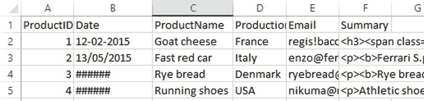

图 13-1. 产品列表.csv 文档

### 验证电子邮件地址

正则表达式在处理数据时的一个重要应用是确保更高的数据质量。根据国际数据公司（IDC）的估计，数据质量差每年给企业造成 65 亿美元的损失。无效的电子邮件地址是一种可以通过正则表达式捕捉到的错误类型。

首先创建一个新的包，并在设计界面上添加一个数据流任务。在数据流任务内部，添加一个平面文件源和一个指向之前提到的`.csv`文档（`ProductList.csv`，位于本章源代码中）的新平面文件连接管理器。将“常规”页面的所有设置保留为默认值，如图 13-2 所示。

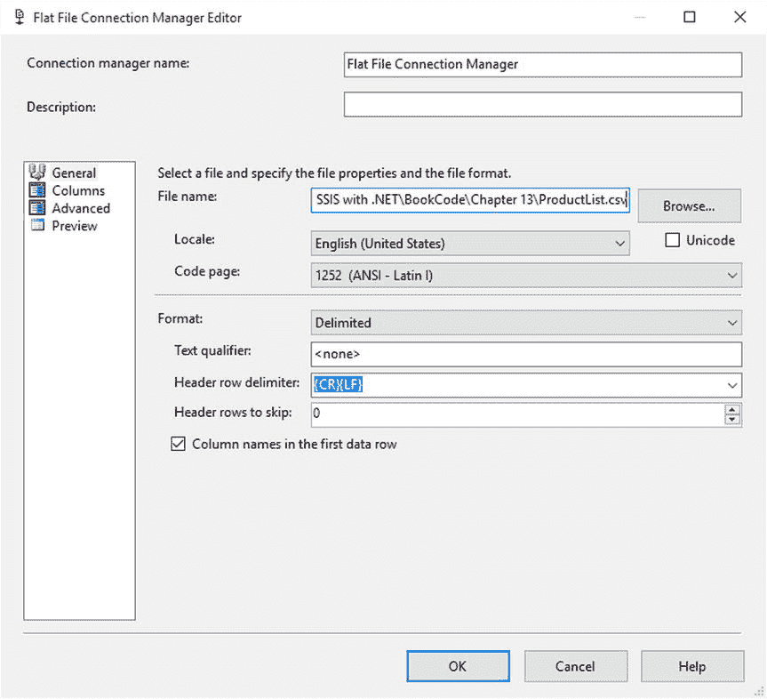

图 13-2. 平面文件连接管理器编辑器

访问“列”页面，确保已获取元数据并且列被正确解析。

在平面文件连接管理器的“高级”页面中，更改“摘要”列的长度，因为如果数据长度超过 50 个字符，将会发生截断，从而在运行包时触发错误。将数据类型更改为宽度为 4000 的字符串`DT_STR`，如图 13-3 所示。该宽度应足够大，以防止截断发生。

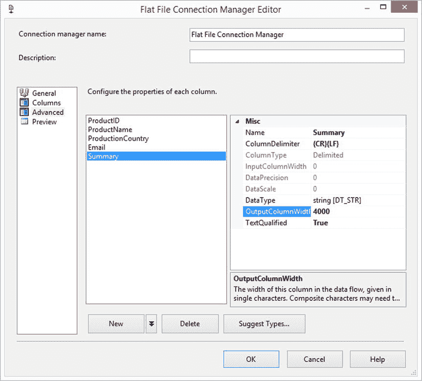

图 13-3. 更改数据类型

在数据流设计界面上添加一个用于转换的脚本组件，名为`SCR_ValidateEmail`，并在其与之前创建的平面文件源之间添加一条数据流路径。配置“输入列”页面，以只读模式接受来自平面文件源的所有可用列，如图 13-4 所示。在此示例中，你仅使用电子邮件列，因此最佳实践是只获取所需的列，但由于你将在其他示例中使用其他一些列，这里将获取所有可用列。

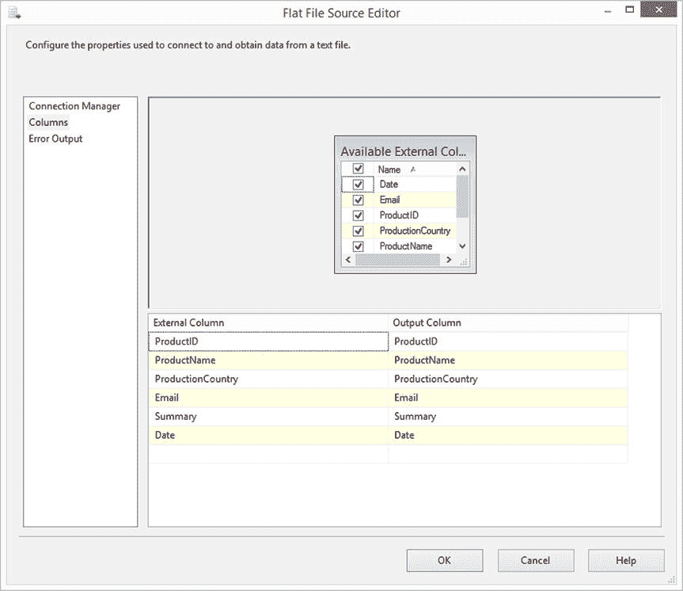

图 13-4. 脚本任务转换编辑器的输入页面

在编辑器的“输入和输出”页面上，你基本上需要两个输出：`ValidEmail`和`InvalidEmail`。第一个用于有效的电子邮件地址，第二个用于无效的电子邮件地址。首先将输出 0 重命名为`ValidEmail`。对于这两个输出，你需要将`ExclusionGroup`设置为 1，将`SynchronousInputID`设置为输入 0（因为每个输入对应一个输出）。输出 1 重命名为`InvalidEmail`。这两个输出如图 13-5 所示。

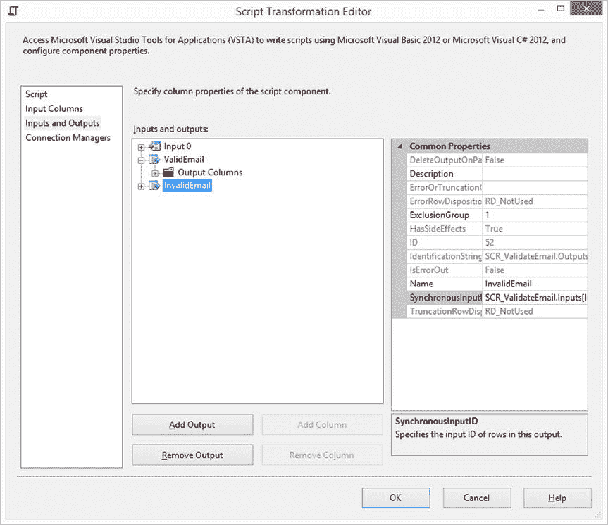

图 13-5. 输出列

#### 脚本

在脚本页面上点击“编辑脚本...”按钮，即可打开 VSTA 编辑器；你可以开始添加代码来执行验证，以保留行数据。首先，你可以安全地删除 `PreExecute` 和 `PostExecute` 方法，因为你不需要它们。然后，你需要添加对正则表达式命名空间的引用。

```
#region CustomNamespace
using System.Text.RegularExpressions;
#endregion
```

通过将所有验证步骤封装在函数中，可以保持接口的简洁。你实现的第一个函数用于验证给定的电子邮件地址。

以下是 C# 实现：

```
// 一个布尔方法，用于根据正则表达式模式验证电子邮件地址
public bool IsCorrectEmail(String emailAddress)
{
     // 电子邮件模式
     string emailAddressPattern = @"^(([^<>()[\]\\.,;:\s@\""]+"
                             + @"(\.[^<>()[\]\\.,;:\s@\""]+)*)|(\"".+\""))@"
                             + @"((\[[0-9]{1,3}\.[0-9]{1,3}\.[0-9]{1,3}"
                             + @"\.[0-9]{1,3}\])|(([a-zA-Z\-0-9]+\.)+"
                             + @"[a-zA-Z]{2,}))$";
     // 检查是否匹配并返回该值（布尔值）
     return Regex.IsMatch(emailAddress,emailAddressPattern,RegexOptions.IgnoreCase);
}
```

以下是 VB.NET 实现：

# 在 SSIS 中使用正则表达式

```vb
' 一个布尔方法，用于根据正则表达式模式验证电子邮件地址
Public Function IsCorrectEmail(emailAddress As [String]) As Boolean
' 电子邮件模式
Dim emailAddressPattern As String = "^(([^<>()[\]\\.,;:\s@\""]+" + _
        "(\.[^<>()[\]\\.,;:\s@\""]+)*)|(\"".+\""))@" + _
        "((\[[0-9]{1,3}\.[0-9]{1,3}\.[0-9]{1,3}" + _
        "\.[0-9]{1,3}\])|(([a-zA-Z\-0-9]+\.)+" + _
        "[a-zA-Z]{2,}))$"
' 检查是否匹配并返回该值（布尔值）
Return Regex.IsMatch(emailAddress, emailAddressPattern, RegexOptions.IgnoreCase)
End Function
```

这个模式并非十分复杂，但它能够根据电子邮件地址的标准定义，匹配大多数有效的电子邮件地址。请注意，该模式不能判断电子邮件地址是否存在，只能判断其格式是否有效。此外，该模式也不会检查顶级域名是否是一个已存在的域名。

> **注意：** 模式可能会变得非常复杂，特别是如果你之前从未接触过正则表达式。对于验证电子邮件地址，有一种更简单的方法——使用`System.Net.Mail.MailAddress`类。要判断电子邮件地址是否有效，可以将该地址传递给`MailAddress(String)`类构造方法。我们强烈建议你查阅互联网上可用的正则表达式资源和示例。

## 调用方法

添加方法后，你需要对脚本中处理的每一行包含电子邮件地址的数据调用该方法。如果方法返回`true`，则电子邮件有效，并将其定向到`ValidEmail`输出；否则，电子邮件无效，需要将其定向到`InvalidEmail`输出。

以下是在 C# 中调用该方法的方式：

```csharp
public override void Input0_ProcessInputRow(Input0Buffer Row)
{
    bool isEmailValid = false;
    //如果没有提供电子邮件，则视为无效
    if (!Row.Email_IsNull)
    {
        isEmailValid = IsCorrectEmail(Row.Email);
    }
    if (isEmailValid)
    {
        Row.DirectRowToValidEmail();
    }
    else
    {
        Row.DirectRowToInvalidEmail();
    }
}
```

在 VB.NET 中，你可以按如下方式调用该方法：

```vb
Public Overrides Sub Input0_ProcessInputRow(Row As Input0Buffer)
        Dim isEmailValid As Boolean = False
        '如果没有提供电子邮件，则视为无效
        If Not Row.Email_IsNull Then
                isEmailValid = IsCorrectEmail(Row.Email)
        End If
        If isEmailValid Then
                Row.DirectRowToValidEmail()
        Else
                Row.DirectRowToInvalidEmail()
        End If
End Sub
```

关闭脚本编辑器，并向包中添加两个多播组件：一个连接到`ValidEmail`输出，另一个连接到`InvalidEmail`输出。在实际场景中，你可能希望记录无效电子邮件的行并停止处理该行。

如果你为两个优先约束添加数据查看器，并使用本章代码示例中提供的输入文件运行包，你可以看到无效电子邮件被验证方法捕获，如图 13-6 所示。

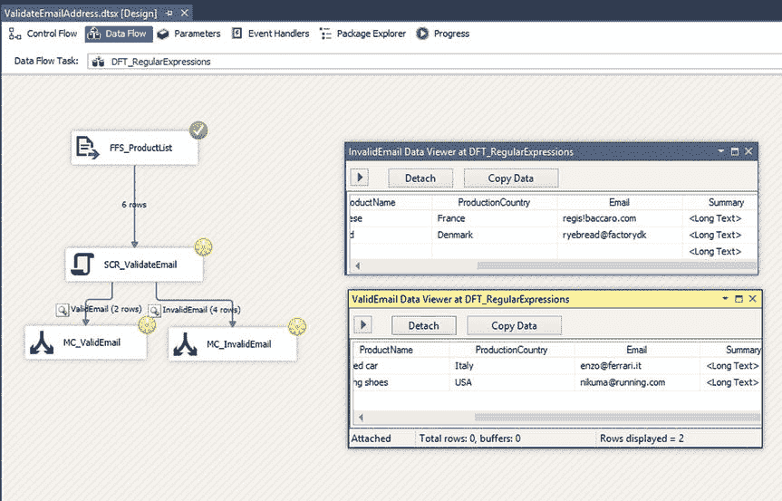

**图 13-6.** 成功运行包并显示数据查看器

## 移除 HTML 标签

在 SSIS 中处理文本时，有时会遇到包含大量标记的 HTML 格式文本，而你并不希望保留这些标记。从文本中去除标记是一个常见问题，使用正则表达式可以轻松实现。你需要做的就是指定 HTML 标签的模式，这非常简单：

它从`<`开始，并且必须匹配任意单个字符，甚至换行符，一次或多次。这种包含一个或多个字符的模式可以重复一次或完全不重复，从而产生如下的表达式：

```
<(.|\n)+?>
```

## 包

从前一个示例（或第 13 章 的示例代码）开始，在包的设计界面上添加一个“数据流任务”，并将其命名为`DFT_RemoveHTML`。

在“数据流任务”内部，按照前一个示例（验证电子邮件地址）所述添加一个“平面文件源”，并将其配置为从源文件中获取所有列。

在界面上添加一个名为`Scr_RemoveHTML`的“脚本组件”，选择“转换”作为其类型，并将其输入连接到“平面文件源”的输出。双击“脚本组件”，仅将`Summary`列设为`ReadWrite`，如图 13-7 所示。

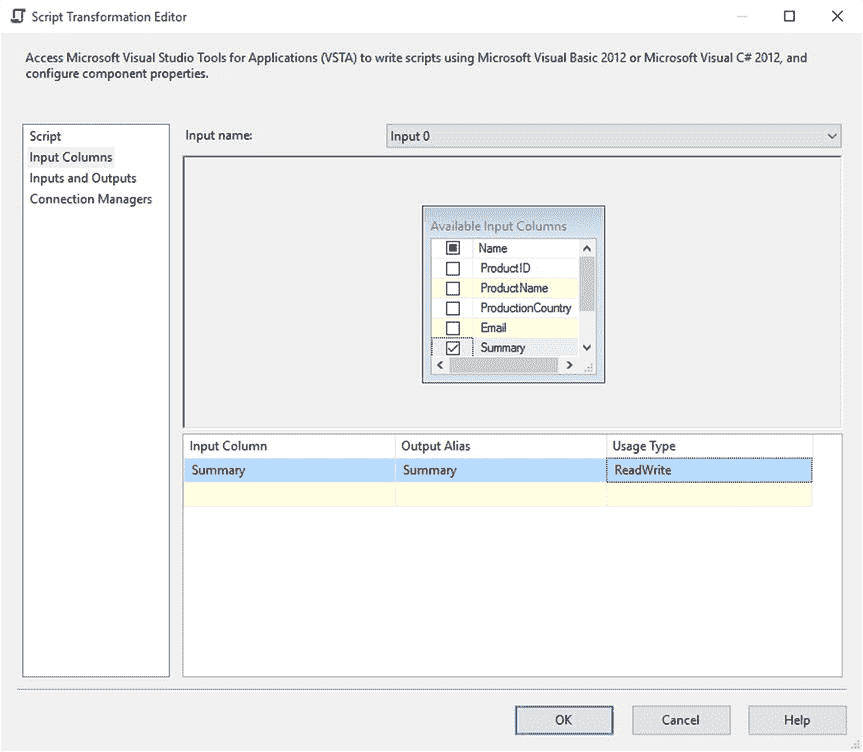

**图 13-7.** 配置输入列

在“脚本”页面上，点击“编辑脚本...”以打开 VSTA。从脚本中删除`PreExecute`和`PostExecute`方法。

### 脚本

在代码中使用正则表达式之前，需要先通过`Using`或`Imports`指令添加对命名空间的引用。如果使用 C#，请编写以下代码：

```csharp
#region CustomNamespace
using System.Text.RegularExpressions;
#endregion
```

你需要一个能使用前述模式来移除 HTML 代码的方法。

```csharp
// 在类级别创建以提升性能
// HTML 标签的模式
public static String htmlTagPattern = "<(.|\n)+?>";

// 使用该模式创建正则表达式对象
public Regex objRegExp = new Regex(htmlTagPattern);

// 一个使用正则表达式模式去除 HTML 的布尔方法
public String RemoveHtml(String message)
{
    // 将 HTML 标签替换为空字符串
    message = objRegExp.Replace(message, String.Empty);
    // 返回不含 HTML 标签的消息
    return message;
}
```

以下是在 VB.NET 中使用的代码：

```vb
' 在类级别创建以提升性能
' HTML 标签的模式
Public Shared htmlTagPattern As [String] = "<(.|" & vbLf & ")+?>"

' 使用该模式创建正则表达式对象
Public objRegExp As New Regex(htmlTagPattern)

' 一个使用正则表达式模式去除 HTML 的函数
Public Function RemoveHtml(message As [String]) As [String]
        ' 将 HTML 标签替换为空字符串
        message = objRegExp.Replace(message, [String].Empty)
        ' 返回不含 HTML 标签的消息
        Return message
End Function
```

在上述函数中，你使用正则表达式的`Replace`方法移除 HTML 标记并将其替换为空字符串，而在第一个示例中，你只关心匹配操作。

然后，你可以在`Input0_ProcessInputRow`方法中调用该方法，C# 的实现如下：

```csharp
public override void Input0_ProcessInputRow(Input0Buffer Row)
{
    Row.Summary = RemoveHtml(Row.Summary);
}
```

VB.NET 的调用方式如下：

```vb
Public Overrides Sub Input0_ProcessInputRow(Row As Input0Buffer)
        Row.Summary = RemoveHtml(Row.Summary)
End Sub
```

关闭 VSTA 编辑器，并向脚本组件的输出添加多播，同时启用优先级约束上的数据查看器。运行包时，你应该能够看到不含 HTML 标记的摘要，如图 13-8 所示。

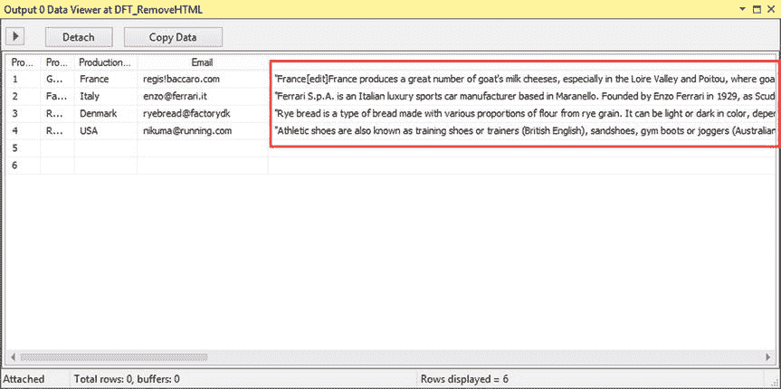

图 13-8. 显示结果的数据查看器

在此示例中，你了解了如何使用正则表达式的 `Replace` 方法从文本中去除 HTML 代码。在下一个示例中，你将了解如何验证日期，并在日期不符合所需格式时将其替换为默认值。

### 清理/验证

正则表达式也是确保数据质量的绝佳工具。基于清理和验证规则实现模式非常直接。在前面的示例代码中，有一个日期列。该列的唯一问题是数据质量。有时日期的各部分用正斜杠（`/`）分隔，有时用短划线（`-`）分隔。在其他情况下，根本没有日期，只有一连串的 `#` 符号。让我们实现一个脚本，确保日期始终以正确的方式表示，以便最终可以转换为 datetime 格式。此外，约定将空或无效的日期字符串替换为 `9999-12-31`。

#### 包

从上一个示例（或第 13 章的示例代码）开始，在包的设计图面上添加一个数据流任务，并将其命名为 `DFT_CleanseDate`。

在数据流任务内部，按照上一个示例（验证电子邮件地址）的描述添加一个平面文件源，并将其配置为从源文件中获取所有列。

在设计图面上添加一个名为 `SCR_CleanseDate` 的脚本组件，选择转换类型，并将其输入连接到平面文件源的输出。双击脚本组件，仅选择所需的列以提升性能——在本例中是 `Date` 列，并将其标记为 `ReadWrite`，如图 13-9 所示。单击脚本页面上的 `Edit Script…` 按钮以打开 VSTA。

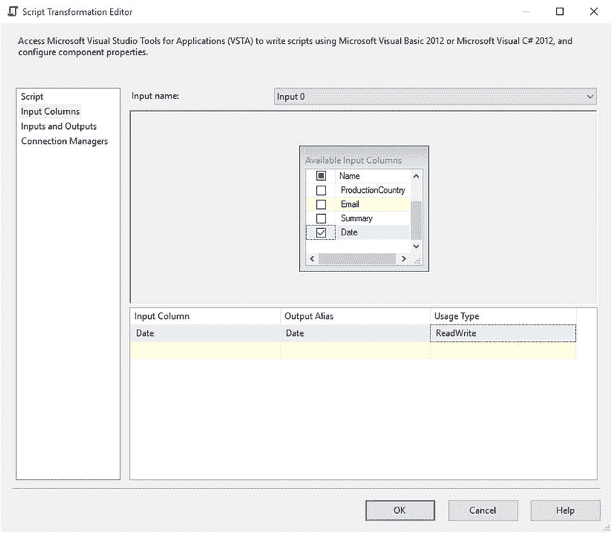

图 13-9. 日期列已更改为 ReadWrite

#### 脚本

首先，移除不必要的 `PreExecute` 和 `PostExecute` 方法。要在代码中使用正则表达式，需要先使用 `Using` 或 `Imports` 指令添加对命名空间的引用。以下是实现此功能的 C# 代码：

```
#region CustomNamespace
using System.Text.RegularExpressions;
#endregion
```

你需要一个方法来验证输入字符串的格式是否正确。`DateTime.TryParse` 方法正具备此功能。`TryParse` 会将指定的日期和时间字符串表示形式转换为其等效的 `DateTime` 对象，并返回一个指示转换是否成功的值，这比返回错误信息更容易处理。所使用的正则表达式十分简单；你需要查找所有出现的正斜杠、点、逗号和破折号，并将它们替换为破折号。再次给出 C# 中的实现：

```
//在类级别创建以提高性能
// 查找日期字符串中出现的 / , . - 字符
Regex rgx = new Regex("([-/,.])");

// 此方法使用 TryParse 检查日期是否有效，
// 如果无效则使用并返回一个通用值。
public string CheckDate(String date)
{
    string CleanedDate;
    // 将它们替换为 -
    CleanedDate = rgx.Replace(date, "-");
    DateTime parsedDate;
    if (DateTime.TryParse(CleanedDate, out parsedDate) == true)
    {
        //如果是日期，则以格式良好的方式返回
        // 日期格式化为 ISO 格式以避免混淆
        return parsedDate.ToString("yyyy-MM-dd");
    }
    else
    {
        //不是有效日期，则返回 ISO 格式的通用值
        return "9999-12-31";
    }
}
```

与往常一样，使用 VB.NET 可以轻松地表达该实现：

```
'在类级别创建以提高性能
' 查找日期字符串中出现的 / , . - 字符
Private rgx As New Regex("([-/,.])")

' 此方法使用 TryParse 检查日期是否有效，
' 如果无效则使用并返回一个通用值。
Public Function CheckDate([date] As [String]) As String
     Dim CleanedDate As String
     ' 将它们替换为 -
     CleanedDate = rgx.Replace([date], "-")
     Dim parsedDate As DateTime
     If DateTime.TryParse(CleanedDate, parsedDate) = True Then
         '如果是日期，则以格式良好的方式返回
         ' 日期格式化为 ISO 格式以避免混淆
         Return parsedDate.ToString("yyyy-MM-dd")
     Else
         '不是有效日期，则返回 ISO 格式的通用值
         Return "9999-12-31"
     End If
End Function
```

现在，从 `Main` 方法中，可以轻松地为每一行调用该帮助方法。在 C# 中，编写如下代码：

```
public override void Input0_ProcessInputRow(Input0Buffer Row)
{
            if (!Row.Date_IsNull)
       {
           Row.Date = CheckDate(Row.Date);
       }
       else
       {
           Row.Date = "9999-12-31";
       }
}
```

在 VB.NET 中，编写如下代码：

```
Public Overrides Sub Input0_ProcessInputRow(Row As Input0Buffer)
        If Not Row.Date_IsNull Then
        Row.Date = CheckDate(Row.Date)
        Else
        Row.Date = "9999-12-31"
        End If
End Sub
```

关闭 VSTA 编辑器，并向脚本组件的输出添加一个多播，以便在优先约束上启用数据查看器。运行包时，您应该能够看到经过验证和清理的日期，如图 13-10 所示。

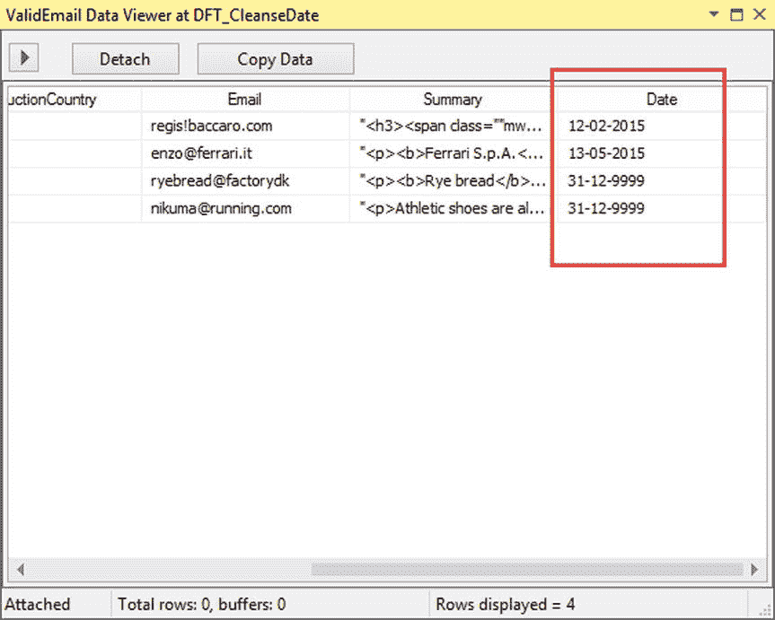

图 13-10. 展示清理后日期的数据查看器

### 总结

通过使用正则表达式，您可以以一种非常直接的方式对数据进行匹配、格式化、清洗和验证。这些示例演示了正则表达式的一些基本功能。通过组合更复杂的模式，您可以释放高性能正则表达式引擎的真正力量。

此外，还有一些工具可以帮助您构建表达式，这样您就不必自己费力解决了。其中最好用的工具之一是 RegExr，访问地址为 [`regexr.com`](http://regexr.com/)。

如果您更喜欢离线工具，RegexMagic 也是一个不错的选择；您可以在 [www.regular-expressions.info/regexmagic.html](http://www.regular-expressions.info/regexmagic.html) 找到它。

