# 脚本任务的进阶解决方案

电子补充材料 本章在线版本（doi:[10.1007/978-1-4842-0638-6_8](http://dx.doi.org/10.1007/978-1-4842-0638-6_8)）包含补充材料，仅供授权用户使用。

本章将探讨 ETL 中常见的实际应用场景，例如文件的压缩与解压，以及加密与解密。利用.NET 脚本可以大大简化这些场景的实现。此外，如何在`Foreach`循环中使用正则表达式进行筛选呢？

### 正则表达式

正则表达式在数据验证或清洗方面非常实用，而这些操作使用 SSIS 表达式几乎无法实现或极其困难。你可能会认为它们应该出现在数据流任务中（在第 13 章中你将看到一些非常有帮助的示例），但它们在控制流中同样非常有用。让我们通过一个非常简化的筛选示例来比较这些表达式类型；首先使用正则表达式，然后使用 SSIS 表达式。它们都筛选`actual*.csv`和`budget*.csv`文件：

```
^(actuals|budget).*\.csv$
```

```
LOWER(LEFT(@[User::FilePath], 7)) == "actuals" || LOWER(LEFT(@[User::FilePath], 6)) == "budget"
```

但如果接下来的四个字符必须是数字（如年份）呢？SSIS 表达式会变得相当复杂且难以阅读/维护，而使用正则表达式则容易得多：

```
^(actuals|budget)[0-9]{4}.*\.csv$
```

那么，如何在`Foreach`循环容器中使用正则表达式进行筛选呢？`Foreach`文件枚举器仅支持简单的通配符，例如`*.csv`，但无法通过单个`Foreach`循环容器同时筛选`actuals*.csv`和`budget*.csv`，或`*.csv`和`*.txt`。在本示例中，你在`Foreach`循环内添加一个脚本任务，用于验证由`Foreach`循环填充的变量（图 8-1 展示了此工作流）。你需要所有`budget[年份]*.csv`和`actuals[年份]*.csv`文件，但排除其他`.csv`文件。筛选条件中的`[年份]`表示文本后应跟四位数字：例如`actuals2016.csv`或`budget2017.csv`。将`Foreach`循环中的筛选器设置为`*.csv`以尽可能筛选。当文件数量较大时，这能提供更好的性能。

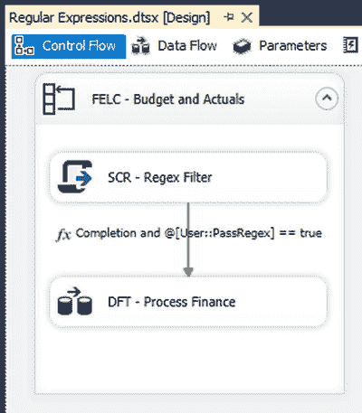

图 8-1. 循环中的正则表达式筛选器

#### 变量

`Foreach`循环文件枚举器使用当前文件的文件路径填充字符串变量`FilePath`，但对于正则表达式筛选器，你需要两个额外的变量：

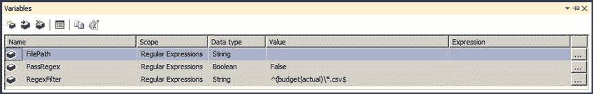

图 8-2. 正则表达式筛选器的变量

- `RegexFilter`：一个字符串变量，包含用于筛选的正则表达式：`^(actuals|budget)[0-9]{4}.*\.csv$`
- `PassRegex`：一个布尔变量，如果当前文件名通过正则表达式，则填充为`True`

#### 脚本任务

在你的`Foreach`循环容器中添加一个脚本任务作为首个任务。在脚本任务编辑器中，在`ReadOnlyVariables`中添加两个字符串变量：`FilePath`和`RegexFilter`，在`ReadWriteVariables`中添加布尔变量`PassRegex`（见图 8-3）。

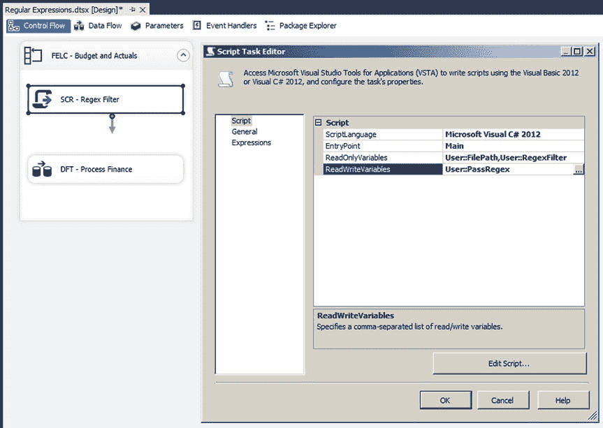

图 8-3. 只读与读写变量

#### 脚本

进入 VSTA 环境，添加以下命名空间以简化代码：

```
#region customNamespaces

using System.Text.RegularExpressions;

using System.IO;

#endregion
```

以下是 VB.NET 代码：

```
#Region "customNamespaces"

Imports System.Text.RegularExpressions

Imports System.IO

#End Region
```

然后在`Main`方法中添加以下代码。请注意可选的`RegexOptions`，可用于使正则表达式不区分大小写。

```
public void Main()
{
  // 将 SSIS 变量的值存储到.NET 变量中
  string currentFile = Dts.Variables["User::FilePath"].Value.ToString();
  string regexPattern = Dts.Variables["User::RegexFilter"].Value.ToString();

  // 从当前文件路径中移除路径
  // d:\sources\myFile.csv => myFile.csv
  currentFile = Path.GetFileName(currentFile);

  // 使用 SSIS 变量中的模式创建正则表达式对象。如果需要区分大小写的筛选器，可以移除 RegexOptions。
  Regex FileFilterRegex = new Regex(regexPattern, RegexOptions.IgnoreCase);

  // 检查是否匹配，并将结果（布尔值）返回给 SSIS 变量
  Dts.Variables["User::PassRegex"].Value = FileFilterRegex.IsMatch(currentFile);

  // 仅为测试目的添加日志记录
  bool fireAgain = true;
  Dts.Events.FireInformation(0, "RegexFilter", currentFile + " " + 
                     Dts.Variables["User::PassRegex"].Value.ToString(), string.Empty, 0, ref fireAgain);

  // 脚本任务成功完成
  Dts.TaskResult = (int)ScriptResults.Success;
}
```

以下是 VB.NET 代码：

```
Public Sub Main()
  ' 将 SSIS 变量的值存储到.NET 变量中
  Dim currentFile As String = Dts.Variables("User::FilePath").Value.ToString()
  Dim regexPattern As String = Dts.Variables("User::RegexFilter").Value.ToString()

  ' 从当前文件路径中移除路径
  ' d:\sources\myFile.csv => myFile.csv
  currentFile = Path.GetFileName(currentFile)

  ' 使用 SSIS 变量中的模式创建正则表达式对象。如果需要区分大小写的筛选器，可以移除 RegexOptions。
  Dim FileFilterRegex As New Regex(regexPattern, RegexOptions.IgnoreCase)

  ' 检查是否匹配，并将结果（布尔值）返回给 SSIS 变量
  Dts.Variables("User::PassRegex").Value = FileFilterRegex.IsMatch(currentFile)

  ' 仅为测试目的添加日志记录
  Dim fireAgain As Boolean = True
  Dts.Events.FireInformation(0, "RegexFilter", currentFile + " " + _
                     Dts.Variables("User::PassRegex").Value.ToString(), String.Empty, 0, fireAgain)

  ' 脚本任务成功完成
  Dts.TaskResult = ScriptResults.Success
End Sub
```

#### 优先约束

脚本任务将`PassRegex`变量填充为`True`或`False`。你可以在优先约束的表达式中使用此变量，以决定在脚本任务之后是停止还是继续。将包含正则表达式的脚本任务连接到`Foreach`循环中的下一个任务。然后，在优先约束编辑器（见图 8-4）中，将"求值操作"更改为`表达式`，并将表达式设置为以下内容：`@[User::PassRegex] == true`。或者，更简短地写成：`@[User::PassRegex]`。

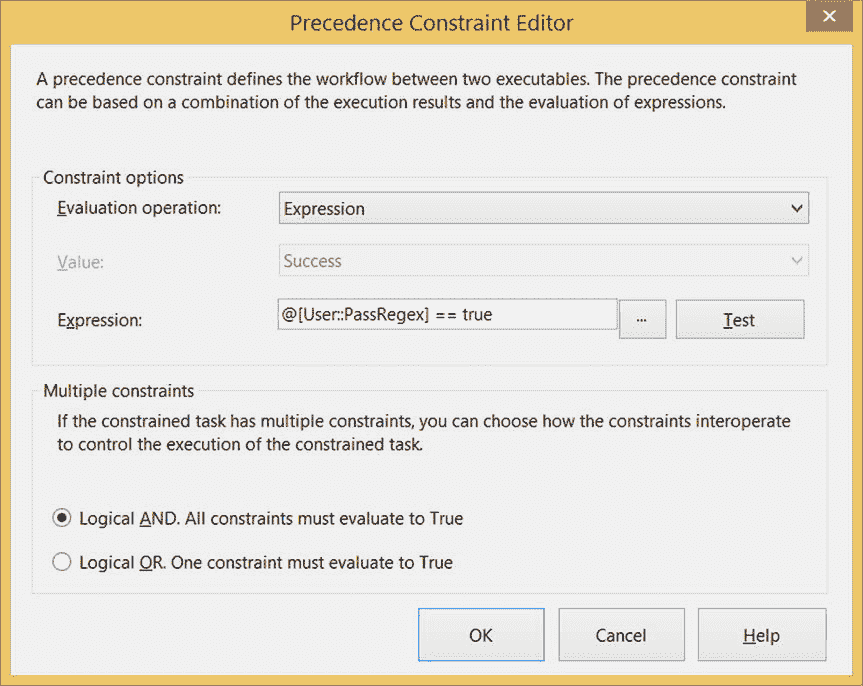

图 8-4. 在优先约束编辑器中添加表达式

#### 测试

现在执行包，并观察"执行结果"选项卡。你会看到脚本任务的执行次数多于数据流任务。为了测试，你在脚本任务中添加了一些代码（见第 4 章），用于记录哪些文件通过了正则表达式，哪些没有。

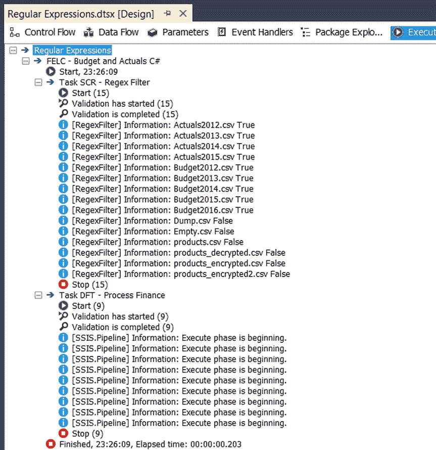

图 8-5. 执行结果（带额外日志记录）

### 压缩/解压缩

在.NET Framework 4.5.3 之前，压缩和解压缩文件需要第三方程序集，因为 zip 文件并非"开箱即用"支持。在 4.5.3 框架中，微软终于添加了对 zip 文件的支持；但截至本书编写时，SSIS 2014 仅支持 4.5.1。如果你能升级到 4.5.3，则这将是首选方式。


#### 下载库

有多种免费开源的库可用于压缩和解压缩；例如，`SharpZipLib` 和 `DotNetZip`。本示例使用 `DotNetZip`，你可以从 CodePlex 网站 [`http://dotnetzip.codeplex.com`](http://dotnetzip.codeplex.com) 下载它。

在下载的文件中搜索 `Ionic.Zip.dll`。找到如图 8-6 所示的文件。根据版本不同，它可能位于 `\DotNetZipLib-DevKit-vX.X\zip-vX.X\` 子文件夹中。要将此程序集注册到全局程序集缓存 (GAC)，请以管理员模式打开 Visual Studio 命令提示符（参见第 4 章）。转到程序集位置，并执行 `gacutil /i Ionic.Zip.dll`，如图 8-7 所示。

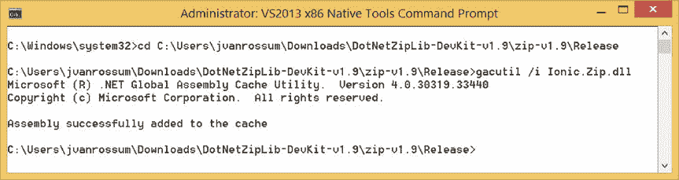

*图 8-7.* `gacutil /i Ionic.Zip.dll`

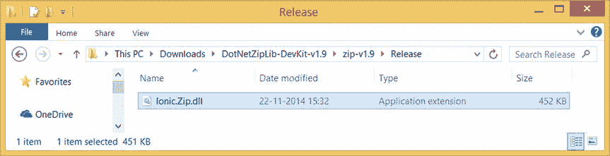

*图 8-6.* 在 zip 文件中，使用 `zip-v1.9/Release` 文件夹来安装 `Ionic.Zip.dll`

#### 解压缩

在此解压缩示例中，你有一个指向 zip 文件的文件连接管理器，以及一个指向解压缩后的 `.csv` 文件的平面文件连接管理器。`Products.zip` 将被解压缩然后删除。解压缩后的 `.csv` 文件由数据流任务处理。控制流看起来类似于图 8-8。

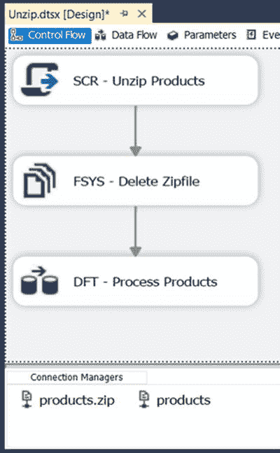

*图 8-8.* 控制流和连接

#### 添加引用

编辑脚本任务，然后打开 VSTA 环境，如图 8-9 所示，以添加对新程序集（现在位于 GAC 中）的引用。有关添加引用的更多信息，请参见第 4 章。

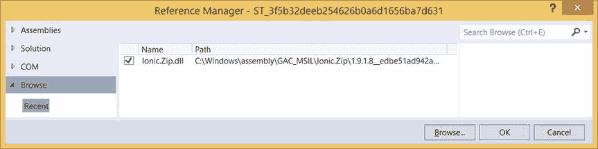

*图 8-9.* 对 `Ionic.Zip` 的引用

#### 解压缩脚本

在此解压缩示例中，你将使用指向 zip 文件的文件连接管理器。解压缩位置源自 zip 文件位置，但如有必要，你也可以使其可配置。

此脚本逐个提取压缩文件，并过滤 `.csv` 文件。但如果你需要所有文件，也可以一次性提取所有压缩文件。该代码作为注释包含在脚本中，应替换 Foreach 循环。选择适合你的方法。你还可以检查 `myZipFile` 中的属性来设置 zip 文件属性，例如密码，以及用于大文件（>4GB）的 zip64，但这些选项未包含在示例脚本中。

转到 VSTA 环境并添加以下命名空间以缩短代码：

```
#region customNamespaces
using Ionic.Zip;
using System.IO;
#endregion
```

以及 VB.NET 代码：

```
#Region "customNamespaces"
Imports Ionic.Zip
Imports System.IO
#End Region
```

接下来，将以下代码添加到 `Main` 方法中。在此示例中，所有 `.csv` 文件都将被解压缩，并且它们会覆盖任何现有文件。

```
public void Main()
{
  // 获取 zip 文件和解压缩文件夹的文件路径
  string myZipFilePath = Dts.Connections["products.zip"].AcquireConnection(null).ToString();
  // 确定解压缩位置。本例中为
  // zip 文件所在的文件夹。你可以用变量或
  // 连接管理器替换它
  string myUnzipfolder = new FileInfo(myZipFilePath).Directory.FullName;

  // 创建指向实际 zip 文件的 zip 文件对象
  using (ZipFile myZipFile = ZipFile.Read(myZipFilePath))
  {
    // 一次性提取所有文件（替代 foreach 循环）
    //myZipFile.ExtractAll(myUnzipfolder, ExtractExistingFileAction.OverwriteSilently);

    // 逐个遍历 zip 文件中的所有条目
    foreach (ZipEntry myZipEntry in myZipFile)
    {
      // 过滤：仅提取 CSV 文件
      if (myZipEntry.FileName.EndsWith(".csv"))
      {
        // 提取文件并覆盖现有文件
        myZipEntry.Extract(myUnzipfolder, ExtractExistingFileAction.OverwriteSilently);
      }
    }
  }
  // 脚本任务成功
  Dts.TaskResult = (int)ScriptResults.Success;
}
```

这是 VB.NET 代码：

```
Public Sub Main()
  ' 获取 zip 文件和解压缩文件夹的文件路径
  Dim myZipFilePath As String = _
                   Dts.Connections("products.zip").AcquireConnection(Nothing).ToString()
  ' 确定解压缩位置。本例中为
  ' zip 文件所在的文件夹。你可以用变量或
  ' 连接管理器替换它
  Dim myUnzipfolder As String = New FileInfo(myZipFilePath).Directory.FullName

  ' 创建指向实际 zip 文件的 zip 文件对象
  Using myZipFile As ZipFile = ZipFile.Read(myZipFilePath)
    ' 一次性提取所有文件（替代 foreach 循环）
    'myZipFile.ExtractAll(myUnzipfolder, ExtractExistingFileAction.OverwriteSilently);

    ' 逐个遍历 zip 文件中的所有条目
    For Each myZipEntry As ZipEntry In myZipFile
      ' 过滤：仅提取 CSV 文件
      If myZipEntry.FileName.ToLower().EndsWith(".csv") Then
        ' 提取文件并覆盖现有文件
        myZipEntry.Extract(myUnzipfolder, ExtractExistingFileAction.OverwriteSilently)
      End If
    Next
  End Using
  ' 脚本任务成功
  Dts.TaskResult = ScriptResults.Success
End Sub
```

> **提示：** 你也可以使用正则表达式进行过滤。

#### 压缩

在此压缩示例中，你将从数据流任务中压缩平面文件指定项。为此，你将使用来自平面文件目标的平面文件连接管理器。要指定 zip 文件的名称和路径，你将使用一个指向（不存在的）zip 文件的文件连接管理器。数据流任务完成后，你将压缩所创建的 `.csv` 文件，以便进行归档、上传或通过电子邮件发送。简化的控制流可能类似于图 8-10。

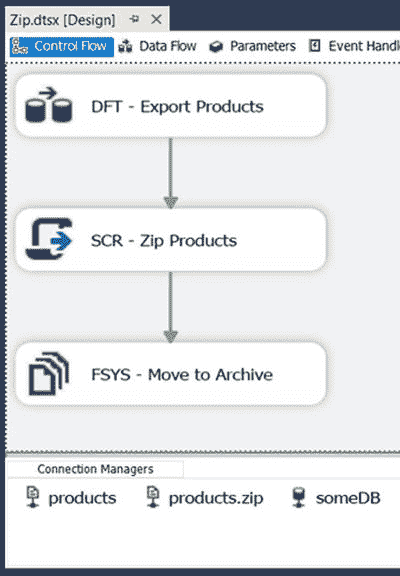

*图 8-10.* 压缩文件

#### 引用

编辑脚本任务，然后打开 VSTA 环境以添加对新 `Ionic.Zip` 程序集的引用。有关添加引用的更多信息，请参见第 4 章。另请参阅使用相同引用的解压缩示例。


#### 压缩脚本

如之前所述，你需要使用连接管理器来指定源文件（`Flat File: products`）和压缩文件（`File: products.zip`）的位置。首先，添加以下命名空间以精简代码：

```csharp
#region customNamespaces
using Ionic.Zip;
using System.IO;
#endregion
```

以下是相应的 VB.NET 代码：

```vb
#Region "customNamespaces"
Imports Ionic.Zip
Imports System.IO
#End Region
```

接下来，将以下代码复制到你的 `Main` 方法中。`myZipFile` 对象拥有许多可用于调整压缩文件的属性。在下面的脚本中，我们只展示了最常用的属性，实际上还有更多。请使用 IntelliSense 探索所有属性和方法。你也可以在代码中添加一些日志记录（参见第 4 章），并在 `save` 方法周围添加 `try-catch` 块，使你的代码更加健壮。

```csharp
public void Main()
{
    // 从连接管理器中获取源文件和压缩文件名
    string mySource = Dts.Connections["products"].AcquireConnection(null).ToString();
    string myZipFilePath = Dts.Connections["products.zip"].AcquireConnection(null).ToString();

    // 创建一个新的压缩文件
    using (ZipFile myZipFile = new ZipFile(myZipFilePath))
    {
        // 为压缩文件设置密码保护
        myZipFile.Password = "53cr3t!";

        // 设置压缩级别
        myZipFile.CompressionLevel = Ionic.Zlib.CompressionLevel.Level9;

        // 处理文件名中的特殊字符
        myZipFile.AlternateEncoding = Encoding.UTF8;
        myZipFile.AlternateEncodingUsage = ZipOption.AsNecessary;

        // 处理超大文件
        myZipFile.UseZip64WhenSaving = Zip64Option.AsNecessary;

        // 将文件添加到压缩包的根目录
        myZipFile.AddFile(mySource, "\\");

        // 保存压缩文件
        myZipFile.Save();
    }

    // 脚本任务成功
    Dts.TaskResult = (int)ScriptResults.Success;
}
```

以下是相应的 VB.NET 代码：

```vb
Public Sub Main()
    ' 从连接管理器中获取源文件和压缩文件名
    Dim mySource As String = _
        Dts.Connections("products").AcquireConnection(Nothing).ToString()
    Dim myZipFilePath As String = _
        Dts.Connections("products.zip").AcquireConnection(Nothing).ToString()

    ' 创建一个新的压缩文件
    Using myZipFile As New ZipFile(myZipFilePath)
        ' 为压缩文件设置密码保护
        myZipFile.Password = "53cr3t!"

        ' 设置压缩级别
        myZipFile.CompressionLevel = Ionic.Zlib.CompressionLevel.Level9

        ' 处理文件名中的特殊字符
        myZipFile.AlternateEncoding = Encoding.UTF8
        myZipFile.AlternateEncodingUsage = ZipOption.AsNecessary

        ' 处理超大文件
        myZipFile.UseZip64WhenSaving = Zip64Option.AsNecessary

        ' 将文件添加到压缩包的根目录
        myZipFile.AddFile(mySource, "\")

        ' 保存压缩文件
        myZipFile.Save()
    End Using

    ' 脚本任务成功
    Dts.TaskResult = ScriptResults.Success
End Sub
```

### 加密/解密文件

有时你需要对文件进行加密，以便安全地存储或发送。`System.Security.Cryptography` 命名空间提供了多种加密方式，但其中（撰写本书时）最好的一种是 **RijnDael**。在此示例中，你将通过连接管理器对文件进行加密和解密。我们将使用如图 8-11 所示的流程。

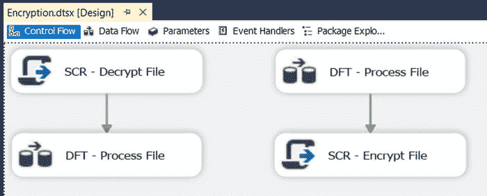

**图 8-11.** 文件加密与解密

> **注意：** 在对高度敏感的数据实施加密之前，请全面研究各种加密方法的所有可能性、优缺点；不要想当然地直接使用这些代码。此外，加密与安全技术发展迅速。本书撰写时安全的方法，当你阅读本书时可能已经过时。

### 连接管理器

要加密由数据流任务创建的平面文件，你可以使用名为 `MyProducts` 的平面文件连接管理器作为脚本任务的源。名为 `MyProducts_encrypted` 的文件连接管理器用作目标，其中包含加密文件的文件路径。

解密则相反。名为 `MyProducts_encrypted` 的文件连接管理器用作源，名为 `MyProducts_decrypted` 的平面文件连接管理器用作目标。解密文件后，此连接管理器即可用作数据流任务的源。

#### 变量

为了存储密码，你需要一个变量，例如图 8-12 中的 `MyPassword` 变量。务必将包部署到生产环境时移除该默认值；否则，安全性将大打折扣。请改用配置或参数。

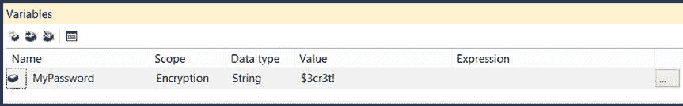

**图 8-12.** 你的秘密密码

#### 脚本任务

对于加密，请在数据流之后添加一个脚本任务；对于解密，请在数据流之前添加。在脚本任务编辑器中，将密码变量添加到 `ReadOnlyVariables`（参见图 8-13）。

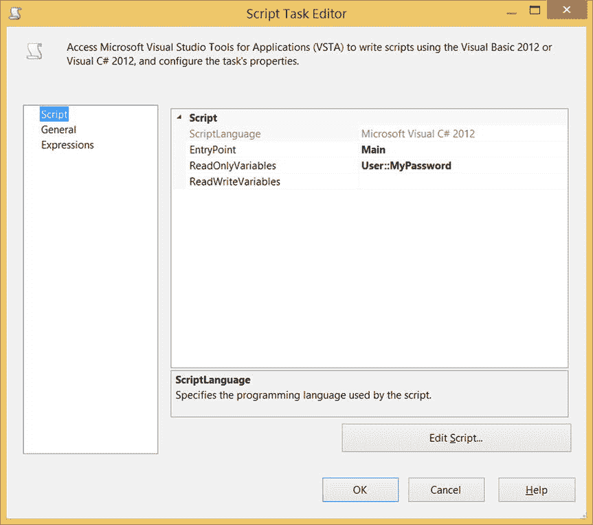

**图 8-13.** `ReadOnlyVariables` 中的秘密密码


#### 脚本

进入 VSTA 环境并添加以下命名空间以简化代码：

```csharp
#region customNamespaces
using System.Security.Cryptography;
using System.IO;
#endregion
```

这是 VB.NET 代码：

```vbnet
#Region "customNamespaces"
Imports System.Security.Cryptography
Imports System.IO
#End Region
```

加密和解密需要一个盐值（salt），该盐值存储在静态类变量中。盐值是一些随机数据，与密码一起用于加密数据。其主要功能是防御常用密码列表攻击。将此变量添加到类内部，但位于 `Main` 方法之外。

```csharp
// 盐值是一些随机数据，与密码一起用于加密数据。
// 其主要功能是防御常用密码列表攻击。
private static readonly byte[] SALT = new byte[] { 0x26, 0xdc, 0xff, 0x76,
                                                   0xad, 0xed, 0x7a, 0x64, 0xc5, 0xfe,
                                                   0x20, 0xaf, 0x4d, 0x08, 0x22, 0x3c };
```

以下是 VB.NET 代码：

```vbnet
' 盐值是一些随机数据，与密码一起用于加密数据。
' 其主要功能是防御常用密码列表攻击。
Private Shared ReadOnly SALT As Byte() = New Byte() {&H26, &HDC, &HFF, &H76,_
                                                     &HAD, &HED, &H7A, &H64,_
                                                     &HC5, &HFE, &H20, &HAF,_
                                                     &H4D, &H8, &H22, &H3C}
```

接下来是两个静态方法：一个用于加密，一个用于解密。将它们添加到你的类中。放在现有的 `Main` 方法下方可能是最有条理的位置。这些方法将从 `Main` 方法中被调用。

```csharp
// 使用 Rijndael 加密算法解密文本文件
public static void Decrypt(string fileIn, string fileOut, string Password)
{
    // 为加密的源文件打开文件流
    using (FileStream fsIn = new FileStream(fileIn, FileMode.Open, FileAccess.Read))
    {
        // 为解密后的文件打开文件流
        using (FileStream fsOut = new FileStream(fileOut, FileMode.OpenOrCreate, FileAccess.Write))
        {
            // 利用盐值技术从密码创建密钥和初始化向量
            Rfc2898DeriveBytes pdb = new Rfc2898DeriveBytes(Password, SALT);
            // 使用 Rijndael 创建对称算法
            Rijndael alg = Rijndael.Create();
            // 设置密钥和初始化向量
            alg.Key = pdb.GetBytes(32);
            alg.IV = pdb.GetBytes(16);

            // 创建一个 CryptoStream
            using (CryptoStream cs = new CryptoStream(fsOut, alg.CreateDecryptor(),
                                                       CryptoStreamMode.Write))
            {
                // 初始化一个缓冲区，并分块处理输入文件。
                // 这样做是为了避免将整个文件（可能很大）读入内存。
                int bufferLen = 4096;
                byte[] buffer = new byte[bufferLen];
                int bytesRead;
                do
                {
                    // 从输入文件中读取一块数据
                    bytesRead = fsIn.Read(buffer, 0, bufferLen);
                    // 解密它
                    cs.Write(buffer, 0, bytesRead);
                } while (bytesRead != 0);

                // 关闭所有资源
                cs.Close();
                fsOut.Close();
                fsIn.Close();
            }
        }
    }
}

// 使用 Rijndael 加密算法加密文本文件
public static void Encrypt(string fileIn, string fileOut, string Password)
{
    // 为源文件打开文件流
    using (FileStream fsIn = new FileStream(fileIn, FileMode.Open,
                                             FileAccess.Read))
    {
        // 为加密后的文件打开文件流
        using (FileStream fsOut = new FileStream(fileOut, FileMode.OpenOrCreate,
                                                  FileAccess.Write))
        {
            // 利用盐值技术从密码创建密钥和初始化向量
            Rfc2898DeriveBytes pdb = new Rfc2898DeriveBytes(Password, SALT);
            // 使用 Rijndael 创建对称算法
            Rijndael alg = Rijndael.Create();
            // 设置密钥和初始化向量
            alg.Key = pdb.GetBytes(32);
            alg.IV = pdb.GetBytes(16);

            // 创建一个 CryptoStream
            using (CryptoStream cs = new CryptoStream(fsOut, alg.CreateEncryptor(),
                                                       CryptoStreamMode.Write))
            {
                // 初始化一个缓冲区，并分块处理输入文件。
                // 这样做是为了避免将整个文件（可能很大）读入内存。
                int bufferLen = 4096;
                byte[] buffer = new byte[bufferLen];
                int bytesRead;
                do
                {
                    // 从输入文件中读取一块数据
                    bytesRead = fsIn.Read(buffer, 0, bufferLen);
                    // 加密它
                    cs.Write(buffer, 0, bytesRead);
                } while (bytesRead != 0);

                // 关闭所有资源
                cs.Close();
```


`fsOut.Close();`

`fsIn.Close();`

`}`

`}`

`}`

`}`

这是 VB.NET 代码：

```vb.net
' 使用 Rijndael 加密解密文本文件
Public Shared Sub Decrypt(fileIn As String, fileOut As String, Password As String)

    ' 为加密的源文件打开文件流
    Using fsIn As New FileStream(fileIn, FileMode.Open, FileAccess.Read)

        ' 为解密后的文件打开文件流
        Using fsOut As New FileStream(fileOut, FileMode.OpenOrCreate, FileAccess.Write)

            ' 使用加盐技术从密码创建密钥和 IV
            Dim pdb As New Rfc2898DeriveBytes(Password, SALT)

            ' 使用 Rijndael 创建对称算法
            Dim alg As Rijndael = Rijndael.Create()

            ' 设置密钥和 IV
            alg.Key = pdb.GetBytes(32)
            alg.IV = pdb.GetBytes(16)

            ' 创建一个 CryptoStream
            Using cs As New CryptoStream(fsOut, alg.CreateDecryptor(), CryptoStreamMode.Write)

                ' 初始化缓冲区并分块处理输入文件。
                ' 这样做是为了避免将整个文件（可能很大）读入内存。
                Dim bufferLen As Integer = 4096
                Dim buffer As Byte() = New Byte(bufferLen - 1) {}
                Dim bytesRead As Integer
                Do
                    ' 从输入文件中读取一块数据
                    bytesRead = fsIn.Read(buffer, 0, bufferLen)
                    ' 解密它
                    cs.Write(buffer, 0, bytesRead)
                Loop While bytesRead <> 0

                ' 关闭所有对象
                cs.Close()
                fsOut.Close()
                fsIn.Close()

            End Using
        End Using
    End Using
End Sub

' 使用 Rijndael 加密文本文件
Public Shared Sub Encrypt(fileIn As String, fileOut As String, Password As String)

    ' 为源文件打开文件流
    Using fsIn As New FileStream(fileIn, FileMode.Open, FileAccess.Read)

        ' 为加密后的文件打开文件流
        Using fsOut As New FileStream(fileOut, FileMode.OpenOrCreate, FileAccess.Write)

            ' 使用加盐技术从密码创建密钥和 IV
            Dim pdb As New Rfc2898DeriveBytes(Password, SALT)

            ' 使用 Rijndael 创建对称算法
            Dim alg As Rijndael = Rijndael.Create()

            ' 设置密钥和 IV
            alg.Key = pdb.GetBytes(32)
            alg.IV = pdb.GetBytes(16)

            ' 创建一个 CryptoStream
            Using cs As New CryptoStream(fsOut, alg.CreateEncryptor(), CryptoStreamMode.Write)

                ' 初始化缓冲区并分块处理输入文件。
                ' 这样做是为了避免将整个文件（可能很大）读入内存。
                Dim bufferLen As Integer = 4096
                Dim buffer As Byte() = New Byte(bufferLen - 1) {}
                Dim bytesRead As Integer
                Do
                    ' 从输入文件中读取一块数据
                    bytesRead = fsIn.Read(buffer, 0, bufferLen)
                    ' 加密它
                    cs.Write(buffer, 0, bytesRead)
                Loop While bytesRead <> 0

                ' 关闭所有对象
                cs.Close()
                fsOut.Close()
                fsIn.Close()

            End Using
        End Using
    End Using
End Sub
```

最后是 `Main` 方法的代码，你在其中调用解密和加密方法。这里有两个示例：第一个解密一个文件，第二个加密一个文件。

```vb.net
' 解密
Public Sub Main()

    ' 获取加密文件的文件路径
    Dim filepathEncrypted As String = Dts.Connections("MyProducts_encrypted").AcquireConnection(Nothing).ToString()

    ' 获取解密后文件的文件路径。
    Dim filepathDecrypted As String = Dts.Connections("MyProducts").AcquireConnection(Nothing).ToString()

    ' 从 SSIS 变量获取密码
    Dim encryptionKey As String = Dts.Variables("MyPassword").ToString()

    ' 创建加密文件的解密副本
    Decrypt(filepathEncrypted, filepathDecrypted, encryptionKey)

    ' 脚本任务成功
    Dts.TaskResult = ScriptResults.Success

End Sub

' 加密
Public Sub Main()

    ' 获取需要加密的文件的文件路径。
    Dim filepathSource As String = Dts.Connections("MyProducts").AcquireConnection(Nothing).ToString()

    ' 获取加密文件的文件路径
    Dim filepathEncrypted As String = Dts.Connections("MyProducts_encrypted").AcquireConnection(Nothing).ToString()

    ' 从 SSIS 变量获取密码
    Dim encryptionKey As String = Dts.Variables("MyPassword").ToString()

    ' 创建文件的加密副本
    Encrypt(filepathSource, filepathEncrypted, encryptionKey)

    ' 脚本任务成功
    Dts.TaskResult = ScriptResults.Success

End Sub
```

这是 C# 代码：

```csharp
// 解密
public void Main()
{
    // 获取加密文件的文件路径
    string filepathEncrypted = Dts.Connections["MyProducts_encrypted"].AcquireConnection(null).ToString();

    // 获取解密后文件的文件路径。
    string filepathDecrypted = Dts.Connections["MyProducts"].AcquireConnection(null).ToString();

    // 从 SSIS 变量获取密码
    string encryptionKey = Dts.Variables["MyPassword"].ToString();

    // 创建加密文件的解密副本
    Decrypt(filepathEncrypted, filepathDecrypted, encryptionKey);

    // 脚本任务成功
    Dts.TaskResult = (int)ScriptResults.Success;
}

// 加密
public void Main()
{
    // 获取需要加密的文件的文件路径。
    string filepathSource = Dts.Connections["MyProducts"].AcquireConnection(null).ToString();

    // 获取加密文件的文件路径
    string filepathEncrypted = Dts.Connections["MyProducts_encrypted"].AcquireConnection(null).ToString();

    // 从 SSIS 变量获取密码
    string encryptionKey = Dts.Variables["MyPassword"].ToString();

    // 创建文件的加密副本
    Encrypt(filepathSource, filepathEncrypted, encryptionKey);

    // 脚本任务成功
    Dts.TaskResult = (int)ScriptResults.Success;
}
```

### 总结

在本章中，您看到了一些更高级的编码示例，例如压缩和正则表达式。尽管这些示例已经可以随时使用，但我们鼓励您探索各种对象的其他属性，以添加日志记录、错误处理，将连接管理器更改为变量或参数，以及组合示例（例如，在解压缩文件时使用正则表达式进行过滤）。

