# 16. 创建自定义任务

电子补充材料 本章在线版本 (doi:[10.​1007/​978-1-4842-0638-6_​16](http://dx.doi.org/10.1007/978-1-4842-0638-6_16)) 包含补充材料，仅供授权用户使用。

在前面的章节中，你创建了一些非常有用的脚本任务来帮助你处理各类任务。使用脚本任务的缺点在于代码存储在包本身中。如果你有多个包使用同一个脚本任务，那么最终会得到一大堆脚本任务——每个任务都使用自己的代码副本。当你需要修复 bug 或添加额外功能时，你必须先找到所有使用该特定脚本任务的包，然后逐个修改它们。

脚本任务的另一个问题是它需要一些 .NET 知识。这对你来说可能不是问题，但大多数 SSIS 开发者并不具备 .NET 编程技能。如果他们想使用你便捷的脚本任务代码，那么像使用另一个变量或连接管理器这样简单的事情，也需要你编辑脚本。当你创建自定义任务时，你可以添加一个用户界面，这样使用你任务的人就不需要特定的编程技能了（参见图 16-1）。

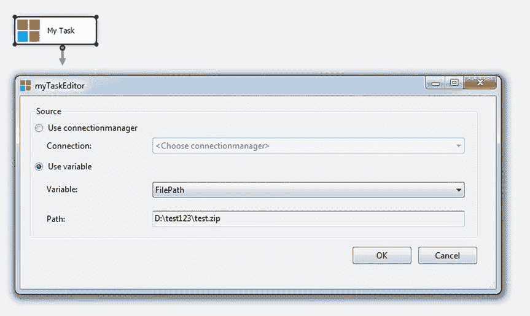

图 16-1. 用于控制流的自定义任务

在 SSIS 中使用自定义任务有一个缺点。你需要在所有使用该任务的服务器和开发工作站上安装你的任务。在某些组织中，这可能是一个巨大的挑战，因为一些服务器管理员不喜欢将程序集添加到全局程序集缓存中。

## 自定义任务准备

在本例中，你将创建一个检查文件是否存在的任务。它使用连接管理器或变量来获取要检查的文件路径。为此，你需要一个支持 C# 和 VB.NET 项目的 Visual Studio 版本。BIDS 或 SSDT 是不够的，因为它们只支持 BI 项目。我们在此示例中使用了 Visual Studio Professional 2013，但也有支持 C# 和 VB.NET 的较便宜版本；例如，Visual Studio Community 或 Visual Studio Express。

当然，你需要安装你想用自定义任务支持的所有 SSIS 版本。如果你想让你的任务适用于多个版本的 SSIS，你需要使用不同的引用重新编译代码。

### 创建 Visual Studio 项目

对于这个自定义任务，你将使用两个类库项目：一个用于实际任务，一个用于用户界面。确保为任务选择合适的 .NET 版本（SSIS 2005：2.0，SSIS 2008：3.5，SSIS 2012：4.0，SSIS 2014 也是 4.0）。首先，创建一个名为 `myTask` 的新项目（参见图 16-2），然后向同一解决方案中添加第二个类库项目，名为 `myTaskUI`。

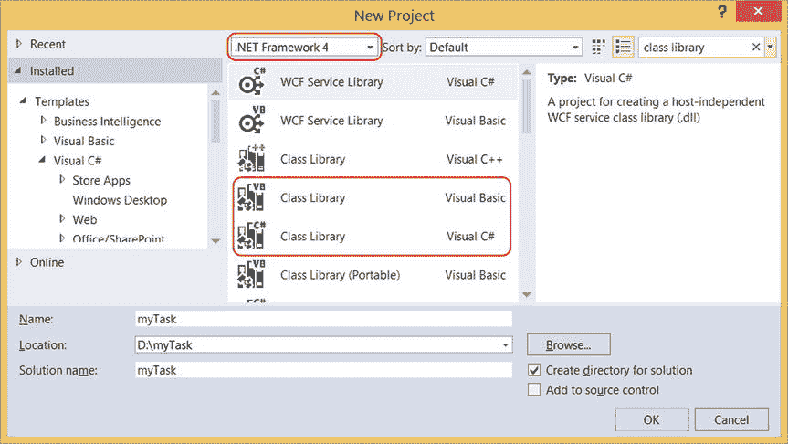

图 16-2. 类库项目

在开始编码之前，你还需要处理许多其他事项，例如引用、强名称、生成事件和图标。

### 默认命名空间和程序集名称

进入你的项目属性。在“应用程序”页面中，你需要在两个项目中更改程序集名称和默认命名空间。默认命名空间将是 `ScriptingBook.myTask`，程序集名称将是默认命名空间加上项目名称：`ScriptingBook.myTask.myTask` 和 `ScriptingBook.myTask.myTaskUI`（参见图 16-3）。

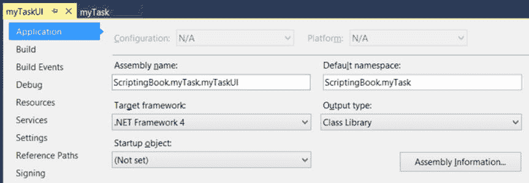

图 16-3. 设置命名空间和程序集名称

### 为强名称创建密钥

SSIS 运行时对程序集的要求是它们必须位于 GAC 中。GAC 要求程序集具有强名称。这提供了唯一的标识以及保证的位置（GAC），SSIS 运行时可以在该位置找到它需要的可执行文件。因此，你需要为程序集赋予强名称。进入其中一个项目的属性，然后转到“签名”页面。勾选“为程序集签名”复选框，然后从下拉列表中添加一个新的密钥文件。本例中的名称为 `myTask.snk`，签名算法为 `sha256RSA`，无密码（参见图 16-4）。单击“确定”按钮后，新的密钥文件将在解决方案资源管理器中可见。接下来，将相同的 `.snk` 文件复制到另一个项目，然后用相同的密钥为该项目签名。

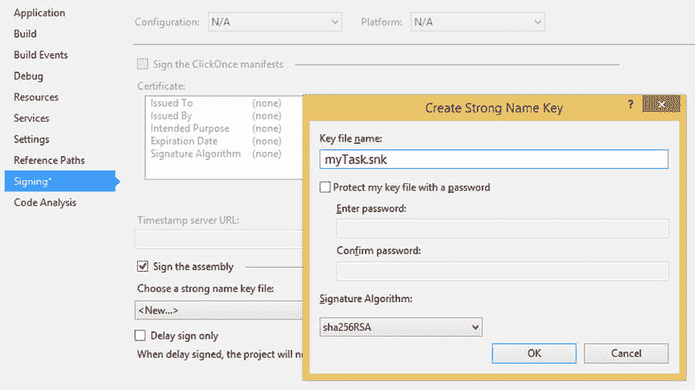

图 16-4. 添加密钥文件（C# 项目，VB.NET 相似）

### 获取公钥令牌

对于运行时代码，你需要 GUI 程序集的公钥令牌。因此，首先使用 Release 配置生成项目，然后打开 Visual Studio 命令提示符。使用 `CD` 命令（更改目录）转到其中一个项目的 `Bin\Release` 文件夹。执行以下命令以获取 `publicKeyToken`：

`sn.exe -t ScriptingBook.myTask.myTask.dll`

（参见图 16-5）。复制此密钥令牌以备后用。

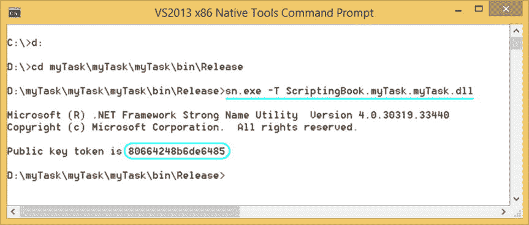

图 16-5. 用于获取公钥令牌的强名称工具

### 图标

当然，你需要为任务准备一个合适的图标。网上有大量免费图标可用，也有创建新图标的工具。通过解决方案资源管理器向两个项目添加图标文件。添加图标文件后，确保将“生成操作”属性更改为 `Embedded Resource`，如图 16-6 所示；否则，图标将不会显示。稍后，你可以在 UI 项目的 Windows 窗体中使用此图标。这样，当你编辑任务时它就会显示出来。

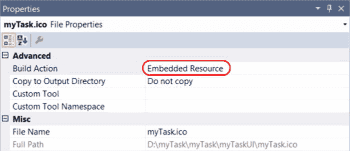

图 16-6. 设置图标的生成操作

在运行时项目中，你可以使用此文件为你的任务提供自定义图标，而不是默认图标。该图标将显示在 SSIS 工具箱和控制流中。相关代码将在后面解释。

### 生成事件

要在 SSIS 中使用程序集，你需要将它们安装到全局程序集缓存（GAC）中以供运行时使用，并复制到 SSIS 的任务文件夹中以供设计时使用。通过“生成事件”页面，你可以在生成 Visual Studio 项目时自动完成此操作。但是，由于要将程序集添加到 GAC，因此需要以管理员身份运行 Visual Studio。转到项目属性，然后转到“生成事件”页面。C# 项目有一个名为“生成事件”的单独选项卡，但 VB.NET 项目在“编译”选项卡上有一个“生成事件”按钮。将以下命令添加到生成后事件。请注意，SQL Server 文件夹中的数字对于不同 SSIS 版本是不同的：2005：90、2008：100、2012：110、2014：120 和 2016：130。

`SSIS 2008`

```
cd $(ProjectDir)
@SET TASKDIR="C:\Program Files (x86)\Microsoft SQL Server\100\DTS\Tasks\"
@SET GACUTIL="C:\Program Files (x86)\Microsoft SDKs\Windows\v7.0A\bin\gacutil.exe"
Echo Installing dll in GAC
Echo $(OutDir)
Echo $(TargetFileName)
%GACUTIL% -if "$(OutDir)$(TargetFileName)"
Echo Copying files to Tasks
copy "$(OutDir)$(TargetFileName)" %TASKDIR%
```

`SSIS 2012 with SSDT 2010`

```
cd $(ProjectDir)
@SET TASKDIR="C:\Program Files (x86)\Microsoft SQL Server\110\DTS\Tasks\"
@SET GACUTIL="C:\Program Files (x86)\Microsoft SDKs\Windows\v7.0A\Bin\NETFX 4.0 Tools\gacutil.exe"
Echo Installing dll in GAC
Echo $(OutDir)
Echo $(TargetFileName)
%GACUTIL% -if "$(OutDir)$(TargetFileName)"
Echo Copying files to Tasks
copy "$(OutDir)$(TargetFileName)" %TASKDIR%
```

**注意：** 如果你使用的是 Visual Studio 2012，那么 `gacutil` 位于 `v8.0a` 而不是 `v7.0a`。对于其他版本，这也可能有所不同。也可以下载 `gactuil`。它是 Microsoft Windows SDK 的一部分。

### 自定义任务运行时代码

你首先从执行和验证任务时使用的代码入手。由于完整代码太大，无法在书中全部展示，因此你将专注于最重要的 SSIS 内容。但本书附带该代码，因此你可以从示例代码中复制 `myTask.cs` 文件并将其添加到项目中。

首先，你需要将 `Microsoft.SqlServer.Dts.Runtime` 添加到命名空间以缩短代码。以下是此项目使用的完整列表：

```csharp
using System;
using System.ComponentModel;
using System.IO;
using System.Xml;
using Microsoft.SqlServer.Dts.Runtime;
```

现在介绍任务最重要的代码：你可以在其中命名任务，为其添加图标，并将其连接到编辑器程序集：`DtsTask`。以下是代码；请注意，为了便于阅读，`UITypeName` 赋值已被换行，但在你的代码中应该是一行长字符串。

```csharp
namespace ScriptingBook.myTask
{
    // 连接到编辑器程序集。从上一步复制 PublicKeyToken。
    [DtsTask(
    DisplayName = "My Task",
    TaskType = "myTask",
    TaskContact = "ScriptingBook Example",
    IconResource = "ScriptingBook.myTask.myTask.ico",
    UITypeName = "ScriptingBook.myTask.myTaskInterface,
                  ScriptingBook.myTask.myTaskUI,
                  Version=1.0.0.0,
                  Culture=Neutral,
                  PublicKeyToken=80664248b6de6485",
    RequiredProductLevel = DTSProductLevel.None)]
    public class myTask : Task, IDTSComponentPersist
    {
    }
}
```

`DtsTask` 标签有多个可以更改的属性：

*   `DisplayName`：你在工具箱中看到的名称；这是将任务拖到控制流时的默认名称。
*   `TaskType`：任务的技术名称。
*   `TaskContact`：你的姓名和联系信息。在发生致命错误时，会显示此信息。用户便能够联系到你。
*   `IconResource`：嵌入图标的完全限定名称。这会在工具箱中以及将任务拖到控制流时显示。尝试找到一个描述你的任务并与其余图标匹配的图标。这可不是一项简单的任务。
*   `UITypeName`：这是与编辑器的连接，你可以在其中命名接口类和 UI 类。在此字符串中，你还需要粘贴通过 `sn` 命令检索到的公钥令牌。
*   `RequiredProductLevel`：最好将其保留为默认值，但你可以选择其他产品级别（Enterprise、Standard、Workgroup），之后你的任务将仅适用于该版本的 SQL Server。

还要注意类名后面的接口和基类名称。`IDTSComponentPersist` 是一个接口，声明了你作为实现该接口的类的一部分来实现的方法。`Task` 是一个基类，实现了某些默认方法，你可以重写这些方法并在自己的代码中以稍微不同的方式实现。

#### 任务属性

接下来是任务的属性（见图 16-7）。这些属性用于存储从任务编辑器中选择的值。除了每个任务的名称和数据类型外，你还可以添加额外的元数据，例如用于阐明属性用途的描述、默认值，或用于对所有属性进行排序的类别。

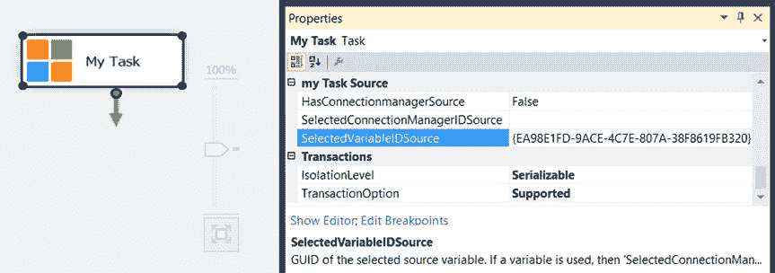

**图 16-7.** 自定义任务属性

以下代码显示了您在此任务中使用的三个属性：

```csharp
private bool _hasConnectionmanagerSource = true;
[CategoryAttribute("my Task Source")]
[Description("True if a connectionmanager is used for the task as source.")]
[DefaultValue(true)]
public bool HasConnectionmanagerSource
{
    get { return this._hasConnectionmanagerSource; }
    set  {this._hasConnectionmanagerSource = value; }
}

private string _selectedConnectionManagerIDSource = "";
[CategoryAttribute("my Task Source")]
[Description("GUID of the selected source connectionmanager.")]
public string SelectedConnectionManagerIDSource
{
    get { return this._selectedConnectionManagerIDSource; }
    set { this._selectedConnectionManagerIDSource = value; }
}

private string _selectedVariableIDSource = "";
[CategoryAttribute("my Task Source")]
[Description("GUID of the selected source variable.")]
public string SelectedVariableIDSource
{
    get { return this._selectedVariableIDSource; }
    set { this._selectedVariableIDSource = value; }
}
```

#### 验证任务

要验证自定义任务，您需要重写 `Validate` 方法。基本上，您需要检查上一段落中所述属性的值。当这些值与您的预期不符时，您可以触发一个错误或警告，并返回 `Failure` 作为结果。验证方法在设计时（即关闭编辑器时）执行，在运行时执行两次：一次是在包初始化时，另一次是在任务执行时。

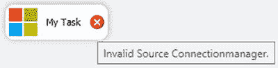

图 16-8. 设计时错误

在此示例中，您将检查用户是否已选择连接管理器或变量。如果未选择，则触发一个错误。您还会检查所选变量或连接管理器是否仍然存在。这是通过遍历所有变量或连接管理器来验证 GUID 是否存在来实现的。

也可以添加其他检查。例如，检查变量或连接管理器中的文件路径是否存在。

### 验证方法

`Validate` 方法在任务执行前进行验证。其主要职责是确保任务配置有效，例如，当使用了连接管理器时，需要检查所选连接管理器是否存在。

```csharp
public override DTSExecResult Validate(Connections connections,
                                       VariableDispenser variableDispenser,
                                       IDTSComponentEvents componentEvents,
                                       IDTSLogging log)
{
    // 如果您使用了连接管理器，那么请检查它是否有效！
    if (HasConnectionmanagerSource)
    {
        // 检查下拉列表中是否选择了连接管理器
        if (String.IsNullOrEmpty(_selectedConnectionManagerIDSource))
        {
            componentEvents.FireError(0, "MyTask",
                                         "连接管理器是必填项。",
                                         "", 0);
            return DTSExecResult.Failure;
        }
        // 检查所选连接管理器是否仍然存在
        if (FindConnectionManager(connections,
                                  _selectedConnectionManagerIDSource)
                                  == null)
        {
            componentEvents.FireError(0, "MyTask",
                                         "连接管理器不存在。",
                                         "", 0);
            return DTSExecResult.Failure;
        }
    }
    else
    {
                // 对变量执行相同的检查
    }
        // 未遇到错误
    return DTSExecResult.Success;
}

// 将 GUID 转换为实际连接管理器的方法。
// 它遍历所有连接管理器并比较 GUID。
private ConnectionManager FindConnectionManager(Connections connections,
                                                string connectionManagerID)
{
  ConnectionManager tempConnManager = null;
  foreach (ConnectionManager connManager in connections)
  {
    if (connManager.ID == connectionManagerID)
    {
      tempConnManager = connManager;
      return tempConnManager;
    }
  }
  return tempConnManager;
}
```

### 执行代码

任务的实际代码在名为 `Execute` 的重写方法中执行。在此示例中，您首先检查是否使用了连接管理器或变量。然后，您将 `GUID` 转换为实际的连接管理器或变量，以从中提取文件路径。这使用了与前文编辑器代码中类似的方法完成。

最后，您使用一个简单的 `File.Exists` 来检查文件路径是否指向一个存在的文件。如果文件不存在，您将触发一个包含描述性错误消息的错误事件，并返回 `Failure` 作为执行结果，从而导致任务失败。

```csharp
// 用于存储文件路径的类变量
private string _filePathSource = "";

public override DTSExecResult Execute(Connections connections,
                           VariableDispenser variableDispenser,
                           IDTSComponentEvents componentEvents,
                           IDTSLogging log,
                           object transaction)
{
  // 将 GUID 转换为实际的变量或连接管理器
  // 并从连接管理器或变量中获取文件路径
  if (HasConnectionmanagerSource)
  {
         _selectedConnectionManagerSource = FindConnectionManager
                                         (connections,_selectedConnectionManagerIDSource);
         _filePathSource = GetFilePathSource(
                          _selectedConnectionManagerSource);
  }
  else
  {
         _selectedVariableSource = FindVariable(
                                variableDispenser,
                                    _selectedVariableIDSource);
         _filePathSource = GetFilePathSource(_selectedVariableSource);
  }

  if (!File.Exists(_filePathSource))
  {
         componentEvents.FireError(0, "My Task", "文件 "
                                   + _filePathSource
                                         + " 不存在", "", 0);
         return DTSExecResult.Failure;
  }
  else
  {
         return DTSExecResult.Success;
  }
}
```

### SaveToXML 和 LoadFromXml

在类定义中，您继承了 `Task` 以执行和验证您的任务，同时还实现了 `IDTSComponentPersist` 接口，用于将编辑器中的更改保存到包 `XML` 中，以及从包 `XML` 中加载更改。

```csharp
void IDTSComponentPersist.LoadFromXML(System.Xml.XmlElement node,
                                      IDTSInfoEvents infoEvents)
{
  // 当任务的 XML 在 BIDS/SSDT 之外被修改时可能会发生此情况
  if (node.Name != "MyTask")
  {
    throw new Exception(string.Format(
        "加载任务时出现意外的任务元素 - {0}.", "MyTask"));
  }
  else
  {
    // 使用包 XML 中的值填充私有属性变量。
    _hasConnectionmanagerSource = Convert.ToBoolean(
                                  node.Attributes.GetNamedItem(
                                  "HasConnectionmanagerSource").Value);
    _selectedConnectionManagerIDSource = node.Attributes.GetNamedItem(
                               "SelectedConnectionManagerIDSource").Value;
    _selectedVariableIDSource = node.Attributes.GetNamedItem(
                               "SelectedVariableIDSource").Value;
  }
}

void IDTSComponentPersist.SaveToXML(System.Xml.XmlDocument doc,
                                    IDTSInfoEvents infoEvents)
{
  // 在包 XML 中创建节点
  XmlElement taskElement = doc.CreateElement(string.Empty, "MyTask",
                                             string.Empty);
  // 在节点中创建代表自定义属性的属性
  // 并将每个属性添加到元素中
  // 指示您使用的是连接管理器还是变量的布尔值
  XmlAttribute MyTaskXmlAttribute = doc.CreateAttribute(string.Empty,
                             "HasConnectionmanagerSource", string.Empty);
  MyTaskXmlAttribute.Value = _hasConnectionmanagerSource.ToString();
  taskElement.Attributes.Append(MyTaskXmlAttribute);
  // 来自连接管理器的 GUID
  MyTaskXmlAttribute = doc.CreateAttribute(string.Empty,
                           "SelectedConnectionManagerIDSource",
                            string.Empty);
  MyTaskXmlAttribute.Value = _selectedConnectionManagerIDSource.ToString();
  taskElement.Attributes.Append(MyTaskXmlAttribute);
  // 来自变量的 GUID
  MyTaskXmlAttribute = doc.CreateAttribute(string.Empty,
                                "SelectedVariableIDSource", string.Empty);
  MyTaskXmlAttribute.Value = _selectedVariableIDSource.ToString();
  taskElement.Attributes.Append(MyTaskXmlAttribute);
  // 将新元素添加到包文档中
  doc.AppendChild(taskElement);
}
```

### 自定义任务窗体

为了便于说明，窗体布局设计得非常简单（见图 16-9）。用户应当能够选择一个`File`、`Flat File`或`Excel Connection Manager`来指定需要检查的文件，或者能够选择一个（包含文件路径的）字符串变量。为了提升用户体验，用户还应当能够在任务中直接创建新的连接管理器或新变量。

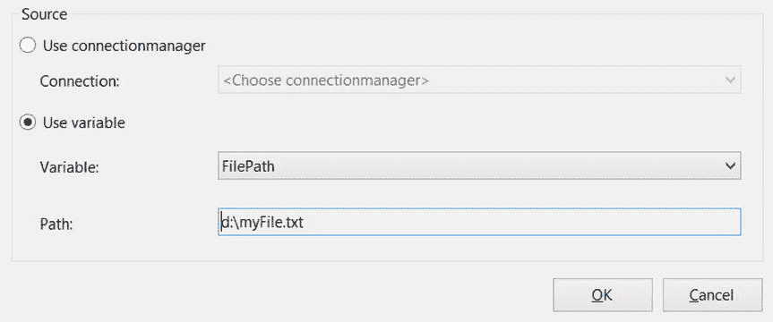

图 16-9. 基础窗体

即使是这样一个非常简单的任务，其代码量也可能轻松超过 30 页，这对于一本图书来说可能并不实用。因此，我们只会展示与 SSIS 相关部分的代码，当然，完整代码可随本书获取。你可以通过以下四个步骤，将示例项目中的窗体添加到你的 UI 项目中：

- 在 UI 项目中添加对`System.Drawing`和`System.Windows.Forms`的引用。

- 将三个窗体文件——`myTaskEditor.cs`、`myTaskEditor.Designer.cs`和`myTaskEditor.resx`——复制到你自己的 UI 项目文件夹中。

- 右键单击你的 UI 项目，选择“添加，现有项”，添加`myTaskEditor.cs`、`myTaskEditor.Designer.cs`和`myTaskEditor.resx`。

- 关闭并重新打开你的解决方案。然后，打开窗体查看添加的内容。

### 窗体代码

首先，使用 `using` 指令来精简代码。这里只需要六个命名空间。默认情况下会多一些，但你可以移除它们。Visual Studio 甚至提供了移除未使用 `using` 的选项：右键单击某个 `using`，选择“组织 using”（具体操作可能因 Visual Studio 版本而异）。

```
using System;
using System.Collections;
using System.Drawing;
using System.Windows.Forms;
using Microsoft.SqlServer.Dts.Runtime;
using Microsoft.SqlServer.Dts.Runtime.Design;
```

### TaskHost 和 ServiceProvider

`taskHost`属性用于获取和设置当前任务的属性。这里的“属性”指的是所有你希望在关闭编辑器时保存的内容，例如选择了哪个变量或连接管理器。或者，如果你想为示例扩展重试功能，则需要存储重试次数和重试间隔。在运行时代码中，你看到过这些属性在`Validate`和`Execute`方法中被用于检查正确的文件路径。但是，`TaskHost`也可用于获取当前包的属性，例如该特定包中所有可用变量的列表。而`ServiceProvider`属性用于添加新变量或连接管理器，或获取当前连接管理器的列表。以下代码被添加到类代码的顶部。

# 类属性与方法

```csharp
// 设置和获取 taskhost
private TaskHost _taskHost;
public TaskHost TaskHost
{
  get { return _taskHost; }
  set { _taskHost = value; }
}

// 获取连接，设置在 ServiceProvider 方法中完成
private Connections _connections;
public Connections connections
{
  get { return _connections; }
}

// 获取或设置 serviceprovider。用于获取
// 例如 VariablesProvider 和 ConnectionsProvider
private IServiceProvider _serviceProvider = null;
public IServiceProvider ServiceProvider
{
  get
  {
    return _serviceProvider;
  }
  set
  {
    _serviceProvider = value;
    // 从服务提供者获取连接
    // 代码看起来复杂，但实际上只是类型转换
    _connections = ((IDtsConnectionService)
                    (value.GetService(typeof(IDtsConnectionService))))
                    .GetConnections();
  }
}
```

在该类的构造函数中，对`taskhost`和`serviceprovider`属性进行了设置。这是通过`myTaskInterface.cs`中的代码完成的，稍后会对此进行说明。现在，你可以在所有其他方法中使用这些属性。

```csharp
// 构造函数，用于设置 taskhost 和 serviceprovider
// 参见 myTaskInterface.cs 中的 GetView 方法
public myTaskEditor(TaskHost taskHost,
                         IServiceProvider serviceprovider)
{
        InitializeComponent();
        this.TaskHost = taskHost;
        this.ServiceProvider = serviceprovider;
}
```

## PageLoad

在`PageLoad`方法中，你需要用变量或连接管理器填充下拉框，以便用户进行选择。为此，你可以使用`TaskHost`。第一个示例用一个字符串变量（非系统变量）填充下拉框。在下拉框中，变量名称属性是可见的，但`QualifiedName`属性被用作键值。

```csharp
// 用字符串变量填充下拉框
cmbVariablesSource.Items.Clear();
cmbVariablesSource.DisplayMember = "Name";
cmbVariablesSource.ValueMember = "QualifiedName";
cmbVariablesSource.Items.Add("<选择变量>");
cmbVariablesSource.Items.Add("<新建变量>");  // 打开新建弹出窗口

// 遍历所有包变量
foreach (Variable variable in _taskHost.Variables)
{
  // 仅限非系统变量且为字符串类型的变量
  if ((!variable.SystemVariable) && (variable.DataType == TypeCode.String))
  {
    cmbVariablesSource.Items.Add(variable);
  }
}
```

连接管理器也可以采用相同的方式处理。在这个示例中，你只希望包含带有文件路径的连接管理器（`File`、`Flat File`和`Excel`）。同样，列表中显示的是名称属性，但`ID`（一个`GUID`）被用作键值。

```csharp
cmbConnectionsSource.Items.Clear();
cmbConnectionsSource.DisplayMember = "Name";
cmbConnectionsSource.ValueMember = "ID";
cmbConnectionsSource.Items.Add("<选择连接管理器>");
// 此选项将打开新建连接管理器弹出窗口
cmbConnectionsSource.Items.Add("<新建连接管理器>");

foreach (ConnectionManager connection in this._connections)
{
    string ConnectionType = connection.CreationName;
    if (ConnectionType == "FILE" ||
        ConnectionType == "EXCEL" ||
        ConnectionType == "FLATFILE")
    {
        cmbConnectionsSource.Items.Add(connection);
    }
}
```

### 将 GUID 转换为变量

稍后，在“确定”按钮的`OnClick`事件中，您会看到存储的是变量的`GUID`而不是名称。若要在组合框中选择正确的变量，您必须先从任务中检索`GUID`变量，然后遍历所有变量并逐一比较其`GUID`以找到正确的变量。找到后，便可在打开表单时用它来选择组合框中的正确变量。

但首先，您需要从任务中检索`GUID`变量。以下代码用于检索存储在任务中的属性值，如图 16-10 所示：


图 16-10. 需要检索的属性

```csharp
_taskHost.Properties["SelectedVariableIDSource].GetValue(_taskHost);
```

这是完整的代码。`FindVariable`方法将此`GUID`转换为实际的变量对象，您可以用它来选择组合框中的正确项。

```csharp
Variable var = FindVariable(_taskHost.Properties["SelectedVariableIDSource"]
                                        .GetValue(_taskHost).ToString().Trim());

if (var != null)
{
  // 找到变量，现在在组合框中选择它
  cmbVariablesSource.SelectedItem = var;
}
else
{
  // 未找到变量，选择组合框中的第一项
  cmbVariablesSource.SelectedIndex = 0;
}
```

以下是一个额外的方法，用于遍历所有包变量以比较`GUID`。如果找到`GUID`，则返回正确的变量；否则返回`null`。

```csharp
private Variable FindVariable(string variableID)
{
  // 此方法遍历所有变量
  // 并返回与 GUID 匹配的变量。
  foreach (Variable var in _taskHost.Variables)
  {
    if (var.ID == variableID)
    {
      return var;
    }
  }

  return null;
}
```

相同的方法可用于查找正确的连接管理器。您可以在示例任务中找到该代码。

### 添加变量

在变量组合框的`onChange`事件中，当选中列表中的第二项`<New variable>`时，您想要添加一个新变量。如果是这种情况，您使用`serviceProvider`打开默认的 SSIS “添加变量”对话框（参见图 16-11）。点击“确定”关闭对话框后，新变量会被添加到包中，然后您可以将新变量添加到组合框中并选中它。如果点击“取消”，则关闭对话框并选中组合框中的默认项。

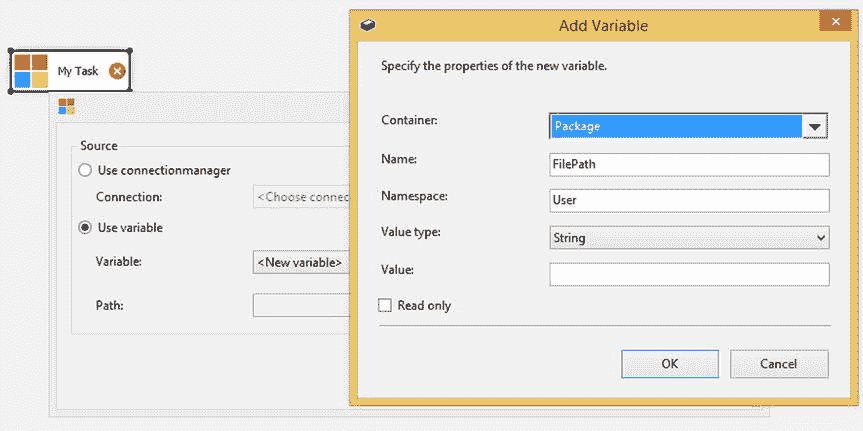

图 16-11. 添加变量对话框

```markdown
// 类变量用于存储选中的变量。它由 SelectedIndexChange 事件填充，
// 并被“确定”按钮点击事件使用。
private Variable selectedVariableSource = null;

// 设置所选变量的方法
private void cmbVariablesSource_SelectedIndexChanged(object sender, EventArgs e)
{
    ComboBox combobox = (ComboBox)sender;

    // 如果选中了 <Choose variable>，则清空路径文本框
    if (combobox.SelectedIndex == 0)
    {
        this.txtFilePathFinalSource.Text = "";
        return;
    }

    // 如果选中了 <New variable>，则弹出窗口以创建新变量
    if (combobox.SelectedIndex == 1)
    {
        int currentdIndex = -1;
        IDtsVariableService _dtsVariableService = _serviceProvider
                             .GetService(typeof(IDtsVariableService))
                             as IDtsVariableService;
        Variable newVariable = _dtsVariableService
                                .PromptAndCreateVariable(this, null,
                                "FilePath", "User", typeof(String));
        if (newVariable != null)
        {
            currentdIndex = combobox.Items.Add(newVariable);
            combobox.SelectedIndex = currentdIndex;
            return;
        }
        else
        {
            // 弹窗中点击了取消
            combobox.SelectedIndex = 0;
            return;
        }
    }

    // 填充私有变量以存储选中的变量
    selectedVariableSource = (Variable)combobox.SelectedItem;

    // 如果变量仍为 null，则清空表单
    if (selectedVariableSource == null)
    {
        this.cmbVariablesSource.SelectedIndex = 0;
        this.txtFilePathFinalSource.Text = "";
        return;
    }

    // 在文本框中显示路径
    this.txtFilePathFinalSource.Text = (String)selectedVariableSource.Value;
}
```

### 添加连接管理器

添加连接管理器时，构造过程类似，但由于需要先在文件、平面文件或 Excel 之间进行选择，因此在显示标准 SSIS“添加连接管理器”对话框之前，会额外弹出一个自定义对话框（见图 16-12）。该对话框`Prompt.ShowConnectionManagerTypeDialog()`会返回一个字符串，其值为`"FILE"`、`"FLATFILE"`或`"EXCEL"`。此字符串用于打开 SSIS 中相应类型的“添加连接管理器”对话框。

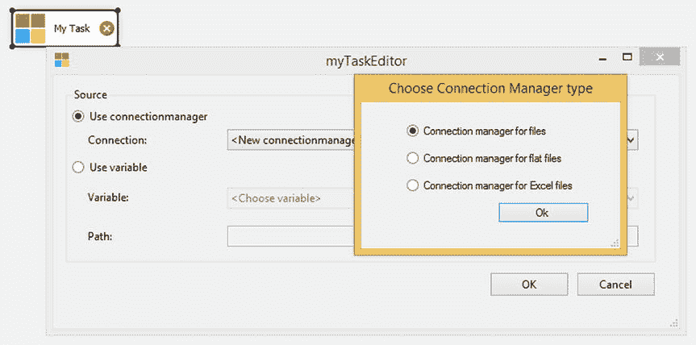

图 16-12. 连接管理器对话框前的自定义对话框

# 关闭编辑器并保存更改

当您使用“确定”按钮关闭编辑器时，需要将表单中的值保存到任务的属性中，以便在重新打开编辑器或执行任务时使用这些值。而当您单击“取消”按钮时，只需关闭编辑器并返回“取消”作为对话框结果即可。

```
// 用于存储所选连接管理器的类变量。
// 该变量将由 SelectedIndexChange 事件填充，并在“确定”按钮单击事件中使用。
private ConnectionManager selectedConnectionManagerSource = null;

// 设置所选连接管理器的方法
private void cmbConnectionsSource_SelectedIndexChanged(object sender,
                                                       EventArgs e)
{
    ComboBox combobox = (ComboBox)sender;
    // 如果选择了 <选择连接管理器>
    // 则清空存储路径的文本框
    if (combobox.SelectedIndex == 0)
    {
        this.txtFilePathFinalSource.Text = "";
        return;
    }
    // 如果选择了 <新建连接管理器>
    // 则弹出对话框以创建新的连接管理器
    if (combobox.SelectedIndex == 1)
    {
        int currentIndex = -1;
        IDtsConnectionService _dtsConnectionService = _serviceProvider
                               .GetService(typeof(IDtsConnectionService))
                               as IDtsConnectionService;
        ArrayList createdConnection = _dtsConnectionService
                                .CreateConnection
                                (Prompt.ShowConnectionManagerTypeDialog());
        if (createdConnection.Count > 0)
        {
            ConnectionManager newConnectionManager = (ConnectionManager)
                                                      createdConnection[0];
           _dtsConnectionService.AddConnectionToPackage(
                                    newConnectionManager);
            currentIndex = combobox.Items.Add(newConnectionManager);
            combobox.SelectedIndex = currentIndex;
            return;
        }
        else
        {
            // 在弹出对话框中点击了“取消”
            combobox.SelectedIndex = 0;
            return;
        }
    }
    // 填充私有变量以存储所选连接管理器
    selectedConnectionManagerSource = (ConnectionManager)
                                       combobox.SelectedItem;
    // 如果变量仍为 null，则清空表单
    if (selectedConnectionManagerSource == null)
    {
        this.cmbConnectionsSource.SelectedIndex = 0;
        this.txtFilePathFinalSource.Text = "";
        return;
    }
    // 获取连接管理器的路径。对于 Excel 连接管理器，
    // 应使用 ExcelFilePath 属性而非连接字符串
    if (selectedConnectionManagerSource.CreationName == "EXCEL")
    {
        this.txtFilePathFinalSource.Text = selectedConnectionManagerSource
                                  .Properties["ExcelFilePath"]
                                  .GetValue(selectedConnectionManagerSource)
                                  .ToString();
    }
    else
    {
        this.txtFilePathFinalSource.Text = selectedConnectionManagerSource
                                           .ConnectionString;
    }
}
```

```
private void btnCancel_Click(object sender, EventArgs e)
{
  // 以“取消”状态关闭编辑器
  this.DialogResult = DialogResult.Cancel;
  this.Close();
}

private void btnSave_Click(object sender, EventArgs e)
{
  // 将值（连接管理器和变量 GUID）保存到任务属性中。
  if (this.cmbConnectionsSource.SelectedIndex != 0)
  {
    // 已选择某项，从私有类变量中获取所选连接管理器
    _taskHost.Properties["SelectedConnectionManagerIDSource"]
             .SetValue(_taskHost, selectedConnectionManagerSource.ID);
  }
  else
  {
    // 未选择任何内容，保存空字符串
    _taskHost.Properties["SelectedConnectionManagerIDSource"]
                        .SetValue(_taskHost, string.Empty);
  }
  if (this.cmbVariablesSource.SelectedIndex != 0)
  {
    // 已选择某项，从私有类变量中获取所选变量
    _taskHost.Properties["SelectedVariableIDSource"]
                        .SetValue(_taskHost, selectedVariableSource.ID);
  }
  else
  {
    // 未选择任何内容，保存空字符串
    _taskHost.Properties["SelectedVariableIDSource"].SetValue(_taskHost,
                                                              string.Empty);
  }
  // 以“确定”状态关闭编辑器
  this.DialogResult = DialogResult.OK;
  this.Close();
}
```

# 接口类代码

下一个类文件实现了`IDtsTaskUI`接口。它唯一的作用是将`taskHost`和`serviceProvider`传递给编辑器。此类文件名为`myTaskInterface.cs`，位于 UI 项目中。

# 使用 SQL Server Integration Services 构建自定义任务

```
using System;
using System.Windows.Forms;
using Microsoft.SqlServer.Dts.Runtime;
using Microsoft.SqlServer.Dts.Runtime.Design;

// 类，为任务编辑器提供接口
namespace ScriptingBook.myTask
{
  public class myTaskInterface : IDtsTaskUI
  {
    private TaskHost _taskHost;
    private IServiceProvider _serviceProvider;
    public myTaskInterface()
    {
    }
    public void Initialize(TaskHost taskHost,
                           IServiceProvider serviceProvider)
    {
      // 获取 taskHost 和 serviceProvider
      // 并填充类变量
      taskHost = taskHost;
      serviceProvider = serviceProvider;
    }
    public ContainerControl GetView()
    {
      // 将 taskHost 和 serviceProvider 传递给编辑器
      myTaskEditor editor = new myTaskEditor();
      editor.TaskHost = this._taskHost;
      editor.ServiceProvider = this._serviceProvider;
      return editor;
    }
    public void Delete(IWin32Window parentWindow)
    {
    }
    public void New(IWin32Window parentWindow)
    {
    }
  }
}
```

## 表达式生成器

也可以在自定义任务中使用内置的表达式生成器（见图 16-13）。但是，这是一个不受支持的功能，这意味着不能保证它在下次 SSIS 更新后仍能正常工作。该代码未包含在示例任务中，但可以在单独的文本文件中找到。

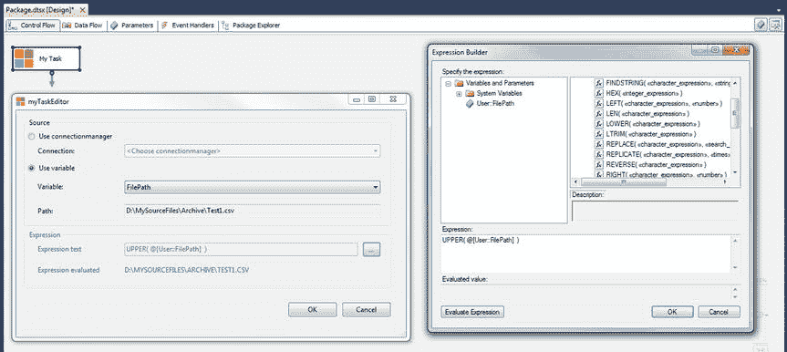
图 16-13. 自定义任务中的表达式生成器

### Using 指令

为了使代码更紧凑，您需要在 UI 项目的代码中添加两个额外的 `using` 指令。由于不同命名空间中存在重复名称，包装器 `using` 指令略有不同。

```
usings Microsoft.DataTransformationServices.Control;
usings Wrapper = Microsoft.SqlServer.Dts.Runtime.Wrapper;
```

### 表单控件

在这个简化示例中，您需要添加一个按钮（用于打开表达式生成器）、一个只读文本框（用于显示表达式）和一个标签（用于显示计算结果）。

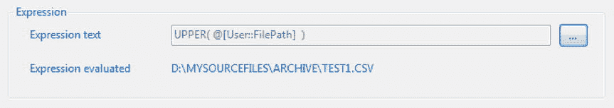
图 16-14. 用于打开表达式生成器的表单控件

## 代码

要打开表达式生成器，您需要使用以下代码为按钮添加一个 `onclick` 事件处理程序。

```csharp
private void btnExpression_Click(object sender, EventArgs e)
{
    try
    {
        // 创建一个表达式生成器弹窗，确保表达式可以被
        // 评估为字符串，或者如果您希望返回布尔值，则将其改为 System.Boolean。
        // 最后一个属性是包含您要编辑的表达式的文本框。
        using (var expressionBuilder = ExpressionBuilder.Instantiate(
                                         _taskHost.Variables,
                                         _taskHost.VariableDispenser,
                                         Type.GetType("System.String"),
                                         txtExpression.Text))
        {
            // 打开带有表达式生成器的窗口/对话框
            if (expressionBuilder.ShowDialog() == DialogResult.OK)
            {
                // 如果点击了“确定”，则文本框将被填入已创建的表达式，
                // 并且标签将被清空
                txtExpression.Text = expressionBuilder.Expression;
                lblExpressionEvaluated.Text = "";

                // 创建用于计算表达式的对象
                Wrapper.ExpressionEvaluator evaluator =
                                      new Wrapper.ExpressionEvaluator();

                // 添加表达式
                evaluator.Expression = txtExpression.Text;

                // 用于存储计算结果的变量
                object result = null;

                try
                {
                    // 计算表达式并将结果存储在 result 变量中
                    evaluator.Evaluate(DtsConvert.GetExtendedInterface(
                                       _taskHost.VariableDispenser),
                                            out result, false);
                }
                catch (Exception ex)
                {
                    // 在标签中存储错误信息
                    // 在这个例子中可能有点多余，因为表达式生成器窗口已经验证过表达式了。
                    // 但您也可以让文本框可编辑，并在此处更改表达式（无需打开表达式生成器窗口）
                    lblExpressionEvaluated.Text = ex.Message;
                }

                // 如果表达式包含错误，"result" 将为 <null>。
                if (result != null)
                {
                    // 将计算结果添加到标签中
                    lblExpressionEvaluated.Text = result.ToString();
                }
            }
        }
    }
    catch (Exception ex)
    {
        MessageBox.Show(ex.Message);
    }
}
```

现在，您可以将该表达式存储在一个属性中，并在运行时检索它。在运行时，您可以使用相同的代码来计算该表达式。

## 本章小结

在本章中，您学习了创建自定义任务的基础知识。我们鼓励您先学习一些基本的 .NET 编码知识，之后再着手创建大量的自定义任务。


