# 9. 脚本组件基础

电子补充材料 本章的在线版本 (doi:[10.​1007/​978-1-4842-0638-6_​9](http://dx.doi.org/10.1007/978-1-4842-0638-6_9)) 包含补充材料，可供授权用户使用。

如果您有不规则的平面文件格式，或者想要使用正则表达式清理数据，或者需要 XML 目标，那么脚本组件是您的最佳选择之一。脚本组件是 SSIS 数据流的一部分；它为您提供了一个脚本编辑器。它可以用作源、转换或目标。在本章中，您将深入研究脚本组件以及该组件的一些最常见用法。您将学习如何在脚本组件中使用变量、连接管理器、日志记录方法和错误处理。


### 编辑器

由于脚本组件可用于多种目的，因此当您将其添加到数据流任务的设计界面时，首先必须选择脚本类型（`Source`、`Destination` 或 `Transformation`）（参见图 9-1）。这是一个“一次性选择”选项，这意味着只能在创建组件时进行选择。如果您想要更改它，则必须删除并重新创建该组件。根据您选择的类型，为该组件生成的默认代码会发生变化，但其他特性（例如添加输入列或输出列的能力）也会随之改变。

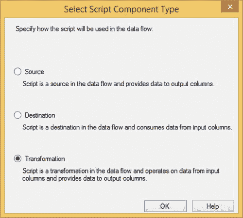

图 9-1. 脚本组件类型

脚本组件编辑器与脚本任务编辑器类似，但它拥有更多选项和页面（参见图 9-2）。在第一页上，您可以添加 `ReadOnly` 和 `ReadWrite` 变量，以避免在代码中出现硬编码值。您还可以选择脚本语言：`C#` 或 `VB.NET`。如果您仍在使用 SSIS 2005，则唯一的选择是 `VB.NET`。此语言选项是“一次写入”的。在点击 `Edit Script...` 按钮后，该选项将变为灰色，并且您无法再更改脚本语言。更改它的唯一方法是删除整个脚本组件，将新的组件添加到您的数据流中，然后重新开始。

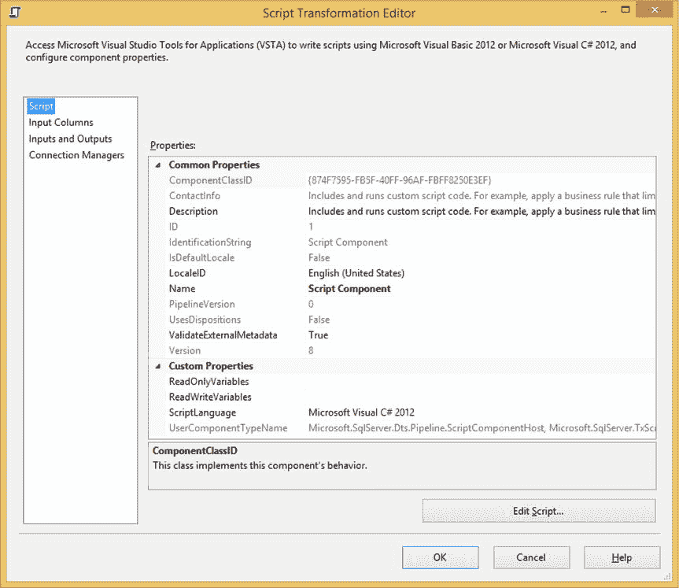

图 9-2. 脚本组件编辑器

#### 输入列

只有在您选择 `Transformation` 或 `Destination` 作为脚本组件类型时，“输入列”页面才可见。在此页面上，您可以选择需要在 .NET 代码中交互的所有列（参见图 9-3）。默认情况下，所有列都是 `ReadOnly` 的，但在 `Usage Type` 列中，您可以将某列设置为 `ReadWrite`。

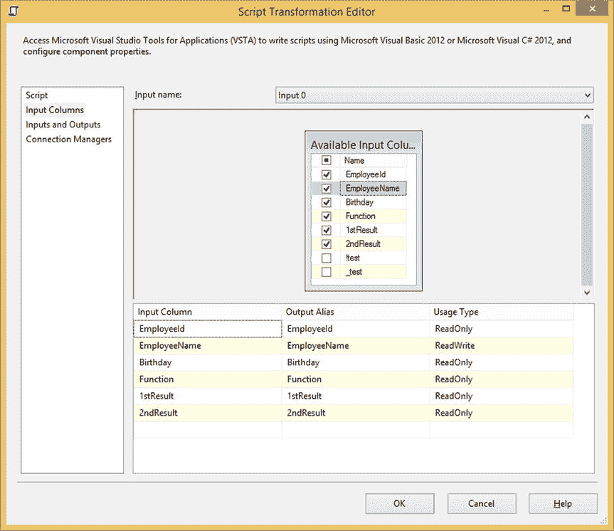

图 9-3. 输入列

脚本组件无法处理不以字母开头的名称。当列名以数字或标点符号开头时，它会在内部名称中将其移除。因此，`1stResult` 在代码中变成了 `Row.stResult`。如果您有两个名称相同但数字前缀不同的列，这可能会导致问题。在 `Output Alias` 列中，您可以重命名列。此重命名操作不仅适用于脚本，也适用于数据流的其余部分。

#### 输入和输出

在第三页上，您可以添加可由 .NET 脚本填充的新列。例如，您可以添加一个数据类型为 `DT_I4` 的 `RowNumber` 列，并在脚本中为其填充一个序列号（参见图 9-4）。而且，还可以添加一个额外的输出，这允许您将行分割到多个输出中；不过，有关此内容的更多信息将在本章后面介绍。

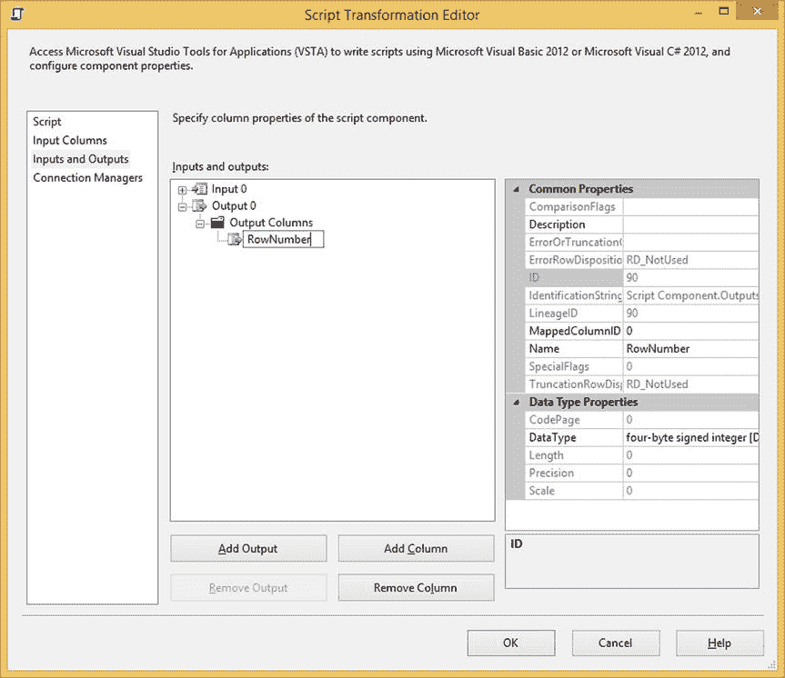

图 9-4. 添加新的 RowNumber 列

### 连接管理器

在最后一页上，您可以添加希望在脚本代码中使用的连接管理器（参见图 9-5）。您可以使用连接管理器来防止代码中出现硬编码路径。在代码中使用连接管理器之前，必须先将其添加到该列表中。这与脚本任务编辑器不同，在脚本任务编辑器中，您可以直接在代码中添加连接管理器。在 `Name` 列中，您可以为其添加一个别名，该别名将在脚本代码中使用。空格会被移除，就像带有数字或标点符号的前缀一样。

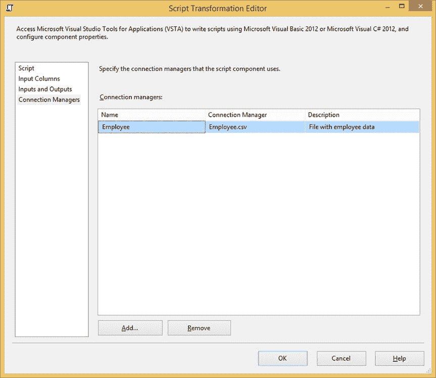

图 9-5. 选择连接管理器

为了存储文件或文件夹路径，您最可能使用文件连接管理器，但您可以使用所有类型的连接管理器。但是，在脚本组件中使用数据库连接管理器来执行查询时需要谨慎，因为可能存在不需要编码的更简单的解决方案；例如，使用 `Execute SQL Task` 甚至 `OLE DB` 命令。


### 脚本布局

当您完成变量、列和连接管理器的设置后，可以点击`编辑脚本...`按钮打开 VSTA 编辑器（见图 9-6）。该编辑器是 Visual Studio 的一个新实例，其中包含一个使用 C# 或 VB.NET 代码的 VSTA 项目。`VSTA` 代表 Visual Studio Tools for Applications。根据脚本类型（源、转换或目标），VSTA 编辑器会添加带有不同方法的默认代码。SSIS 2005 使用的是 Visual Studio for Applications (VSA)。与 VSTA 相比，最大的区别在于它不支持 C# 语言。

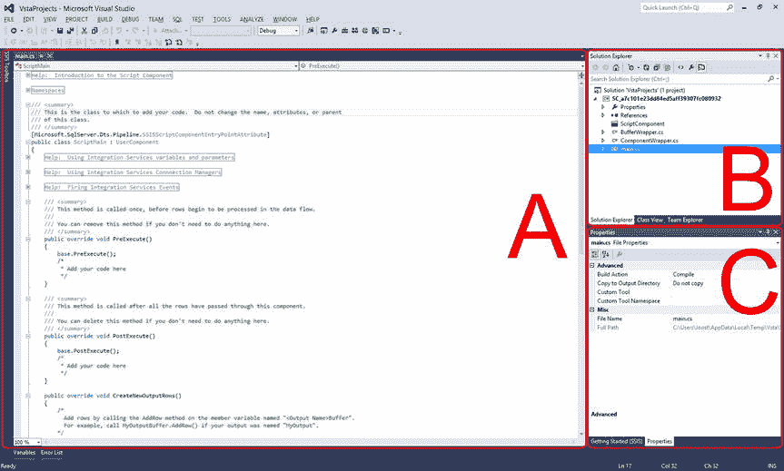

图 9-6. VSTA 编辑器

下面介绍图 9-6 中编辑器的各个部分。这与脚本任务章节类似，因为它们都使用相同的 VSTA 环境。

- **A. 主窗口**：您在此处编写代码。当您关闭 VSTA 编辑器时，保存操作会自动完成。
- **B. 解决方案资源管理器**：在此部分中，您可以添加额外的引用、更改项目属性（例如目标框架），还可以选择性地添加额外的 C# 或 VB.NET 文件。更改应使用`全部保存`按钮保存；否则，当您关闭 VSTA 编辑器时，这些更改将丢失。
- **C. 属性**：在此处，您可以查看在解决方案资源管理器中所选项目的属性；例如，您可以查看（临时）VSTA 项目在磁盘上的存储位置。

A 部分的脚本是自动生成的，其代码根据脚本类型、SSIS 版本以及脚本语言的不同而有所差异。脚本组件始终以一条通用注释开头。SSIS 不同版本间的文本会发生变化。要么删除这些注释，更好做法是用关于文件/脚本的有用注释来替换它们。您为什么使用脚本组件？您的代码在做什么？在 2012 版本中，加入了 `regions` 以使代码更有序。您也可以手动将它们添加到 SSIS 2008 的脚本中。

```
#region Help:  Introduction to the Script Component

/* The Script Component allows you to perform virtually any operation that can
* be accomplished in a .Net application within the context of an Integration
* Services data flow.
*
* Expand the other regions which have "Help" prefixes for examples of specific
* ways to use Integration Services features within this script component. */
#endregion
```

这是 VB.NET 代码：

```
#Region "Help:  Introduction to the Script Component"

' The Script Component allows you to perform virtually any operation that can
' be accomplished in a .Net application within the context of an Integration
' Services data flow.
' Expand the other regions which have "Help" prefixes for examples of specific
' ways to use Integration Services features within this script component.
#End Region
```

接下来是 `using` 指令或 `import` 语句。在 C# 中，它们被称为 `using` 指令；例如：

```
#region Namespaces

using System;
using System.Data;
using Microsoft.SqlServer.Dts.Pipeline.Wrapper;
using Microsoft.SqlServer.Dts.Runtime.Wrapper;
#endregion
```

在 VB.NET 中，它们被称为 `Import` 语句；例如：

```
#Region "Imports"

Imports System
Imports System.Data
Imports System.Math
Imports Microsoft.SqlServer.Dts.Pipeline.Wrapper
Imports Microsoft.SqlServer.Dts.Runtime.Wrapper
#End Region
```

包含哪些命名空间因 SSIS 版本而异，甚至因脚本语言而异。您可以添加额外的 `using`/`imports` 以使代码更简洁。它们启用/允许使用给定命名空间中的类型，而无需完全限定引用它们（关于 .NET 基础知识的更多信息，请参见第 3 章）。

第三部分是命名空间和类声明。这些是自动生成的。除非您是经验丰富的 .NET 开发人员并且有充分的理由进行更改，否则请不要修改它们。

```
/// <summary>
/// This is the class to which to add your code.  Do not change the name,
/// attributes, or parent of this class.
/// </summary>
[Microsoft.SqlServer.Dts.Pipeline.SSISScriptComponentEntryPointAttribute]
public class ScriptMain : UserComponent
{
```

这是 VB.NET 代码：

```
' This is the class to which to add your code.  Do not change the name,
' attributes, or parent of this class.
<Microsoft.SqlServer.Dts.Pipeline.SSISScriptComponentEntryPointAttribute> _
<CLSCompliant(False)> _
Public Class ScriptMain
Inherits UserComponent
```

接下来是关于变量、连接管理器和事件的大量帮助文本，这些文本被包裹在区域中。您可以删除这些内容以获得更清晰的代码，因为它们对于实际代码并非必需。在所有帮助文本之后，您会看到实际的方法。以下部分描述了六个最常用/最常重写的方法：`AcquireConnections`、`ReleaseConnections`、`PreExecute`、`PostExecute`、`CreateNewOutputRows` 和 `Input0_ProcessInputRow`。默认情况下并非所有这些方法都会包含在内，但您可以手动添加它们。或者，如果您不想在代码中包含太多方法，也可以合并代码——例如，合并 `AcquireConnections` 和 `PreExecute` 方法，仅使用 `PreExecute` 方法。您在互联网上的许多代码示例中都能看到这种用法。

如果您重写了一个方法，您会自动获得一些默认代码，这些代码执行来自被重写方法的基础代码。该行以 `base.` 开头，后跟方法名。您可以删除它，因为它在 SSIS 中不执行任何操作。大多数 MSDN 示例也不包含它们。或者您也可以保留它，因为它不会对代码造成损害。

#### AcquireConnections

此方法不在默认代码中。顾名思义，`AcquireConnections` 方法用于从连接管理器中获取连接。在此示例中，您将从 ADO.NET 连接管理器获取连接，并将其存储在一个类变量中，以便在其他方法中使用。

```
// Create class variables so that they can be used in all methods.
// Added System.Data.SqlClient to usings.

IDTSConnectionManager100 myAdoConnectionManager;
System.Data.SqlClient.SqlConnection myDbConnection;

public override void AcquireConnections(object Transaction)
{
  // Fill connection manager object with a Package connection manager
  myAdoConnectionManager = this.Connections.myADOConn;

  // Fill connection object with connection from the
  // ADO.NET connection manager object.
  myDbConnection = (System.Data.SqlClient.SqlConnection)myAdoConnectionManager
                          .AcquireConnection(Transaction);
}
```

这是 VB.NET 代码：

```
' Create class variables so that they can be used in all
' Added System.Data.SqlClient to imports.

Private myAdoConnectionManager As IDTSConnectionManager100
Private myDbConnection As System.Data.SqlClient.SqlConnection

Public Overrides Sub AcquireConnections(Transaction As Object)
  ' Fill connection manager object with a Package connection manager
  myAdoConnectionManager = Me.Connections.myADOConn

  ' Fill connection object with connection from the
  ' ADO.NET connection manager object.
  myDbConnection = DirectCast(myAdoConnectionManager _
        .AcquireConnection(Transaction), System.Data.SqlClient.SqlConnection)
End Sub
```

#### ReleaseConnections

`ReleaseConnections` 是 `AcquireConnections` 方法的对应方法。在此方法中，当您不再需要连接时释放它。此代码使用与 `AcquireConnections` 方法代码相同的类变量。

```
public override void ReleaseConnections()
{
  // Release the connection when finished
  myAdoConnectionManager.ReleaseConnection(myDbConnection);
}
```

这是 VB.NET 代码：

```
Public Overrides Sub ReleaseConnections()
  ' Release the connection when finished
  myAdoConnectionManager.ReleaseConnection(myDbConnection)
End Sub
```


#### PreExecute

`PreExecute`方法在任意行通过组件之前执行。它常用于获取变量或连接管理器，或执行一些初始代码，例如以下示例中启动一个新的 XML 文档。

```
// Variable that contains the XML document  
// Added System.Xml to usings  
XmlTextWriter textWriter;  

// Start of XML document  
public override void PreExecute()  
{  
    // Create a new XML document and use the filepath  
    // from a FILE connection manager named xmldocument as XML-file  
    textWriter = new XmlTextWriter(  
                 this.Connections.xmldocument.ConnectionString.ToString(), null);  
    // Start writing the XML document:  
    textWriter.WriteStartDocument();  
    // Create root element <root>  
    textWriter.WriteStartElement("ROOT");  
}
```

以下是 VB.NET 代码：

```
' Variable that contains the XML document  
' Added System.Xml to imports  
Dim textWriter As XmlTextWriter  

Public Overrides Sub PreExecute()  
    MyBase.PreExecute()  
    ' Create a new XML document and use the filepath  
    ' from a file connection manager named xmldocument as XML-file  
    textWriter = New XmlTextWriter( _  
                 Me.Connections.xmldocument.ConnectionString.ToString(), _  
                 System.Text.Encoding.Default)  
    'Start writing the XML document:  
    textWriter.WriteStartDocument()  
    'Create root element <root>  
    textWriter.WriteStartElement("ROOT")  
End Sub
```

#### PostExecute

`PostExecute`方法在所有行通过组件之后执行。它常用于设置变量或释放连接管理器，或执行一些最终代码。在此示例中，您将关闭在`PreExecute`方法中打开的 XML 文档。在第 12 章中，您将看到此 XML 目标的完整示例。

```
// Close of XML document  
public override void PostExecute()  
{  
    // Close root element: </root>  
    textWriter.WriteEndElement();  
    // Stop writing the XML document  
    textWriter.WriteEndDocument();  
    // Close document  
    textWriter.Close();  
}
```

以下是 VB.NET 代码：

```
Public Overrides Sub PostExecute()  
    'Close root element: </root>  
    textWriter.WriteEndElement()  
    'Stop writing the XML document  
    textWriter.WriteEndDocument()  
    'Close document  
    textWriter.Close()  
End Sub
```

#### Input0_ProcessInputRow

`Input0_ProcessInputRow`方法仅在脚本组件转换和目标中可用。它针对进入脚本组件的每条记录执行一次。在此方法中，您将处理每行中的列值。在此示例中，您将使用序列号填充一个名为`RowNumber`的新输出列。您可以在第 11 章中找到完整示例。

```
// New internal variable to store the rownumber  
private int sequenceNumber = 0;  

// Method that will be started for each record in your dataflow  
public override void Input0_ProcessInputRow(Input0Buffer Row)  
{  
    // Seed counter  
    sequenceNumber++;  
    // Fill the new column  
    Row.RowNumber = sequenceNumber;  
}
```

以下是 VB.NET 代码：

```
' New internal variable to store the rownumber  
Private sequenceNumber As Integer = 0  

' Method that will be started for each record in your dataflow  
Public Overrides Sub Input0_ProcessInputRow(ByVal Row As Input0Buffer)  
    'Seed counter  
    sequenceNumber = sequenceNumber + 1  
    ' Fill the new column  
    Row.RowNumber = sequenceNumber  
End Sub
```

#### CreateNewOutputRows

`CreateNewOutputRows`方法是脚本组件源的等效于`Input0_ProcessInputRow`的方法，但它也可用于具有异步输出的转换。通过此方法，您可以创建新行，但该方法仅执行一次。因此，您需要添加一个循环结构来添加多行。在此基础示例中，您将添加 10 行，每行包含一个整数列（数字 1 到 10）和一个字符串列（根据数字值显示"even"或"uneven"）。在第 10 章中，您可以找到此方法的多个示例。

```
public override void CreateNewOutputRows()  
{  
    // Add 10 rows  
    for (int i = 1; i <= 10; i++)  
    {  
        // Add a new row  
        Output0Buffer.AddRow();  
        // Fill two columns with data  
        Output0Buffer.myIntegerColumn = i;  
        Output0Buffer.myStringColumn = (i % 2) == 1 ? "uneven" : "even";  
    }  
}
```

以下是 VB.NET 代码：

```
Public Overrides Sub CreateNewOutputRows()  
    ' Add 10 rows  
    For i As Integer = 1 To 10  
        ' Add a new row  
        Output0Buffer.AddRow()  
        ' Fill two columns with data  
        Output0Buffer.myIntegerColumn = i  
        Output0Buffer.myStringColumn = If((i Mod 2) = 1, "uneven", "even")  
    Next  
End Sub
```

### 变量和参数

与脚本任务类似，您可以在脚本组件中使用变量（和参数），但存在一些差异。首先，获取变量值只能在`PreExecute`方法中完成，设置变量值只能在`PostExecute`方法中完成；否则，会出现运行时错误。例如，如果您需要在`Input0_ProcessInputRow`或`CreateNewOutputRows`方法中使用变量值，则必须创建一个类变量来存储来自 SSIS 变量的值，然后在其他方法中使用该类变量。

有两种不同的方法。在此示例中，您将填充一个新的`RowNumber`列（请参阅“输入和输出”部分），但起始序列来自一个 SSIS 整数变量（见图 9-7）。此变量可以通过配置或通过执行如下查询的`Execute SQL Task`来填充：

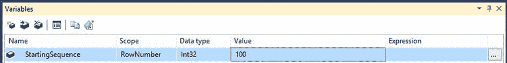

图 9-7. 名为`StartingSequence`的整数变量

```
SELECT ISNULL(MAX(rownumber),0) + 1 as NextRowNumber FROM myTable
```


#### 方法一：`ReadOnlyVariables` 与 `ReadWriteVariables`

此示例可供下载。在数据源后添加一个类型为“转换”的脚本组件。在“输入和输出”页面上，添加一个名为 `RowNumber` 的新输出列。在编辑器的第一页，你需要将 `StartingSequence` 变量添加为 `ReadWrite` 变量（参见图 9-8）。在此示例中，你首先读取起始序列，完成后，再将最后一行行号填充到该变量中。

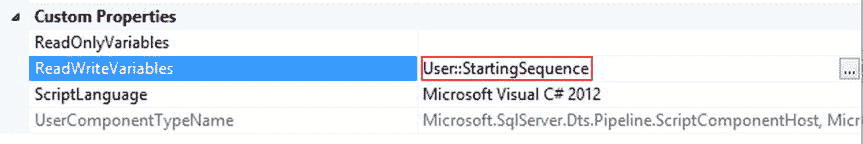

图 9-8.  
`ReadWriteVariables`

现在，点击 `Edit Script...` 按钮，并创建一个整数类变量，该类变量存在于类中，但不属于任一方法。最合适的位置是在类声明之后；但这并非强制要求。

```
// 用于存储行号的类变量，
// 该变量可在所有方法中使用
private int rowNumber = 0;
```

以下是 VB.NET 代码：

```
' 用于存储行号的类变量，
' 该变量可在所有方法中使用
Private rowNumber as Int32 = 0
```

在 `PreExecute` 方法中，你可以使用 SSIS 整数变量的值来填充这个类变量。如果你键入 `Variables`，那么 IntelliSense 将显示可用变量的完整列表。这些变量是你选择作为 `ReadOnly` 或 `ReadWrite` 变量的那些。你可能已经注意到，这与脚本任务有所不同。

```
public override void PreExecute()
{
  // 使用 SSIS 整数变量的值
  // 填充类变量
  rowNumber = Variables.StartingSequence;
}
```

以下是 VB.NET 代码：

```
Public Overrides Sub PreExecute()
  ' 使用 SSIS 整数变量的值
  ' 填充类变量
  rowNumber = Variables.StartingSequence
End Sub
```

在 `Input0_ProcessInputRow` 方法中，你递增该值，然后为每一行填充新的输出行号列。

```
public override void Input0_ProcessInputRow(Input0Buffer Row)
{
  // 行号递增 1
  rowNumber++;
  // 使用行号填充新列
  Row.RowNumber = rowNumber;
}
```

以下是 VB.NET 代码：

```
Public Overrides Sub Input0_ProcessInputRow(ByVal Row As Input0Buffer)
  ' 行号递增 1
  rowNumber = rowNumber + 1
  ' 使用行号填充新列
  Row.RowNumber = rowNumber
End Sub
```

在 `PostExecute` 方法中（该方法在所有行处理完毕后执行），你可以为下一个数据流或出于日志记录目的，使用最后一行行号设置 SSIS 整数变量。

```
public override void PostExecute()
{
  // 使用最终行号填充 SSIS 变量
  Variables.StartingSequence = rowNumber;
}
```

以下是 VB.NET 代码：

```
Public Overrides Sub PostExecute()
  ' 使用最终行号填充 SSIS 变量
  Variables.StartingSequence = rowNumber
End Sub
```

#### 方法二：变量分配器

第二种方法与脚本任务的第二种变量方法非常相似。不同之处在于，你不是在编辑器中使用 `ReadOnly` 和 `ReadWrite` 变量字段，而是在代码中锁定变量。在此示例中，你只需要更改 `PreExecute` 和 `PostExecute` 方法。其余代码完全相同。在 `PreExecute` 方法中，你锁定 SSIS 整数变量以进行读取，在用 SSIS 变量中的值填充类变量后，你释放锁。同时，还添加了一个显式转换（`Convert.ToInt32`），因为从对象到整数的转换是不安全的，数据可能会丢失。`Convert.ToInt32` 的替代方法是 `Int32.TryParse`，如果你不确定数据类型，使用后者会更安全。在这种情况下，你可以确定它是整数。

```
public override void PreExecute()
{
// 锁定变量以进行读取
VariableDispenser variableDispenser = (VariableDispenser)VariableDispenser;
variableDispenser.LockForRead("User::StartingSequence");
// 创建一个变量“容器”来存储变量
IDTSVariables100 vars;
variableDispenser.GetVariables(out vars);
// 使用 SSIS 整数变量的值填充类变量
// 因为使用此方法时数据类型始终是 Object，
// 所以你首先需要使用转换将其转换为适当的数据类型。
rowNumber = Convert.ToInt32(vars["User::StartingSequence"].Value);
// 解锁变量
vars.Unlock();
}
```

以下是 VB.NET 代码：

```
Public Overrides Sub PreExecute()
' 锁定变量以进行读取
Dim variableDispenser As VariableDispenser = _
CType(Me.VariableDispenser, VariableDispenser)
variableDispenser.LockForRead("User::StartingSequence")
' 创建一个变量“容器”来存储变量
Dim vars As IDTSVariables100
variableDispenser.GetVariables(vars)
' 使用 SSIS 整数变量的值填充类变量
' 因为使用此方法时数据类型始终是 Object，
' 所以你首先需要使用转换将其转换为适当的数据类型。
rowNumber = Convert.ToInt32(vars("User::StartingSequence").Value)
' 解锁变量
vars.Unlock()
End Sub
```

在 `PostExecute` 方法中，你需要锁定变量以进行写入，从而使用最终的行号填充该变量。无需添加额外的转换，因为从整数到对象的转换是隐式转换，不会丢失数据。

```
public override void PostExecute()
{
// 锁定变量以进行写入
VariableDispenser variableDispenser = (VariableDispenser)VariableDispenser;
variableDispenser.LockForWrite("User::StartingSequence");
// 创建一个变量“容器”来存储变量
IDTSVariables100 vars;
variableDispenser.GetVariables(out vars);
// 使用最终行号填充 SSIS 变量
vars["User::StartingSequence"].Value = rowNumber;
// 解锁变量
vars.Unlock();
}
```

以下是 VB.NET 代码：

```
Public Overrides Sub PostExecute()
' 锁定变量以进行写入
Dim variableDispenser As VariableDispenser = _
CType(Me.VariableDispenser, VariableDispenser)
variableDispenser.LockForWrite("User::StartingSequence")
' 创建一个变量“容器”来存储变量
Dim vars As IDTSVariables100
variableDispenser.GetVariables(vars)
' 使用最终行号填充 SSIS 变量
vars("User::StartingSequence").Value = rowNumber
' 解锁变量
vars.Unlock()
End Sub
```

注意

如果在脚本组件中设置了变量值，则新值仅在数据流任务完成后才可用。  
如果你仍在使用 SSIS 2005，则 `IDTSVariables100` 应为 `IDTSVariables90`。  
不能在脚本组件中读取敏感参数；这仅在脚本任务中可行。

#### 结论

在第二个使用变量分配器的示例中，锁定和解锁变量时似乎有更多的控制权。其最大缺点是你无法快速查看正在使用的变量；必须检查整个代码。其他缺点包括：需要编写更多代码来完成相同任务，必须将 Object 数据类型转换为有用的类型，并且无法使用 IntelliSense 获取变量名称。因此，首选方法应为第一种方法。


### 连接管理器

Integration Services 使用连接管理器来提供对各种数据源的访问，例如平面文件和数据库，同时也包括 Web 服务器和消息队列。你可以在脚本组件中使用这些连接管理器，以避免硬编码路径和连接字符串。但在使用数据库连接管理器时要保守一些，因为可能存在现成的替代方案，例如 `Execute SQL Task`、`OLE DB Source`、`OLE DB Command` 和 `OLE DB Destination`。如果你确实需要在脚本中使用数据库连接管理器，那么 ADO.NET 是首选连接管理器类型，因为像 OLE DB、ADO 和 ODBC 这样的连接管理器不会返回 .NET 托管对象。相反，它们返回 COM 对象，使用起来比较困难。

在目标脚本中，你可以使用 `PreExecute` 方法或 `AcquireConnections` 方法来获取连接，但在源脚本中，也可以使用 `CreateNewOutputRows` 方法，因为它只执行一次。不过，最好使用 `AcquireConnections` 方法，因为它是唯一可以启动事务的地方。

在开始编码之前，你首先需要将你的连接管理器添加到脚本组件编辑器的连接管理器列表中。完成此操作后，你就可以在脚本组件中使用别名（名称列）。如果你输入 `This.Connections.`，可以使用 IntelliSense 获取连接管理器名称。

第一个示例是简单地获取连接字符串属性以提取文件路径，并将其用于 `StreamReader` 中。

```
using (StreamReader sr = new StreamReader(
this.Connections.MyProducts.ConnectionString))
{
    String line;
    // 从文件中读取行，直到到达文件末尾。
    while ((line = sr.ReadLine()) != null)
    {
        // 对 line 变量执行某些操作
    }
}
```

这是 VB.NET 代码：

```
Using sr As New StreamReader(Me.Connections.MyProducts.ConnectionString)
    Dim line As String = sr.ReadLine
    ' 从文件中读取行，直到到达文件末尾。
    Do While (Not line Is Nothing)
        ' 对 line 变量执行某些操作
        ' 并以读取下一行结束循环
        line = sr.ReadLine
    Loop
End Using
```

与其使用连接字符串属性，不如使用 `AcquireConnection`。这将会处理连接管理器上的表达式（如果有的话）。

```
this.Connections.MyProducts.AcquireConnection(null).ToString()
```

这是 VB.NET 代码：

```
Me.Connections.MyProducts.AcquireConnection(Nothing).ToString()
```

返回值因连接管理器类型而异。例如，平面文件连接管理器返回包含文件路径的字符串，而 ADO.NET 连接管理器返回一个 `SqlConnection` 对象。搜索"以编程方式处理连接管理器"或访问 BOL 页面 [`https://msdn.microsoft.com/en-us/library/cc645942.aspx`](https://msdn.microsoft.com/en-us/library/cc645942.aspx) 以获取完整概述。

```
// 将连接管理器存储在本地连接管理器对象中
IDTSConnectionManager100 myADONETConnectionManager =
this.Connections.AdvantureWorks;
// 获取连接
SqlConnection myADONETConnection = (SqlConnection)myADONETConnectionManager.
AcquireConnection(null);
// 创建包含查询的字符串
string QueryString = "SELECT count(*) as NumberOfStores FROM [Sales].[Store]";
// 创建包含查询和连接的命令
SqlCommand myCommand = new SqlCommand(QueryString, myADONETConnection);
// 执行查询并遍历记录
SqlDataReader dr = myCommand.ExecuteReader();
while (dr.Read())
{
    // 使用 dr.GetValue(x) 执行某些操作
}
```

创建所有这些变量/对象的更好替代方案是使用 `using`，以确保所有对象在使用完毕后被释放。

```
using (SqlConnection myADONETConnection = (SqlConnection)
myADONETConnectionManager.AcquireConnection(null))
{
    // 对 myADONETConnection 执行某些操作
}
// myADONETConnection 现在已释放
```

这是 VB.NET 代码：

```
' 将连接管理器存储在本地连接管理器对象中
Dim myADONETConnectionManager As IDTSConnectionManager100 = Me.Connections.AdvantureWorks
' 获取连接
Dim myADONETConnection As SqlConnection = CType(myADONETConnectionManager.AcquireConnection(Nothing), SqlConnection)
' 创建包含查询的字符串
Dim QueryString As String = "SELECT count(*) as NumberOfStores FROM [Sales].[Store]"
' 创建包含查询和连接的命令
Dim myCommand As New SqlCommand(QueryString, myADONETConnection)
' 执行查询并遍历记录
Dim dr As SqlDataReader = myCommand.ExecuteReader()
While dr.Read()
    ' 使用 dr.GetValue(x) 执行某些操作
    MessageBox.Show(dr.GetValue(0).ToString())
End While
```

这是 VB.NET 中相同的示例：

```
Using myADONETConnection As SqlConnection = CType(myADONETConnectionManager. _
AcquireConnection(Nothing), SqlConnection)
    ' 对 myADONETConnection 执行某些操作
End Using
' myADONETConnection 现在已释放
```


### 记录事件

在脚本组件中，您可以触发/引发事件以进行日志记录。但是，例如，触发一个信息事件并不会自动记录该消息。您仍然需要在包日志记录中捕获这些事件。触发事件的工作方式与脚本任务事件类似，但可触发的事件更少：

- `FireCustomEvent`
- `FireError`
- `FireInformation`
- `FireProgress`
- `FireWarning`

接下来是几个触发事件的示例。不要触发过多事件，因为这会污染日志记录，使其失去价值，并降低脚本组件的性能。所有方法（除了`FireProgress`）都具有类似的结构。

第一个整数是错误/警告/信息代码。您可以将其保持为零，除非您希望维护所有代码的完整列表。第二个参数是包含转换（子）名称的字符串。在大多数情况下，这可以是脚本组件的名称，除非您有一个包含多个日志条目的大型代码片段；例如，届时您可以使用代码部分区的名称。第三个参数是您想要记录的实际消息。对于其他参数，您可以按所示使用值。在大多数情况下，它们的用处较小。

在脚本组件中，您可以使用以下代码触发一个错误，这将导致在“进度/执行结果”选项卡中生成一条日志行（见图 9-9）。


图 9-9. `FireError` 结果（来自“进度/执行结果”选项卡）

最后的参数是`string.Empty`和 0，因为您没有可用的帮助文件引用。

```
// 出错时取消组件
bool bpCancel = true;

// 触发错误
ComponentMetaData.FireError(0, "MyTransformation", "发生错误！",
string.Empty, 0, out bpCancel);
```

这是 VB.NET 代码：

```
' 出错时取消组件
Dim bpCancel As Boolean = True

' 触发错误
ComponentMetaData.FireError(0, "MyTransformation", "发生错误！", _
String.Empty, 0, bpCancel)
```

您可以将 `FireError` 方法与 `try-catch` 语句结合使用，以处理意外错误。

```
//C# 代码
try
{
    // 您的代码
}
catch(Exception ex)
{
    bool pbCancel = True;
    this.ComponentMetaData.FireError(0, "MyTransformation",
    "发生错误：" + ex.Message,
    string.Empty, 0, out pbCancel);
}
```

这是 VB.NET 代码：

```
Try
    ' 您的代码
Catch ex As Exception
    Dim bpCancel As Boolean = True
    ComponentMetaData.FireError(0, "MyTransformation", _
    "发生错误：" + ex.Message, _
    String.Empty, 0, bpCancel)
End Try
```

触发警告没有取消选项；它会导致在“进度/执行结果”选项卡中出现一个感叹号图标和警告文本，如图 9-10 所示。


图 9-10. `FireWarning` 结果（来自“进度/执行结果”选项卡）

```
// 触发警告
ComponentMetaData.FireWarning(0, "MyTransformation", "发生错误！",
string.Empty, 0);
```

这是 VB.NET 代码：

```
' 触发警告
ComponentMetaData.FireWarning(0, "MyTransformation", "发生错误！", _
String.Empty, 0)
```

触发信息事件具有一个 `FireAgain` 选项，用于防止在“进度/执行结果”选项卡中产生多行日志，如图 9-11 所示。


图 9-11. `FireInformation` 结果（来自“进度/执行结果”选项卡）

```
// 指定未来是否应再次引发该事件
bool pbFireAgain = true;

// 触发信息
ComponentMetaData.FireInformation(0, "MyTransformation", "供您参考！",
string.Empty, 0, ref pbFireAgain);
```

这是 VB.NET 代码：

```
' 指定未来是否应再次引发该事件
Dim pbFireAgain As Boolean = True

' 触发信息
ComponentMetaData.FireInformation(0, "MyTransformation", "供您参考！", _
String.Empty, 0, pbFireAgain)
```

如果您有一个循环结构或一个为每一行执行的方法，那么您可以使用 `FireProgress` 事件来让您了解进度百分比（见图 9-12）。这可能只对可能需要一些时间的过程有用。在此示例中，0 是下限，100 是上限，25 是实际值。

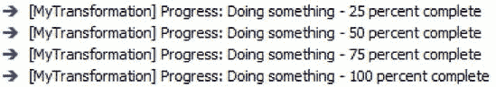

图 9-12. `FireProgress` 结果

```
// 指定未来是否应再次引发该事件
bool pbFireAgain = false;

// 触发进度
ComponentMetaData.FireProgress("正在执行操作", 25, 0, 100,
"MyTransformation", ref pbFireAgain);
```

这是 VB.NET 代码：

```
' 指定未来是否应再次引发该事件
Dim pbFireAgain2 As Boolean = True

' 触发进度
ComponentMetaData.FireProgress("正在执行操作", 25, 0, 100, _
"MyTransformation", pbFireAgain)
```

#### 更改 .NET 版本

每个版本的 SSIS 都有其自己支持的 .NET Framework 范围（见表 9-1）。这意味着您不能在 SSIS 2005 中使用诸如 LINQ（语言集成查询）之类的 .NET 3.5 功能，因为它只支持 .NET 2.0。在 SSIS 2008 中，Microsoft 增加了对 .NET 3.5 及更高版本的支持；但是，SSIS 2008 的默认目标框架是 .NET 2.0，您可以在 VSTA 编辑器中更改它。

表 9-1. SSIS 版本与支持的框架

| SSIS 版本 | 支持的框架 |
| --- | --- |
| 2005 | 2.0 |
| 2008 (R2) | 2.0 => 3.5 |
| 2012 | 2.0 => 4.0 |
| 2014 | 2.0 => 4.5.1 |
| 2016 | 2.0 => 4.5.2 |

要更改目标框架，请转到 VSTA 编辑器，在解决方案资源管理器中右键单击项目。然后选择属性。在 C# 项目中，您可以在第一页上找到目标框架（应用程序，如图 9-13 所示）。

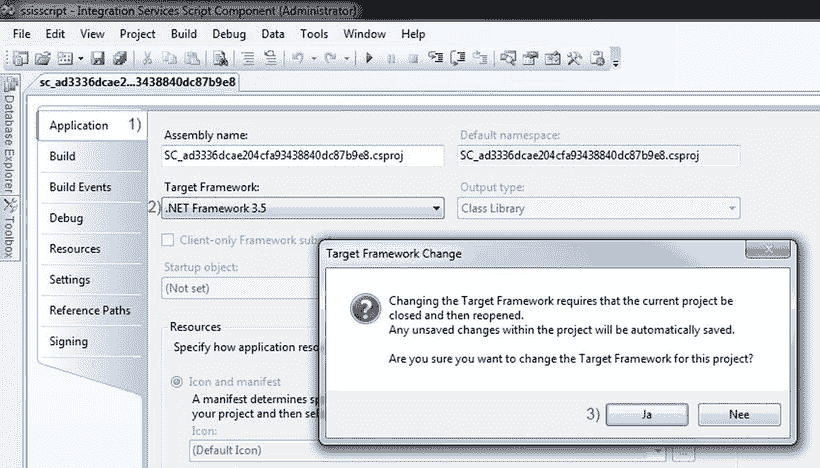

图 9-13. 为 C# 更改目标框架

在 VB.NET 中，目标框架位于不同的位置，具体取决于 SSIS 或 Visual Studio 的版本（见图 9-14）。在较旧的版本中，您可以在“编译”页面的“高级”选项中找到它。而在较新的版本中，Microsoft 将其位置与 C# 项目对齐，并将其移到了“应用程序”页面。

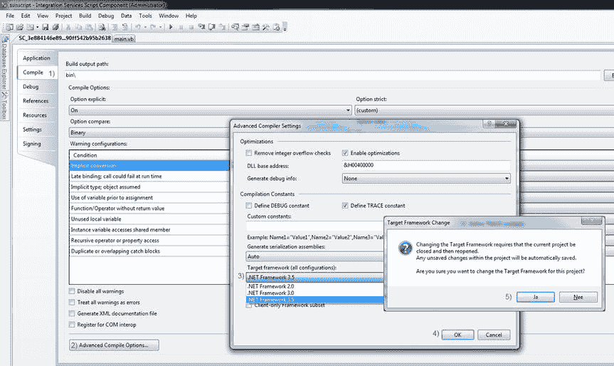

图 9-14. 为 VB.NET 更改目标框架

### 总结

在本章中，您学习了脚本组件的基础知识，例如如何使用变量或连接管理器。在接下来的章节中，您将了解更多关于它们如何在各种示例中使用的内容。

