# 10. 脚本组件作为源

*电子补充材料* 本章的在线版本 (doi:[10.1007/978-1-4842-0638-6_10](http://dx.doi.org/10.1007/978-1-4842-0638-6_10)) 包含补充材料，仅供授权用户使用。

本章重点介绍脚本组件作为源的使用。数据流任务中有许多不同的可用源，但有时您会遇到，例如，格式不正确而无法被平面文件源读取的文件。那么，如果您没有数据来测试数据流，使用脚本组件生成随机测试数据呢？

## 列数不等的平面文件

有些 `.csv` 文件的行中，末尾的列并没有全部填充。这些列没有被留空，而是被省略了。这会导致平面文件连接管理器中出现一些奇怪的行为，某些行和列会合并。以下是用于此示例的示例数据：

`"test1";"abc";"xyz";"123"`

`"test2";"cba";"zyx";"321"`

`"test3";"abc"`

`"test4";"efg";"zyx"`

`"test5";"cba";"zyx";"321"`

如果你在平面文件连接管理器中预览，它会将较短的行与下一行合并，并显示错误。图 10-1 展示了这种情况。你可以看到 "test4" 是如何与来自 "test3" 行的 "abc" 相邻的。图 10-2 展示了你会收到的错误消息。

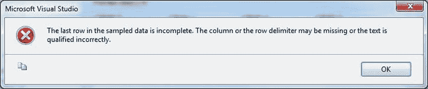

图 10-2. 平面文件连接管理器编辑器中的错误

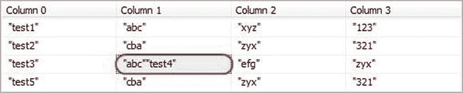

图 10-1. 合并的列和行

### 脚本组件源

这个问题在 SSIS 2012 中通过添加一个名为 `AlwaysCheckForRowDelimiters` 的新平面文件连接管理器属性得到了修复；但对于旧版本，当你尝试读取包含此类数据的文件时，会在平面文件连接管理器编辑器中收到错误。使用脚本组件作为数据源可以帮助你读取此文件。你将使用一个指向同一个具有可变列数的 CSV 文件、但未定义列的文件连接管理器，而不是使用平面文件连接管理器。

转到数据流任务，并将一个脚本组件添加到设计图面上。系统会要求你在源、转换和目标之间进行选择。如图 10-3 所示，选择**源**，并为任务起一个有用的名称。建议添加一个关于使用脚本组件原因的说明或注释。

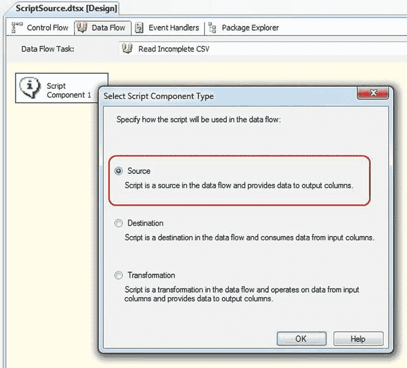

图 10-3. 脚本组件源

### 创建输出列

打开脚本转换编辑器，并转到**输入和输出**页面。向输出 0 添加四个字符串列。在单击**添加列**按钮添加第二列之前，应先单击**输出列**；否则，新列将被添加到顶部而不是底部。

你可能需要在脚本中将数据从字符串转换为整数。最佳实践是使用正确的数据类型；否则，你将需要在数据流的下游转换这些值。图 10-4 高亮显示了数据类型下拉列表字段。

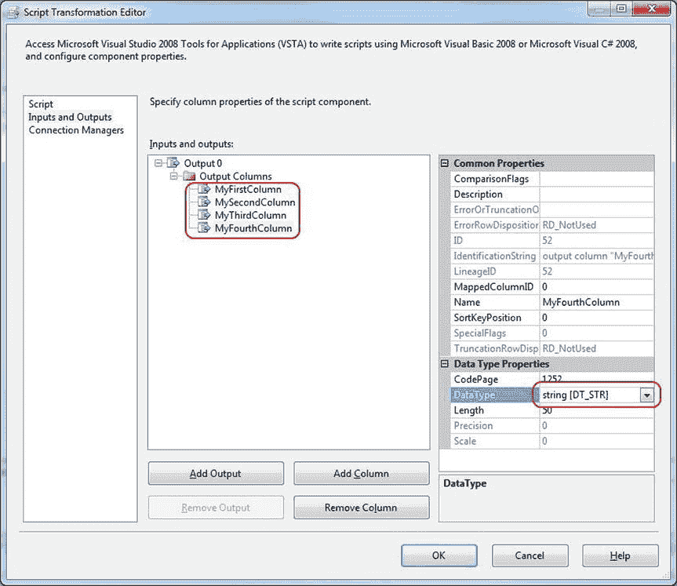

图 10-4. 添加新的输出列

### 创建文件连接管理器

为了避免在脚本中使用硬编码的连接字符串，你需要一个连接管理器。在此示例中，你将直接从脚本组件编辑器中创建一个新的连接管理器，但你也可以事先创建它，然后在编辑器中使用该连接管理器。转到**连接管理器**页面并添加一个新连接 (1)。连接管理器类型 (2) 应为 **FILE**，使用类型 (3) 应为**现有文件**。接着，在**名称**列中将默认名称从 Connection 更改为 `myFile`。这些步骤如图 10-5 所示。

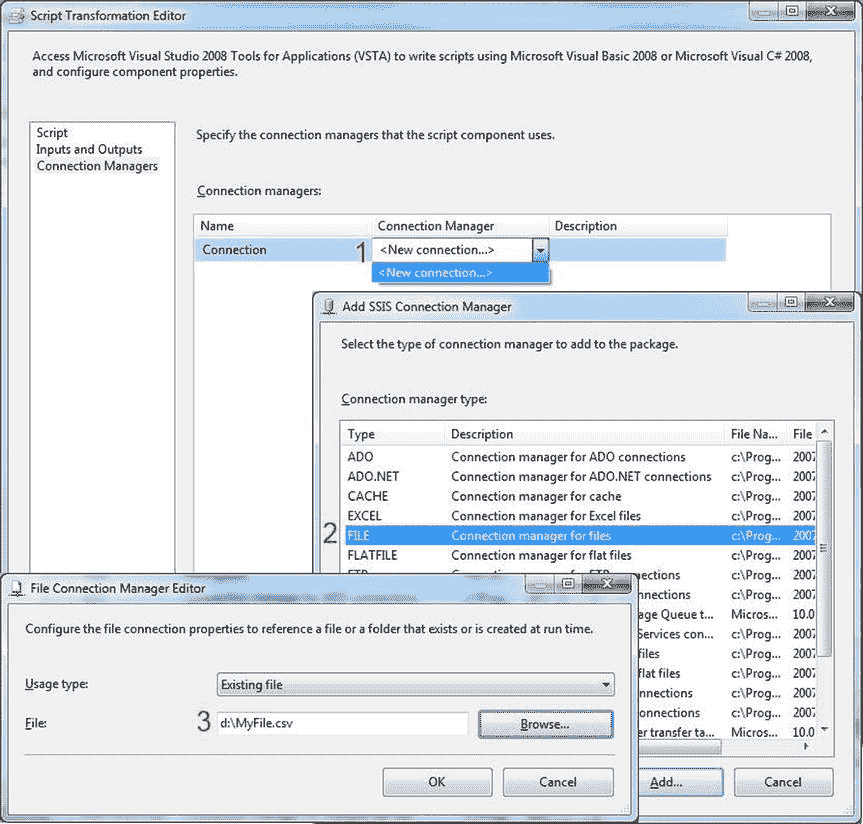

图 10-5. 添加新的连接管理器

### 代码

现在你可以回到**脚本**页面，并选择**编辑脚本...** 以打开 VSTA 环境。首先，你需要添加一个额外的命名空间来简化代码。

```
#region CustomNamespace
using System.IO;
#endregion
```

这是 VB.NET 代码：

```
#Region "CustomNamespace"
Imports System.IO
#End Region
```

接下来，你可以将以下代码复制到 `CreateNewOutputRows` 方法中。此方法创建新记录。

```
public override void CreateNewOutputRows()
{
    // 从连接管理器获取文件路径
    string filePath = this.Connections.myFile
        .AcquireConnection(null).ToString();

    // 通过流读取文件
    // 编码是可选的
    using (StreamReader sr = new StreamReader(filePath,
        System.Text.Encoding.UTF7))
    {
        // 临时存储一行内容的字符串变量
        string line;

        // 逐行从文件读取，直到文件末尾
        while ((line = sr.ReadLine()) != null)
        {
            // 将行拆分为列
            string[] columns = line.Split(';');

            // 向缓冲区添加一个新行
            this.Output0Buffer.AddRow();

            // 填充列，但检查它们是否存在
            if (columns.Length > 0)
            {
                // 使用 Trim 或子字符串移除字符串开头和结尾的 "
                Output0Buffer.MyFirstColumn =
                    columns[0].TrimStart('"').TrimEnd('"');
            }
            if (columns.Length > 1)
            {
                Output0Buffer.MySecondColumn =
                    columns[1].TrimStart('"').TrimEnd('"');
            }
            if (columns.Length > 2)
            {
                Output0Buffer.MyThirdColumn =
                    columns[2].TrimStart('"').TrimEnd('"');
            }
            if (columns.Length > 3)
            {
                Output0Buffer.MyFourthColumn =
                    columns[3].TrimStart('"').TrimEnd('"');
                // 如果你选择整数作为数据类型，则需要添加转换：
                // Output0Buffer.MyIntColumn =
                // Convert.ToInt32(columns[3].TrimStart('"').TrimEnd('"'));
            }
        }
    }
}
```

这是 VB.NET 代码，其中的 `while` 循环与 C# 示例略有不同。

Public Overrides Sub `CreateNewOutputRows()` 方法用于创建新的输出行。此方法从连接管理器获取文件路径，通过流读取文件并解析每一行数据，将其填充到输出缓冲区中。

你已经删除了重写的预执行和后执行方法，因为你不需要它们。你可以使用预执行方法来检查文件是否包含数据等。`脚本组件编辑器`会在执行代码前检查连接管理器中的文件是否存在。

#### 结果

当执行数据流任务时，你可以添加一个数据查看器来检查结果。图 10-6 展示了一个示例。

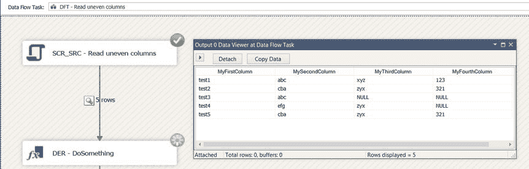

图 10-6. 结果

### 跨越多行记录的纯文本文件

将`脚本组件`作为源的一个好用途是当记录被分隔在多行中时。在这种情况下，每行包含一个字段。

```
id,1
name,Joost
address,Street 2
id,2
name,Regis
address,Avenue 4b
id,3
name,William
address,Plaza 5
```

#### 脚本组件源

转到数据流任务，将一个`脚本组件`添加到设计图面。系统将询问您选择源、转换还是目标。选择源，如图 10-7 所示，并为该组件指定一个有意义的名称。

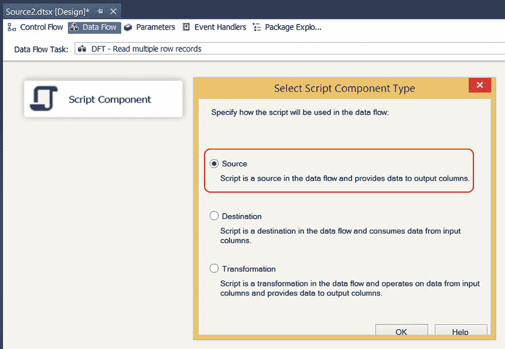

图 10-7. 作为源的脚本组件

#### 输出列

编辑`脚本组件`并转到“输入和输出”页面（见图 10-8）。在输出部分添加三列：

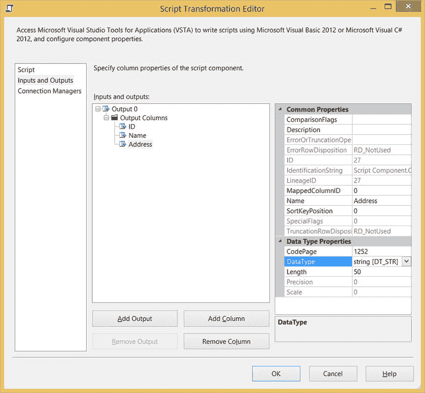

图 10-8. 输出列

- `ID`（四字节有符号整数，`DT_I4`）
- `Name`（字符串 50，`DT_STR` 1252）
- `Address`（字符串 50，`DT_STR` 1252）

#### 创建连接管理器

在此示例中，您将从`脚本组件编辑器`内部创建一个新的连接管理器，但您也可以预先创建，然后在此编辑器中使用该连接管理器。转到“连接管理器”选项卡并添加一个新连接(1)，以避免在脚本中对连接字符串进行硬编码。连接管理器类型(2)应为`FILE`，使用类型(3)应为“现有文件”。接下来，将默认名称从`Connection`更改为`myFile`。这些步骤如图 10-9 所示。

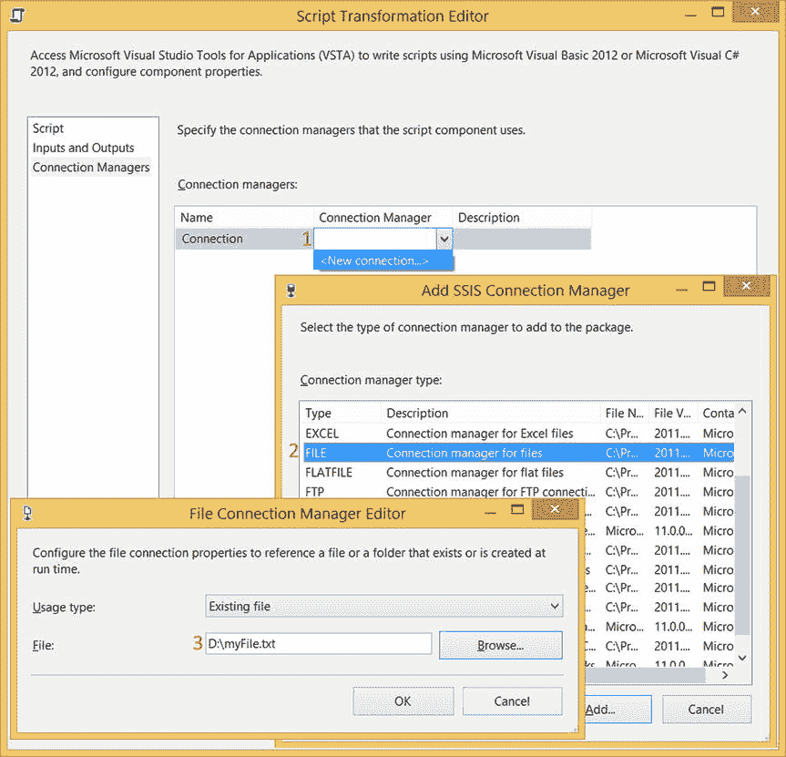

图 10-9. 添加新的连接管理器

#### 代码

现在您可以返回“脚本”页面，并选择“编辑脚本...”以打开 VSTA 环境。首先，您需要添加一个额外的命名空间来缩短代码。

```csharp
#region CustomNamespace
using System.IO;
#endregion
```

以下是 VB.NET 代码：

```vbnet
#Region "CustomNamespace"
Imports System.IO
#End Region
```

在此示例中，您在`PreExecute`方法中添加了文件大小检查。当文件中没有可用数据时，会触发一个警告。还有一个名为`filePath`的类变量，用于在各个方法之间进行通信。`脚本组件编辑器`会在代码执行前检查连接管理器中的文件是否存在。这意味着文件存在性检查会重复现有逻辑，因此不会增加任何价值。

```csharp
// 用于存储连接管理器文件路径的变量
private string filePath;

public override void PreExecute()
{
    // 填充类变量
    filePath = this.Connections.myFile.AcquireConnection(null).ToString();

    // 检查文件是否包含数据，如果为空则触发警告。
    FileInfo fi = new FileInfo(filePath);
    if (fi.Length == 0)
    {
        this.ComponentMetaData.FireWarning(0, "myFile", "空文件: " +
            filePath, "", 0);
    }
}
```

以下是 VB.NET 代码：

```vbnet
' 用于存储连接管理器文件路径的变量
Private filePath As String

Public Overrides Sub PreExecute()
    ' 填充类变量
    filePath = Me.Connections.myFile.AcquireConnection(Nothing).ToString()

    ' 检查文件是否包含数据，如果为空则触发警告。
    Dim fi As New FileInfo(filePath)
    If fi.Length = 0 Then
        Me.ComponentMetaData.FireWarning(0, "myFile", "空文件: " & _
            filePath, "", 0)
    End If
End Sub
```

接下来，您可以将以下代码复制到`CreateNewOutputRows`方法中。此方法创建新记录。它遍历文件中的所有行，并统计字段数量。当达到总字段数时，它会在 SSIS 中创建一条新记录，然后重置计数器。

```csharp
public override void CreateNewOutputRows()
{
    // 用于存储字段值的变量
    int ID = 0;             // 字段 1
    string Name = "";       // 字段 2
    string Address = "";    // 字段 3
    int NumberOfColumns = 3;

    // 用于跟踪当前行/字段的计数器
    int rowCounter = 0;

    // 通过流读取文件。编码是可选的
    using (StreamReader sr = new StreamReader(filePath,
        System.Text.Encoding.UTF7))
    {
        String line;

        // 读取文件中的行，直到到达文件末尾。
        while ((line = sr.ReadLine()) != null)
        {
            // 增加计数器
            rowCounter++;

            // 将行拆分为字段和值
            string[] columns = line.Split(',');

            // 填充正确的变量
            // 第 1 行: ID, 第 2 行: Name, 第 3 行: Address
            switch (rowCounter)
            {
                case 1:
                    // 字段 1
                    ID = System.Convert.ToInt32(columns[1]);
                    break;
                case 2:
                    // 字段 2
                    Name = columns[1];
                    break;
                case 3:
                    // 字段 3
                    Address = columns[1];
                    break;
                default:
                    // 不正确
                    break;
            }

            // 如果已到达最后一个字段，则添加新行
            if (rowCounter.Equals(NumberOfColumns))
            {
                // 添加一个新行并填充字段
                this.Output0Buffer.AddRow();
                Output0Buffer.ID = ID;
                Output0Buffer.Name = Name;
                Output0Buffer.Address = Address;

                // 最后一个字段，重置计数器并从下一组行开始
                rowCounter = 0;
            }
        }
    }
}
```

以下是 VB.NET 代码：

```vbnet
Public Overrides Sub CreateNewOutputRows()
    ' 用于存储字段值的变量
    Dim ID As Integer = 0                     ' 字段 1
    Dim Name As String = ""                   ' 字段 2
    Dim Address As String = ""                ' 字段 3
    Dim NumberOfColumns As Integer = 3

    ' 用于跟踪当前行/字段的计数器
    Dim rowCounter As Integer = 0

    ' 通过流读取文件。编码是可选的
    Using sr As New StreamReader(filePath, System.Text.Encoding.UTF7)
        Dim line As String

        ' 读取第一行
        line = sr.ReadLine()

        ' 从文件中逐行读取，直到到达文件末尾。
        While (line <> Nothing)
            ' 增加计数器
            rowCounter += 1

            ' 将行拆分为字段和值
            Dim columns As String() = line.Split(","c)

            ' 填充正确的变量
            ' 第 1 行: ID, 第 2 行: Name, 第 3 行: Address
            Select Case rowCounter
                Case 1
                    ' 字段 1
                    ID = System.Convert.ToInt32(columns(1))
                Case 2
                    ' 字段 2
                    Name = columns(1)
                Case 3
                    ' 字段 3
                    Address = columns(1)
                Case Else
                    ' 不正确
            End Select

            ' 如果已到达最后一个字段，则添加新行
            If rowCounter.Equals(NumberOfColumns) Then
                ' 添加一个新行并填充字段
                Me.Output0Buffer.AddRow()
                Output0Buffer.ID = ID
                Output0Buffer.Name = Name
                Output0Buffer.Address = Address

                ' 最后一个字段，重置计数器并从下一组行开始
                rowCounter = 0
            End If

            ' 从文件中读取一行
            line = sr.ReadLine()
        End While
    End Using
End Sub
```

### 结果

当您执行数据流任务时，可以添加数据查看器（如图 10-10 所示）来检查结果。如果您有更多字段，只需扩展`switch`语句并增加`NumberOfColumns`整数变量即可。

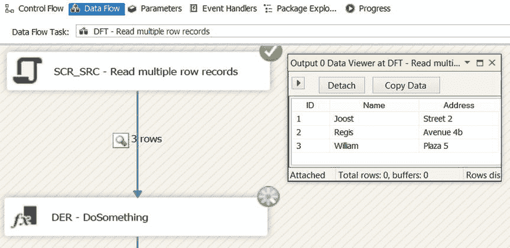

图 10-10. 结果

## 使用脚本组件作为源生成随机数据

如果您知道源的格式，但没有实际数据进行测试怎么办？使用`脚本组件`作为源，您可以轻松生成随机数据，例如介于最小值和最大值之间的数字、介于开始日期和结束日期之间的日期、包含随机字符的文本，或者从列表中随机选取的文本。您可以使用此`脚本组件`示例来替换源，或者生成数据并填充源。

### 脚本组件源

转到数据流任务，将脚本组件添加到设计图面。系统会询问您选择源、转换还是目标。选择“源”并为其指定一个有用的名称。示例如图 10-11 所示。

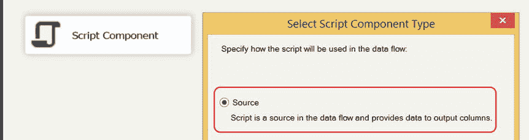

图 10-11. 作为源的脚本组件

### 输出列

## 脚本组件编辑与输出列设置

编辑脚本组件，然后转到“输入和输出”页面（见图 10-12）。添加您需要的列并设置适当的数据类型。在此示例中，您使用了字符串、整数、日期、货币和数值类型，但也可以使用其他数据类型。您可能需要在代码中添加额外的强制类型转换。

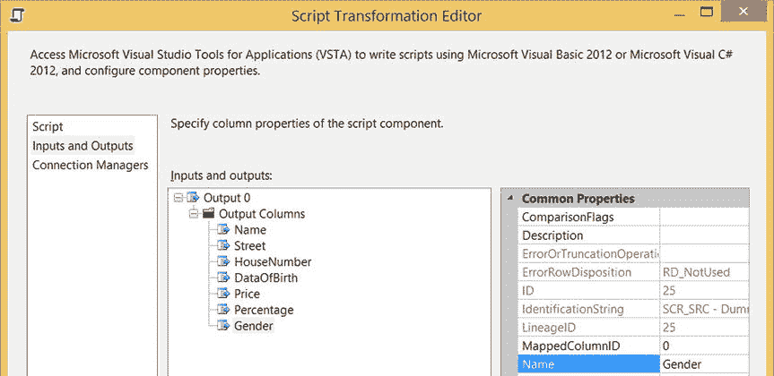
图 10-12.

该示例的列如下所示：

*   `Name` （字符串 [DT_STR] 50）
*   `Street` （字符串 [DT_STR] 50）
*   `HouseNumber`（四字节有符号整数 [DT_I4]）
*   `DateOfBirth`（日期 [DT_DATE]）
*   `Price`（货币 [DT_CY]）
*   `Percentage`（数值 [DT_NUMERIC] 5,2）
*   `Gender`（字符串 [DT_STR] 1）

图 10-12 显示了脚本转换编辑器中的这些列。

### 代码

在此示例中，您不必使用任何额外的命名空间，但使用了三个类变量。第一个整数用于指定要生成的行数。两个字符串变量用于随机单词或随机字符。您可以创建这些字符串的多个版本，每个版本包含不同的单词或字符集。

```
// 配置要生成的行数
private int numberOfRows = 1000;

// 用于选取的逗号分隔字符串值列表
private string randomNames = "Smith,Johnson,Williams,Brown,Jones," +
    "Miller,Davis,Garcia,Rodriguez,Wilson";

// 用于创建字符串的字符列表
private string chars = "0123456789ABCDEFGHIJKLMNOPQRSTUVWXYZ" +
    "abcdefghijklmnopqrstuvwxyz";
```

以下是 VB.NET 代码：

```
' 配置要生成的行数
Private numberOfRows As Integer = 1000

' 用于选取的逗号分隔字符串值列表
Private randomNames As String = "Smith,Johnson,Williams,Brown,Jones," + _
    "Miller,Davis,Garcia,Rodriguez,Wilson"

' 用于创建字符串的字符列表
Private chars As String = "0123456789ABCDEFGHIJKLMNOPQRSTUVWXYZ" + _
    "abcdefghijklmnopqrstuvwxyz"
```

接下来是几个新方法，您将它们放在了名为 `RandomMethods` 的区域中。这些额外的方法从 `CreateNewOutputRows` 方法中调用，用于生成随机数据。最清晰的位置可能是在 `CreateNewOutputRows` 方法的下方。

```
#region RandomMethods

// 传入一个字符串，随机选取其中一个元素
private string pickRandomString(string stringlist, Random rndNumber)
{
    // 将字符串拆分为字符串数组
    string[] strings = stringlist.Split(',');
    // 随机选取一个并返回
    return strings[rndNumber.Next(strings.Length)];
}

// 从字符集合中创建具有随机字符的字符串
private string createRandomString(string chars, int max, Random rndNumber)
{
    // 注释掉此行可创建
    // 长度相同的字符串
    max = rndNumber.Next(1, max);
    // 创建一个指定长度的字符数组
    char[] stringChars = new char[max];
    // 用随机字符填充每个数组元素
    for (int i = 0; i < stringChars.Length; i++)
    {
        stringChars[i] = chars[rndNumber.Next(chars.Length)];
    }
    // 将字符数组转换为字符串并返回
    return new String(stringChars);
}

// 在最小值和最大值之间随机选取一个数字
private int pickRandomNumber(int min, int max, Random rndNumber)
{
    // 随机选取一个整数
    return rndNumber.Next(min, max);
}

// 在最小值和最大值之间随机选取一个数字
public double pickRandomNumber(double min, double max, Random rndNumber)
{
    // 随机选取一个双精度浮点数
    return rndNumber.NextDouble() * (max - min) + min;
}

// 在最小日期和最大日期之间随机选取一个日期
public static DateTime pickRandomDate(DateTime from, DateTime to,
    Random rndNumber)
{
    // 计算 to 与 from 之间的差值
    TimeSpan range = to - from;
    // 确定随机增量
    TimeSpan randTimeSpan = new TimeSpan((long)(rndNumber.NextDouble() *
        range.Ticks));
    // 返回 from 加上随机增量的结果
    return (from + randTimeSpan).Date;
}

#endregion
```

以下是 VB.NET 代码：

```
#Region "RandomMethods"

' 传入一个字符串，随机选取其中一个元素
Private Function pickRandomString(stringlist As String, _
    rndNumber As Random) As String
    ' 将字符串拆分为字符串数组
    Dim strings As String() = stringlist.Split(","c)
    ' 随机选取一个并返回
    Return strings(rndNumber.Next)
End Function

' 从字符集合中创建具有随机字符的字符串
Private Function createRandomString(chars As String, max As Integer, _
    rndNumber As Random) As String
    ' 注释掉此行可创建
    ' 长度相同的字符串
    max = rndNumber.Next
    ' 创建一个指定长度的字符数组
    Dim stringChars As Char() = New Char(max - 1) {}
    ' 用随机字符填充每个数组元素
    For i As Integer = 0 To stringChars.Length - 1
        stringChars(i) = chars(rndNumber.Next)
    Next
```

现在是将代码添加到 `CreateNewOutputRows` 方法中的时候了。其中包含一个 `for` 循环，该循环会一直执行，直到达到请求的记录数。在循环内部，各列将被填充随机数据。

```csharp
// 生成新行的标准方法
public override void CreateNewOutputRows()
{
    // 循环直到 numberOfRows 被满足。变量 i 还会
    // 用于为每行生成不同的随机值。
    for (int i = 0; i < numberOfRows; i++)
    {
        // 添加一个新行
        Output0Buffer.AddRow();

        // 数据类型: string [DT_STR]
        Output0Buffer.Name = pickRandomString(randomNames, new Random(i));

        // 数据类型: string [DT_STR]
        Output0Buffer.Street = createRandomString(chars, 10, new Random(i));

        // 数据类型: four-byte signed integer [DT_I4]
        Output0Buffer.HouseNumber = pickRandomNumber(1, 10, new Random(i));

        // 数据类型: date [DT_DATE]
        Output0Buffer.DateOfBirth = pickRandomDate(new DateTime(1974, 01, 01),
        new DateTime(1999, 12, 31), new Random(i));

        // 数据类型: currency [DT_CY]
        Output0Buffer.Price = Convert.ToDecimal(pickRandomNumber(
        Convert.ToDouble(0), Convert.ToDouble(10000),
        new Random(i)));

        // 数据类型: numeric [DT_NUMERIC]
        Output0Buffer.Percentage = Convert.ToDecimal(pickRandomNumber(
        Convert.ToDouble(0), Convert.ToDouble(100),
        new Random(i)));

        // 数据类型: string [DT_STR]
        Output0Buffer.Gender = pickRandomString("M,F", new Random(i));
    }
}
```

以下是 VB.NET 代码：

```vbnet
' 生成新行的标准方法
Public Overrides Sub CreateNewOutputRows()
    ' 循环直到 numberOfRows 被满足。变量 i 还会
    ' 用于为每行生成不同的随机值。
    For i As Integer = 0 To numberOfRows - 1
        ' 添加一个新行
        Output0Buffer.AddRow()

        ' 数据类型: string [DT_STR]
        Output0Buffer.Name = pickRandomString(randomNames, New Random(i))

        ' 数据类型: string [DT_STR]
        Output0Buffer.Street = createRandomString(chars, 10, New Random(i))

        ' 数据类型: four-byte signed integer [DT_I4]
        Output0Buffer.HouseNumber = pickRandomNumber(1, 10, New Random(i))

        ' 数据类型: date [DT_DATE]
        Output0Buffer.DateOfBirth = pickRandomDate(New DateTime(1974, 1, 1), _
        New DateTime(1999, 12, 31), New Random(i))

        ' 数据类型: currency [DT_CY]
        Output0Buffer.Price = Convert.ToDecimal(pickRandomNumber( _
        Convert.ToDouble(0), Convert.ToDouble(10000), _
        New Random(i)))

        ' 数据类型: numeric [DT_NUMERIC]
        Output0Buffer.Percentage = Convert.ToDecimal(pickRandomNumber( _
        Convert.ToDouble(0), Convert.ToDouble(100), _
        New Random(i)))

        ' 数据类型: string [DT_STR]
        Output0Buffer.Gender = pickRandomString("M,F", New Random(i))
    Next
End Sub
```

请注意，如果你重新运行数据流，你会得到相同的随机数据。这是因为你正在使用行号 `i` 作为种子来计算随机值：`New Random(i)`。如果你不希望这样，你可以通过向种子添加毫秒之类的内容来改变行为：

```csharp
new Random(i + DateTime.Now.Millisecond)
```

### 结果

当你执行数据流任务时，可以添加一个数据查看器来检查结果。你可以在图 10-13 中看到这样的查看器。你可以将数据移动到表或平面文件中，并将其作为另一个数据流中的源来测试它。通过添加额外的列或其他字符串集，可以很容易地对其进行扩展。

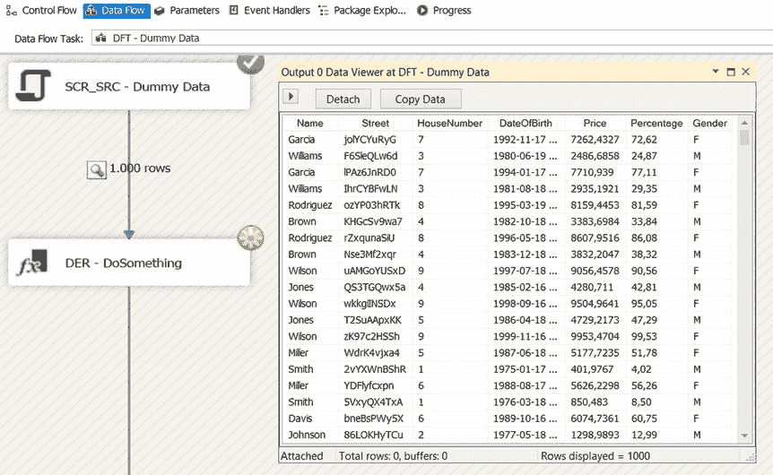

**图 10-13.** 结果

### 总结

在本章中，你学习了如何将脚本组件用作不同格式文本文件的源。只要你能够想出一个规则，其可能性就是无限的。你看到的第二件事是如何生成用于测试目的的随机数据。当你没有数据时，这很方便。在第 15 章中，你会看到你甚至可以像使用网络服务作为源。