## 11. 脚本组件转换

电子补充材料 本章的在线版本 (`doi:10.1007/978-1-4842-0638-6_11`) 包含补充材料，可供授权用户使用。

使用标准转换可以完成很多事情，但有时脚本组件提供了更简单的解决方案。例如，在派生列中实现嵌套的 `if` 结构是可能的，但如果你有很多层级或条件，它会变得难以阅读和维护。并且某些功能在开箱即用的组件中是不可用的。本章展示了脚本组件有用的一些情况。

### 脚本组件转换

脚本组件转换的基本结构是让你能够逐行访问来自上游的数据。针对输出的转换会应用于输入中的每一行。这种转换也可以以非同步方式发生，这意味着输入中的每一行不需要在输出行中都有匹配项（它们可以在输出中产生零行或多行）。例如，一个文件夹名称输入行可以返回多个包含该文件夹中文件名的输出行。输出设置的控制是在脚本组件的“输入和输出”窗格中完成的，如图 11-1 所示。

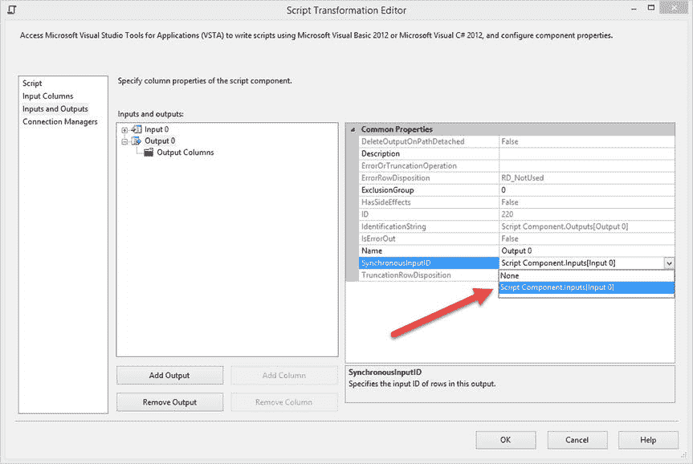

图 11-1. 脚本组件同步输入

如果一个组件有多个输入，你可以创建多个输出并匹配输入和输出，甚至添加一些异步输出。

### ProperCase

有时你会得到格式非常糟糕的数据，而且你没有机会访问数据源来重新格式化它。你可能希望对它应用适当的首字母大写格式。在下面的例子中，你有一个客户表，其中的 `FirstName` 和 `LastName` 列都是大写字母。你希望将它们重新格式化为适当的大小写格式。

有一个名为 `StrConv` 的 VB.NET 函数可以为你转换大小写。在 C# 中，这稍微复杂一些。你首先向包中添加一个数据流任务，然后使用源助手来获取数据。

#### 数据源

为简化操作，在 `APRESS_SSIS_Scripting` 数据库中创建一个名为 `Chapter_11` 的表，定义如下：

```
CREATE TABLE [dbo].Chapter_11 NOT NULL,
    [FirstName] nvarchar NULL,
    [LastName] nvarchar NULL,
    [YearlyIncome] [int] NULL,
    [TeamName] varchar NULL
) ON [PRIMARY]
```

该表需填充一些全大写的名字和姓氏，作为数据源。

```
INSERT INTO [dbo].[Chapter_11] ([FirstName], [LastName]) VALUES (N'JON', N'YANG')
INSERT INTO [dbo].[Chapter_11] ([FirstName], [LastName]) VALUES (N'EUGENE', N'HUANG')
INSERT INTO [dbo].[Chapter_11] ([FirstName], [LastName]) VALUES (N'RUBEN', N'TORRES')
INSERT INTO [dbo].[Chapter_11] ([FirstName], [LastName]) VALUES (N'CHRISTY', N'ZHU')
INSERT INTO [dbo].[Chapter_11] ([FirstName], [LastName]) VALUES (N'ELIZABETH', N'JOHNSON')
INSERT INTO [dbo].[Chapter_11] ([FirstName], [LastName]) VALUES (N'JULIO', N'RUIZ')
INSERT INTO [dbo].[Chapter_11] ([FirstName], [LastName]) VALUES (N'JANET', N'ALVAREZ')
```

> **注意：** 第 11 章的源代码包含表架构和填充表的脚本。

#### 脚本转换

首先，在包的设计界面上添加一个数据流任务。在此数据流任务中，添加一个 `OLE DB` 源组件，指向刚创建的表：`Chapter_11`。

添加一个名为 `SCR_TRA_ProperCasing` 的脚本组件，如图 11-2 所示。在“输入”窗格中，勾选要更改的列，并将其使用类型更改为 `ReadWrite`（默认是 `ReadOnly`）。将脚本组件连接到 `OLE DB` 源组件的输出。

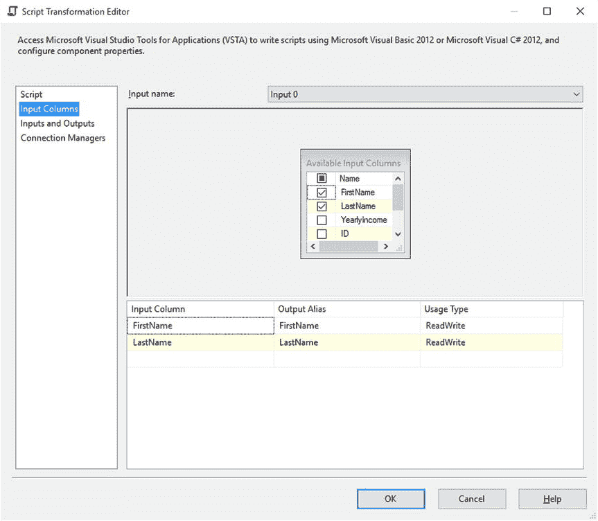

图 11-2. `ReadWrite` 变量

在创建的 `VSTA` 脚本中，需要找到 `Input0_ProcessInputRow` 方法并执行一些字符串转换。

`C#` 没有内置方法将字符串转换为 `ProperCase`，因此需要自行实现。最简单的方法可能是先将所有字符转换为小写，然后对小写字符串应用 `TitleCase` 方法。

```
//先转换为小写
string firstName = Row.FirstName.ToLower();
string lastName = Row.LastName.ToLower();

//实际的 Proper Casing 转换
Row.FirstName = new System.Globalization.CultureInfo("en").TextInfo.ToTitleCase(firstName);
Row.LastName = new System.Globalization.CultureInfo("en").TextInfo.ToTitleCase(lastName);
```

> **注意：** 另一种方法是在自定义命名空间中添加对 `Visual Basic` DLL 的引用，然后从 `C#` 调用 `VBScript` 方法。但我们认为，混合编程语言并非优雅方式。

`VB.NET` 中的解决方案与 `C#` 类似：

```
Row.FirstName = StrConv(Row.FirstName, VbStrConv.ProperCase)
Row.LastName = StrConv(Row.LastName, VbStrConv.ProperCase)
```

编写完脚本后，可以向数据流中添加一个多播组件，并将其连接到脚本组件的输出。在两者之间的连接中添加数据查看器；图 11-3 显示了结果。

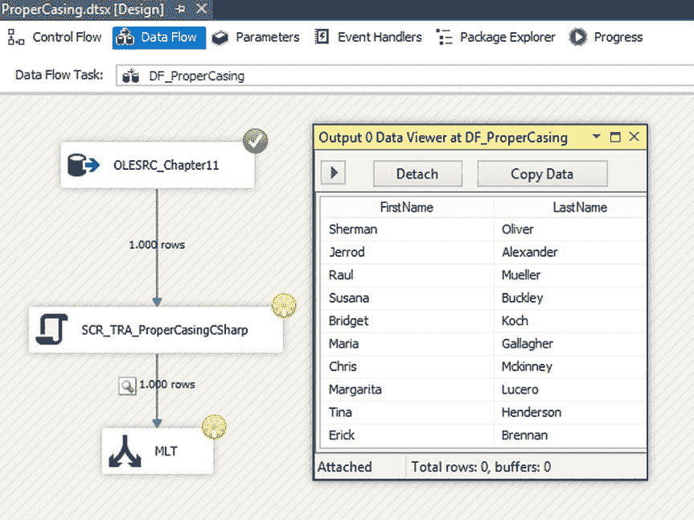

图 11-3. Proper casing

### 加密与解密数据

有时需要从表或文件中提取数据，但希望在导出前对数据进行加密，以保护敏感信息不被泄露。例如，社会保险号、密码或薪资。之后可能需要解密数据以显示原始值。

为此，使用前面示例中创建的表的 `YearlyIncome` 列，该列需要加密，并在某时刻解密。

然后向表中添加一些数据：

```
INSERT INTO [dbo].[Chapter_11] ([FirstName], [LastName], [YearlyIncome]) VALUES (N'Leonardo', N'Mc Cormick', 145872)
INSERT INTO [dbo].[Chapter_11] ([FirstName], [LastName], [YearlyIncome]) VALUES (N'Josh', N'Cortez', 292927)
INSERT INTO [dbo].[Chapter_11] ([FirstName], [LastName], [YearlyIncome]) VALUES (N'Andres', N'Wall', 318002)
INSERT INTO [dbo].[Chapter_11] ([FirstName], [LastName], [YearlyIncome]) VALUES (N'Leonard', N'Chambers', 255004)
INSERT INTO [dbo].[Chapter_11] ([FirstName], [LastName], [YearlyIncome]) VALUES (N'Miguel', N'Kelly', 71128)
INSERT INTO [dbo].[Chapter_11] ([FirstName], [LastName], [YearlyIncome]) VALUES (N'Jerry', N'Fox', 180525)
```

#### 解决方案包

在一个名为 `EncryptDecrypt` 的新包中，添加一个数据流任务 `DFT_EncryptData`。在此数据流任务中，添加一个名为 `OLE_SRC_GetDataToEncrypt` 的 `OLE DB` 源组件。将源连接指向 第 11 章 的表，并选择所有列，如图 11-4 所示。

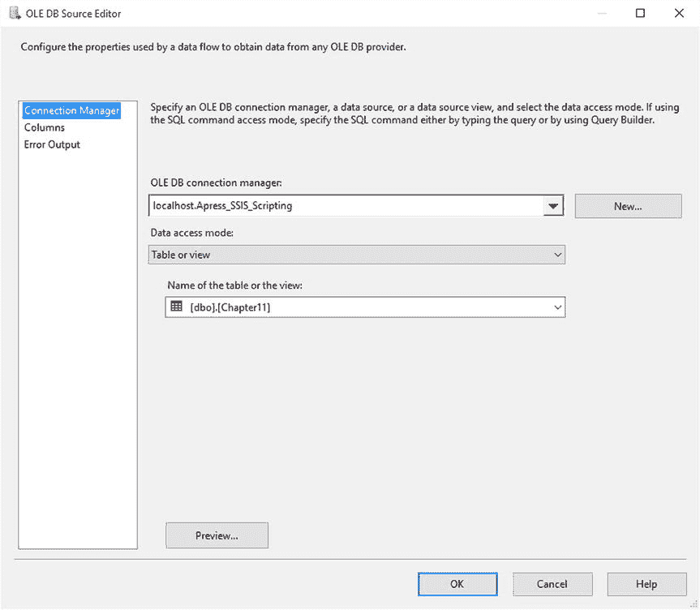
*图 11-4. OLE DB 源连接窗口*

.NET Framework 支持两种加密方式：对称加密和非对称加密。

它们使用不同的过程执行。对称加密在流上执行，因此适用于加密大量数据。非对称加密在少量字节上执行，因此仅适用于小数据量。由于我们逐行处理单个列，因此将使用非对称加密。

对称加密通常用于加密整个文件。

第 8 章包含一些关于使用脚本任务加密和解密整个文件的注意事项。

#### 变量

加密首先需要一个加密密钥。创建一个名为 `EncryptionKey` 的字符串变量，并使用经典的包含所有字母的句子为其赋值：`"The quick fox jumps over the lazy dog."`。

配置好 OLE DB 源后，接下来添加一个用于转换的脚本组件；将其命名为 `SCR_TRA_EncryptIncome`。

在组件的“脚本”页面中，将 `User::EncryptionKey` 变量添加为 `Read-only`，如图 11-5 所示。

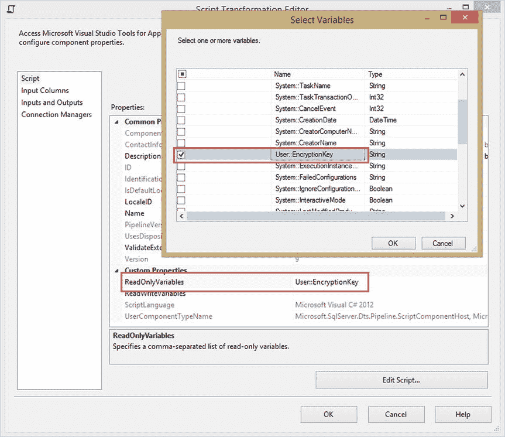
*图 11-5. ReadOnly 变量*

在组件的“输入列”页面中，选择 `YearlyIncome`，即要加密的列（见图 11-6）。

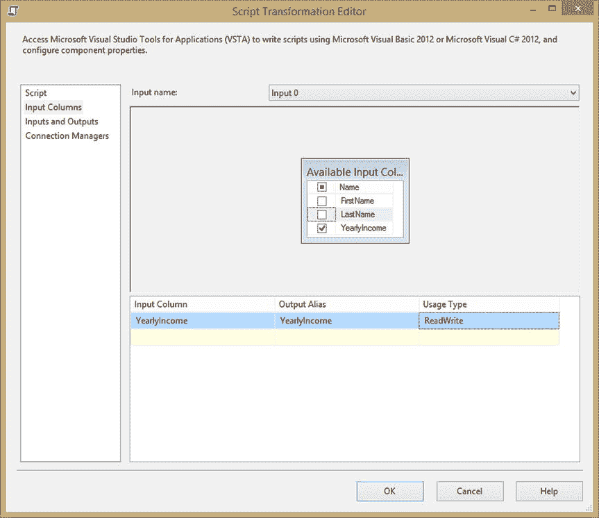
*图 11-6. 脚本转换编辑器输入页面*

#### 脚本

点击 **Edit Script...** 按钮启动 VSTA。首先，可以移除自动生成类中不需要的方法：`PreExecute` 和 `PostExecute`。

接下来添加加密和解密文本所需的命名空间。以下是 C# 脚本的开头部分：

```csharp
#region CustomNamespaces
using System.IO;
using System.Security.Cryptography;
#endregion
```

以下是 VB.NET 版本：

```vbnet
Imports System.IO
Imports System.Security.Cryptography
```

在脚本中添加两个方法：一个用于加密，一个用于解密。它们都接受两个参数：一个待加密字符串和一个加密密钥字符串。

这两个方法具有相同的接口：

```csharp
public static string Encrypt(string clearText, string Password)
public static string Decrypt(string cipherText, string Password)
```

在 VB.NET 中，可以按如下方式添加这两个方法：

```vbnet
Public Shared Function Encrypt(ByVal clearText As String, ByVal Password As String)
Public Shared Function Decrypt(ByVal cipherText As String, ByVal Password As String)
```

#### 为密码加盐

`Encrypt` 和 `Decrypt` 方法的核心思路是传入一个密码和一个密码盐，并利用密码盐从密码中派生密钥。当然，在 `Encrypt` 方法和 `Decrypt` 方法中使用的盐必须是相同的。这一步是在类级别完成的，而不是在方法中，因为只需要在类实例化时执行一次。

在 C# 中，密码盐定义如下：

```csharp
// 使用加盐技术从密码创建密钥和 IV
PasswordDeriveBytes pdb = new PasswordDeriveBytes(Password, new byte[] { 0x49, 0x76, 0x61, 0x6e, 0x20, 0x4d, 0x65, 0x64, 0x76, 0x65, 0x64, 0x65, 0x76 });
```

VB.NET 读者可以在代码中编写以下内容：

```vbnet
' 使用加盐技术从密码创建密钥和 IV
Dim pdb As New PasswordDeriveBytes(Password, New Byte() {&H49, &H76, &H61, &H6E, &H20, &H4D, &H65, &H64, &H76, &H65, &H64, &H65, &H76})
```

#### 加密流

然后，您需要创建一个 `CryptoStream`，它包含一个目标流（`MemoryStream`）、一个加密算法（为简单起见，这里使用 Rijndael 算法，但也可以使用其他算法）以及流模式。在加密和解密值时，`CryptoStreamMode` 都设置为 `Write`。

以下是在 C# 中创建该流的代码：

```csharp
// 创建一个 CryptoStream
CryptoStream cs = new CryptoStream(ms, alg.CreateDecryptor(), CryptoStreamMode.Write);
```

VB.NET 的实现如下：

```vbnet
' 创建一个 CryptoStream
Dim cs As CryptoStream = New CryptoStream(ms, alg.CreateEncryptor(), CryptoStreamMode.Write)
```

加密和解密之间的唯一区别在于操作写入 `MemoryStream` 之后。

#### 加密数据

对于加密，您需要将字节数组转换为 Base64 字符串。在 C# 中通过以下方式实现：

```csharp
// 将加密数据作为字符串返回
return Convert.ToBase64String(encryptedData);
```

使用以下代码在 VB.NET 中执行相同的转换：

```vbnet
' 将加密数据作为字符串返回
Encrypt = Convert.ToBase64String(encryptedData)
```

#### 解密数据

对于解密，您需要将内容转换回普通的人类可读字符串。在 C# 中，编写如下代码：

```csharp
// 将解密数据作为字符串返回
return System.Text.Encoding.Unicode.GetString(decryptedData);
```

而在 VB.NET 中，您可以这样编写：

```vbnet
' 将解密数据作为字符串返回
Decrypt = System.Text.Encoding.Unicode.GetString(decryptedData)
```

**注意**
完整的脚本可在第 11 章的可下载代码中找到。

如果您向脚本组件转换的输出添加一个多播，您就可以添加一个数据查看器并检查返回的数据，以确保所有内容都按预期解密。图 11-7 展示了脚本的结果。

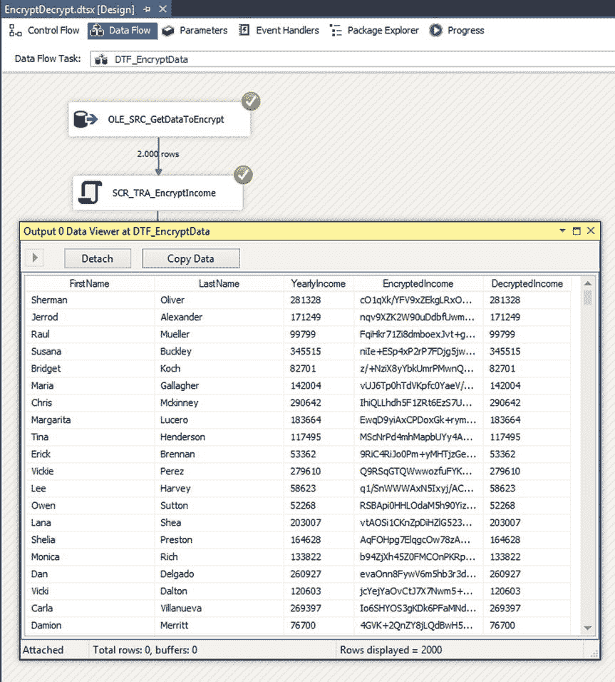
**图 11-7.** 加密和解密的收入

加密和解密可以通过多种不同的方式进行。我们仅仅触及了这个主题的表面，单靠一个例子远不足以全面阐述。如果您对 .NET 中加密功能的更多信息感兴趣，我们建议您进一步查阅 MSDN 上的系统密码命名空间，网址为 [msdn.microsoft.com/en-us/library/System.Security.Cryptography(v=vs.110).aspx](https://msdn.microsoft.com/en-us/library/System.Security.Cryptography(v=vs.110).aspx)。

### 比较行

继续使用员工收入的例子，假设每个员工都属于一个团队，您希望能够检查谁在团队中收入最高，以及收入最高的成员与团队其他成员之间的收入差距。

让我们将员工分配到十个不同的团队中。

```sql
UPDATE dbo.Chapter11 SET TeamName = 'Team ' + CAST(RIGHT(ID,1) AS VARCHAR(1))
```

在一个空白包的设计界面上，添加一个名为 `DFT_CompareRows` 的数据流。在此数据流中，添加一个 OLE DB 源连接，并连接到 `APRESS_SSIS_Scripting` 数据库。为了进行逐行比较，您需要首先按 `TeamName` 排序输入，然后按 `Income` 排序，因此您需要将数据访问模式设置为 SQL 命令，并将命令文本设置如下：

```
SELECT [FirstName]
      ,[LastName]
      ,[YearlyIncome]
      ,[ID]
      ,[TeamName]
  FROM [dbo].[Chapter 11]
ORDER BY TeamName, YearlyIncome DESC
```

在“列”页面上，选择所有列，如图 11-8 所示。

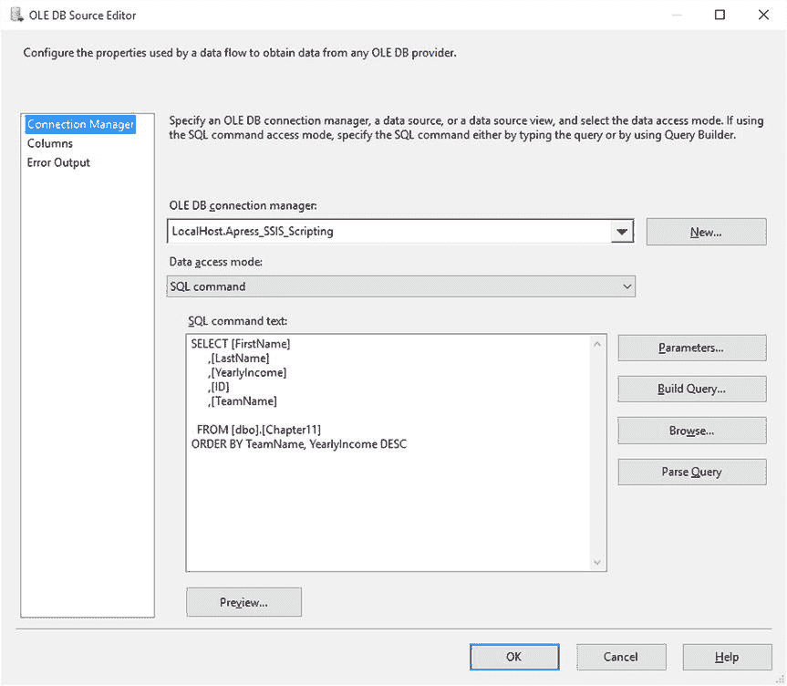  
`图 11-8.` OLE DB 源编辑器

然后，您在数据流中添加一个用于转换的脚本组件（重命名为 `SCR_TRA_CompareRows`），并将其连接到 OLE DB 源输出。

在“脚本组件输入列”页面上，您需要将 `YearlyIncome` 和 `TeamName` 添加为只读输入列，因为您在脚本中会用到它们。

接下来，为 `Output0` 添加两个类型为 `DT_I4`（四字节有符号整数）的列，分别命名为 `HighestIncome` 和 `IncomeDifference`。这些是您将在脚本中写入的列。

在组件的“脚本”页面上单击 `编辑脚本…`，然后启动 VSTA。首先，删除您不使用的 `PostExecute` 和 `PreExecute` 方法。此处重要的方法是 `Input0_ProcessInputRow`，您可以在其中对通过的数据进行逐行比较。

因为输入已排序，您可以放心逐行比较的操作会成功。在这类脚本中，这是一个非常重要的点。输入是否已排序对于比较的成功至关重要。

以下是用于比较行的 C# 版本脚本：

```
// 将当前行与上一行进行比较
if (Row.TeamName == teamname)
{
    // 匹配，将收入与上一行的收入进行比较
    Row.IncomeDifference = Row.YearlyIncome - highestincome;
}
else
{
    // TeamName 不匹配，这是新团队的第一行
    highestincome = Row.YearlyIncome;
}
// 将当前行的值存储到变量中，供下一行使用。
teamname = Row.TeamName;
Row.HighestIncome = highestincome;
```

而 VB.NET 中的代码如下：

```
' 将当前行与上一行进行比较
If Row.TeamName = teamname Then
    ' 匹配，将收入与上一行的收入进行比较
    Row.IncomeDifference = Row.YearlyIncome - highestincome
Else
    ' TeamName 不匹配，这是新团队的第一行
    highestincome = Row.YearlyIncome
End If
' 将当前行的值存储到变量中，供下一行使用。
teamname = Row.TeamName
Row.HighestIncome = highestincome
```

通过向数据流添加一个多播和一个数据查看器，您可以检查脚本是否正常工作。图 11-9 展示了比本章源代码中更大的数据样本的结果。

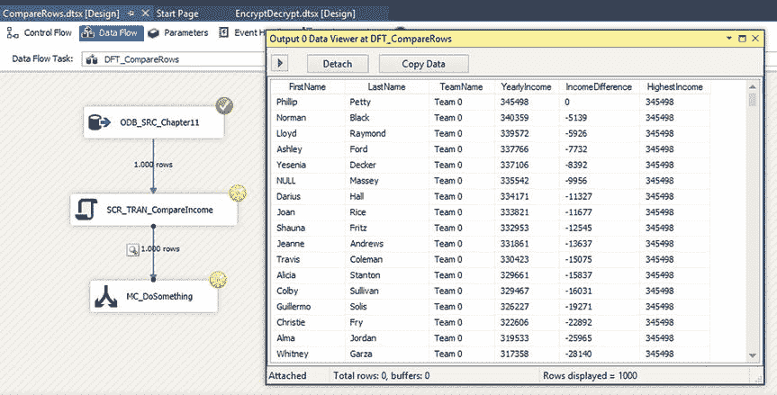  
`图 11-9.` 带有结果的数据查看器

### IsNumeric

.NET Framework 具备多种检测数据类型、空值等功能。尽管 SQL Server 2012 允许使用 `TryCast` 等部分功能，但由于我们并非总能使用最新版本的 SQL Server，因此并非总有条件使用此方法。这时，脚本组件的功能就派上了用场。

为便于演示，我们使用一个仅包含单列数据的简易文本文件作为输入。数据如下：

`TextNumber`

`1`

`42`

`3`

`4`

`Hello world!`

`7`

`I love SSIS`

如你所见，其中有一些行并非数值型。

数值检测的实现非常简单。在界面上添加一个新包和一个数据流。

在该数据流中，添加平面文件源：`FFS_TextNumbers`，并创建一个指向上述文本文档的连接管理器。所有配置保留默认值。点击“列”页面确认数值。图 11-10 展示了平面文件连接管理器的设置。

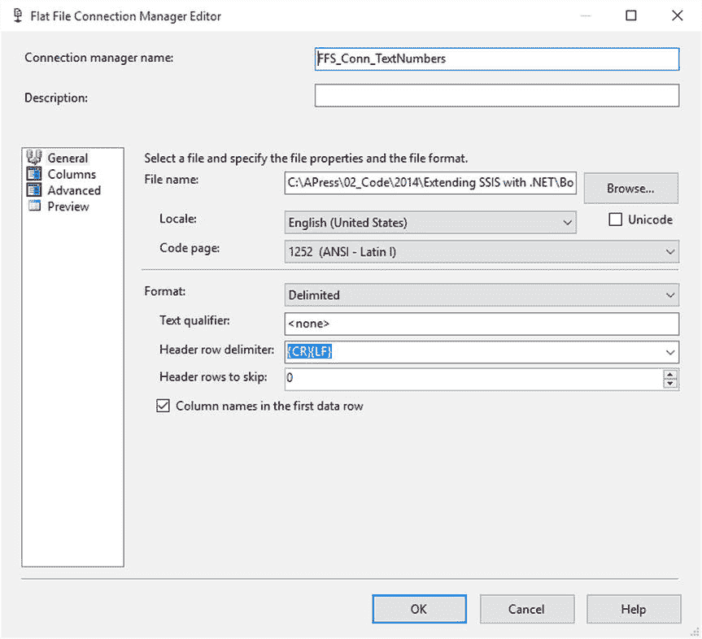  
`图 11-10.` 平面文件连接管理器编辑器

有了平面文件源后，添加一个用于转换的脚本组件，命名为 `SCR_TRA_TextNumber`。

在组件的“输入”页面，将 `TextNumber` 列设为“只读”。

在“输入和输出列”页面，添加一个布尔类型（`DT_BOOL`）的输出列 `isNumeric`，用于存储结果。

在“脚本”页面点击“编辑脚本...”按钮后，移除不需要的 `PreExecute` 和 `PostExecute` 方法，并在 `Input0_ProcessInputRow` 方法中添加以下两行代码：

```
//检查值是否为数值型
int result;
Row.isNumeric = Int32.TryParse(Row.TextNumber, out result);
```

如果使用 VB.NET 编写，则添加以下两行：

```
Dim result As Int32
' 如果解析成功则返回 true，否则返回 false
Row.isNumeric = Int32.TryParse(Row.TextNumber, result)
```

确实既简单又强大。结果如图 11-11 所示。

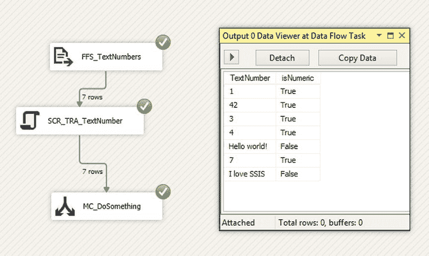  
`图 11-11.` `Int32.TryParse` 方法的执行结果

### 创建代理键

在某些情况下，你需要在数据流中生成一个唯一的连续数字作为某种键。它还可用于排名、消除重复项等。当数据来自半结构化源（例如，一个没有连续标识或行号信息的文本文件）时，脚本转换是理想的解决方案。

我们继续以上一节检测数值的示例为基础进行构建。假设你想确保所有获取的数值行都添加一个行号。

注意：如果你尚未了解上一节的解决方案，可以从本书网站下载代码。

在名为 `SCR_TRA_TextNumber` 的脚本组件的“输入和输出列”页面中，添加一个四字节有符号整数（`DT_I4`）类型的输出列，命名为 `RowNumber`。

点击“编辑脚本...”按钮打开脚本。在 C# 解决方案中，在类声明的正下方添加以下代码行：

```
int rownumber = 0; // 在类级别定义，每行都会保留其值
```

VB.NET 读者请执行以下操作：

```
Dim rownumber As Integer = 0
```

将 `Input0_ProcessInputrow` 方法中的现有代码替换为以下内容：

```
int result;
bool isNumeric = Int32.TryParse(Row.TextNumber, out result);
if (isNumeric)
{
    Row.isNumeric = isNumeric;
    rownumber++;
    Row.RowNumber = rownumber;
}
```

如果使用 VB.NET，请编写以下代码：

```
Dim result As Integer
Dim isNumeric As Boolean = Int32.TryParse(Row.TextNumber, result)
If isNumeric Then
        Row.isNumeric = isNumeric
        rownumber += 1
        Row.RowNumber = rownumber
End If
```

运行包时，你可以看到所有数值行都添加了连续的行号。所有非数值行的 `RowNumber` 列值均为 0。结果如图 11-12 所示。

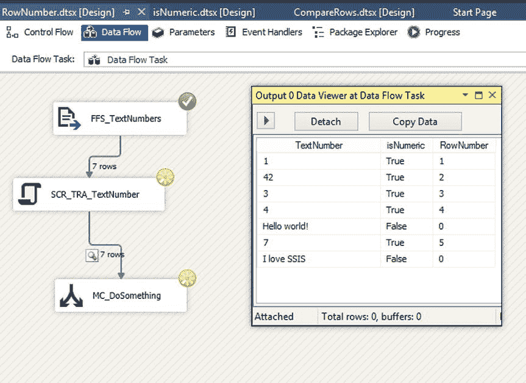  
`图 11-12.` `RowNumber` 附加到数值行

脚本组件再次帮你完成了对数据执行的、非直接或 SSIS 中不可用的任务。

### 创建 GUID

SSIS 中没有内置函数或表达式可用于创建新的 GUID。如果你已有以字符串形式存储的 GUID，则可以在派生列中使用强制转换将其转换为真正的 GUID 数据类型；或者，如果你有 SQL Server 数据源，则可以在源查询中使用 `NEWID()` 函数。

就像上一个创建 `RowNumber` 的示例一样，你可以使用 .NET 中的脚本组件通过一行代码创建一个 GUID。

#### 创建包

首先创建一个新的 SSIS 包，并在界面上添加一个数据流。在此数据流中，添加一个指向先前示例中文件的平面文件源连接，如图 11-13 所示。

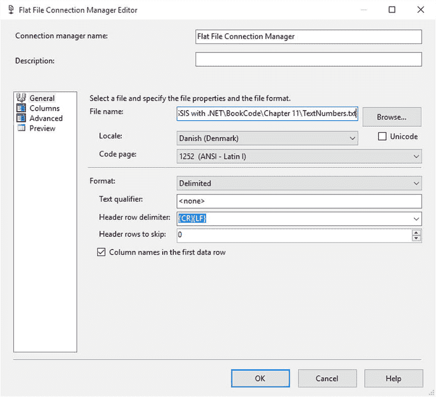
图 11-13. 平面文件连接管理器配置

#### 添加脚本组件

在源之后添加一个脚本组件，并将脚本类型选择为“转换”。将其连接到其他组件，并命名为 `SCR_CreateGUID`。在“输入和输出”页面，转到“输出 0”，选择“输出列”，然后添加一个名为 `RowGUID` 的新列。将其类型更改为 `DT_GUID`（唯一标识符），如图 11-14 所示。

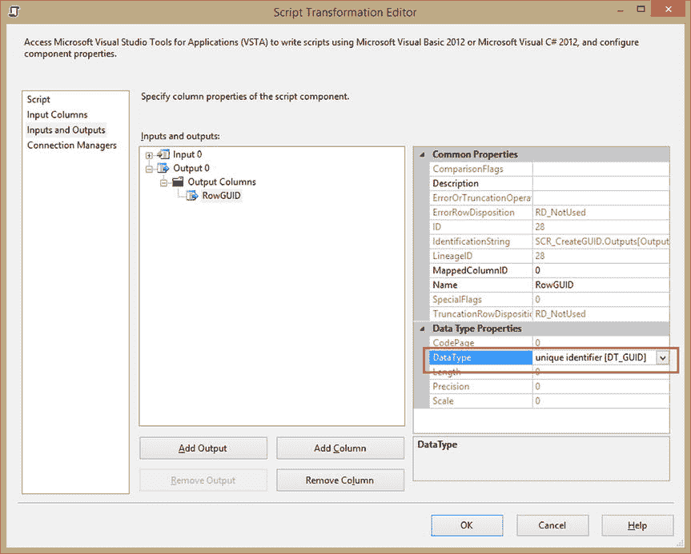
图 11-14. 添加新输出列

在组件的“脚本”页面，点击“编辑脚本...”。在 VSTA 编辑器中，移除你不需要的 `PreExecute` 和 `PostExecute` 方法。在 `Input0_ProcessInputRow` 方法中，添加一行 C# 代码来创建一个随机 GUID 并将其赋值给你之前创建的列。

```
//创建并分配一个 GUID
Row.RowGUID = Guid.NewGuid();
```

在 VB.NET 中，代码如下：

```
' 使用 SSIS 创建全局唯一标识符
Row.Guid2 = System.Guid.NewGuid()
```

#### 结果

关闭 VSTA 编辑器和脚本转换编辑器。向数据流添加一个多播，并将其连接到脚本组件。如果添加数据查看器（右键单击脚本组件和多播之间的连接），你应该会看到如图 11-15 所示的结果。由于 GUID 是全局唯一的，每次运行生成的 GUID 都应不同。

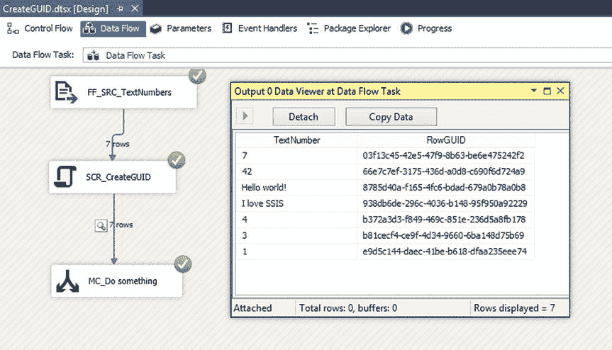
图 11-15. 新添加的 GUID 列

### 条件多播

处理 SSIS 包中的事实表时，你可能需要处理空值。此外，一个需求可能是出于审计目的记录空值行。使用内置组件可以实现这一点，但这非常繁琐，因为它涉及条件拆分、多个多播和一个 Union All 组件。

此时，脚本组件具备多个输出的功能就非常实用了。这种方法有两个好处。第一个好处是，你可以比使用大量条件转换更优雅地处理复杂的 `if` 语句；在一个脚本中处理所有条件比多个 SSIS 条件表达式更具可读性。第二个好处是，单行数据可以被重定向到多个输出，无需使用多播。

在以下示例中，你将遍历表的所有行，并将其中一些行重定向到输出以用于审计，因为某些列的值是错误的（你也可以检查值是否超过阈值、质量不佳，或任何其他想保存特定数据行的特殊原因；但这不属于此示例的内容）。

#### 数据源

对于数据源，你使用之前用过的第 11 章 数据。此表中包含一些员工的收入信息。由于公司今年业绩非常好，管理层决定将所有员工的收入提高 20%，同时指出所有年收入低于 20 万美元的员工。

首先，向一个空白包中添加一个数据流。在此数据流中，添加一个 OLE DB 源，连接到书籍代码中的 chapter 11 表。

> **注意**
> 此示例的完整代码可在本书网站上获取。

选择表中所有可用的列。

#### 脚本

添加一个脚本组件，并在“脚本类型”对话框中选择“转换”。将组件重命名为 `SCR_EnsureIncomeRaise`，并将数据源的输出连接到其输入。

在脚本组件的“输入列”页面上，选择 `YearlyIncome` 作为只读输入列。

在脚本组件的“输入和输出”页面上，将第一个输出重命名为 `GiveARaise`，并添加第二个名为 `LessThan200K` 的输出。

还需要执行几个步骤来确保输出按预期工作。首先，你需要将两个输出的 `ExclusionGroup` 属性都更改为 1（或其他非零值）。

默认情况下，所有输入行都被定向到所有可用输出，除非你指明要将每一行重定向到某个特定输出。这是通过为输出的 `ExclusionGroup` 属性指定一个非零值来实现的。该整数值具体是多少并不重要，但对于所有指定的输出组，该值必须相同。

配置如图 11-16 所示。

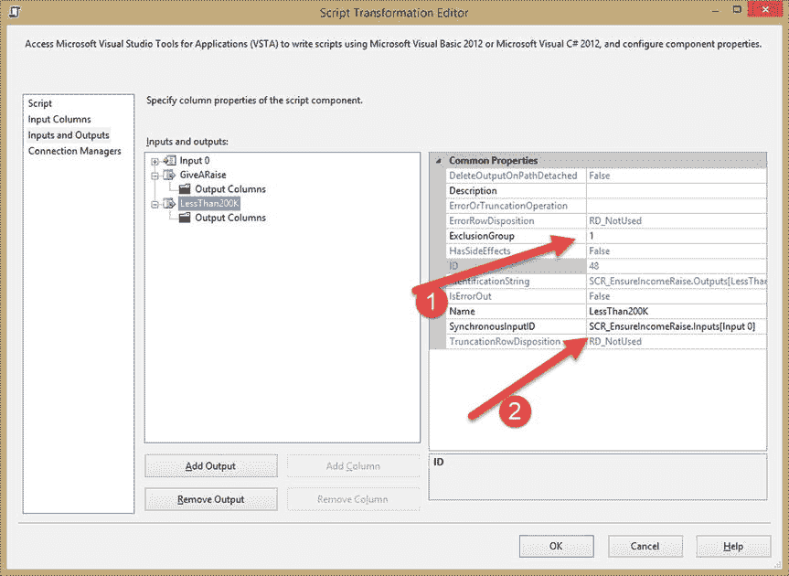
图 11-16. 输出配置

以下是该配置的详细说明：

- `ExclusionGroup` 设置为 1，并且对于所有输出，该值必须相同。

- 将 `SynchronousOuputID` 设置为 0（无）会创建异步输出，其中输出行与输入行没有任何关系，从而创建新的内存缓冲区并将值复制到其中。由于并非输出缓冲区中的所有行都会进入此输出，这使得我们可以实现条件重定向。

设置完成后，通过单击“脚本”页面上的 `Edit Script...` 打开脚本编辑器。移除 `PreExecute` 和 `PostExecute` 方法。然后输入以下 C# 代码：

```
// 在脚本的 Input0_ProcessInputRow 方法中添加以下几行代码：
if (Row.YearlyIncome < 200000)
{
    Row.DirectRowToLessThan200K();
}
Row.DirectRowToGiveARaise();
```

或者以下 VB.NET 代码：

```
If Row.YearlyIncome < 200000 Then
    Row.DirectRowToLessThan200K()
End If

Row.DirectRowToGiveARaise()
```

指示脚本仅将 `YearlyIncome` 小于 20 万的行用于一个输出，而将所有行用于另一个输出。如你所见，该逻辑非常易于实现，并且比使用 SSIS 条件拆分更具可读性。

关闭脚本组件，并向数据流中添加一个派生列 `DER_GiveARaise`。该派生列用于将 `YearlyIncome` 提高（并替换）20%。配置如图 11-17 所示。

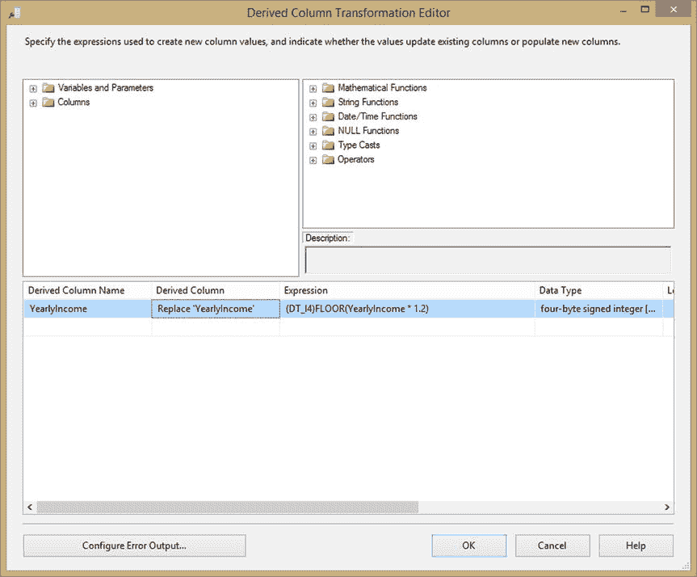
图 11-17. 使用派生列提高 20%

将派生列的输入连接到脚本组件的 `GiveARaise` 输出。

完成后，向派生列的输出添加一个多播，并向脚本组件的 `LessThan200K` 输出添加另一个多播。通过向多播连接添加数据查看器，你可以看到 `YearlyIncome` 符合脚本组件中条件的行，以及收入提高后的行。

图 11-18 显示了收入提高后的数据查看器。

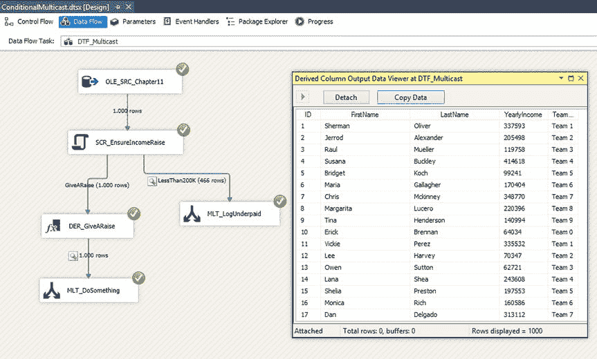
图 11-18. 所有收入提高 20%

### 总结

在本章中，你看到了几个示例，说明脚本组件可以执行 SSIS 中原本无法完成的任务。你还看到了脚本组件比内置任务更灵活、更易于使用和理解的示例。