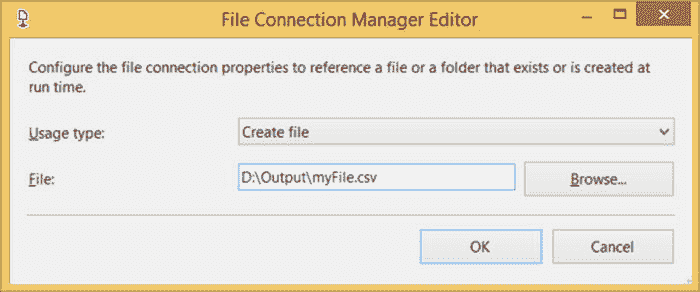
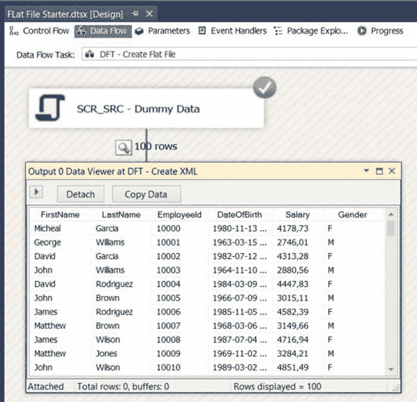
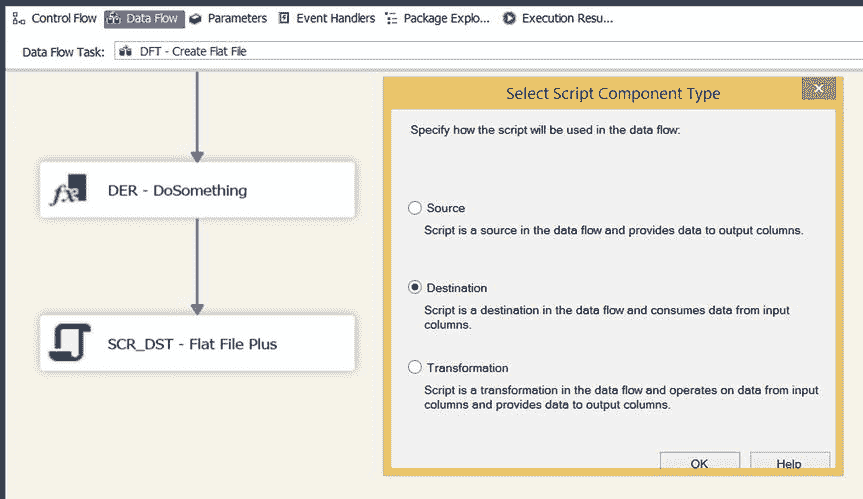
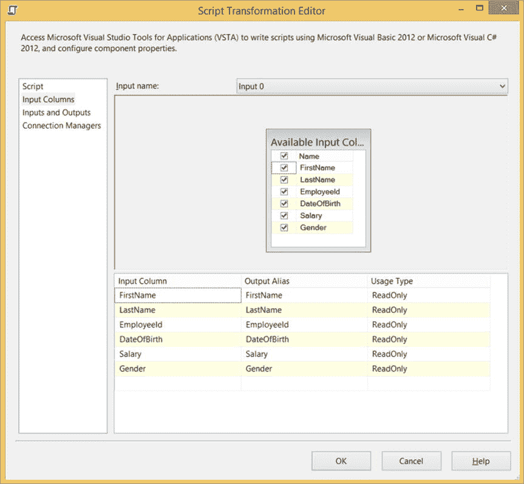
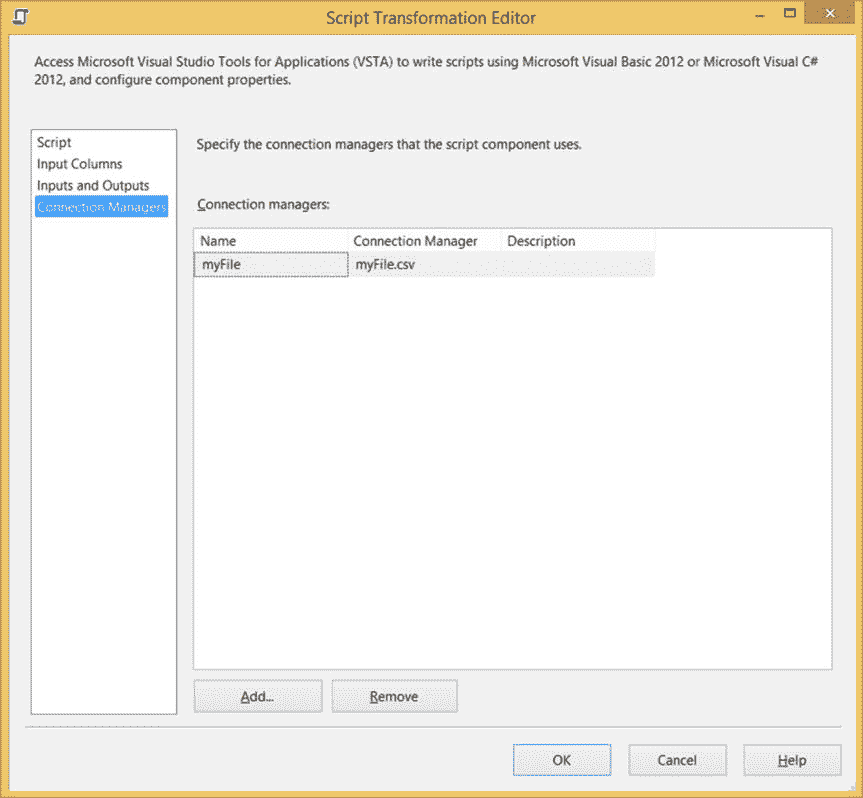
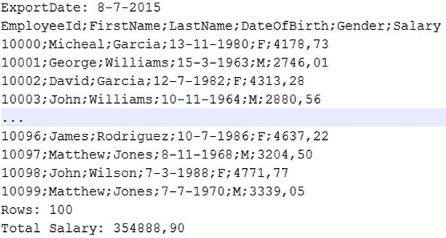
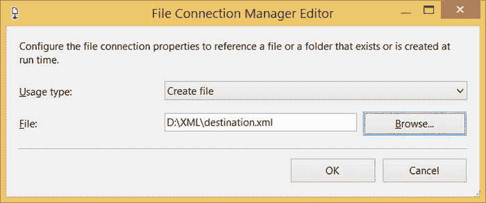
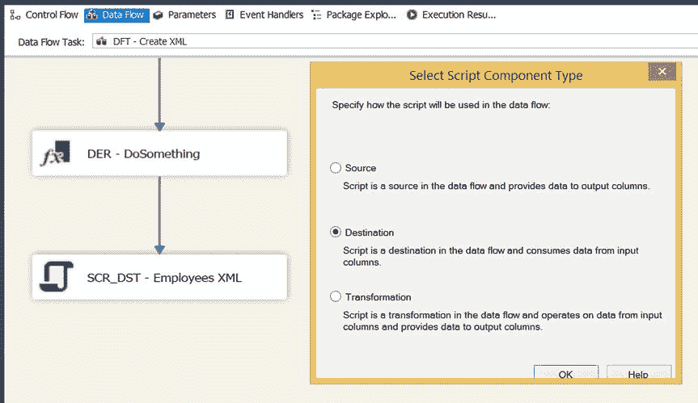
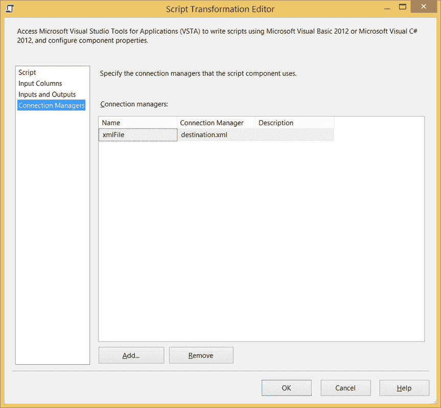
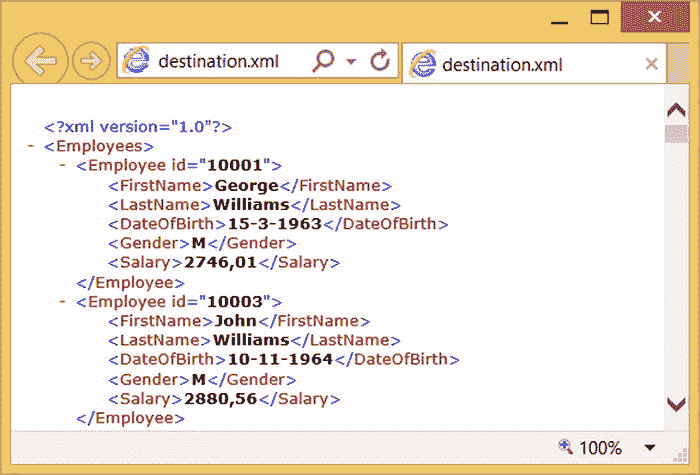

# 脚本组件作为目标

电子补充材料 本章的在线版本 (doi:[10.1007/978-1-4842-0638-6_12](http://dx.doi.org/10.1007/978-1-4842-0638-6_12)) 包含补充材料，仅供授权用户使用。

本章重点介绍脚本组件作为目标。虽然有很多现成的目标可用，但有时你需要一些特殊的目标——例如包含额外页眉和页脚的自定义平面文件、跨多行的记录，以及 XML 目标。
但在将脚本组件用作目标时请务必小心。由于记录是逐行处理的，因此，通过存储过程调用或大量单条查询命令将大量数据插入数据库可能不是个好主意。启用快速加载的 OLE DB 目标可能快得多；如果你确实需要存储过程调用，那么 `OLE DB` 命令更易于理解和维护。但对于自定义文本文件，脚本组件作为目标非常有用。Web 服务对于脚本组件目标也有实际用途。第 15 章中提供了一些 Web 服务示例。

## 带页眉和页脚的基本平面文件目标

第一个示例是一个基本的平面文件目标。它与常规平面文件目标非常相似，但增加了额外的页眉和页脚。你可以轻松地根据自身需求扩展此示例。

### 创建文件连接管理器

由于你不想在脚本中对平面文件的路径进行硬编码，因此将使用文件连接管理器。创建一个指向现有或不存在的文件的文件连接管理器。示例请参见图 12-1。



图 12-1. 指向 CSV 文件的文件连接管理器

### 数据源

在本示例中，你将使用第 10 章的随机测试数据作为数据源。你可以使用入门包，也可以使用自己的数据作为数据源。以下是输出的列：

-   `FirstName`（`DT_STR`，1252，50）
-   `LastName`（`DT_STR`，1252，50）
-   `EmployeeId`（`DT_I4`）
-   `DateOfBirth`（`DT_DATE`）
-   `Salary`（`DT_NUMERIC`，6，2）
-   `Gender`（`DT_STR`，1252，1）

图 12-2 展示了本章示例的随机数据源入门包。



图 12-2. 随机数据源入门包

### 脚本组件

将一个脚本组件拖到数据流的设计界面上，然后选择 `Destination`（目标）类型，如图 12-3 所示。为其指定一个合适的名称，并将其连接到数据流中的最后一个转换。



图 12-3. 脚本组件类型：目标

### 添加入站列

编辑脚本组件，转到 `Input Columns`（入站列）页面。选择 `.csv` 文件中需要的所有列，如图 12-4 所示。以数字或标点符号开头的列应在 `Output Alias`（输出别名）列中进行重命名，因为这些列会在脚本代码中被移除。



图 12-4. 选择所需的入站列

以下是入站列：

-   `FirstName`
-   `LastName`
-   `EmployeeId`
-   `DateOfBirth`
-   `Salary`
-   `Gender`

### 选择连接管理器

转到 `Connection Manager`（连接管理器）页面，选择新创建的文件连接管理器。如图 12-5 所示添加后，将其命名为 `myFile`。你也可以通过下拉列表添加一个新的连接管理器。



图 12-5. 添加连接管理器

### 代码

现在，你可以回到 `Script`（脚本）页面，点击 `Edit Script...`（编辑脚本...）按钮打开 `VSTA` 环境。首先，你需要添加一个额外的命名空间来简化代码。

```csharp
#region CustomNamespace
using System.IO;
#endregion
```

这是 VB.NET 代码：

```vbnet
#Region "CustomNamespace"
Imports System.IO
#End Region
```

接下来，你需要几个类变量来存储 CSV 数据和页脚信息。

```csharp
// 指向 CSV 文件的流
private StreamWriter textWriter;

// 用于定义列分隔符的字符串变量
private string ColumnDelimiter = ";";

// 用于跟踪行数的计数器
private int TotalRows = 0;

// 用于统计总薪水的十进制变量
private decimal TotalSalary = 0;
```

以下是 VB.NET 代码：

```vbnet
' 指向 CSV 文件的流
Private textWriter As StreamWriter

' 用于定义列分隔符的字符串变量
Private ColumnDelimiter As String = ";"

' 用于跟踪行数的计数器
Private TotalRows As Integer = 0

' 用于统计总薪水的十进制变量
Private TotalSalary As Decimal = 0
```

在 `PreExecute` 方法中，你要打开流并开始写入标头。但此时还不能写入总计、计数或求和信息，因为还没有得到相关数据。

```csharp
public override void PreExecute()
{
    // 创建一个新的 CSV 文件，并使用
    // 连接管理器中的文件路径
    textWriter = new StreamWriter(
        this.Connections.myFile.AcquireConnection(null).ToString());

    // 写入包含当前日期的标头
    textWriter.WriteLine("ExportDate: " + DateTime.Now.ToShortDateString());

    // 写入包含列名的标头
    textWriter.Write("EmployeeId" + ColumnDelimiter);
    textWriter.Write("FirstName" + ColumnDelimiter);
    textWriter.Write("LastName" + ColumnDelimiter);
    textWriter.Write("DateOfBirth" + ColumnDelimiter);
    textWriter.Write("Gender" + ColumnDelimiter);
    textWriter.WriteLine("Salary");
}
```

这是 VB.NET 代码：

```vbnet
Public Overrides Sub PreExecute()

    ' 创建一个新的 CSV 文件，并使用
    ' 连接管理器中的文件路径
    textWriter = New StreamWriter( _
        Me.Connections.myFile.AcquireConnection(Nothing).ToString())

    ' 写入包含当前日期的标头
    textWriter.WriteLine("ExportDate: " + DateTime.Now.ToShortDateString())

    ' 写入包含列名的标头
    textWriter.Write(Convert.ToString("EmployeeId") & ColumnDelimiter)
    textWriter.Write(Convert.ToString("FirstName") & ColumnDelimiter)
    textWriter.Write(Convert.ToString("LastName") & ColumnDelimiter)
    textWriter.Write(Convert.ToString("DateOfBirth") & ColumnDelimiter)
    textWriter.Write(Convert.ToString("Gender") & ColumnDelimiter)
    textWriter.WriteLine("Salary")

End Sub
```

在`PostExecute`方法中，你需要添加页脚并关闭`.csv`文件。在脚本的这个阶段，你可以使用总计和求和值，因为`Input0_ProcessInputRow`方法已经计算出了这些值。

```csharp
public override void PostExecute()
{
    // 添加页脚
    textWriter.WriteLine("Rows: " + TotalRows.ToString());
    textWriter.WriteLine("Total Salary: " + TotalSalary.ToString());

    // 关闭文件
    textWriter.Close();
}
```

以下是 VB.NET 代码：

```vbnet
Public Overrides Sub PostExecute()

    ' 添加页脚
    textWriter.WriteLine("Rows: " + TotalRows.ToString())
    textWriter.WriteLine("Total Salary: " + TotalSalary.ToString())

    ' 关闭文件
    textWriter.Close()

End Sub
```

在`Input0_ProcessInputRow`方法中，你需要处理所有记录。每个列值与列分隔符组合，被写入到`.csv`文件中。最后一列使用`WriteLine`而非`Write`来添加行分隔符。在这里，你也可以计算可在页脚中使用的项目。

```csharp
public override void Input0_ProcessInputRow(Input0Buffer Row)
{
    // 使用列分隔符写入列值
    textWriter.Write(Row.EmployeeId.ToString() + ColumnDelimiter);
    textWriter.Write(Row.FirstName.ToString() + ColumnDelimiter);
    textWriter.Write(Row.LastName.ToString() + ColumnDelimiter);
    textWriter.Write(Row.DateOfBirth.ToShortDateString() + ColumnDelimiter);
    textWriter.Write(Row.Gender.ToString() + ColumnDelimiter);

    // 对最后一列使用 WriteLine 作为行分隔符
    textWriter.WriteLine(Row.Salary.ToString());

    // 用于页脚的计算
    TotalRows++;
    TotalSalary = TotalSalary + Row.Salary;
}
```

这是 VB.NET 代码：

```vbnet
Public Overrides Sub Input0_ProcessInputRow(ByVal Row As Input0Buffer)

    ' 使用列分隔符写入列值
    textWriter.Write(Row.EmployeeId.ToString() & ColumnDelimiter)
    textWriter.Write(Row.FirstName.ToString() & ColumnDelimiter)
    textWriter.Write(Row.LastName.ToString() & ColumnDelimiter)
    textWriter.Write(Row.DateOfBirth.ToShortDateString() & ColumnDelimiter)
    textWriter.Write(Row.Gender.ToString() & ColumnDelimiter)

    ' 对最后一列使用 WriteLine 作为行分隔符
    textWriter.WriteLine(Row.Salary.ToString())

    ' 用于页脚的计算
    TotalRows += 1
    TotalSalary = TotalSalary + Row.Salary

End Sub
```

### 结果

现在运行包并检查平面文件的结果。请注意，这是一个非常基础的示例，但非常容易根据你的需求进行扩展。图 12-6 展示了本章示例的结果。



图 12-6. 文本文件的一部分

## 基本 XML 目标

遗憾的是，目前仍没有现成的 XML 文件目标可用。如果你的源是 SQL Server 表，则可以在 OLE DB 源组件中使用 `FOR XML` 查询，然后将结果写入无标题的平面文件目标。如果你使用不同的源或进行了大量转换，则 `FOR XML` 查询不再适用。此时，脚本组件可以帮你解决问题。

### 创建文件连接管理器

由于你不希望在脚本中对 XML 文件的路径进行硬编码，因此将使用文件连接管理器。创建一个指向现有或非现有文件的文件连接管理器。图 12-7 显示了一个示例。



图 12-7. 指向 XML 文件的文件连接管理器

### 源

在此示例中，你使用的是之前平面文件目标示例中的随机测试数据，这些数据来自第 10 章。以下是输出列：

- `FirstName` (`DT_STR`, 1252, 50)
- `LastName` (`DT_STR`, 1252, 50)
- `EmployeeId` (`DT_I4`)
- `DateOfBirth` (`DT_DATE`)
- `Salary` (`DT_NUMERIC`, 6, 2)
- `Gender` (`DT_STR`, 1252, 1)

### 脚本组件

将一个“脚本组件”拖到数据流的设计图面上，然后选择“目标”作为类型，如图 12-8 所示。为其指定一个合适的名称，并将其连接到数据流中的最后一个转换。



图 12-8. 脚本组件类型：目标

### 输入列

编辑脚本组件并转到“输入列”页面。选择 XML 中需要的所有列，如图 12-9 所示。以数字或标点符号开头的列应在“输出别名”列中重命名，因为这些列会在脚本代码中被移除。


图 12-9. 选择所需的输入列

以下是输入列：

- `FirstName`
- `LastName`
- `EmployeeId`
- `DateOfBirth`
- `Salary`
- `Gender`

### 选择连接管理器

转到“连接管理器”页面并选择新创建的文件连接管理器。添加后（如图 12-10 所示），将其命名为 `xmlFile`。你也可以通过下拉列表添加新的连接管理器。



图 12-10. 添加连接管理器

### 代码

现在，你可以回到“脚本”页面，单击“编辑脚本...”按钮打开 VSTA 环境。首先，你需要添加一个额外的命名空间以简化代码。

```csharp
#region CustomNamespace

using System.Xml;

#endregion
```

以下是 VB.NET 代码：

```vbnet
#Region "CustomNamespace"

Imports System.Xml

#End Region
```

接下来，你需要一个用于存储 XML 数据的类变量。在此示例中，你使用 `XmlTextWriter` 命名空间。

```csharp
// XmlTextWriter (stream) object to write the XML
XmlTextWriter textWriter;
```

这是 VB.NET 代码：

```vbnet
' File stream object to write the XML
Private xmlFile As StreamWriter
```

在 `PreExecute` 方法中，你打开流并开始写入 XML 结构的开始标签。

## 结果

现在运行包并检查 XML 文件的结果。（图 12-11 显示了我们的结果）。这是一个非常基础的示例，没有错误处理，也没有转义像 `<` 和 `>` 这样的受限字符。并且，如果列很多，可能会非常耗时。第 14 章 展示了一个更灵活的示例，它会遍历列集合。



图 12-11. 在 Internet Explorer 中查看的 XML 文件

以下是 `PreExecute` 方法的 C# 代码：

```csharp
public override void PreExecute()
{
    // Create a new XML document and use the
    // filepath in the connection as XML-file
    textWriter = new XmlTextWriter(this.Connections.
    xmlFile.AcquireConnection(null).ToString(), null);
    // Start writing the XML document:
    textWriter.WriteStartDocument();
    // Create root element <Employees>
    textWriter.WriteStartElement("Employees");
}
```

以下是 `PreExecute` 方法的 VB.NET 代码：

```vbnet
Public Overrides Sub PreExecute()
    ' Create a new XML document and use the
    ' filepath in the connection as XML-file
    textWriter = New XmlTextWriter(Me.Connections. _
    xmlFile.AcquireConnection(Nothing).ToString(), _
    System.Text.Encoding.Default)
    ' Start writing the XML document:
    textWriter.WriteStartDocument()
    ' Create root element <Employees>
    textWriter.WriteStartElement("Employees")
End Sub
```

在 `PostExecute` 方法中，你关闭 XML 标签并清理资源。

`PostExecute` 方法的 C# 代码如下：

```csharp
public override void PostExecute()
{
    // Close root element: </Employees>
    textWriter.WriteEndElement();
    // Stop writing the XML document
    textWriter.WriteEndDocument();
    // Close document and clean up resources
    textWriter.Close();
}
```

`PostExecute` 方法的 VB.NET 代码：

```vbnet
Public Overrides Sub PostExecute()
    'Close root element: </Employees>
    textWriter.WriteEndElement()
    'Stop writing the XML document
    textWriter.WriteEndDocument()
    'Close document and clean up resources
    textWriter.Close()
End Sub
```

在 `Input0_ProcessInputRow` 方法中，你处理所有记录。每个列都作为 `Employee` 的一个元素提及，但 `ID` 列作为 `Employee` 的一个属性使用。

`Input0_ProcessInputRow` 方法的 C# 代码：

```csharp
public override void Input0_ProcessInputRow(Input0Buffer Row)
{
    // Opening tag employee with ID as attribute
    textWriter.WriteStartElement("Employee");
    textWriter.WriteStartAttribute("id");
    textWriter.WriteString(Row.EmployeeId.ToString());
    textWriter.WriteEndAttribute();
    // Writing elements within the Employee tag
    textWriter.WriteStartElement("FirstName");
    textWriter.WriteString(Row.FirstName.ToString());
    textWriter.WriteEndElement();
    textWriter.WriteStartElement("LastName");
    textWriter.WriteString(Row.LastName.ToString());
    textWriter.WriteEndElement();
    textWriter.WriteStartElement("DateOfBirth");
    textWriter.WriteString(Row.DateOfBirth.ToShortDateString());
    textWriter.WriteEndElement();
    textWriter.WriteStartElement("Gender");
    textWriter.WriteString(Row.Gender.ToString());
    textWriter.WriteEndElement();
    textWriter.WriteStartElement("Salary");
    textWriter.WriteString(Row.Salary.ToString());
    textWriter.WriteEndElement();
    // Closing tag employee
    textWriter.WriteEndElement();
}
```

`Input0_ProcessInputRow` 方法的 VB.NET 代码：

```vbnet
Public Overrides Sub Input0_ProcessInputRow(ByVal Row As Input0Buffer)
    ' Write opening tag for row with id property
    xmlFile.WriteLine("<Employee id=""" & Row.EmployeeId.ToString() & """>")
    ' Extra columns
    xmlFile.WriteLine("<FirstName>" & Row.FirstName.ToString() _
    & "</FirstName>")
    xmlFile.WriteLine("<LastName>" & Row.LastName.ToString() & "</LastName>")
    xmlFile.WriteLine("<DateOfBirth>" & Row.DateOfBirth.ToShortDateString() _
    & "</DateOfBirth>")
    xmlFile.WriteLine("<Gender>" & Row.Gender.ToString() & "</Gender>")
    xmlFile.WriteLine("<Salary>" & Row.Salary.ToString() & "</Salary>")
    ' Closing tag for row
    xmlFile.WriteLine("</Employee>")
End Sub
```

## 总结

在本章中，你学习了如何使用脚本组件创建自己的文本文件（`.csv` 和 `.xml`）。虽然非常基础，但易于扩展。如果列很多，这两种方法可能都比较耗时，但在第 14 章中，你将学习如何使用反射来遍历所有列。