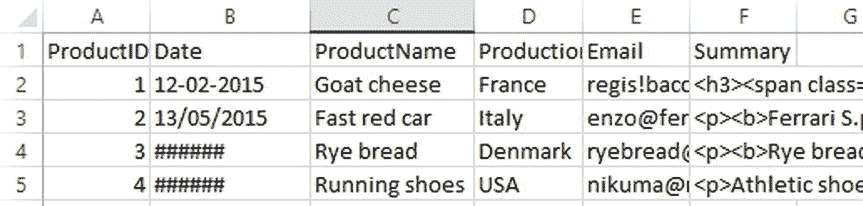
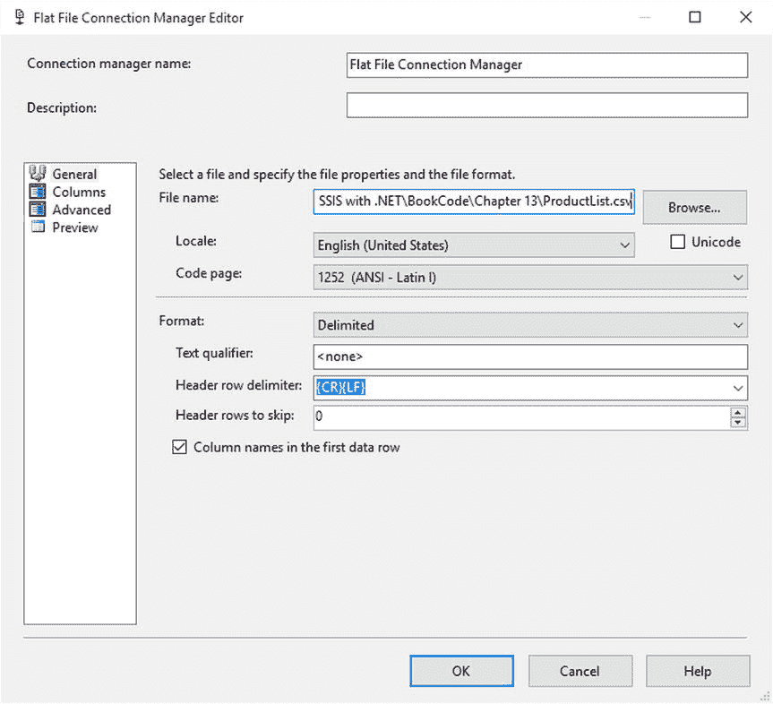
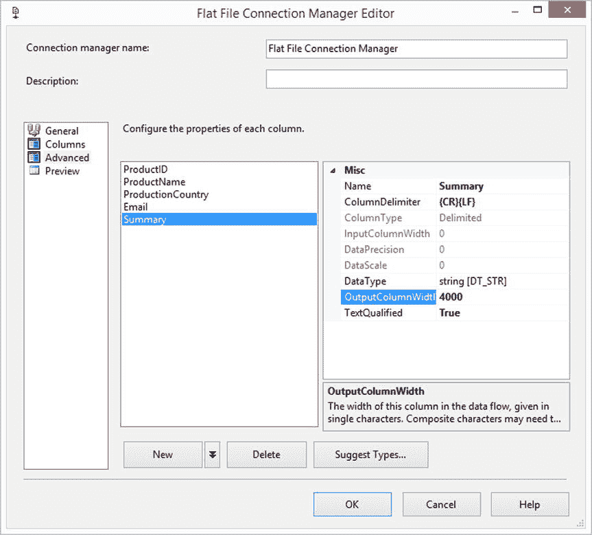
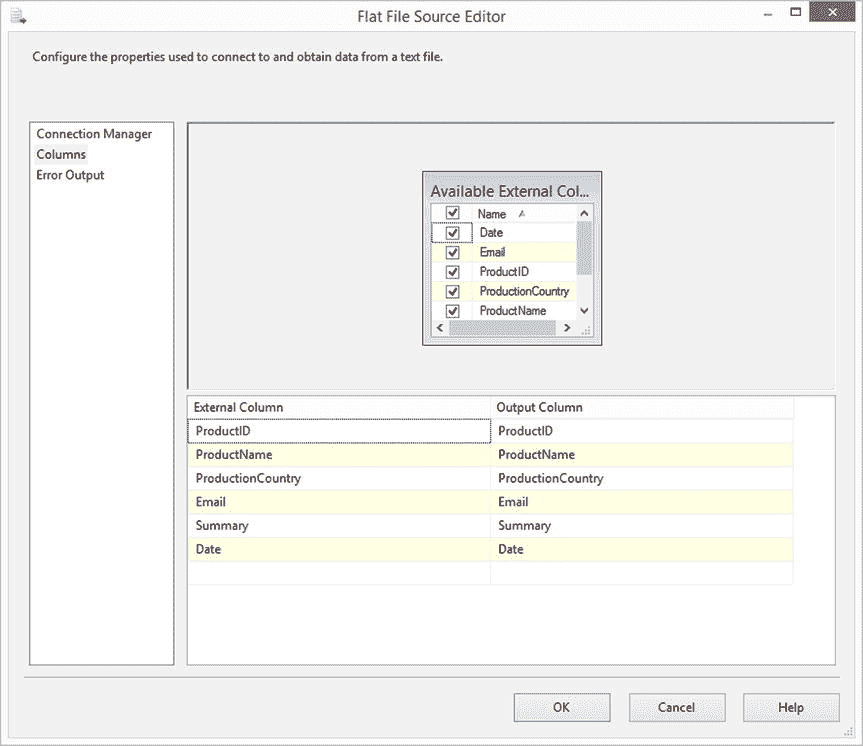
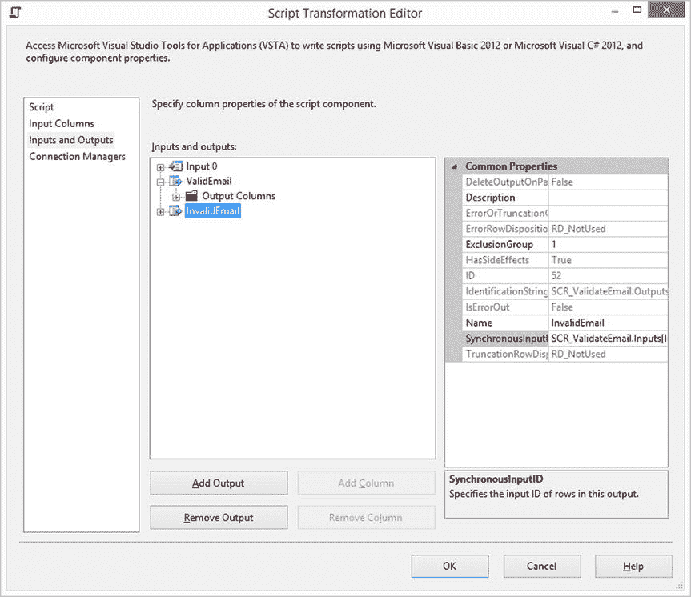
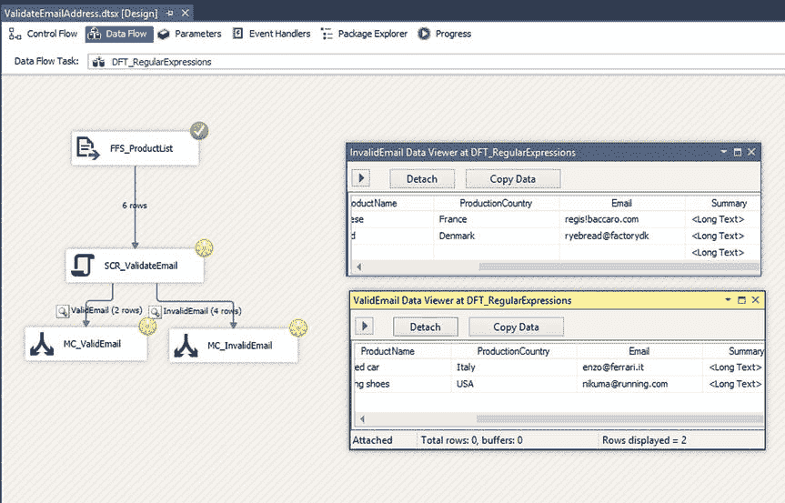
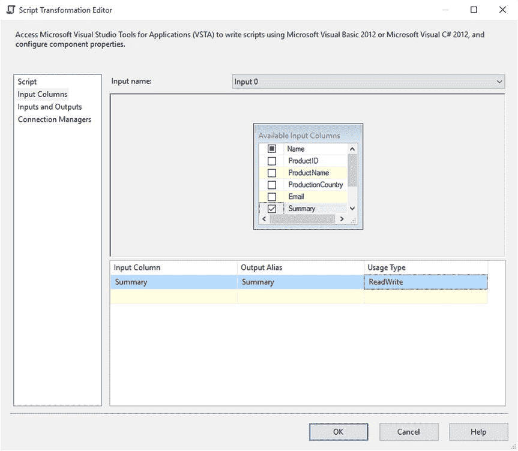
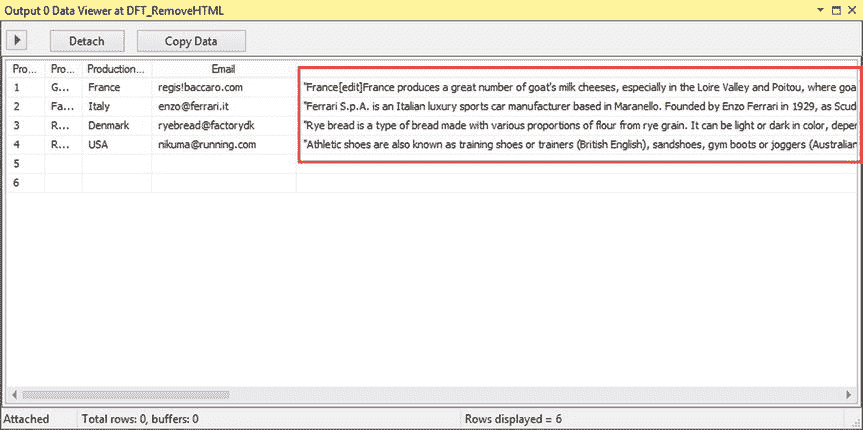
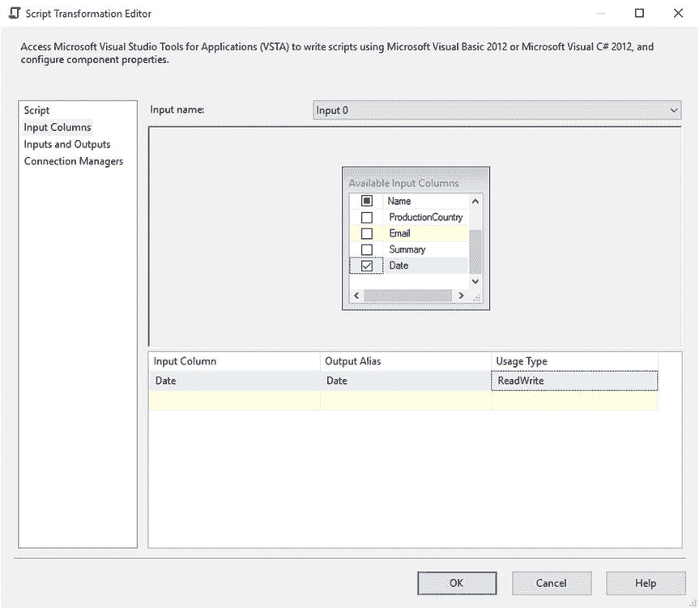
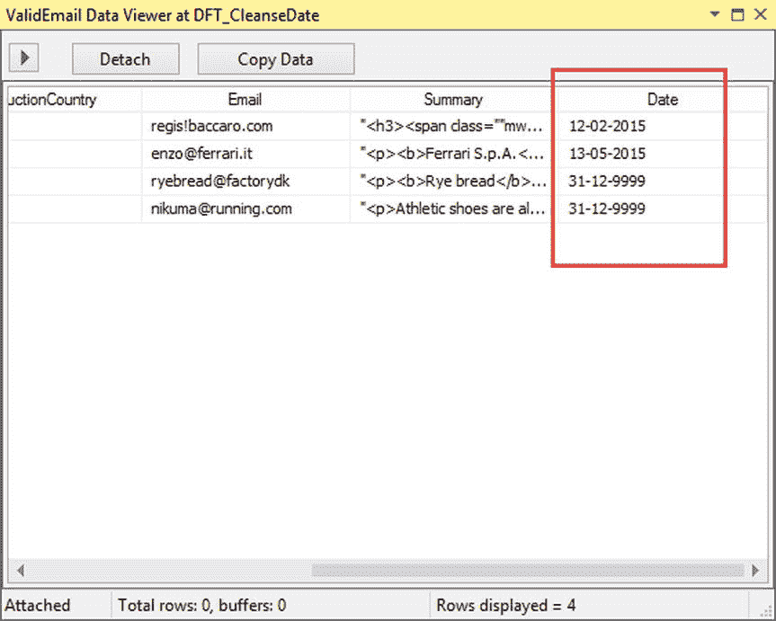

## 13. 正则表达式

电子补充材料 本章的在线版本（doi:[10.​1007/​978-1-4842-0638-6_​13](http://dx.doi.org/10.1007/978-1-4842-0638-6_13)）包含补充材料，供授权用户使用。

许多 ETL 应用程序和流程通常处理字符串或需要解析大量文本；你常会遇到需要从文本块中剥离某些元素，或验证电子邮件地址格式是否有效的情况。

正则表达式提供了一种灵活、强大且高效的处理文本的方法。正则表达式模式匹配引擎使你能够：

- 解析大量文本以查找特定的字符模式

- 验证文本以确保其符合预定义模式

- 提取、编辑或删除文本子串，并将这些子串添加到集合中以生成报告

正则表达式的核心是其引擎，在.NET Framework 中由`System.Text.RegularExpression.Regex`对象表示。

使用正则表达式处理文本要求正则表达式引擎至少有两个参数：

- 要在文本中查找的正则表达式模式

- 用于解析正则表达式模式的文本

关于正则表达式对象模型的更多信息，请参阅 MSDN 上的[`https://msdn.microsoft.com/en-us/library/30wbz966(v=vs.110).aspx`](https://msdn.microsoft.com/en-us/library/30wbz966(v=vs.110).aspx)。

如前所述，正则表达式是引擎尝试匹配的模式。一个模式由以下三个部分中的一个或多个组成：

- 字符文本

- 运算符

- 构造

正则表达式语法的完整列表，包括字符转义、字符类、定位点、分组构造、限定符、反向引用构造、替换构造、替换、正则表达式选项和其他构造，可在 MSDN 上参考：[`https://msdn.microsoft.com/en-us/library/az24scfc(v=vs.110).aspx`](https://msdn.microsoft.com/en-us/library/az24scfc(v=vs.110).aspx)。

以下是一些寻找正则表达式示例和资源的优秀网站列表：

- [`http://www.regexr.com`](http://www.regexr.com/)

- [`http://www.regular-expressions.info/`](http://www.regular-expressions.info/)

- [`http://rubular.com`](http://rubular.com)

- [`http://regexone.com`](http://regexone.com)

`Regex`类提供了执行前面所述操作的方法。

- `IsMatch`方法用于确定正则表达式是否出现在输入文本中；例如，验证电子邮件地址格式是否正确时使用。

- `Match`或`Matches`方法用于检索一个对象或对象集合，其中包含所有匹配正则表达式模式的文本出现。

- `Replace`方法用于替换匹配正则表达式模式的文本。

本章将通过三个示例，演示如何解析、验证以及提取子串。

### 先决条件

本章所有示例均基于示例文件`ProductList.csv`，该文件可在本章的源代码中找到。

以下是用于存储信息的六列：

- 产品 ID

- 产品名称，即产品的名称

- 创建日期

- 产品生产国家

- 产品负责人的电子邮件地址（包含一些格式错误）

- 产品的 HTML 描述（HTML 描述取自维基百科）

图 13-1 是在 Excel 中打开的`.csv`文件的部分截图。



图 13-1. 产品列表.csv 文档

### 验证电子邮件地址

正则表达式在处理数据时的一个重要应用是确保更高的数据质量。根据国际数据公司（IDC）的估计，数据质量差每年给企业造成 65 亿美元的损失。无效的电子邮件地址是一种可以通过正则表达式捕捉到的错误类型。

首先创建一个新的包，并在设计界面上添加一个数据流任务。在数据流任务内部，添加一个平面文件源和一个指向之前提到的`.csv`文档（`ProductList.csv`，位于本章源代码中）的新平面文件连接管理器。将“常规”页面的所有设置保留为默认值，如图 13-2 所示。



图 13-2. 平面文件连接管理器编辑器

访问“列”页面，确保已获取元数据并且列被正确解析。

在平面文件连接管理器的“高级”页面中，更改“摘要”列的长度，因为如果数据长度超过 50 个字符，将会发生截断，从而在运行包时触发错误。将数据类型更改为宽度为 4000 的字符串`DT_STR`，如图 13-3 所示。该宽度应足够大，以防止截断发生。



图 13-3. 更改数据类型

在数据流设计界面上添加一个用于转换的脚本组件，名为`SCR_ValidateEmail`，并在其与之前创建的平面文件源之间添加一条数据流路径。配置“输入列”页面，以只读模式接受来自平面文件源的所有可用列，如图 13-4 所示。在此示例中，你仅使用电子邮件列，因此最佳实践是只获取所需的列，但由于你将在其他示例中使用其他一些列，这里将获取所有可用列。



图 13-4. 脚本任务转换编辑器的输入页面

在编辑器的“输入和输出”页面上，你基本上需要两个输出：`ValidEmail`和`InvalidEmail`。第一个用于有效的电子邮件地址，第二个用于无效的电子邮件地址。首先将输出 0 重命名为`ValidEmail`。对于这两个输出，你需要将`ExclusionGroup`设置为 1，将`SynchronousInputID`设置为输入 0（因为每个输入对应一个输出）。输出 1 重命名为`InvalidEmail`。这两个输出如图 13-5 所示。



图 13-5. 输出列

#### 脚本

在脚本页面上点击“编辑脚本...”按钮，即可打开 VSTA 编辑器；你可以开始添加代码来执行验证，以保留行数据。首先，你可以安全地删除 `PreExecute` 和 `PostExecute` 方法，因为你不需要它们。然后，你需要添加对正则表达式命名空间的引用。

```
#region CustomNamespace
using System.Text.RegularExpressions;
#endregion
```

通过将所有验证步骤封装在函数中，可以保持接口的简洁。你实现的第一个函数用于验证给定的电子邮件地址。

以下是 C# 实现：

```
// 一个布尔方法，用于根据正则表达式模式验证电子邮件地址
public bool IsCorrectEmail(String emailAddress)
{
     // 电子邮件模式
     string emailAddressPattern = @"^(([^<>()[\]\\.,;:\s@\""]+"
                             + @"(\.[^<>()[\]\\.,;:\s@\""]+)*)|(\"".+\""))@"
                             + @"((\[[0-9]{1,3}\.[0-9]{1,3}\.[0-9]{1,3}"
                             + @"\.[0-9]{1,3}\])|(([a-zA-Z\-0-9]+\.)+"
                             + @"[a-zA-Z]{2,}))$";
     // 检查是否匹配并返回该值（布尔值）
     return Regex.IsMatch(emailAddress,emailAddressPattern,RegexOptions.IgnoreCase);
}
```

以下是 VB.NET 实现：

# 在 SSIS 中使用正则表达式

```vb
' 一个布尔方法，用于根据正则表达式模式验证电子邮件地址
Public Function IsCorrectEmail(emailAddress As [String]) As Boolean
' 电子邮件模式
Dim emailAddressPattern As String = "^(([^<>()[\]\\.,;:\s@\""]+" + _
        "(\.[^<>()[\]\\.,;:\s@\""]+)*)|(\"".+\""))@" + _
        "((\[[0-9]{1,3}\.[0-9]{1,3}\.[0-9]{1,3}" + _
        "\.[0-9]{1,3}\])|(([a-zA-Z\-0-9]+\.)+" + _
        "[a-zA-Z]{2,}))$"
' 检查是否匹配并返回该值（布尔值）
Return Regex.IsMatch(emailAddress, emailAddressPattern, RegexOptions.IgnoreCase)
End Function
```

这个模式并非十分复杂，但它能够根据电子邮件地址的标准定义，匹配大多数有效的电子邮件地址。请注意，该模式不能判断电子邮件地址是否存在，只能判断其格式是否有效。此外，该模式也不会检查顶级域名是否是一个已存在的域名。

> **注意：** 模式可能会变得非常复杂，特别是如果你之前从未接触过正则表达式。对于验证电子邮件地址，有一种更简单的方法——使用`System.Net.Mail.MailAddress`类。要判断电子邮件地址是否有效，可以将该地址传递给`MailAddress(String)`类构造方法。我们强烈建议你查阅互联网上可用的正则表达式资源和示例。

## 调用方法

添加方法后，你需要对脚本中处理的每一行包含电子邮件地址的数据调用该方法。如果方法返回`true`，则电子邮件有效，并将其定向到`ValidEmail`输出；否则，电子邮件无效，需要将其定向到`InvalidEmail`输出。

以下是在 C# 中调用该方法的方式：

```csharp
public override void Input0_ProcessInputRow(Input0Buffer Row)
{
    bool isEmailValid = false;
    //如果没有提供电子邮件，则视为无效
    if (!Row.Email_IsNull)
    {
        isEmailValid = IsCorrectEmail(Row.Email);
    }
    if (isEmailValid)
    {
        Row.DirectRowToValidEmail();
    }
    else
    {
        Row.DirectRowToInvalidEmail();
    }
}
```

在 VB.NET 中，你可以按如下方式调用该方法：

```vb
Public Overrides Sub Input0_ProcessInputRow(Row As Input0Buffer)
        Dim isEmailValid As Boolean = False
        '如果没有提供电子邮件，则视为无效
        If Not Row.Email_IsNull Then
                isEmailValid = IsCorrectEmail(Row.Email)
        End If
        If isEmailValid Then
                Row.DirectRowToValidEmail()
        Else
                Row.DirectRowToInvalidEmail()
        End If
End Sub
```

关闭脚本编辑器，并向包中添加两个多播组件：一个连接到`ValidEmail`输出，另一个连接到`InvalidEmail`输出。在实际场景中，你可能希望记录无效电子邮件的行并停止处理该行。

如果你为两个优先约束添加数据查看器，并使用本章代码示例中提供的输入文件运行包，你可以看到无效电子邮件被验证方法捕获，如图 13-6 所示。



**图 13-6.** 成功运行包并显示数据查看器

## 移除 HTML 标签

在 SSIS 中处理文本时，有时会遇到包含大量标记的 HTML 格式文本，而你并不希望保留这些标记。从文本中去除标记是一个常见问题，使用正则表达式可以轻松实现。你需要做的就是指定 HTML 标签的模式，这非常简单：

它从`<`开始，并且必须匹配任意单个字符，甚至换行符，一次或多次。这种包含一个或多个字符的模式可以重复一次或完全不重复，从而产生如下的表达式：

```
<(.|\n)+?>
```

## 包

从前一个示例（或第 13 章 的示例代码）开始，在包的设计界面上添加一个“数据流任务”，并将其命名为`DFT_RemoveHTML`。

在“数据流任务”内部，按照前一个示例（验证电子邮件地址）所述添加一个“平面文件源”，并将其配置为从源文件中获取所有列。

在界面上添加一个名为`Scr_RemoveHTML`的“脚本组件”，选择“转换”作为其类型，并将其输入连接到“平面文件源”的输出。双击“脚本组件”，仅将`Summary`列设为`ReadWrite`，如图 13-7 所示。



**图 13-7.** 配置输入列

在“脚本”页面上，点击“编辑脚本...”以打开 VSTA。从脚本中删除`PreExecute`和`PostExecute`方法。

### 脚本

在代码中使用正则表达式之前，需要先通过`Using`或`Imports`指令添加对命名空间的引用。如果使用 C#，请编写以下代码：

```csharp
#region CustomNamespace
using System.Text.RegularExpressions;
#endregion
```

你需要一个能使用前述模式来移除 HTML 代码的方法。

```csharp
// 在类级别创建以提升性能
// HTML 标签的模式
public static String htmlTagPattern = "<(.|\n)+?>";

// 使用该模式创建正则表达式对象
public Regex objRegExp = new Regex(htmlTagPattern);

// 一个使用正则表达式模式去除 HTML 的布尔方法
public String RemoveHtml(String message)
{
    // 将 HTML 标签替换为空字符串
    message = objRegExp.Replace(message, String.Empty);
    // 返回不含 HTML 标签的消息
    return message;
}
```

以下是在 VB.NET 中使用的代码：

```vb
' 在类级别创建以提升性能
' HTML 标签的模式
Public Shared htmlTagPattern As [String] = "<(.|" & vbLf & ")+?>"

' 使用该模式创建正则表达式对象
Public objRegExp As New Regex(htmlTagPattern)

' 一个使用正则表达式模式去除 HTML 的函数
Public Function RemoveHtml(message As [String]) As [String]
        ' 将 HTML 标签替换为空字符串
        message = objRegExp.Replace(message, [String].Empty)
        ' 返回不含 HTML 标签的消息
        Return message
End Function
```

在上述函数中，你使用正则表达式的`Replace`方法移除 HTML 标记并将其替换为空字符串，而在第一个示例中，你只关心匹配操作。

然后，你可以在`Input0_ProcessInputRow`方法中调用该方法，C# 的实现如下：

```csharp
public override void Input0_ProcessInputRow(Input0Buffer Row)
{
    Row.Summary = RemoveHtml(Row.Summary);
}
```

VB.NET 的调用方式如下：

```vb
Public Overrides Sub Input0_ProcessInputRow(Row As Input0Buffer)
        Row.Summary = RemoveHtml(Row.Summary)
End Sub
```

关闭 VSTA 编辑器，并向脚本组件的输出添加多播，同时启用优先级约束上的数据查看器。运行包时，你应该能够看到不含 HTML 标记的摘要，如图 13-8 所示。



图 13-8. 显示结果的数据查看器

在此示例中，你了解了如何使用正则表达式的 `Replace` 方法从文本中去除 HTML 代码。在下一个示例中，你将了解如何验证日期，并在日期不符合所需格式时将其替换为默认值。

### 清理/验证

正则表达式也是确保数据质量的绝佳工具。基于清理和验证规则实现模式非常直接。在前面的示例代码中，有一个日期列。该列的唯一问题是数据质量。有时日期的各部分用正斜杠（`/`）分隔，有时用短划线（`-`）分隔。在其他情况下，根本没有日期，只有一连串的 `#` 符号。让我们实现一个脚本，确保日期始终以正确的方式表示，以便最终可以转换为 datetime 格式。此外，约定将空或无效的日期字符串替换为 `9999-12-31`。

#### 包

从上一个示例（或第 13 章的示例代码）开始，在包的设计图面上添加一个数据流任务，并将其命名为 `DFT_CleanseDate`。

在数据流任务内部，按照上一个示例（验证电子邮件地址）的描述添加一个平面文件源，并将其配置为从源文件中获取所有列。

在设计图面上添加一个名为 `SCR_CleanseDate` 的脚本组件，选择转换类型，并将其输入连接到平面文件源的输出。双击脚本组件，仅选择所需的列以提升性能——在本例中是 `Date` 列，并将其标记为 `ReadWrite`，如图 13-9 所示。单击脚本页面上的 `Edit Script…` 按钮以打开 VSTA。



图 13-9. 日期列已更改为 ReadWrite

#### 脚本

首先，移除不必要的 `PreExecute` 和 `PostExecute` 方法。要在代码中使用正则表达式，需要先使用 `Using` 或 `Imports` 指令添加对命名空间的引用。以下是实现此功能的 C# 代码：

```
#region CustomNamespace
using System.Text.RegularExpressions;
#endregion
```

你需要一个方法来验证输入字符串的格式是否正确。`DateTime.TryParse` 方法正具备此功能。`TryParse` 会将指定的日期和时间字符串表示形式转换为其等效的 `DateTime` 对象，并返回一个指示转换是否成功的值，这比返回错误信息更容易处理。所使用的正则表达式十分简单；你需要查找所有出现的正斜杠、点、逗号和破折号，并将它们替换为破折号。再次给出 C# 中的实现：

```
//在类级别创建以提高性能
// 查找日期字符串中出现的 / , . - 字符
Regex rgx = new Regex("([-/,.])");

// 此方法使用 TryParse 检查日期是否有效，
// 如果无效则使用并返回一个通用值。
public string CheckDate(String date)
{
    string CleanedDate;
    // 将它们替换为 -
    CleanedDate = rgx.Replace(date, "-");
    DateTime parsedDate;
    if (DateTime.TryParse(CleanedDate, out parsedDate) == true)
    {
        //如果是日期，则以格式良好的方式返回
        // 日期格式化为 ISO 格式以避免混淆
        return parsedDate.ToString("yyyy-MM-dd");
    }
    else
    {
        //不是有效日期，则返回 ISO 格式的通用值
        return "9999-12-31";
    }
}
```

与往常一样，使用 VB.NET 可以轻松地表达该实现：

```
'在类级别创建以提高性能
' 查找日期字符串中出现的 / , . - 字符
Private rgx As New Regex("([-/,.])")

' 此方法使用 TryParse 检查日期是否有效，
' 如果无效则使用并返回一个通用值。
Public Function CheckDate([date] As [String]) As String
     Dim CleanedDate As String
     ' 将它们替换为 -
     CleanedDate = rgx.Replace([date], "-")
     Dim parsedDate As DateTime
     If DateTime.TryParse(CleanedDate, parsedDate) = True Then
         '如果是日期，则以格式良好的方式返回
         ' 日期格式化为 ISO 格式以避免混淆
         Return parsedDate.ToString("yyyy-MM-dd")
     Else
         '不是有效日期，则返回 ISO 格式的通用值
         Return "9999-12-31"
     End If
End Function
```

现在，从 `Main` 方法中，可以轻松地为每一行调用该帮助方法。在 C# 中，编写如下代码：

```
public override void Input0_ProcessInputRow(Input0Buffer Row)
{
            if (!Row.Date_IsNull)
       {
           Row.Date = CheckDate(Row.Date);
       }
       else
       {
           Row.Date = "9999-12-31";
       }
}
```

在 VB.NET 中，编写如下代码：

```
Public Overrides Sub Input0_ProcessInputRow(Row As Input0Buffer)
        If Not Row.Date_IsNull Then
        Row.Date = CheckDate(Row.Date)
        Else
        Row.Date = "9999-12-31"
        End If
End Sub
```

关闭 VSTA 编辑器，并向脚本组件的输出添加一个多播，以便在优先约束上启用数据查看器。运行包时，您应该能够看到经过验证和清理的日期，如图 13-10 所示。



图 13-10. 展示清理后日期的数据查看器

### 总结

通过使用正则表达式，您可以以一种非常直接的方式对数据进行匹配、格式化、清洗和验证。这些示例演示了正则表达式的一些基本功能。通过组合更复杂的模式，您可以释放高性能正则表达式引擎的真正力量。

此外，还有一些工具可以帮助您构建表达式，这样您就不必自己费力解决了。其中最好用的工具之一是 RegExr，访问地址为 [`regexr.com`](http://regexr.com/)。

如果您更喜欢离线工具，RegexMagic 也是一个不错的选择；您可以在 [www.regular-expressions.info/regexmagic.html](http://www.regular-expressions.info/regexmagic.html) 找到它。