# 14. 脚本组件反射

电子补充材料 本章的在线版本 (doi:[10.1007/978-1-4842-0638-6_14](http://dx.doi.org/10.1007/978-1-4842-0638-6_14)) 包含补充材料，可供授权用户使用。

本章重点介绍脚本组件的灵活性，因为有时您需要对大量列执行相同的转换，这可能会有点繁琐。第 12 章 中带有大量列的 XML 目标呢？您肯定不想逐个编码几十个列名。通过反射，您可以在运行时遍历所有输入列。因此，您不必硬编码所有这些列。使用反射的另一个绝佳机会是计算所有列的哈希值。

然而，这种灵活性是有代价的，因为如果性能是您最关心的问题，那么反射并非最佳技术。在这种情况下，您需要多次枚举这些列，而这是基于 COM 的对象。在本章末尾，您将找到针对此问题的解决方案。

开始之前有两点需要注意。首先，脚本按照您在编辑器中选择的顺序遍历输入列的集合。其次，当您更改列名、数据类型甚至列的顺序时，您必须编辑脚本并让 SSIS 更改生成的脚本。

### 灵活的 XML 目标

第一个示例延续了第 12 章 中的基本 XML 目标示例（见图 14-1）。唯一的区别在于脚本本身。您可以继续使用该包，也可以使用示例项目中名为 `XML Starter.dtsx` 的起始包。确保已按照正确顺序选择了 XML 文件中所需的所有输入列，然后单击 `Edit Script...` 按钮。

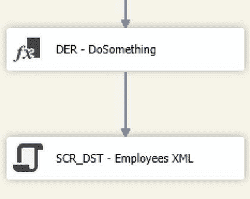

图 14-1. XML 目标


#### 脚本

在本示例中，你将使用所有默认方法，包括 `PreExecute` 和 `PostExecute`，但首先需要将 `System.XML` 添加到命名空间中以简化代码。

```
#region customNamespaces
using System.Xml;
#endregion
```

这是 VB.NET 代码：

```
#Region "customNamespaces"
Imports System.Xml
#End Region
```

你还需要一些类变量，以便在各个方法中使用。

```
// XmlTextWriter (stream) object to write the XML
XmlTextWriter textWriter;
// Boolean variable to do something only onces
Boolean FirstRow = true;
// Variable to store the row type
Type rowType;
// Variable to store the input columns
IDTSInputColumnCollection100 InputColumnCollection;
// Variable to store the value of the column
String columnValue = "";
```

这是对应的 VB.NET 代码：

```
' XmlTextWriter (stream) object to write the XML
Dim textWriter As XmlTextWriter
' Boolean variable to do something only onces
Dim FirstRow As Boolean = True
' Variable to store the row type
Dim rowType As Type
' Variable to store the input columns
Dim InputColumnCollection As IDTSInputColumnCollection100
' Variable to store the value of the column
Dim columnValue As String = ""
```

在 `PreExecute` 方法中，你将创建 XML 文件，同时还会获取输入列。稍后你需要用这些列来遍历所有列。出于性能考虑，你只在 `PreExecute` 中获取一次。

```
public override void PreExecute()
{
    // Get collection of input columns
    InputColumnCollection = this.ComponentMetaData
        .InputCollection[0].InputColumnCollection;
    // Create a new XML document and use the filepath
    //in the connection as XML-file
    textWriter = new XmlTextWriter(this.Connections.xmlFile
        .AcquireConnection(null).ToString(), null);
    // Start writing the XML document:
    textWriter.WriteStartDocument();
    // Create root element <Employees>
    textWriter.WriteStartElement("Employees");
}
```

这是对应的 VB.NET 代码：

```
Public Overrides Sub PreExecute()
    ' Get collection of input columns
    InputColumnCollection = Me.ComponentMetaData _
        .InputCollection(0).InputColumnCollection
    ' Create a new XML document and use the
    ' filepath in the connection as XML-file
    textWriter = New XmlTextWriter(Me.Connections.xmlFile _
        .AcquireConnection(Nothing).ToString(), _
        System.Text.Encoding.Default)
    ' Start writing the XML document:
    textWriter.WriteStartDocument()
    ' Create root element <Employees>
    textWriter.WriteStartElement("Employees")
End Sub
```

`PostExecute` 方法用于关闭 XML 文档。

```
public override void PostExecute()
{
    // Close root element: </Employees>
    textWriter.WriteEndElement();
    // Stop writing the XML document
    textWriter.WriteEndDocument();
    // Close document and clean up resources
    textWriter.Close();
}
```

这是对应的 VB.NET 代码：

```
Public Overrides Sub PostExecute()
    'Close root element: </Employees>
    textWriter.WriteEndElement()
    'Stop writing the XML document
    textWriter.WriteEndDocument()
    'Close document and clean up resources
    textWriter.Close()
End Sub
```

接下来是 `ProcessInputRow` 方法，它为每一行添加 XML 标签。该方法包含一个 `foreach` 循环，用于遍历输入列集合中的所有列。然后，它尝试从每个列获取值，并为 XML 文档添加一个 XML 标签。在 `try-catch` 中，你会看到“反射”代码：`.GetProperty(_____)`。另请注意额外的辅助方法，用于从 XML 文档中移除“非法”字符。这些字符会破坏 XML 标签，导致文档无法读取。

```
public override void Input0_ProcessInputRow(Input0Buffer Row)
{
    // Do only onces
    if (FirstRow)
    {
        // Row type to get the value of a column
        rowType = Row.GetType();
    }
    FirstRow = false;
    // Create row element: <Employee>
    textWriter.WriteStartElement("Employee");
    // Loop through all columns and create a column element:
    // <col1>value</col1><col2>value</col2>
    foreach (IDTSInputColumn100 column in InputColumnCollection)
    {
        // Use the SSIS column name as element name: <col1>
        textWriter.WriteStartElement(column.Name);
        // Get column value, will fail if null
        try
        {
            columnValue = rowType.GetProperty(column.Name)
                .GetValue(Row, null).ToString();
        }
        catch
        {
            // Default value for null values: "null", "" or string.Empty
            columnValue = string.Empty;
        }
        finally
        {
            textWriter.WriteString(removeForbiddenXmlChars(columnValue));
        }
        // Close column element: </col1>
        textWriter.WriteEndElement();
    }
    // Close row element: </Employee>
    textWriter.WriteEndElement();
    // Extra: output the number of processed rows. 103 = RowsWritten
    this.ComponentMetaData.IncrementPipelinePerfCounter(103, 1);
}

private string removeForbiddenXmlChars(string columnValue)
{
    // Remove forbidden chars that could damage your XML document
    return columnValue.Replace("&", "&amp;")
        .Replace("<", "&lt;")
        .Replace(">", "&gt;");
}
```

这是对应的 VB.NET 代码：

```
Public Overrides Sub Input0_ProcessInputRow(Row As Input0Buffer)
    ' Do only onces
    If FirstRow Then
        ' Row type to get the value of a column
        rowType = Row.GetType()
    End If
    FirstRow = False
    ' Create row element: <Employee>
    textWriter.WriteStartElement("Employee")
    ' Loop through all columns and create a column element:
    ' <col1>value</col1><col2>value</col2>
    For Each column As IDTSInputColumn100 In InputColumnCollection
        ' Use the SSIS column name as element name: <col1>
        textWriter.WriteStartElement(column.Name)
        ' Get column value, will fail if null
        Try
            columnValue = rowType.GetProperty(column.Name) _
                .GetValue(Row, Nothing).ToString()
        Catch
            ' Default value for null values: "null", "" or string.Empty
            columnValue = String.Empty
        Finally
            textWriter.WriteString(removeForbiddenXmlChars(columnValue))
        End Try
        ' Close column element: </col1>
        textWriter.WriteEndElement()
    Next
    ' Close row element: </Employee>
    textWriter.WriteEndElement()
    ' Extra: output the number of processed rows. 103 = RowsWritten
    Me.ComponentMetaData.IncrementPipelinePerfCounter(103, 1)
End Sub

Private Function removeForbiddenXmlChars(columnValue As String) As String
    ' Remove forbidden chars that could damage your XML document
    Return columnValue.Replace("&", "&amp;") _
        .Replace("<", "&lt;") _
        .Replace(">", "&gt;")
End Function
```

#### 结果

现在运行包并检查 XML 文件的结果。它应该看起来像图 14-2。这是一个更复杂的脚本，不需要大量手动工作，但它要求一个非常基本的 XML 结构。对于不同的需求，你可能需要在列循环中添加很多 `if` 语句。在这种情况下，你或许更适合使用第 12 章中的示例。

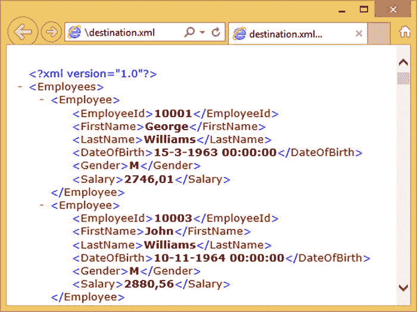

**图 14-2.** 在 Internet Explorer 中查看的 XML 文件

### 所有列的转换

在脚本组件中使用反射的另一个好用途是对所有列执行“某种操作”。例如，修剪所有列或替换所有空值。当然，你可以使用派生列来完成此操作，但如果有大量列，则可能会变得繁琐且容易出错。在此示例中，你将把所有字符串列转换为大写。你可以使用与上一个示例相同的数据源，也可以使用“Upper all Starter.dtsx”入门包或你自己的源文件。


#### 脚本组件类型

向数据流添加脚本组件作为转换，并将其连接到另一个组件（参见图 14-3）。请务必为其指定一个合适的名称；例如：`SCR – Uppercase`。

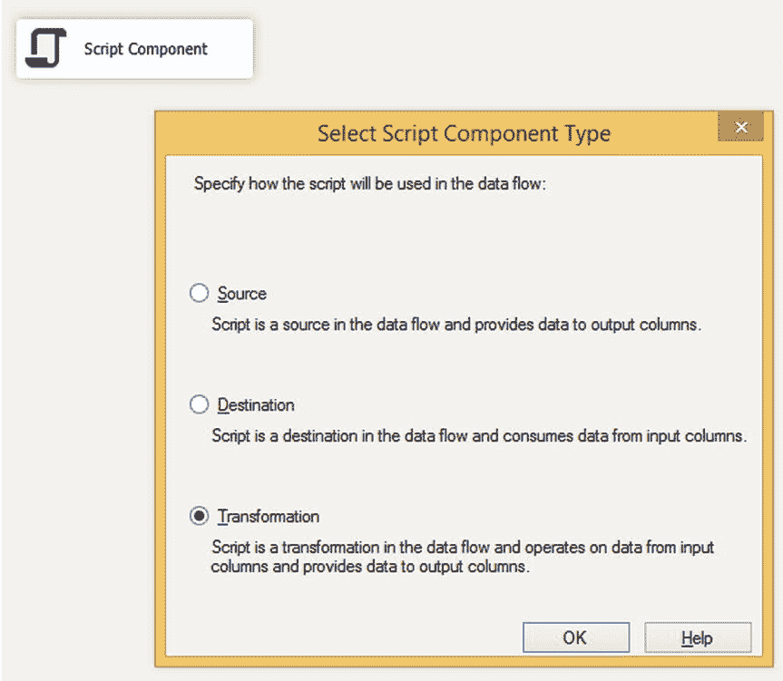

图 14-3.
脚本组件类型的转换

#### 脚本组件输入列

转到“输入列”页面，选择所有要更改的（字符串）列，并将这些列的“使用类型”设置为“读写”（参见图 14-4）。您可以选择所有列，即使是非字符串数据类型的列也可以，因为您将在脚本本身中检查数据类型。当然，为了获得更好的性能，只选择正确的列会更好。这种方法有一个缺点：您必须逐个更改所有选中列的“使用类型”。如果列很多，这将是大量的工作，但使用键盘可以快速完成（更改第一列，然后重复操作：`{tab} {tab} {tab} {down}`）。虽然繁琐，但仍比在派生列中添加数十个表达式要容易。

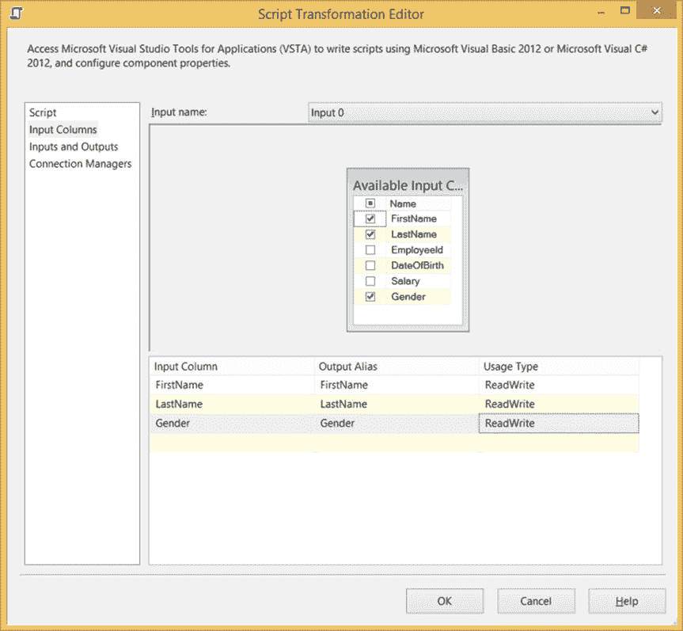

图 14-4.
选择输入列并更改使用类型

#### 脚本

对于此示例，您需要一些类变量。这些变量用于防止在 `ProcessInputRow` 中多次执行某个操作。

```csharp
// 布尔变量，仅执行一次操作
Boolean FirstRow = true;

// 用于存储行类型的变量
Type rowType;

// 用于存储输入列的变量
IDTSInputColumnCollection100 InputColumnCollection;

// 用于存储列值的变量
String columnValue = "";
```

以下是 VB.NET 代码：

```vbnet
' 布尔变量，仅执行一次操作
Dim FirstRow As Boolean = True

' 用于存储行类型的变量
Dim rowType As Type

' 用于存储输入列的变量
Dim InputColumnCollection As IDTSInputColumnCollection100

' 用于存储列值的变量
Dim columnValue As String = ""
```

在 `PreExecute` 方法中，您将用输入列集合填充一个变量。该变量将在 `ProcessInputRow` 方法中使用。

```csharp
public override void PreExecute()
{
    // 获取输入列集合
    InputColumnCollection = this.ComponentMetaData
        .InputCollection[0].InputColumnCollection;
}
```

以下是 VB.NET 代码：

```vbnet
Public Overrides Sub PreExecute()
    ' 获取输入列集合
    InputColumnCollection = Me.ComponentMetaData _
        .InputCollection(0).InputColumnCollection
End Sub
```

`Input0_ProcessInputRow` 方法对每一行执行，然后遍历列集合并更改“读写”字符串列的值。值的更改通过一个单独的方法完成，您可以根据自己的需要调整该方法。

如果您要更改文本或数字的大小，则应确保不超出其长度或精度，否则会导致截断错误。变量列具有各种属性，例如 `column.Precision` 或 `column.Length`，您可以使用它们来添加额外的检查。对于此大写示例，无需添加额外检查。

```csharp
public override void Input0_ProcessInputRow(Input0Buffer Row)
{
    // 仅执行一次
    if (FirstRow)
    {
        // 获取列值的行类型
        rowType = Row.GetType();
    }
    FirstRow = false;

    foreach (IDTSInputColumn100 column in InputColumnCollection)
    {
        // 仅更改字符串数据类型的列
        // 并确保该列为 READWRITE
        if ((column.DataType.ToString().Equals("DT_WSTR") ||
            column.DataType.ToString().Equals("DT_STR")) &&
            column.UsageType.ToString().Equals("UT_READWRITE"))
        {
            // 获取列值，如果为空则失败
            try
            {
                // 获取当前列值
                columnValue = rowType.GetProperty(column.Name).GetValue(Row,
                    null).ToString();

                // 使用一个方法更改列值。确保符合
                // 数据类型，包括大小（/精度/小数位数）。变量
                // column 具有获取列大小的属性。
                rowType.GetProperty(column.Name).SetValue(Row,
                    UpperColumnValue(columnValue), null);
            }
            catch
            {
                // 如果值为空则不执行任何操作
            }
        }
    }
}

// 可根据需要调整的新函数
public string UpperColumnValue(string ValueOfProperty)
{
    // 将值转换为大写
    ValueOfProperty = ValueOfProperty.ToUpper();
    return ValueOfProperty;
}
```

以下是 VB.NET 代码：

```vbnet
Public Overrides Sub Input0_ProcessInputRow(ByVal Row As Input0Buffer)
    ' 仅执行一次
    If FirstRow Then
        ' 获取列值的行类型
        rowType = Row.GetType()
    End If
    FirstRow = False

    For Each column As IDTSInputColumn100 In InputColumnCollection
        ' 仅更改字符串数据类型的列
        ' 并确保该列为 READWRITE
        If ((column.DataType = DataType.DT_WSTR Or _
            column.DataType = DataType.DT_STR) And _
            column.UsageType = DTSUsageType.UT_READWRITE) Then
            ' 获取列值，如果为空则失败
            Try
                ' 获取当前列值
                columnValue = rowType.GetProperty(column.Name).GetValue(Row, _
                    Nothing).ToString()

                ' 使用一个方法更改列值。确保符合
                ' 数据类型，包括大小（/精度/小数位数）。变量
                ' column 具有获取列大小的属性。
                rowType.GetProperty(column.Name).SetValue(Row, _
                    UpperColumnValue(columnValue), Nothing)
            Catch ex As Exception
                ' 如果值为空则不执行任何操作
            End Try
        End If
    Next
End Sub

' 可根据需要调整的新函数
Private Function UpperColumnValue(ValueOfProperty As String) As String
    ' 将值转换为大写
    ValueOfProperty = ValueOfProperty.ToUpper()
    Return ValueOfProperty
End Function
```

#### 结果

添加数据查看器以测试脚本并运行包。您应该会看到大量大写字母（参见图 14-5）。

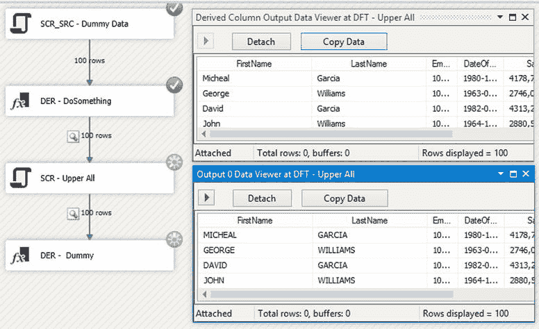

图 14-5.
将所有文本列转换为大写的结果

### 计算行的哈希值

哈希可用于更安全地存储密码和其他敏感数据，也可用于检测记录中的更改。例如，如果要检查是否应使用源数据更新目标表中的记录，则可以逐一比较所有列值。如果只有四或五列，这还可以接受，但如果有 20 列，则很繁琐。诀窍是计算并存储所有列值的哈希值（也称为校验和）。下次要检查更改时，只需要检查该哈希列即可。

请注意，在 SSIS 中计算哈希会消耗额外的时间，并且在目标表中填充哈希也会消耗额外的空间和时间，但在大多数情况下，这些额外的时间和空间是值得的。有多种哈希算法。例如，MD5（消息摘要 5 算法）比 SHA512（安全哈希算法，512 字节）消耗的时间更少、空间更小，但安全性也更低，并且存在（可忽略不计的）极小可能性使两个不同的字符串产生相同的哈希值。这称为哈希冲突。因此，请花时间研究哪种算法最适合您的情况，并明智地选择。相比之下，MD5 对于保护敏感数据来说是可以的，但您应该考虑更安全的算法。并且要小心处理非常大的 (n)text 列。对它们进行哈希运算可能会花费太多时间。


#### 变量

如果你使用此脚本计算的是安全哈希值而非仅校验和，则需要添加一个字符串变量来存储盐值。对于校验和，你可以跳过此部分。请确保使用配置信息，避免在包中硬编码值。该字符串变量的名称为`saltValue`。请务必添加一个虚拟/测试值（参见图 14-6）。

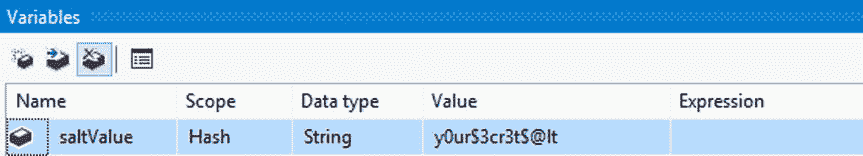

图 14-6. 用于存储盐值的变量

#### 脚本组件

在本例中，你将复用前面示例中的数据源。你可以使用入门包或自己的数据源。在你的数据流中添加一个脚本组件（类型为转换）（参见图 14-7）。为其指定一个合适的名称，例如`SCR – Hash All`，并将其连接到其他组件。

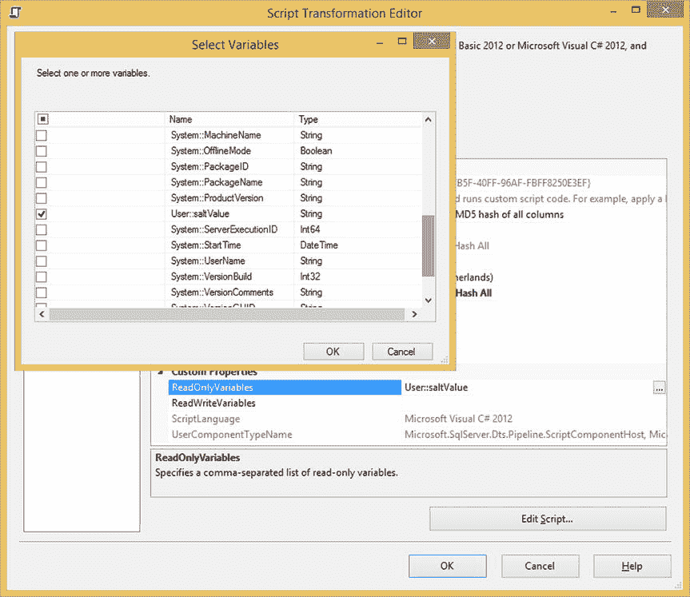

图 14-7. 数据流

#### 只读变量

如果你想使用盐值，则需要将`saltValue`变量添加为只读变量。脚本组件不支持敏感参数，但你可以使用脚本任务来读取敏感参数，然后将其值存储在一个字符串变量中作为一种变通方法（参见图 14-8）。之后，你就可以在脚本组件中使用该变量了。请注意，这仍然存在一些安全风险，因为包在运行时该值会驻留在内存中。但至少它没有硬编码在包中。

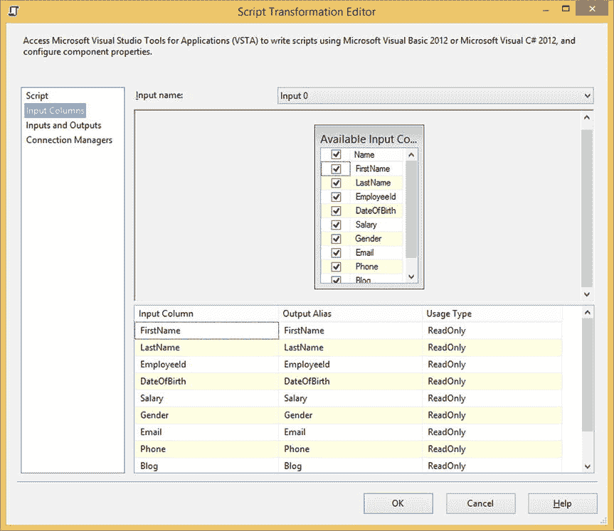

图 14-8. 作为只读变量的盐值变量

#### 输入列

转到“输入列”选项卡，并选择你需要的所有列为只读（默认设置）；但选择键列没有意义，因为它们不会改变。如果这个包不是唯一计算哈希值的地方，请确保始终使用相同的列顺序。否则，生成的哈希值将不相同。在本例中，由于`EmployeeId`是唯一键，因此你选择除`EmployeeId`之外的所有列（参见图 14-9）。

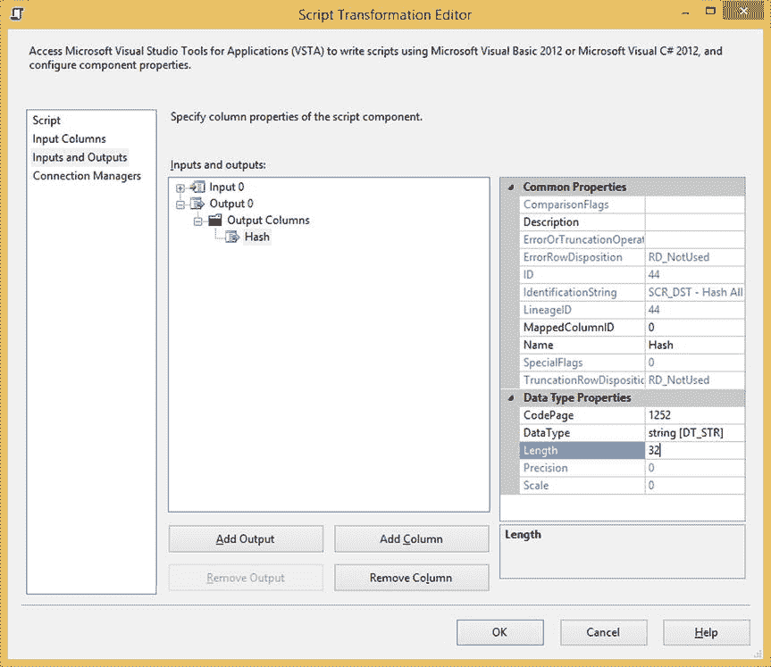

图 14-9. 选择输入列为只读

#### 输出列

你需要一个新的字符串列来存储计算出的哈希值。其长度可能在 MD5 的 32 位到 SHA512 的 128 位之间变化。在本例中，你将使用 MD5 哈希，其长度为 32 个字符。转到“输入和输出”页面。展开“输出 0”，然后选择“输出列”。点击“添加列”按钮来添加新的字符串列（参见图 14-10）。

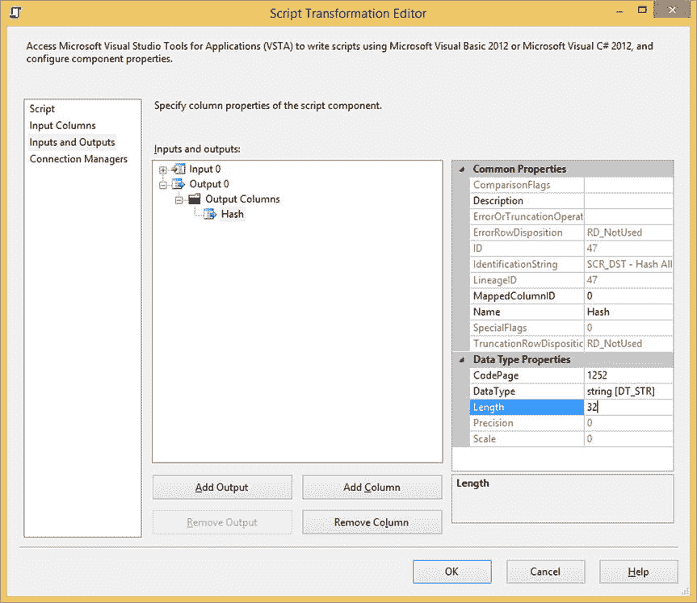

图 14-10. 添加新的哈希输出列

#### 脚本

在本例中，你使用了所有默认方法，包括`PreExecute`和`PostExecute`，但首先需要将`System.Security.Cryptography`添加到命名空间中以缩短代码。

```
#region customNamespaces
using System.Security.Cryptography;
#endregion
```

这是 VB.NET 代码：

```
#Region "customNamespaces"
Imports System.Security.Cryptography
#End Region
```

你还需要一些类变量。这些变量用于避免在`ProcessInputRow`中多次执行某个操作。同时请注意列分隔符变量，它用于区分例如值为“AB AB”和“ABA B”的两个列。最好使用不会在数据中出现的分隔符。你可以使用多个字符。

```
// 布尔变量，用于仅执行一次操作
Boolean FirstRow = true;

// 用于存储行类型的变量
Type rowType;

// 用于存储输入列的变量
IDTSInputColumnCollection100 InputColumnCollection;

// 用于存储列值的变量
String columnValue = "";

// 创建哈希对象。在 PreExecute 中选择类型
HMAC hashingObject = null;

// 列分隔符，用于区分
// 值"AB AB"和"ABA B"
String columnSeparator = "|";
```

这是 VB.NET 代码：

```
' 布尔变量，用于仅执行一次操作
Dim FirstRow As Boolean = True

' 用于存储行类型的变量
Dim rowType As Type

' 用于存储输入列的变量
Dim InputColumnCollection As IDTSInputColumnCollection100

' 用于存储列值的变量
Dim columnValue As String = ""

' 创建哈希对象。在 PreExecute 中选择类型
Private hashingObject As HMAC = Nothing

' 列分隔符，用于区分
' 值"AB AB"和"ABA B"
Private columnSeparator As String = "|"
```

在`PreExecute`方法中，你需要选择哈希类型。在本例中，你将使用 MD5，但其他算法也是可行的。如果你不想使用盐值，则忽略前两行代码，并删除第三行代码中的`saltByteArray`一词。

```
public override void PreExecute()
{
    // 定义盐值以使哈希更安全。
    String salt = Variables.saltValue.ToString();

    // 从盐值字符串创建字节数组
    byte[] saltByteArray = Encoding.Unicode.GetBytes(salt);

    // 通过替换 HMACMD5 选择哈希类型为：
    // HMACSHA1, HMACSHA256, HMACSHA384, HMACSHA512
    // 或 HMACRIPEMD160。这些更安全，但
    // 生成时间也更长。
    hashingObject = new HMACMD5(saltByteArray);

    // 获取输入列的集合
    InputColumnCollection = ComponentMetaData.InputCollection[0]
        .InputColumnCollection;
}
```

这是 VB.NET 代码：

```
Public Overrides Sub PreExecute()
    ' 定义盐值以使哈希更安全。
    Dim salt As String = Variables.saltValue.ToString()

    ' 从盐值字符串创建字节数组
    Dim saltByteArray As Byte() = Encoding.Unicode.GetBytes(salt)

    ' 通过替换 HMACMD5 选择哈希类型为：
    ' HMACSHA1, HMACSHA256, HMACSHA384, HMACSHA512
    ' 或 HMACRIPEMD160。这些更安全，但
    ' 生成时间也更长。
    hashingObject = New HMACMD5(saltByteArray)

    ' 获取输入列的集合
    InputColumnCollection = Me.ComponentMetaData _
        .InputCollection(0).InputColumnCollection
End Sub
```

在`PostExecute`方法中，你只需清理哈希对象。

```
public override void PostExecute()
{
    // 清理哈希对象
    if (hashingObject != null)
    {
        hashingObject.Clear();
        hashingObject = null;
    }
}
```

这是 VB.NET 代码：

```
Public Overrides Sub PostExecute()
    ' 清理哈希对象
    If (IsNothing(hashingObject)) Then
        hashingObject.Clear()
        hashingObject = Nothing
    End If
End Sub
```

在`Input0_ProcessInputRow`方法中，你遍历所有选定的列，将所有列值（包括列分隔符）连接成一个大的字符串。此字符串将由另一个方法进行哈希处理，返回的哈希值将保存在新的输出列中。


```csharp
public override void Input0_ProcessInputRow(Input0Buffer Row)
{
    // 仅执行一次
    if (FirstRow)
    {
        // 用于获取列值的行类型
        rowType = Row.GetType();
    }
    FirstRow = false;

    // 用于拼接所有列值的字符串构建器
    StringBuilder columnConcatenation = new StringBuilder();
    // 用于标记是否为第一列
    Boolean FirstColumn = true;

    foreach (IDTSInputColumn100 column in InputColumnCollection)
    {
        // 获取列值，若为空则失败
        try
        {
            // 获取当前列值
            columnValue = rowType.GetProperty(column.Name).GetValue(Row, null).ToString();
        }
        catch
        {
            // 值为空时不执行任何操作
            columnValue = null;
        }

        // 非第一列时添加分隔符
        if (!FirstColumn)
        {
            columnConcatenation.Append(columnSeparator);
        }
        FirstColumn = false;
        // 将列值拼接到字符串中
        columnConcatenation.Append(columnValue);
    }

    // 调用哈希方法计算哈希值
    // 并将哈希值存储到新的输出列中
    Row.Hash = GetHash(columnConcatenation.ToString());
}

// 将字符串转换为字节的哈希方法
public string GetHash(string text)
{
    byte[] bytes = Encoding.Unicode.GetBytes(text);
    return GetHash(bytes);
}

// 计算哈希值并创建哈希字符串的哈希方法
public string GetHash(byte[] bytes)
{
    // 对字节进行哈希计算
    byte[] hash = hashingObject.ComputeHash(bytes);
    // 将字节格式化为字符串
    string hashString = string.Empty;
    foreach (byte x in hash)
    {
        // 将字节格式化为十六进制字节
        // X = 十六进制格式
        // 2 = 2 个字符
        hashString += String.Format("{0:x2}", x);
    }
    return hashString;
}
```

这是 VB.NET 代码：

```vbnet
Public Overrides Sub Input0_ProcessInputRow(ByVal Row As Input0Buffer)
    ' 仅执行一次
    If FirstRow Then
        ' 用于获取列值的行类型
        rowType = Row.GetType()
    End If
    FirstRow = False

    ' 用于拼接所有列值的字符串构建器
    Dim columnConcatenation As New StringBuilder()
    ' 用于标记是否为第一列
    Dim FirstColumn As Boolean = True

    For Each column As IDTSInputColumn100 In InputColumnCollection
        ' 获取列值，若为空则失败
        Try
            ' 获取当前列值
            columnValue = rowType.GetProperty(column.Name).GetValue(Row, _
                Nothing).ToString()
        Catch
            ' 若失败，则将值设为空
            columnValue = Nothing
        End Try

        ' 非第一列时添加分隔符
        If (Not FirstColumn) Then
            columnConcatenation.Append(columnSeparator)
        End If
        FirstColumn = False
        ' 将列值拼接到字符串中
        columnConcatenation.Append(columnValue)
    Next

    ' 调用哈希方法计算哈希值
    ' 并将哈希值存储到新的输出列中
    Row.Hash = GetHash(columnConcatenation.ToString())
End Sub

' 将字符串转换为字节的哈希方法
Public Function GetHash(text As String) As String
    Dim bytes As Byte() = Encoding.Unicode.GetBytes(text)
    Return GetHash(bytes)
End Function

' 计算哈希值并创建哈希字符串的哈希方法
Public Function GetHash(bytes As Byte()) As String
    ' 对字节进行哈希计算
    Dim hash As Byte() = hashingObject.ComputeHash(bytes)
    ' 将字节格式化为字符串
    Dim hashString As String = String.Empty
    For Each x As Byte In hash
        ' 将字节格式化为十六进制字节
        ' X = 十六进制格式
        ' 2 = 2 个字符
        hashString += [String].Format("{0:x2}", x)
    Next
    Return hashString
End Function
```

#### 结果

现在运行数据流并检查结果。如果在脚本组件后添加数据查看器，即可看到新创建并填充的哈希列（参见图 14-11）。

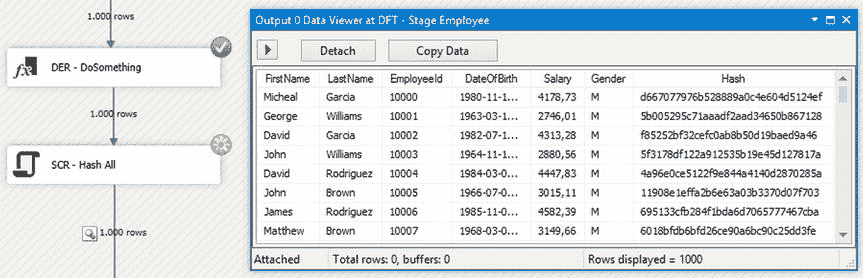

图 14-11. 新的哈希列

可以在此脚本组件后添加一个查找转换，检查 `EmployeeId` 是否存在于目标表中。如果在同一查找中也获取了哈希值，则可以将该哈希值与新创建的哈希值进行比较，以确定是否需要更新数据。请注意，不应使用 OLE DB 命令更新记录，因为其速度较慢。插入到临时表中，然后通过执行 SQL 任务进行批量更新，可能会更快。

### 小结

在本章中，你了解了反射的各种可能性。当需要对大量列执行大量重复操作时，反射非常方便。添加或删除列无需大量工作，只需打开并关闭 VSTA 环境，让 SSIS 生成标准代码即可。

其缺点是代码略为复杂，且性能略逊于对所有列操作进行硬编码。可以通过在 `PreExecute` 方法中将列对象移动到自定义对象，并使用该对象替代速度较慢的 COM 对象，来解决部分性能下降问题。在 Todd McDermid 的 Dimension Merge SCD 组件的 CodePlex 项目中，可以找到一个极佳的示例，但这需要一些复杂的编码工作（参见 `http://dimensionmergescd.codeplex.com`）。你需要权衡这是否适用于自己的情况。

