# 15. Web 服务

电子补充材料 本章的在线版本（doi:10.1007/978-1-4842-0638-6_15）包含补充材料，可供授权用户使用。

第 7 章解释了如何在脚本任务中使用 Web 服务，但 Web 服务在数据流任务中也同样有用，可用于丰富数据、作为目标，甚至作为源。许多产品都使用 Web 服务作为接口。Microsoft Dynamics CRM 和 SharePoint 等工具将所有数据存储在 SQL Server 数据库中，但不允许直接编辑数据库中的数据。相反，供应商会提供 Web 服务来修改数据。本章提供了一些常用 Microsoft 产品和互联网上可用的 Web 服务的示例。

## 使用天气数据丰富数据

第一个示例使用了第 7 章中介绍的公共天气 Web 服务。关于 Web 服务的详细信息和理论，应阅读该章节。在此示例中，你将使用 Web 服务中的天气信息来丰富来自平面文件的地理数据。创建一个包含空数据流的包。添加一个名为 `FF_SRC – Cities` 的平面文件源组件，并将其连接到包含以下数据的平面文件。对于本示例中的列，默认的 50 个字符串大小即可。示例包中的文件名为 `Weather.csv`。

```
Country,City
netherlands,amsterdam
netherlands,maastricht
belgium,antwerp
france,le touquet
france,agen
germany,hamburg
germany,munich
denmark,alborg
```

### 变量

向包中添加一个名为 `WebserviceUrl` 的字符串变量，并填入以下 Web 服务 URL：`http://www.webservicex.net/globalweather.asmx`。这使得配置 URL 变得更容易，如图 15-1 所示。

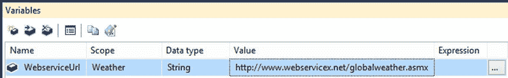

图 15-1. 用于配置 Web 服务的字符串变量

### 脚本组件

向数据流中添加一个脚本组件（类型：转换），并将其连接到源，如图 15-2 所示。为其指定一个有意义的名称，例如 `SCR - Get weather`。然后编辑脚本组件，并将上一步中的变量添加到 `ReadOnlyVariables` 属性中。

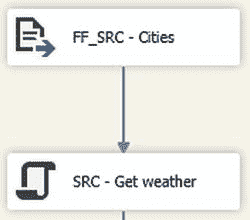

图 15-2. 脚本组件转换

### 输入列

在脚本组件编辑器中，进入 `Input Columns` 选项卡，并将 `Country` 和 `City` 列作为只读输入列添加到脚本中；图 15-3 展示了一个示例。

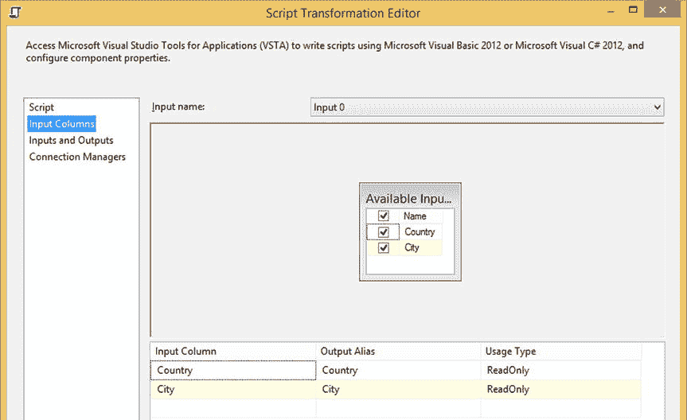

图 15-3. 输入列

### 输入和输出

你需要创建一个新的字符串列来存储天气信息。Web 服务返回一个 XML 文档，你将把它存储在字符串列中。你也可以将 XML 拆分到单独的列中，使其更加整洁。进入 `Inputs and Outputs` 选项卡，添加一个名为 `Weather` 的新字符串列，数据类型为 `string`，长度为 1000。它应该被添加到 `Output 0` 中，如图 15-4 所示。

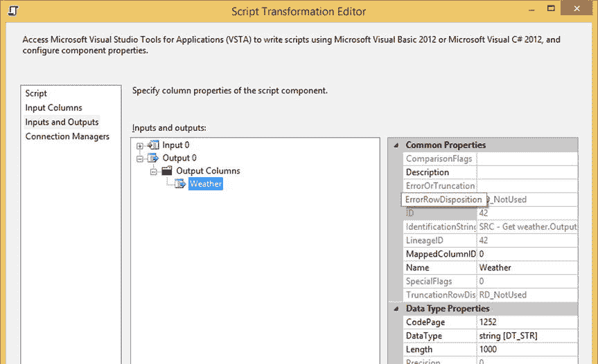

图 15-4. 新的输出列

### 添加服务引用

下一步是通过右键单击 `References`，然后选择 `Add Service Reference…` 来添加一个新的服务引用。在地址栏中，粘贴 Web 服务的 URL（`http://www.webservicex.net/globalweather.asmx`），然后点击 `Go` 查找该 Web 服务。图 15-6 展示了一个示例。

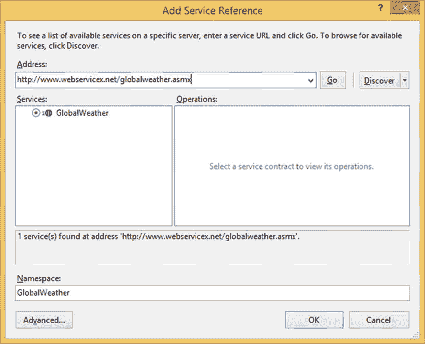

图 15-6. 添加服务引用

在 `NameSpace` 字段中，输入 `GlobalWeather`，然后点击 `OK`。现在你已经将 Web 服务作为设计时代码的引用添加进来了。确保在旧版 Visual Studio 中点击 `Save All` 按钮。

### 命名空间

为了缩短代码，添加以下命名空间。第二个命名空间 `GlobalWeather` 的前缀来自内部 VSTA 项目名称。每个脚本组件都会不同，但可以开始输入 `SC_`，IntelliSense 会帮你完成剩下的工作。

```csharp
#region CustomNamespace

using System.ServiceModel;

using SC_a064a2a5a804496ca3277204de13f199.GlobalWeather;

#endregion
```

以下是 VB.NET 代码：

```vbnet
#Region "CustomNamespace"

Imports System.ServiceModel

Imports SC_f27cac918ef84ea4bd35b959b1971ecf.GlobalWeather

#End Region
```

### 类变量

为通道工厂和天气 Web 服务对象添加类变量。你将在各种方法中使用这些对象。

```csharp
[Microsoft.SqlServer.Dts.Pipeline.SSISScriptComponentEntryPointAttribute]
public class ScriptMain : UserComponent
{
    // Create a Channel Factory with the type of the Web Service.
    ChannelFactory<GlobalWeatherSoap> channelFactory;
    // Create a GlobalWeatherSoap object to call the web service
    GlobalWeatherSoap weatherSvcObj;
```

以下是 VB.NET 代码：

```vbnet
<Microsoft.SqlServer.Dts.Pipeline.SSISScriptComponentEntryPointAttribute> _
<CLSCompliant(False)> _
Public Class ScriptMain
  Inherits UserComponent
  ' Create a Channel Factory with the type of the Web Service.
  Dim channelFactory As ChannelFactory(Of GlobalWeatherSoap)
  ' Create a GlobalWeatherSoap object to call the web service
  Dim weatherSvcObj As GlobalWeatherSoap
```

### PreExecute

在 `PreExecute` 方法中，你从 SSIS 字符串变量中获取 Web 服务 URL。这个 URL 在运行时使用。

```csharp
public override void PreExecute()
{
    // Get the right binding: basicHttp
    BasicHttpBinding httpb = new BasicHttpBinding();
    // And initiate the channelFactory with this binding
    channelFactory = new ChannelFactory<GlobalWeatherSoap>(httpb);
    // The necessary endpoint with our address from the variable
    EndpointAddress ep = new EndpointAddress(Variables.WebserviceUrl.ToString());
    // Create the representation of the web service
    weatherSvcObj = channelFactory.CreateChannel(ep);
}
```

以下是 VB.NET 代码：

```markdown
## PreExecute 方法

```vbnet
Public Overrides Sub PreExecute()
    ' Get the right binding: basicHttp
    Dim httpb As New BasicHttpBinding()
    ' And initiate the channelFactory with this binding
    channelFactory = New ChannelFactory(Of GlobalWeatherSoap)(httpb)
    ' The necessary endpoint with our address from the variable
    Dim ep As New EndpointAddress(Variables.WebserviceUrl.ToString())
    ' Create the representation of the webservice
    weatherSvcObj = channelFactory.CreateChannel(ep)
End Sub
```

### Input0_ProcessInputRow

在 `ProcessInputRow` 方法中，你使用两个输入列作为 `GetWeather` 方法的参数来调用 Web 服务。结果存储在新的输出列中。如果你想将 XML 文档拆分为单独的列，就在这里进行。你可能还想添加一个 `try-catch` 结构来捕获这个公共 Web 服务可能导致的意外错误。示例包中包含了一个额外的 `try-catch`。

```csharp
public override void Input0_ProcessInputRow(Input0Buffer Row)
{
    // Call Web service with city and country parameters
    Row.Weather = weatherSvcObj.GetWeather(Row.City, Row.Country);
}
```

以下是 VB.NET 代码：

```vbnet
Public Overrides Sub Input0_ProcessInputRow(ByVal Row As Input0Buffer)
    ' Call Web service with city and country parameters
    Row.Weather = weatherSvcObj.GetWeather(Row.City, Row.Country)
End Sub
```

### PostExecute

当操作完成时，你可以在 `PostExecute` 方法中关闭通信。

```csharp
public override void PostExecute()
{
    // Close the communication
    channelFactory.Close();
}
```

以下是 VB.NET 代码：

```vbnet
Public Overrides Sub PostExecute()
    ' Close the communication
    channelFactory.Close()
End Sub
```

### 结果

现在添加一个虚拟的派生列，并将其连接到脚本组件。添加一个数据查看器，如图 15-7 所示，以查看 Web 服务调用的结果。

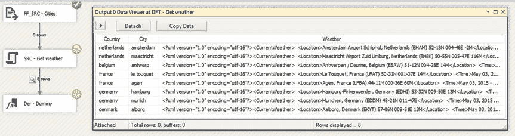

图 15-7. 数据查看器

## Dynamics CRM

本章节演示如何在 Microsoft Dynamics CRM 2013 中插入或更新数据，但其他版本也提供类似的 Web 服务及代码。如果您没有使用 Microsoft Dynamics CRM，可以跳过此部分。如前所述，不允许直接在数据库中编辑 CRM 数据。更新操作需通过 Web 服务完成。但对于读取数据，您可以使用 CRM 数据库中的视图。

由于每个 CRM 解决方案使用不同的实体及属性集，因此无法提供分步示例。取而代之的是针对不同字段类型（如常规文本字段、选项集和查找字段）提供的一组指南和代码示例。数据流因用户和解决方案而异，但基于 Web 服务的脚本设计大致相同。首先，提供一些指南：

*   为避免插入重复数据，需检查源数据中是否有唯一键可与 CRM 中的键进行比对。若没有，则可将源数据的业务键存储在 CRM 的（隐藏）列中，以便在下次运行时轻松比对数据。

*   要更新或删除 CRM 中的数据，需要记录的 GUID（唯一键或实体 ID）。因此，需通过 CRM 视图上的查找转换（数据流示例 2）或与使用同一 CRM 视图的 OLE DB 源（数据流示例 1）进行联接来获取此数据。

*   应避免不必要地更新 CRM 中的记录，这会降低性能并污染 CRM 历史信息。因此，需要检查数据是否变更。可通过从 CRM 获取所有要比较的列，利用业务键将其与源数据库联接，然后使用一个大型表达式比较每一列来实现。另一种技巧是对源视图和 CRM 视图的所有列进行哈希处理，这样只需比较一个哈希列即可。上一章提供了相关示例。

接下来介绍两种可将数据从源迁移到 CRM 的数据流设计方案。两种方案的底层部分（含脚本组件）相同。如果有多个源向同一 CRM 实体插入和更新记录，则需在将数据迁移到 CRM 之前确定哪个源（甚至哪条记录）具有优先权。

### 数据流示例 1

示例 1 使用合并联接来比较源数据与 CRM 数据。图 15-8 显示了该示例的完整数据流。

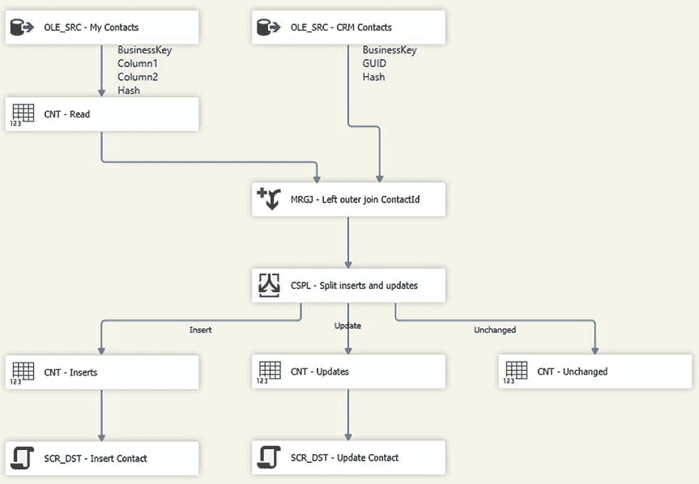

图 15-8. 数据流示例 1

在第一个示例中，从源（我的联系人）获取所有列，包括业务键。同时添加一个哈希值以一次性比较所有列。除了使用 `hashbytes`，您还可以使用第 14 章中的脚本组件示例来计算所有列的哈希值，或使用第三方校验和转换。查询示例如下：

```sql
SELECT          ContactId as SourceContactId
,               Column1
,               Column2
,               HASHBYTES('MD5', Column1 + '|' + Column2) as hash
FROM            myTable
ORDER BY        ContactId       -- For join in SSIS
```

所有数据转换应在合并联接和计算哈希值之前完成。否则会对比两个不同的对象，导致始终更新所有现有记录。本示例未包含转换，因此可以在源查询中直接计算哈希值。

在 CRM 源（CRM 联系人）中，选择 CRM 的 GUID（用于更新/删除）、源 ID（用于联接）和哈希值（用于比较）。仅选择具有源 ID 的联系人。

```sql
SELECT          ContactId              -- GUID (entity ID)
,               SourceContactId -- ID from source
,               HASHBYTES('MD5', Column1 + '|' + Column2) as hash
FROM            myCrmContactsView
WHERE           SourceContactId is not null    -- Only contacts from this source
ORDER BY        SourceContactId                -- For join in SSIS
```

在合并联接中，对源数据与 CRM 数据基于源 ID 执行左外部联接（获取源的所有行，以及 CRM 中具有匹配 `sourceid` 的行）。在接下来的条件性拆分中，检查哪些行需要插入、更新或忽略。如果 CRM 侧的源 ID 为空，则需要插入该记录。如果哈希值不同，则需要更新 CRM 中的记录。其余所有行均被忽略，因为它们已存在于 CRM 中且未发生变化。

### 数据流示例 2

第二个示例使用查找转换来比较源数据与 CRM 数据。图 15-9 显示了该示例的数据流。

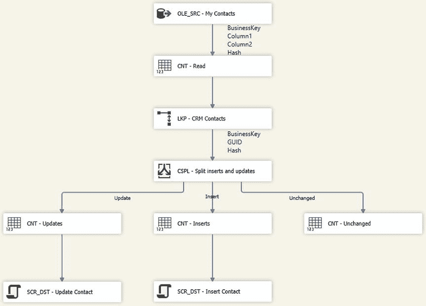

图 15-9. 使用查找转换的数据流示例 2
```

在第二个示例中，通过查找转换获取 CRM 数据，而不是使用 OLE DB 源和合并联接。查询语句与第一个示例相同，但无需排序（排序仅合并联接需要）。选择哪种方案取决于从 CRM 获取的记录数量（如果使用查找，记录数最好能放入内存），以及 CRM 记录的长度（因为 `hashbytes` 输入限制为 8000 字节）。若超过限制，需使用其他方法计算哈希值，例如通过脚本组件。此外，如果还需要删除或停用 CRM 中不再存在于源数据中的记录，则需使用完全外部联接，而这仅能通过合并联接实现。

## 下载 CRM SDK

在执行脚本组件之前，需先下载 Microsoft CRM 2013 软件开发包 (SDK)，下载地址为 [`http://www.microsoft.com/en-us/download/details.aspx?id=40321`](http://www.microsoft.com/en-us/download/details.aspx?id=40321)（对于 2011 版，将 URL 中的 ID 值改为 24004；2015 版 ID 为 44567）。运行下载的文件以解压所有文件。您只需用到 `SDK\Bin` 文件夹中的 `Microsoft.Xrm.Sdk.dll` 程序集。

下一步是将该程序集添加到 SSIS 计算机的全局程序集缓存 (GAC) 中，并将其复制到 SSIS 的 Binn 文件夹 `C:\Program Files (x86)\Microsoft SQL Server\110\DTS\Binn\`（文件夹名称 110 对应 SQL Server 版本：100 对应 2008，110 对应 2012，120 对应 2014）。在开发机器上，可使用 `gacutil` 将程序集添加到 GAC。在生产服务器上，需要创建安装程序、禁用 UAC 并通过 Windows 资源管理器将程序集拖入 GAC，或使用 PowerShell 脚本将其添加到 GAC。注意，向 GAC 添加内容需要管理员权限。

## Windows Identity Foundation

CRM SDK 还需要 Windows Identity Foundation。请从 [`http://www.microsoft.com/en-US/download/details.aspx?id=17331`](http://www.microsoft.com/en-US/download/details.aspx?id=17331) 下载并安装。标准安装即可满足要求。

## 变量

为避免硬编码用户名、域名、密码和 Web 服务地址，建议使用变量或参数，并在脚本组件中引用它们。本示例使用了四个字符串变量，如图 15-10 所示。

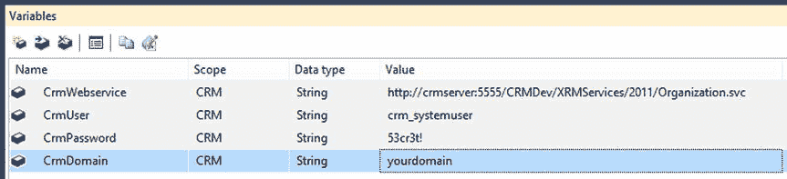

图 15-10. 用于存储 Web 服务连接信息的变量

CRM Web 服务 URL 格式为 `http://<servername>:5555/<sitename>/XRMServices/Organization.svc`，端口号可能有所不同。

## 添加脚本组件

添加一个脚本组件（目标类型），用于插入或更新操作，并将上一步中的四个字符串变量添加为 `ReadOnlyVariables`。此步骤对所有脚本通用，如图 15-11 所示。

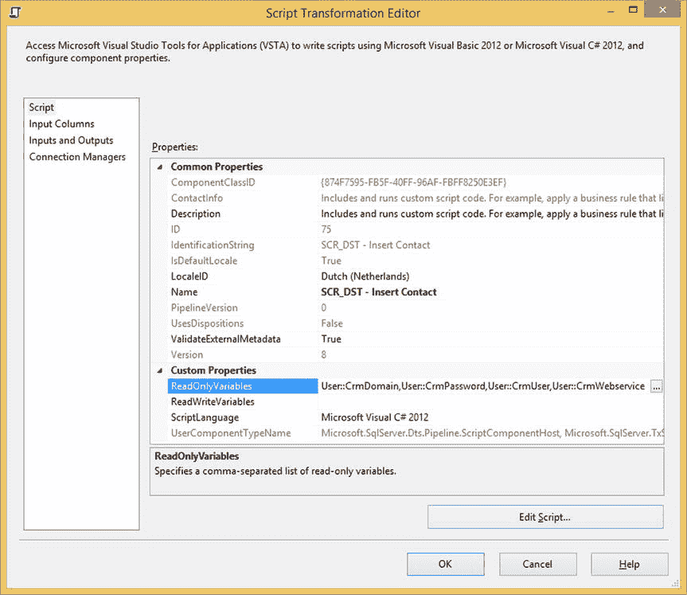

图 15-11. `ReadOnlyVariables`

## 输入列

当向 CRM 插入记录时，你需要源的唯一 ID，以便将其存储在（隐藏的）CRM 列中，同时需要所有你想插入到 CRM 的源数据列（见图 15-12）。对于此脚本，你不需要哈希值或来自 CRM 的列（它们本来就是空的）。

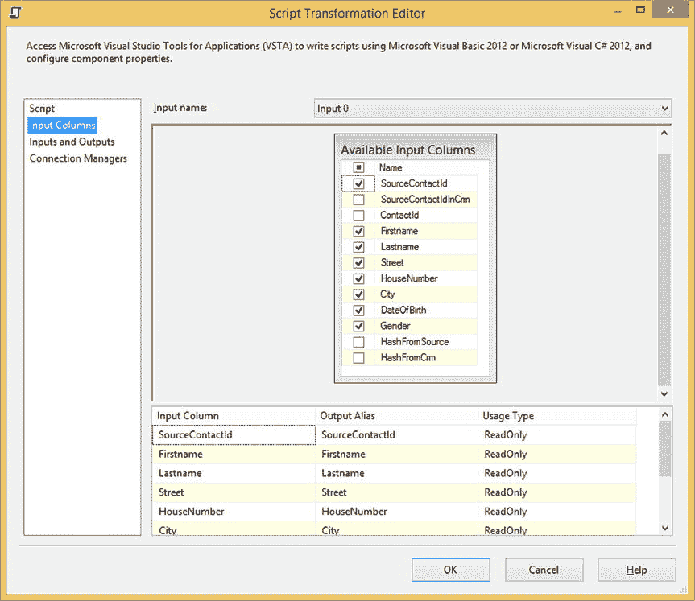

图 15-12. 用于向 CRM 插入记录的列

当更新记录时，你还需要来自 CRM 的 GUID 列（`ContactId`），因为它是唯一键，但不需要来自源的业务键（`SourceContactId`），因为它已在 CRM 中。

## 添加命名空间

为简化代码，在 CRM SDK 命名空间和 `ServiceModel.Description`（用于 `ClientCredentials`）顶部添加额外的 `using`/`imports` 语句。

```
#region customNamespaces
using Microsoft.Xrm.Sdk;
using Microsoft.Xrm.Sdk.Client;
using Microsoft.Xrm.Sdk.Query;
using System.ServiceModel.Description;
#endregion
```

以下是 VB.NET 代码：

```
#Region "CustomNamespace"
Imports Microsoft.Xrm.Sdk
Imports Microsoft.Xrm.Sdk.Client
Imports Microsoft.Xrm.Sdk.Query
Imports System.ServiceModel.Description
#End Region
```

## 类变量

对于 Web 服务，你需要一个 `IOrganizationService` 类变量。该变量的值在 `PreExecute` 方法中赋值；在 `Input0_ProcessInputRow` 方法中，它用于在 CRM 中提交操作。

```
IOrganizationService organizationservice;
```

以下是 VB.NET 代码：

```
Dim organizationservice As IOrganizationService
```

## PreExecute

在 `PreExecute` 方法中，你将读取 SSIS 变量以获取 Web 服务调用的凭据。创建新的 Web 服务代理并赋值给类变量，以便稍后用于提交插入和更新操作。

```
public override void PreExecute()
{
  // 用包中的变量值填充字符串变量
  string CrmUrl = this.Variables.CrmWebservice.ToString();
  string CrmDomainName = this.Variables.CrmDomain.ToString();
  string CrmUserName = this.Variables.CrmUser.ToString();
  string CrmPassWord = this.Variables.CrmPassword.ToString();
  // 使用凭据连接到 Web 服务
  ClientCredentials credentials = new ClientCredentials();
  credentials.UserName.UserName = string.Format("{0}\\{1}", CrmDomainName
                                                          , CrmUserName);
  credentials.UserName.Password = CrmPassWord;
  organizationservice = new OrganizationServiceProxy(new Uri(CrmUrl), null
                                                     , credentials, null);
}
```

以下是 VB.NET 代码：

## PreExecute 方法

```
Public Overrides Sub PreExecute()
  ' 用包中的变量值填充字符串变量
  Dim CrmUrl As String = Me.Variables.CrmWebservice.ToString()
  Dim CrmDomainName As String = Me.Variables.CrmDomain.ToString()
  Dim CrmUserName As String = Me.Variables.CrmUser.ToString()
  Dim CrmPassWord As String = Me.Variables.CrmPassword.ToString()
  ' 使用凭据连接到 Web 服务
  Dim credentials As New ClientCredentials()
  credentials.UserName.UserName = String.Format("{0}\{1}", CrmDomainName, _
                                                           CrmUserName)
  credentials.UserName.Password = CrmPassWord
  organizationservice = New OrganizationServiceProxy(New Uri(CrmUrl), Nothing _
                                                    , credentials, Nothing)
End Sub
```

## Input0_ProcessInputRow

在此方法中，你将 SSIS 中的每一行数据传递给 Web 服务。你将使用`后期绑定`方法，因为它比早期绑定更快，但最终结果相同。后期绑定的缺点是无法在编译时验证名称和数据类型。以下是早期绑定与后期绑定的区别。

```
// 早期绑定
Contact newContact = new Contact();
newContact.Name = "Joost van Rossum";
organizationservice.Create(newContact);

// 后期绑定
Entity newContact = new Entity("contact");
newContact["name"] = "Régis Baccaro";
organizationservice.Create(newContact);
```

以下是 VB.NET 代码：

```
' 早期绑定
Dim newContact As New Contact()
newContact.Name = "Joost van Rossum"
organizationservice.Create(newContact)

' 后期绑定
Dim newContact As New Entity("contact")
newContact("name") = "Régis Baccaro"
organizationservice.Create(newContact)
```

## Input0_ProcessInputRow - 插入

插入代码首先需要创建一个实体对象，并将 CRM 实体的名称作为参数传递。

```csharp
// 创建一个类型为 'contact' 的 Entity 对象
Entity newContact = new Entity("contact");
```

以下是 VB.NET 代码：

```vbnet
' 创建一个类型为 'contact' 的 Entity 对象
Dim newContact As New Entity("contact")
```

之后，就可以开始填充 CRM 列。如果你确定 SSIS 列中已有数据，则可以直接赋值。

```csharp
// 在 CRM 中存储源数据的业务键
// 这使得比较和筛选用于更新的记录更加容易
newContact["SourceContactId"] = Row.SourceContactId;

// 填充 crm 字段。注意字段名是区分大小写的！
newContact["firstname"] = Row.Firstname;
newContact["lastname"] = Row.Lastname;
```

以下是 VB.NET 代码：

```vbnet
' 在 CRM 中存储源数据的业务键
' 这使得比较和筛选用于更新的记录更加容易
newContact("SourceContactId") = Row.SourceContactId

' 填充 crm 字段。注意字段名是区分大小写的！
newContact("firstname") = Row.Firstname
newContact("lastname") = Row.Lastname
```

你也可以在赋值时添加空值检查，这样当值为空时，CRM 字段将保持不变。在这种情况下，CRM 中的值要么为空，要么会使用默认值。

```csharp
// 地址，但要检查列是否已填充
if (!Row.Street_IsNull)
{
    newContact["address1_line1"] = Row.Street;
}

if (!Row.HouseNumber_IsNull)
{
    newContact["address1_line2"] = Row.HouseNumber;
}

if (!Row.City_IsNull)
{
    newContact["address1_city"] = Row.City;
}
```

以下是 VB.NET 代码：

```vbnet
' 地址，但要检查列是否已填充
If Not Row.Street_IsNull Then
    newContact("address1_line1") = Row.Street
End If

If Not Row.HouseNumber_IsNull Then
    newContact("address1_line2") = Row.HouseNumber
End If

If Not Row.City_IsNull Then
    newContact("address1_city") = Row.City
End If
```

填充 `OptionSet`（一个包含预定义值的下拉列表）会略有不同。你不能直接赋值字符串，而是需要分配关联的 ID。你需要一些 CRM 知识才能在 CRM 中找到该 ID，因此，咨询 CRM 顾问可能会更方便。

```csharp
OptionSetValue contactType = new OptionSetValue();

if (!Row.ContactType_IsNull)
{
    switch (Row.ContactType)
    {
        case "Client":
            contactType.Value = 1;
            break;
        case "Partner":
            contactType.Value = 2;
            break;
        case "Personal":
            contactType.Value = 3;
            break;
        default:
            contactType.Value = 2;
            break;
    }
    newContact.Attributes.Add("contacttype", (OptionSetValue)contactType);
}
```

以下是 VB.NET 代码：

```vbnet
Dim contactType As New OptionSetValue()

If Not Row.ContactType_IsNull Then
    Select Case Row.ContactType
        Case "Client"
            contactType.Value = 1
            Exit Select
        Case "Partner"
            contactType.Value = 2
            Exit Select
        Case "Personal"
            contactType.Value = 3
            Exit Select
        Case Else
            contactType.Value = 2
            Exit Select
    End Select
    newContact.Attributes.Add("contacttype", DirectCast(contactType, _
        OptionSetValue))
End If
```

例如，将我们的新联系人链接到一个客户（即查找），是通过 `EntityReference` 完成的，但你需要相关客户的 `GUID`。这应该在查找转换中通过对 `CRM` 执行查询来完成。

```csharp
// 引用另一个实体（查找）
EntityReference Account = new EntityReference("account", Row.AccountGuid);
newContact["accountid"] = Account;
```

以下是 `VB.NET` 代码：

```vbnet
' 引用另一个实体（查找）
Dim Account As New EntityReference("account", Row.AccountGuid)
newContact("accountid") = Account
```

最后，实际将联系人添加到 `CRM` 只需要一行代码。

```csharp
// 创建新联系人
organizationservice.Create(newContact);
```

以下是 `VB.NET` 代码：

```vbnet
' 创建新联系人
organizationservice.Create(newContact)
```

### Input0_ProcessInputRow - 更新

更新联系人与插入非常相似，但你需要联系人的 `GUID`。

```csharp
// 创建一个类型为 'contact' 的 Entity 对象
Entity existingContact = new Entity("contact");

// 最重要的属性是填充实体 ID
// 这是来自 CRM 的 GUID 列。没有此列
// 则无法更新 CRM 中的记录。
existingContact["contactid"] = Row.ContactId;
```

以下是 `VB.NET` 代码：

```vbnet
' 创建一个类型为 'contact' 的 Entity 对象
Dim existingContact As New Entity("contact")

' 最重要的属性是填充实体 ID
' 这是来自 CRM 的 GUID 列。没有此列
' 则无法更新 CRM 中的记录。
existingContact("contactid") = Row.ContactId
```

接下来，你可以像在插入中那样，开始填充所有的 `CRM` 列。

```csharp
// 填充 crm 字段。注意字段名是区分大小写的！
existingContact["firstname"] = Row.Firstname;
existingContact["lastname"] = Row.Lastname;
```

以下是 `VB.NET` 代码：

```vbnet
' 填充 crm 字段。注意字段名是区分大小写的！
existingContact("firstname") = Row.Firstname
existingContact("lastname") = Row.Lastname
```

但是，当你添加 `if` 语句来检查空值时，也需要添加一个 `else` 分支；否则，该列将不会被更新。

```csharp
// 地址，但要检查列是否已填充
if (!Row.Street_IsNull)
{
    existingContact["address1_line1"] = Row.Street;
}
else
{
    existingContact["address1_line1"] = "";
}
```

以下是 `VB.NET` 代码：

```vbnet
' 地址，但要检查列是否已填充
If Not Row.Street_IsNull Then
    existingContact("address1_line1") = Row.Street
Else
    existingContact("address1_line1") = ""
End If
```

最后一步是实际的更新代码。

```csharp
// 更新联系人
organizationservice.Update(existingContact);
```

以下是 `VB.NET` 代码：

```vbnet
' 更新联系人
organizationservice.Update(existingContact)
```

### Input0_ProcessInputRow - 硬删除

如果某个记录在你的源数据中已不存在，你也可以从 `CRM` 中删除它。在你的数据流（合并联接）中，应将左外部联接更改为完全外部联接。之后，需要更改条件性拆分中的表达式。第一个“插入”输出表达式检查 `CRM` 端的 `sourceContactId` 是否为空。第二个“删除”输出表达式检查源端的 `sourceContactId` 是否为空。最后一个“更新”输出表达式检查哈希值是否不同。

对于脚本组件中的输入列，你只需要来自 `CRM` 的 `GUID` 列。请注意，这将是从 `CRM` 执行的物理删除，且无法撤销！

```csharp
// 删除客户。第一个参数是实体名称，第二个参数
// 是来自 CRM 源的实体 ID。
organizationservice.Delete("contact", Row.ContactId);
```

以下是 `VB.NET` 代码：

```vbnet
' 删除客户。第一个参数是实体名称，第二个参数
' 是来自 CRM 源的实体 ID。
organizationservice.Delete("contact", Row.ContactId)
```

### Input0_ProcessInputRow - 软删除

如果物理删除操作过于彻底，你也可以停用记录，但需要从 `SDK` 中额外添加一个程序集到 `GAC` 和 `Binn` 文件夹：`Microsoft.Crm.Sdk.Proxy.dll`。然后还需要在 `VSTA` 环境中引用此程序集。在“添加引用”窗口中，浏览到 `SSIS` 的 `Binn` 文件夹。之后，需要为停用操作再添加一个额外的命名空间。

```
using Microsoft.Crm.Sdk.Messages;
```

这是 `VB.NET` 代码：

```
Import Microsoft.Crm.Sdk.Messages
```

接下来是实际的停用代码。请注意，这是一个添加到队列中的请求。因此，当 `CRM` 正在处理时，脚本可能已经完成，而请求仍在队列中。

```
// Create CRM request to (de)activate record
SetStateRequest setStateRequest = new SetStateRequest();

// Which entity/record should be (de)activate?
// First part in the entityname, second is the entity id from the CRM source.
setStateRequest.EntityMoniker = new EntityReference("contact", Row.ContactId);

// Setting 'State' (0 – Active ; 1 – InActive)
setStateRequest.State = new OptionSetValue(1);

// Setting 'Status' (1 – Active ; 2 – InActive)
setStateRequest.Status = new OptionSetValue(2);

// Execute the request
SetStateResponse response =
                (SetStateResponse)organizationservice.Execute(setStateRequest);
```

这是 `VB.NET` 代码：

```
# SharePoint Web 服务集成

在脚本组件中调用 SharePoint Web 服务有时是必要的。在某些情况下，你可以使用 Web 服务任务，但在其他情况下，例如当你只在数据流任务的行的内部有可用数据时，你必须使用脚本组件。

在以下示例中，你将从一个 SharePoint 站点中的所有文档库获取所有文档，并从每个库中获取 Excel 文档。

你使用的是 SharePoint 2013，但这在 SharePoint 2010 中也适用。

## 变量

图 15-14 显示了变量窗口。定义了两个变量：`SiteURL` 指定 SharePoint 站点的地址，`fileType` 指定感兴趣的文档类型。图中的文档类型是 `xsls`，表示 Microsoft Excel 的 Open XML 电子表格格式。

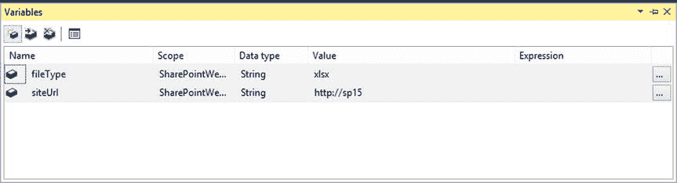

图 15-14. 变量窗口

首先创建两个执行包所需的字符串变量。

## 脚本组件

在表面上添加一个数据流任务，然后在数据流内部，添加一个名为 `SCR_SRC-GetSharePointLists` 的脚本组件。将类型指定为源，如图 15-15 所示。

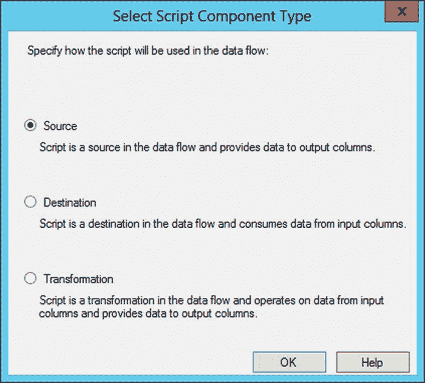

图 15-15. 脚本组件

在脚本转换编辑器的脚本页面上，将 `SiteUrl` 变量添加为 `ReadOnlyVariable`。在输入和输出页面上，添加三个输出列：`ListName`、`ListID` 和 `webID`。将这三个列的类型都设置为 `string`。图 15-16 展示了示例中的三个列。

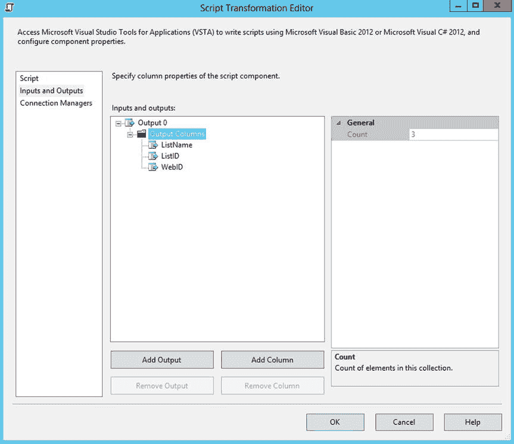

图 15-16. 添加输出列

## 脚本

现在是编辑脚本的时候了。首先，由于你要处理 Web 服务，需要向 SharePoint 列表 Web 服务添加服务引用。其地址为 `http://<sitename>/_vti_bin/lists.asmx`，其中 `<sitename>` 是站点名称。你可以在图 15-17 中看到这一点。对于命名空间，选择 `SharePointListWebService`。

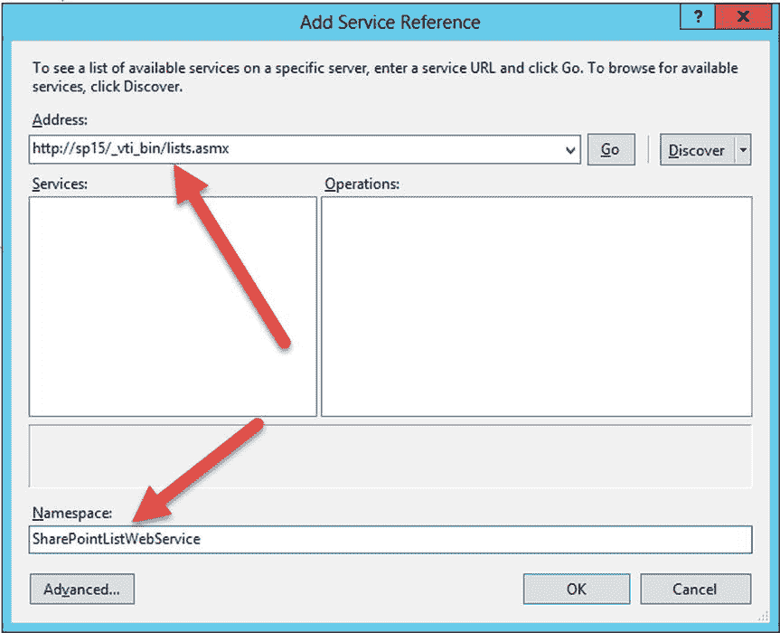

图 15-17. 添加服务引用

图 15-17 中的地址用于生成服务接口和协定。地址本身将是动态的，并在运行时借助变量 `SiteURL` 指定。

为了功能、可读性和易用性，添加一些自定义命名空间。

```
#region CustomNameSpace
using System.Xml;
using System.ServiceModel;
using SC_3ed715c2a09541348a1ee539d02fd266.SharePointListWebService;
#endregion
```

这是 VB.NET 代码：

```
#Region "CustomNamespace"
Imports System.Xml
Imports System.ServiceModel
Imports SC_3ed715c2a09541348a1ee539d02fd266.SharePointListWebService
#End Region
```

如果你阅读过第 7 章，你已经知道要在所有正确的配置文件中获取所有正确的 Web 服务配置值是多么困难。这次，你创建了一个方法来实现 SharePoint Web 服务（NTLM）所需的安全性。以下方法是 `app.config` 中内容的 C#/VB.NET 版本。该方法需要添加到最后的方法声明之后，但在 VSTA 的 C# 或 VB.NET 类内部。

```
internal static ListsSoapClient CreateWebServiceInstance(string siteUrl)
{
    BasicHttpBinding binding = new BasicHttpBinding();
    // These are defaults and reflect  app.config:
    binding.SendTimeout = TimeSpan.FromMinutes(1);
    binding.OpenTimeout = TimeSpan.FromMinutes(1);
    binding.CloseTimeout = TimeSpan.FromMinutes(1);
    binding.ReceiveTimeout = TimeSpan.FromMinutes(10);
    binding.AllowCookies = false;
    binding.BypassProxyOnLocal = false;
    binding.HostNameComparisonMode = HostNameComparisonMode.StrongWildcard;
    binding.MessageEncoding = WSMessageEncoding.Text;
    binding.TextEncoding = System.Text.Encoding.UTF8;
    binding.TransferMode = TransferMode.Buffered;
    binding.UseDefaultWebProxy = true;
    binding.Security.Mode = BasicHttpSecurityMode.TransportCredentialOnly;
    binding.Security.Transport.ClientCredentialType =
        HttpClientCredentialType.Ntlm;
    binding.Security.Message.ClientCredentialType =
        BasicHttpMessageCredentialType.UserName;
    return new ListsSoapClient(binding, new EndpointAddress(siteUrl + @"/_vti_bin/lists.asmx"));
}
```

这是 VB.NET 代码：

```
' Create CRM request to (de)activate record
Dim setStateRequest As New SetStateRequest()

' Which entity/record should be (de)activate?
' First part in the entityname, second is the entity id from the CRM source.
setStateRequest.EntityMoniker = New EntityReference("contact", Row.ContactId)

' Setting 'State' (0 – Active ; 1 – InActive)
setStateRequest.State = New OptionSetValue(1)

' Setting 'Status' (1 – Active ; 2 – InActive)
setStateRequest.Status = New OptionSetValue(2)

' Execute the request
Dim response As SetStateResponse = _
     DirectCast(organizationservice.Execute(setStateRequest), SetStateResponse)
```

```
Friend Shared Function `CreateWebServiceInstance`(siteUrl As String) As `ListsSoapClient`
    Dim binding As New `BasicHttpBinding`()
    ' These are defaults and reflect app.config:
    binding.SendTimeout = `TimeSpan.FromMinutes(1)`
    binding.OpenTimeout = `TimeSpan.FromMinutes(1)`
    binding.CloseTimeout = `TimeSpan.FromMinutes(1)`
    binding.ReceiveTimeout = `TimeSpan.FromMinutes(10)`
    binding.AllowCookies = False
    binding.BypassProxyOnLocal = False
    binding.HostNameComparisonMode = `HostNameComparisonMode.StrongWildcard`
    binding.MessageEncoding = `WSMessageEncoding.Text`
    binding.TextEncoding = `System.Text.Encoding.UTF8`
    binding.TransferMode = `TransferMode.Buffered`
    binding.UseDefaultWebProxy = True
    binding.Security.Mode = `BasicHttpSecurityMode.TransportCredentialOnly`
    binding.Security.Transport.ClientCredentialType = _
        `HttpClientCredentialType.Ntlm`
    binding.Security.Message.ClientCredentialType = _
        `BasicHttpMessageCredentialType.UserName`
    Return New `ListsSoapClient`(binding, New EndpointAddress(siteUrl & _
        `Convert.ToString("/_vti_bin/lists.asmx")`)))
End Function
```

如您所见，其中包含了配置所需的一切。但关键部分是 `ClientCredentialType`。SharePoint 要求使用 `NTLM`。如果您是从内部调用，则无需传递凭据。在脚本的 `PreExecute` 方法中实例化客户端：

```
//Create the client with all the bindings set
ListsSoapClient client = CreateWebServiceInstance(siteUrl);

//Programatically sets the credentials
client.ClientCredentials.Windows.ClientCredential = new System.Net.NetworkCredential();
client.ClientCredentials.Windows.AllowedImpersonationLevel = System.Security.Principal.TokenImpersonationLevel.Impersonation;
client.Open();

//Call the method to get all the lists
result = client.GetListCollection();

//Tidy up
client.Close();
```

以下是 `VB.NET` 代码：

```
'Create the client with all the bindings set
Dim client As ListsSoapClient = CreateWebServiceInstance(siteUrl)

'Programatically sets the credentials
client.ClientCredentials.Windows.ClientCredential = New System.Net.NetworkCredential()
client.ClientCredentials.Windows.AllowedImpersonationLevel = System.Security.Principal.TokenImpersonationLevel.Impersonation
client.Open()

'Call the method to get all the lists
result = client.GetListCollection()

'Tidy up
client.Close()
```

结果存储在一个名为 `result` 的变量中，之后在 `CreateNewOutputRows` 方法中，您可以遍历该变量，并为每个结果添加一行信息。

```
foreach (XmlNode node in result)
{
    if (node.Name == "List")
    {
        Output0Buffer.AddRow();
        Output0Buffer.ListID = node.Attributes["ID"].Value;
        Output0Buffer.ListName = node.Attributes["Title"].Value;
    }
}
```

以下是 `VB.NET` 代码：

```
For Each node As XmlNode In result
    If node.Name = "List" Then
        Output0Buffer.AddRow()
        Output0Buffer.ListID = node.Attributes("ID").Value
        Output0Buffer.ListName = node.Attributes("Title").Value
    End If
Next
```

### 从库中提取 Excel 文件

现在您已经获得了输出行，接下来需要在数据流任务中添加另一个名为 `SRC_TRA-GetExcelDocuments` 的脚本组件。这次，您选择“转换”类型，因为您将获取每个列表并从中提取所需的项目。

在其脚本页面上，将 `fileType` 和 `siteURL` 添加到 `ReadOnlyVariables` 列表中。

在“输入列”页面上，勾选所有可用列：`ListName`、`ListID` 和 `WebID`。

在“输入和输出”页面上，务必记住将 `SynchronousInputID` 设置为 `None`，因为您希望脚本组件在其输出中生成比接收到的更多的行。显然，每个文档库中可能包含不止一个 Excel 文件。

> **注意：** 同步输出和异步输出之间的区别在第 11 章中有更详细的解释。

您还需要向输出中添加两列：类型为字符串、长度为 250 的 `FileFullPath`，以及一个类型为字符串、使用默认长度的 `listName`，用于返回文件所在库的名称（参见图 15-18）。

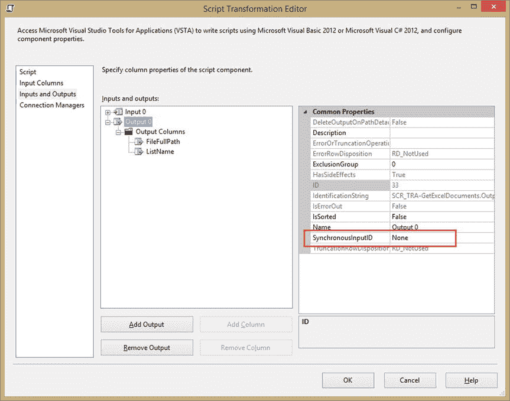

*图 15-18.* 向脚本组件添加输出

您需要再次添加对 SharePoint Web 服务的引用，方法与之前完全相同。您还需要添加 `help` 方法来设置绑定。

同样，您需要一些自定义命名空间：

```
#region CustomNameSpace
using System.Xml;
using System.Windows.Forms;
using System.ServiceModel;
using SC_3ed715c2a09541348a1ee539d02fd266.SharePointListWebService;
using System.Text;
using System.ServiceModel.Description;
#endregion
```

以下是 `VB.NET` 代码：

## PreExecute

在脚本的 `PreExecute` 方法中，实例化并打开 Web 服务。您不希望它在处理每一行时都被实例化。

```vb
#Region "CustomNameSpace"
Imports System.Xml
Imports System.Windows.Forms
Imports System.ServiceModel
Imports SC_3ed715c2a09541348a1ee539d02fd266.SharePointListWebService
Imports System.Text
Imports System.ServiceModel.Description
#End Region
```

```csharp
//Assign the package variables to some local variables
string siteUrl = Variables.siteUrl;
fileType = Variables.fileType;

//Create the client with all the bindings set
client = CreateWebServiceInstance(siteUrl);

//Programatically sets the credentials
client.ClientCredentials.Windows.ClientCredential = new
                                               System.Net.NetworkCredential();
client.ClientCredentials.Windows.AllowedImpersonationLevel =
              System.Security.Principal.TokenImpersonationLevel.Impersonation;
client.Open();
```

以下是 VB.NET 代码：

```vbnet
'Assign the package variables to some local variables
Dim siteUrl As String = Variables.siteUrl
fileType = Variables.fileType

'Create the client with all the bindings set
client = CreateWebServiceInstance(siteUrl)

'Programatically sets the credentials
client.ClientCredentials.Windows.ClientCredential = New System.Net.NetworkCredential()
client.ClientCredentials.Windows.AllowedImpersonationLevel = System.Security.Principal.TokenImpersonationLevel.Impersonation
client.Open()
```

## Input0_ProcessInputRow

`Input0_ProcessInputRow` 方法是实际执行工作的位置。您在此处调用另一个 SharePoint Web 服务方法。`GetListItems` 方法返回列表中的所有元素。有关此方法的更多信息，请访问 [`msdn.microsoft.com/en-us/library/lists.lists.getlistitems`](https://msdn.microsoft.com/en-us/library/lists.lists.getlistitems)。

基本上，您需要定义一个查询元素（`query`），其中包含决定返回哪些记录及其顺序的查询，以及一个 `viewFields` 元素，用于指定在查询中返回哪些字段及其顺序。为了保持代码整洁，有一些辅助方法来创建 XML 节点和元素。本章的完整脚本可供下载，因此此处仅列出相关部分。

对 Web 服务的调用如下所示：

```csharp
XmlNode listContent = client.GetListItems(listName, null, null,
                (XmlElement)ViewFields, null, (XmlElement)QueryOptions, webID);
```

以下是 VB.NET 代码：

```vbnet
Dim listContent As XmlNode = client.GetListItems(listName, Nothing, Nothing, DirectCast(ViewFields, XmlElement), Nothing, DirectCast(QueryOptions, XmlElement), _
webID)
```

调用 Web 服务并处理了架构和命名空间后，您便可以遍历结果以提取所需的文件类型。

```csharp
foreach (XmlNode row in rows)
{
    if (row.Attributes["ows_ContentType"].Value == "Document" &&
        row.Attributes["ows_DocIcon"].Value == fileType)
    {
        //more than one excel file per library - add one row per file to the output
        Output0Buffer.AddRow();
        Output0Buffer.FileFullPath = row.Attributes["ows_EncodedAbsUrl"].Value;
        Output0Buffer.ListName = listName;
        //xmlResultsDoc.Save(@"c:\listContent.xml"); // for debug
    }
}
```

以下是 VB.NET 代码：

```vbnet
For Each row As XmlNode In rows
        If row.Attributes("ows_ContentType").Value = "Document" AndAlso row.Attributes("ows_DocIcon").Value = fileType Then
                'more than one excel file per library - add one row per file to the output
                Output0Buffer.AddRow()
                Output0Buffer.FileFullPath = row.Attributes("ows_EncodedAbsUrl").Value
                Output0Buffer.ListName = listName
        End If
Next
```

最后，在数据流中添加一个多播（Multicast）和一个数据查看器（data viewer），以便能够查看数据。结果如图 15-19 所示。

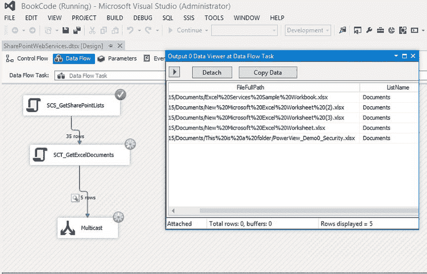

图 15-19. 调用 SharePoint Web 服务的结果

### 总结

在本章中，你学习了如何在脚本组件中使用 Web 服务，特别是针对 Dynamics CRM 和 SharePoint 等微软产品。请注意，Web 服务通常比直接访问 API 更慢，但它具有许多优势，例如作为行业标准、与供应商无关以及解耦性。此外，Web 服务的本质使你能够为 SSIS 解决方案添加极大的灵活性。