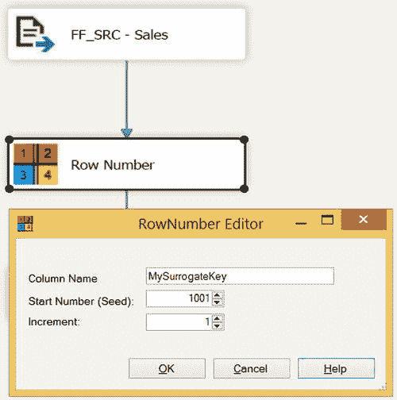
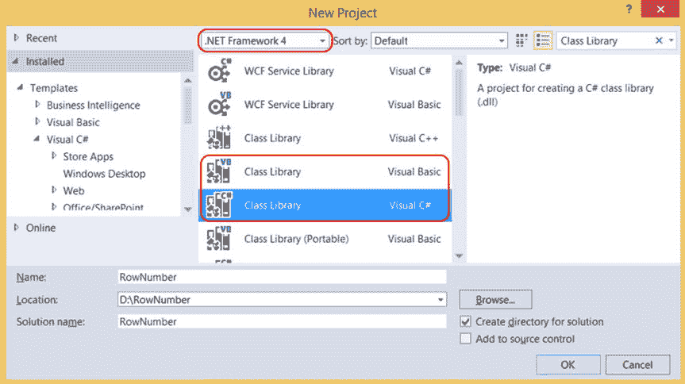
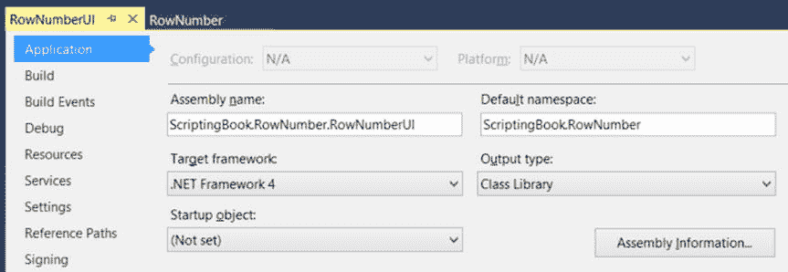
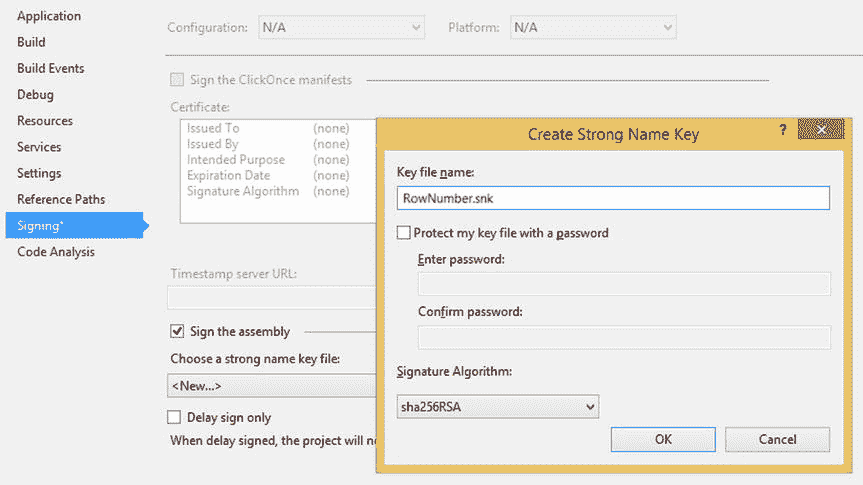
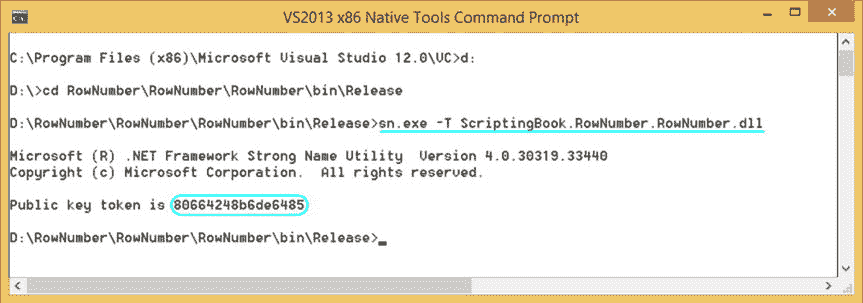
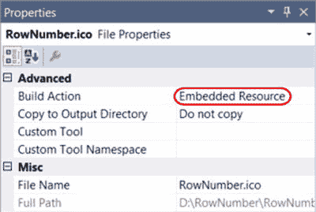
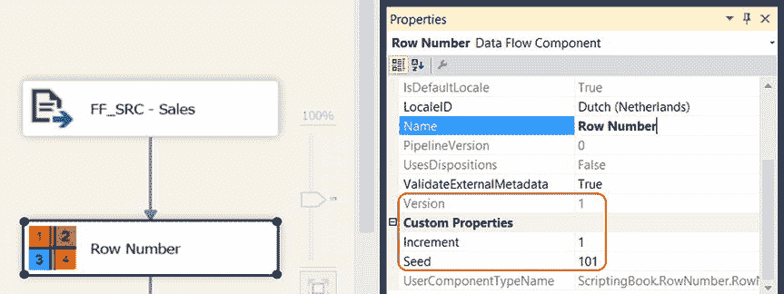
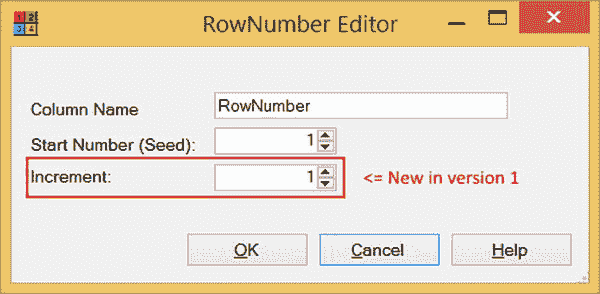
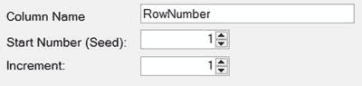
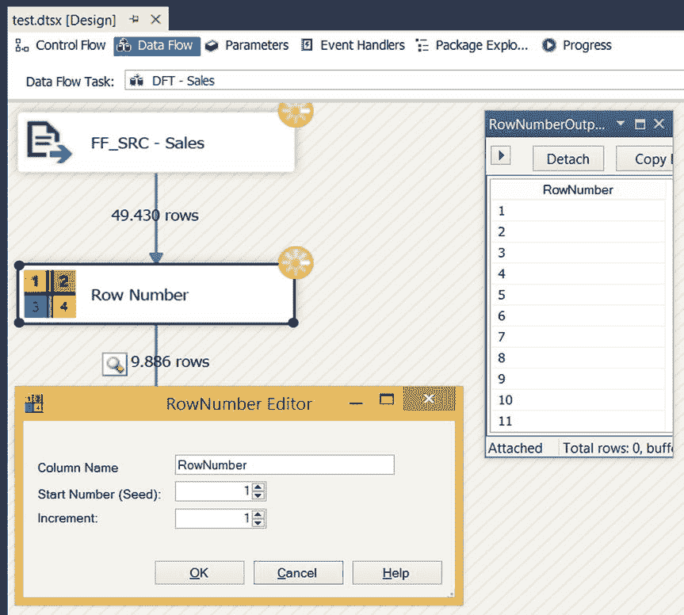

# 17. 创建自定义转换

电子补充材料 本章的在线版本 (doi: [10.1007/978-1-4842-0638-6_17](http://dx.doi.org/10.1007/978-1-4842-0638-6_17)) 包含补充材料，供授权用户使用。

本章向您展示如何为数据流创建自定义转换。与自定义任务相比，这稍微复杂一些，因为需要处理更多的方法和要点。为了便于理解，您将使用在脚本组件章节中看到的行号脚本。这是一个非常基础的转换，但易于扩展，可以添加您在各类博客和论坛上找到的各种高级功能。

与使用脚本组件相比，创建自定义转换的利弊与自定义任务和脚本任务之间的比较类似（参见图 17-1）。然而，由于这更困难，您决定采用自定义转换而非脚本组件的临界点可能会向脚本组件方向略微偏移。



图 17-1. 数据流的自定义转换

### 自定义转换的准备

在本示例中，您将创建一个转换，该转换会添加一个包含代理键（或行号）的新列。为此，您需要一个支持 C# 和 VB.NET 项目的 Visual Studio 版本。仅凭 BIDS 或 SSDT 是不够的，因为它们只支持 BI 项目。本示例使用 Visual Studio Professional 2013，但也有支持 C# 和 VB.NET 的更便宜的版本，例如 Visual Studio Community 或 Visual Studio Express。示例代码包含一个额外的安装程序项目。该项目的模板可以从 [`https://visualstudiogallery.msdn.microsoft.com/9abe329c-9bba-44a1-be59-0fbf6151054d`](https://visualstudiogallery.msdn.microsoft.com/9abe329c-9bba-44a1-be59-0fbf6151054d) 下载。

当然，您还需要安装要支持自定义转换的所有 SSIS 版本。如果您希望您的转换能在多个 SSIS 版本上工作，则需要使用不同的引用重新编译代码。

#### 创建 Visual Studio 项目

对于此自定义转换，您将使用两个类库项目。一个用于实际的转换，另一个用于用户界面。请确保为转换选择了正确的 .NET 版本。SSIS 2005: 2.0, SSIS 2008: 3.5, SSIS 2012: 4.0, SSIS 2014: 4.0。首先创建一个名为 `RowNumber` 的新项目，然后向同一解决方案中添加第二个类库项目，命名为 `RowNumberUI`，如图 17-2 所示。



图 17-2. 类库项目

在开始编码之前，您首先需要处理许多其他事项，例如引用、强名称、生成事件，当然还有图标。

#### 默认命名空间和程序集名称

转到您项目的属性。在“应用程序”页面中，您需要更改两个项目的程序集名称和默认命名空间（参见图 17-3）。默认命名空间将为 `ScriptingBook.RowNumber`。程序集名称将是默认命名空间加上项目名称：`RowNumber` 项目和 `RowNumberUI` 项目分别对应 `ScriptingBook.RowNumber.RowNumber` 和 `ScriptingBook.RowNumber.RowNumberUI`。



图 17-3. 设置命名空间和程序集名称

#### 创建强名称密钥

SSIS 运行时要求程序集位于 GAC 中。GAC 要求程序集具有强名称。这提供了唯一的标识。因此，您需要为程序集提供一个强名称。转到其中一个项目的属性，然后转到“签名”页面。勾选“为程序集签名”复选框，然后在下拉列表中添加一个新的密钥文件。本例中的名称是 `RowNumber.snk`，签名算法为 `sha256RSA`，无密码（参见图 17-4）。单击“确定”按钮后，新的密钥文件将出现在解决方案资源管理器中。接下来，您需要将相同的 `.snk` 文件复制到另一个项目，然后使用相同的密钥文件对该项目进行签名。您也可以通过将密钥文件复制到当前项目中来重用自定义任务项目中的密钥文件。



图 17-4. 添加密钥文件 (C# 项目，但 VB.NET 看起来类似)


#### 获取公钥令牌

对于运行时代码，你需要获取 GUI 程序集的公钥令牌（PublicKeyToken）。因此，请先使用发布配置生成项目，然后打开 Visual Studio 命令提示符（见图 17-5）。使用 `cd`（更改目录）命令导航到某个项目的 `Bin\Release` 文件夹，并执行以下命令以获取公钥令牌：



图 17-5.

用于获取公钥令牌的强名称工具

```
sn.exe -T ScriptingBook.RowNumber.RowNumber.dll
```

复制此密钥令牌以备将来使用。

如果您复用了自定义任务项目中的密钥文件，那么公钥令牌是相同的，可以跳过此步骤。

#### 图标

当然，你需要一个漂亮的图标来代表我们的转换。网上有很多免费的图标，也有创建新图标的工具。通过解决方案资源管理器将 `.ico` 文件添加到两个项目中。添加图标文件后，请确保将 **`Build Action`** 属性更改为 `Embedded Resource`；否则，图标将不会显示。稍后，你可以在 UI 项目的 Windows 窗体中使用此图标。这样，当你编辑转换时，它就会显示出来（见图 17-6）。



图 17-6.

设置图标的 **`Build Action`**

在运行时项目中，你可以使用此文件为你的转换提供自定义图标，而不是默认图标。这将在 SSIS 工具箱和数据流中显示。实现此功能的代码将在后面解释。

#### 生成事件

要在 SSIS 中使用这些程序集，你需要将它们安装到 GAC（全局程序集缓存）中供运行时使用，并将它们复制到 SSIS 的设计时 `PipelineComponents` 文件夹。你可以在生成 Visual Studio 项目时，通过生成事件自动完成此操作。但由于要将程序集添加到 GAC，因此需要以管理员身份运行 Visual Studio。转到项目属性，然后转到生成事件。C# 项目有一个单独的“生成事件”选项卡，而 VB.NET 项目在“编译”选项卡上有一个 **`Build Events`** 按钮。将以下命令添加到后期生成事件中。请注意，SQL Server 文件夹中的编号因 SSIS 版本而异：2005：90，2008：100，2012：110，2014：120，2016：130。另请注意，在后期生成事件命令行文本框中，路径应位于一行。此处为适应页面排版而换行。

SSIS 2008

```
cd $(ProjectDir)
@SET PIPEDIR="C:\Program Files (x86)\Microsoft SQL Server\100\DTS\PipelineComponents\"
@SET GACUTIL="C:\Program Files (x86)\Microsoft SDKs\Windows\v7.0A\bin\gacutil.exe"
Echo Installing dll in GAC
Echo $(OutDir)
Echo $(TargetFileName)
%GACUTIL% -if "$(OutDir)$(TargetFileName)"
Echo Copying files to Tasks
copy "$(OutDir)$(TargetFileName)" %PIPEDIR%
```

SSIS 2012 与 Visual Studio 2010

```
cd $(ProjectDir)
@SET PIPEDIR="C:\Program Files (x86)\Microsoft SQL Server\110\DTS\PipelineComponents\"
@SET GACUTIL="C:\Program Files (x86)\Microsoft SDKs\Windows\v7.0A\Bin\NETFX 4.0 Tools\gacutil.exe"
Echo Installing dll in GAC
Echo $(OutDir)
Echo $(TargetFileName)
%GACUTIL% -if "$(OutDir)$(TargetFileName)"
Echo Copying files to Tasks
copy "$(OutDir)$(TargetFileName)" %PIPEDIR%
```

注意

如果你使用的是 Visual Studio 2012 或 Visual Studio 2013，则 `gacutil.exe` 位于 v8.0a 文件夹而不是 v7.0a 中。其他版本的路径也可能不同。`gacutil.exe` 也可以下载；它是 Microsoft Windows SDK 的一部分。

### 自定义转换运行时代码

你将从执行转换时使用的代码开始。由于完整代码太多，无法在书中全部展示，因此你将重点关注最重要的 SSIS 内容。但本书附带了代码。你可以从示例代码中复制 `RowNumber.cs` 文件并将其添加到你的项目中。

首先，你需要添加一些额外的 SSIS 命名空间来简化代码。这是你将在本项目中使用的完整列表：

```
using System;
using Microsoft.SqlServer.Dts.Pipeline;
using Microsoft.SqlServer.Dts.Pipeline.Wrapper;
using Microsoft.SqlServer.Dts.Runtime.Wrapper;
```

现在是你转换中最重要的代码——在这里命名它、赋予其图标并将其连接到编辑器程序集：`DtsPipelineComponent`。此属性允许你设置组件的所有元数据。

```
namespace ScriptingBook.RowNumber
{
    [DtsPipelineComponent(
    DisplayName = "Row Number",
    ComponentType = ComponentType.Transform,
    Description = "Adds a rownumber to the output",
    IconResource = "ScriptingBook.RowNumber.RowNumber.ico",
    UITypeName = "ScriptingBook.RowNumber.RowNumberInterface, ScriptingBook.RowNumber.RowNumberUI, Version=1.0.0.0, Culture=Neutral, PublicKeyToken=80664248b6de6485",
    CurrentVersion = 1
    )]
    public class RowNumber : PipelineComponent
    {
```

`DtsPipelineComponent` 标签具有可以更改的属性，如下所示：

- `DisplayName`：这是你在工具箱中看到的名称；它是你将转换拖到数据流时的默认名称。
- `ComponentType`：通过此属性，你可以告知 SSIS 它是转换、源还是目标。
- `Description`：用作转换默认描述的文本。
- `IconResource`：嵌入图标的完全限定名称。这在工具箱中以及当你将转换拖到数据流中时显示。尝试找到一个能够描述你的任务并与其他图标风格相符的图标。这是一项相当艰巨的任务。
- `UITypeName`：这是与编辑器的连接，你可以在其中命名接口类和 UI 类。在此字符串中，你还需要粘贴通过 `sn` 命令检索到的公钥令牌。请注意，这虽然是一行代码，但在此处为适应页面排版而换行。
- `CurrentVersion`：这可以在名为 `PerformUpgrade` 的方法中使用，以处理当你添加额外属性时发生的更改，这些属性在使用旧版本转换的包中不存在。如果你不处理这些更改，则在使用旧版本的包中会出现错误。更多信息见后文。

另外要注意类名之后的接口：`PipelineComponent`。这允许你用自己的代码覆盖接口中的方法。代码中每个带有 `override` 修饰符的方法都来自此接口。


### 组件属性及输入输出端口

第一种方法是 `ProvideComponentProperties`，在组件添加到数据流界面时被调用。在该方法中，您通过添加输入端口、输出端口、自定义属性以及一个用于存储行号的新输出列来初始化组件。

在输入端口中，您告知组件哪些数据将进入组件，以及当输入失败时应如何处理。在本例中，您不需要输入列，因为您不使用上游数据，也不需要错误输出。

在输出端口中，您告知组件输出是否为同步，以及添加了哪些新输出列。我们的示例是同步的，并且您需要一个新输出列来存储新的行号。

自定义属性端口是您向组件添加属性（`Increment` 和 `Seed`）的地方（参见图 17-7）。这与自定义任务示例中的方式完全不同。除了名称、描述和初始值之外，您还可以指示用户是否可以在属性中使用表达式。



图 17-7. 自定义属性与元数据版本

此外还有一个补充。组件的版本号存储在一个属性中。如果之后安装了组件的新版本，则可以在 `PerformUpgrade` 方法中将此初始（元数据）版本号与当前（二进制）版本号进行比较。更多细节将在后续说明。

```
// 用于存储自定义属性默认值的类变量
private Int64 _seed = 1;
private int _increment = 1;
private string _newColumnName = "RowNumber";

public override void ProvideComponentProperties()
{
    // 当组件初始添加到数据流任务时调用此方法。
    // 添加输入
    IDTSInput100 input = ComponentMetaData.InputCollection.New();
    input.Name = "RowNumberInput";
    // 不使用 ErrorRowDisposition。
    // 如果在行处理过程中失败，不希望其进入备用输出缓冲区。
    input.ErrorRowDisposition = DTSRowDisposition.RD_NotUsed;

    // 添加输出（同步）
    // 异步会创建新的缓冲区
    // 同步将列添加到现有缓冲区
    // SynchronousInputID 连接同步组件的输入和输出
    IDTSOutput100 output = ComponentMetaData.OutputCollection.New();
    output.Name = "RowNumberOutput";
    output.SynchronousInputID = input.ID;
    output.ExclusionGroup = 1;

    // 添加列
    // 初始时使用默认名称创建一个新的输出列
    // 在 UI 中您可以更改此名称。默认数据类型为 DT_I8。
    // 您可以添加一个数据类型下拉框，让用户选择要使用的数据类型。
    IDTSOutputColumn100 outputColumn = output.OutputColumnCollection.New();
    outputColumn.Name = _newColumnName;
    outputColumn.Description = "生成的行号";
    outputColumn.SetDataTypeProperties(DataType.DT_I8, 0, 0, 0, 0);

    // 定义此组件的自定义属性
    AddProperty("Seed", "起始数字。", _seed, false);
    AddProperty("Increment", "增量大小。", _increment, false);

    // 针对版本控制错误的变通方案（由 Todd McDermid 提供）
    // 当组件添加到数据流时，版本号会保存在包中。
    // 当安装了新版本的组件时，PerformUpgrade 方法可以处理这些更改。
    DtsPipelineComponentAttribute componentAttribute =
        (DtsPipelineComponentAttribute)
        Attribute.GetCustomAttribute(this.GetType(),
        typeof(DtsPipelineComponentAttribute), false);
    ComponentMetaData.Version = componentAttribute.CurrentVersion;
}

// 添加自定义属性的辅助方法
private void AddProperty(string name,
    string description,
    object value,
    bool supportsExpression)
{
    // 向组件添加自定义属性
    IDTSCustomProperty100 commandProp = this.ComponentMetaData.CustomPropertyCollection.New();
    commandProp.Name = name;
    commandProp.Description = description;
    if (supportsExpression)
    {
        // 告知 SSIS 您允许对我们的属性使用表达式
        commandProp.ExpressionType = DTSCustomPropertyExpressionType.CPET_NOTIFY;
    }
    commandProp.Value = value;
    return;
}
```

### 验证转换

为了验证自定义转换，您需要重写 `Validate` 方法。就像在自定义任务中一样，您可以检查自定义属性的值，看它们是否符合预期。但您也可以验证输入和输出：输出列的数量是否正确？某个输入列是可读/写的吗？或者输入数量是否多于一个？验证方法在设计时关闭编辑器时执行，以及在运行时初始化包和执行数据流任务时各执行一次（参见图 17-8）。


图 17-8. 设计时错误

以下是您可以返回的四种不同状态：

* `VS_ISBROKEN`: 组件的元数据不正常。用户应在数据流中解决此问题。示例：`increment = 0`。
* `VS_ISCORRUPT`: 存在无法修复的错误。最好通过删除并重新添加组件来重新开始。示例：输入或输出数量不正确。
* `VS_ISVALID`: 一切正常。
* `VS_NEEDSNEWMETADATA`: 列的元数据存在问题，需要修复。示例：上游列被删除或更改。

```
public override DTSValidationStatus Validate()
{
    // 用于 FireError 的布尔值，指示是否取消执行
    bool pbCancel = false;

    // 如果您使用了输入列并且输入流
    // 被删除或更改，则可能会影响我们的
    // 代码。因此，检查输入列是否
    // 仍然有效
    if (!ComponentMetaData.AreInputColumnsValid)
    {
        return DTSValidationStatus.VS_NEEDSNEWMETADATA;
    }

    // 验证是否只有 1 个输入
    if (ComponentMetaData.InputCollection.Count != 1)
    {
        ComponentMetaData.FireError(0, ComponentMetaData.Name,
        "输入数量不正确。", "", 0, out pbCancel);
        return DTSValidationStatus.VS_ISCORRUPT;
    }

    // 验证没有输入列
    if (ComponentMetaData.InputCollection[0].InputColumnCollection.Count !=
        0)
    {
        ComponentMetaData.FireError(0, ComponentMetaData.Name,
        "输入列数量不正确。", "", 0, out pbCancel);
        return DTSValidationStatus.VS_ISCORRUPT;
    }

    // 验证是否只有 1 个输出
    if (ComponentMetaData.OutputCollection.Count != 1)
    {
        ComponentMetaData.FireError(0, ComponentMetaData.Name,
        "输出数量不正确。", "", 0, out pbCancel);
        return DTSValidationStatus.VS_ISCORRUPT;
    }

    // 验证是否有 1 个输出列
    if (ComponentMetaData.OutputCollection[0].OutputColumnCollection.Count
        != 1)
    {
        ComponentMetaData.FireError(0, ComponentMetaData.Name,
        "输出列数量不正确", "", 0, out pbCancel);
        return DTSValidationStatus.VS_ISCORRUPT;
    }

    // 验证增量不为零
    if (_increment == 0)
    {
        ComponentMetaData.FireError(0, ComponentMetaData.Name,
        "增量不能为零", "", 0, out pbCancel);
        return DTSValidationStatus.VS_ISBROKEN;
    }

    return base.Validate();
}
```


#### 执行代码

此转换的实际代码在名为 `ProcessInput` 的重写方法中执行。对于这个示例，由于没有输入列且只有一个输出列，因此代码相当简单。该方法会针对传递给组件的每个缓冲区执行。你需要遍历当前缓冲区中的行，填充新列，然后递增行号以处理下一行。

此外，还可以对新的值进行验证。如果新列是 `DT_I4` 类型，则需要确保新的行号能够被容纳。本示例使用了 `DT_I8` 类型，其最大值非常大，不太可能很快达到上限。

```
public override void ProcessInput(int inputID, PipelineBuffer buffer)
{
  // 遍历缓冲区中的行
  while (buffer.NextRow())
  {
    // 检查新数字是否超出范围。对于最大值为 9,223,372,036,854,775,807 的 bigint 来说，
    // 这个检查可能不太有用。
    if (_currentRowNumber < Int64.MinValue ||
        _currentRowNumber > Int64.MaxValue)
    {
      // 抛出错误，该值无法被所选变量类型容纳！
      bool pbCancel = true;
      ComponentMetaData.FireError(0, this.ComponentMetaData.Name,
      "行号不在所选变量类型 DT_I8 (Int64) 的范围内", string.Empty, 0, out pbCancel);
      throw new ApplicationException("行号不在所选变量类型 'DT_I8 (Int64)' 的范围内。");
    }
    // 用行号填充第一个（索引为 0 的）输出列
    buffer.SetInt64(0, _currentRowNumber);
    // 准备就绪后递增
    _currentRowNumber = _currentRowNumber + _increment;
    // 将行定向到 defaultOutput
    buffer.DirectRow(ComponentMetaData.OutputCollection[0].ID);
  }
}
```

#### PreExecute

`PreExecute` 方法仅在 `ProcessInput` 方法启动前执行一次。它是执行任何可以预先完成并缓存以供其他方法使用的处理的好地方。对于此示例，你只需从属性中获取值，以便在 `ProcessInput` 方法中用于添加行号。如果你还有输入列，那么这也是映射输入和输出的位置。

```
public override void PreExecute()
{
  // 从属性中获取值，以便在 ProcessInput 中使用
  _currentRowNumber = Int64.Parse(this.ComponentMetaData
                      .CustomPropertyCollection["Seed"].Value.ToString());
  _increment = (int)this.ComponentMetaData
               .CustomPropertyCollection["Increment"].Value;
}
```

#### PerformUpgrade

如果你想要扩展自定义转换，这是一个重要的方法。你需要将代码中的版本与包中的版本进行比较（参见图 17-9）。如果转换的版本 0 没有更改增量的属性，而版本 1 引入了该属性，那么你不希望使用版本 0 创建的现有包因此失败。



图 17-9. 带有增量选项的新版本

如果元数据版本低于二进制版本，则可以添加带有默认值的附加属性。这应该可以防止因升级而导致的错误。

而且，如果你（例如）忘记了升级生产服务器上的转换，那么元数据版本可能高于二进制版本。在这种情况下，你也应该抛出一个错误。

```
public override void PerformUpgrade(int pipelineVersion)
{
  // 从属性中获取当前组件版本。
  DtsPipelineComponentAttribute componentAttribute =
      (DtsPipelineComponentAttribute)Attribute.GetCustomAttribute(
       this.GetType(), typeof(DtsPipelineComponentAttribute), false);
  int binaryVersion = componentAttribute.CurrentVersion;
  int metaDataVersion = ComponentMetaData.Version;

  // 如果包中保存的组件版本低于当前版本（版本 2），则执行升级。
  if (metaDataVersion < binaryVersion)
  {
    // 从版本 0 升级到 1
    if (metaDataVersion == 0)
    {
      if (ComponentMetaData.CustomPropertyCollection["Increment"] == null)
      {
        // 添加具有默认值的新属性
        AddProperty("Increment", "增量大小。", 1, false);
      }
    }
    // 更新元数据版本，否则版本仍然不同，
    // 下次打开包时会再次执行升级，导致错误。
    ComponentMetaData.Version = binaryVersion;
  }

  // 忘记升级服务器上的转换了？
  if (metaDataVersion > binaryVersion)
  {
      throw new Exception("组件的运行时版本已过期。"
      + "升级安装程序可能会解决此问题。");
  }
}
```

#### 禁用高级编辑器

如果你已为转换添加了自定义编辑器，则可能不希望用户使用高级编辑器并可能弄乱你的组件。你可以重写这些处理程序并抛出错误。以下是删除输出端口的一个示例，但代码中还有更多类似操作。

```
public override void DeleteOutput(int outputID)
{
  throw new Exception(string.Format("不允许从 '{0}' 中删除输出。", ComponentMetaData.Name), null);
}
```

### 自定义转换窗体

为了便于解释，窗体布局再次保持非常简单（参见图 17-10）。为了添加行号，用户可以指定包含行号的新列的名称。并且用户可以在编辑器中更改起始编号和增量。



图 17-10. 基本窗体

此编辑器的完整代码随书提供。你可以通过以下四个步骤将示例项目中的窗体添加到你的 UI 项目：

1.  在 UI 项目中添加对 `System.Drawing` 和 `System.Windows.Forms` 的引用。
2.  将三个窗体文件 `RowNumberEditor.cs`、`RowNumberEditor.resx` 和 `RowNumberEditor.Designer.cs` 复制到你的 UI 项目文件夹。
3.  右键单击你的 UI 项目，然后选择 **添加** > **现有项** 以添加以下文件：`RowNumberEditor.cs`、`RowNumberEditor.Designer.cs` 和 `RowNumberEditor.resx`。
4.  关闭并重新打开你的解决方案。然后打开窗体以查看你添加的内容。

### 窗体代码

首先，是用于简化代码的 using 指令。你在此处只需要四个命名空间。默认情况下会有更多，但你可以删除它们。Visual Studio 甚至提供了一个选项来删除未使用的 using：右键单击 using 并选择 **组织 Using**（这可能因 Visual Studio 版本而异）。

```
using System;
using System.Windows.Forms;
using Microsoft.SqlServer.Dts.Pipeline.Wrapper;
using Microsoft.SqlServer.Dts.Runtime;
```


#### ServiceProvider、Connections、Variables 和 Metadata

该组件提供了一些对象，可用于获取变量或连接管理器，以及获取和设置自定义属性。这些对象将由实现 `IDtsComponentUI` 的 `RowNumberInterface` 类进行设置。

在此示例中，您仅使用 `IDTSComponentMetaData100` 从自定义属性中获取值。`IServiceProvider` 可以创建变量。`Variables` 对象可用于遍历所有变量，而 `Connections` 可用于遍历所有连接管理器。

```
private Variables _vars = null;

public Variables Variables
{
  get { return _vars; }
  set { _vars = value; }
}

private Connections _conns = null;

public Connections Connections
{
  get { return _conns; }
  set { _conns = value; }
}

private IServiceProvider _sp = null;

public IServiceProvider ServiceProvider
{
  get { return _sp; }
  set { _sp = value; }
}

private IDTSComponentMetaData100 _cmd = null;

public IDTSComponentMetaData100 ComponentMetadata
{
  get { return _cmd; }
  set { _cmd = value; }
}
```

#### FormLoad

在窗体加载方法 `RowNumberEditor_Load` 中，您将从自定义属性中获取值，并将其用于填充编辑器中的字段。

```
private void RowNumberEditor_Load(object sender, EventArgs e)
{
  // 获取新列的名称并填充文本框
  txtColumnName.Text = _cmd.OutputCollection[0]
                       .OutputColumnCollection[0].Name;
  // 将自定义属性中的种子值转换为 bigint 类型
  // 并填充数值调节钮
  numSeed.Value = Int64.Parse(_cmd
                  .CustomPropertyCollection["Seed"].Value.ToString());
  // 将自定义属性中的增量值转换为 int 类型
  // 并填充数值调节钮
  numIncrement.Value = (int)_cmd
                       .CustomPropertyCollection["Increment"].Value;
}
```

此示例未使用变量，但如果您需要一个包含变量的组合框，那么此处就是填充该组合框的位置。以下是一些基本的示例代码（未包含在示例代码中）：

```
// 额外的命名空间
using Microsoft.SqlServer.Dts.Runtime;

// 遍历所有变量
foreach (Microsoft.SqlServer.Dts.Runtime.Variable variable in Variables)
{
  // 过滤系统变量
  if (!variable.SystemVariable)
  {
    // 填充组合框
    cmbMyVariables.Items.Add(variable);
    // 从组合框中选择自定义属性中的变量
    if (variable.QualifiedName ==
                       (string)_cmd.CustomPropertyCollection["myVar"].Value)
    {
      cmbMyVariables.SelectedItem = variable;
    }
  }
}
```

并且，在编辑器中添加变量也是可行的，其方式与自定义任务示例类似。以下代码未包含在示例代码中：

```
// 用于存储变量在组合框中索引的整数
int currentdIndex = -1;
// 打开新的添加变量屏幕以添加整数变量
IDtsVariableService _dtsVariableService = _sp.GetService(
                    typeof(IDtsVariableService)) as IDtsVariableService;
Variable newVariable = _dtsVariableService.PromptAndCreateVariable(this,
                       null, "StartNumber", "User", typeof(Int32));
// 检查是否创建了新变量
if (newVariable != null)
{
  // 将变量添加到组合框
  currentdIndex = combobox.Items.Add(newVariable);
  // 在组合框中选择新变量
  combobox.SelectedIndex = currentdIndex;
}
```

##### 关闭编辑器并保存更改

当您通过单击“确定”按钮关闭编辑器时，您希望将表单中的值保存到转换的自定义属性中，以便在重新打开编辑器或执行转换时能够使用它们。而当您单击“取消”按钮时，则只需关闭编辑器。

```
// DTSComponent 的包装类
private CManagedComponentWrapper _designTimeInstance;

private void btnOK_Click(object sender, EventArgs e)
{
  // 仅实例化一次。您不希望每次关闭编辑器时都添加输出和列
  if (_designTimeInstance == null)
  {
      _designTimeInstance = _cmd.Instantiate();
  }
  // 检查列名是否已存在
  // 如果不存在，则更改输出列的名称
  IDTSOutputColumn100 outputColumn = _cmd.OutputCollection[0]
                                     .OutputColumnCollection[0];
  if (outputColumn.Name != txtColumnName.Text)
  {
      outputColumn.Name = txtColumnName.Text;
  }
  // 将种子值传递给组件属性
  _designTimeInstance.SetComponentProperty("Seed", (Int64)numSeed.Value);
  // 将增量值传递给组件属性
  _designTimeInstance.SetComponentProperty("Increment",
                                           (int)numIncrement.Value);
}

private void btnCancel_Click(object sender, EventArgs e)
{
  // 关闭窗口并撤销更改
  this.Close();
}
```

### 接口类代码

下一个类文件实现了 `IDtsComponentUI`。它所做的工作仅仅是将变量和 `serviceProvider` 等对象传递给编辑器。它在 SSIS 逻辑和您的自定义代码之间充当交互点。此类文件名为 `RowNumberInterface.cs`，位于 UI 项目中。

此处包含空方法是因为它们是接口 `IDtsComponentUI` 所要求的，但在此示例中，您并未为它们实现任何自定义代码。如果您省略它们，将会收到一个生成错误，提示您忘记实现接口成员。

```
using System;
using System.Windows.Forms;
using Microsoft.SqlServer.Dts.Pipeline.Design;
using Microsoft.SqlServer.Dts.Pipeline.Wrapper;
using Microsoft.SqlServer.Dts.Runtime;

// 类，为转换编辑器提供接口
namespace ScriptingBook.RowNumber
{
  public class RowNumberInterface : IDtsComponentUI
  {
    IDTSComponentMetaData100 _cmd;
    IServiceProvider _sp;

    public void Help(System.Windows.Forms.IWin32Window parentWindow)
    {
    }

    public void New(System.Windows.Forms.IWin32Window parentWindow)
    {
    }

    public void Delete(System.Windows.Forms.IWin32Window parentWindow)
    {
    }

    public bool Edit(System.Windows.Forms.IWin32Window parentWindow,
                     Variables variables, Connections connections)
    {
      // 创建并显示用户界面的窗体。
      RowNumberEditor componentEditor = new RowNumberEditor();
      componentEditor.Connections = connections;
      componentEditor.Variables = variables;
      componentEditor.ComponentMetadata = _cmd;
      componentEditor.ServiceProvider = _sp;
      return componentEditor.ShowDialog(parentWindow) == DialogResult.OK;
    }

    public void Initialize(IDTSComponentMetaData100 dtsComponentMetadata,
                           IServiceProvider serviceProvider)
    {
      // 存储组件元数据。
      _cmd = dtsComponentMetadata;
      _sp = serviceProvider;
    }
  }
}
```

当使用新的自定义转换运行数据流时，您可以添加一个数据查看器来查看您辛勤工作的成果，如图 17-11 所示。



图 17-11.

最终结果

### 总结

在本章中，您了解了生成自定义转换的基础知识。我们鼓励您在急于创建大量自定义任务和组件之前，先学习一些基本的 .NET 编码知识。MSDN 上充满了示例代码，您可以使用它们来扩展这个基础示例，使其功能更加完善。

