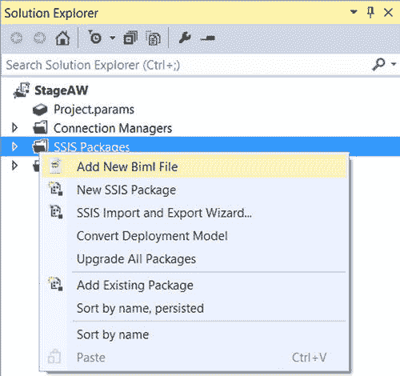
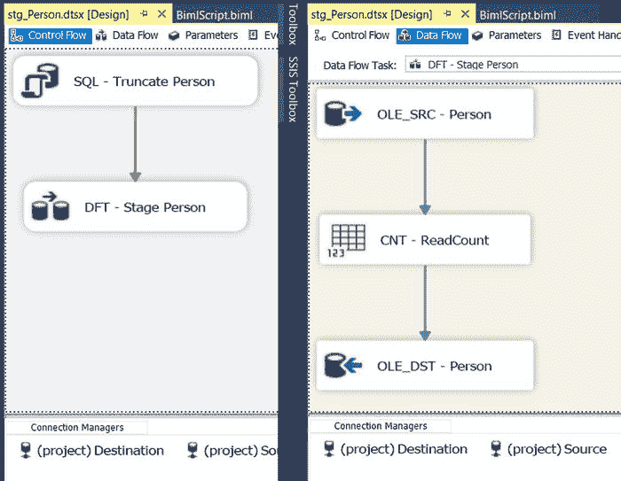
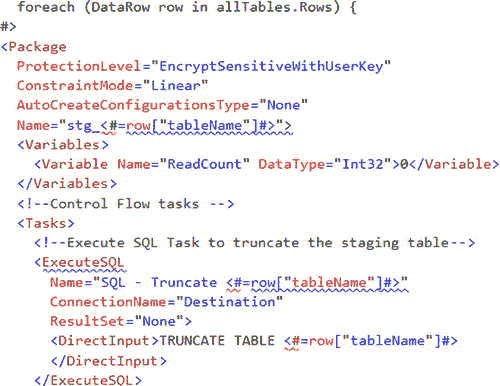
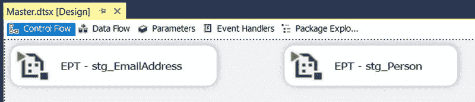

# 18. 包创建

电子补充材料 本章在线版(doi:[10.​1007/​978-1-4842-0638-6_​18](http://dx.doi.org/10.1007/978-1-4842-0638-6_18)) 包含授权用户可用的补充材料。电子补充材料 本章在线版(doi:[10.​1007/​978-1-4842-0638-6_​18](http://dx.doi.org/10.1007/978-1-4842-0638-6_18)) 包含授权用户可用的补充材料。

本章表明，除了在 SSIS 包中使用 .NET，你还可以使用 .NET 来创建 SSIS 包。虽然这听起来工作量很大，尤其是在 SSDT 中通过拖放操作就能轻松完成的情况下，但这样做也有其益处。

创建几个临时包并非最具挑战性的工作，但创建数十个呢？如果不留心，这可能会变得非常繁琐且容易出错。除摆脱 ETL 中枯燥的部分外，批量创建包还具有以下优势：

- **速度**：即使是最有经验的 SSIS 专家，一天也无法创建 50 个或更多的包。
- **可扩展性**：为所有包添加额外功能变得简单。
- **一致性**：所有包外观一致，并使用相同的命名约定。

批量生产包有两种不同的方法：

- 仅使用 C# 或 VB.NET 进行编程
- 使用 XML 与少量 C# 或 VB.NET 代码混合的 BIMLScript

### 以编程方式创建 SSIS 包

第一种方法是使用 .NET 程序集以编程方式创建包。你可以在 Visual Studio 中使用类库项目来做到这一点；但如果你只有用于 BI 的 SSDT 而没有 C# 或 VB.NET 的项目，你甚至可以（通过将代码添加到 `Main` 方法中）使用脚本任务来执行以下代码。不过，你也可以获取免费的 Visual Studio Community 或 Visual Studio Express 版本来完成此操作。

首先，添加对位于全局程序集缓存 (GAC) 中的 `Microsoft.SqlServer.ManagedDTS.dll` 的引用。每个版本的 SSIS 在 GAC 中都有属于自己的程序集版本。接下来，添加对 `Microsoft.SqlServer.Dts.Runtime` 的 `Using` 或 `Import` 指令。如果你使用脚本任务，可以跳过引用和命名空间，因为默认情况下它们已经存在。在此示例中，你将创建一个非常基础的包，其中包含一个 OLE DB 连接管理器和唯一一个执行特定语句的执行 SQL 任务。

```
// 创建新包
Package package = new Package();

// 向包添加 OLE DB 连接管理器
ConnectionManager OleDbCon = package.Connections.Add("OLEDB");
OleDbCon.ConnectionString = "Data Source=.;Integrated Security=SSPI;Initial Catalog=MyDB;";
OleDbCon.Name = "MyOleDbConnection";

// 向包添加执行 SQL 任务
Executable exec = package.Executables.Add("STOCK:SQLTask");
TaskHost thSqlTask = exec as TaskHost;
thSqlTask.Name = "SQL - Truncate Stage";

// 为执行 SQL 任务添加属性（示例表）
thSqlTask.Properties["SqlStatementSource"].SetValue(thSqlTask, "Truncate table ABC;");
thSqlTask.Properties["Connection"].SetValue(thSqlTask, OleDbCon.ID);

// 创建应用程序对象以保存包
Microsoft.SqlServer.Dts.Runtime.Application app = new Microsoft.SqlServer.Dts.Runtime.Application();

// 将包保存为 XML
app.SaveToXml(@"D:\myPackage.dtsx", package, null);
```

以下是 VB.NET 代码：

```
' 创建新包
Dim package As New Package()

' 向包添加 OLE DB 连接管理器
Dim OleDbCon As ConnectionManager = package.Connections.Add("OLEDB")
OleDbCon.ConnectionString = "Data Source=.;Integrated Security=SSPI;Initial Catalog=MyDB;"
OleDbCon.Name = "MyOleDbConnection"

' 向包添加执行 SQL 任务
Dim exec As Executable = package.Executables.Add("STOCK:SQLTask")
Dim thSqlTask As TaskHost = TryCast(exec, TaskHost)
thSqlTask.Name = "SQL - Truncate Stage"

' 为执行 SQL 任务添加属性（示例表）
thSqlTask.Properties("SqlStatementSource").SetValue(thSqlTask, "Truncate table ABC;")
thSqlTask.Properties("Connection").SetValue(thSqlTask, OleDbCon.ID)

' 创建应用程序对象以保存包
Dim app As New Microsoft.SqlServer.Dts.Runtime.Application()

' 将包保存为 XML
app.SaveToXml("D:\myPackage.dtsx", package, Nothing)
```

任务的添加相对简单，但由于使用了原生 COM API，转换操作相当困难。如果你确实喜欢这种方法并希望继续此示例，请访问 [`https://msdn.microsoft.com/en-us/library/ms345167.aspx`](https://msdn.microsoft.com/en-us/library/ms345167.aspx) 查看更多示例。

对于大多数 ETL 顾问来说，这可能太难了。这就是微软一些聪明人创建 `EzAPI` 的原因，它是一个强大的生成包的框架，并且使用起来也简单得多。在 BIML（参见下一节）出现之前，这是最流行的生成包的方式。不幸的是，这个项目已经有一段时间没有更新了；或许是因为更流行的 BIMLScript 的兴起。但如果你想了解，`EzAPI` 仍在 CodePlex 上可用，网址是 [`http://sqlsrvintegrationsrv.codeplex.com/releases/view/21238`](http://sqlsrvintegrationsrv.codeplex.com/releases/view/21238)。

### 使用 BIMLScript 创建 SSIS 包

商业智能标记语言 (BIML) 是一种用于创建 SSIS、SSAS 和数据库资产的 XML 方言；它由 Varigence 公司创建。这种方法最有趣的部分在于，你可以向 XML 中添加 .NET 代码，例如，添加一个遍历所有源表的迭代。因此，你可以使用 XML 创建包，然后通过相对简单的 .NET 语句增加灵活性和可重复性。

免费的社区版 BIMLScript 可通过 BIDSHelper 获得，但也存在名为 MIST 的商业版本，具有更多功能。你可以从 [`https://varigence.com/Mist`](https://varigence.com/Mist) 下载试用版。在本示例中，你将使用 BIDSHelper，它可以从 CodePlex 的 [`https://bidshelper.codeplex.com`](https://bidshelper.codeplex.com/) 下载。下载并安装适用于你 SQL Server 版本的相应版本，并检查你是否拥有 AdventureWorks 数据库（OLTP，2012 或 2014）。如果你还没有这个数据库，可以从 CodePlex 的 [`http://msftdbprodsamples.codeplex.com`](http://msftdbprodsamples.codeplex.com/) 下载。

在本示例中，你将创建临时包来暂存 AdventureWorks 中的表。这些包非常基础，但你可以根据自己的需求进行扩展。网上有许多可用的示例。你甚至可以生成目标表；在下一步中，你将手动执行此操作。


#### 创建临时数据库

创建一个名为 `StageAW` 的新数据库，用于存储来自 `AdventureWorks` 的临时表。第一个需要暂存的表是 `Person.Person`；你需要在临时数据库中创建此表。移除所有“冗余内容”（约束、默认值、架构等），以创建一个非常基础的临时表。后续你可以对所有需要暂存的表执行相同操作。第二个表 `Person.EmailAddress` 的脚本也已包含在内。

```
USE [StageAW]
GO

CREATE TABLE Person NULL,
    [NameStyle] [bit] NULL,
    [Title] nvarchar NULL,
    [FirstName] nvarchar NULL,
    [MiddleName] nvarchar NULL,
    [LastName] nvarchar NULL,
    [Suffix] nvarchar NULL,
    [EmailPromotion] [int] NULL,
    [AdditionalContactInfo] nvarchar NULL,
    [Demographics] nvarchar NULL,
    [rowguid] [uniqueidentifier] NULL,
    [ModifiedDate] [datetime] NULL
) ON [PRIMARY]
GO

CREATE TABLE EmailAddress NULL,
    [rowguid] [uniqueidentifier] NULL,
    [ModifiedDate] [datetime]  NULL
) ON [PRIMARY]
```

#### 添加新的 BIML 文件

在 SSDT/BIDS 中创建一个名为 `StageAW` 的新 SSIS 项目。然后右键单击项目或名为 `SSIS Packages` 的文件夹，选择 `Add New BIML File`（参见图 18-1）。如果此选项不可用，请确保加载项 `BIDSHelper` 已激活（在 `Tools` 菜单中）。一个名为 `BimlScript.biml` 的新文件将添加到 `Miscellaneous` 文件夹中。



*图 18-1. 添加新的 BIML 文件*

打开新的 `BIML` 文件。它包含以下 XML 起始和结束标签。在这些标签内，你将添加新标签来为 `Person.Person` 生成单个临时包。在它们之间添加几个空行，然后开始添加新标签。请注意，第一部分中没有 .NET 代码；但别担心，稍后你将添加它。

```
<Biml ExternalRef="http://schemas.varigence.com/biml.xsd">
</Biml>
```

从 OLE DB 连接管理器开始。你需要一个源连接管理器和目标连接管理器。`CreateInProject` 选项仅适用于项目部署模型。如果在 `Connections` 标签内输入 `"<"`，IntelliSense 将显示所有可用的连接管理器。如有必要，请更改连接字符串。

```
<!--包连接管理器-->
<Connections>
    <OleDbConnection
        Name="Source"
        CreateInProject="true"
        ConnectionString="Data Source=.;Initial Catalog=AdventureWorks2012;
            Provider=SQLNCLI11.1;Integrated Security=SSPI;Auto Translate=False;">
    </OleDbConnection>
    <OleDbConnection
        Name="Destination"
        CreateInProject="true"
        ConnectionString="Data Source=.;Initial Catalog=StageAW;
            Provider=SQLNCLI11.1;Integrated Security=SSPI;Auto Translate=False;">
    </OleDbConnection>
</Connections>
```

第二步是添加包标签，它仍然位于 `BIML` 标签内，但在 `Connections` 标签之后。同样，IntelliSense 将帮助你定义包标签的所有属性。确保保护级别与你的 SSIS 项目匹配。线性约束模式会自动将所有任务与默认优先约束连接起来。下一步中的变量和任务将添加到包标签内。

```
<Packages>
    <Package
        ProtectionLevel="EncryptSensitiveWithUserKey"
        ConstraintMode="Linear"
        AutoCreateConfigurationsType="None"
        Name="stg_Person">
    </Package>
</Packages>
```

第三步是添加一个整数变量，用于数据流中的行计数转换。将其添加在包标签内。

```
<Variables>
    <Variable Name="ReadCount" DataType="Int32">0</Variable>
</Variables>
```

第四步是添加任务。添加一个截断临时表的执行 SQL 任务，以及一个将数据传输到临时表的数据流任务。将这些任务添加在包标签内。在下一步中，你将添加数据流标签内的转换。请注意 `ConnectionName` 属性，它引用了第一步中的连接。

```
<!--控制流任务 -->
<Tasks>
    <!--执行 SQL 任务以截断临时表-->
    <ExecuteSQL
        Name="SQL - Truncate Person"
        ConnectionName="Destination"
        ResultSet="None">
        <DirectInput>TRUNCATE TABLE Person</DirectInput>
    </ExecuteSQL>
    <!--填充临时表的数据流任务-->
    <Dataflow
        Name="DFT - Stage Person">
    </Dataflow>
</Tasks>
```

第五步是添加转换：一个源、一个行计数和一个目标。请注意引用了第一步的连接名称，以及行计数中引用了第三步的变量。由于源列在临时表中都有相同名称，因此不需要进行列映射，因为 BIML 会自动为你处理。但是，对于更复杂的场景，你可以添加列映射。

```
<Transformations>
    <OleDbSource
        ConnectionName="Source"
        Name="OLE_SRC - Person">
        <!-- 一个丑陋的 SELECT *，但你也可以用一些 .net 代码来检索列名 -->
        <DirectInput>SELECT * FROM [Person].Person</DirectInput>
    </OleDbSource>
    <!-- 统计行数 -->
    <RowCount
        Name="CNT - ReadCount"
        VariableName="User.ReadCount">
    </RowCount>
    <!-- 没有列映射的目标 -->
    <OleDbDestination
        Name="OLE_DST - Person"
        ConnectionName="Destination">
        <ExternalTableOutput Table="Person" />
    </OleDbDestination>
</Transformations>
```

现在保存 `BIMLScript` 文件，然后在解决方案资源管理器中右键单击它。选择 `Check Biml for Errors` 以查找拼写错误和其他错误。如果没有错误，再次右键单击它并选择 `Generate SSIS Packages`。它将在项目内生成一个 SSIS 包，如图 18-2 所示。



*图 18-2. 已生成的临时包*


#### 添加 .NET 代码

对于一个单一的包来说，这似乎需要做很多工作。但现在，是时候添加一些 .NET 代码，并遍历所有 AdventureWorks 表。所有硬编码的表名现在都将被一段脚本所取代，该脚本从循环中获取表名。然后，BIML 引擎将生成多个包，而不是一个。但首先，你需要让 BIML 知道你希望使用哪种编程语言，以及你需要哪些 `Usings/Imports`。你需要将这些内容放在 BIML 标记之外。最理想的位置是放在 BIMLScript 的底部。将它们放在顶部可能会导致你失去 IntelliSense 功能。如果你想使用 VB，请将 `C#` 替换为 `VB`。

```
<!--C# 的包含/导入-->
<#@ template language="C#" hostspecific="true"#>
<#@ import namespace="System.Data"#>
<#@ import namespace="System.Data.SqlClient"#>
```

.NET 代码应添加在 `<#` 和 `#>` 标记之间。在 `<Packages>` 和 `<Package>` 之间，你通过 .NET 执行一个查询来从 AdventureWorks 检索表信息。同时，你也在打开一个 Foreach 循环，该循环会遍历该查询返回的所有记录。请注意，为了适应此页面的宽度，这些字符串已换行！

```
<Packages>
<#
  string myConn = @"Data Source=.;Initial Catalog=AdventureWorks2012;
  Provider=SQLNCLI11.1;Integrated Security=SSPI; Auto Translate=False;";
  string myQuery = "SELECT TABLE_NAME as tableName, TABLE_SCHEMA as schemaName
  FROM INFORMATION_SCHEMA.TABLES
  WHERE TABLE_TYPE = 'BASE TABLE' AND TABLE_NAME = 'Person'";
  DataTable allTables = ExternalDataAccess.GetDataTable(myConn, myQuery);
  foreach (DataRow row in allTables.Rows) {
#>
<Package
```

以下是 VB.NET 代码：

```
<Packages>
<#
  Dim myConn As String = "Data Source=.;Initial Catalog=AdventureWorks2012;
  Provider=SQLNCLI11.1;Integrated Security=SSPI; Auto Translate=False;"
  Dim myQuery As String = "SELECT TABLE_NAME as tableName,
  TABLE_SCHEMA as schemaName
  FROM INFORMATION_SCHEMA.TABLES
  WHERE TABLE_TYPE = 'BASE TABLE'
  AND TABLE_NAME = 'Person'"
  Dim allTables As DataTable = ExternalDataAccess.GetDataTable(myConn, myQuery)
  For Each row As DataRow In allTables.Rows
#>
<Package
```

在 `</Package>` 和 `</Packages>` 之间，你关闭了循环。这意味着此代码之间的所有内容都会重复执行 X 次，X 取决于查询返回的行数。

```
</Package>
<#}#>
</Packages>
```

以下是 VB.NET 代码：

```
</Package>
<#Next#>
</Packages>
```

现在，你可以将 BIMLScript 中每个硬编码的表名和模式名替换为来自查询的数据。如果你想用 .NET 写一些东西，可以通过添加等号来实现：`<#=something#>`。在这种情况下，你可以像这样使用 `<#=row["tableName"]#>` 和 `<#=row["schemaName"]#>`。

```
<Package
  ProtectionLevel="EncryptSensitiveWithUserKey"
  ConstraintMode="Linear"
  AutoCreateConfigurationsType="None"
  Name="stg_<#=row["tableName"]#>">
  <Variables>
    <Variable Name="ReadCount" DataType="Int32">0</Variable>
  </Variables>
  <!--控制流任务 -->
  <Tasks>
    <!--执行 SQL 任务以截断临时表-->
    <ExecuteSQL
      Name="SQL - 截断表 <#=row["tableName"]#>"
      ConnectionName="Destination"
      ResultSet="None">
      <DirectInput>TRUNCATE TABLE <#=row["tableName"]#>
      </DirectInput>
```

将 .NET 代码添加到 BIMLScript 的一个缺点是会破坏格式和 IntelliSense 功能（见图 18-3）。C# 注释尤其会破坏你的代码格式。



**图 18-3.** 混乱的格式以及恼人的波浪线

在替换所有硬编码部分（名称、查询和目标）之后，测试你的代码并生成包。如果没有错误并且生成的包是正确的，那么你可以将第二个表（`EmailAddress`）添加到你的临时区域，并扩展 BIMLScript 中的查询，以便它也在 `WHERE` 子句中选中该额外表：`AND TABLE_NAME in ('Person', 'EmailAddress')`。如果这也成功生成了两个可工作的包，你就可以添加所有表并调整 `WHERE` 子句。只需几秒钟，你将拥有数十个临时区域包。


#### 使用 `RowNumber` 添加脚本组件

你还可以通过 BIMLScript 添加脚本任务或组件；例如，本书中经常使用的行号脚本组件。为了简化操作，你将沿用之前的示例，但首先需要在临时表中添加一个名为 `SurrogateKey` 的额外整数列。你可以通过 SSMS 的设计器手动添加，或使用 TSQL 脚本（如下所示），该脚本会在 `person` 表底部添加一个新列。

```
ALTER TABLE dbo.Person ADD
SurrogateKey int NULL
GO
```

接下来，你需要添加一个整数变量来存储种子值（起始数字）。最佳位置是紧跟在 `<Package>` 标签之后。如果你希望扩展 BIMLScript，可以通过执行 SQL 任务，从表中检索最大值来设置正确的起始种子，从而填充此变量。由于已经存在 `<Variables>` 标签，你只需在现有的 `ReadCount` 变量下方添加该变量行，并跳过变量行即可。

```
<Variables>
  <Variable Name="Seed" DataType="Int32">1</Variable>
</Variables>
```

现在是脚本组件。在 Visual Studio 中，这是一个在 VSTA 环境中打开的内部项目。在 BIMLScript 中，这也是一个独立项目，包含在 `<ScriptProjects>` 标签内。在关闭 `Connections` 标签后添加以下标签。它包含唯一的 `ProjectCoreName`，其中包含一个 GUID。编辑脚本组件时，你在解决方案资源管理器中看到的项目名称与此相同。`Name` 属性稍后用于在数据流任务中引用此项目。在这些标签内，你需要添加引用、输入和输出列、变量以及实际脚本。对于 VB，请使用 `.vbproj` 扩展名，并将 `ScriptLanguage` 更改为 VB。

```
<ScriptProjects>
  <ScriptComponentProject
    ScriptLanguage="CSharp"
    ProjectCoreName="sc_c253bef215bf4d6b85dbe3919c35c167.csproj"
    Name="SurrogateKeyScript">
  </ScriptComponentProject>
</ScriptProjects>
```

接下来是程序集引用。你需要添加与脚本组件解决方案资源管理器中相同的引用。在 `<ScriptComponentProject>` 标签之后添加这些引用。对于 VB，你可以在项目属性中找到它们，但它们与 C# 相同。

```
<AssemblyReferences>
  <AssemblyReference AssemblyPath="Microsoft.SqlServer.DTSPipelineWrap" />
  <AssemblyReference AssemblyPath="Microsoft.SqlServer.DTSRuntimeWrap" />
  <AssemblyReference AssemblyPath="Microsoft.SqlServer.PipelineHost" />
  <AssemblyReference AssemblyPath="Microsoft.SqlServer.TxScript" />
  <AssemblyReference AssemblyPath="System.dll" />
  <AssemblyReference AssemblyPath="System.AddIn.dll" />
  <AssemblyReference AssemblyPath="System.Data.dll" />
  <AssemblyReference AssemblyPath="System.Xml.dll" />
</AssemblyReferences>
```

下一步是添加只读和读写变量。在本示例中，你仅将 `Seed` 变量用作 `ReadOnlyVariable`。在 `</AssemblyReferences>` 标签之后添加这些内容。请注意，这并不是之前的变量标签，但需要指定几乎相同的属性。

```
<ReadOnlyVariables>
  <Variable
    VariableName="Seed"
    Namespace="User"
    DataType="Int32" />
</ReadOnlyVariables>
```

接下来，你需要添加 `AssemblyInfo.cs` 和 `main.cs` 文件的文件内容。如果你不希望生成的代码中出现大量空白，建议将缩进减少到最低限度，并将其对齐到最左侧。实际文件内容将在下一步中给出。对于 VB，应使用 `.vb` 扩展名。

```
<Files>
  <File Path="AssemblyInfo.cs">
  </File>
  <File Path="main.cs">
  </File>
</Files>
```

第一个文件是 `AssemblyInfo.cs`。你可以直接在解决方案资源管理器中打开该文件，并将内容复制到 BIMLScript 中。将以下内容粘贴到前面的文件标签内。

```
using System.Reflection;
using System.Runtime.CompilerServices;
//
// General Information about an assembly is controlled through the following
```


```csharp
// 属性集。修改这些属性值以更改与程序集关联的信息。
//
[assembly: AssemblyTitle("SC_ c253bef215bf4d6b85dbe3919c35c167")]
[assembly: AssemblyDescription("")]
[assembly: AssemblyConfiguration("")]
[assembly: AssemblyCompany("Joost and Régis")]
[assembly: AssemblyProduct("SC_ c253bef215bf4d6b85dbe3919c35c167")]
[assembly: AssemblyCopyright("Copyright @ Joost and Régis 2015")]
[assembly: AssemblyTrademark("")]
[assembly: AssemblyCulture("")]
//
// 程序集的版本信息包含以下四个值：
//
//      主版本
//      次版本
//      内部版本号
//      修订号
//
// 你可以指定所有值，也可以使用 '*' 为修订号和内部版本号指定默认值，如下所示：
[assembly: AssemblyVersion("1.0.*")]
```

以下是 VB.NET 代码：

```vbnet
Imports System
Imports System.Reflection
Imports System.Runtime.InteropServices

' 控制程序集的常规信息通过以下属性集进行。
' 修改这些属性值以更改与程序集关联的信息。
' 查看程序集属性的值

<Assembly: AssemblyTitle("SC_ c253bef215bf4d6b85dbe3919c35c167")>
<Assembly: AssemblyDescription("")>
<Assembly: AssemblyCompany("Joost and Régis")>
<Assembly: AssemblyProduct("SC_ c253bef215bf4d6b85dbe3919c35c167")>
<Assembly: AssemblyCopyright("Copyright @ Joost and Régis 2015")>
<Assembly: AssemblyTrademark("")>
<Assembly: CLSCompliant(True)>
<Assembly: ComVisible(False)>

' 如果该项目对 COM 公开，则以下 GUID 用于类型库的 ID
<Assembly: Guid("4d9b8fe7-8cfa-45ea-98e5-0eec88be0a93")>

' 程序集的版本信息包含以下四个值：
'
'      主版本
'      次版本
'      内部版本号
'      修订号
'
' 你可以指定所有值，也可以使用 '*' 为内部版本号和修订号指定默认值，如下所示：
' <Assembly: AssemblyVersion("1.0.*")>
<Assembly: AssemblyVersion("1.0.0.0")>
<Assembly: AssemblyFileVersion("1.0.0.0")>
```

第二个文件是 `main.cs`。同样，只需打开你的示例脚本并将内容复制到 BIMLScript 中，但首先要将 `<` 和 `>` 替换为 `&gt；` 和 `&lt；`；否则，XML 标签会混乱。将其粘贴到第二个文件标签中：

```csharp
#region Namespaces
using System;
using System.Data;
using Microsoft.SqlServer.Dts.Pipeline.Wrapper;
using Microsoft.SqlServer.Dts.Runtime.Wrapper;
#endregion

/// <summary>
/// 行号转换，用于创建标识列
/// </summary>
[Microsoft.SqlServer.Dts.Pipeline.SSISScriptComponentEntryPointAttribute]
public class ScriptMain : UserComponent
{
    int rownumber = 0;

    /// <summary>
    /// 从变量获取起始行号
    /// </summary>
    public override void PreExecute()
    {
        rownumber = this.Variables.Seed;
    }

    /// <summary>
    /// 填充行号列，然后递增行号
    /// </summary>
    /// <param name="Row">当前正在通过组件的行</param>
    public override void Input0_ProcessInputRow(Input0Buffer Row)
    {
        Row.SurrogateKey = rownumber;
        rownumber++;
    }
}
```

以下是 VB.NET 代码：

```vbnet
#Region "Imports"
Imports System
Imports System.Data
Imports System.Math
Imports Microsoft.SqlServer.Dts.Pipeline.Wrapper
Imports Microsoft.SqlServer.Dts.Runtime.Wrapper
#End Region

'行号转换，用于创建标识列
<Microsoft.SqlServer.Dts.Pipeline.SSISScriptComponentEntryPointAttribute> _
<CLSCompliant(False)> _
Public Class ScriptMain
    Inherits UserComponent

    Dim rownumber As Integer = 0

    '从变量获取起始行号
    Public Overrides Sub PreExecute()
        rownumber = Me.Variables.Seed
    End Sub

    '填充行号列，然后递增行号
    Public Overrides Sub Input0_ProcessInputRow(ByVal Row As Input0Buffer)
        Row.SurrogateKey = rownumber
        rownumber = rownumber + 1
    End Sub
End Class
```

"内部"项目的最后一步是添加输入和输出列。在此示例中，只有一个名为 `SurrogateKey` 的输出列。这也应添加到 `ScriptComponentProject` 标签内。

```xml
<InputBuffer Name="Input0">
  <Columns>
    <!-- 没有输入列 -->
  </Columns>
</InputBuffer>
<OutputBuffers>
  <OutputBuffer Name="Output0">
    <Columns>
      <Column Name="SurrogateKey" DataType="Int32"></Column>
    </Columns>
  </OutputBuffer>
</OutputBuffers>
```

在 `Data Flow Task` 中，你可以添加对你刚创建的项目的引用。由于输出列的名称与添加到目标表的新列名称相同，因此你无需添加任何映射。将此内容添加到 `Row Count` 转换和 `OLE DB Destination` 之间：

```xml
<ScriptComponentTransformation Name="SCR - Rownumber">
  <ScriptComponentProjectReference ScriptComponentProjectName="SurrogateKeyScript" />
</ScriptComponentTransformation>
```

现在，通过右键单击杂项文件夹中的 BIMLScript 来重新生成包。替换现有包。最好先关闭这些包，如果它们仍在 Visual Studio 中打开的话；否则，你会收到重新加载请求。

如果 BIMLScript 变得太大，你可以将部分内容（例如 `ScriptProjects`）移动到一个单独的 BIML 文件中，然后使用包含标签将此文件嵌入到主 BIML 文件中。

```html
<#@ include file="ScriptProjects.biml" #>
```

当然，`ScriptProjects.biml` 文件包含在生成包时替换包含标签的确切 XML。这使你的 BIMLScript 更加紧凑和清晰。此外，这也使得在其他 BIML 文件中重用部分内容变得更加容易。


#### BIMLScript：主包

既然你已经创建了几十个阶段包，还需要生成一个主包；否则，你最终将不得不手动添加大量执行包任务。以下是一个简单主包的基本 BIML 代码。它生成一个名为`Master.dtsx`的包，并包含一个执行包任务。

```
<Biml ExternalRef"> http://schemas.varigence.com/biml.xsd` `">
  <Packages>
    <Package
      Name="Master"
      ConstraintMode="Parallel"
      AutoCreateConfigurationsType="None"
      ProtectionLevel="EncryptSensitiveWithUserKey">
      <Tasks>
        <!--执行项目包-->
        <ExecutePackage Name="EPT - stg_Person">
          <ExternalProjectPackage Package="stg_Person.dtsx" />
        </ExecutePackage >
      </Tasks>
    </Package>
  </Packages>
</Biml>
```

首先，在底部指定编程语言并添加对`System.IO`的导入。如果你更偏好 VB 语言，请将`C#`替换为`VB`。

```
<!--C#的包含/导入-->
<#@ template language="C#" hostspecific="true"#>
<#@ import namespace="System.IO"#>
```

接下来，在`Tasks`标签内部以及执行包任务周围添加一个循环。此循环可能与第一个示例中的循环类似，但您也可以遍历文件。在本例中，您将遍历当前 SSIS 项目的项目文件夹。如有必要，请更改`D:\stageAW\`路径。

```
<!-- 从文件系统中的 SSIS 项目文件夹获取所有暂存包 -->
<#
string[] myStagingfiles = Directory.GetFiles(@"D:\stageAW\", "stg_*.dtsx");
foreach(string fileName in myStagingfiles) {
  FileInfo stagePackage = new FileInfo(fileName);
  // 移除扩展名，因为任务名中不允许包含"." 
  string nameOnly = Path.GetFileNameWithoutExtension(stagePackage.Name);
#>
<!--执行项目包-->
<ExecutePackage Name="EPT - <#=nameOnly#>">
  <ExternalProjectPackage Package="<#=stagePackage.Name#>" />
</ExecutePackage>
<# } #>
```

这是 VB.NET 代码：

```
<!-- 从文件系统中的 SSIS 项目文件夹获取所有暂存包 -->
<#
Dim myStagingfiles As String() = Directory.GetFiles("D:\stageAW\","stg_*.dtsx")
For Each fileName As String In myStagingfiles
  Dim stagePackage As New FileInfo(fileName)
  ' 移除扩展名，因为任务名中不允许包含"." 
  Dim nameOnly As String = Path.GetFileNameWithoutExtension(stagePackage.Name)
#>
<!--执行项目包-->
<ExecutePackage Name="EPT - <#=nameOnly#>">
  <ExternalProjectPackage Package="<#=stagePackage.Name#>" />
</ExecutePackage>
<# Next #>
```

图 18-4 展示了包含执行包任务的简化主包。



**图 18-4.** 包含执行包任务的简化主包

> **提示：** 如果你想在将.NET 代码添加到 BIML 之前进行测试，可以使用类似 LINQPad ([`www.linqpad.net`](http://www.linqpad.net/)) 的工具来测试代码片段。

### 总结

在本章中，你学习了如何生成包。第一个包可能比使用拖放操作花费的时间稍长，但如果你必须手动创建几十个乏味的包，那么生成方式是最佳选择。

有两种方式：.NET 程序集和 BIML。坚定的.NET 开发者可能更喜欢第一种，但 BIML 正变得越来越流行。作为一名 ETL 顾问，你应该掌握其中一种方法。本章中的所有示例都非常简单，但目的是向你展示最基础的内容。网上有大量可用的资源，特别是关于 BIML 的（[`http://bimlscript.com`](http://bimlscript.com/)）。

---

