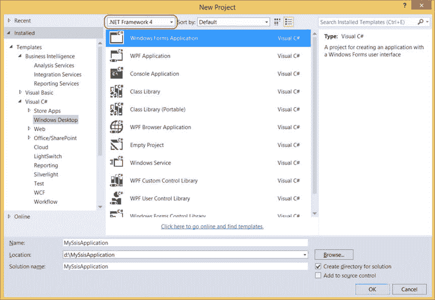
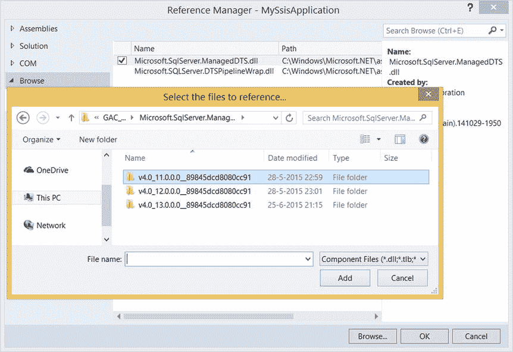
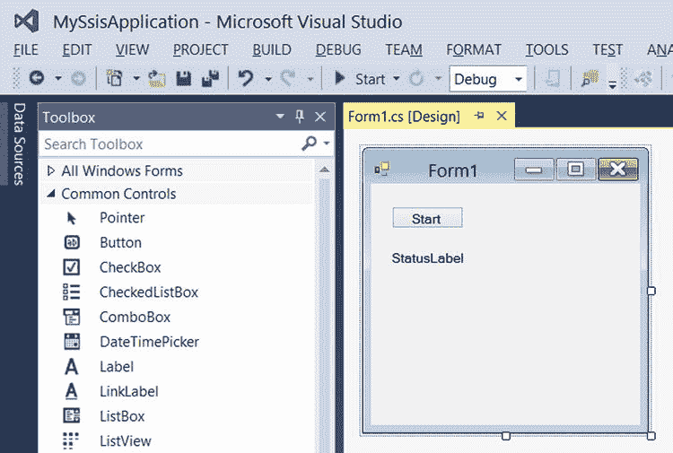
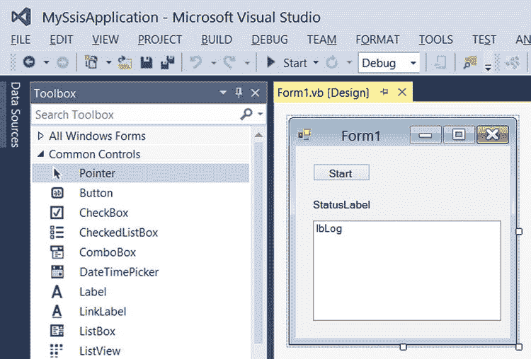
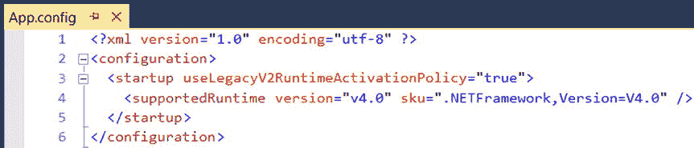
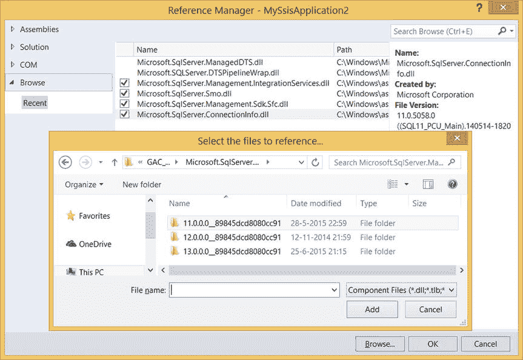
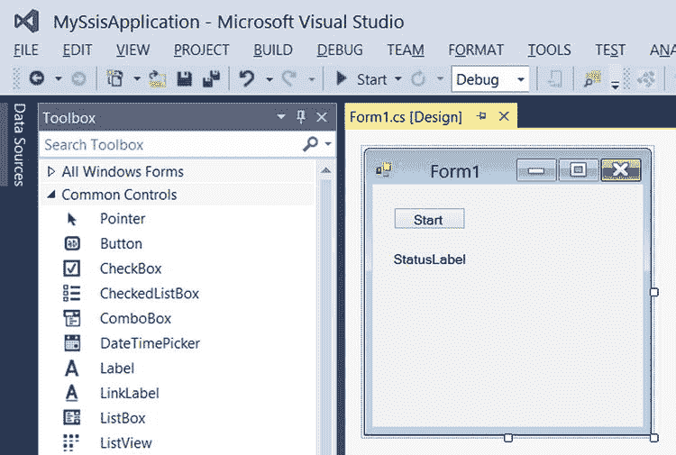
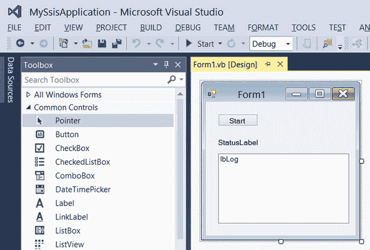
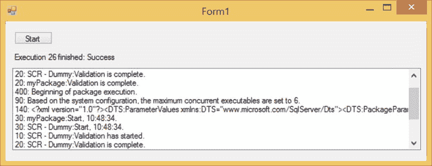

# 19. 在.NET 中执行包

## 电子补充材料
本章的在线版本 (doi:[10.1007/978-1-4842-0638-6_19](http://dx.doi.org/10.1007/978-1-4842-0638-6_19)) 包含补充材料，仅供授权用户使用。

本章将向你展示如何从.NET 应用程序执行包，该应用程序可以是 Web 应用程序、Web 服务、Windows 服务或 Windows 应用程序。由于有两种部署模型，因此也有两种不同的方式来执行包；但有一个要求：你需要在与应用程序相同的机器上安装 SQL Server Integration Services。包将在此机器上运行。如果在你的环境中无法做到这一点，你可以在机器 A 上创建一个 Web 服务来本地执行包，然后从运行在机器 B 的应用程序调用该 Web 服务。另一种替代方案是让机器 B 上的代码在机器 A 上执行一个远程 SQL Server 代理作业，以在本地执行包。在这两种情况下，应用程序都在机器 B 上运行，但包在机器 A 上运行。

如果你使用的是 Integration Services 目录（项目部署模型），你也可以远程执行该数据库中的存储过程。

### 包部署模型

第一个示例使用了一个 Windows 应用程序来运行存储在文件系统中的包。请确保你有一个可用于操作的虚拟包。你可以创建一个新包，并添加一个触发警告事件的脚本任务（示例见第 4 章）。

要创建此 Windows 应用程序，你需要一个包含 C#或 VB.NET 模板的 Visual Studio 版本；仅 SSDT for BI 或 BIDS 是不够的（更多细节见第 16 章）。

启动 Visual Studio 并创建一个名为`MySsisApplication`的新 Windows 窗体应用程序项目。确保选择适当的.NET Framework 版本。在此示例中，你将使用.NET Framework 4 来执行一个 SSIS 2012 包。从图 19-1 开始的截图来自 Visual Studio 2013。


**图 19-1** 用于执行 SSIS 包的 Windows 窗体应用程序

#### 添加引用

首先，你需要添加对 SSIS 的引用，特别是对`Microsoft.SqlServer.ManagedDTS.dll`的引用，该 DLL 位于 Windows 的全局程序集缓存中。在解决方案资源管理器中，右键单击“引用”（在 VB 中，右键单击项目），然后选择**添加引用...**。接着浏览到正确的程序集。如果你的开发机器上安装了多个版本的 SSIS，请确保选择正确的版本。每个 SSIS 版本都有其自己的文件夹。文件路径中的`X`因版本而异。

`C:\Windows\Microsoft.NET\assembly\GAC_MSIL\Microsoft.SqlServer.ManagedDTS\v4.0_1X.0.0.0__89845dcd8080cc91\Microsoft.SqlServer.ManagedDTS.dll`

在图 19-2 中，你看到了三个版本：`v4.0_11` (SSIS 2012)、`v4.0_12` (SSIS 2014) 和 `v4.0_13` (SSIS 2016)。


**图 19-2** 添加对 `Microsoft.SqlServer.ManagedDTS.dll` 的引用

#### 创建窗体

打开`Form1`文件，添加一个名为`btnStart`的按钮和一个名为`lblStatus`的标签。你可以在工具箱中找到它们。完成后，你的窗体应类似于图 19-3 所示。


**图 19-3** 一个仅包含一个按钮和一个标签的简单窗体

#### 代码

现在双击 Start 按钮（`btnStart`）来创建一个 `onClick` 事件处理程序。代码页面将打开，并创建一个名为 `btnStart_Click` 的新方法。

```csharp
private void btnStart_Click(object sender, EventArgs e)

{

}
```

这是 VB.NET 代码：

```vb
Private Sub btnStart_Click(sender As Object, e As EventArgs) Handles _
                                                             btnStart.Click
End Sub
```

你需要将代码添加到此方法中，但首先需要添加一个额外的命名空间来缩短代码。对于 VB.NET 项目，导入的命名空间是项目的属性，但你也可以像在脚本任务或脚本组件中那样，将导入代码添加到代码顶部。

```csharp
#region CustomNamespace
using Microsoft.SqlServer.Dts.Runtime;
#endregion
```

这是 VB.NET 代码：

```vb
#Region "CustomNamespace"
Imports Microsoft.SqlServer.Dts.Runtime
#End Region
```

现在回到按钮的代码。此示例使用 `myApplication.LoadPackage` 从文件系统加载包，但你也可以使用 `LoadFromSqlServer` 或 `LoadFromDtsServer` 从 MSDB 或包存储区加载包。如果你在 `myApplication` 后面输入一个点，IntelliSense 将显示所有可能的选项。

在这段代码中，你需要将引用修改为你自己的示例包。在下面那一行，有一段用于设置变量值的代码。要么删除该行，要么向示例包中添加一个变量。

```csharp
private void btnStart_Click(object sender, EventArgs e)
{
    // 实例化 SSIS 应用程序对象
    Microsoft.SqlServer.Dts.Runtime.Application myApplication =
                        new Microsoft.SqlServer.Dts.Runtime.Application();

    // 从文件系统加载包
    //（对于基于 SQL Server 的包，请使用 LoadFromSqlServer）
    lblStatus.Text = "Loading package from file system.";
    Package myPackage = myApplication.LoadPackage(@"D:\myPackage.dtsx", null);

    // 可选：设置其中一个 SSIS 包变量的值
    myPackage.Variables["User::myVar"].Value = "test123";

    // 执行包
    lblStatus.Text = "Executing package";
    DTSExecResult myResult = myPackage.Execute();

    // 显示执行结果
    lblStatus.Text = "Package result: " + myResult.ToString();
}
```

这是 VB.NET 代码：

```
Private Sub btnStart_Click(sender As Object, e As EventArgs) Handles btnStart.Click
    ' 实例化 SSIS 应用程序对象
    Dim myApplication As Application = New Application()

    ' 从文件系统加载包
    '（对于基于 SQL Server 的包，请使用 LoadFromSqlServer）
    lblStatus.Text = "Loading package from file system."
    Dim myPackage As Package = _
                     myApplication.LoadPackage("D:\myPackage.dtsx", Nothing)

    ' 可选：设置其中一个 SSIS 包变量的值
    myPackage.Variables("User::myVar").Value = "test123"

    ' 执行包
    lblStatus.Text = "Executing package"
    Dim myResult As DTSExecResult = myPackage.Execute()

    ' 显示执行结果
    lblStatus.Text = "Package result: " + myResult.ToString()
End Sub
```

#### 日志记录

由于此示例适用于使用包部署模型的包，因此没有像目录中那样的默认日志记录可用。如果你要记录到表、文本文件等，并希望在 Windows 应用程序中显示这些信息，则需要为此添加自定义代码。不过，也可以从包中获取警告和错误，并在简单的列表框中显示这些消息，例如。首先，向表单中添加一个名为 `lbLog` 的列表框。它应该看起来类似于图 19-4 所示。



图 19-4.

扩展了用于日志消息的列表框的简单表单

接下来，你需要将警告和错误添加到列表框中。一个缺点是它们来自两个不同的集合。如果你想按出现的顺序显示它们，则必须合并并排序。在此示例中，你将错误和警告都存储在一个临时数据表中，以便将它们排序后添加到列表框中。你可以将此代码添加到 `btnStart_Click` 方法的底部。请注意，这是一种快速但不完善的显示日志的方式，它确实有效，但还有更复杂的方法或更方便的控件来完成此操作。然而，我们还是把重点放在 SSIS 内容上。

```
// 创建一个临时表来存储警告和错误
DataTable myLogTable = new DataTable("myLogTable");
myLogTable.Columns.Add("LogTime", typeof(DateTime));
myLogTable.Columns.Add("Source", typeof(string));
myLogTable.Columns.Add("Message", typeof(string));

// 遍历所有警告并将其添加到表中
foreach (DtsWarning packageWarning in myPackage.Warnings)
{
    myLogTable.Rows.Add(Convert.ToDateTime(packageWarning.TimeStamp), packageWarning.Source, packageWarning.Description);
}

// 遍历所有错误并将其添加到表中
foreach (DtsError packageError in myPackage.Errors)
{
    myLogTable.Rows.Add(Convert.ToDateTime(packageError.TimeStamp), packageError.Source, packageError.Description);
}

// 创建排序视图，然后利用它创建一个新的数据表
myLogTable.DefaultView.Sort = "LogTime";
DataTable myLogTableSorted = myLogTable.DefaultView.ToTable();

// 清理资源
myLogTable.Dispose();

// 遍历新的排序数据集并将行添加到列表框中
foreach (DataRow row in myLogTableSorted.Rows)
{
    lbLog.Items.Add(row.Field<DateTime>(0).ToLongTimeString() + " - " + row.Field<string>(1) + " - " + row.Field<string>(2));
}

// 清理资源
myLogTableSorted.Dispose();
```

这是 VB.NET 代码：

```
' 创建一个临时表来存储警告和错误
Dim myLogTable As DataTable = New DataTable("myLogTable")
myLogTable.Columns.Add("LogTime", GetType(DateTime))
myLogTable.Columns.Add("Source", GetType(String))
myLogTable.Columns.Add("Message", GetType(String))

' 遍历所有警告并将其添加到表中
For Each packageWarning As DtsWarning In myPackage.Warnings
    myLogTable.Rows.Add(Convert.ToDateTime(packageWarning.TimeStamp), packageWarning.Source, packageWarning.Description)
Next

' 遍历所有错误并将其添加到表中
For Each packageError As DtsError In myPackage.Errors
    myLogTable.Rows.Add(Convert.ToDateTime(packageError.TimeStamp), packageError.Source, packageError.Description)
Next

' 创建排序视图，然后利用它创建一个新的数据表
myLogTable.DefaultView.Sort = "LogTime"
Dim myLogTableSorted As DataTable = myLogTable.DefaultView.ToTable()

' 清理资源
myLogTable.Dispose()

' 遍历新的排序数据集并将行添加到列表框中
For Each row As DataRow In myLogTableSorted.Rows
    lbLog.Items.Add(row.Field(Of DateTime)(0).ToLongTimeString() + " - " + row.Field(Of String)(1) + " - " + row.Field(Of String)(2))
Next

' 清理资源
myLogTableSorted.Dispose()
```

#### 结果

现在运行应用程序并点击“开始”按钮。检查包日志，确认包是否确实已执行。如前所述，验证日志是否正常工作的一个简单方法是在示例包中添加一个脚本任务来触发一些警告和/或错误（有关触发事件的示例，请参见第 4 章）。

如果您遇到以下错误，说明您可能正在使用旧版本的 Visual Studio（2010）：

`The Execute method on the task returned error code 0x80131621 (Mixed mode assembly is built against version 'v2.0.50727' of the runtime and cannot be loaded in the 4.0 runtime without additional configuration information.). The Execute method must succeed, and indicate the result using an "out" parameter.`

解决方案是告知 Visual Studio，允许在 4.0 应用程序中使用 .NET Framework 2.0 代码。您可以通过在 `App.config` 文件的 `startup` 标记中添加 `useLegacyV2RuntimeActivationPolicy="true"` 属性来实现。如果您没有 `App.config` 文件，可以在解决方案资源管理器中右键单击项目，然后依次选择添加 > 新建项 > 应用程序配置文件 > `App.config` 来添加一个，该文件的外观应类似于图 19-5。



图 19-5. C# 项目中使用的 `App.config` 示例

另一种选择是将 Windows 应用程序项目的目标框架更改为 2.0 或 3.5。

### 项目部署模型

第二个示例同样使用 Windows 应用程序——这一次是运行一个存储在 Integration Services 目录中的包。启动 Visual Studio 并创建一个名为 `MySsisApplication2` 的新 Windows 窗体应用程序项目。确保选择适当的 .NET Framework 版本。在此示例中，您将使用 .NET Framework 4 来执行 SSIS 2012 包。

#### 添加引用

首先，您需要添加四个引用，它们位于 Windows 的全局程序集缓存中。在解决方案资源管理器中，右键单击引用（在 VB 中，右键单击项目），然后选择添加引用…。接着浏览到正确的程序集。如果您的开发机器上安装了多个版本的 SSIS，请确保选择正确的版本。每个版本的 SSIS 都有其自己的文件夹。文件路径中的 `X` 因版本而异（参见前面的示例；另请参见图 19-6）。



图 19-6. 添加对 SSIS 的多个引用

```
C:\Windows\assembly\GAC_MSIL\Microsoft.SqlServer.ConnectionInfo\1X.0.0.0__89845dcd8080cc91\Microsoft.SqlServer.ConnectionInfo.dll
```

```
C:\Windows\assembly\GAC_MSIL\Microsoft.SqlServer.Management.Sdk.Sfc\1X.0.0.0__89845dcd8080cc91\Microsoft.SqlServer.Management.Sdk.Sfc.dll
```

```
C:\Windows\assembly\GAC_MSIL\Microsoft.SqlServer.Smo\1X.0.0.0__89845dcd8080cc91\Microsoft.SqlServer.Smo.dll
```

```
C:\Windows\assembly\GAC_MSIL\Microsoft.SqlServer.Management.IntegrationServices\1X.0.0.0__89845dcd8080cc91\Microsoft.SqlServer.Management.IntegrationServices.dll
```

#### 创建窗体

打开 `Form1` 文件，并添加一个名为 `btnStart` 的按钮和一个名为 `lblStatus` 的标签。您可以在工具箱中找到它们。准备就绪后，您的窗体应类似于图 19-7。



图 19-7. 只有一个按钮和一个标签的简单窗体

#### 代码

双击“开始”按钮 (`btnStart`) 以创建一个 `onClick` 事件处理程序。代码页面打开，并创建了一个名为 `btnStart_Click` 的新方法。

```csharp
private void btnStart_Click(object sender, EventArgs e)

{

}
```

这是 VB.NET 代码：

```vb
Private Sub btnStart_Click(sender As Object, e As EventArgs) Handles _

btnStart.Click

End Sub
```

您将向此方法添加代码，但首先需要添加一些额外的命名空间以简化代码。对于 VB.NET 项目，导入的命名空间是项目的一个属性，但您也可以像在脚本任务或脚本组件中那样，将 `imports` 代码添加到代码的顶部。

```csharp
#region CustomNamespace

using System.Data.SqlClient;

using Microsoft.SqlServer.Management.IntegrationServices;

using System.Collections.ObjectModel;

#endregion
```

这是 VB.NET 代码：

```vb
#Region "CustomNamespace"

Imports System.Data.SqlClient

Imports Microsoft.SqlServer.Management.IntegrationServices

Imports System.Collections.ObjectModel

#End Region
```

现在回到按钮的代码。此示例首先连接到目录所在的 SQL Server 实例。然后加载包并提供可选参数。之后，执行包；但如果您想等待包的结果，则会有一个问题。存在一个无法更改的 30 秒超时。如果您的包需要超过 30 秒才能完成，则会出现错误：

`Timeout expired. The timeout period elapsed prior to completion of the operation or the server is not responding.`

要解决此问题，您需要异步执行包，使其不等待响应。但这是默认方法，因此无需更改代码。在执行代码之后，您可以添加一个 `while` 循环来检查状态是否为“已完成”，这表示包已执行完毕。

在此代码中，您会看到一个示例包的位置。请确保您已将测试包部署到 SSISDB 并更改了代码中的位置。您还会看到两个参数的代码。同样，请确保您已将这两个参数添加到项目和包中，或者已从代码中删除这些行。

```csharp
private void btnStart_Click(object sender, EventArgs e)
{
    // 连接到目录所在的 SQL Server 实例
    using (SqlConnection ssisConnection = new SqlConnection
    ("Data Source=.;Initial Catalog=master;Integrated Security=SSPI;"))
    {
        try
        {
            // 包含连接的 SSIS 服务器对象
            IntegrationServices ssisServer = new IntegrationServices(ssisConnection);
            // 对要执行的包的引用
            lblStatus.Text = "正在从目录加载包。";
            Form.ActiveForm.Refresh();
            PackageInfo ssisPackage = ssisServer.Catalogs["SSISDB"]
                .Folders["Extending SSIS"]
                .Projects["Chapter 19"]
                .Packages["myPackage.dtsx"];
            // 设置参数
            Collection<PackageInfo.ExecutionValueParameterSet> executionParameter =
                new Collection<PackageInfo.ExecutionValueParameterSet>();
            // 为异步（value=0，默认）或同步（value=1）执行添加执行参数。您可以跳过此行代码。
            executionParameter.Add(new PackageInfo.ExecutionValueParameterSet
            {ObjectType = 50, ParameterName = "SYNCHRONIZED", ParameterValue = 0});
            // 添加执行参数（值）以覆盖默认日志记录级别
            // (0=无, 1=基本, 2=性能, 3=详细)
            executionParameter.Add(new PackageInfo.ExecutionValueParameterSet
            {ObjectType = 50, ParameterName = "LOGGING_LEVEL", ParameterValue = 3});
            // 添加项目参数（值）以填充项目参数
            executionParameter.Add(new PackageInfo.ExecutionValueParameterSet
            {ObjectType = 20, ParameterName = "MyProjectParameter",
            ParameterValue = "some value"});
            // 添加包参数（值）以填充包参数
            executionParameter.Add(new PackageInfo.ExecutionValueParameterSet
            {ObjectType = 30, ParameterName = "MyPackageParameter",
            ParameterValue = "some value"});

            // 执行包并返回 `ServerExecutionId`
            long executionIdentifier = ssisPackage.Execute(false,
                null,
                executionParameter);

            // 使用上一步的 `ServerExecutionId` 获取执行详情
            lblStatus.Text = "正在执行包";
            Form.ActiveForm.Refresh();
            ExecutionOperation executionOperation = ssisServer.Catalogs["SSISDB"]
                .Executions[executionIdentifier];

            // 在未完成执行前进行循环（超时方案）
            while (!(executionOperation.Completed))
            {
                // 刷新执行信息
                executionOperation.Refresh();

                // 等待 5 秒后再刷新
                // （避免给服务器造成压力）
                System.Threading.Thread.Sleep(5000);
            }

            // 显示 `ServerExecutionId`
            lblStatus.Text = "执行 " + executionOperation.Id.ToString() +
                " 已完成: " + executionOperation.Status.ToString();
        }
        catch (Exception ex)
        {
            // 异常日志代码
            lblStatus.Text = "错误: " + ex.Message;
        }
    }
}
```

以下是 VB.NET 代码：

### 日志记录

记录日志比之前的示例稍简单，但首先需要在窗体中添加一个名为`lbLog`的列表框。它看起来应类似于图 19-8。



`图 19-8.` 添加了用于显示日志消息的列表框的简单窗体

要填充列表框，只需添加以下循环，但请确保在执行此操作前清空列表框。你可以在显示`ServerExecutionId`和状态之后添加此代码。

```csharp
// 添加日志行前清空列表框
lbLog.Items.Clear();

// 遍历日志并将消息添加到列表框
foreach (OperationMessage message in ssisServer.Catalogs["SSISDB"].Executions[executionIdentifier].Messages)
{
    lbLog.Items.Add(message.MessageType.ToString() + ": " + message.Message);
}
```

这是 VB.NET 代码：

```vbnet
' 添加日志行前清空列表框
lbLog.Items.Clear()

' 遍历日志并将消息添加到列表框
For Each message As OperationMessage In ssisServer.Catalogs("SSISDB") _
    .Executions(executionIdentifier) _
    .Messages
    lbLog.Items.Add(message.MessageType.ToString() + ": " + message.Message)
Next
```

### 结果

现在运行应用程序并点击“开始”按钮。检查列表框中的日志（见图 19-9）。你可以将其与目录中的日志进行比较。



**图 19-9.** 结果

### 总结

在本章中，你学习了如何通过`.NET`应用程序执行包。你可以创建一个 Web 服务用来远程执行包，或者创建一个 Windows 服务来监视特定文件夹，并在新文件放入该文件夹时执行包。可能性是无限的。