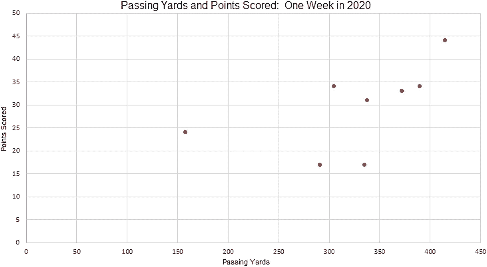
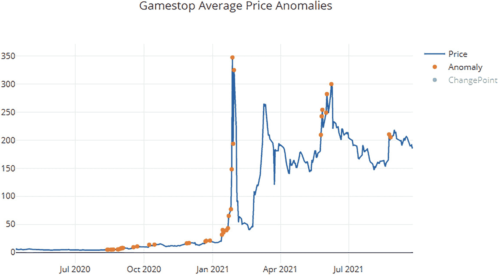
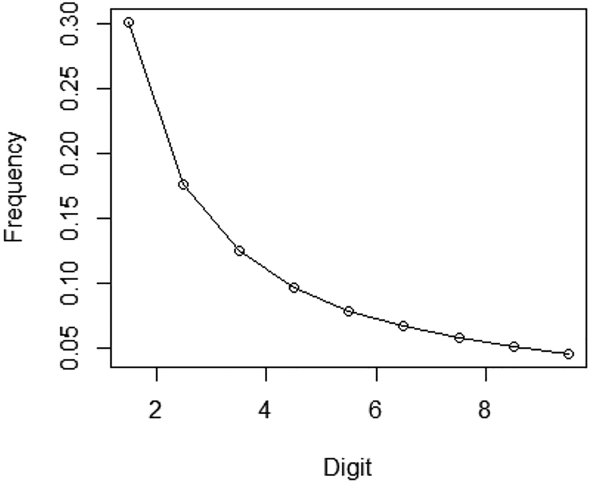
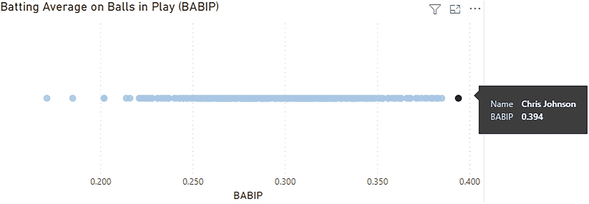
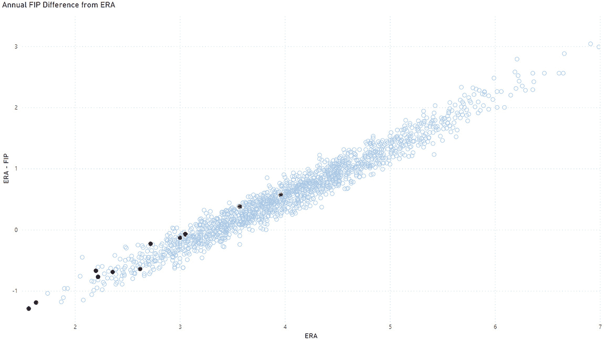
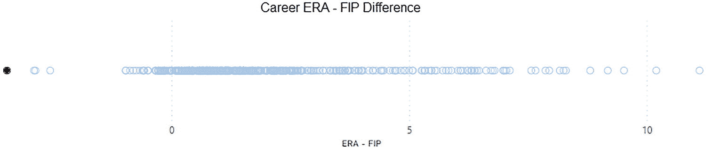
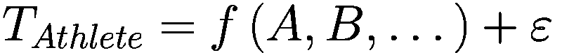
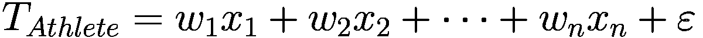

# 1. 异常与异常检测的重要性

在我们开始构建异常检测器之前，理解异常具体是什么非常重要。本章的第一部分将为我们提供对异常的基本理解。然后，在本章的第二部分，我们将探讨跨多个行业的异常检测用例。在本章的第三部分，我们将列举三类异常检测方法，这些方法将在本书中反复出现，我们将对每种方法获得高层次的理解，为后续的深入探讨做准备。最后，我们将以一些关于构建自己的异常检测器时需要考虑的要点来结束本章。

## 定义异常

在我们开始构建异常检测器之前，我们需要理解什么是异常。同样，在我们定义异常的概念之前，我们需要理解离群值。


### 异常值

`outlier`（异常值）是指与正常值存在显著差异的数据点。例如，在 2008 年夏季奥运会男子 200 米比赛中，尤塞恩·博尔特以 19.30 秒的成绩创造了世界纪录，比第二名肖恩·克劳福德快了超过 0.6 秒。其余五名选手（除两名被取消资格的选手外）的成绩在 19.96 秒到 20.59 秒之间，这意味着第二名与最后一名之间的差距略大于第一名与第二名之间的差距。因此，第二名到第六名的成绩属于`inliers`（内值），即与正常值没有显著差异的值。表 1-1 显示了决赛中运动员的成绩。

**表 1-1** 2008 年夏季奥运会男子 200 米比赛完成时间（来源：[*https://w.wiki/4CpZ*](https://w.wiki/4CpZ)（维基百科））

| 运动员 | 时间（秒） |
| --- | --- |
| 尤塞恩·博尔特 | 19.30 |
| 肖恩·克劳福德 | 19.96 |
| 沃尔特·迪克斯 | 19.98 |
| 布赖恩·津加伊 | 20.22 |
| 克里斯蒂安·马尔科姆 | 20.40 |
| 金·柯林斯 | 20.59 |

基于这些信息，很明显博尔特的成绩是一个异常值。接下来的问题是，这是一个离群点吗？

### 噪声与离群点

在异常值的范畴内，我们定义了两个子类别：`noise`（噪声）和`anomalies`（离群点）。这两个术语之间的区别最终取决于人类的兴趣。噪声是我们不感兴趣的异常值，而离群点则是我们感兴趣的异常值。这个离群点的定义与 Aggarwal（1`–`4）中的定义一致，但并非普遍适用——例如，Mehrotra 等人将“异常值”和“离群点”作为同义词使用（Mehrotra 等人，4）。

另一种区分噪声和离群点的方法是考虑带有误差项的模型。假设我们有一个函数，它接受一组输入，并返回对该运动员跑完 200 米比赛所需秒数的估计值。如果我们输入各种不同的参数，就有可能描绘出这个函数的形状，同时理解到我们的估计值与实际时间之间存在一定的方差。我们通过添加一个误差项来展示这一点：

```
T_Athlete = f(A, B, ...) + ε
```

有时，在给定一组输入值和实际时间的情况下，我们可能会看到与预期时间相差 0.25 秒的情况。如果我们认为这次特定的比赛仍然遵循相同的底层函数，并且所有差异都归因于误差项，那么我们的估计值与实际时间之间的差异，严格来说，就是噪声。

相比之下，假设对于像博尔特这样的传奇运动员，存在一个不同的函数：

```
T_Bolt = f(A, B, ...) + ε
```

这个函数对时间的估计值远低于普通的奥运选手（如果存在这种可能的话！）。如果我们使用这个函数，得到的结果比使用正常模型的数据点快 0.25 秒，那么这个结果就非常合理。然而，如果我们预期得到普通运动员的输出，却得到了博尔特的输出，那么这个结果就是一个离群点：一个与正常值不同且我们感兴趣的结果，因为生成该结果所依据的底层函数不同。

在实践中，这种对离群点的理解更多是概率性的而非确定性的，因为我们不一定知道生成任何给定数据点的具体函数，这使得区分噪声和离群点变得困难。在博尔特的案例中，我们可以预期这是一个离群点而非噪声，不仅因为博尔特在该项目中创造了新的世界纪录，还因为他的成绩远低于其他世界级运动员，这佐证了他属于另一个级别的观点。

### 诊断一个示例

我们已经看了一个例子，现在来回顾一个图形示例。图 1-1 显示了 2020 赛季某周美国国家橄榄球联盟（NFL）比赛中得分与传球码数的散点图。



一个点图绘制了得分与传球码数的关系。一些估计值为（160, 24）、（310, 34）、（330, 32）、（380, 34）、（430, 44）。

**图 1-1** 2020 年某周 NFL 球队的得分与传球码数

作为人类，我们具备某些先天和后天训练的能力来分析这些信息并从中得出结论，我们将在第 2 章中更详细地讨论这一点。目前，只需说明在该图中，传球码数与得分之间似乎存在正相关关系就足够了。

根据现有信息，我们可以想象一个相当紧密的带状区域，用于估计给定传球码数下的得分，画一条粗线，这条线接近或完全覆盖了大部分数据点。这样做会使我们估计，一个四分卫传球 300 码的球队，在正常情况下可能得到大约 28`–`35 分。

在提出这个理论模型后，我们可以转向两个异常值：尽管球队的四分卫分别传出了大约 290 码和 335 码，但这两支球队只得到了 17 分。这引出了我们需要回答的两个关键问题——至少是暂时性地回答——以便继续进行离群点检测的过程。第一个问题是，我们的模型是否足够好，能够正确区分内值和异常值？如果答案是“是”，那么第二个问题是，异常值数据点遵循与内值完全不同的过程的可能性有多大？

在本书中，我们将探讨有助于回答这两个问题的思路和技术。话虽如此，第二个问题可能很难得出确切的结论，因为它取决于我们对生成这些数据点的过程内部运作的理解。

这引出了另一个重要的考量：领域知识对于`outlier detection`（异常值检测）并非必需，但对于`anomaly detection`（离群点检测）却是必需的。回到图 1-1 中的例子，一个对美式橄榄球一无所知的人也能感知到数据中的关系以及数据集中的两个异常值。然而，这个人无法判断这些数据点仅仅是噪声，还是暗示着一种不同的行为模式。具体来说，如果那些球队只得到 17 分是由于运气不佳、射门失误或面对强大的红区防守，那么这些因素将指向这些异常值为噪声。另一方面，如果这些球队的教练策略效率低下，能够将球推进到前场，但始终无法将进攻势头转化为得分，那么我们可以恰当地将这些点称为离群点。一个拥有足够信息的领域专家可以帮助我们区分这两种结果。正如我们将在本章后面看到的，我们构建离群点检测器的目的是为这样的领域专家提供足够的信息，以便他们分析、解释，然后根据我们传递的信号采取行动。


### 如果我们错了呢？

在判断一个数据点是否为异常值时，我们可以通过根据某些潜在特征将结果分为两个或多个类别来执行*分类*操作。在异常检测中，我们通常最终会得到两个类别：这个事物是异常，或者这个事物不是异常。如果我们有两个可能的类别（这是离群值或这不是离群值），并且我们可以预测这两个类别中的任何一个，那么最终会得到如表 1-2 所示的结果，该表给出了在给定预测类别及其实际类别的情况下的可能结果。

**表 1-2** 基于离群值预测与数据点实际异常状态的结果

| | 预测为离群值 | 预测为非离群值 |
| --- | --- | --- |
| **实际异常** | 正确（真阳性） | 第二类错误（假阴性） |
| **实际非异常** | 第一类错误（假阳性） | 正确（真阴性） |

查看此表，我们看到两个维度：给定的数据点是否实际上是异常，以及我们对那个数据点做出的预测是阳性（是，这是离群值）还是阴性（不，这不是离群值）。当我们正确判断出离群值确实是异常，或者非离群值确实是非异常时，我们注意到分类是正确的，然后可以继续。然而，我们可能出错的方式有两种。第一种出错方式是，我们预测一个数据点是离群值，但结果它并不是异常——它只是噪声。这也被称为*第一类错误*或*假阳性*。与此相反的情况是，尽管某个数据点是真正的异常，但我们未能将其判定为离群值。后一种失败被称为*第二类错误*或*假阴性*。我们应尽可能避免任何一种错误，但将这些错误分开分类的事实引出了一个有趣的问题：这两种错误哪一种更糟糕？

答案是咨询师那句著名的口头禅：视情况而定。在这种情况下，关键的考量因素涉及错过至少一个真实异常且未对其采取行动的负面后果，与接收警报或对最终被证明完全正常但被我们的检测服务错误分类的数据点进行研究之间的权衡。你愿意接受多少假阳性来限制假阴性的可能性，将取决于几个因素，例如假阳性活动的频率、确定预测的离群值是否真的是异常所需的工作量，以及假阴性结果的成本。诸如此类的因素将帮助你决定离群值检测器应该有多严格，不过我们将在第 4 章开始看到一种有助于解决此问题的替代方法。

## 现实世界中的异常

在本节中，我们将简要介绍几个异常检测在决策中发挥重要作用的行业。对其中任何一个行业的详细分析都远远超出了本书的范围，但即使是简短的总结也足以阐明异常检测是一个跨行业关注点的论点。

### 金融

异常检测在金融领域有多种用途。与此相关的最明显场景之一是资产定价。异常资产定价的典型代表非 GameStop 公司（GME）莫属，其每日收盘股价构成了图 1-2。



**图 1-2** GameStop 公司（GME）从 2020 年 4 月 13 日到 2021 年 9 月 24 日的每日收盘价。异常判定来自 `ML.NET` 库

很少有股票会经历我们在 GameStop 身上看到的持续数月之久的动荡，但根据我们在撰写本书时可用的信息，许多离群数据点都与媒体宣传活动（无论是大众媒体还是社交媒体）、期权到期日以及市场参与者在这一代人最大的市场事件之一中选边站队有关。

资产定价并非异常检测在金融行业唯一有意义的地方。异常检测可能很重要的另一种情况是法务会计，即审查会计实务和财务文件，以确定组织成员是否实施了欺诈行为。法务会计师所做的远不止仔细审查资产负债表和日记账分录，但当他们确实审查财务文件时，他们是在寻找模式和异常情况。

其中一种模式是本福特定律，该定律指出，足够大的数字集合的首位数字通常遵循一种特定模式，即较小的数字比较之大的数字出现得更频繁。图 1-3 以图形形式展示了这种分布。



**图 1-3** 如果遵循本福特定律，数字序列首位数字分布的直观描述

并非所有数据集都会遵循这种模式，但一个快速的“经验法则”是，如果一个数据集包含的数据点跨越至少三个（或更多）数量级，那么它很可能遵循本福特定律。这个经验法则之所以成立，是因为许多确实遵循本福特定律的分布类型——例如指数分布或对数正态分布——通常包含跨越多个数量级的各种值，而不遵循本福特定律的分布——最常见的是均匀分布和高斯分布——则通常不会。关于本福特定律背后数学原理的深入探讨，我推荐 Hall (2019)。

然而，就我们的目的而言，只要理解本福特定律可以为法务会计师提供某些数据集分布应如何的预期就足够了，特别是像公司或政府机构的日记账分录集合这样的数据集。与本福特定律的显著偏差本身并不能证明存在不法行为，但它对审计师来说是一个危险信号，通常值得进一步调查，以了解为什么这个特定数据集不典型。

### 医学

异常检测对医学领域至关重要。关于什么构成健康与不健康的身体指标，存在着大量的研究。这些指标的例子包括血压、体温、血氧饱和度和心电图（ECG）数据。我们可以根据一个人的测量值与正常值相比的显著变化推断出他当前处于不健康状态。请注意，这个正常值可能是通过对大量人群的数据进行汇总和平均得出的，也可能来自该个体处于已知健康状态的情况。

借助现代电子设备，我们可以以前在医院病房之外不可能的方式收集和比较数据。填补这一空白的消费产品的一个例子是 Apple Watch，它能够跟踪心率数据并通过 ECG 应用程序显示。该设备可以通知异常高或低的心率，以及心律不齐。Mehrotra 等人提供了其他例子，说明异常检测在医学领域可能具有价值（11-12）。


### 体育数据分析

体育是全球性的大生意，据《福布斯》统计，截至 2020 年，有 12 支体育特许经营权的价值至少达到 35 亿美元。此外，根据运动项目的不同，一支球队每个赛季可能在球员薪资上投入 2 亿美元或更多。为了最大化这笔投资回报，球队在体育数据分析领域投入了大量时间和金钱。在这种对数据分析的重视下，分析和理解异常值至关重要，以免被误导，认为一个赛季的统计成功必然会延续到下一个赛季。

#### 一个价值 2300 万美元的错误

克里斯·约翰逊在 2013 赛季开始时是亚特兰大勇士队的首发三垒手。那个赛季他以 0.321 的击球率收官，这为他赢得了一份为期四年、价值 2300 万美元的合同。进入 2014 赛季，勇士队期望他成为进攻端的关键贡献者；然而，他的击球率却下降到了 0.263，到了 2015 年底，亚特兰大总经理约翰·哈特将克里斯·约翰逊作为与克利夫兰印第安人队交换不良合同的一部分交易了出去。在他签下那份合同时，就有充分理由相信约翰逊无法达到预期，图 1-4 通过一项名为“场内击球率”（BABIP）的统计数据揭示了原因。BABIP 衡量的是球员将球击入场内时的表现，即忽略本垒打以及三振或保送等球未进入比赛的情况。BABIP 的正常值通常在`.270`–`.330`范围内，但克里斯·约翰逊的 BABIP 高达`.394`，这使他在 2013 赛季至少拥有 150 次打数的 383 名合格球员中排名第一。



一个点图，横轴为 BABIP。这些点绘制成一条平行于横轴的直线。

**图 1-4** 克里斯·约翰逊在 2013 年以`.394`的 BABIP 领跑美国职业棒球大联盟

约翰逊领跑联盟且其 BABIP 至少高出正常值 60 个点（即 0.060）这一点很重要，因为有大量证据表明，决定击入场内的球是出局还是安打的主要是防守方，而非击球手本人。这一普遍原则存在例外，但其含义是，通常情况下，一个赛季 BABIP 非常高的球员不太可能在下一个赛季重现这一表现。以约翰逊为例，他的 BABIP 从 2013 年的`.394`下降到了 2014 年的`.345`。由于缺乏强大的长打或上垒能力，约翰逊比大多数球员更依赖击球率来贡献进攻火力，而他的 BABIP 向均值回归正是其进攻崩溃的原因。如果勇士队当时能理解约翰逊在这一关键指标上是一个多么极端的异常值，他们或许就不会在 2013 赛季后给他提供那份糟糕的合同，而是让其他球队犯下那个错误。

#### 一个持久的反常现象

格雷格·马杜克斯是有史以来最伟大的投手之一。他在大联盟的 23 个赛季中持续压制击球手，这得益于他对球路不可思议的控制力以及几乎无与伦比的变速球能力，且不会让击球手提前察觉。马杜克斯还享有另一项殊荣：在 1988 年至 2007 年间，他是自责分率（ERA）与独立防守投球数据（FIP）差值最大的投手，这一时间段涵盖了马杜克斯从年轻先发投手崭露头角到退役前一年的整个巅峰期。

FIP 这一衡量指标源于对投手究竟能控制哪些因素、而哪些因素取决于防守的研究。研究结果表明，投手主要负责三件事：保送、三振和本垒打。除此之外，击入场内球的大部分贡献则完全取决于防守——正如我们在上一节关于 BABIP 的讨论中所看到的那样。

FIP 的一个结论是，它往往比投手当前赛季的 ERA 更能预测其下一赛季的 ERA，因为防守表现会趋向均值。这意味着，如果你看到一名投手的 ERA 远低于其 FIP，我们可以预期他在下一年会出现回归。除非他是格雷格·马杜克斯。图 1-5 展示了来自投手的 1703 个赛季数据，显示了他们的 ERA 与 FIP 之间的差值，其中负值表示投手表现优于其 FIP 预期，正值则表示表现不及预期。



一个点图，横轴为 ERA，纵轴为 ERA 与 FIP 的差值。呈现上升趋势。

**图 1-5** 横轴为 ERA，纵轴为 ERA 与 FIP 的差值。格雷格·马杜克斯在亚特兰大勇士队效力期间（其职业生涯巅峰期）的赛季数据以黑色突出显示

格雷格·马杜克斯创造了 ERA 与 FIP 之间最大的两个差值——而且这两个差值连续出现，这意味着他并没有像预期那样向均值回归。在这一时间段内，马杜克斯占据了前 30 个最佳球员赛季中的四个席位，并且持续表现优于其 FIP 预期。图 1-6 显示了 1988 年至 2007 年间所有投手 ERA 与 FIP 差值的累计总和，马杜克斯位居榜首，紧随其后的是佩德罗·马丁内斯、何塞·里霍和丹尼斯·马丁内斯。



一个点图，横轴为 ERA 与 FIP 的差值。这些点绘制成一条平行于横轴的直线。

**图 1-6** 1998 年至 2007 年间所有投手 ERA 与 FIP 差值的职业生涯总和

在这个案例中，我们再次看到了一个异常值：马杜克斯的 ERA 持续优于 FIP 的预期，这是极少数投手能够做到的。基于他整个职业生涯的表现，这是一个马杜克斯的异常状态本身就是一种反常现象的例子：他的行为模式与其他投手差异巨大，以至于可以公平地说，他遵循着与大多数其他投手不同的表现函数。


### 网站分析

网站分析是异常检测的一个绝佳领域，原因有二。首先，网站往往会产生大量流量，人类无法在合理时间内解析这些数据。这迫使人们使用日志聚合和分析工具来简化工作，但即使有了这些工具，进行全面分析所需的时间也可能令人望而生畏。第二个原因更为重要：任何网站都持续存在着一股错误暗流。自动化工具会持续扫描网站和公共 IP 地址，寻找已知的常见漏洞。这可能导致对托管在.NET 网站上的 `index.php` 等文件的请求产生 404（文件未找到）错误。这些并非合法请求，而且频率很高，以至于在任何假设你未过滤掉这些消息、就会广播警报的简单系统中，它们都会因噪音而过载。

过滤掉非法错误可能就足够了，但至少还存在另外两类无趣的错误：过时链接和意外错误。关于前者的例子：假设我发送了一封电子邮件，其中包含一个指向我上传到网上的照片的链接。几年后，我从网站上删除了这张照片，但你的邮箱里仍然保留着这个链接。如果你打开那个链接，你会得到一个 404（文件未找到）错误，因为该资源已不复存在。关于后者的例子：我可能试图凭记忆访问一个 URL，在此过程中不小心按错了键，导致了一个拼写错误。这也可能导致 404 错误。类似地，我可能不小心点击了一个受保护的链接，被提示输入凭据，然后选择了“取消”，从而导致 403（未授权）错误。这些是合法的错误，但从系统管理员的角度来看，这是正常且预期的行为。系统管理员没有什么需要“修复”的，因为一切都在按设计运行。

异常检测的有趣之处在于，能够发现超出“互联网背景辐射”（此比喻感谢史蒂夫·吉布森）和常见失误之外的错误。假设一个新版本的产品发布，开发团队启用了一个功能开关，将 1%的流量发送到一个新页面，而 99%的流量仍停留在现有页面上。再进一步假设新页面上存在问题，导致一定比例的用户收到与页面上缺失资源相关的 404 错误。现在我们有了不同的行为模式——不再是针对某个特定资源的一两次失败请求，也不是广泛的噪音。一个能够发现这类错误并发出警报，同时过滤掉大部分前述噪音的异常检测系统，可以为系统管理员和开发团队节省大量时间，同时还能在客户提交故障单之前发现代码发布问题。

### 更多应用场景

至此，应该清楚异常检测并不局限于某个单一的行业或研究领域，而是具有广泛的适用性。此外，事实证明，存在一套独立于领域或行业的通用异常检测技术，这意味着我们在本书中学到的技术将适用于任何行业。

既然我们已经简要调查了现实世界中的异常现象，下一步就是审视异常检测的三个类别。

## 异常检测的类别

我们有三大类异常检测技术可供使用。我们将根据它们在后续章节中出现的顺序，逐一进行探讨。所有这三种技术在其各自的领域都很有价值，因此理解每种技术的关键组成部分，以便针对特定问题应用最佳方法，是值得的。

### 统计异常检测

第一类异常检测技术是统计异常检测技术。使用这些技术时，我们假设数据遵循某种特定的底层分布——目前，可以将其理解为数据集的形状——但除了数据的分布之外，我们不对数据“应该”是什么样子做任何假设。换句话说，我们没有一个模型，能够根据给定的输入集得到特定的预测输出。

对于统计异常检测技术，异常值是指那些显著偏离我们分布中心的数据点——也就是说，它们距离中心足够远，以至于我们可以预期它们并非真正属于同一分布。“显著不同”和“足够远”的定义必然是宽松的，因为它们可能是用户可配置的，并且很可能取决于具体领域。

第 6 章到第 8 章将重点介绍如何将统计技术整合到一个通用的异常检测服务中。

### 聚类异常检测

第二类异常检测技术侧重于聚类。聚类的概念是，我们根据数据点彼此之间的距离将它们分组。当数据点彼此足够接近时，我们将这些分组称为*簇*。我们不对数据中的底层关系做任何假设——即单个数据点最终是如何聚类在一起的。我们不假设数据遵循任何特定的分布，也不尝试构建输入与输出相关的模型。相反，我们只关心输出以及它们所形成的簇。

当使用聚类技术进行异常值检测时，如果一个数据点距离任何给定的簇都足够远，我们就认为它是一个异常值。鉴于我们将异常值定义为距离常态足够远的点，这是有道理的，但这要求我们将对“常态”的理解从一个点（如分布的中心）扩展为一组点，其中每个点可能都独立于其他点。

第 9 章到第 11 章将重点介绍如何将聚类技术整合到一个通用的异常检测服务中，而第 12 章将介绍一种有趣的聚类变体。


### 基于模型的异常检测

本书将介绍的最后一类技术是建模技术。在这种情况下，我们会训练某种预期数据行为的模型。通常，这些模型遵循相似的路径：给定一个或一组输入，我们根据每个输入的价值为其分配权重，然后以某种方式将这些加权输入组合起来生成输出。这种技术被称为*回归*，在数据科学领域极为常见。我们预测短跑运动员成绩的公式就是回归的一个例子：



在此，我们并未明确指定具体的权重或变量的组合方式，因为这些属于实现细节，取决于具体问题的性质。例如，我们可能假设预测奥运运动员的成绩基于一个线性模型，其中每个加权变量相加后得出对时间的估算，如下所示：



在这种情况下，异常值指的是实际计算出的数据点与预测数据点存在显著差异的情况。回到尤塞恩·博尔特的例子，我们可能会将一组加权输入代入模型，得到（例如）男子 200 米比赛的成绩为 20.10 秒。当他以 19.30 秒完赛时，我们的预测偏差足够大，使得博尔特的成绩成为一个异常值。于是，我们可以凭直觉推断：博尔特并不遵循我们的常规模型，而是遵循另一种模型——该模型对输入变量的权重可能不同，甚至可能包含与其他运动员无关的变量。无论具体情况如何，一旦我们假设博尔特遵循不同的模型，就可以断言这些异常值实际上是异常点：它们是由与生成大部分数据不同的过程产生的。

做出这一推断需要一个关键假设：我们选择的模型在绝大多数情况下都能充分拟合底层现象的行为。如果我们的模型不擅长预测结果，那么对异常值的描述就会出现错误，因为模型无法足够好地判断什么是正常行为。如果情况如此，我们就不应信任模型来告诉我们某个数据点是异常值。

第 13 章至第 17 章将重点介绍基于模型的异常检测中一个特别有趣的变体：时间序列分析。

## 构建异常检测器

现在，我们对什么是异常以及可能用于发现异常的技术有了高层次的理解，是时候开始构建一个异常检测服务了——这也是本书将贯穿始终的工作。然而，在编写一行代码或深入研究学术论文之前，我们需要更好地了解客户可能如何使用异常检测服务。目前，我们将探讨三个关键设计概念。

### 关键目标

我们首先需要理解的是：异常检测服务的目的是什么？人们可能出于多种原因想要使用异常检测服务。第一个原因是当出现问题时向人类发出警报。例如，回到网络分析的案例，当出现导致用户无法看到相关网络资源的问题时，我们希望向系统管理员和开发人员发出警报。同时，我们不想就诸如自动机器人探测常见漏洞（且未能发现）或用户输错 URL 等情况向工作人员发出警报。

第二个原因与警报完全无关，即检验一个猜想。表 1-1 向我们展示了尤塞恩·博尔特在 2008 年奥运会上的速度之快，我们可以看到博尔特与其他选手之间的成绩差异非常显著。尽管如此，我们可能希望看到对数据更客观的分析，例如确定一名普通奥运运动员以博尔特的 19.30 秒跑完 200 米的概率。这种回顾性分析并不必然导致后续的警报需求，因此它被标记为一个独立的用例。

第三个使用异常检测服务的原因确实源于第一个用例中的警报场景，但它更进一步：我们可以利用异常检测服务让程序在无需人工干预的情况下修复问题。例如，假设你销售高端电脑显示器，平均零售价为 1500 美元。一个重大节日即将来临，你希望将显示器价格打折 150 美元，以总计 1350 美元的价格出售。不幸的是，在尝试应用折扣时，你将`price`设置为 150 美元，于是大量订单涌入，因为人们发现这款显示器的价格仅为零售价的 10%。这使公司陷入困境：要么允许订单并承受重大损失，要么取消订单并可能激起顾客和购物平台的愤怒——在后一种情况下，可能危及客户与平台的关系，甚至导致客户被禁止在该平台销售。一个警报服务可能会提示，这款显示器的价格范围从未偏离 1300–1500 美元，而新价格与此截然不同。我们可以设想一个系统，在人工确认这确实是预期价格之前，阻止价格变更生效。

最后，我们甚至可能不知道“正常”是什么样子，并希望发现它。例如，假设我们希望找出哪种类型的人最有可能购买 1500 美元的显示器。根据人口统计细节，我们可能会发现存在某些倾向于购买我们显示器的客户群体，并可以针对这些客户进行营销。这一过程中的异常值也很有趣，因为它们可能预示着潜在的客户群体——这些群体尚未购买我们的显示器，但如果我们更了解他们的需求，他们可能会倾向于购买。根据异常值的信息，我们的分析师可以进行市场研究，判断是否存在尚未开发的市场细分领域，如果存在，又该如何触达这些人群。


### 人类如何处理异常？

接下来需要考虑的是，问问自己：使用你的异常检测服务的人类将如何处理异常值报告，并判断某个异常值究竟是真正的异常，还是仅仅是噪声？例如，是否存在人类应遵循的特定调查流程？在制造业场景中，我们可以想象对传感器进行异常检测，例如机器温度或某台机器在压制和折叠纸箱时所施加的压力。假设一名操作员观察机器温度，如果温度升高到可接受水平以上，操作员会按下按钮释放冷却剂。如果该操作未能将温度降至可接受水平，操作员会再按另一个按钮来降低运行速度。最后，如果温度仍然远超出正常参数范围，操作员会按下第三个按钮来停止生产线，直到机器冷却或技术人员完成对机器的检查。

理解人们将如何使用你的异常检测服务之所以重要，是因为你或许能帮助他们自动化某些流程。在上述场景中，我们很容易想象一个系统将温度数据输入异常检测服务，并在给定时间范围内收到一定数量的异常值后，自动执行上述三个步骤。如果提供更精细的解决方案，也许该服务会在将警告写入日志的同时自动释放冷却剂。然后，如果系统降低了运行速度，它可能会向在职技术人员发出警报，让他们意识到问题，而将完全停机的选项留给人类。

如果我们无法自动化这类活动，用户可能仍会发现异常检测服务的价值，因为它可以为调查提供基础。回到网站分析示例，异常数量的错误——无论是总体上异常大量的错误，还是特定类别错误（如`404`（文件未找到）或`403`（未授权））的异常数量——都能为系统管理员提供足够的信息，让他们深入日志，追踪可能导致行为变化的原因，无论是代码部署、基础设施变更还是服务故障。

在这两种交互级别之间，我们还可以设想一种依赖于异常检测服务的服务，它在收到异常值后，会将某些内容排队等待人工审核。一个例子是对产品自动价格变动的人工审核。在大多数情况下，我们可能不希望人工审核价格变动，因为变动的产品数量可能相当大。然而，当某个产品的价格与其正常水平出现巨大差异时，在实际价格变动之前进行人工审核将是一个很好的案例。这可能会为公司避免后续的严重损失。

在试图辨别服务调用者的具体意图时，最重要的问题是：当你向人类发出潜在异常警报时，他们需要具备哪些领域知识？根据我们公认的定义，异常必然是有趣的。人类拥有哪些信息使得这件事变得有趣，而不仅仅是另一起噪声事件？此外，这些信息中有多少我们可以自动化或转移给机器？并非所有事情都适合自动化，无论是由于缺乏合适的设备，还是因为不同人头脑中分散、主观的知识量过大，导致自动化解决方案不可行。话虽如此，异常检测服务存在的典型原因是为后续调查和潜在行动提供关于潜在异常的信息。

### 已知的未知

在我们结束关于异常的讨论时，还有一个最后的考虑：我们对现有异常已经掌握了多少信息？假设我们有一台机器所有温度记录的历史数据。此外，一位专家仔细检查了每一条记录，并确定了机器是否运行异常，这使我们能够将高温与需要维修或报废的加工不良产品关联起来。有了这些信息，我们可以执行*监督学习*，这是机器学习的一个子集，它利用已知的正确信息对未知信息得出结论。监督学习在商业世界中是一种特别流行的机器学习类别——大多数机器学习问题往往符合监督学习场景，并且存在大量关于监督学习技术的工具和研究。

不幸的是，对于异常检测来说，它往往不适合监督学习的范畴，因为我们很少有幸能拥有专家为我们构建全面的数据集。大多数情况下，我们必须执行*无监督学习*，这是机器学习的另一个类别，在这种学习中，我们对于某个特定数据点是否为异常，并没有已知的正确答案。相反，我们需要自己去发现该数据点是否异常。正如我们将在本书中看到的，有很多技术可以用于无监督学习，但所有这些技术都有一个前提：我们无法轻易确定异常检测器的正确（或错误）程度，因为我们缺乏关于什么是异常、什么不是异常的可靠信息。

有时，我们可能了解一些先前的异常场景。这是两种变体之间的中间地带，被称为*半监督学习*。其思路是，我们可能拥有少量已知的正确数据，例如一些异常的历史记录，并利用这些信息像监督学习场景那样训练模型。从这个微小的样本出发，我们使用聚类技术来确定哪些数据点与已知异常足够相似，然后将这些相似的数据点标记为异常。我们可以将这些标记为异常值的点展示给人类，让他们告诉我们预测是否正确，从而在不花费大量时间和精力审查大量数据的情况下，扩展我们的已知输入数据。假设你有足够有效的数据来创建初始模型，半监督学习通常比无监督学习更准确。

## 结论

在第一章中，我们阐述了异常值、噪声和异常的本质。异常值是与常态有显著差异的值。噪声和异常是异常值集合的划分。不感兴趣的异常值是噪声，而有趣的异常值则是异常。在任何涉及问题统计分析的地方，异常检测都很重要，这意味着异常检测在广泛的行业和领域中都有用武之地。

本书将重点介绍三类异常检测技术：统计技术、聚类技术和基于模型的技术。每一类技术都带有自身对数据和场景的假设，并且各自都有其价值。我们将看到，某些类型的问题更适合某一类技术而非其他，因此充分理解所有三类技术非常重要。

最后，我们探讨了异常检测中的人为因素。无论你的服务检测异常的能力有多强，它的价值都体现在为人类提供帮助的程度上。因此，理解服务使用者的需求有助于你构建极具价值的东西。尽管我们将重点讨论异常值检测和软件开发的技术方面，但在开发实际产品时，请务必牢记你的最终用户。


