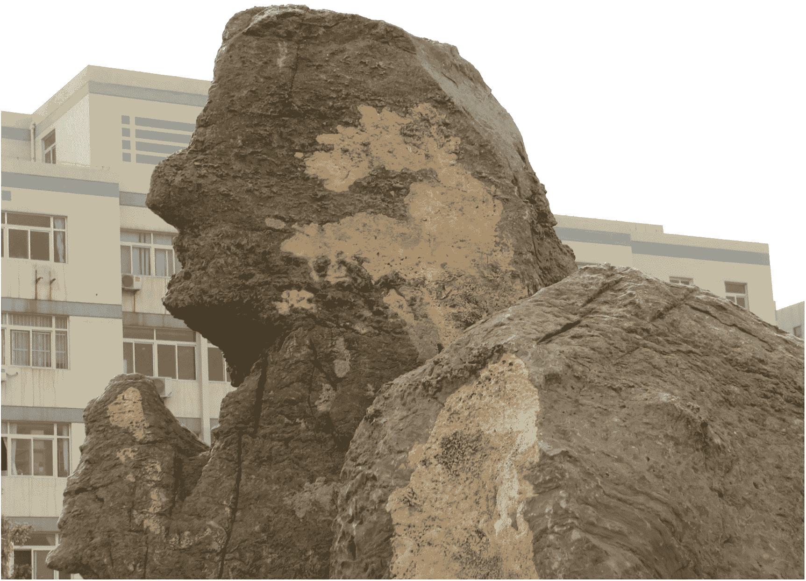
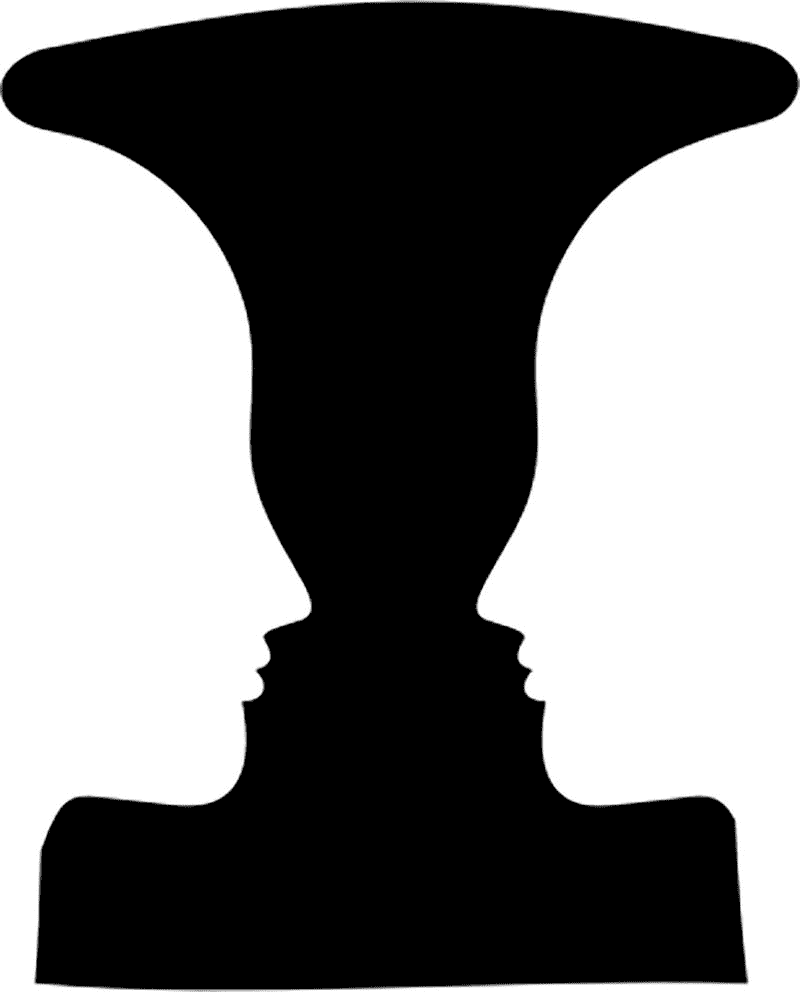
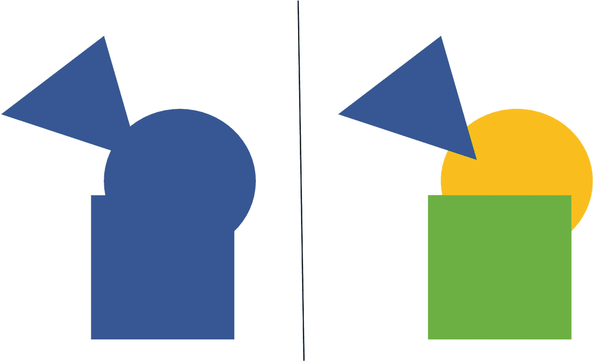
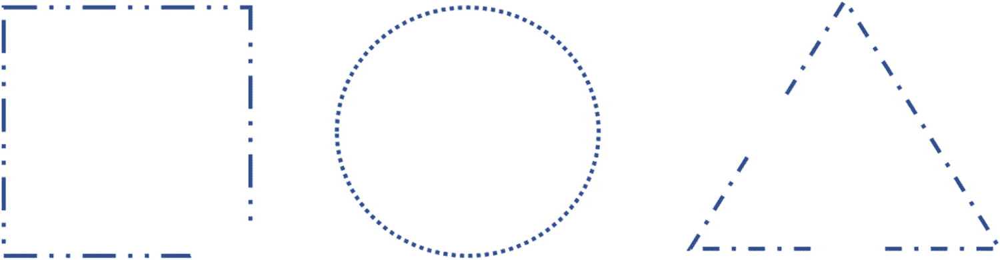
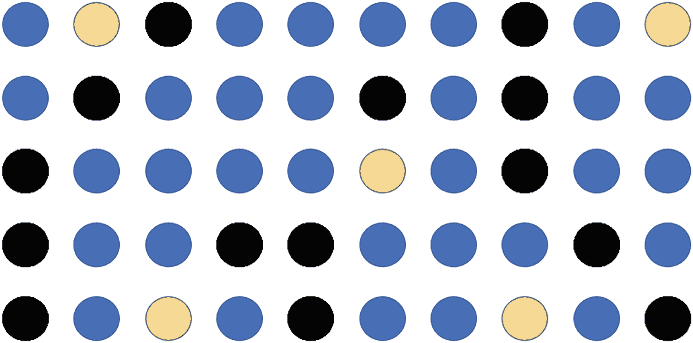
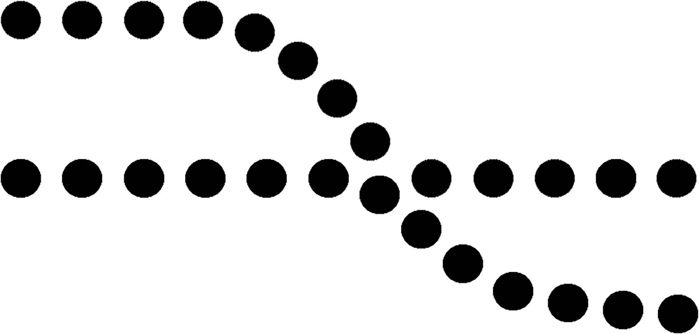
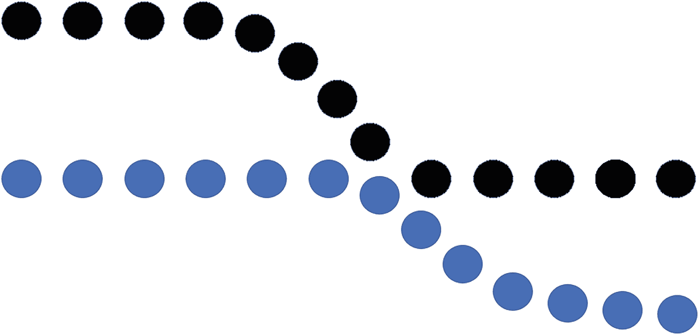
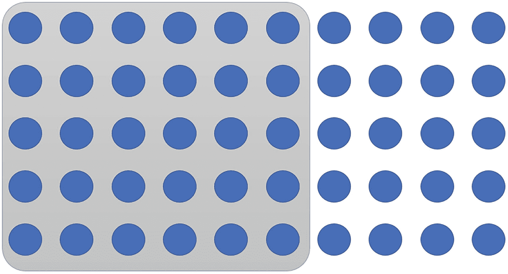
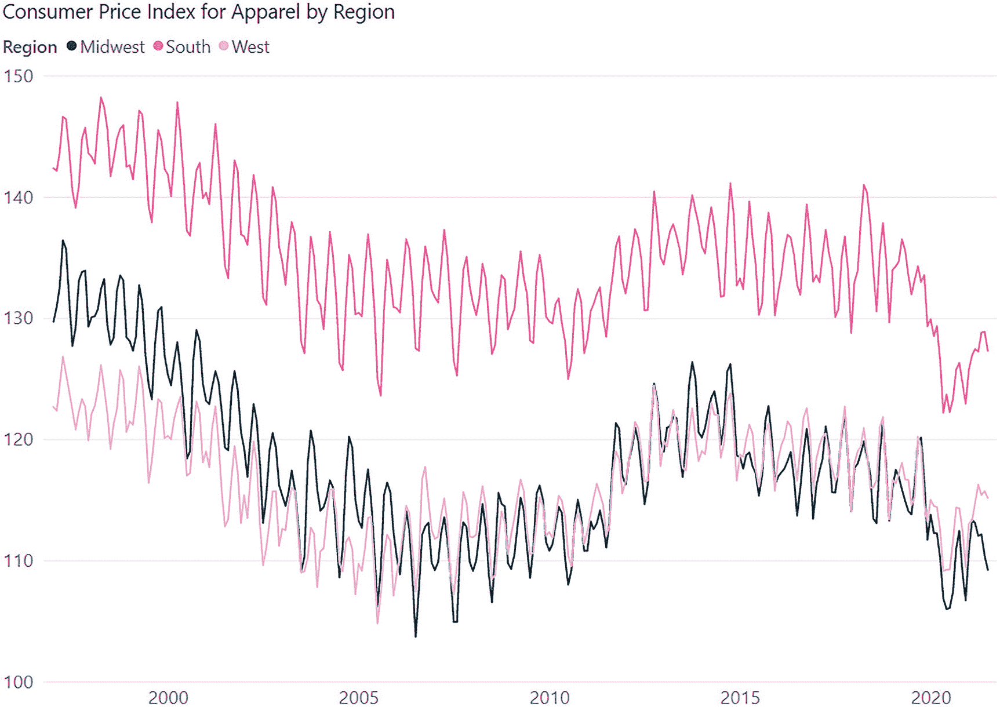
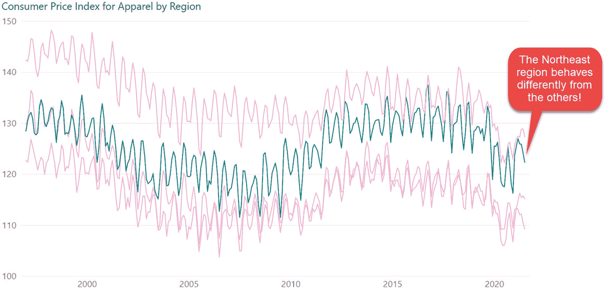

# 2. 人类是模式匹配者

在上一章中，我们了解了*异常值*、*噪声*和*异常*。我们还利用了人类直觉发现异常的能力。在本章中，我们将进一步了解人类如何解读和处理信息。具体来说，我们将重点关注格式塔心理学派的发现。

## 格式塔学派入门

1912 年，马克斯·韦特海默撰写了一篇题为《运动视觉的实验研究》（*Experimentelle Studien über das Sehen von Bewegung*）的论文。在这篇论文中，韦特海默描述了*似动*的概念，即当物体并未移动时，观察者却感知到了运动。随后，韦特海默与同事库尔特·考夫卡和沃尔夫冈·苛勒共同创立了柏林格式塔心理学派，我们简称为格式塔学派。术语*格式塔*（*Gestalt*）意为“形式”或“图形”，代表了其理论的主要基础之一：我们的思维是以结构化整体而非单个感觉来运作的。简单来说，人们是基于心理模式来观察事物的。更具体地说，人们会以最简单的方式解读事物，这意味着我们倾向于将排列解读为元素更少而非更多、结构对称而非不对称，并且看起来像我们之前见过的事物。这就是*普雷格朗茨*定律（*Prägnanz*，意为“简洁”或“精炼”），考夫卡在其《格式塔心理学原理》一书中对此进行了最佳阐述。

格式塔学派在学术界经历了起伏，过去一个世纪中受到了一系列批评和复兴。本书不会评判心理学领域研究者的各种主张与反驳，但我们会采纳那些拥有最多实验支持的发现，并将其作为理解人类行为的指南。

## 格式塔学派的关键发现

本节的目标是回顾构成普雷格朗茨概念的四个关键格式塔学派发现。然后，我们将回顾这些发现的 12 个推论，并观察人类如何运用这些原则来观察视觉元素，并基于这些观察得出结论。

### 涌现性

格式塔学派的第一个关键发现是*涌现性*概念。涌现性是指当大脑识别出熟悉的模式时，我们会立即且无需刻意努力地感知到事物。例如，我可能会觉得某朵云看起来像一只长颈鹿。这种感知并非我明确想要看到长颈鹿，而是自动发生的。一个从未见过长颈鹿（无论是实物还是图片）的人，不会像我一样观察那朵云。

当然，四足哺乳动物并非我们大脑会无意识感知的唯一事物。另一个常见的例子是面孔。例如，图 2-1 是一张拍摄于中国天津的岩石照片。从我第一眼看到这块岩石起，我就知道它非常像经济学家和道德哲学家亚当·斯密。

图 2-1：中国天津的一块岩石，与亚当·斯密相似

我们的大脑后来可能会拒绝这种关联，但那种即时的识别确实发生了。我最终可能会断定图 2-1 中的岩石实际上并不像亚当·斯密（尽管它确实很像！），但这并不能阻止那种即时的、前意识的解读发生。

### 具体化

第二个关键发现与第一个紧密相关，即*具体化*概念。在此语境下，具体化意味着我们在识别时会感知到完整、有意义、具体的物体。此外，当我们确实识别出某个特定物体时，需要额外的脑力才能专注于抽象形状。

例如，人类从人群中认出熟悉之人的能力，远比原始概率所假设的要强。在拥挤的餐厅里找到一群朋友出奇地容易，即使部分身体或面孔被桌子或路人遮挡。我们也非常擅长发现部分被遮挡的人或物，比如大部分身体被被子盖住的人，或者试图用爪子捂住眼睛来躲藏的小猫。

一个基于具体化概念的笑话出自《辛普森一家》第八季的一集，名为《我们信任玛琦》。在这一集中，荷马在日本洗衣粉吉祥物“斯帕克尔先生”身上看到了自己的形象。这个吉祥物是由松村鱼业公司（以一条微笑的鱼为代表）和玉渊重工公司（一个灯泡）组合而成的。由于观众已经看过荷马·辛普森的脸超过七年，他们自然会把这个“鱼灯泡”与荷马联系起来。

具体化也解释了迷彩的关键原理。严格来说，迷彩的目的并非让你隐形；相反，它的作用是打破你自然的形状，使他人更难完整地观察到你。在自然界中，迷彩以多种形式出现，例如条纹（老虎）、斑点（豹子）和反荫蔽（瞪羚）。对人类而言，迷彩通常出现在军事或狩猎场景中，具体图案取决于地形。一个特别有趣的历史例子是“眩目迷彩”，这是第一次世界大战期间涂在舰船上的一系列高对比度、相互交叉的几何图形。眩目迷彩的目的是让德国潜艇更难判断特定船只的速度和航向，从而使德国潜艇更难击沉英美船只。在这种情况下，迷彩实际上使船只更容易被发现，但（至少在理论上——关于眩目迷彩是否真的有效，结果尚无定论）却增加了瞄准和击沉船只的难度。

### 不变性

第三个值得注意的发现是*不变性*概念。不变性意味着即使存在一定程度的变异，我们也能识别出大多数形状和图形。例如，我知道圆形是什么样子，即使这个圆形比我之前看到的更大或填充颜色不同，我也能识别出来。我可以观察一只从未见过的狗，并知道这是一只狗。此外，我还能在不同时间点识别出同一事物或同一个人——尽管有时会有困难。如果我十年没见过一位老同学，即使对方发型、穿着和腰围都变了，我可能仍然能认出这个人。这里发生的是，我们的大脑能够提取一个人或事物的基本特征，并让我们将其推广到其他情况和时间。

然而，不变性并不等同于完美的记忆或理解。十二年前看过一张 DVD 封面，我今天可能就认不出来了。通常，那些我们最常见到或与我们联系最紧密的人或事物，即使有显著变化，也能随着时间的推移被识别出来。

### 多稳态

我们最后的关键发现被称为*多稳态*。多稳态的概念是指，如果缺乏足够的视觉线索来解析特定情境，我们会在对场景的不同解读之间来回切换。例如，图 2-2 展示了一个文献中经典的例子——鲁宾的花瓶。鲁宾的花瓶以心理学家埃德加·鲁宾的名字命名，他本人并非格式塔学派心理学家，但却是科夫卡等人的同事和灵感来源。

图 2-2：一个瓶口宽阔、中部狭窄、底部宽大的花瓶，形似两张面孔。

观看这幅图像时，我们的大脑可以解读出两种截然不同的图像：它要么是一个花瓶的图片，要么是两张相对的面孔。由于两种图像都可能成立，且对我们的大脑来说都有意义，我们难以判断哪一个是“正确”的图像，因此每个图像都会在我们的意识中占据一段时间，随后又被另一个所取代。这种状态会持续到我们获得足够的视觉线索来消除图像的歧义。对于鲁宾的花瓶而言，这通常是通过增加第三个维度来实现的，这样我们就能清晰地看到花瓶的深度或面孔的深度。增加这种深度消除了任何歧义，使得看到“错误”答案变得困难得多。

## 关键发现中蕴含的原则

这四项关键发现本身很有趣，但它们也引出了一系列后续原则，我们可以利用这些原则来理解一个人如何解读眼睛发送给大脑的信号。本节总共将回顾 12 条原则，其排列顺序使得各原则能够相互递进。

### 意义性

从上述发现中推导出的第一条原则是*意义性*原则。意义性是指我们可以将视觉元素组合在一起，形成有意义或相关的场景。这一原则直接源于涌现的概念。在图 2-1 中，我将几块岩石的形状组合在一起，解读出一张人脸，并赋予了该形态以意义。类似地，仰望云朵的人常常会看到形状或动物，这也是这种能力的副产品。在数据分析的背景下，我们可以查看散点图并辨别出数据中的趋势。趋势本身并非视觉元素，而是我们基于先前经验或直觉推断出来的东西。

意义性的另一面是，我们可能会将某些属性归因于并非事实的事物。假设我们有一个随机数生成器，它以相等的概率生成 1 到 100 之间的整数，并打印出序列 `{8, 9, 10}`。我们可能会看到一个趋势，并假设下一个值将是 11，但假设随机数生成器没有损坏，那么下一个数字*不是* 11 的概率是 99%。在这种情况下，我们识别出了一个虚假的趋势——或者用第 1 章的语言来说，我们有一个形成离群值的序列，但结果证明它是噪声，而非真正的异常。

### 简洁性

第二条原则是*简洁性*原则。人类倾向于将现实简化为尽可能简单的形式。例如，图 2-3 展示了两幅图像。左侧我们看到一幅图像。右侧是同一幅图像，但每个形状都有不同的颜色。在这两种情况下，我们都能立即感知到左侧的“形状”实际上是三角形、圆形和正方形的组合，正如我们在右侧看到的那样。

图 2-3：即使形状重叠且缺乏明确的颜色差异或边界（如左侧所示），我们仍然能找到方法将它们分解为最小的有意义的元素

我们看到三个形状而非一个的原因在于，我们脑海中没有与左侧物体相似的心理图像；因此，我们将其分解为我们能理解的组成部分。类似地，如果我给你看一张猫懒洋洋地躺在软垫椅子扶手上的照片，你会看到一把椅子和一只猫，而不是某种两者混合而成的怪物。这一原则与具体化的概念相关联，即我们尽可能地将事物感知为完整、有意义且具体的对象。如果我们经常将左侧的图像看作一个有着巨大莫西干发型但发际线严重后退的人物漫画，我们就会开始将其感知为一个整体对象，因为我们现在可以独立于其底层形状来赋予它意义。

### 闭合性

第三条原则是*闭合性*原则，即大脑会自动补充缺失的视觉信息以完成图像。图 2-4 展示了一个闭合性的例子，我可以自信地说，你会分别看到一个正方形、一个圆形和一个三角形。

图 2-4：由于闭合性原则，一个正方形、圆形和三角形出现在视野中

我同样可以自信地说，这些图形实际上都不是正方形、圆形或三角形。相反，我们看到的只是这三个形状的标记被打散了，但我们的大脑会不假思索地“连接这些点”，为我们完成图案。同样的能力也使我们能够辨别出某个东西是什么，即使它被部分遮挡。例如，图 2-5 展示了一条蜿蜒到树后的小径。尽管小径的一部分位于树后，超出了我们的视线，我们仍然可以合理地推断出存在铺路石完成了这条小径。

花园中一条蜿蜒到树后的小径。

图 2-5
我们的大脑“补全”了绕到树后的小径部分

### 相似性

最强大的原则之一是*相似性*原则。该原则发现，我们会自然而然地根据颜色、大小、形状和其他视觉特征对项目进行分组。此外，在颜色方面，我们在讨论定义相似性的因素时，可以包括色相、饱和度、明度、鲜艳度和色温。当以灰度显示图像时，我们会丢失大量此类信息，但图 2-6 仍然足够清晰，让我们能够看到三种不同的颜色（或印刷品中的灰色阴影）。

一张由 10 列 5 行圆点组成的示意图。

图 2-6
相似性原则的体现

当我们观察图 2-6 中的图像时，在缺乏其他信息的情况下，人们倾向于认为相同颜色的圆点具有某种共同含义，例如，散布在图像中的黑色圆点都代表着与蓝色和黄色圆点无关的某种事物。由此，我们可以引入额外的复杂性，例如将一些圆点改为正方形和三角形。然后，我们会认为相似的颜色和形状代表同一事物，或许相同颜色的形状具有某种相似性，但并不完全等同。更进一步，我可能会包含各种颜色的更大和更小的形状，同样，在缺乏其他信息的情况下，我们倾向于认为尺寸相似的元素彼此之间具有共同点。随着我们增加更多层次的复杂性，这些假设会不断累积，你更有可能让观看者感到困惑，而不是阐明情况。即便如此，借助一些提示，我们的大脑可以毫无问题地跨多个视觉维度处理信息。

### 良好连续性

第五个原则是*良好连续性*，即我们的大脑倾向于遵循平滑、可预测的路径。图 2-7 展示了良好连续性原则的一个示例。在这里，我们利用封闭性属性，从一系列圆点中看出两条线。最上面的一条线向下弯曲，与图像中间的一条直线相交。

一条由圆点组成的水平线。一条由圆点组成的最上面的线向下弯曲，与水平线相交。

图 2-7
封闭性和良好连续性原则让我们看到一条直线和一条曲线

尽管图像中并没有实际的线条，但我们很容易从出现的圆点的间距中看出这两条线的轮廓，我们的大脑可以据此解读场景。此外，我们可以假设其他人也会以相同的方式解读这些线条——很少有人会看到三条（或更多）线条，或者认为这两条线没有相交。

为了确保其他人确实看到两条不相交的线，我们可以引入颜色，并利用相似性原则。现在，在图 2-8 中，我们有两组圆点序列：黑色和蓝色（或印刷品中的灰色）。

一条由圆点组成的水平线。一条由圆点组成的最上面的线向下弯曲，与水平线相交。

图 2-8
我们的大脑天生抗拒图像中的不连续性

随着颜色的变化，我们勉强看到线条彼此弯曲分开。这也给我们一个指示：某些原则比其他原则更强：相似性，尤其是在颜色方面，压倒了大多数其他原则，使我们能够引导观看者，尽管存在其他倾向。这也是一个很好的总结，说明为什么你不应该在视觉设计中过度使用颜色，因为这样做会失去吸引观看者注意力并纠正错误假设的能力。

### 图形与背景

另一个与格式塔学派密切相关的原则是*图形*与*背景*的二元性。图形是我们图像的主体，而背景则代表主体周围的场景。我们可以利用视觉线索来决定什么是重要的图形，什么构成背景。通常，最好的线索之一是图形相对于背景往往更小。另一个线索是图形和背景在颜色上形成鲜明对比。

回到格式塔学派的关键发现，多稳态的概念可以更好地表述为活动图形与背景之间的混淆。鲁宾的花瓶，如图 2-2 所示，就是一个例子，其中图形有两种可能的解读，导致我们轮流看到每一种，并持续一段时间。有趣的是，即使在这种多稳态的情况下，我们最终也不会出现面孔和花瓶同时成为图形的情况——一个必须是背景，而另一个则成为图形。

### 接近性

*接近性*原则表明，我们会认为紧密排列在一起的事物比分散得更远的事物关联性更强。例如，图 2-9 展示了一系列沿直线分布的圆点。每个圆点的颜色和大小完全相同，但我们却看到了四个独立的组，这完全是由于圆点之间的间距造成的。

4 组圆点。第一组有 3 个圆点，第二组有 1 个，第三组有 2 个，第四组有 1 个。

图 2-9
尽管是相同颜色、相同大小的圆点，但我们根据接近性感知到了四个组

这个接近性原则将联系到本书的第三部分，其中我们将介绍基于距离的异常检测技术。基于距离的异常检测技术依赖于一个假设：距离较近的数据点是相似的，如果我们有足够多的数据点足够接近，那么所有这些点都是内点。

### 连通性

*连通性*是指我们倾向于将物理上连接的项目视为一个整体。举个简单的例子，想象一支经典的黄色 2 号铅笔。我们把铅笔本身说成一个东西，但它却由石墨芯、包裹石墨的木框、橡胶橡皮擦、将橡皮擦固定在木框上的金属箍以及木材上的黄色油漆涂层组成。当然，必要时我们可以专注于其中任何一个组件，但我们的默认解读是将铅笔视为一个整体。连通性可视为接近性原则的最终体现。

### 共同区域

*共同区域*原则比接近性原则更进一步。根据共同区域原则，我们假设位于一个明确划分的空间区域内的东西必然是相似的。图 2-10 向我们展示了这种现象的一个示例。在这个例子中，我们有一系列规则的圆点，它们都具有相同的颜色、大小和形状。它们彼此等距排列，使得这个视觉画面尽可能同质。然后，我们画一个方框，作为一组圆点后面的背景。现在，方框内的所有圆点似乎都属于一个共同区域，而剩下的圆点则位于第二个没有方框的区域。

圆点排列成 10 列 5 行。前 6 列中的圆点位于一个高亮区域中。

图 2-10
灰色区域内的点属于一个视觉组，而区域外的点则隐含地属于第二个视觉组

### 对称性

我们倾向于将对称排列的元素视为同一组的一部分。这就是**对称性**原则。尽管该原则以对称命名，但它同样适用于反射、旋转和平移。举例来说，如果我看到一个人站在镜子前，我的大脑不会将镜中的映像视为另一个人。再举一个更抽象的例子，我可以任意旋转一个三角形，但仍然能认出它是一个三角形。如果我看到两个三角形，其中一个的旋转角度与另一个不同，尽管存在旋转差异，我仍然会将它们归为一组。回到实际例子，一组箭头可以指引穿过走廊的路线，尽管后续的箭头指向不同方向——有时指向左，有时指向右，有时直行——我仍然可以将它们归为一组，视为我必须遵循才能到达目的地的方向序列。

增加人们基于对称性进行匹配可能性的方法之一是运用相似性属性。回到之前箭头引路的例子，如果所有箭头颜色相同且大小相近，会有所帮助。这样做能降低人们认为一种颜色的箭头属于一组方向指示，而另一种颜色的箭头属于另一组方向指示的可能性。这种箭头引路的策略在医院中很常见，医院利用墙壁上的箭头和彩色线条来指示不同病房的方向。

### 共同命运

**共同命运**原则指出，我们倾向于将朝同一方向移动的元素归为一组。例如，如果我们看到一条道路上满是朝一个方向行驶的汽车，我们会将其视为一个集合名词：车流。单个车辆成为单一心理组的一部分，但该组不包括同一图像中朝相反方向行驶的汽车。

我们可以通过观察时间序列数据将这一点与可视化世界联系起来。两条序列的变动看起来越协调，我们就越倾向于将它们视为一个整体。图 2-11 展示了 1997 年 1 月至 2021 年 7 月期间美国三个地区服装类消费者价格指数的示例。

标题为“各地区服装消费者价格指数”的折线图。图中的线条呈现下降趋势。

图 2-11
三个地区遵循相似的模式

每条序列都遵循一个共同的模式，尽管中西部地区的序列在早期年份下降幅度更大。由于这些模式大致相同，具有相似的起伏，我们将这三条线解读为遵循一个共同模式，并且可以针对这三条独立的线谈论“这个”模式。

### 同步性

我们将要介绍的最后一个原则是**同步性**。在这种情况下，我们将代表同步事件的视觉元素归为一组。另一种表述方式是，大约同时发生的多件事物似乎会相互关联。假设我向窗外望去，看到一辆汽车飞驰而过，紧随其后是一辆警车，警灯闪烁，警笛鸣响。我会自然而然地认为这两个事件相互关联，并且可能在脑海中构建一个故事来解释这种情况是如何发生的。

然而，在思考同步性时，牢记“相关性并不意味着因果关系”这一概念非常重要。两件事在时间上接近发生，并不意味着它们就有关联。那两辆在路上飞驰的汽车可能实际上并无关联，也许警车正赶往一个重大事件现场，甚至没有时间报告或理会另一辆超速车辆。在这种情况下，这两个事件先后发生只是巧合。

同步性和共同命运都在时间序列分析中扮演着重要角色，这将是第四部分的重点。

## 帮助人们发现异常

我们可以利用格式塔原则，在以可视化格式展示数据时帮助最终用户发现异常。在下一节中，我们将总结一些关键技巧，你可以用它们来帮助报告查看者和应用程序用户发现离群值和异常。

## 使用颜色作为信号

我们感知颜色差异的能力是人类最重要的信号指示器之一。即使对于患有各种形式色觉缺陷（俗称色盲）的人来说，发现颜色差异也是我们大脑无需刻意关注就能做到的事情。用格式塔术语来说，颜色是一种涌现现象。

鉴于此，我们应该只在最有意义的情况下使用颜色变化。如果我们创建的可视化图像看起来像彩虹爆炸了一样，大量的颜色变化会压倒我们大脑有效处理变化的有限能力。结果，我们在图像中引入了噪声源。这种噪声可能与我们第一章（其中噪声是指不感兴趣的离群值）中定义的不完全相同，但它在分散观看者注意力这一点上是相同的。

不要将颜色随意散布在可视化图像上，而应谨慎使用颜色变化来表示重要事项。通过限制可视化图像中使用的颜色数量，观看者将有可能发现离群值，从而使具有足够领域知识的细心观看者能够调查并确定离群值的原因。

## 限制无意义信息

与我们第一点类似，我们希望限制可视化图像中的无意义信息。目标是让故事的重要部分成为图形而非背景。也就是说，可视化图像中争夺注意力的元素越多，就越有可能有一些多余的、无信息量的元素夺走我们的注意力。我们在这些原则中看到，人类擅长找出差异和发现离群值，但我们也同样看到，那些对我们有利的原则也可能反过来欺骗我们，让我们错过存在的东西，或者看到不存在的东西。

## 启用“串联线索”

最后，要展示能让观众“串联线索”的内容，使他们能以最有效的方式运用自己的领域知识。实现串联线索的最佳方法是利用邻近性、相似性和共同命运等原则。

在邻近性方面，应尽量以这样的方式布置视觉元素：让彼此靠近的点在相关维度上也接近。这在数轴上绘制点时很直观，因为彼此靠近的点在数值上也会相似。理想情况下，你可以调整比例尺，使得观众眼中靠近的点属于同一相关集群，而点之间的间隔则代表显著差异。你无法总是完美控制这一点，但需要考虑图像尺寸、坐标轴的最小最大值以及点的大小。

为了提升观众运用相似性原则的能力，尽量使用相同的形状、颜色和大小来表示同类事物。如果确实使用了不同大小的形状，要确保大小代表一个有意义的连续变量，例如事件数量。同时，尽量保证比例尺的相对差异合理，避免出现某个点完全压倒其他所有点的情况。

最后，关于共同命运原则，如果可能的话，尽量强调或指出那些运动轨迹相似的情况，将它们与不符合的元素区分开来分组。例如，查看图 2-11，我们可以看到三个地区在服装类别的消费者价格指数上走势非常相似。而实际上还有第四个地区，其表现略有不同。图 2-12 展示了一个示例：用相同颜色表示具有共同命运的地区，并用不同颜色突出显示东北地区。

一张折线图，标题为“各地区服装类消费者价格指数”。图中有一条线被标注为“东北地区表现与其他地区不同”。

图 2-12 使用相同颜色表示具有共同命运的地区，从而让我们能够指出一个表现略有不同的地区

## 结论

在马克斯·韦特海默的开创性论文发表一百多年后，格式塔学派仍然具有现实意义，尤其是在感官识别领域。深入理解本章阐述的原则，将极大帮助报告读者和应用程序用户理解你所提供的信息。这是一个值得称赞的目标，但在异常检测方面，仅凭这些原则还不足以创建一个能让计算机在数据中发现异常值的程序。即便如此，我们将在本书中多次回顾这些原则，因为归根结底，异常检测问题是一项人类事业：正是人类为异常值提供了必要的意义标准，从而将异常与单纯的噪声区分开来。