# 3. 形式化异常检测

在上一章中，我们探讨了人类用于执行离群值和异常检测的感官工具，并花时间理解了它们的工作原理。计算机不具备这些感官工具，因此我们需要使用其他流程来让它们检测离群值。具体来说，我们需要至少实现三种离群值检测方法中的一种，以便为计算机提供某种离群值检测流程。本章将开始阐述本书将涵盖的三种离群值检测方法中的第一种：统计方法。

## 形式化的重要性

第 2 章明确指出，人类总体上非常擅长模式匹配和识别问题。人类在严酷生态系统中赖以生存的许多技能，同样有助于观察更平凡的事物，例如按业务部门和时间绘制的公司收入散点图。尽管如此，人类及其使用的工具都会犯错。在本节中，我们将探讨为何完全由人类驱动的离群值检测程序不太可能成功。

### “我一看就知道”是不够的

将一组原始数据交给一个人，并期望从中获得完整准确的离群值集合，通常是一件徒劳无功的事情。我们的处理能力是矛盾的：在某些情况下，我们能够轻松地在海量信息中辨别出模式或发现异常，但即使是很小的数据集，如果没有正式的工具，也可能让我们的头脑不堪重负。此外，我们在前一章中讨论的许多格式塔见解都带有学习成分。例如，涌现发生在大脑*识别*出模式时，有意义性适用于*个人相关*的场景，而具体化则取决于我们*认出*某个事物。由于背景和经验不同，两个人可能不会在给定的数据集中发现相同的离群值。因为我们不能假设所有观众都具有相同的背景、经验和能力，所以将数据交给观众并期望得到输出是不可行的。

### 人类的易错性

这也引出了下一点：人类会犯错。我们的眼睛并不完美，我们也不总能完美地回忆起特定的数值、模式或概念。由于我们容易忘记先前的模式、观察到虚假或不存在的模式，以及忽略眼前存在的模式，因此我们并非完全可靠的离群值检测工具。

然而，我不想过分强调这一点——人类*确实*非常擅长这项任务，并且应该成为任何异常检测系统的重要组成部分。至少，人类是必要的，以便为离群值赋予意义，并确定某个离群值最终是否属于异常。除此之外，人类还能提供一些能力，以发现机器或自动化技术遗漏的离群值。顺便提一下，这有助于我们了解自动化离群值检测过程的效果——如果人类经常发现该过程遗漏的异常，那可不是一个好兆头！

### 边缘离群值

人类易错性的一类表现是边缘离群值的情况。在查看图表时，某些类型的离群值很容易发现。图 3-1 是我们在第 1 章中看到过的一张图片的复现，其中两个离群值很容易被识别出来。

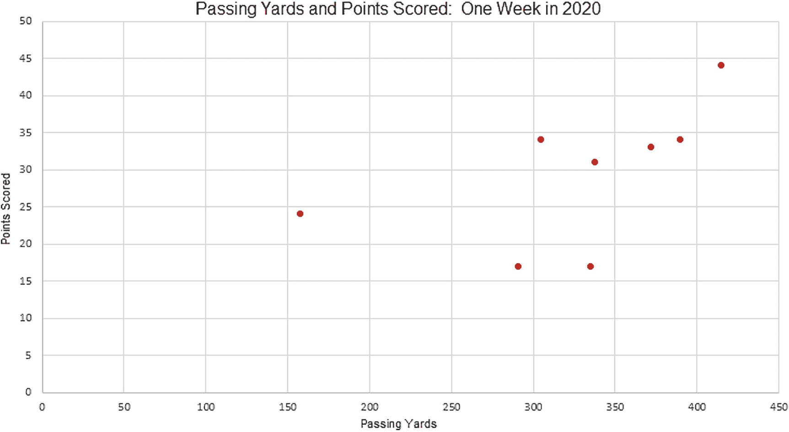

一张散点图，横轴为传球码数，纵轴为得分。估计值分别为 (160, 24)、(290, 17)、(310, 34)、(340, 31)、(380, 34) 和 (420, 44)。

图 3-1

NFL 单周比赛中得分与传球码数的关系。我们在图表上看到两个离群值，它们的得分均未达到 20 分

这些很容易发现，但最上面的那个点——四分卫传球约 415 码，其球队得到 44 分——是离群值吗？如果不是，那么如果他的球队得到 45 分或 47 分呢？这个数据点需要得多少分才能成为离群值？人类非常擅长发现与常态差异很大的事物，但在注意到非常微小的差异时，我们的准确性往往大打折扣。因此，我们可能会遗漏那些刚好处于边缘的离群值，或者误将那些实际上是正常值但接近边缘的数据点纳入其中。

### 可视化的局限性

最后，人类在审查可视化形式的数据时表现最佳。像图 3-1 这样的图表，能让我们比查看数字表格更高效地利用感官感知能力。人类可以很好地处理少量变量，但普通人一次能处理的最大变量数是五个：分别对应`X`、`Y`和`Z`轴各一个；一个用于表示数据点的大小；以及通过随时间在图表上移动数据点来捕捉时间度量。即便这样，在许多情况下也可能有些勉强，让我们通常只能舒适地处理不超过两三个变量。

这说明，一旦事情变得复杂，我们需要在越来越高的维度上审视关系时，人类的肉眼往往就不太灵光了。我们或许可以使用诸如降维之类的技术来简化分析工作，但即使是像主成分分析（`PCA`）这样的降维技术也有其局限性。在更复杂的场景中，我们可能仍然无法将成分数量减少到足够少，以便于轻松可视化。

## 第一个正式工具：单变量分析

基于上一节的认知，我们可以引入额外的工具和技术来增强人类能力，并使领域专家更容易从数据集中识别出异常。在本章中，我们将从讨论统计分析技术开始，特别是*单变量分析*。术语“单变量”意为“一个变量”，指的是我们只有一个变量需要分析的数据集。当我们说“一个变量”时，是认真的：它仅仅是一组值的集合，我们可能用一维数组之类的东西来实现它。

这种方法听起来对于任何实际分析来说都过于局限，但在实践中，它实际上非常有效。在许多情况下，我们可以通过假设任何其他变量都是*独立的*（即没有外部变量影响给定数据点的值），将分析范围缩小到一个重要的输入变量。这是一个几乎永远不成立的朴素假设，然而在实践中它通常效果不错，足以让我们据此进行合理的统计分析。

### 分布与直方图

在查看一维数据时，我们的关注点在于数据的分布。理解*分布*（或*统计分布*）的一个简单方法就是将其视为数据的形状。也就是说，在数据集中，某个特定值出现的频率有多高？对于一维数据，我们可以创建一种称为*直方图*的图表，它展示了数据集中某个值出现的频率。

在了解直方图的实际应用之前，我们先简要介绍一下变量的一个属性：变量是*离散的*还是*连续的*。离散变量具有有限且已知的可能值数量。如果我让你给一部电影打分，分数范围是 1 到 5 星，5 星最高且不允许半星，那么我就创建了一个离散变量，它包含从 1 到 5（含）的一系列回答。相比之下，连续变量具有无限数量的可能值。但在实践中，“无限”通常意味着“非常大的数量”，而非真正的无穷。如果我询问一群人去年赚了多少钱（必要时换算成美元），我会得到各种各样的回答。虽然一个人一年能赚到的美元和美分数量是有限的——显然，不会超过去年全球所有国家的 GDP 总和——但在实践中我们仍认为这个变量是连续的，因为我们很可能会得到大量独特的回答。

此外，在根据连续变量构建直方图时，我们通常不那么关心变量的精确值，而是可以用近似值来代替，从而将某个范围内的值聚合起来，作为一个组来显示，我们称之为*组距*。图 3-2 展示了一个此类直方图的示例，其中包含了某个赛季中投球局数至少达到 150 局的美国职棒大联盟所有投手的自责分率（`ERA`），共有 4897 条记录。我使用 R 语言中的`ggplot2`库生成了这张图，该库默认使用 30 个组距。

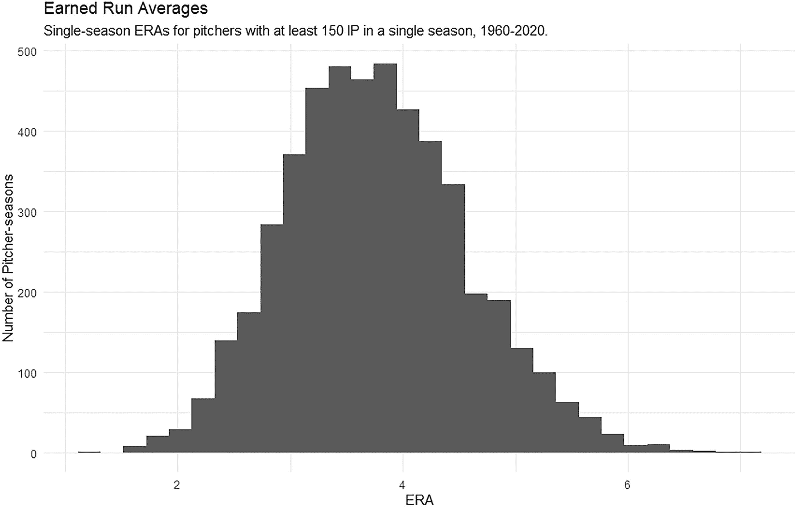

直方图绘制了投手赛季次数与`ERA`的关系。估计值为 (1, 10), (3, 450), (4, 490), (6, 10), 和 (7, 0)。

**图 3-2**  
使用 30 个组距的单赛季自责分率直方图

图 3-3 展示了组距选择的重要性，我们将组距数量减少到了 5 个。

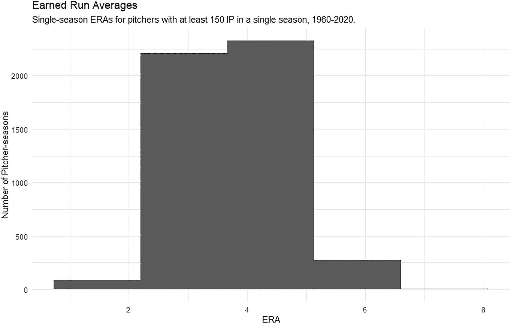

直方图绘制了投手赛季次数与`ERA`的关系。值为估计值。(1, 100), (2, 2400), (4, 2700), 和 (6, 250)。

**图 3-3**  
当使用五个组距时，我们丢失了数据中的大量细节

将数据减少到仅仅五个区间，我们丢失了巨大的数据保真度。话虽如此，对于所有数据集而言，并没有一个单一的“正确”区间数量。我们通常使用直方图来帮助理解数据的形状，因此“正确”的组距数量是能够在不引入过多噪声的情况下，为我们提供分布形状信息的数量。图 3-4 展示了噪声的一个例子，我们将组距数量增加到了 500 个。

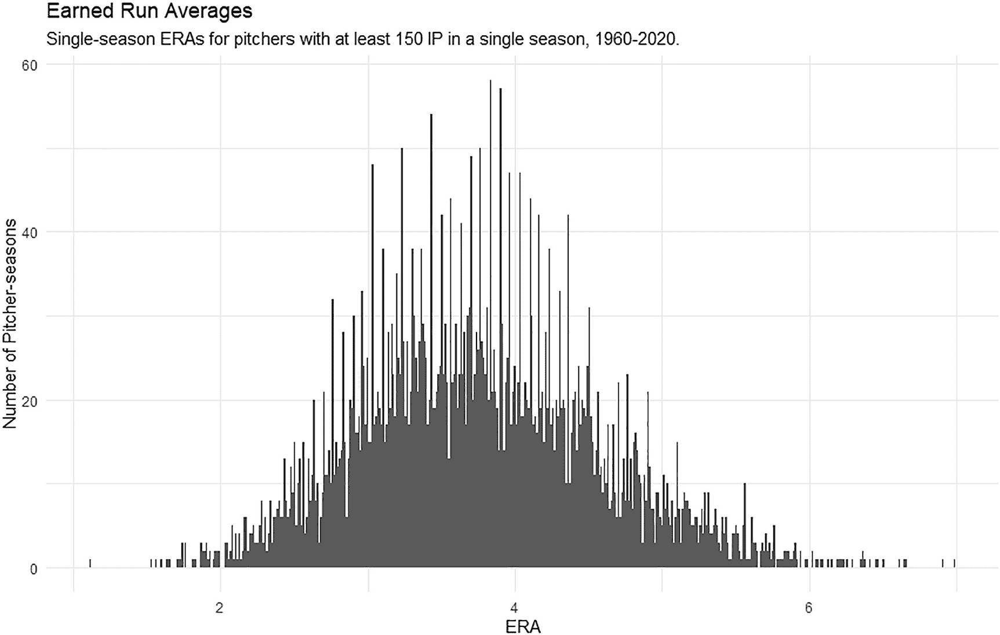

直方图绘制了投手赛季次数与`ERA`的关系。值为估计值。(1, 1), (3, 17), (4, 58), (4.5, 32), 和 (6, 1)。

**图 3-4**  
组距过多和过少一样，都会妨碍我们对数据的理解

在这种情况下，将数据分成 500 个组距妨碍了我们对数据分布的理解；组距实在太多，难以从生成的图像中看出什么名堂。在选择组距数量时，一个经验法则是减少组距数量，直到它不再像图 3-4 那样看起来参差不齐。对于这个例子，这个数量大概在 30 到 50 个组距之间，而默认设置已经足以让我们对数据的整体感觉有一个概念。

现在，我们对分布有了基本概念，并了解了一种可用于展示单变量分布的工具，接下来让我们简要介绍一下最著名的分布，以及它用于异常检测的一些相关属性。

### 正态分布

*正态分布*（或称*高斯分布*）无疑是最广为人知的分布。这是任何学生在统计学课程中最早学习的分布之一，原因很充分：它易于理解，具有若干有用的性质，并且在实践中我们经常见到它，因此值得关注。尽管自然界中存在其他更常见的分布——例如对数正态分布——但让我们像统计学教科书一样，首先聚焦于正态分布。

图 3-5 展示了正态分布的*概率密度函数*（PDF）。

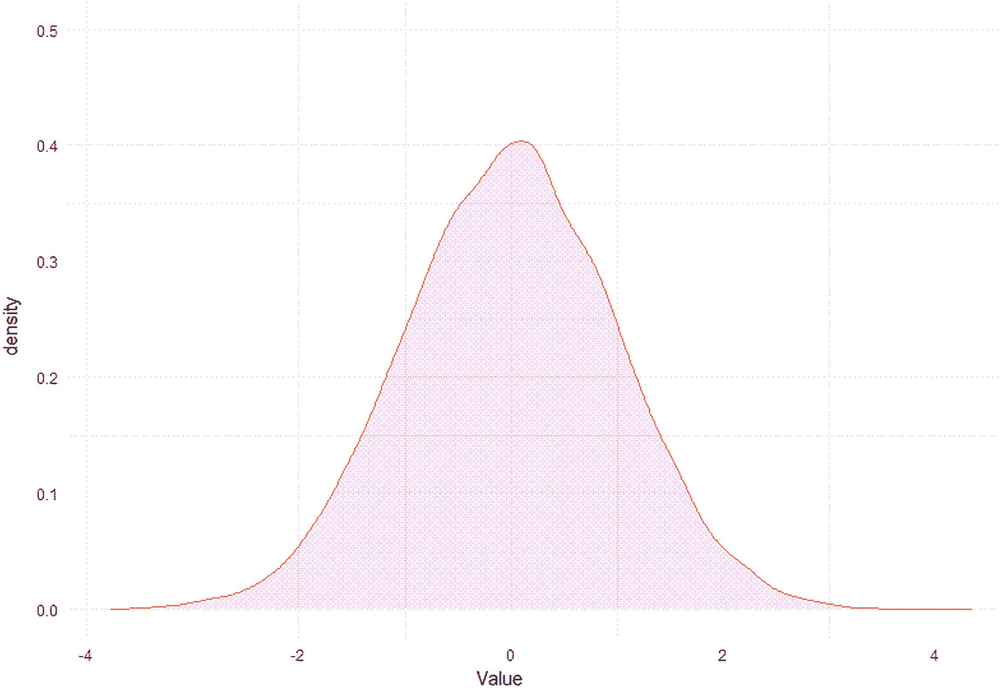

一张图绘制了密度与数值的关系。估计值为（负 4，0.0）、（0，0.4）和（4，0.0）。

**图 3-5** 正态分布的概率密度函数。此 PDF 通过从正态分布中随机选取 15,000 个值并绘制所得密度函数生成

这张图向我们展示了两点：首先，如果我们从正态分布中随机选取一个点，得到某个特定值的可能性有多大。我们从 X 轴上的一个无穷小区间内选取一个特定值的概率，就是该值在 Y 轴上的高度。这告诉我们，我们更可能得到接近 0 的值，而不是远离 0 的值。其次，我们可以累加曲线下的面积，从而了解我们选取一个小于等于（或大于等于）X 轴上某个特定值的可能性有多大。例如，如果我们累加曲线下直到-2 这个值的面积，这大约相当于曲线总面积的 2.5%。这告诉我们，如果我们从正态分布中随机选取一个点，我们选取到一个小于等于-2 的点的概率大约为 2.5%。

这两个性质几乎适用于我们将在第 3 章中看到的所有分布。现在我们对分布有了基本概念，接下来看看三个有助于我们理解大多数分布的度量指标。

### 均值、方差与标准差

对我们而言，第一个重要的度量指标是*均值*，它是我们俗称“平均值”的两个术语之一（另一个是*中位数*）。我们可以通过`μ = Σ values / N`来计算一组点的均值。换句话说，如果我们对数值求和并除以数值的个数，就得到了均值。

在前面展示的正态分布示例中，均值为 0。由于正态分布的曲线是对称且单峰的，通过观察概率密度函数很容易确定均值：它就是峰值。对于其他分布，均值不一定那么容易找到，我们将在后文中看到。

既然我们已经弄清楚了均值，描述正态分布的另一个关键方式是*方差*，即曲线的分散程度。计算一组点的方差比计算均值稍微复杂一些：`σ² = (1/N) Σ (x_i - μ)²`。换句话说，我们对每个点与均值之差的平方求和。然后，将其除以数据点的数量，就得到了方差的计算结果。

一旦理解了方差，*标准差*就很简单了：标准差是方差的平方根。标准差对于正态分布是一个相当重要的度量指标，因为关于我们随机抽取一个点与均值相距一定距离的可能性，存在一些经验法则。图 3-6 展示了这个 68-95-99.7 法则。

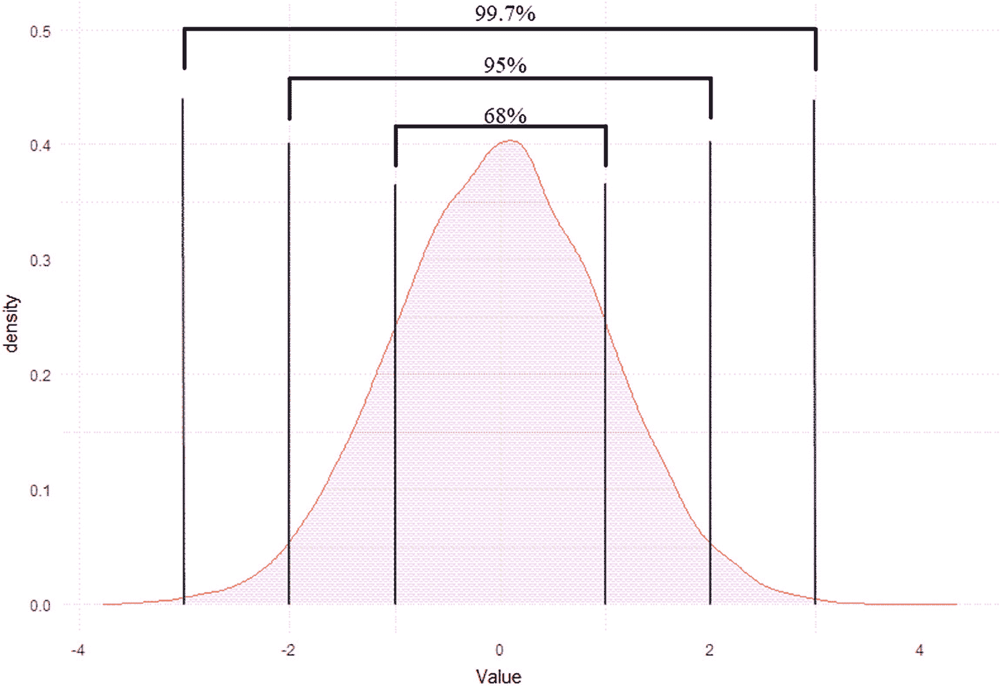

一张图绘制了密度与数值的关系。估计值为（负 4，0.0）、（0，0.4）和（4，0.0）。矩形的值为 68%、95%和 99.7%。

**图 3-6** 正态分布遵循 68-95-99.7 法则

从图 3-6 中我们可以看到，抽取一个介于-1 和 1 之间的值的概率约为 68%。抽取一个介于-2 和 2 之间的值的概率为 95%。最后，抽取一个介于-3 和 3 之间的值的概率约为 99.7%。这引出了我们对异常值的第一个技术性定义：如果给定点与均值的距离超过三个标准差，并且我们假设底层分布是正态分布，那么该点就是一个异常值。如果分布确实是正态的，这意味着大约每 1000 个点中就有 3 个会落在正常范围之外。一个点离均值越远，它就越可能是异常的。假设我们发现一个点与均值相距六个标准差。那么，找到一个与均值相距六个标准差的数据点的概率大约为五亿分之一，因此，除非你处理数十亿行数据，否则这个与均值相距六个标准差的点极有可能并非来自我们的正态分布，而很可能来自其他某个分布。这类似于我们在第 1 章中所说的，该数据点很可能是由其他过程生成的。

在结束本节之前，让我区分一下*标准*正态分布和*一般*正态分布。标准正态分布是均值为 0、方差为 1 的正态分布。任何其他遵循正态分布性质但均值不为 0 或方差不为 1 的分布，其运作方式仍然与正态分布类似。原因在于，我们可以对集合中的每个点执行等效操作，使其转化为标准正态分布。这在实践中意味着，我们可以对图 3-7 中的所有分布应用同一套工具。

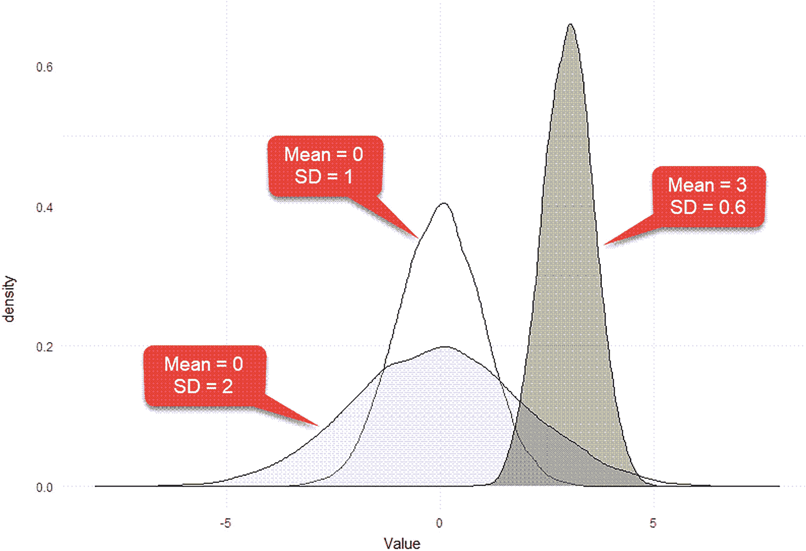

一张图绘制了密度与数值的关系。它有三条正态曲线：均值=0 标准差=1，均值=0 标准差=2，以及均值=3 标准差=0.6。

**图 3-7** 此图表上显示了三个正态分布。第一个正态分布是标准正态分布，均值为 0，标准差为 1。第二条较矮的曲线代表一个均值为 0、标准差为 2 的正态分布。第三条曲线的均值为 3，标准差为 0.6

当方差不等于 1 时，我们可以将每个点乘以某个缩放因子，使方差变为 1。当均值不为 0 时，我们可以加上某个因子（正数或负数），使均值变为 0。重要的是，这些操作不会影响数据中各元素之间的关系，这使得我们在实践中可以将一个分布视为正态分布，即使其均值或方差与标准正态分布不同。

### 其他分布

正态分布是我们首先回顾的分布，因为它具有若干优良性质，并且在实践中经常出现。然而，它当然不是唯一与我们相关的分布。现在让我们看看另外三个分布，每个分布都有其独特的细微差别。请注意，由于时间和范围限制，本章不会涵盖所有分布。这些分布仍然可能很重要，因此请不要认为这组分布是全面的或涵盖了所有实际案例。

### 对数正态分布

正态分布在我们生活中相当常见，但许多重要的事物并不遵循正态分布。例如，如果你观察某个州各城镇的人口数量、预算项目中的金额，或者一个国家所有居民的净资产，这些数据集并不服从正态分布。相反，它们遵循*对数正态分布*，这意味着数值的对数服从正态分布，而非数值本身。图 3-8 展示了对数正态分布与正态分布的对比示例。

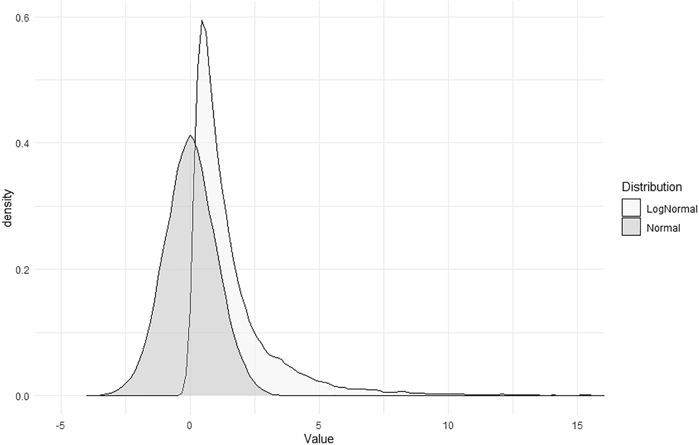

一张密度与数值的关系图。对数正态分布是一条右偏曲线，正态分布则是一条标准正态曲线。

图 3-8

对数正态分布与正态分布的对比，每个分布各使用了 15,000 个采样点。对数正态分布呈现出“长尾”效应。请注意，该图略有误差：此数据集中最小的对数正态值为 0.02，因此所有值均大于 0。

正态分布呈对称的“钟形曲线”，而对数正态分布则有一条“长尾”，这意味着你在峰值左侧看到数值的可能性要高于右侧。另一种描述方式是它具有*偏度*，即曲线的一侧比另一侧延伸得显著更远。

另一点需要注意的是，由于这是对数计算，集合中的所有值必须大于零，因为你无法对负数或零取对数。如果你的现象不可能为负（例如过去一年的收入），这便是一个提示，表明该分布更可能是对数正态分布而非正态分布。

如果你假设一个集合服从正态分布，而它实际上服从对数正态分布，你很可能会得到大量高值的异常点，而这些异常点最终被证明是噪声：也就是说，有些人确实那么富有，或者有些城市确实那么大。

### 均匀分布

均匀分布是最容易理解的一种分布。如果我们有一个取值范围在 0 到 9（含）之间的均匀分布，那么得到值 0、9 或 5 的可能性是完全相同的。图 3-9 展示了一个均匀分布的示例。

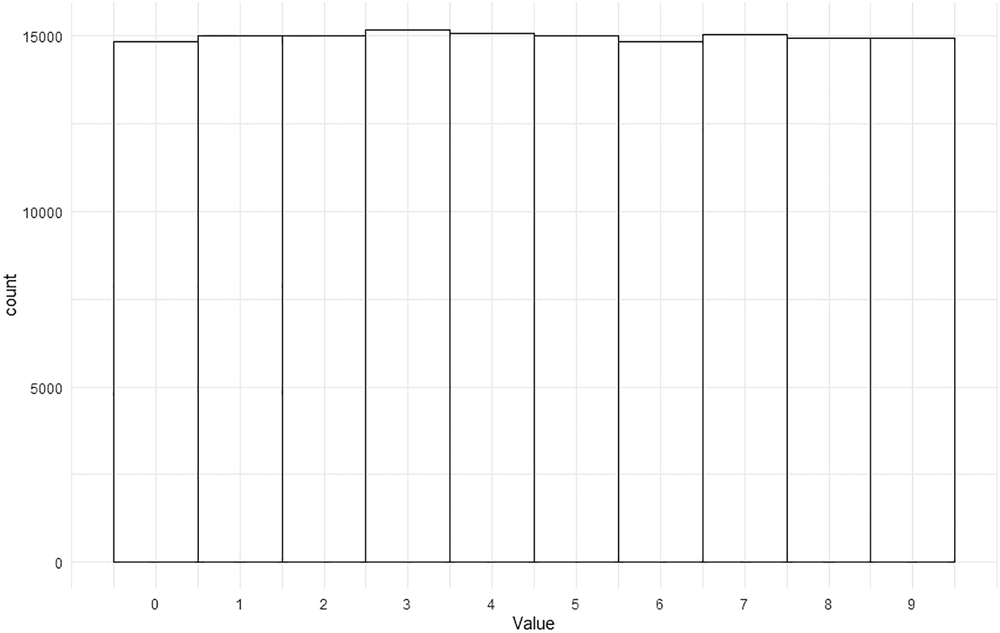

一张计数与数值的直方图。估计值分别为 (0, 14900)、(1, 15000)、(3, 15100)、(5, 15000)、(7, 15100) 和 (9, 15000)。

图 3-9

从 0 到 9 的均匀分布中抽取的 150,000 个点。由于这是一个样本点集合，计数上存在微小差异，而在均匀分布的理想形式中我们不会看到这些差异。

对于均匀分布，我们不能将任何单个点称为异常点，因为每个值出现的概率都相同。相反，如果我们有理由相信该分布应该是均匀的——例如在使用 SQL Server 等数据库中的 `RAND()` 函数或 Python 中的 `random()` 函数时——我们需要观察一系列事件，并计算在给定均匀分布下该序列发生的可能性。具体来说，掷六面骰子掷出 6 点是很常见的——事实上，它应该以 1/6 的概率发生。但连续掷出 20 次 6 点，就会让人怀疑这个骰子是否被做了手脚。

### 柯西分布

最后一种分布是一种华丽但所幸不常见的分布。柯西分布看起来很像正态分布，如图 3-10 所示。

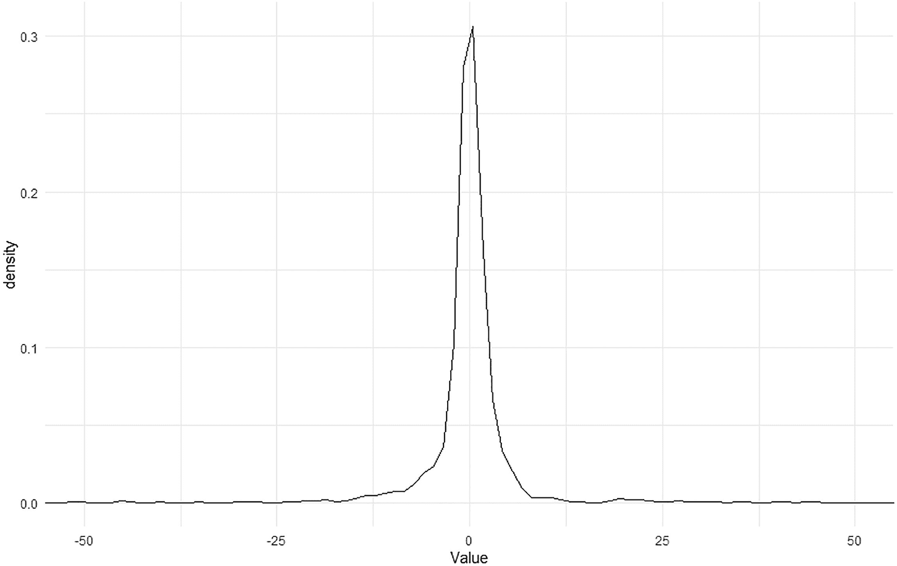

一张密度与数值的关系图。估计值分别为 (负 50, 0.0)、(负 8, 0.02)、(0, 0.31)、(8, 0.01) 和 (45, 0.0)。

图 3-10

一个包含 1000 个采样值的柯西分布示例。图中的“肥尾”现象十分明显。在该样本中，最小值为 -425，最大值为 222。相比之下，正态分布的范围会落在 -4 到 4 之间。

关键区别在于柯西分布具有“肥尾”，而正态分布则没有。换句话说，正态分布渐近地趋近于零，这意味着你可以实际地忽略在均值六到七个标准差之外找到点的可能性，并且距离越远，这种可能性就越可以忽略。然而，对于柯西分布，始终存在一种现实的可能性，即得到一个看起来与你所认为的均值相差 10 或 20 个标准差的点。我之所以需要用这种方式表述最后一句，是因为柯西分布实际上并没有均值或方差。在概率密度函数中，存在一个最高概率点，看起来可能像均值，但由于肥尾的存在，我们永远无法收敛到一个稳定的均值。

在自然界中，我们会在少数情况下看到柯西分布，主要是在光谱学领域。幸运的是，这些情况很少见，因为它们会大大增加我们判断某事物是否为异常现象的难度！

## 稳健性与均值

到目前为止，我们主要关注围绕均值和标准差（尤其是正态分布）的异常值检测。在本节中，我们将理解为什么这种方法会给我们带来问题，以及我们可以采取什么措施。

### 异常值的敏感性

使用均值和标准差进行异常检测的最大问题在于，它们对少量异常值非常敏感。假设我们的集合中有以下六个数据点：`{ 7.3, 8.2, 8.4, 9.1, 9.3, 9.6 }`。计算该集合的标准差，我们得到值为 0.85。计算该集合的均值，我们得到值为 8.65。假设这些数据来自近似正态分布，并使用我们第一个关于异常的技术定义，我们可以认为，如果一个点与 8.65 的距离在任一方向上超过 3 * 0.85，则该点为异常点。换句话说，根据我们上面的数据，正常值的范围应在 6.1 到 11.2 之间。

现在让我们添加一个异常值：1.9。我们可以判断它是异常值，因为它远在我们的预期范围之外；因此，系统是有效的。但看看它对我们的系统造成了什么影响：加入值 1.9 后，标准差变为 2.67，均值下降到 7.69。我们可接受值的范围现在变成了 -0.32 到 15.7，这意味着我们刚刚称之为异常值的那个点，如果再次出现，现在反而会变成正常值！

### 中位数与“稳健”统计

均值和标准差存在的问题催生了“稳健”统计的发展，其稳健性体现在：在结果像之前示例那样崩溃之前，能够抵御一定数量的异常值。在计算平均值时，我们可以从非稳健的均值切换到稳健的*中位数*。中位数是数据集的第 50 百分位数，也就是所有数值的中点。在前面的例子中，集合 `{ 7.3, 8.2, 8.4, 9.1, 9.3, 9.6 }` 的中位数是 8.75。计算方法是：成对地移除最小值和最大值，直到剩下一个或两个数值。在这个例子中，我们先移除 7.3 和 9.6，再移除 8.2 和 9.3，剩下 8.4 和 9.1。由于剩下两个数值，我们取这两个数值的中点，即 8.75。

接下来，我们可以计算*中位数绝对偏差*，简称 MAD。MAD 是另一种稳健统计量，可作为标准差的替代。其公式为 `MAD = median(|X_i - X̃|)`。也就是说，我们取每个数值与集合中位数之差的绝对值的中位数。由于我们的中位数是 8.75，我们从每个集合元素中减去 8.75 并取绝对值，得到 `{ 1.45, 0.55, 0.35, 0.35, 0.55, 0.85 }`。这个集合的中位数是 0.55。

应用与之前类似的公式，我们可以将距离中位数超过三个 MAD 的值视为异常值。也就是说，如果一个数值与 8.75 的距离超过 `3 * 0.55` 个单位（即超出 7.1 到 10.4 的范围），我们就将其标记为异常值。这里的 1.9 显然是一个异常值，但让我们看看它对我们后续计算的影响。

集合 `{ 1.9, 7.3, 8.2, 8.4, 9.1, 9.3, 9.6 }` 的中位数是 8.4。这已经让我们看到了稳健性的实际体现：我们遇到一个异常值并立即将其排除。它确实将中位数拉低了，但只是拉低到下一个正常值点。然后，要计算 MAD，我们需要计算与 8.4 的差值的绝对值的中位数，即 `{ 6.5, 1.1, 0.2, 0, 0.7, 0.9, 1.2 }`。这个集合的中位数是 0.9，因此 MAD 为 0.9。这意味着我们的可接受值范围扩大到了距离 8.4 的 `3 * 0.9` 个单位，即 5.7 到 11.1。范围确实有所扩大，但远没有之前那么严重——即使在这个扩大的集合中，我们仍然会将 1.9 视为异常值。此外，MAD 从异常值中“恢复”的速度比标准差快得多，这意味着与使用非稳健统计量相比，使用稳健统计量时，我们的可接受值窗口打开得更慢、关闭得更快，这使得稳健统计量在我们数据集中恰好有多个异常值时，更不容易“隐藏”它们。

### 超越中位数：计算百分位数

我们已经了解了一种百分位数的计算：中位数，即第 50 百分位数。在异常值检测中，还有其他有用的百分位数，而包含多个百分位数的最有用的可视化图表之一就是箱线图。图 3-11 展示了一个箱线图的示例。

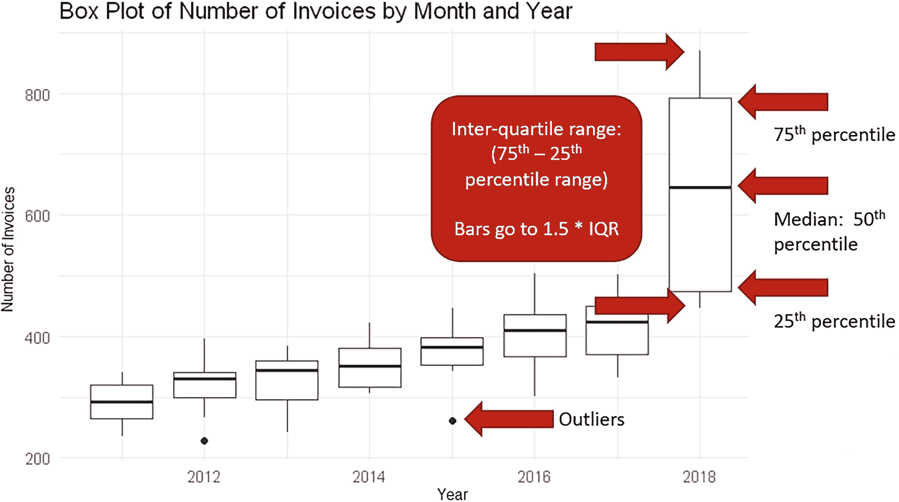

一个箱线图绘制了发票数量与年份的关系。它包含八个箱体。

一个箱线图至少包含五个有用的百分位数：最小值（第 0 百分位数）、最大值（第 100 百分位数）、中位数（第 50 百分位数），以及第 25 和第 75 百分位数。箱体本身由第 25 和第 75 百分位数之间的范围构成，我们称之为*四分位距*（IQR）。我们可以看到中位数所在的一条线，这让我们了解数据的偏斜程度（因为向一个方向偏斜的数据会显示出中位数与外侧百分位数之间的距离，与其相反方向上的对应距离存在差异）。接着，我们看到从箱体延伸出的“须”。这些须代表距离箱体顶部或底部在 `1.5 * IQR` 个单位范围内的所有数据点。超出此范围的点即为异常值，这给出了我们关于异常值的第三个技术定义：异常值是指任何低于第 25 百分位数或高于第 75 百分位数超过 1.5 倍四分位距的点。

当我们开始收集这些关于异常值的技术定义时，重要的是要注意，这些定义并不保证完全重叠，这意味着一个过程可能将某个值称为异常值，而另一个过程可能将其称为正常值。我们将从第 6 章开始处理这种复杂性。

## 控制图

在结束本章之前，让我们再看一种异常可视化的变体：*统计过程控制图*，我将其简称为控制图。控制图的主要目的是判断一个给定的过程是否按预期运行。控制图的一个常见用例是在制造业中，其中操作有特定的允许公差。例如，假设我们要监控一台将两块金属板铆接在一起的机器。我们知道铆钉的预期位置，也知道在需要修复或报废金属板之前，允许偏离该预期位置的最大方差。有了这些信息，我们可以创建如图 3-12 所示的控制图。这种特定类型的图称为 I 图，它以固定间隔测量单个值，例如铆钉距离“完美”位置的距离。随着机器处理更多数据，我们随时间追踪这些值，并将每个值与均值进行比较。

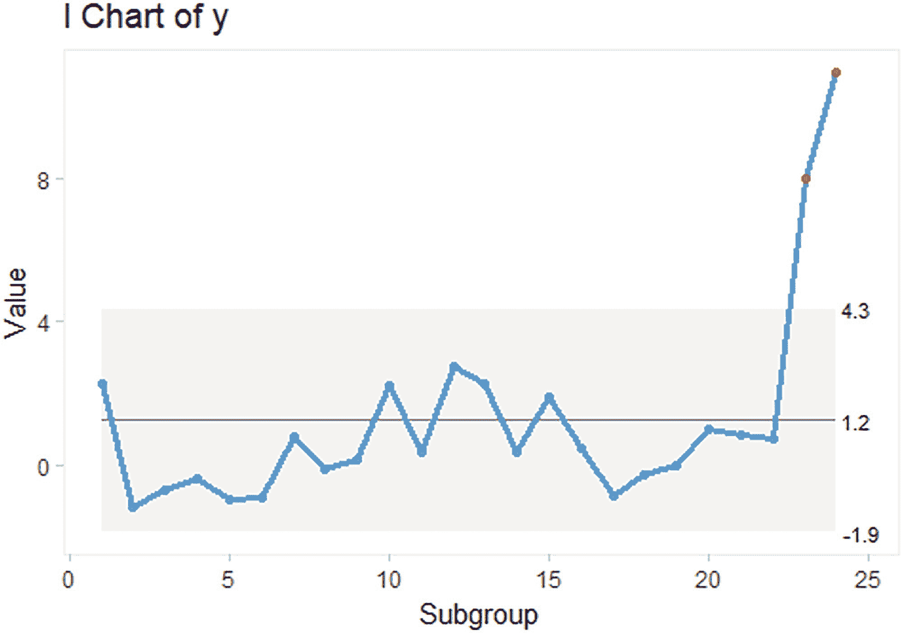

一个折线图绘制了数值与子组的关系。估计值为 (0, 4.5)、(10, 2) 和 (25, 11)。矩形框值为 -1.9、1.2 和 4.3。

一个称为 I 图的特定统计过程控制图示例。阴影区域代表距离均值线三个标准差的范围。最后两个数据点位于阴影区域之外，表明该过程刚刚“失控”

在此图中，我们看到预期值用一条线表示，可容忍范围用阴影区域表示。在美国，需要控制图的受监管行业通常将界限设定为均值两侧各三个标准差，这构成了图中的阴影区域。当你想到标准差是非稳健统计量这个问题时，这可能会让你犹豫，但这里有一个关键区别：在使用控制图时，我们预先计算了均值和标准差，并且不会根据新值进行更新。因此，如果新信息表明存在异常值，它不会影响阴影区域的位置或大小。

从这个例子中我们可以看到，该过程开始时处于“受控”状态，即位于阴影区域内。经过若干步骤后，它进入了“失控”状态，表明存在问题。使用我们之前的例子，我们可能会看到铆钉靠得太近，或者它们相对于应有位置太靠左或太靠右。无论原因是什么，控制图都告诉我们，需要采取行动并解决这个问题。

## 结论

在本章中，我们从使用格式塔原则对异常值和异常进行可视化解释，过渡到了对异常值的统计理解。朝这个方向发展，使我们能够创建出比人类更一致地发现异常值的系统。

在下一章中，我们将开始构建这样一个系统，搭建出本书后续部分将使用的框架。

