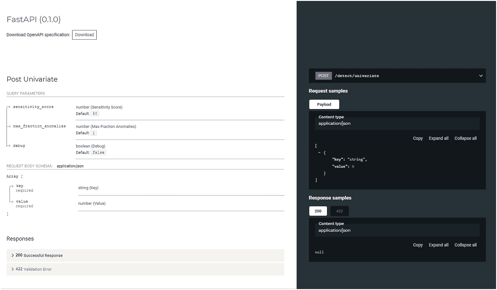
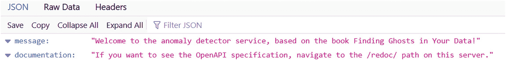

# 4. 搭建框架

到目前为止，我们一直专注于离群点和异常检测的理论方面。在后续章节中，我们仍需要多次深入探讨理论，但我们已经掌握了足够的知识，可以开始开发一个合适的异常检测服务了。

在本章中，我们将为实时离群点检测服务搭建基础框架。然后，在下一章中，我们将集成一个测试库，以降低在迭代技术时破坏代码的风险。

## 行业工具

在编写一行代码之前，我们需要做出几个重要决策：选择哪种编程语言、使用哪些包来简化流程，甚至如何与最终用户及其他程序交互。最后这一选择涉及协议以及如何*序列化*和*反序列化*数据，以确保在尽可能简化调用服务流程的同时，仍能兑现我们的承诺。

### 选择编程语言

第一个重大选择是挑选编程语言。在本书中，我们将使用 `Python` 编程语言来开发服务。`Python` 是一种极其流行的编程语言，既可作为通用语言，尤其在数据科学和机器学习领域应用广泛。具体来说，我们将使用 `Anaconda` 发行版的 `Python`，因为它自带了多种适用于异常检测项目的有用库。其中包括提供类似表格数据结构的 `pandas`、提供多种数学和统计函数的 `numpy`，以及 `Python` 的机器学习库 `scikit-learn`。除了这些库之外，我们还会在本书中陆续介绍并使用更多其他库。

当然，`Python` 并非构建异常检测服务的唯一编程语言。其他几种语言也具备内置功能或易于安装的库，使异常检测过程相当直接。例如，`R` 语言包含多种异常检测包，其中就包括优秀的 `anomalydetector` 库。`R` 是一种出色的领域特定语言，专用于数据科学、数据分析和统计学。虽然它不一定是一种优秀的通用编程语言，但我们所需的功能完全在其能力范围之内，而且作者和技术编辑此前也曾合作，用 `R` 语言构建过一个功能完备的异常检测服务。

如果你希望使用通用编程语言，`.NET` 框架提供了两种非常适合异常检测引擎的语言：面向对象的 `C#` 和函数式 `F#`。这两种语言都可以配合多种包来简化统计分析。例如，`Math.NET` 项目就包含多个旨在解决组合数学、数值分析和统计分析问题的包。

简而言之，我们将使用 `Python`，因为它既是此类开发的不错选择，也是流行选择，但你不必拘泥于仅使用 `Python` 来完成这项任务。

### 做出管道决策

在确定了语言选择之后，我们需要就最终用户如何与服务交互做出一些决定。首先要问的问题是：客户为什么需要这项服务？我们越了解他们想要解决什么样的问题，就越能定制服务以满足其需求。针对我们的场景，假设最终用户希望调用服务并近乎实时地获得响应，而不是发送大型数据集并请求对整个数据集进行批量操作。本书中使用的技术同样适用于这两种情况，但这一决策将导致我们向外界暴露服务的方式截然不同。

鉴于我们希望允许最终用户在实时场景中进行交互，我们很可能希望选择*超文本传输协议*（`HTTP`）作为传输机制。我们也可以选择使用*传输控制协议*（`TCP`）套接字自行设计解决方案，但这会显著增加开发解决方案的开销，并且要求用户开发自定义客户端来与服务交互。开发自定义的 `TCP` 解决方案可能会带来更好的性能，但这远远超出了本书的讨论范围。

坚持使用 `HTTP` 作为首选协议后，我们有两种主要方式来创建服务，这两种方式在 `Python` 中都得到了广泛支持：远程过程调用框架 `gRPC`，或者使用 *JavaScript 对象表示法*（`JSON`）构建*表述性状态转移*（`REST`）`API`，以便在服务与客户端之间传递数据。基于 `gRPC` 的解决方案具有一些显著优势，首先是有效载荷大小。`gRPC` 中的有效载荷采用*协议缓冲区*（*Protobuf*）格式，这是一种二进制格式，能很好地压缩请求大小。相比之下，`JSON` 是一种相对较大且未压缩的文本格式。`JSON` 比其他格式（如*可扩展标记语言*（`XML`））更紧凑，但 `Protobuf` 和 `JSON` 之间的有效载荷大小可能存在显著差异，尤其是在批量处理场景中。此外，使用 `gRPC` 时我们拥有严格的契约，这意味着客户端确切知道服务器将提供什么、存在哪些参数和标志，以及如何构建请求。与早期的 `REST API` 实现相比，这是一个显著优势，尽管较新的 `REST API` 实现了 `OpenAPI` 规范（以前称为 *Swagger*），该规范描述了 `REST API`。`OpenAPI` 规范提供了与 `gRPC` 在其契约中描述的信息类似的内容，从而大大简化了跨服务开发。

出于本书的目的，我们将选择使用 `JSON` 构建 `REST API`。做出这一选择有三个原因。首先，使用 `REST` 允许我们利用免费可用的工具与服务交互，包括网络浏览器。`gRPC` 框架对基于浏览器的交互支持非常有限，而 `REST` 则原生支持浏览器。选择 `REST` 而非 `gRPC` 的第二个原因是，支持 `JSON` 的 `REST API` 提供了人类可读的请求，使人们更容易解析和解释请求，并纠正客户端或服务中的潜在错误。虽然有技术可以将 `Protobuf` 请求转换为 `JSON`，但出于教学目的，我们将坚持使用较慢但更易于理解的方法。我们选择 `REST API` 而非 `gRPC` 的最后一个原因是，更多开发者熟悉前者而非后者。向基于微服务开发的转变使 `gRPC` 成为一个流行的框架，但我们在行业中拥有几十年的 `REST` 使用经验，并且已经解决了其大部分问题。然而，如果你正在为生产发布开发异常检测套件，`gRPC` 将是一个很好的选择，特别是如果你开发的客户端或调用者熟悉该框架。

### 减少架构变量

在确定了部分“管道”决策后，我们可以寻找其他方法来简化开发过程。例如，考虑到我们打算为调用者实现一个 `REST API`，有多个基于 `Python` 的框架可以简化 `API` 开发，包括 `Flask` 和 `FastAPI`。`Flask` 是一个用于核心 `API` 开发的成熟包，并且与 `Gunicorn` 等代理解决方案集成良好。与此同时，`FastAPI` 是一个较新的解决方案，具有许多优点，包括出色的性能以及使用名为 `ReDoc` 的工具自动实现 `OpenAPI` 规范。图 4-1 展示了基于我们将在本章开发的 `API` 构建的文档示例。



`FastAPI` 0.1.0 的截图，显示用于下载文档的界面，包含 `post univariate` 和多个选项。

图 4-1

我们 `API` 的自动 `API` 文档

除此之外，我们还可以使用 `Docker` 容器来部署应用程序。这样，无论你运行的是哪种操作系统，或者安装了哪些库，都可以轻松部署最终解决方案。使用我们构建的解决方案的容器版本是可选的，但如果你确实安装了 `Docker` 并希望简化依赖管理过程，本章末尾提供了基于 `Docker` 部署的说明。

## 开发初始框架

在决定了语言和技术之后，是时候开始开发了。在本节中，我们将安装托管 `API` 所需的先决条件。然后，我们将创建一个存根 `API`。在下一节中，我们将开始填充细节。

### 战场准备

如果你想跟着本书的步骤，创建自己的异常值检测 `API` 服务，你需要在电脑上安装 `Python` 3.5 或更高版本。最简单的入门方法是安装 `Anaconda` 发行版的 `Python`，地址为 [`https://anaconda.com`](https://anaconda.com)。然后，安装 `Anaconda` 个人版，该版本适用于 `Windows`、`macOS` 和 `Linux`。`Anaconda` 还预装了许多 `Python` 库，使其成为数据科学和机器学习操作的绝佳选择。

接下来，如果你还没有获取本书的代码仓库，请访问 [`https://github.com/Apress/finding-ghosts-in-your-data`](https://github.com/Apress/finding-ghosts-in-your-data) 获取，并根据 `\src\README.md` 中的说明进行操作，具体取决于你是想跟着本书的代码创建自己的异常值检测器，还是想使用代码库的完整版本。请注意，如果你想跟着本书的代码操作，你仍然需要参考代码的完整版本，因为为了节省篇幅，某些代码段会被省略。

该仓库包含几个文件夹。`\doc\` 文件夹包含项目的基本文档，包括如何运行项目的不同部分。`\src\app\` 文件夹包含我们将在本书中逐步创建的代码库的完整版本。`\src\comp\` 文件夹包含我们将在本书最后一章中介绍的对比工作。`\src\web\` 文件夹包含一个配套网站，我们将在本书中创建并持续更新。离开 `\src\` 目录，`\test\` 文件夹包含两组独立的测试：一组单元测试和一组集成测试。最后，我们还有一个 `Dockerfile`，供希望将解决方案作为 `Docker` 容器运行的人使用，以及一个 `requirements.txt` 文件。

安装 `Anaconda`（或类似的 `Python` 变体）后，打开代码仓库中的 `requirements.txt` 文件。该文件包含一组包，每行一个，我们将在本书中使用这些包。你可以使用 `pip` 包管理系统手动安装这些包，也可以在仓库的根目录下打开一个 `shell` 并运行 `pip install -r requirements.txt`。

如果你收到一条错误消息，提示找不到 `pip`，请确保你的 `Path` 环境变量包含 Anaconda 及其目录。例如，如果你将 Anaconda 安装在 `E:\Anaconda3`，请将该目录以及 `E:\Anaconda3\Library\bin`、`E:\Anaconda3\Library\usr\bin\` 和 `E:\Anaconda\Scripts` 添加到你的路径中。然后，重启你的 shell 并重试。

如果你使用的是 Anaconda，你需要确保你在一个新的 conda 环境下工作。你可以在代码仓库的主目录下使用命令 `conda create --name finding_ghosts` 在 conda 中创建一个环境。然后，使用 `conda activate finding_ghosts` 激活该环境。之后，你就可以运行 `pip` 命令，而不会影响其他包的安装。

## 构建 API 框架

现在我们已经安装好所有东西，让我们来构建一个 API。如果你已经从配套仓库中获取了源代码，请务必将现有的 `app` 文件夹重命名为类似 `app_complete` 的名称。然后，创建一个新的 `app` 文件夹。在这个文件夹内，创建一个名为 `__init__.py` 的空 Python 文件，确保在“init”前后各有两个下划线。这个文件有助于让 Python 解释器知道我们的 `app` 文件夹包含一个 Python 模块的代码。创建此文件后，再创建另一个名为 `main.py` 的文件。这个文件将是我们 API 的入口点。用你选择的编辑器打开这个新文件。如果你没有偏好的编辑器，三个不错的选择是 Visual Studio Code、Wing IDE 和 PyCharm。Anaconda 还附带 Spyder，这是另一个 Python 集成开发环境（IDE）。

在 `main.py` 的顶部，输入代码清单 4-1 中的代码。这将确保我们可以引用 API 所需的项目和库。

```
from fastapi import FastAPI
from pydantic import BaseModel
from typing import Optional, List
import pandas as pd
import json
import datetime
# 代码清单 4-1
# main.py 文件中的导入语句
```

前三个条目与 FastAPI 库相关，允许我们设置 API 服务器、创建模型来塑造我们的输入和输出签名，并允许我们将特定的模型元素标记为可选或传入的项目列表。接下来的三个条目与额外的 `Python` 库相关，这些库会很有用。`Pandas` 是一个数据分析库，其最有用的功能之一是能够创建 Pandas DataFrames。DataFrames 的行为类似于其他语言中的对应物以及 SQL 中的表，它们是具有命名实体的二维数据结构，每个实体可能具有不同的类型。除了 `Pandas`，我们还导入了 `json` 和 `datetime` 库，以便使用它们各自的功能。

现在我们已经有了导入语句，下一步是创建一个新的 FastAPI 应用程序并尝试运行它。代码清单 4-2 提供了构建 FastAPI 服务所需的最少代码。

```
app = FastAPI()
@app.get("/")
def doc():
return {
"message": "Welcome to the anomaly detector service, based on the book Finding Ghosts in Your Data!",
"documentation": "If you want to see the OpenAPI specification, navigate to the /redoc/ path on this server."
}
# 代码清单 4-2
# 创建一个带有一个端点的新 API
```

在这段代码中，我们首先创建了一个名为 `app` 的新 API 服务。然后，我们在根目录为我们的应用程序创建了一个新端点。这个端点接受 REST 中的 `GET` 方法。`GET` 方法不接受请求体，并且预期会返回一些内容。当使用浏览器浏览网页或点击链接时，浏览器会将这些操作转换为 `GET` 请求。

定义端点后，我们现在需要编写代码，说明如果有人调用该端点时我们的代码应该做什么。在这种情况下，我们返回一条消息。该消息必须是有效的 JSON。在这里，我们创建了一个包含两个属性的 JSON 对象：`message` 和 `documentation`。`documentation` 属性指向一个路径 `/redoc/`，这意味着如果你在本地机器上运行，你将导航到 `http://127.0.0.1/redoc` 来查看类似于图 4-1 的 OpenAPI 规范。

要查看此列表，请在 shell 中导航到 `/src/` 文件夹并输入以下命令：

`uvicorn app.main:app --host 0.0.0.0 --port 80`

此命令执行 `uvicorn` 网络服务器。然后它将查找一个名为 `app` 的文件夹和一个名为 `main.py` 的文件。在该文件中，`uvicorn` 将找到我们对 `app` 的引用并使 API 可用。我们将在本地主机的 80 端口上运行它，尽管你可以根据需要更改主机和端口。导航到 `http://localhost` 将返回一个类似于图 4-2 的 JSON 片段。


一个显示 JSON 片段消息和通知的截图。
图 4-2
在异常检测器服务的 `/` 端点上执行 `GET` 操作后得到的 JSON 消息。某些浏览器（如 Firefox）会生成像你在这里看到的赏心悦目的 JSON 结果；其他浏览器则只会将 JSON 作为文本显示在屏幕上。

现在我们有了一个功能性的 API 服务，下一步是规划我们在本书中需要的输入和输出签名。

## 输入与输出签名

每个 API 端点都需要其特定的输入和输出结构。在本节中，我们将规划主要端点，定义它们的签名，并为每个端点创建 `桩方法`。`桩方法` 允许我们在不承诺所有实现细节的情况下定义 API 的结构。它们还能让我们在开发过程中一次只解决一个问题，同时仍能取得明显的进展。

总共，我们将有四个方法，每个方法对应书中的几个章节。第一个方法将使用统计技术检测单变量数据，这是第二部分的内容。第二个方法将涵盖使用聚类和非聚类技术进行多变量异常检测，这是第三部分的内容。第三个方法将允许我们对单个数据流执行时间序列分析，这是第四部分的第一个目标。最后一个方法将让我们检测多个时间序列数据集中的异常，这将在第四部分的后半部分介绍。

### 定义通用签名

此时，构建一个 `桩方法` 并看看我们能否设计出在所有输入上都合理有效的东西是合理的。我们将从最简单的情况开始：单变量、无序、数值型、非时间序列数据。从那里开始的每一次变化都会引入其自身的复杂性，但在 API 层面上的修改应该相当有限，将大部分复杂性留给解决方案的更深层部分。

我们需要进行的所有 API 调用都将遵循一个通用签名，如清单 4-3 中所定义。

```
@app.post("/detect/univariate")
def post_univariate(
input_data: List[],
debug: bool = False,

):
df = pd.DataFrame(i.__dict__ for i in input_data)
(df, ...) = univariate.detect_univariate_statistical(df, ...)
results = { "anomalies": json.loads(df.to_json(orient='records')) }
if (debug):
### TODO: 添加调试数据
results.update({ "debug_msg": "这是一条日志消息。" })
return results
# 清单 4.3
# 通用解决方案的框架
```

我们首先需要定义我们将向服务发起 POST 调用。与 `GET` 不同，此方法接受请求体，并允许我们以 JSON 格式传入数据集。POST 调用还将定义我们需要调用的端点。在这种情况下，我们将调用 `/detect/univariate` 端点，这将触发对 `post_univariate()` 方法的调用。对于四种情况中的每一种，此方法看起来都非常相似。

我们要做的第一件事是从 JSON 输入创建一个 `Pandas` `DataFrame`。将数据放入 `DataFrame` 将使我们更容易对输入数据进行操作，并且我们在本书中使用的许多分析技术都依赖于数据以 `DataFrame` 形式存在。

创建 `DataFrame` 后，我们将调用一个检测方法。在这种情况下，该函数名为 `detect_univariate_statistical()`，并将返回一个新的 `DataFrame`，其中包含原始数据以及一个描述该结果是否为异常的附加属性。然后，我们可以将此数据重新格式化为 JSON，这一点很重要，因为外部世界运行在 JSON 上，而不是 `Pandas` `DataFrame` 上。

我们还将包含一个调试部分，这将在开发过程中提供帮助，并包含故障排除信息。目前，我们将把它作为一个包含一些基本细节的桩，但随着我们逐步完善流程的具体工作方式，我们将更好地理解我们可以且应该在此处包含什么。这些调试结果将与我们的异常集位于同一个输出 JSON 中，这意味着我们的调用者不需要任何额外的软件或功能来读取调试信息。

最后，我们返回结果 JSON 对象。这个相同的基本布局也将很好地服务于其他三个方法。

## 定义异常值

我们现在已经定义了检测异常值的大部分基本方法，但仍有一些模块需要填充，特别是关于`input`的部分。在开发方法时，我们希望为用户提供一定程度的控制，以决定什么构成异常值。然而，重要的是要注意，我们并不期望用户知道定义异常值的精确标准——如果他们知道，他们一开始就不需要异常值检测器了！不过，有几种度量标准我们可以期望用户来控制。

### 敏感度与异常值比例

第一个关键度量是敏感度。在这种情况下，我们所说的敏感度并非技术定义，而是一个滑动标尺。理想情况下，调用者无需了解阈值的具体细节，就能控制我们的异常值检测器将某物标记为异常值的可能性。我们将`sensitivity score`分数范围设定为 1 到 100（含），其中 1 表示最不敏感，100 表示最敏感。具体如何实现将取决于所使用的技术，但这为调用者提供了一个简单的控制机制。

此外，我们需要控制数据集中预期出现的最大异常值比例。某些异常值检测技术期望输入中包含可能异常的最大项目数。与其试图为用户估算这个值，我们可以直接询问这个答案。`max_fraction_anomalies`值范围从 0.0 到 1.0（含），其中 1.0 意味着每个数据点都可能是一个异常值。在实践中，我们期望值在 0.05 到 0.10 之间，意味着不超过 5-10% 的记录是异常值。这个比例也可以为我们标记为异常值的项目数量提供一个硬性限制，这意味着如果调用者发送了 100 个数据点，且`max_fraction_anomalies`为 0.1，我们保证返回的异常值不超过十个。这将与`sensitivity score`分数协同工作：将`sensitivity score`分数视为一个滑动标尺，而`max_fraction_anomalies`则是一个硬性上限。

### 单一解决方案

如果对于某一类问题，存在一种最佳技术来解决该问题，我们可以使用这种技术而排除所有其他可能的技术。在这种情况下，计算相当直接：我们将输入数据应用于给定的算法，如果该技术需要`sensitivity score`和/或`max_fraction_anomalies`，则一并传入。我们得到异常项目的数量，然后需要确定是直接返回这个结果集，还是需要执行额外的工作。对于输入技术接受`sensitivity score`或`max_fraction_anomalies`的情况，我们的工作可能到此就完成了。否则，我们需要开发一种方法来应用`sensitivity score`，然后截断超出`max_fraction_anomalies`的任何项目。这是可行的，因为每种技术都会为每个数据点应用一个分数，并且我们可以对这些分数进行排序，使得分数越高的越有可能是异常值。有了这些分数，即使我们使用的技术没有敏感度或截止点的概念，我们也可以自行实现。

### 组合模型

更复杂的情况是，我们需要创建`集成模型`，即包含多个输入算法的模型。此时，我们需要对哪些项目被标记为异常值有更多控制权，因为集成中的每种技术都会对给定数据点的异常程度有自己的判断。我们需要汇总结果，并自行执行最终评分和阈值划分。

我们还需要为每个输入算法提供权重。某些技术比其他技术更擅长发现异常值，因此我们希望赋予它们更高的权重。但整合多种输入策略具有很大价值，因为没有任何单一技术能够完美地发现所有异常并忽略所有噪声。正因如此，即使是相对噪声较大的技术也能提供价值，尤其是在同时使用多种此类技术时。我们希望噪声能在不同技术之间“相互抵消”，从而留下更多异常值，并且（理想情况下！）更少的噪声。

在最简单的情况下，我们可以为每种技术赋予相同的权重，这相当于让每种技术投票一次，然后统计票数，以确定某个特定数据点是否为异常值。当技术数量较多时，这本身就可以作为`灵敏度评分`的有效标准——假设我们有 20 个独立的测试。我们可以给每个测试分配 5 分的权重，这样最高分就是 5 * 20 = 100。这与`灵敏度评分`非常契合，因此如果调用方传入的`灵敏度评分为 75`，那就意味着一个特定数据点必须至少在 20 个测试中的 15 个中被判定为异常值，才能出现在我们的最终列表中。

当采用差异化权重时，数学原理基本相同，但会稍微复杂一些。我们不再为每个触发的测试分配 5 分，而是根据感知到的准确性，为某些测试分配 10 分，为其他测试分配 2 分。最终结果仍然是，我们期望总分加起来为 100，因为这能使评分与我们的`灵敏度评分`保持一致。

无论我们如何对技术进行加权，我们都希望返回关于如何执行此加权的信息。这样，我们就能调试这些技术，并更好地了解我们的`灵敏度评分`是否按预期工作。

## 构建解决方案

结合上一节的背景，让我们重新审视代码清单 4-3 中的代码，并扩展解决方案以包含我们所需的一切。就输入而言，我们需要将`input_data`定义为正确的列表类型。FastAPI 包含一个名为`BaseModel`的概念，它使我们能够轻松解释调用方传入的 JSON，并将其转换为 Python 能够理解的对象。对于单变量统计输入，我们需要一个单一的`value`列。同时，添加一个`key`列也是合适的。这样，如果调用方希望为特定值赋予特定含义，他们可以使用`key`列来实现。我们不会将`key`用于数据分析，但会保留它并将其返回给用户。

`detect_univariate_statistical()`函数应接收`sensitivity_score`和`max_fraction_anomalies`，并输出分配给特定模型的`weights`，以及任何其他可能有助于调试的详细信息。

代码清单 4-4 展示了单变量检测函数的更新版本，其中增加了`sensitivity_score`和`max_fraction_anomalies`作为输入，以及`weights`和模型详细信息作为输出。

```python
class Univariate_Statistical_Input(BaseModel):
    key: str
    value: float

@app.post("/detect/univariate")
def post_univariate(
    input_data: List[Univariate_Statistical_Input],
    sensitivity_score: float = 50,
    max_fraction_anomalies: float = 1.0,
    debug: bool = False
):
    df = pd.DataFrame(i.__dict__ for i in input_data)
    (df, weights, details) = univariate.detect_univariate_statistical(df, sensitivity_score, max_fraction_anomalies)
    results = { "anomalies": json.loads(df.to_json(orient='records')) }
    if (debug):
        ### TODO: 添加调试数据
        ### 权重、集成细节等
        results.update({ "debug_msg": "这是一条日志消息。" })
        results.update({ "debug_weights": weights })
        results.update({ "debug_details": details })
    return results
```

代码清单 4-4
新更新的单变量异常检测 API 调用

其他方法将具有非常相似的方法签名，尽管每个调用都需要自己的模型。对于多变量异常检测，我们将用值列表替换名为`value`的单个浮点数。单输入时间序列异常检测将恢复使用单个值，但会包含一个用于日期和时间的`dt`参数。最后，多序列时间序列异常检测将添加日期以及一个`series_key`值，该值表示给定数据点所属的特定时间序列。

在勾勒出 API 应有的样子之后——并且理解到我们尚未完成，因为我们需要在设计过程中整合调试信息——我们可以为四种检测方法中的每一种创建`桩代码`。`桩代码`或`桩方法`是一种快速开发技术，我们硬编码函数的输出签名，以便在填充所有细节之前，可以先处理调用此函数的操作。创建`桩方法`使我们能够解决创建 API 的更高层次问题，并确保 API 代码本身在尝试处理更艰巨的异常检测实现任务之前能够正常工作。然后，当我们准备好深入研究每种技术时，我们已经有了一个现成的代码框架可供使用。

为了实现我们的`桩方法`，我们将创建一个`models`文件夹，然后为每种检测方法创建一个文件。代码清单 4-5 展示了`detect_univariate_statistical`的`桩方法`。

```python
import pandas as pd

def detect_univariate_statistical(
    df,
    sensitivity_score,
    max_fraction_anomalies
):
    df_out = df.assign(is_anomaly=False, anomaly_score=0.0)
    return (df_out, [0,0,0], "未选择集成模型。")
```

代码清单 4-5
通过统计方法检测单变量异常值的`桩方法`。输出被硬编码为返回看起来像正确响应的内容，但不需要我们实现生成正确结果的基础代码。

其他函数看起来与此类似，只是可能会根据调用的具体性质增加额外的参数——例如，多变量异常检测需要一个用于分析时使用的邻近点数量的参数。一旦这些就位，我们就完成了：我们拥有一个功能性的 API 服务器以及我们将提供给最终用户的契约；如果他们以正确的格式传入数据并调用正确的 API 端点，我们将检测该给定数据集中的异常值并将其返回给最终用户。在本章中，我们最后要做的事情是将其打包，以便更容易部署。

## 容器化解决方案

我们已有一个解决方案，可以在本地机器上直接运行。但假设我们希望将此解决方案部署到 Azure 应用服务之类的平台上，该如何打包代码并使其可运行呢？最简单的打包方式之一就是将其容器化。容器的核心理念是：将代码和所有项目依赖项整合到一个单一的`镜像`中。这个镜像随后可以作为一个独立的`容器`，部署到任何运行相应软件的平台上。我可以将本 API 的软件打包，并为你提供这个镜像。然后，你可以获取该镜像，并将其部署到自己的环境中，无需安装任何其他东西。

安装和配置 Docker 这类容器化解决方案已超出本书的讨论范围。如果你已安装或能够安装相应软件，请继续阅读；如果不行，你也可以在非容器环境下运行本书中的所有内容，这并不会影响理解。

对于 Windows 用户，在撰写本文时，市面上有一款主要的容器操作产品：Docker Desktop。Docker Desktop 对个人非商业用途免费。对于 Mac 用户，Docker Desktop 同样适用，但也有一个名为 Lima 的免费替代品。Linux 用户则有多种基于 `containerd` 的选择，我个人比较偏爱 Moby。无论你使用哪种产品，`Dockerfile` 的内容都是相同的。清单 4-6 展示了我们将用于启动异常检测器容器化版本的 `Dockerfile`。

```
FROM python:3.9
WORKDIR /code
COPY ./requirements.txt /code/requirements.txt
RUN pip install --no-cache-dir --upgrade -r /code/requirements.txt
COPY ./src/app /code/app
CMD ["uvicorn", "app.main:app", "--host", "0.0.0.0", "--port", "80"]
```

Python 3.9 是撰写本文时的最新版本，因此我们将使用它。其余步骤相当直接：从 `requirements.txt` 文件安装 Python 包，将我们的应用程序移动到其目标位置，然后运行 `uvicorn`。

如果你希望使用容器化解决方案，可以在本书配套的 GitHub 仓库的 readme 文件中找到更多说明，仓库地址为：`https://github.com/Apress/finding-ghosts-in-your-data`。

## 本章小结

在本章中，我们开始着手构建异常检测解决方案。这包括确定协议和基础应用方面的“管道”，以及创建调用者输入数据并期望返回异常值列表时所使用的接口。在下一章中，我们将创建一个配套的测试项目，以确保在本书后续修改代码时，一切功能仍能按预期运行。