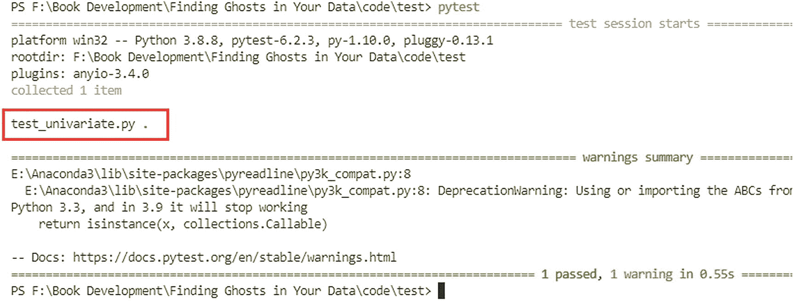
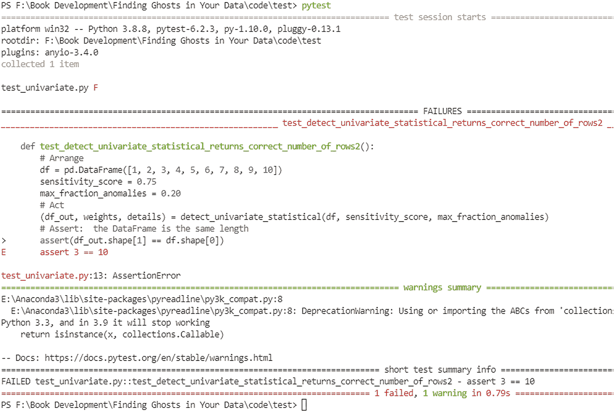
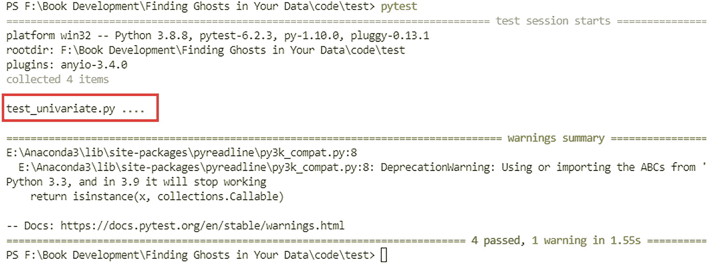
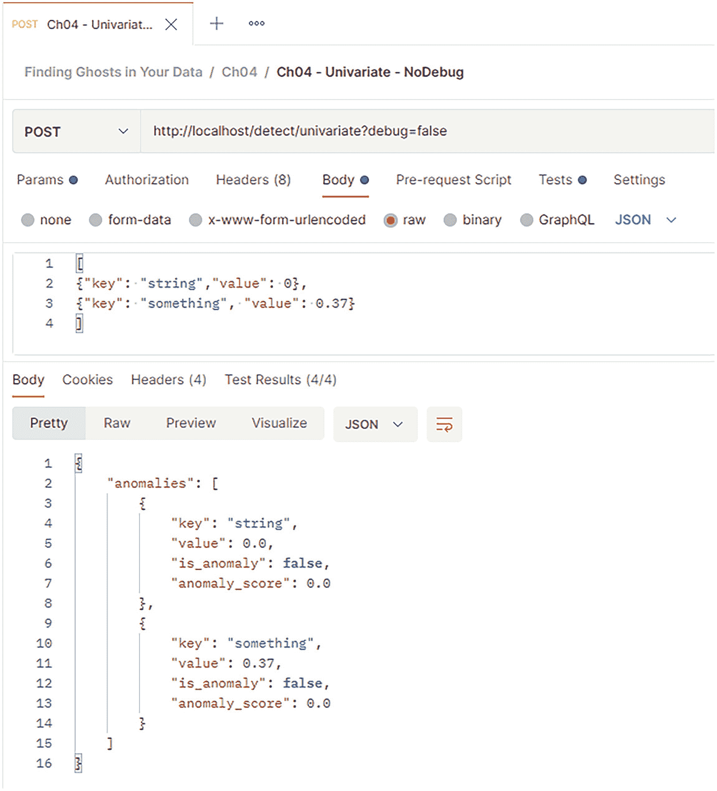
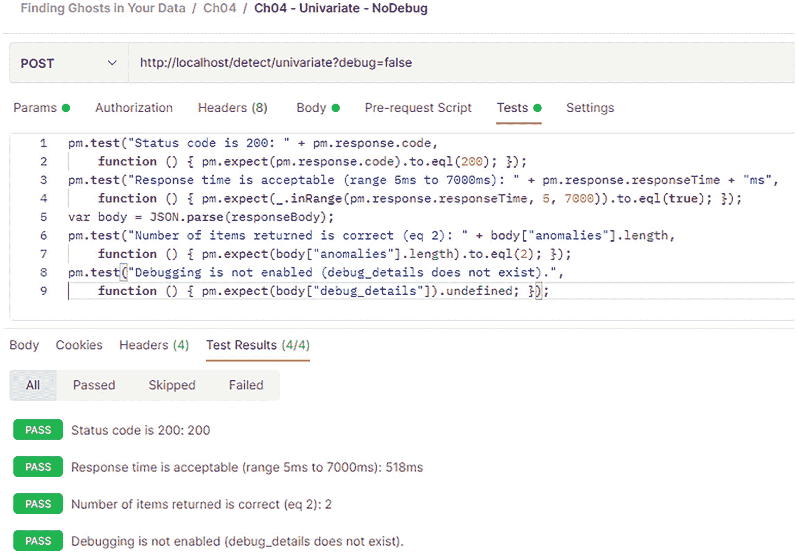
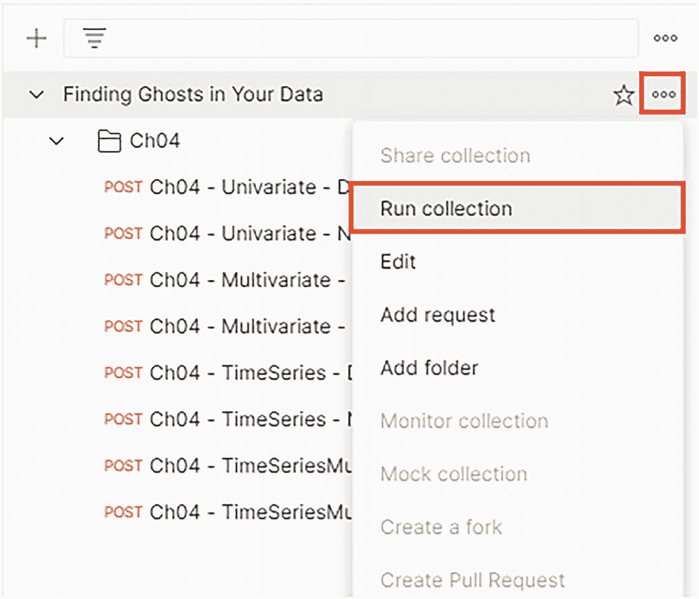

# 5. 构建测试套件

在前一章中，我们开始构建一个应用程序，并搭建了一系列有用的方法。在本章中，我们将构建一些测试，以确保我们在本书中所做的更改不会破坏现有功能或导致不良结果。首先，我们将了解各种可用的工具。然后，我们将介绍一些编写可测试 Python 代码的技巧。最后，我们将创建一组单元测试和一组集成测试，使我们能够随时运行它们，以确保维护产品质量。

## 常用工具

本章将介绍两种主要的测试类型：*单元测试*和*集成测试*。它们并非我们能创建的唯一测试类型，但却是最重要的两种。

单元测试的目的是测试应用程序代码的某个狭窄功能。通常，我们针对代码库中的单个函数或方法创建单元测试，使用各种正常、异常甚至离奇的输入来测试该函数，以确保代码在所有情况下都能正确运行。例如，我们有一个用于单变量异常检测的方法 `detect_univariate_statistical()`。该方法接收三个输入：一个 Pandas DataFrame、一个数值型敏感度分数，以及一个代表允许的最大异常比例数值。它返回一个 Pandas DataFrame、一组权重和一个代表附加信息的字符串。通过测试，我们将尝试不同的场景，看看是否能发现错误结果或导致错误的组合。

与此同时，集成测试旨在测试代码组件的组合。单元测试确定给定函数在给定输入下是否按预期工作，而集成测试则确保整个应用程序按预期运行。由于我们的异常检测应用程序运行在 FastAPI 上，最直接的集成测试过程将从那些 API 调用入手，因为它们代表了最终用户操作我们系统的方式。

这些关于单元测试和集成测试的高层解释适用于任何语言。在下一节中，我们将聚焦于为每种目的选择合适的库和工具。

### 单元测试库

Python 有多种可用的单元测试库，但我们将使用 `pytest` 框架（[`https://docs.pytest.org`](https://docs.pytest.org)）。这是一个低仪式感的库，意味着你可以轻松地将其集成到现有应用程序中，并且无需编写大量代码即可创建和运行测试。许多大型 Python 项目（例如 scikit-learn）都使用 `pytest`，因此我们将效仿它们。

通过运行 `pip install pytest` 可以轻松地在机器上安装 Pytest。安装完成后，我们就可以开始编写测试了。我们将把所有单元测试创建在 `\test\` 目录下，该目录位于我们的 `\src\` 源代码目录之外。这样，我们以后可以独立于这些单元测试来打包源代码本身。它还在应用程序代码和测试代码之间创建了清晰的分离，允许不同的开发人员分别处理测试和代码，而不会产生干扰风险。

在自动化单元测试方面，`tox` 自动化项目（[`https://pypi.org/project/tox`](https://pypi.org/project/tox)）允许我们从命令行运行持续集成任务，包括一组单元测试。它与 `pytest` 集成得很好，考虑到 `tox` 的一些作者也是 `pytest` 的作者，这很合理。本书不会实现单元测试自动化，但这将是一个自然的后续步骤。

### 集成测试

我们有大量的集成测试应用程序和库可供选择。我最喜欢的用于 REST API 的工具之一是 `Postman`（[`https://postman.com`](https://postman.com)）。`Postman` 包含一个支持 Windows、macOS 和 Linux 的桌面应用程序。在 `Postman` 中创建一次性测试很容易，但你也可以创建测试集合并通过 `Postman` 应用程序、`Postman` 服务或使用基于 `npm` 的集合运行器（作为自动化解决方案的一部分）来运行它们。

## 编写可测试的代码

我们可以遵循一些实践来编写更易于测试的 Python 代码。其中一些实践在大多数通用编程语言（如 C#、F#、Java、Scala 等）中都很常见，但另一些则是 Python 特有的。在本节中，我们将探讨几个有助于在 Python 中更轻松地开发测试的想法。

### 保持方法分离

首先，我们希望限制 Python 方法（和函数）的规模和范围。一个好的做法是让一个 Python 方法只做好一件事。虽然并不总能将方法限制为只做一件事（而且你对“一件事”的定义在特定场景下可能与我不同），但作为经验法则，应尽可能地进行拆分。这带来了两个具体的好处：一个显而易见，另一个则不那么明显。显而易见的好处是，我们可以独立地测试各个方法，从而更容易隔离和测试功能。不那么明显的好处是，通过将代码拆分成组件方法，我们不仅有机会测试当前代码所覆盖的特定用例，还能测试其他逻辑用例。

例如，假设我们有一个流程，它根据贷款剩余金额、贷款利率和预期还款日期来计算贷款的清偿金额。如果这个计算逻辑存在于一个方法中，该方法负责检索客户的贷款详情、计算未来七天的清偿金额，并检查客户是否有资格进行任何利率调整，那么测试这个功能会相当困难，因为我们需要构建一个可能的客户矩阵：有些客户有未偿还贷款，有些则没有；针对这两种情况中的每一种，又需要各种不同利率的贷款；此外，还需要考虑每种情况下客户是否有资格进行利率调整的变体。即使我们假设有两类客户（有贷款、无贷款）、六种主要的贷款清偿情况（可能与剩余金额、利率、贷款是固定利率还是浮动利率，以及客户是否允许提前还款而无需支付罚金有关），以及三种利率调整类型（不符合条件、符合小幅调整条件、符合大幅调整条件），我们也会为这一个函数产生 `2*6*3=36` 个独立的测试用例。对于一个方法来说，测试量太大了！

通过将这些逻辑拆分成三个独立的方法，我们显著减少了测试的数量和复杂性：我们需要两个测试来覆盖检索客户贷款详情的方法，六个测试来覆盖各种贷款清偿的意外情况，以及三个测试来处理利率调整的预测。现在，我们不再需要 36 个测试用例，而是 `2+6+3=11` 个。再加上几个集成测试，我们可能只需要 13 个测试，这比维护 36 个测试要容易得多。

此外，使用更小、功能单一的方法，更容易思考和测试边界情况。例如，如果名义利率变为负值，这会破坏我们的贷款计算吗？过去 10-15 年间，几家欧洲中央银行、日本银行和欧洲中央银行都制定了负名义利率政策；即便如此，实现此方法的开发者也不太可能考虑到负贷款利率可能带来的影响，但通过保持方法分离和功能单一，测试这类特殊情况就变得容易得多。

### 强调用例

延续第一点，我们的代码应该致力于实现特定的业务用例，在这些用例中，*参与者*——即与我们的应用程序交互的人或系统——有需求或愿望，而我们的应用程序的工作就是满足这些愿望。例如，在我们的异常值检测算法中，最终用户想要确定一组时间序列数据点中哪些点是异常的。这些特定的用例可能需要相当多的函数才能完成工作，但我们要牢记用例，并开发测试来确保我们能够满足该用例。这些测试通常是集成测试而非单元测试，因为我们希望确保应用程序的行为能够满足参与者的需求。

### 函数式还是整洁：你的选择

最后一点是关于选择软件开发路径。我们可以通过两种不同的方式编写高质量、可测试的 Python 代码：采用函数式方法或面向对象方法。

函数式方法强调小型、*确定性*的函数。所谓确定性，是指给定一组特定的输入，函数总是返回相同的输出。例如，将温度从摄氏度转换为华氏度（反之亦然）就是一个确定性操作。如果是 9 摄氏度，那么就是 48.2 华氏度。无论我们调用这个转换函数多少次，它都应该返回相同的值。反例是，获取已登录用户的剩余贷款金额本质上是非确定性的。贷款金额本身并不严格依赖于输入：如果我传入已登录的用户 ID 27，我不能保证会得到 14,906.25 美元这个值。我*这次*可能会得到这个值，但一旦用户偿还了贷款，这个数字下降，这种关系就不再成立。因此，下次我运行测试时，结果可能与我的测试预期相符，也可能不符，从而导致虚假的测试失败。通过使函数具有确定性，我们的测试更不容易失败，我们花在修复失败测试上的时间也会更少。

与编写可测试 Python 代码相关的函数式编程的另一个重要方面是，函数不应该有*副作用*。换句话说，函数接收输入并将其转换为输出；它们不做任何其他事情。这种方法更像是一种理想追求，而非完全现实——毕竟，保存到数据库就是一种副作用，如果应用程序绝对无法修改数据，那么大多数应用程序都会相当无趣。恰好我们的异常值检测引擎可以接近无副作用，因为我们不创建文件、不保存到数据库、也不将结果推送到某个第三方服务。然而，对于大多数应用程序来说，我们通常没有这么幸运。

在实践中，“无副作用”的真正含义是“让尽可能多的函数没有副作用”。这样做最大的好处是，更容易对代码进行推理：我可以看到一个函数，它根据本金、利率和还款期数计算每月利息支付。如果代码只做这些，我们只需要看到像 `monthly_payment = get_monthly_payment(principal, irate, num_payments)` 这样的单个方法调用。如果 `get_monthly_payment()` 函数还为客户分配了贷款专员、向客户发送了电子邮件，并触发了一个更新数据库中利率的任务，那么我们就需要仔细阅读函数的内容才能理解发生了什么。这会使测试变得相当困难。通过让尽可能多的函数没有副作用，我们简化了测试设计和创建的过程。

除了函数式编程方法，我们还可以采用面向对象的方法进行 Python 开发。Sebastian Buczyński 在他的博客 [`https://breadcrumbscollector.tech/python-the-clean-architecture-in-2021/`](https://breadcrumbscollector.tech/python-the-clean-architecture-in-2021/) 中，将整洁架构（一种面向对象编程的理念）专门应用到了 Python 中。如果这种方法适合你，Buczyński (2020) 有一本关于此主题的书籍长度的论述。

我个人的偏好倾向于函数式编程，因此本书中的代码会偏向函数式。话虽如此，编写面向对象的 Python 代码并利用整洁架构来构建功能完备的应用程序，也具有很大的价值。

## 创建初始测试

现在让我们创建一些测试，为未来的应用程序开发奠定基础。我们将从一组单元测试开始，然后进行一些集成测试。由于目前我们只有一系列桩方法，最多只能测试结果的结构是否符合预期。随着代码的不断开发，我们应该能够扩展这个测试库，使其变得更加健壮。

### 单元测试

我们的第一个单元测试将涵盖最简单的情况：单变量异常值检测。在 `\test\` 文件夹中创建一个名为 `test_univariate.py` 的文件。`pytest` 库只会查找以 "test" 开头或结尾的文件，因此我们的文件名中需要包含这个词。

在文件内部，`pytest` 只会将以 "test" 开头的方法或位于以 "Test" 开头的类中的方法视为测试。我们将每个相关的测试方法都以 "test_" 开头，以便更容易地查找测试。我们要创建的第一个测试方法名为 `test_detect_univariate_statistical_returns_correct_number_of_rows`。尽管这个名字有点长，但它确实准确地告诉我们测试的内容：它调用 `detect_univariate_statistical()` 并确保如果我们传入一定数量的记录，我们得到相同数量的记录。这意味着在执行异常值检测时，我们不会从数据集中添加或丢失任何数据点。

清单 5-1 给出了这个测试方法的一个简单示例。

```
from src.app.models.univariate import *
import pandas as pd
import pytest
def test_detect_univariate_statistical_returns_correct_number_of_rows():
#### 准备
df = pd.DataFrame([1, 2, 3, 4, 5, 6, 7, 8, 9, 10])
sensitivity_score = 75
max_fraction_anomalies = 0.20
#### 执行
(df_out, weights, details) = detect_univariate_statistical(df, sensitivity_score, max_fraction_anomalies)
#### 断言：DataFrame 长度相同
assert(df_out.shape[0] == df.shape[0])
```
清单 5-1：一个简单的测试方法

第一行代码是我们获取对 `detect_univariate_statistical()` 引用的方式。因为我们在 `\src\` 中有一个 `__init__.py` 文件，`pytest` 能够识别它。定义测试方法后，我们有三个部分：准备、执行和断言。这种单元测试的命名法为我们编写测试提供了一致的模式。在准备部分，我们执行所有必要的设置。首先，我们创建一个包含十个元素的示例 Pandas DataFrame，以及此测试所需的其他输入参数。由于敏感度分数 `sensitivity_score` 和最大异常比例 `max_fraction_anomalies` 应该与测试结果无关，我们将在第一个测试中将其设置为合理的值。

安排好输入后，我们执行操作，调用被测试的方法。我们传入输入，并期望返回一个输出元组，包括另一个 Pandas DataFrame、一个包含权重的数组以及一个包含附加详细信息的字符串。单元测试的执行部分通常相当小，通常只有一行。

最后，我们有测试的断言阶段。在断言阶段，我们使用一系列断言语句执行实际测试。使用 `pytest`，我们通过 `assert()` 函数来实现。理想情况下，我们执行一个断言，因为这表明我们正在测试单个事物。在实践中，我们可能有多个断言来捕获问题的其他相关角度。

构建单元测试库的最大好处之一是很容易确保你做得正确：你可以在测试目录的终端中运行 `pytest`，并获得如图 5-1 所示的结果。



图 5-1：在测试目录的终端中运行 `pytest` 的算法。单个测试已成功运行

`pytest` 标记测试结果的方式是使用一个绿色的点，这在打印（或屏幕上）可能难以看到。图 5-2 显示了一个测试失败的示例。成功的测试往往会被忽略，但失败的测试——在文件名附近标记为红色的 F——非常清晰。



图 5-2：测试失败的算法。一个失败的测试示例

在这种情况下，我们可以看到失败测试的定义、错误消息、与此失败相关的代码行，以及“简短测试摘要信息”部分中的问题摘要。有了这些信息，我们可以进行故障排除并纠正问题。

一个测试很好，但我们通常希望测试几组不同的输入参数。例如，我们的测试对于一组十个元素效果很好，但它对其他 DataFrame 的效果如何？如果我们的 DataFrame 中只有一个元素，它是否同样有效？空 DataFrame 呢？我们可以为每个情况创建单独的测试，但这会涉及大量的复制和粘贴，而且坦率地说，我们的测试名称已经够长了！幸运的是，`pytest` 包含使用多组输入运行相同测试的能力。这使我们能够尝试各种情况，包括正常输入、边缘情况以及以前导致代码错误的情况。在清单 5-2 中，我们使用 `@pytest.mark.parameterize()` 指示器来尝试几个可能的测试。请注意，要使其工作，我们还需要为测试方法添加一个新的输入参数：Pandas DataFrame 的输入列表。

```
@pytest.mark.parametrize("df_input", [
[1, 2, 3, 4, 5, 6, 7, 8, 9, 10],
[1],
[1, 2, 3, 4.5, 6.78, 9.10],
[]
])
def test_detect_univariate_statistical_returns_correct_number_of_rows(df_input):
#### 准备
df = pd.DataFrame(df_input)
sensitivity_score = 75
max_fraction_anomalies = 0.20
#### 执行
(df_out, weights, details) = detect_univariate_statistical(df, sensitivity_score, max_fraction_anomalies)
#### 断言：DataFrame 长度相同
assert(df_out.shape[0] == df.shape[0])
```
清单 5-2：在 pytest 中使用参数化方法，用多个输入数据集运行同一个测试

运行此代码会得到图 5-3 中的结果。现在你可以看到每个成功的测试对应一个绿点，总共四个。



图 5-3：多个成功测试且无失败的算法。多个成功测试且无失败

随附的 GitHub 仓库中的测试文件夹包含这些测试以及针对其他每种技术的测试。这将为我们提供足够的单元测试基础，至少目前是这样。后续大多数章节的一部分将是扩展测试列表，无论是由于我们添加了新功能，还是仅仅为了保留一个我们的异常值检测引擎未能识别的情况。有了这些基础，让我们将注意力转向测试的另一面：集成测试。

### 集成测试

我们的单元测试将有助于确保异常值检测器中的功能按预期工作。集成测试则有助于确保用户获得的体验与我们的预期一致。`Postman` 应用程序可以轻松创建 API 调用，并组合测试来确保响应符合我们的预期。单元测试和集成测试的一个主要区别（至少在我们使用这些术语的语境下）在于，单元测试可以独立运行。`Pytest` 自身具备运行测试和调用代码的能力，且独立于我们基于 `FastAPI` 的服务，因此服务无需在特定机器上运行，我们的单元测试也能正常工作。相比之下，集成测试的目的是检查互联部件系统的行为，而我们实现这一目标的最简单方法是让应用程序运行起来并调用 API 端点。因此，要运行以下测试，你需要让 `uvicorn` 保持运行状态并托管 API 项目。

图 5-4 展示了一个 `Postman` API 测试的示例，它调用了单变量端点，并传入了一个包含两个 JSON 序列化的 `Univariate_Statistical_Input` 对象的数组。我们还将 `debug` 参数设置为 `False`，这意味着我们不会从 API 获取调试信息。



一张标题为“第 04 章 - 单变量”的截图。在 `body` 菜单下，有一段 4 行代码。在底部窗格的 `body` 菜单下，有一段 16 行代码。

**图 5-4**  

一个 `Postman` 测试及其对应结果

我们在图 5-4 中看到的内容，可以很容易地在其他工具中复现，包括像使用 `cURL` 应用程序提交一系列 web 请求这样简单的方式。`Postman` 的独特之处在于，它能够针对响应对象编写基于 JavaScript 的测试，并在“测试结果”部分显示结果。清单 5-3 包含了对单变量端点的四个独立测试。这些测试考察了问题的不同方面，包括调用本身是否成功、特定结果的正确性、甚至响应时间是否合理（尽管在这种情况下，七秒的响应时间可能并不总是合理的！）等服务质量问题。

```
pm.test("状态码为 200: " + pm.response.code,
function () { pm.expect(pm.response.code).to.eql(200); });
pm.test("响应时间可接受（范围 5ms 到 7000ms）: " + pm.response.responseTime + "ms",
function () { pm.expect(_.inRange(pm.response.responseTime, 5, 7000)).to.eql(true); });
var body = JSON.parse(responseBody);
pm.test("返回的项目数量正确（等于 2）: " + body["anomalies"].length,
function () { pm.expect(body["anomalies"].length).to.eql(2); });
pm.test("调试未启用（debug_details 不存在）。",
function () { pm.expect(body["debug_details"]).undefined; });
```

**清单 5-3**  

调用未启用调试的单变量端点的集成测试

第一个测试检查响应代码是否为 `200`，这表明服务功能正常。我们传入了一组合理的输入，并期望得到正确的响应。然后，我们检查响应时间，确保其在 `5` 到 `7000` 毫秒之间。我喜欢在这里设置一个最小边界，以防止服务在未实际执行任何工作的情况下立即（且错误地）返回成功响应。找到合适的下限可能需要几次迭代，但如果成功响应所需时间从未少于 `50` 或 `100` 毫秒，那么在 `3` 毫秒内成功通常表明两种情况：要么你的代码变得显著更快——这种情况下你需要更新测试——要么发生了某些事情导致测试得出不正确的结论，例如，一个阻止代码运行并直接返回空集的 bug。

其余测试检查响应中的特定元素，要获取这些元素，我们需要解析响应体。第三个测试确保我们返回了两个项目。这与我们传入的项目数量相匹配，因此我们既没有丢失也没有增加数据元素。第四个测试检查我们是否不包含任何调试细节，因为我们已将 `debug` 标志设置为 `False`。图 5-5 包含了测试及其结果。我们可以看到每个测试都有清晰的文本指示，便于将每个与特定请求相关的测试的预期结果与实际结果进行比较。



一张测试结果截图。在 `Test` 菜单下，有 9 行代码，在底部窗格的测试结果下，有 4 个标记为“通过”的输出。

**图 5-5**  

单个 `Postman` API 请求的测试结果

这本身当然很有用，因为我们可以保存此请求并在将来再次运行，以确保基本行为没有改变。如果我们有大量 API 请求，可以将它们捆绑到一个 `Postman` 集合中。`Postman` 集合是 API 请求的逻辑分组，在集合内，我们还可以进一步将内容分解到文件夹中。这对于对请求进行分类很有帮助，但图 5-6 展示了其真正的用途：运行集合中的所有测试。



一张标题为“在数据中寻找幽灵”的选项卡截图。左侧有一个“第 04 章”列。右侧的下拉菜单中标记了“运行集合”。

**图 5-6**  

运行给定集合中的所有测试

选择此选项会进入一个测试运行器，它允许我们运行每个请求并执行所有测试。与我们的单元测试库类似，这使我们能够组合一系列集成测试，并确保在开发新的异常值检测技术时不会破坏核心功能。

通过 `Postman` 的 `Newman` CLI（可在 [`https://github.com/postmanlabs/newman`](https://github.com/postmanlabs/newman) 获取），也可以实现集合运行的自动化。如果你从 `Postman` 导出一个集合，就可以使其在运行 `Newman` 的机器上可用，并安排集合运行。这不如运行 `pytest` 命令那么简单，但你可以围绕 `Postman` 集合构建一个健壮的测试平台。

## 结论

在本章中，我们开始使用 `pytest` 创建一组单元测试，并使用 `Postman` 创建集成测试。我们将在本书中继续扩展这些测试。在下一章中，我们将回到异常值检测应用程序，并首次尝试使用统计技术解决单变量异常值检测问题。