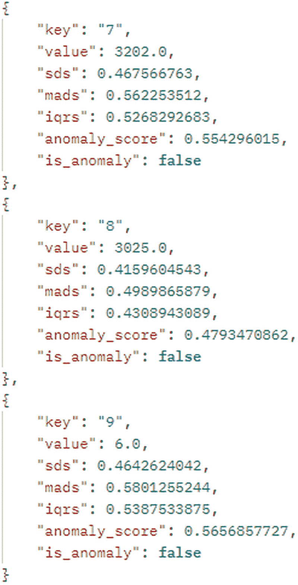
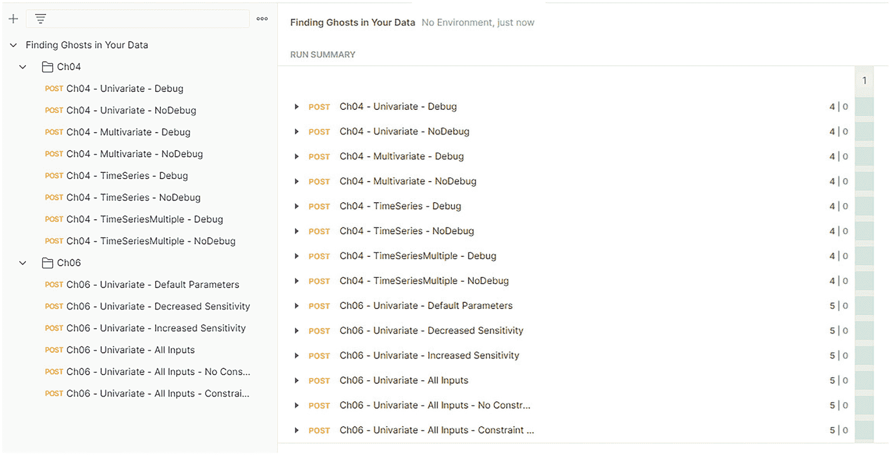

# 6. 实现第一个方法

前两章为我们的工作奠定了基础，第 4 章阐述了基本的 API 调用和存根方法，随后第 5 章介绍了单元测试和集成测试。在本章中，我们将以此为基础，开始实现我们的第一个异常值检测测试。遵循“从简单开始”的原则，我们将实施一些最简单的测试：基于统计的单变量异常值检测测试。

## 一个激励性示例

单变量异常检测器听起来限制很大：几乎没有哪个现象简单到可以归结为单一变量。然而在实践中，单变量异常检测可能非常强大，因为我们的目的并非解释世界，而是判断是否发生了异常情况。从这个角度看，只要我们拥有某种与其他度量足够独立的度量指标，就可以进行单变量异常检测分析并得到答案。

例如，你的电脑是由复杂部件组成的混合物，如果认为单一度量就能完全描述机器的健康状况，那将是愚蠢的。不过，确实存在能够描述电脑某部分健康状况的单一度量。例如，CPU 温度是衡量电脑冷却系统工作状况的绝佳指标，并且存在基于环境温度和工作负载的最佳范围。一个快速经验法则是：在重负载下，现代 CPU 通常运行在 60 到 80 摄氏度（140–176 华氏度）之间，但高于此范围的温度可能很危险。如果我们通过收集常见时间间隔（如十秒或一分钟间隔）内的平均温度来追踪 CPU 热传感器的输出，就可以使用单变量统计分析来检查是否存在远高于正常值的温度。这些高温可能表明冷却系统的某些方面出现问题、系统负载过高或热传感器故障。这里的目标不是确定原因，而是向操作员提供信息，表明某些情况值得关注。

在前面的例子中，我们重点关注了极高温度，因为这是我们在电脑上常遇到的问题。对于便携设备，尤其是需要在户外使用的设备，我们不仅需要关注高温，还需要关注低温，因为极低温度也可能损坏电子元件或表明热传感器存在问题。本章的测试将聚焦于`双向`异常检测，这意味着我们会对异常高值和异常低值都发出警报。将单向分析作为选项是可行的，但这留给读者作为练习。

既然我们知道这种异常检测将涵盖两个方向，接下来就需要确定应该使用哪种度量——或哪些度量。在第 3 章中，我们研究了多种统计度量，例如距离均值的标准差个数、距离四分位距的距离以及距离中位数的中位数绝对偏差个数。面对这些测试以及我们可以考虑的其他所有统计测试，我们应该选择哪一个？在这种情况下，我们将拥抱“与”的力量。

## 集成作为一种技术

本章将使用的测试都是相当简单的统计测试。这些测试简单的主要优点是它们也相当快速。这些测试简单的主要缺点是我们没有太多机会调整这些测试以减少噪声。这时，一种称为`集成`的技术对我们来说就非常有益。

集成是将一系列模型组合在一起，并从所有模型的组合中得出单一答案的过程。这项技术背后的直觉相当直接。存在一组构成我们数据集合的点。作为人类，我们可能会查看数据，但只有在异常检测引擎完成工作后才能查看。因此，我们的异常检测过程无法事先知道哪些点是异常值，所以即使我们拥有所有可用技术的集合，也可能不知道在特定情况下哪些技术是合理的。换句话说，每种技术有时有效，有时无效。

这里真正的关键在于，不同技术的有效范围会有所不同——也就是说，测试 A 可能在一组条件下失败，测试 B 可能在另一组条件下失败，而测试 C 在第三组条件下失败。理想情况下，这三组失败条件完全不会重叠，这意味着对于每个数据点，三个测试中至少有两个是正确的，我们只需选择得票最多的答案来判断某点是否为异常值。实际中的异常检测不会这么简单，尽管直觉并非完全错误：尽管不同技术之间存在“失败区域”的重叠，但不同类型的技术在特定数据范围内可能更有效，且重叠远非完全。因此，创建一组中等有效测试的集成，可以产生优于任何单个测试的结果。

本章将讨论两种类型的集成：`顺序集成`和`独立集成`。让我们逐一了解。

### 顺序集成

我们要讨论的第一种集成技术称为`顺序集成`。顺序集成的思路是依次运行每个测试，前一个测试的结果会输入到后续测试中。在这种情况下，我们首先运行测试 A。关于数据点是异常值还是正常值的信息，随后会与原始数据一起输入到测试 B 中。测试 B 接收所有这些输入，然后生成自己的一组异常值和正常值。我们将这些结果输入到测试 C，依此类推，直到完成所有测试。最终结果是一组数据点，并带有关于某点是否为异常值或正常值的一致性标记。

通常，顺序集成通过缩小潜在有争议数据点的相关范围来工作。如果第一个模型对某个预测极其自信，我们可能不希望后续模型在这些数据点上浪费时间。相反，后续模型会尝试回答第一个模型觉得困难的问题。因此，我们通常希望最好的模型先上，尽可能多地处理数据点。

使用顺序集成时，无法保证对于任何给定数据点，我们都能找到一个极其自信的模型（无论我们对“极其自信”如何定义）。因此，到最后，我们可能有一些数据点，没有任何模型能明确将其定义为异常值或正常值。在这种情况下，我们可以报告集成中最后一个测试的结果。或者，我们可以采用简单的投票机制：如果有五个测试，其中三个报告某数据点为异常值，两个没有，我们就将其判定为异常值。这些猜测的置信度会相当低，但通过良好的测试序列，目标是让这类数据点相对较少；相反，我们的目标是让集成中的各种测试能够自信地预测绝大多数数据点的答案。

### 独立集成

顺序集成虽然效果不错，但也存在风险：如果某个模型自信地给出了错误结论怎么办？如果我们的第一个模型对某个结果非常自信，但最终证明是错误判断，那么后续模型将不会对其进行检验，也就无法发现这一偏差。这时，`独立集成`就派上了用场。在独立集成中，我们仍然会对数据集执行一系列测试。然而，主要区别在于这些测试是彼此独立进行的——也就是说，测试 A 的结果不会输入到测试 B、测试 C 或任何其他测试中。相反，每个测试都会对整个输入数据运行，并为每个数据点生成预测。当我们对所有数据点完成所有测试的计算后，就需要将结果合并起来。

合并结果的最简单方法是统计某个测试将给定数据点标记为异常值的次数，并检查是否达到某个阈值。假设我们有五个测试，并且要求简单多数才能决定将某个数据点标记为异常值。在这种情况下，无论任何特定测试对其预测的置信度有多高，我们都需要五个测试中的三个达成一致才能做出判断。

另一种可用的技术是对各个测试进行加权。例如，假设测试 A 总体上相当准确，而测试 B 整体上准确性稍差，但两者都不足以单独达到足够精度。在这种情况下，我们可能会给测试 A 比测试 B 更多的投票份额，这样如果出现分歧，测试 A 将覆盖测试 B。加入更多测试后，你就能理解这种组合方式了。假设我们有测试 A、B、C 和 D，其加权投票份额分别为 35、15、30 和 20。此外，我们规定某个数据点至少需要 50 份额才能被视为异常。在这种情况下，有多种途径可以达到 50 份额：例如，测试 A 加上任何其他测试都能至少达到 50 份额。然而，如果只有测试 B 和 C 将某个数据点标记为异常值，那么我们将无法达到 50 份额的阈值，因此不会将该数据点标记为异常值。

### 在顺序集成与独立集成之间选择

顺序集成和独立集成都是合并多个模型或测试结果的有用技术。让我们探讨几种场景，了解何时应该优先选择一种集成技术而非另一种。

首先，如果你有一个特别优秀的算法，顺序集成可能优于独立集成。这将允许我们在第一次测试后排除大量数据点，从而使后续测试显著加快。相比之下，独立集成要求对所有数据点运行所有测试，这意味着性能（就速度而言）不会那么好。

相反，如果你有一系列质量相近但都没有绝对优势的算法，那么独立集成技术是更安全的方法。这将降低将异常值错误标记为正常值（或反之）的可能性，这可以弥补独立集成运行速度较慢的不足。

其次，如果你了解特定算法的性能特征，顺序集成过程可能更有意义。例如，在特定条件下，某个算法可能比另一个对异常值更敏感，但假设它在处理少量数据行时比处理大量数据行时效果更好。在这种情况下，你可以尝试评估数据集的一些特征，判断它更符合第一个算法还是第二个算法，并以该算法为主导，使用另一个算法作为清理测试。如果你不确定某个算法何时优于另一个，那么独立集成是更安全的选择。

最后，如果你有互补性的检查，顺序集成通常会更好——也就是说，如果每个算法的失效区域重叠较少，那么顺序地输入结果并逐步缩减数据集通常会效果良好。

## 实现初步检查

在本章中，我们将实现三种算法：与均值的标准差、与四分位距的距离，以及与中位数的中位数绝对偏差。回顾我们之前的检查清单，我们并没有一个算法能明显优于其他算法。与中位数的中位数绝对偏差是与均值的标准差的一个更稳健的版本，因此前者会更好。话虽如此，两者都能捕捉到大量异常值，并且在某些情况下，我们可能希望从与均值的标准差测试中获得额外信息。与四分位距的距离涵盖了与基于方差的度量不同的空间，但“不同”并不能保证在这里更好。

我们也不会知道这三种算法的性能特征。我们可以根据它们的运作方式做出一些假设，但我们尚未尝试定义哪些算法对任何给定数据集效果最佳。

基于这两个考虑，本章我们将使用独立集成。在本书的后续部分，我们将看到一个顺序集成非常有意义的例子。现在，让我们开始编写代码！

我们首先需要更新 `univariate.py` 文件并添加我们的测试。在 `detect_univariate_statistical()` 函数内部，我们需要做四件事：运行测试、对测试结果进行评分、确定哪些数据点是异常值，以及返回异常值集合。为了使这段代码更符合函数式编程风格，我们将每个操作作为独立函数执行，并且每个操作都不会产生副作用。

第一个函数 `run_tests()` 将负责运行以下每个测试。

# 异常检测函数实现

## 与均值的标准差

我们将实现的第一个测试是检查某个特定数据点是否偏离均值超过给定的标准差个数。我们可以将此函数命名为`check_sd()`，它将为数据集中的每个数据点运行一次。`check_sd()`函数将接受四个参数：数值（`value`）、数据集的均值（`mean`）、数据集的标准差（`sd`），以及报告异常值所需的最小标准差倍数（`min_num_sd`）。`check_sd()`的代码构成了代码清单 6-1。

```
def check_sd(val, mean, sd, min_num_sd):
    if (abs(val - mean) < (min_num_sd * sd)):
        return abs(val - mean)/(min_num_sd * sd)
    else:
        return 1.0
```

代码清单 6-1 创建标准差检查的初步尝试

此函数检查我们的数值与均值之间的绝对差是否大于最小标准差倍数。如果数据点数值与均值之间的差值在可接受范围内，我们返回达到`min_num_sd`标准差阈值进度的百分比。如果差值超出可接受范围，我们返回分数 1.0，表示此测试认为该数据点是异常值。

当我们调用`check_sd()`时，调用者会发送数据点的数值，因此我们知道该值。我们也会知道最小标准差倍数，因为我们将其设置为 3。我们需要在`run_tests()`函数中计算均值和标准差，使用 Pandas DataFrame 可以轻松完成：分别是`df['value'].mean()`和`df['value'].std()`。

## 中位数绝对偏差

本章将实现的第二个检验，用于检查某个数据点是否偏离中位数超过给定倍数的中位数绝对偏差。这是对均值标准差检验的稳健版本，意味着少数异常值不会实质性地影响检验质量。由于此检验的代码与之前的检验基本相似，我们应该为基于中位数的统计检验创建一个通用函数。清单 6-2 展示了该函数。

```
def check_stat(val, midpoint, distance, n):
    if (abs(val - midpoint) < (n * distance)):
        return abs(val - midpoint)/(n * distance)
    else:
        return 1.0
```

清单 6-2 一个用于执行中位数距离检验的新函数

有了这个函数后，我们可以重构`check_sd()`函数来调用这个新函数。清单 6-3 展示了这一点以及新的`check_mad()`函数。

```
def check_sd(val, mean, sd, min_num_sd):
    return check_stat(val, mean, sd, min_num_sd)

def check_mad(val, median, mad, min_num_mad):
    return check_stat(val, median, mad, min_num_mad)
```

清单 6-3 三个简单的基于中位数的距离检验

## 四分位距距离

我们将实现的第三个也是最后一个检验，用于检查某个数据点是否超出第 25 和第 75 百分位数超过给定倍数的四分位距。提醒一下，四分位距是数据集中第 75 百分位数与第 25 百分位数之差。如果满足以下两个条件之一，我们便将其视为异常值：要么该值高于第 75 百分位数超过 1.5 倍四分位距，要么该值低于第 25 百分位数超过 1.5 倍四分位距。`check_iqr()`函数将接收六个参数：数据点的值（`value`）、数据集的中位数（`median`）、第 25 百分位数（`p25`）、第 75 百分位数（`p75`）、数据集的四分位距（`iqr`），以及报告异常值前与相关百分位数的最小四分位距倍数（`min_iqr_diff`）。`check_iqr()`的代码如清单 6-4 所示。

```
def check_iqr(val, median, p25, p75, iqr, min_iqr_diff):
    if (val < median):
        if (val > p25):
            return 0.0
        elif (p25 - val) < (min_iqr_diff * iqr):
            return abs(p25 - val)/(min_iqr_diff * iqr)
        else:
            return 1.0
    else:
        if (val < p75):
            return 0.0
        elif (val - p75) < (min_iqr_diff * iqr):
            return abs(val - p75)/(min_iqr_diff * iqr)
        else:
            return 1.0
```

清单 6-4 创建四分位距检验的初次尝试

这段代码与我们前两个函数略有不同，因为我们多了两个参数。我们不是检查与中位数的距离，而是检查与第 25 和第 75 百分位数的距离，但只对每个百分位数进行单向检验。因此，如果我们的值小于中位数，我们就针对第 25 百分位数进行检验。如果数据点位于第 25 百分位数和中位数之间，则此检验的异常得分为 0——它肯定是一个正常值。如果我们低于第 25 百分位数，但距离小于`min_iqr_diff`倍的四分位距，我们会计算距离边界的接近程度，并生成一个介于 (0, 1) 范围内的数值。任何超出截止点的数据点，其异常得分将为 1.0。对于大于或等于中位数的值，我们针对第 75 百分位数执行类似的检验。

现在我们已经完成了这些检验，可以向上提升一个层次，完成`run_tests()`函数。

## 完成 `run_tests()` 函数

我们知道，我们希望`run_tests()`函数为每个数据点调用每个检验。我们还知道，该函数需要计算聚合度量，具体包括均值、标准差、中位数、四分位距和中位数绝对偏差。为此，我们需要一个包含名为`value`列的 Pandas DataFrame。清单 6-5 展示了该函数的实现。

```
def run_tests(df):
    mean = df['value'].mean()
    sd = df['value'].std()
    p25 = np.quantile(df['value'], 0.25)
    p75 = np.quantile(df['value'], 0.75)
    iqr = p75 – p25
    median = df['value'].median()
    mad = robust.mad(df['value'])
    calculations = {
        "mean": mean,
        "sd": sd,
        "p25": p25,
        "median": median,
        "p75": p75,
        "iqr": iqr,
        "mad": mad
    }
    ### 对每个检验执行并添加新得分
    df['sds'] = [check_sd(val, mean, sd, 3.0) for val in df['value']]
    df['mads'] = [check_mad(val, median, mad, 3.0) for val in df['value']]
    df['iqrs'] = [check_iqr(val, median, p25, p75, iqr, 1.5) for val in df['value']]
    return (df, calculations)
```

清单 6-5 完整的 run_tests() 函数

此函数接收一个 DataFrame，然后计算五个相关的聚合度量。请注意，我们使用 numpy 中的`quantile()`函数来计算数据集中的第 75 和第 25 百分位数。此外，我们使用 Python 中 statsmodels 包中的`robust.mad()`函数来计算中位数绝对偏差，因为 Pandas 中的`mad()`方法实际上计算的是*均值*绝对偏差，而非*中位数*绝对偏差，这个术语上的细微差别在实践中会产生巨大影响。其余的聚合函数都是 DataFrame 上可用的方法。

计算完聚合度量后，我们将结果存入一个名为`calculations`的字典中，该字典将返回给调用者用于调试目的。然后，我们对 DataFrame 中的每个值执行每个检验，并将结果作为新列添加到 DataFrame 中。DataFrame 中数据的顺序与我们创建的每个列表的顺序相同，因此我们无需在追加新列之前对数据进行排序。完成这些工作后，我们返回更新后的 DataFrame，以便进行下一步操作：对这些结果进行评分。

## 构建评分板

到目前为止，我们有一系列检验，每个检验都提供了对特定数据点异常程度的自身计算。我们现在希望将这些独立的检验结合起来，并向最终用户返回一个统一的异常得分以及给定数据点是否异常的判定。

在创建评分函数时，检验方法已经为我们提供了良好的基础，因为它们提供了两方面的信息。首先，它们清晰地指示了某个检验是否将某数据点标记为异常值或正常值。这些分界线（距离均值 3 个标准差、距离第 25/75 百分位数 1.5 倍四分位距、距离中位数 3 倍中位数绝对偏差）可能并非完美，但在现阶段应该能很好地为我们服务。其次，如果我们确实发现某个数据点超出了这些边界，我们就能直接得到该数据点被视为异常值的指示。
引入这样的阈值既有好处也有风险。好处在于，一个极端异常值不会掩盖不那么极端的异常值——即使另一个数据点距离第 75 百分位数有 500 倍四分位距，一个距离第 75 百分位数 50 倍四分位距的数据点仍然是一个明显的异常值。这里的风险在于，如果数据分布完全不像正态分布，我们对异常值的上限设定可能会导致问题。在这些情况下（特别是如果我们回想一下柯西分布），我们最终可能会得到过多的异常值，从而导致更多的噪声。

## 加权结果

清单 6-6 提供了一个函数代码，用于根据每个测试的加权结果为每个数据点生成异常分数。

```
def score_results(
    df,
    weights
):
    return df.assign(anomaly_score=(
        df['sds'] * weights['sds'] +
        df['iqrs'] * weights['iqrs'] +
        df['mads'] * weights['mads']
    ))
```
清单 6-6：为每个数据点生成异常分数。

该函数接收一个 Pandas `DataFrame` 以及一个权重字典。如果我们希望保证异常分数范围在 0 到 1 之间，那么所有权重的总和应等于 1.0。除了这个潜在的线性约束外，我们可以自由选择任何想要的权重。
找出正确的权重将是一个挑战，我们不应将这个任务推给用户。作为一般原则，用户不需要知道我们如何运行测试的细节，也不需要了解其数据分布的详细信息——毕竟，如果他们知道所有这些，为什么还需要我们的服务？因此，我们需要直接确定权重。确定权重最简单的方法是将一些基本直觉与大量的试错相结合。让我们从基本直觉开始。
当我们的测试集中同时包含稳健统计量和非稳健统计量时，我们应该偏向于稳健统计量，因为它们更有可能在面对一定比例的异常值时保持敏感。同时保留两者仍然有价值，因为我们可以找到这样的场景：某个数据点与中位数的 MAD 超过 3，但与均值的标准差却未达到 3，因此同时包含这两个值将降低我们对这个特定数据点是否为异常值的预期（相比于同时通过两项测试的数据点）。尽管如此，偏向于稳健统计量意味着我们希望 `mads` 结果的权重大于 `sds` 结果。四分位距（与第 25 或第 75 百分位的距离）也是一个相当稳健的统计量，并且是追踪某值是否为异常值的合理安全度量，因此我们将赋予它比标准差（与均值的距离）更大的权重，但小于中位数绝对偏差（与中位数的距离）的权重。
为这些权重确定具体数值需要针对你的特定环境，对多种相关数据集运行统计测试，并尝试确定哪些权重在发现异常值时表现最佳且不会频繁出错。这里最大的挑战是，我们通常没有标记数据来指示何时真正发生了异常；缺少这一关键信息，我们可以追踪异常值，但可能无法保证任何一组权重在某个环境中都是最优的。
为了继续推进，我们将从以下权重开始：`mads`（与中位数的距离）为 0.45，`iqrs`（与中位数的距离）为 0.35，`sds`（与均值的距离）为 0.25。这些数值之和大于 1，这意味着我们的异常分数可能超过 1。不过，这没关系：如果数值之和恰好为 1，在不将灵敏度设置为 20–30 这样非常低的值的情况下，在给定数据集中发现多个异常值会变得更加困难。在实践中，即使使用这些分数，如果我们设置灵敏度分数阈值为 75 或 80 左右，通常也需要三个测试中至少有两个达到最大值。我建议将权重总和保持在 1.0 到 1.5 之间，具体取决于你希望系统在给定灵敏度分数下显示更多还是更少的异常值。
现在我们有了权重，并且可以计算异常分数，接下来可以进入最后一部分：确定某值是否为异常值。

## 确定异常值

我们希望异常分数通常介于 0 到 1 之间（包含端点，但可能略高）的原因是，灵敏度分数本身的范围是 1 到 100（包含端点）。我们可以反转并缩放灵敏度分数，使其与我们的异常分数重叠。由于灵敏度分数范围在 1 到 100 之间，且 100 表示最灵敏，我们希望分数越高看到的异常值越多。为此，我们可以从 100 中减去灵敏度分数，将结果除以 100.0，然后将其与我们计算出的异常分数进行比较，如果某个数据点的异常分数大于灵敏度分数阈值，则将其标记为异常值。嗯，差不多是这样。有一个小小的例外，与最大异常值比例有关。
如果我们的最大异常值比例小于异常分数达到或超过灵敏度分数的数据点比例，那么我们需要选择最异常的数据点，直到达到该最大异常值比例。例如，假设 20% 的数据点的异常分数大于传入的灵敏度分数，但用户同时指出最大异常值比例应为 15%。在这种情况下，我们只能将 15% 的数据点标记为异常值，因此我们应该从数据集中选择*最*异常的结果。清单 6-7 展示了如何实现这一点。

```
def determine_outliers(
    df,
    sensitivity_score,
    max_fraction_anomalies
):
    sensitivity_score = (100 - sensitivity_score) / 100.0
    max_fraction_anomaly_score = np.quantile(df['anomaly_score'], 1.0 - max_fraction_anomalies)
    if max_fraction_anomaly_score > sensitivity_score and max_fraction_anomalies < 1.0:
        cutoff = max_fraction_anomaly_score
    else:
        cutoff = sensitivity_score
    return df.assign(is_anomaly=(df['anomaly_score'] >= cutoff))
```
清单 6-7：确定给定值是否为异常值，并考虑最大异常值比例。

第一步是找到 `100 - (max_fraction_anomalies * 100)` 百分位数对应的分数。也就是说，如果 `max_fraction_anomalies` 为 0.1，我们想要找到异常分数的第 (100 – 10) = 90 百分位数。如果该分数小于灵敏度分数，则意味着最大异常值比例不会限制我们的结果，因此我们可以使用灵敏度分数。如果该分数大于灵敏度分数且 `max_fraction_anomalies` 小于 1.0，则意味着我们只应返回大于或等于最大比例分数对应的值。无论哪个分数胜出，我们都以相同的方式判断某值是否为异常值，并将其作为一个新列返回。
接下来，清单 6-8 将所有部分整合在一起。

```
def detect_univariate_statistical(
    df,
    sensitivity_score,
    max_fraction_anomalies
):
    weights = {"sds": 0.25, "iqrs": 0.35, "mads": 0.45}
    if (df['value'].count() < 3):
        return (df.assign(is_anomaly=False, anomaly_score=0.0), weights, "必须至少包含 3 个数据点。")
    elif (max_fraction_anomalies <= 0.0 or max_fraction_anomalies > 1.0):
        return (df.assign(is_anomaly=False, anomaly_score=0.0), weights, "必须提供有效的最大异常值比例，0 < x <= 1。")
    elif (sensitivity_score <= 0 or sensitivity_score > 100 ):
        return (df.assign(is_anomaly=False, anomaly_score=0.0), weights, "必须提供有效的灵敏度分数，0 < x <= 100。")
    else:
        df_tested = run_tests(df)
        df_scored = score_results(df_tested, weights)
        df_out = determine_outliers(df_scored, sensitivity_score, max_fraction_anomalies)
        return (df_out, weights, { "message": "集成方法：[均值 +/- 3*标准差，中位数 +/- 1.5*四分位距，中位数 +/- 3*中位数绝对偏差]。", "calculations": calculations})
```
清单 6-8：基于统计测试检测单变量异常值的新函数。

在这个函数中，我们首先设置权重。然后，我们确保调用者至少传入三个数据点，因为我们需要至少三个数据点才能判断某值是否为异常值。两个数据点永远不足以显示异常值，而少于两个数据点则会在计算方差时导致错误。接着，我们检查以确保最大异常值比例和灵敏度分数被设置为合理的值。

## 异常值检测实现

假设我们已获得可接受的输入，接下来将逐一遍历每个函数调用：首先运行测试，然后对结果进行评分，最后确定异常值。最后，我们返回输出`DataFrame`、权重列表以及测试内容的描述信息。该描述信息还包含中点和距离计算，便于诊断特定数据点为何呈现异常状态。

恭喜！现在你已经拥有了一个异常值检测器！

### 更新测试

既然我们已经通过统计测试实现了单变量数据的异常值检测代码，接下来可以更新单元测试和集成测试项目，确保代码按预期工作。首先更新单元测试，然后处理集成测试。

### 更新单元测试

在上一章中，我们仅有的单元测试让我们确信所做的修改不会从根本上破坏应用程序。巧合的是，在本章代码开发过程中，这个包含少量测试用例的单元测试表现出色，成功捕获了两个可能被遗漏的独立错误。既然单元测试项目已经带来了净收益，现在我们有更多内容需要测试，不妨再添加几个单元测试。

目前我们可以有效测试三个方面：特定数据集产生的异常值数量、敏感度评分对返回异常值数量的影响，以及异常值最大比例对返回异常值数量的影响。清单 6-9 包含了第一个新测试，其中包含只有一个异常值的情况。

```python
@pytest.mark.parametrize("df_input", [
[1, 2, 3, 4, 5, 6, 7, 8, 9, 10, 90],
[1, 1, 1, 2, 2, 3, 3, 4, 4, 5, 5, 5, -13],
[0.01, 0.03, 0.05, 0.02, 0.01, 0.03, 0.40],
[1000, 1500, 1230, 13, 1780, 1629, 1450, 1106],
[1, 2, 3, 4, 5, 6, 7, 8, 9, 10, 19.4]
])
def test_detect_univariate_statistical_returns_single_anomaly(df_input):
    # Arrange
    df = pd.DataFrame(df_input, columns={"value"})
    sensitivity_score = 50
    max_fraction_anomalies = 0.50
    # Act
    (df_out, weights, details) = detect_univariate_statistical(df, sensitivity_score, max_fraction_anomalies)
    num_anomalies = df_out[df_out['is_anomaly'] == True].shape[0]
    # Assert: we have exactly one anomaly
    assert(num_anomalies == 1)
```

*清单 6-9：预期只返回一个异常值的测试用例*

测试代码相当直观：我们将输入数据集组织为 Pandas `DataFrame`，并将敏感度评分设为静态值 50。同时将异常值最大比例设置得足够高，以便可能触发多个异常结果。然后，在调用`detect_univariate_statistical()`函数后，我们统计`is_anomaly`标记为`True`的记录数，并确保该计数等于 1。

该测试的每个测试用例都有特定目的。第一个用例展示了整数值的大幅增长。第二个用例包含一个负异常值，确保我们能正确处理负值。第三个用例考察相对较小的数值，这可能会暴露“最小距离”的缺陷。第四个用例确保我们能找到较小但非负的异常值。最后，第五个用例同时包含整数和小数，确保我们在同一次调用中能同时支持这两种类型。

我们还可以为其他数量的异常值创建测试。实际上，我们可以创建一个包含数据集和预期异常值数量的大型测试，不过我可能更倾向于将 0、1 和 2 个异常值的情况分开，并为每种情况包含多个测试用例。请查看`test_univariate.py`文件了解这些用例，但我希望重点讨论一个特定的测试用例及其背后的策略。

这个特定测试用例的输入数据集为`[1000, 1500, 2230, 13, 1780, 1629, 3202, 3025, 6]`。人类看到这个数据可能会立即将 13 和 6 视为异常值，但这种情况人类可能判断错误。人类之所以认为 13 和 6 是异常值，最可能的原因是数量级差异：13 和 6 分别比其他值小两到三个数量级，因此我们的眼睛能捕捉到这种差异。然而，如果进行数学计算，我们会发现它们并不像我们预期的那样是明显的异常值。该输入数据集的均值为 1598.33，中位数为 1629。从这两个指标来看，3202 和 3025 与中点的距离与 6 和 13 相当。该数据集的第 25 百分位数为 1000，第 75 百分位数为 2230，因此四分位距为 1230，1.5 倍四分位距为 1845。最后，该样本的标准差为 1143，MAD 为 932.55。有了这些数字，我们可以手动计算所有距离，或者直接调用异常值检测引擎获取权重。图 6-1 展示了 3202、3025 和 6 的结果。



*图 6-1：三个非异常值的权重和异常评分*

经过计算，很明显，由于该数据集的离散程度，6 和 13 并非异常值，至少对于敏感度评分 30 来说是这样。随着敏感度评分升高，6 和 13 会变成异常值，但 3202 和 3025 也会同时变成异常值。

接下来要审查的测试是确保敏感度评分能正确影响结果中异常值的数量。清单 6-10 展示了该测试的代码以及我们将使用的所有测试用例。

```python
anomalous_sample = [1, 1, 2, 2, 3, 3, 4, 4, 5, 5, 6, 7, 8, 9, 10, 2550, 9000]

@pytest.mark.parametrize("df_input, sensitivity_score, number_of_anomalies", [
    (anomalous_sample, 100, 17),
    (anomalous_sample, 95, 15),
    (anomalous_sample, 85, 8),
    (anomalous_sample, 75, 5),
    (anomalous_sample, 50, 2),
    (anomalous_sample, 25, 2),
    (anomalous_sample, 1, 1)
])
def test_detect_univariate_statistical_sensitivity_affects_anomaly_count(df_input, sensitivity_score, number_of_anomalies):
    # Arrange
    df = pd.DataFrame(df_input, columns={"value"})
    max_fraction_anomalies = 1.0
    # Act
    (df_out, weights, details) = detect_univariate_statistical(df, sensitivity_score, max_fraction_anomalies)
    num_anomalies = df_out[df_out['is_anomaly'] == True].shape[0]
    # Assert: we have the correct number of anomalies
    assert(num_anomalies == number_of_anomalies)
```

*清单 6-10：确保敏感度评分按预期工作*

在此场景中，我们使用相同的输入数据集。该数据集的棘手之处在于，2550 和 9000 显然是异常值，但 2550 与 9000 相距甚远，如果我们尝试对单个数据点进行加权，并且没有像我们那样对统计测试设置上限（均值加减 3 个标准差、第 25/75 百分位数加减 1.5 倍四分位距、中位数加减 3 倍 MAD），我们可能会将 2550 判定为正常值。随着敏感度评分降低，我们可以看到相应的异常值数量也在减少。

最后一个单元测试将确保异常值最大比例按预期工作。根据之前的测试，当敏感度评分为 1.0 时，我们会得到 17 个异常值。通过滑动设置`max_fraction_anomalies`，我们可以看到报告的异常值数量发生变化。清单 6-11 包含了该测试的代码。

### 更新集成测试

我们在上一节中添加的新单元测试很棒，但我们还需要确保整个应用程序按预期工作。这就是新集成测试发挥作用的地方。在本章中，我们将引入六个新的集成测试，并对第 4 章的测试进行一个小修改。首先，我们来讨论这个小修改。

在第 4 章中，我们通过检查 `debug_details` 字符串的长度来验证调试细节是否存在。随后，我们改变了写出这些细节的方式，改为写出一个 JSON 对象，因此这个检查机制也需要改变。现在，我们改为检查是否存在，这意味着所有集成测试检查都将改为以下代码：`pm.test("调试已启用 (debug_details 存在): " + body["debug_details"], function () { pm.expect( body["debug_details"].exist); });`。

这只会影响那些我们期望有调试细节的测试，因此 `NoDebug` 测试将保持不变。

完成这个修改后，我们可以添加新的请求。前三个请求将检查敏感度分数，并确保不同的敏感度分数会导致不同数量的离群数据点。清单 6-12 给出了这个请求的一组测试。

```
pm.test("状态码为 200: " + pm.response.code,
function () { pm.expect(pm.response.code).to.eql(200); });
pm.test("响应时间可接受 (范围 5ms 到 7000ms): " + pm.response.responseTime + "ms",
function () { pm.expect(_.inRange(pm.response.responseTime, 5, 7000)).to.eql(true); });
var body = JSON.parse(responseBody);
pm.test("返回的项目数正确 (等于 17): " + body["anomalies"].length,
function () { pm.expect(body["anomalies"].length).to.eql(17); });
pm.test("调试已启用 (debug_details 存在): " + body["debug_details"],
function () { pm.expect(body["debug_details"].exist); });
pm.test("异常计数正确 (等于 2)", () => {
let anomalies = body["anomalies"].filter(a => a.is_anomaly === true);
pm.expect(anomalies.length).to.eql(2);
} );
```

清单 6-12：随 Postman 请求运行的测试

这些测试开始时与之前相同，检查响应代码是否表示成功，响应时间是否可接受，以及返回的项目数是否等于我们期望的数量。然后，我们加入了新的调试细节检查，并以一个新函数结束。这个新函数通过调用 `anomalies` 数组上的 `filter()` 函数，检查 `is_anomaly` 设置为 `true` 的位置，来验证异常计数是否正确。第一个测试使用默认的敏感度分数 50 和最大异常比例 1.0；因此，我们期望有两个离群点。第二个测试将敏感度分数降低到 10，这将离群点数量减少到 1 个。第三个测试将敏感度分数提高到 75，得到五个离群点。

第二组请求基于一个新的数据集，该数据集包含 125 个随机生成的、大于 0 美元但小于 40 美元的报销值，以及五个大于 100 美元的报销值。通过使用不同的敏感度分数和最大异常比例组合，这三个测试得出了不同数量的离群点。

图 6-2 显示了运行整个集合的最终结果，表明第 4 章的集成测试仍然成功，第 6 章的新测试也同样成功。



图 6-2：所有集成测试通过

## 结论

在本章中，我们将离群点检测引擎转变为一个功能性的产品。在下一章中，我们将扩展我们创建的集成模型，添加额外的统计测试，调整权重，并致力于使单变量检测引擎更加强大。