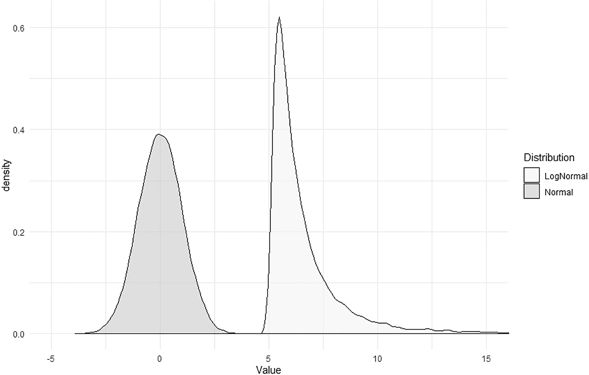
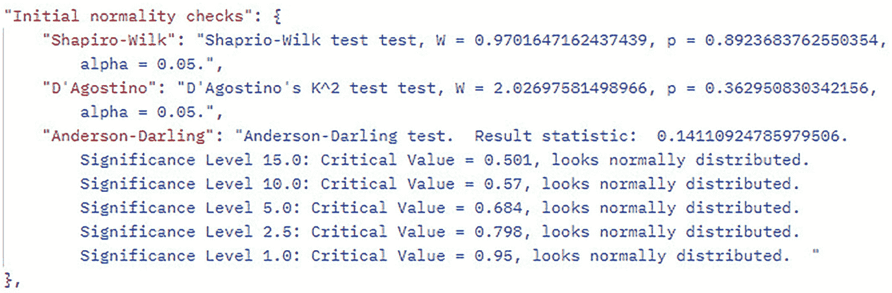
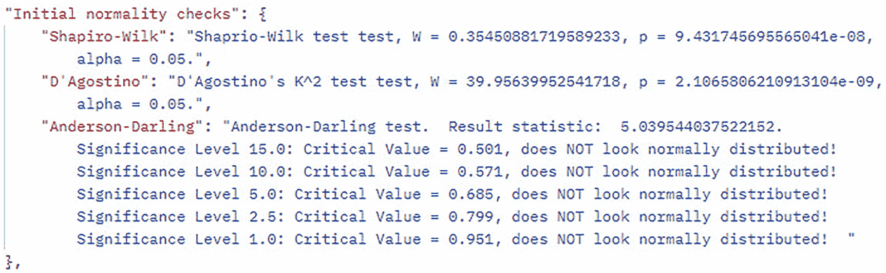
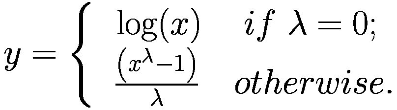
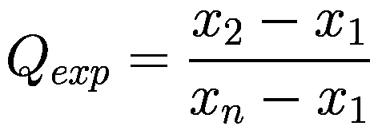
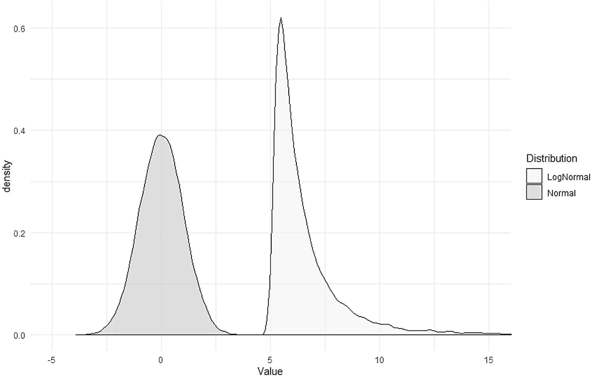
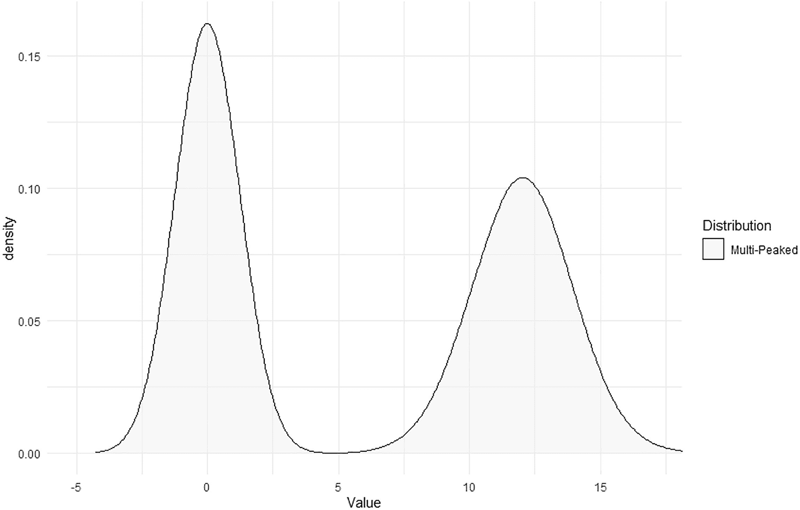

# 7. 扩展集成模型

第 6 章为我们提供了前三个离群点检测测试。在本章中，我们将在先前工作的基础上，包含几个额外的测试。我们还将重构现有代码，重新思考一些设计选择，并完成单变量统计分析的核心要素。

## 添加新测试

我们在前一章中添加的三个测试非常有用，甚至可能足以单独解决许多常见的单变量离群点检测问题。然而，如果你的输入数据遵循特定的形状，还有其他测试在追踪离群点方面非常有用。具体来说，如果数据足够接近正态分布，我们可以执行几种测试。

> **注意：** 在第 3 章中，我们描述了各种分布，包括正态分布。简要总结一下，标准正态分布的均值为 0，方差为 1。一个正态分布是指我们可以仅通过加法和乘法，将数据转换到正态分布，而不会扭曲数据点之间的关系。在本章的其余部分，任何对正态分布（甚至提到“标准”正态分布）的引用都将指代更通用的概念，而不是均值为 0、方差为 1 的特定正态分布。

### 正态性检验

有多种检验方法可以判断特定数据集是否服从正态分布。我们将介绍的第一种检验称为夏皮罗-威尔克检验。该检验以塞缪尔·夏皮罗和马丁·威尔克命名，在判断给定样本是否近似正态分布方面通常最为准确。在 Python 中，夏皮罗-威尔克检验是 `scipy.stats` 库中的一个函数。

第二种检验称为达戈斯蒂诺 K 平方检验，以拉尔夫·达戈斯蒂诺命名。该检验衡量数据集呈现的偏度和峰度。在统计学中，样本的偏度衡量的是左尾更长（负偏态）、右尾更长（正偏态）还是两尾长度相等（无偏态）。图 7-1 展示了一个无偏态的正态分布示例，以及一个呈现正偏态的对数正态分布。



该图绘制了密度与数值的关系。对数正态曲线是右偏曲线，正态曲线是正态曲线。

图 7-1
正态分布无偏态。相比之下，对数正态分布呈现正偏态

数据集的峰度表示分布尾部所含的数据量。正态分布的峰度为 3，随着峰度增加，出现异常数据点的可能性也随之增加。使用图 7-1 中的数据集，我们的正态分布偏度为 0，峰度为 2.99。对数正态数据集的偏度为 5.34，峰度为 58.34。

达戈斯蒂诺 K 平方检验（即 `scipy.stats` 中的 `normaltest()` 函数）利用这些度量来估计数据集的分布是否与正态分布存在显著差异。

我们将使用的第三种检验是安德森-达林检验，以西奥多·安德森和唐纳德·达林命名。该检验与夏皮罗-威尔克检验类似。其精确度通常不如夏皮罗-威尔克检验，但在 Python 中，`anderson()` 函数可在多种显著性水平下执行检验，这意味着你可以一次性在多个显著性水平上进行测试。

代码清单 7-1 包含了本章的新导入语句以及三个函数调用中的两个：夏皮罗-威尔克检验和达戈斯蒂诺 K 平方检验。

```
from scipy.stats import shapiro, normaltest, anderson, boxcox
import scikit_posthocs as ph
import math

def check_shapiro(col, alpha=0.05):
    return check_basic_normal_test(col, alpha, "夏皮罗-威尔克检验", shapiro)

def check_dagostino(col, alpha=0.05):
    return check_basic_normal_test(col, alpha, "达戈斯蒂诺 K² 检验", normaltest)

def check_basic_normal_test(col, alpha, name, f):
    stat, p = f(col)
    return ( (p > alpha), (f"{name}检验, W = {stat}, p = {p}, alpha = {alpha}.") )
```

代码清单 7-1
运行两个基本的正态性检验

这两个检验的形式相似，因此我们将代码集中到 `check_basic_normal_test()` 中，该函数接受四个参数：`DataFrame` 中的值（`col`）、在将结果标记为非正态之前允许结果偏离正态分布程度的指标（`alpha`）、用于标记的函数名称（`name`）以及实际的函数名（`f`）。在 Python 中，我们可以将一个函数作为另一个函数的输入。这样做时，请注意，无论是在 `check_basic_normal_test()` 的参数中，还是在 `check_shapiro()` 或 `check_dagostino()` 的调用中，我们都不在函数名后加括号。我们将函数调用 `f(col)` 保留在 `check_basic_normal_test()` 的函数体内，在其中我们调用 `shapiro()` 或 `normaltest()` 并将 `col` 作为参数传入。这些检验会计算一个 `p` 值，并将其与我们提供的 `alpha` 参数进行比较。如果 `p` 值大于 `alpha`，则我们假设该样本可能来自正态分布。如果 `p` 值小于或等于 `alpha`，我们认为数据不是正态的。

代码清单 7-2 包含了安德森-达林检验。由于该检验涉及的内容比其他检验更多，它不能完全套用相同的模式，因此我们需要采用略有不同的方式。

```
def check_anderson(col):
    #### 首先假设为正态性。
    anderson_normal = True
    return_str = "安德森-达林检验。"
    result = anderson(col)
    return_str = return_str + f"结果统计量: {result.statistic}"
    for i in range(len(result.critical_values)):
        sl, cv = result.significance_level[i], result.critical_values[i]
        if result.statistic < cv:
            return_str = return_str + f"显著性水平 {sl}: 临界值 = {cv}, 看起来呈正态分布。 "
        else:
            anderson_normal = False
            return_str = return_str + f"显著性水平 {sl}: 临界值 = {cv}, 看起来不呈正态分布！ "
    return ( anderson_normal, return_str )
```

代码清单 7-2
安德森-达林正态性检验

安德森-达林检验会提供一个结果统计量，并允许你将该统计量与每个显著性水平（即每个 `alpha` 值）的临界值进行比较。每个显著性水平的临界值取决于输入数据点的数量。图 7-2 展示了针对通过正态性检验的数据集，夏皮罗-威尔克检验、达戈斯蒂诺检验和安德森-达林检验的示例结果。



针对通过正态性检验的数据集，夏皮罗-威尔克检验、达戈斯蒂诺检验和安德森-达林检验的伪代码。

图 7-2
三次正态性检验的结果。注意，安德森-达林检验的显著性水平范围是从 0 到 100，而非 0 到 1

在此图中，我们可以看到夏皮罗-威尔克检验和达戈斯蒂诺检验的 `p` 值都远高于 0.05，因此该数据集通过了这些正态性检验。对于安德森-达林检验，结果统计量的值为 0.141。为了将数据集视为来自正态分布，该数值应低于每个显著性水平的临界值。正如我们所见，统计量值 0.141 远低于 15% 显著性水平的临界值 0.501，因此也低于更弱的显著性水平。相比之下，图 7-3 展示了一个输入数据集似乎并非来自正态分布的示例。



针对似乎并非来自正态分布的输入数据集，夏皮罗-威尔克检验、达戈斯蒂诺检验和安德森-达林检验的伪代码。

图 7-3
一个明显非正态的样本

在这种情况下，Shapiro-Wilk 检验和 D’Agostino 检验的 `p` 值均远低于 0.05，这意味着两项检验都表明该数据集似乎并非来自正态分布。Anderson-Darling 检验的统计量值大于 5.0，远高于 15% 显著性水平下的 0.501，甚至超过了 1% 显著性水平下的 0.951。

现在我们已经完成了三项检验，接下来要构建另一个函数，该函数能够判断何时调用每种方法、进行调用、汇总结果，并判定输入数据集是否服从正态分布。清单 7-3 包含了该函数的代码。

# 判断正态分布与数据转换

以下是关于正态性检验和Box-Cox变换的格式化文档。

## 正态性检验函数

```python
def is_normally_distributed(col):
    alpha = 0.05
    if col.shape[0] = 5k. n = {col.shape[0]}"
    if col.shape[0] >= 8:
        (dagostino_normal, dagostino_exp) = check_dagostino(col, alpha)
    else:
        dagostino_normal = True
        dagostino_exp = f"D'Agostino's test did not run because n < 8\. n = {col.shape[0]}"
    (anderson_normal, anderson_exp) = check_anderson(col)
    diagnostics = {"Shapiro-Wilk": shapiro_exp, "D'Agostino": dagostino_exp, "Anderson-Darling": anderson_exp}
    return (shapiro_normal and dagostino_normal and anderson_normal, diagnostics)
```

**清单 7-3**
一个用于判断输入数据集是否服从正态分布的函数

该函数首先将`alpha`值设为 0.05，遵循我们的一般原则：不让用户做出需要详细统计知识的选择。然后，如果数据集包含的观测值少于 5000 个，则运行 Shapiro-Wilk 检验；否则跳过该检验。如果我们至少有八个观测值，则可以运行 D’Agostino 的 K 平方检验。最后，无论样本量大小如何，我们都可以运行 Anderson-Darling 检验。

在基于这三项检验做出判定时，我们需要做出类似于集成学习权重分配的决定。我们可以进行简单投票，或者对某些检验赋予更高的权重。在本例中，我们将采用简单的一致同意规则：如果所有三项检验都一致认为数据集服从正态分布，那么我们就假定它是正态分布的；否则，我们就假定它不服从正态分布。诊断结果会生成我们在图 7-2 和图 7-3 中看到的 JSON 片段。

### 趋近正态分布

既然我们已经有了正态性检验的方法，那么接下来自然会问：如果我们需要正态分布的数据，而我们的数据集并非正态分布，我们能否对此做些什么？这个问题的答案是肯定的：“很可能可以！”

有几种技术可以将数据转换得看起来更像服从正态分布。其中或许最流行的是 Box-Cox 变换，它以乔治·博克斯和大卫·考克斯的名字命名。Box-Cox 变换根据清单 7-4 中的公式对一个变量进行变换。

### 清单 7-4. Box-Cox 变换背后的公式



假设我们有一个目标变量`x`。这代表我们单变量数据集的单一特征。我们想要将`x`的值转换为一个服从正态分布的变量，我们称之为`y`。给定某个`lambda` (λ) 值，我们可以通过执行两种操作之一来实现这一点。如果`lambda`为 0，那么我们对`x`取对数，结果即为`y`。这对于我们在第 3 章中看到的对数正态分布数据效果很好。否则，我们有一个非零的`lambda`，将`x`提升到该次幂，从结果中减去 1，再除以`lambda`。`Lambda`可以是任何正值或负值，尽管 Box-Cox 变换中常用的值范围在 -5 到 5 之间。

这就引出了下一个问题：我们如何知道`lambda`的正确值是多少？嗯，SciPy 库为我们提供了一个解决方案：`scipy.stats.boxcox()` 接受一个可选的`lambda`参数。如果你为`lambda`传入一个值，该函数将使用该值执行 Box-Cox 变换。否则，如果你没有为`lambda`参数指定值，该函数将确定`lambda`的最优值并将其返回给你。即使我们得到了`lambda`的最优值，也不能保证变换后的数据实际上服从正态分布，因此，我们应该在之后检查结果，看看我们的变换效果如何。

考虑到上述情况，清单 7-5 展示了我们用于对输入数据集进行正态化的代码。

## 数据正态化函数

```python
def normalize(col):
    l = col.shape[0]
    col_sort = sorted(col)
    col80 = col_sort[ math.floor(.1 * l) + 1 : math.floor(.9 * l) ]
    temp_data, fitted_lambda = boxcox(col80)
    #### Now use the fitted lambda on the entire dataset.
    fitted_data = boxcox(col, fitted_lambda)
    return (fitted_data, fitted_lambda)
```

**清单 7-5**
使用 Box-Cox 技术对输入数据进行正态化的函数

我们做的第一件事是找出输入数据中间 80% 的部分。这样做的理由是，Box-Cox 变换在数据变换方面非常有效。事实上，它效果如此之好，以至于可能会掩盖数据中的异常值，并使后续检验在识别异常值方面失去很多价值。因此，我们将重点关注中间 80% 的数据，这部分数据通常预计不会包含太多异常值。对中间 80% 的数据运行 `boxcox()`，我们会得到一个拟合的`lambda`值。然后，我们可以将该值作为参数传入，对整个数据集执行变换，并返回整个拟合数据集以及我们从中间 80% 数据构建的拟合`lambda`值。

我们在清单 7-6 中使用了这一点，该清单包含了关于我们能否对数据进行正态化以及正态化成功程度的规则。

## 归一化执行函数

```python
def perform_normalization(base_calculations, df):
    use_fitted_results = False
    fitted_data = None
    (is_naturally_normal, natural_normality_checks) = is_normally_distributed(df['value'])
    diagnostics = {"Initial normality checks": natural_normality_checks}
    if is_naturally_normal:
        fitted_data = df['value']
        use_fitted_results = True
    if ((not is_naturally_normal)
        and base_calculations["min"] > 0
        and df['value'].shape[0] >= 8):
        (fitted_data, fitted_lambda) = normalize(df['value'])
        (is_fitted_normal, fitted_normality_checks) = is_normally_distributed(fitted_data)
        use_fitted_results = True
        diagnostics["Fitted Lambda"] = fitted_lambda
        diagnostics["Fitted normality checks"] = fitted_normality_checks
    else:
        has_variance = base_calculations["min"] > 0
        enough_observations = df['value'].shape[0] >= 8
        diagnostics["Fitting Status"] = f"Elided for space"
    return (use_fitted_results, fitted_data, diagnostics)
```

**清单 7-6**
对数据集执行归一化的函数

清单 7-6 首先检查数据是否已经服从正态分布。如果是，则无需执行任何变换，可以直接使用原始数据。否则，在满足以下所有条件时，我们会执行 Box-Cox 变换：第一，数据必须不服从正态分布；第二，数据必须存在一定的方差；第三，数据中所有值必须大于 0，因为无法对 0 或负数取对数；第四，我们需要至少八个观测值，Box-Cox 变换才能生效。

如果满足所有这些条件，则调用 `normalize()` 函数，获取拟合后的数据和 lambda 值。然后，对得到的数据集再次调用 `is_normally_distributed()`。请注意，由于我们基于数据集中央的 80% 来配置 lambda 值，因此变换后数据中可能仍然存在极端异常值，导致最终结果仍是非归一化的。因此，我们会记录结果，但不会让 `is_normally_distributed()` 阻止我们继续执行。

如果未满足所有相关条件，我们会找出哪些条件不满足，并将其写入诊断字典。最后，将所有结果返回给最终用户。现在，我们有了一个在需要时对数据进行归一化的函数，接下来可以更新 `run_tests()` 函数，将其纳入其中，并添加一系列新测试。

## 新测试的框架

到目前为止，无论数据形态和观测数量如何，我们都有三个必须运行的测试。除了这三个测试，我们还应该添加在特定场景下有意义的测试。`清单 7-7` 展示了更新后的 `run_tests()` 函数框架，该函数将能够运行所有统计测试。

```python
def run_tests(df):
    base_calculations = perform_statistical_calculations(df['value'])
    (use_fitted_results, fitted_data, normalization_diagnostics) = perform_normalization(base_calculations, df)
    # for each test, execute and add a new score
    # Initial tests should NOT use the fitted calculations.
    b = base_calculations
    df['sds'] = [check_sd(val, b["mean"], b["sd"], 3.0) for val in df['value']]
    df['mads'] = [check_mad(val, b["median"], b["mad"], 3.0) for val in df['value']]
    df['iqrs'] = [check_iqr(val, b["median"], b["p25"], b["p75"], b["iqr"], 1.5) for val in df['value']]
    tests_run = {
        "sds": 1,
        "mads": 1,
        "iqrs": 1,
        # Mark these as 0s to start and set them on if we run them.
        "grubbs": 0,
        "gesd": 0,
        "dixon": 0
    }
    # Start off with values of -1. If we run a test, we'll populate it with a valid value.
    df['grubbs'] = -1
    df['gesd'] = -1
    df['dixon'] = -1
    if (use_fitted_results):
        df['fitted_value'] = fitted_data
        col = df['fitted_value']
        c = perform_statistical_calculations(col)
        # New tests go here.
    else:
        diagnostics["Extended tests"] = "Did not run extended tests because the dataset was not normal and could not be normalized."
    return (df, tests_run, diagnostics)
```

清单 7-7 — 更新后的测试运行器。为简洁起见，大部分对诊断字典的引用已被移除。

函数中首先执行统计计算，获取均值、标准差、中位数和 MAD 等数据。我们还将最小值（`min`）、最大值（`max`）和观测数量（`len`）添加到了字典中，这些数据对后续测试很有用。之后，我们执行归一化检查，并获取一个指示是否应使用拟合结果的响应。无论是否决定使用拟合结果，我们首先都要使用原始数据执行第 `6` 章中的检查。这样做的实际原因是，这样做意味着我们无需更改本章中的许多单元测试——经过变换的数据，由于变换本身的特性，其异常值点不一定与未变换的数据相同。

运行这些初始测试后，我们将它们标记为已运行，并将新测试标记为未运行。我们还在 `DataFrame` 中为新测试创建了列。这样，后续对列的引用都能保证正常工作。最后，如果 `use_fitted_results` 标志为 `True`，我们将把拟合值设置到（可能已）变换的数据集中，并对拟合数据执行一组新的统计计算。然后，我们准备运行任何新测试。以下各节将介绍我们将引入的三个新测试、它们的重要性以及实现方法。

### 格拉布斯异常值检验

格拉布斯异常值检验基于弗兰克·格拉布斯 1969 年的文章《样本中异常观测值的检测程序》（Grubbs, 1969）。该检验概述了一种判断给定数据集中是否存在异常值的策略。该检验的假设是数据集中没有异常值，备择假设是数据集中恰好有一个异常值。它无法检测出多个异常值。

尽管该检验能检测出的异常值数量非常有限，但它在找出与均值偏差最大的数值，并判断该数值是否足够远以至于值得关注方面，表现良好。

我们可以使用 Python 中的 `scikit_posthocs` 包来运行格拉布斯检验。这个第三方包包含多种异常值检测方法，包括格拉布斯检验和另一个我们稍后将用到的检验。调用该检验很简单：使用 `ph.outliers_grubbs(col)` 即可，其中 `col` 是 DataFrame 中包含拟合值的列。该函数调用会返回内点集，这意味着我们需要找出初始数据集与结果内点集之间的差异，以判断是否存在异常值。代码清单 7-8 展示了使用 Python 集合运算实现此目的的一种方法。

```python
def check_grubbs(col):
    out = ph.outliers_grubbs(col)
    return find_differences(col, out)

def find_differences(col, out):
    # 将列和输出转换为集合，以查看缺失的值。
    # 这些就是我们需要报告的异常值。
    scol = set(col)
    sout = set(out)
    sdiff = scol - sout
    res = [0.0 for val in col]
    # 找到缺失输入的位置，并将其标记为异常值。
    for val in sdiff:
        indexes = col[col == val].index
        for i in indexes: res[i] = 1.0
    return res
```

代码清单 7-8 通过集合差异判断是否存在异常值。

`find_differences()` 函数接收两个数据集：我们的拟合值（`col`）和调用格拉布斯检验的输出（`out`）。我们将它们分别转换为集合，然后找出集合的差集——即拟合值集合中所有未出现在结果集合中的元素。请注意，集合中不允许有重复值，因此对特定异常值的所有引用都将成为异常值。例如，如果我们的拟合值数据集是 `[ 0, 1, 1, 2, 3, 9000, 9000 ]`，那么拟合值集合将变为 `{ 0, 1, 2, 3, 9000 }`。如果我们的输出数据集是 `[ 0, 1, 1, 2, 3 ]`，我们同样将其转换为集合，得到 `{ 0, 1, 2, 3 }`。这两个集合的差集是 `{ 9000 }`，因此每个值为 9000 的数据点都将成为异常值。我们通过创建一个新的结果列来实现这一点，该列的数据点数量与拟合值数据集中的元素数量相同。然后，对于差集中的每个值，我们在拟合值数据集中找到所有匹配该值的引用，并将结果数据集中匹配的值标记为 1.0，以表示该数据点是一个异常值。最后，我们将结果列表返回给调用者。

我们遍历 `sdiff` 的原因有两个，尽管该集合中可能只有一个元素。首先，这能干净地处理 `sdiff` 是空集的情况，因为此时循环根本不会执行。其次，我们将在下一个检验——广义 ESD（或 GESD）检验中再次用到这个函数。

### 广义 ESD 异常值检验

# 异常值检测方法

广义极端学生化偏差检验，也称为 GESD 或广义 ESD，是格拉布斯检验的通用形式。格拉布斯检验要求数据集中要么没有异常值，要么只有一个异常值，而广义 ESD 仅要求我们指定异常值的上限。此时，您可能会注意到我们已经跟踪了一个`max_fraction_anomalies`用户输入，因此我们可以将该分数乘以输入项的数量，并用它来确定最大上限。这个想法在原则上很有道理，但在实践中并不总是奏效。其原因在于一个称为`自由度`的概念。

`自由度`是统计学中的一个概念，它与数据集中有多少个独立值相关，因此也关系到我们通过改变这些值来寻找缺失信息（在我们的案例中，即某个特定数据点是否为异常值）的灵活性。如果我们有一个包含 100 个数据点的数据集，并且估计最多可能有 5 个异常值，那么我们就剩下 95 个“已知”的内点。广义 ESD 建立在一种称为`t（或学生 t）分布`的分布之上，其自由度的计算方式是数据点数量减一。对于这个计算，我们取 95 个预期内点，减去 1，最终得到 94 个自由度。用 94 个自由度来寻找最多 5 个异常值，这当然足以胜任。相比之下，如果我们允许 100% 的数据点都是异常值，那么我们将没有自由度，并且可能会出错。鉴于我们的默认异常值分数是 1.0，将其用作广义 ESD 的输入很可能会让我们陷入困境。

相反，让我们回到之前关于异常值和异常情况的规则：某事物之所以异常，部分原因在于它很罕见。我们 90% 的数据点不可能是异常值；否则，庞大的数据点数量最终会使这些“异常值”变成内点！尽管如此，我们并不知道给定数据集中异常值的确切数量，因此我们需要做出一些估计。我们将做出的估计是，潜在异常值不超过数据点的 1/3。再加上至少需要 15 个观测值的最低要求，这确保了对于给定的数据集，我们至少有 5 个潜在异常值，并且至少有 9 个自由度。随着数据集中数据点数量的增加，自由度也会相应增加，我们的解决方案在识别异常值方面会变得更好。

代码清单 7-9 展示了如何从广义 ESD 中找出异常值集。它利用了代码清单 7-8 中的`find_differences()`函数。广义 ESD 的实现来自与格拉布斯检验相同的`scikit_posthocs`库，因此它返回一个内点集合。因此，我们需要计算输入和输出之间的集合差，以确定该检验认为哪些数据点是异常值。

```
def check_gesd(col, max_num_outliers):
    out = ph.outliers_gesd(col, max_num_outliers)
    return find_differences(col, out)
```

代码清单 7-9：使用广义 ESD 检查异常值的代码

## 迪克逊 Q 检验

本章将要实现的最后一个检验是迪克逊 Q 检验，以威尔弗里德·迪克逊的名字命名。迪克逊 Q 检验旨在识别小数据集中的异常值，要求最少三个观测值，且最大观测值数量较小。迪克逊 Q 检验的原始公式规定最多十个观测值，不过迪克逊后来针对不同的小数据集提出了多种检验方法。我们将采用原始规范（即通常所说的 Q 检验），并将最大观测值数量设为 25 个，因为后续研究表明 Q 检验在此规模的数据集上仍然有效。Q 检验的公式见代码清单 7-10。我们首先将`x`中的所有数据按升序排序，使得`x[1]`为最小值，`x[n]`为最大值。

代码清单 7-10：Q 值的计算



计算出 Q 值后，我们将其与给定置信水平下的已知临界值表进行比较。在本例中，我们将使用 95%的置信水平。通过比较，检查我们计算出的 Q 值是否大于或等于临界值。如果是，则最大值数据点为异常值。我们还可以进行类似的检验，以判断最小值数据点是否为异常值。这意味着在实践中，通过迪克逊 Q 检验最多可以识别两个异常值：最大值和最小值。

代码清单 7-11 包含了执行迪克逊 Q 检验的代码。该检验在`scikit_posthocs`中不可用，因此我们将自行创建。

```
def check_dixon(col):
    q95 = [0.97, 0.829, 0.71, 0.625, 0.568, 0.526, 0.493, 0.466,
           0.444, 0.426, 0.41, 0.396, 0.384, 0.374, 0.365, 0.356,
           0.349, 0.342, 0.337, 0.331, 0.326, 0.321, 0.317, 0.312,
           0.308, 0.305, 0.301, 0.29]
    Q95 = {n: q for n, q in zip(range(3, len(q95) + 1), q95)}
    Q_mindiff, Q_maxdiff = (0, 0), (0, 0)
    sorted_data = sorted(col)
    Q_min = (sorted_data[1] - sorted_data[0])
    try:
        Q_min = Q_min / (sorted_data[-1] - sorted_data[0])
    except ZeroDivisionError:
        pass
    Q_mindiff = (Q_min - Q95[len(col)], sorted_data[0])
    Q_max = abs(sorted_data[-2] - sorted_data[-1])
    try:
        Q_max = Q_max / abs(sorted_data[0] - sorted_data[-1])
    except ZeroDivisionError:
        pass
    Q_maxdiff = (Q_max - Q95[len(col)], sorted_data[-1])
    res = [0.0 for val in col]
    if Q_maxdiff[0] >= 0:
        indexes = col[col == Q_maxdiff[1]].index
        for i in indexes:
            res[i] = 1.0
    if Q_mindiff[0] >= 0:
        indexes = col[col == Q_mindiff[1]].index
        for i in indexes:
            res[i] = 1.0
    return res
```

代码清单 7-11：迪克逊 Q 检验的代码

我们首先创建一个列表，包含在 95%置信水平下、针对不同观测值数量的临界值。然后将其转换为字典，键为观测值数量，值为对应的临界值。对数据排序后，我们按照代码清单 7-10 中的公式计算最小值的 Q 值。注意，除法运算被包裹在 try-catch 块中，这样即使数据没有变异，也不会报错，而是确保分子为 0。计算出`Q_min`后，将其值与相应的临界值进行比较，并将结果命名为`Q_mindiff`。我们可以对最大值数据点执行非常类似的检验，将其与第二大值比较，并除以数据集的总范围。

计算出`Q_mindiff`和`Q_maxdiff`后，我们检查它们是否大于或等于零。小于零的值表示该数据点为正常值，而大于或等于零的值则表示异常值。最后，与本章其他检验一样，如果存在多个相同值的数据点，我们将所有这些相同值都标记为异常值。

现在我们已经有了三种可用的检验方法，需要更新调用代码以引用这些检验。

## 调用检验方法

在代码清单 7-7 中，我们为新的检验方法预留了位置。代码清单 7-12 完成了函数调用。为了方便起见，我包含了代码清单 7-7 中的一个`if`语句和几行准备代码，以便更清楚地展示新代码插入的位置。

```
if (use_fitted_results):
    df['fitted_value'] = fitted_data
    col = df['fitted_value']
    c = perform_statistical_calculations(col)
    diagnostics["Fitted calculations"] = c
    if (b['len'] >= 7):
        df['grubbs'] = check_grubbs(col)
        tests_run['grubbs'] = 1
    else:
        diagnostics["Grubbs' Test"] = f"Did not run Grubbs' test because we need at least 7 observations but only had {b['len']}."
    if (b['len'] >= 3 and b['len'] <= 25):
        df['dixon'] = check_dixon(col)
        tests_run['dixon'] = 1
    else:
        diagnostics["Dixon's Q Test"] = f"Did not run Dixon's Q test because we need between 3 and 25 observations but had {b['len']}."
    if (b['len'] >= 15):
        max_num_outliers = math.floor(b['len'] / 3)
        df['gesd'] = check_gesd(col, max_num_outliers)
        tests_run['gesd'] = 1
    else:
        diagnostics["Extended tests"] = "Did not run extended tests because the dataset was not normal and could not be normalized."
```

*代码清单 7-12* 添加三种新的检验方法

为了运行格拉布斯检验，我们至少需要 7 个观测值；运行迪克逊 Q 检验需要 3 到 25 个观测值；而广义 ESD 检验至少需要 15 个观测值。如果运行了某个检验，我们就在 `DataFrame` 中设置相应的列来指示检验结果；否则，对于未运行的检验，其得分将为-1。

由于我们增加了新的检验方法，需要更新权重。保持初始检验的权重不变，我们将添加三个新权重：格拉布斯检验权重为 0.05，迪克逊 Q 检验权重为 0.15，广义 ESD 检验权重为 0.30。考虑到本章投入的工作量，这些权重可能看起来较低，但这是有充分理由的：格拉布斯检验和迪克逊 Q 检验最多分别能标记一个和两个异常值。如果数据中存在更多异常值，它们会错误地将这些数据点标记为正常值。在实践中，这为极端异常值提供了良好的信号，但对非极端异常值的信号则弱得多。广义 ESD 在这方面问题较小，因为我们指定最多 20%的数据点可能是异常值，因此其权重与其他统计检验相当。

添加这些新权重带来了一个有趣的评分问题。在第 6 章中，我们将得分设为权重的简单总和，允许总和超过 1.0。现在我们必须处理一个新问题：如果某个检验未运行，我们不想将其权重计入公式。代码清单 7-13 展示了新版本的`score_results()`函数，该函数现在包含一组已运行的检验。

```python
def score_results(df, tests_run, weights):
    tested_weights = {w: weights.get(w, 0) * tests_run.get(w, 0) for w in set(weights).union(tests_run)}
    max_weight = sum([tested_weights[w] for w in tested_weights])
    return df.assign(anomaly_score=(
        df['sds'] * tested_weights['sds'] +
        df['iqrs'] * tested_weights['iqrs'] +
        df['mads'] * tested_weights['mads'] +
        df['grubbs'] * tested_weights['grubbs'] +
        df['gesd'] * tested_weights['gesd'] +
        df['dixon'] * tested_weights['dixon']
    ) / (max_weight * 0.95))
```

*代码清单 7-13* 新的评分方式

该函数首先创建一个名为`tested_weights`的字典，其中包含我们成功运行的所有统计测试的权重，如果运行了测试则使用权重值，否则为 0。然后，我们计算所有测试的总权重。最后，我们计算一个新的异常分数，即各个评分结果乘以测试权重后的总和，再除以最大权重的 95%。最大权重上的 0.95 乘数，其作用类似于我们在第 6 章中对权重超额分配的方式。这里的思路是，即使灵敏度分数较低，我们仍然希望显示一些极端异常值。因此，给定数据点的异常分数可能超过 1.0，从而确保无论灵敏度级别如何，该数据点始终显示为异常值。

完成这些代码更改后，我们几乎就大功告成了。现在我们需要对测试进行一些更新，这样我们的异常值检测流程就准备就绪了。

## 更新测试

向集成模型中添加新的统计测试，一个自然的结果是，我们单元测试和集成测试中的一些预期结果必然会发生变化。我们添加这些新的统计测试，正是因为它们能提供更细微的差别，因此可能会出现这样的情况：根据第 6 章的结果，我们发现了四个异常值，但现在有了这些新测试，我们发现了五个或三个异常值。因此，我们需要观察这些新统计测试带来的变化，确保这些变化相当合理，并更新单元测试和集成测试以符合我们的新观察结果。此外，我们还需要添加新的测试，以覆盖本章新增的其他功能。

### 更新单元测试

我们在第 6 章中创建的一些测试，将因本章的工作而需要更改。改动最大的测试用例是确保灵敏度级别变化会影响报告异常值数量的测试。在第 6 章中看到的异常值数量，与在第 7 章中看到的数量，存在几处不同。例如，当我们在第 6 章中将灵敏度级别设置为 95 时，我们得到了 15 个异常值。有了这些新测试后，我们降到了 12 个异常值。当灵敏度级别为 85 时，我们从 8 个异常值降到了 5 个；75 时从 5 个降到了 2 个；灵敏度级别为 1 时，从 1 个异常值降到了 0 个。

这实际上是一个积极的结果，因为人类查看流`{ 1, 1, 2, 2, 3, 3, 4, 4, 5, 5, 6, 7, 8, 9, 10, 2550, 9000 }`时，会发现两个异常值：2550 和 9000。理想情况下，我们的异常值检测引擎应该只返回这两个值作为异常值。我们可以看到，至少在 25–75 的范围内（包括我们的默认值 50），我们确实得到了两个异常值。出于类似原因，还有其他一些测试也需要进行小幅修改。

除了对现有测试进行这些修改之外，我们还应该创建新的测试用例。在`test_univariate.py`文件中，有几个新的测试数据集。第一个是`uniform_data`，它是一个从 1 到 10 的列表。然后，我们有`normal_data`，它是根据均值为 50、标准差为 5 的正态分布随机生成的数据。第三个数据集`skewed_data`，是除了四个值乘以 1000 之外的正态数据列表。接下来，我们有`single_skewed_data`，其中只有一个值乘以了 1000。最后，`larger_uniform_data`包含从 1 到 50 的范围。清单 7-14 展示了一个新测试，该测试确保归一化调用返回预期结果，即给定数据集是否呈现正态分布。有趣的一点是，`Shapiro-Wilk`和`Anderson-Darling`测试倾向于将均匀分布的数据评估为接近正态分布，但`D’Agostino`的`K-squared`测试能正确识别出——至少在较大的均匀数据集上——这是一种不同的分布。

本测试的自然后续是确保对 `is_normally_distributed` 的调用返回我们期望的值。清单 7-15 提供了此测试的代码。

```python
@pytest.mark.parametrize("df_input, function, expected_normal", [
    (uniform_data, is_normally_distributed, True),
    (normal_data, is_normally_distributed, True),
    (skewed_data, is_normally_distributed, False),
    (single_skewed_data, is_normally_distributed, False),
    (larger_uniform_data, is_normally_distributed, False),
])
def test_normalization_call_returns_expected_results(df_input, function, expected_normal):
    # Arrange
    df = pd.DataFrame(df_input, columns={"value"})
    col = df['value']
    # Act
    (is_normal, result_str) = function(col)
    # Assert: the distribution is/is not normal, based on our expectations.
    assert(expected_normal == is_normal)
```
清单 7-15
将三个正态性测试合并后得到预期结果

由于在较大的均匀数据集案例上存在分歧，我们期望此函数返回 `False`。为了使测试返回 `True`，所有三个统计检验必须达成一致。

在检查有效测试的结果后，我们应进一步确保仅在给定数据集满足最低标准时才执行 Box-Cox 变换：数据点至少要有八个，数据必须存在一定方差，且数据集中不能有任何小于或等于 0 的值。清单 7-16 包含了此单元测试的代码，以及一些用于测试案例的新数据集。

```python
@pytest.mark.parametrize("df_input, should_normalize", [
    (uniform_data, True),  # 自然正态（程度足够）
    (normal_data, True),  # 自然正态
    (skewed_data, True),
    (single_skewed_data, True),
    # 应进行正态化，因为 D'Agostino 检验结果为假。
    (larger_uniform_data, True),
    # 数据点不足，无法进行正态化。
    ([1,2,3], False),
    # 数据无方差。
    ([1,1,1,1,1,1,1,1,1,1,1,1,1,1,1], False),
    # 包含负值——所有值必须 > 0。
    ([100,20,3,40,500,6000,70,800,9,10,11,12,13,-1], False),
    # 包含零值——所有值必须 > 0。
    ([100,20,3,40,500,6000,70,800,0,10,11,12,13,14], False),
])
def test_perform_normalization_only_works_on_valid_datasets(df_input, should_normalize):
    # Arrange
    df = pd.DataFrame(df_input, columns={"value"})
    base_calculations = perform_statistical_calculations(df['value'])
    # Act
    (did_normalize, fitted_data, normalization_diagnostics) = perform_normalization(base_calculations, df)
    # Assert: the distribution is/is not normal, based on our expectations.
    assert(should_normalize == did_normalize)
```
清单 7-16
确保我们仅对有效数据集执行正态化

每个测试案例旁边的注释解释了为何我们期望得到相应的结果。清单 7-17 展示了我们添加的最后一个测试，该测试根据传入的数据集指示某个特定统计检验是否可以运行。例如，Grubbs 检验至少需要七个数据点，因此如果数据点少于七个，我们就无法运行该检验。具体的测试案例位于 `test_univariate.py` 文件中，清单 7-17 仅展示了调用代码。

```python
def test_normalization_required_for_certain_tests(df_input, test_name, test_should_run):
    # Arrange
    df = pd.DataFrame(df_input, columns={"value"})
    # Act
    (df_tested, tests_run, diagnostics) = run_tests(df)
    # Assert: the distribution is/is not normal, based on our expectations.
    assert(test_should_run == diagnostics["Tests Run"][test_name])
```
清单 7-17
用于判断是否运行特定统计检验的代码

我们可以通过读取 `diagnostics` 字典，并在 `Tests Run` 对象中查找特定测试名称，来确认某个测试是否已运行。

创建完所有相关测试后，我们现在拥有 80 个覆盖各种场景的测试案例。随着产品扩展，我们会添加更多测试案例和测试，但目前这些已经足够。接下来，我们将更新一些现有的集成测试，然后为第 7 章添加新的集成测试。

### 更新集成测试

与单元测试类似，我们也需要对集成测试进行一些小幅调整。例如，名为 `Ch06 – Univariate – All Inputs – No Constraint` 的集成测试在第 6 章中返回了 14 个异常值，但使用新测试后，该数字降至 8 个。

```python
@pytest.mark.parametrize("df_input, function, expected_normal", [
    (uniform_data, check_shapiro, True),
    (normal_data, check_shapiro, True),
    (skewed_data, check_shapiro, False),
    (single_skewed_data, check_shapiro, False),
    (larger_uniform_data, check_shapiro, True),
    (uniform_data, check_dagostino, True),
    (normal_data, check_dagostino, True),
    (skewed_data, check_dagostino, False),
    (single_skewed_data, check_dagostino, False),
    (larger_uniform_data, check_dagostino, False),  # 注意，这与其它测试不同！
    (uniform_data, check_anderson, True),
    (normal_data, check_anderson, True),
    (skewed_data, check_anderson, False),
    (single_skewed_data, check_anderson, False),
    (larger_uniform_data, check_anderson, True),
])
def test_normalization_call_returns_expected_results(df_input, function, expected_normal):
    # Arrange
    # Act
    (is_normal, result_str) = function(df_input)
    # Assert: 根据我们的预期，该分布是/不是正态分布。
    assert(expected_normal == is_normal)
```
清单 7-14
一个测试，用于确保我们的归一化测试在各种类型的数据集上按预期执行

在这个测试中，我们不需要执行任何特殊的准备工作，因此测试的 `Arrange` 部分为空。我们还可以看到，在大多数情况下，这些测试之间是一致的，至少在我选择的五个极端案例中是这样。我们可能会发现这些测试彼此不一致的其他情况，但这对于测试的主要目的来说应该已经足够了。

除了这些更改之外，我们还将添加三个新的集成测试，用于指示正态化是成功、失败还是无需进行。清单 7-18 展示了一个基于 `Postman` 的集成测试案例，在该案例中我们期望正态化成功。

```
pm.test("Status code is 200: " + pm.response.code, function () { pm.expect(pm.response.code).to.eql(200); });
pm.test("Response time is acceptable (range 5ms to 7000ms): " + pm.response.responseTime + "ms", function () { pm.expect(_.inRange(pm.response.responseTime, 5, 7000)).to.eql(true); });
var body = JSON.parse(responseBody);
pm.test("Number of items returned is correct (eq 17): " + body["anomalies"].length, function () { pm.expect(body["anomalies"].length).to.eql(17); });
pm.test("Debugging is enabled (debug_details exists): " + body["debug_details"], function () { pm.expect(body["debug_details"].exist); });
pm.test("Count of anomalies is correct (eq 2)", () => {
let anomalies = body["anomalies"].filter(a => a.is_anomaly === true);
pm.expect(anomalies.length).to.eql(2);
} );
pm.test("We have fitted results (Fitted Lambda exists): " + body["debug_details"]["Test diagnostics"]["Fitted Lambda"], function () { pm.expect(body["debug_details"]["Test diagnostics"]["Fitted Lambda"].exist); });
清单 7-18
我们期望此调用会进行正态化。
```

最后一个测试检查拟合 lambda 是否存在（表明我们执行了 `Box-Cox` 变换），这是我们用来指示正态化按预期发生的方式。在其他测试中也有类似的检查。

## 多峰数据

现在，我们的单变量异常检测引擎已经就位，本章也即将收尾。不过，在结束之前，我想再讨论一个主题：多峰数据。

### 一个隐藏的假设

到目前为止，我们一直基于一个相当直接且合理的假设：我们的数据近似服从正态分布。此外，我们还假设数据是单峰的。图 7-4 是本章开头图 7-1 的复现。



一张密度与数值的关系图。对数正态曲线呈右偏态，正态曲线则为标准正态曲线。

**图 7-4** 两个单峰数据分布

该图展示了两个单峰曲线。存在一个明确的中心值，其密度最高。相比之下，图 7-5 展示了一个多峰曲线的示例，其中包含几组相互竞争的值。



一条正弦曲线绘制了密度与数值的关系。数值为估计值。多峰（负 4, 0.00）、（0, 0.17）、（5, 0.00）、（12, 0.11）和（16, 0.00）。

**图 7-5** 一个具有两个明显峰值的数据集

在这种情况下，极端值——即小于约 -3 或大于约 20 的值——仍然是离群点，但约 3 到 8 之间的一些中心值也成了离群点。事实证明，我们现有的异常检测测试在多峰数据上表现不佳。例如，在集成测试库中，我添加了一个名为 `Ch07 – Univariate – Outliers Slip in with Multi-Peaked Data` 的测试。该测试检查以下数据集：`{ 1, 2, 3, 4, 5, 6, 50, 95, 96, 97, 98, 99, 100 }`。基于我们对离群点的人类理解，可以看出该数据集中的离群点是 50。然而，如果我们在此数据集上运行现有的离群点检测程序，最终会得到表 7-1 中令人惊讶的结果。

**表 7-1** 多峰数据测试结果

| 值 | 异常分数 |
| --- | --- |
| 1 | 0.169 |
| 2 | 0.164 |
| 3 | 0.158 |
| 4 | 0.153 |
| 5 | 0.149 |
| 6 | 0.146 |
| 50 | 0.001 |
| 95 | 0.148 |
| 96 | 0.151 |
| 97 | 0.155 |
| 98 | 0.160 |
| 99 | 0.165 |
| 100 | 0.171 |

50 不仅没有被标记为离群点，反而被认为是*最不可能*成为离群点的数据点！原因在于我们的统计测试围绕均值和中间值展开，而在此例中，两者都（近似）等于 50。

### 解决方案：先睹为快

既然我们看到了问题所在，就可以想出解决这个问题的方法。我们需要的解决方案的核心理解是，我们不应将数据视为一组近似服从正态分布的单峰数值。相反，我们可能会遇到数据分组的情况，我们称之为*簇*。这里，我们有两个数值簇：一个从 1 到 6，另一个从 95 到 100。我们将在本书第三部分详细讨论聚类。

## 结论

在本章中，我们扩展了执行单变量异常检测的能力。我们学习了如何检查输入数据集是否近似服从正态分布，如果数据不服从正态分布，如何对其执行 `Box-Cox` 变换，并整合了需要归一化数据才能工作的额外测试。我们的单变量异常检测器已增长到近 400 行代码，并且在挑选离群点方面变得更好，随着我们提高灵敏度级别，返回的虚假离群点也更少。

在下一章中，我们将暂时离开这个代码库。我们将构建一个辅助小项目来可视化我们的结果，提供一种比阅读数百行 JSON 输出更简单的方法来查看输出。