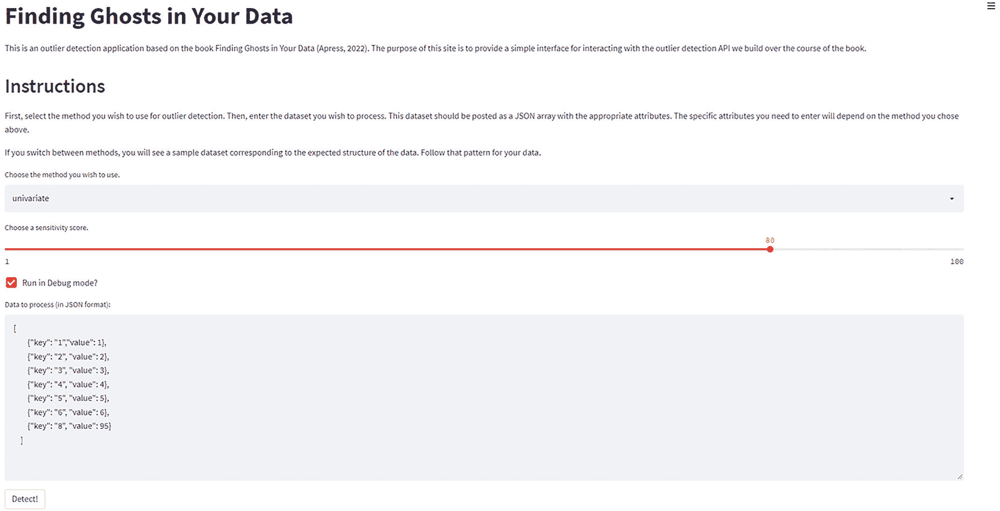
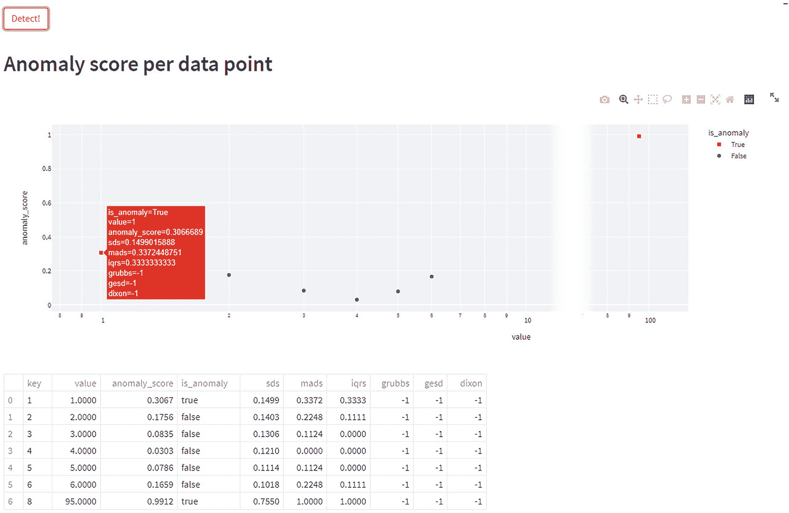
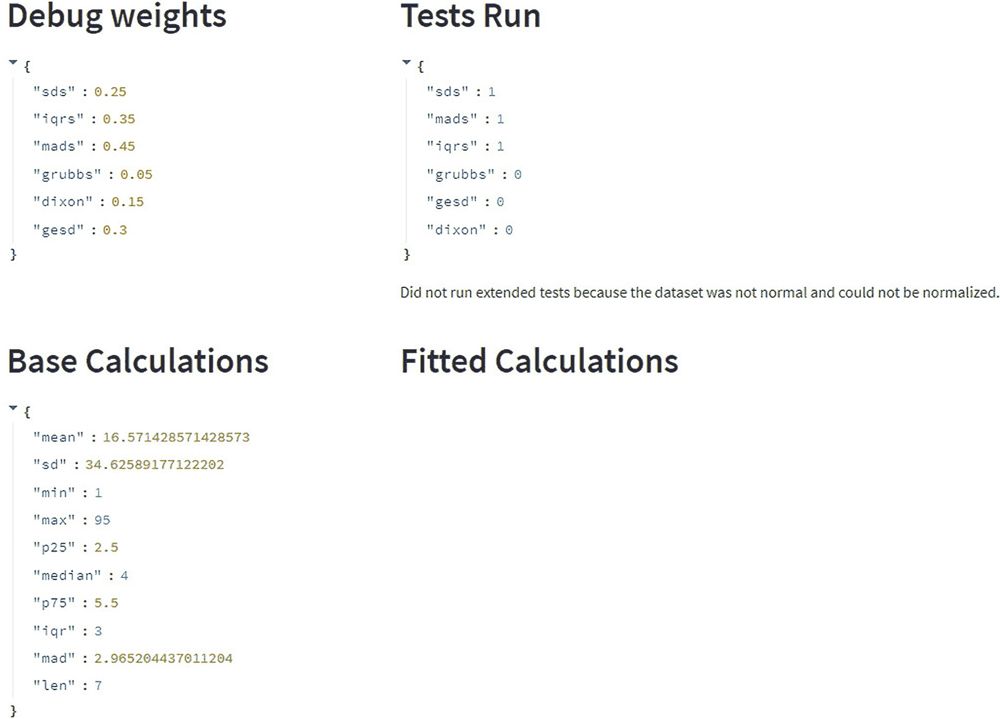

# 8. 可视化结果

在过去的两个章节中，我们与离群点检测服务进行了交互：我们构建并扩展了功能，创建并更新了测试，并通过阅读大量 JSON 输出来诊断问题。在本章中，我们将提供一种更用户友好的方法来与离群点检测器集成。这将采用 Web 应用程序的形式。

## 制定计划

在解决这个方案时，首先要记住的是，Web 服务是我们离群点检测服务的*消费者*，而不是服务本身的一部分。因此，我们将构建一个独立的应用程序。该应用程序将调用我们的检测服务，并以一种使用户更容易看到结果的方式显示结果。由于我们希望在此处尽量减少应用程序开发工作量，我们将重点放在 Web 应用程序上，而不是桌面应用程序。此外，这个可视化工具并非我们打算向公众开放的东西——至少本书中使用的版本不是。这些原则可以驱动一个更完整的产品，但就我们的目的而言，我们只是想要一些比 JSON 块更容易阅读的东西。

牢记这些基本原则，让我们来看看我们目前可用的信息以及如何最好地展示这些信息。

### 我们想展示什么？

我们希望在简单的应用程序上展示几项内容。首先，我们希望提供一种让用户输入数据的方式。我们还应该提供足够的指导，以确保用户知道我们需要这些数据以何种形式提供。这样，如果他们开发了调用我们离群点检测服务的生产级应用程序，他们就会知道需要发送的数据结构。我们还应该提供选择检测方法的能力。到目前为止，我们完全专注于单变量离群点检测，但这很快就会改变，我们应该为此做好准备。我们还应该允许用户选择是否希望查看调试数据。

至于输出，我们希望做得比简单地复述我们收到的 JSON 更好。相反，我们可以提供数据的图形化解释。对于单变量离群点检测，解决方案相当简单：我们的单一输入变量 `value` 成为散点图的 X 轴，异常分数代表 Y 轴。我们还可以以表格格式写出数据点。这两种功能的结合将使人类更容易解释数据，并判断我们检测到的离群点是真正的异常还是仅仅是噪声。以逻辑合理的方式显示调试细节也会很好。我们可以分别显示不同的数据集合，例如调试权重、运行的测试以及不同的计算。这样，人们可以快速扫描到所需部分并查看结果。如果某个调试部分不相关，例如当我们不执行归一化时的拟合计算，我们可以什么都不显示，或者显示一条消息解释为什么某个部分不相关。


### 我们想如何展示它？

在构建用于调用异常检测服务的 Web 应用时，我们有很多选择。由于我们将调用 REST API，因此无需用 Python 编写客户端应用，可以选择任何支持调用 REST API 的语言。为简单起见，我们实际上会用 Python 开发这个应用，但如果你更熟悉 Java、F#、C#、R 或其他语言，构建自己的应用来调用此服务也不失为一次有益的练习。

坚持使用 Python，我们在应用开发方面也有不少选择。一种选择是使用 Django、TurboGears 或 CherryPy 等框架构建一个完整的网站。这将使我们能够设计一套详细的交互流程，对于恰好集成了异常检测功能的完整 Web 应用来说，这可能是最佳路径。然而，对于本章而言，这样的网站对我们来说有些大材小用。幸运的是，还有其他更适合当前任务的选择。

其中一个选择是 Dash，它基于一个名为 Plotly 的可视化库。Dash 为我们提供了出色的仪表盘开发体验，使其成为生产级应用开发的自然之选。不过，Dash 有一定的学习曲线，因此我们将改用名为 Streamlit 的库。Streamlit 的存在是为了让数据科学家能够轻松快速地搭建一个简单的网站来处理数据和模型。与 Dash 不同，Streamlit 并非“生产级”服务，因此我们不会将其暴露给普通公众。然而，就我们构建内部工具的目的而言，Streamlit 将是一个绝佳的选择。

## 开发可视化应用

要安装 Streamlit，请在命令行中运行 `pip install streamlit`。这将为我们安装所有必要的库和依赖项。接下来，在 `\src\` 文件夹中创建一个名为 `\web\` 的文件夹，并在其中创建 `site.py`。我们将使用这个单独的文件夹来管理 Streamlit 网站。

### Streamlit 入门

Streamlit 有一系列内置函数，旨在轻松地在屏幕上显示文本和数据。`write()` 函数允许我们显示使用 Markdown 格式创建的内容。除此之外，还有各种输入字段，如复选框、单选按钮、文本框和文本区域，允许我们接收用户输入。Streamlit 最大的生活质量特性是它能够轻松显示 Pandas DataFrame 以及来自 Plotly、Seaborn 和 matplotlib 等库的图表。Streamlit 在 [`https://docs.streamlit.io/library/cheatsheet`](https://docs.streamlit.io/library/cheatsheet) 上有一个很好的速查表，其网站上也有大量的 API 文档。

由于我们可以保持这个网站简单，所有网站代码都将放在一个 Python 文件中。因此，我们需要一个主函数。清单 8-1 展示了我们网站的基本框架。

```
import streamlit as st
import requests
import pandas as pd
import json
import plotly.express as px
st.set_page_config(layout="wide")
def main():
st.write("TODO: fill in.")
if __name__ == "__main__":
main()
清单 8-1
Streamlit 应用的框架
```

我们首先导入几个库，包括用于编写可视化的 `plotly.express`。然后我们将页面布局设置为宽屏。默认情况下，Streamlit 只使用总屏幕空间的一小部分，尤其是在大显示器上。将布局设置为“wide”意味着我们将占据浏览器的整个宽度，这对我们的目的来说要方便得多。

之后，我们创建一个主函数，并用一条占位消息填充它，表明我们需要填写详细信息。最后，我们执行主函数来显示我们的页面。

一切设置完成后，打开一个控制台窗口到 `\src\web\` 文件夹，并运行 `streamlit run site.py`。这将打开一个新的浏览器窗口并显示我们的简单网站。有了这个结构，让我们对它进行一些扩展。

### 构建初始屏幕

我们首先要做的是为用户创建一个输入屏幕，允许他们选择异常检测方法（尽管到目前为止，我们只实现了单变量方法），指定一个有效的敏感度分数，指定一个最大异常比例，告诉我们是否应以调试模式运行，并以 JSON 格式发送一个有效的输入数据集。因为我们不能期望用户凭直觉理解我们对输入的要求，所以我们应该以样本数据集的形式提供一些说明。清单 8-2 显示了设置此功能所需的代码。

```
server_url = "http://localhost/detect"
method = st.selectbox(label="选择您希望使用的方法。", options = ("univariate", "multivariate", "timeseries/single", "timeseries/multiple"))
sensitivity_score = st.slider(label = "选择敏感度分数。", min_value=1, max_value=100, value=50)
max_fraction_anomalies = st.slider(label = "选择最大异常比例。", min_value=0.01, max_value=1.0, value=0.1)
debug = st.checkbox(label="以调试模式运行？")
if method == "univariate":
starting_data_set = """[
{"key": "1","value": 1},
{"key": "2", "value": 2},
{"key": "3", "value": 3},
{"key": "4", "value": 4},
{"key": "5", "value": 5},
{"key": "6", "value": 6},
{"key": "8", "value": 95}
]
"""
#### 为简化起见，省略了 elif 块。
else:
starting_data_set = "选择一种方法。"
input_data = st.text_area(label = "要处理的数据（JSON 格式）：", value=starting_data_set, height=500)
if st.button(label="检测！"):
st.write("TODO: 输入数据后最终确定细节。")
清单 8-2
构建用户输入部分的代码
```

首先，我们设置服务器 URL。这是我们异常检测程序的位置，我们将在本地端口 80 上运行它。

**注意**

为了使这个 Streamlit 网站正常工作，您需要让 uvicorn 和 FastAPI 服务保持运行。为此，假设您没有其他服务托管在该端口上，命令 `uvicorn app.main:app --host 0.0.0.0 --port 80` 将在您本地机器的端口 80 上托管 API。

接下来，我们希望允许用户选择他们想要执行的异常检测类型。因为到目前为止我们只实现了单变量异常检测，所以我们将此设置为默认值。一旦我们实现了其他技术，我们可以回到这个网站并根据需要进行更新。

第二个用户输入涉及敏感度分数。该分数的范围应为 1 到 100，因此我们将添加一个滑块供用户选择。第三个用户输入允许调用者将最大异常比例设置为 0.01 到 1.0 之间的值，默认值为 0.1。之后，我们有一个简单的复选框，用于确定是否应以调试模式运行命令。然后，我们使用 `text_area()` 函数生成一个文本区域。该文本区域将允许用户键入或粘贴符合相应输入格式的 JSON 块。为了让用户更容易知道输入格式应该是什么样子，我们提供了 `starting_data_set` 变量的内容作为默认值。这里的想法是，我们为用户创建一个非常简单但格式正确的输入数据集，让新用户有机会运行命令并立即获得反馈。

最后，我们在页面上放置一个按钮，并将其标记为“检测！”。当用户单击该按钮时，我们将调用我们的服务并在屏幕上呈现数据。图 8-1 显示了应用的当前状态。



一个标题为“在数据中寻找幽灵”的标签页截图。其下方有说明文字。

**图 8-1**

在应用开发的第一阶段之后，我们已经有了用户控件


我们可以看到，用 Streamlit 构建一个简单的（即便是基础版的）应用是多么容易：只需几行 Python 代码，我们就能拥有一个接受用户输入的表单，甚至能在点击按钮后执行操作。在下一节中，我们将让那个按钮发挥更大的作用。

### 显示结果与详情

在上一节的末尾，我们的按钮在屏幕上输出了一条“TODO”消息。现在，我们将用调用异常检测服务的代码来替换它。我们可以在 `main()` 函数中直接进行此调用，但将调用拆分为独立函数有两个好处。首先，我们的主函数会因构建用户界面而变得有些笨重。因此，将操作调用拆分出来，可以避免日后排查故障时的麻烦。其次，如清单 8-3 所示，拥有一个独立的函数允许我们使用 Streamlit 的注解 `cache` 来标记该函数。

```
@st.cache
def process(server_url, method, sensitivity_score, max_fraction_anomalies, debug, input_data_set):
full_server_url = f"{server_url}/{method}?sensitivity_score={sensitivity_score}&max_fraction_anomalies={max_fraction_anomalies}&debug={debug}"
r = requests.post(
full_server_url,
data=input_data_set,
headers={"Content-Type": "application/json"}
)
return r
清单 8-3
调用异常检测服务的函数，包含缓存注解
```

缓存注解会对函数执行进行*记忆化*。这听起来很高级，但意思就是：对于每一组唯一的输入，Streamlit 都会保存该函数调用的输出结果。然后，如果在应用运行期间再次进行相同的调用，它将从缓存中检索结果，而无需再次调用我们的异常检测服务。这对我们来说很合适，因为我们期望对于给定的方法、敏感度分数、最大异常比例、调试状态和输入数据集，每次调用服务都会返回相同的结果。

有了 `process()` 函数后，我们可以回到 `main()` 函数，用清单 8-4 中的代码替换“TODO”文本。这段代码以易于理解的格式显示结果。

```
resp = process(server_url, method, sensitivity_score, max_fraction_anomalies, debug, input_data)
res = json.loads(resp.content)
df = pd.DataFrame(res['anomalies'])
st.header('每个数据点的异常分数')
colors = {True: 'red', False: 'blue'}
g = px.scatter(df, x=df["value"], y=df["anomaly_score"], color=df["is_anomaly"], color_discrete_map=colors,
symbol=df["is_anomaly"], symbol_sequence=['square', 'circle'],
hover_data=["sds", "mads", "iqrs", "grubbs", "gesd", "dixon"])
st.plotly_chart(g, use_container_width=True)
tbl = df[['key', 'value', 'anomaly_score', 'is_anomaly', 'sds', 'mads', 'iqrs', 'grubbs', 'gesd', 'dixon']]
st.write(tbl)
清单 8-4
显示单变量异常检测的结果。
```

我们做的第一件事是调用异常检测服务，获取响应。然后，我们获取响应内容并将其转换为 JSON 对象。在这个 JSON 对象内部，有一个名为 `anomalies` 的列表，我们可以将其转换为 Pandas DataFrame。

我们希望以两种方式展示这些数据：图形格式和表格格式。图形格式将以散点图的形式展示数据，使用值作为 X 轴，异常分数作为 Y 轴。我们将异常点标记为红色方块，非异常点标记为蓝色圆圈，这样即使对于有色觉缺陷的用户，也能轻松区分两者。

> **注意**
>
> 在选择颜色时，务必注意色觉缺陷（CVD，俗称色盲），这影响着大约 8% 的男性和 0.5% 的女性。色觉缺陷可能使人难以区分某些颜色组合，例如红色和绿色。请使用像 Coblis（[`www.color-blindness.com/coblis-color-blindness-simulator/`](http://www.color-blindness.com/coblis-color-blindness-simulator/)）这样的工具，来查看你的图像对于各种类型色觉缺陷的人会是什么样子。在本例中，红色和蓝色在任何常见类型的 CVD 中都不会重叠，但在单色媒介（例如本书的页面）中却难以区分！因此，我们还使用形状作为标识符，使差异更易于观察。

默认情况下，将鼠标悬停在数据点上会显示 X 轴和 Y 轴的值（即值和异常分数），以及颜色的指示符（即该数据点是否为异常值）。我们可能希望包含额外的信息，例如每个测试的结果。为此，我们将希望包含的列添加到 `hover_data` 列表中。我们也可以考虑通过添加 `log_x=True` 参数，将 X 轴设置为对数刻度。这样，我们就能看到数据中非常大的差异，而不会将较小的值过度挤压在一起，但这有一个显著的缺点：X 轴上的所有值必须为正数；如果你有负值，在将 X 轴设置为对数刻度后，它们将不会显示在图表上。因此，我们不会以对数刻度显示 X 轴值，不过，如果你知道输入数据集始终包含大于零的数字，你或许可以考虑进行此更改。

在图表之后，我们还包含了一个包含数据点的表格。这样，用户无需将鼠标悬停在每个元素上，就能浏览结果并进行逐项比较。图 8-2 展示了我们目前的进展。



一个标题为“每个数据点的异常分数”的标签页截图。它包含一个图表和下方的表格。

**图 8-2** 每个数据点的异常分数。请注意，为了便于阅读屏幕上的相关部分，图表中没有数据点的区域已被移除。移除的区域用一个小的间隙代替，以明确表示进行了移除。在此示例中，我们还对 X 轴使用了对数刻度，以便在打印时更容易查看结果

最后需要添加的是调试详情。与异常值集合不同，调试详情是一个复杂的嵌套文档，无法整齐地放入 Pandas DataFrame 中。不过，我们可以将这些详情分解成几个部分。为了最大化可用的可见空间，我们可以使用 `st.columns()` 函数将结果写入多个列。清单 8-5 展示了前两个数据块：调试权重和我们已运行的测试。

```
if debug:
col11, col12 = st.columns(2)
with col11:
st.header('调试权重')
st.write(res['debug_weights'])
with col12:
st.header("已运行的测试")
st.write(res['debug_details']['Test diagnostics']['Tests Run'])
if "扩展测试" in res['debug_details']['Test diagnostics']:
st.write(res['debug_details']['Test diagnostics']['Extended tests'])
#### ...
清单 8-5
调试时我们写出的前两个信息块
```

我们知道某些块（例如调试权重）始终可用。而其他块（例如是否运行了扩展测试）则取决于我们发送的具体数据集。因此，我们需要使用条件语句来确保信息存在，然后再尝试写出；否则，Streamlit 会在页面上显示错误消息。


在处理调试权重和测试运行之后，我们还会完整地写出基础计算、拟合计算、初始正态性检验、拟合正态性检验，以及最终的完整调试细节。图 8-3 展示了这段代码的运行结果。



三组命令分别名为调试权重、测试运行、基础计算，而第四组名为拟合计算的命令中则没有写入任何命令。

**图 8-3** 诊断信息，我们已将其拆解为核心组成部分

`Streamlit` 能够理解 Python 字典，并以色彩丰富、交互性强的格式将其输出。每个字典左上角的下拉标记允许我们隐藏或显示字典内容，这在像完整调试细节这样的复杂文档中尤其有用。我们无法做到的一件事是轻松地格式化结果。这意味着初始和拟合正态性检验，特别是安德森-达令检验，阅读起来会比理想情况稍显困难。尽管如此，我们用不到 150 行 Python 代码就构建了一个功能性的网站，可用于继续测试我们的异常值检测服务。

## 结论

在本章中，我们创建了一个简单的网站，用于展示异常值检测服务的结果。在接下来的章节中，随着我们实现新的异常值检测技术，我们需要对这个服务进行扩展和修订。在本书下一部分中，我们将实现其中一种技术：多元异常值检测。此外，我们还将利用该过程中的一些见解来改进单变量异常值检测。

