# 9. 聚类与异常

作为第三部分的第一章，本章也充当着第二部分（单变量分析）与第三部分（多元分析）之间的桥梁。在本章中，我们将探讨如何利用聚类技术来解决我们在第 7 章结束时遇到的问题：我们凭直觉可以理解，在一个包含值 `{ 1, 2, 3, 50, 97, 98, 99 }` 的数据集中，值 50 是一个异常值，但我们的异常值检测引擎却坚决不这么认为。

本章将首先描述聚类的概念。然后，我们将介绍两种非常流行的聚类技术：k-means 聚类和 k-近邻算法。之后，我们将讨论聚类技术适用的场景以及它们可能引入的问题。在打下坚实的聚类技术基础后，我们将为单变量异常检测过程添加另一种方法：高斯混合模型。我们将学习该算法的工作原理，以及如何在不引入太多混乱的情况下，将其见解整合到我们现有的异常检测器中。最后，我们将介绍三种多元异常检测的替代方法，这些方法我们不会在异常值检测过程中使用，但仍值得一提。

## 什么是聚类？

聚类背后的关键见解是，我们通常会看到数据点聚集在一起，尤其是当我们引入越来越多的变量时。以著名的鸢尾花数据集为例，该数据集最初由埃德加·安德森于 1935 年收集。图 9-1 展示了三种鸢尾花及其花瓣长度和花瓣宽度的数值。

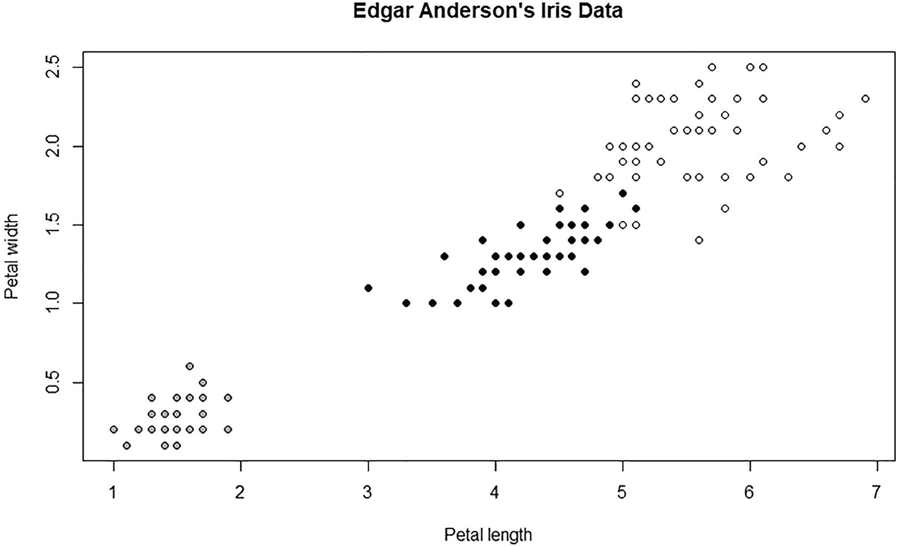

一张标题为“埃德加·安德森的鸢尾花数据”的散点图。该图绘制了花瓣宽度与花瓣长度的关系，右上角聚类密集。

**图 9-1** 鸢尾花数据集中的两个变量显示了数值的聚类情况

我们可以看到至少有两个清晰的数据聚类：一个的花瓣长度为 1–2 厘米，宽度为 0–0.5 厘米；另一个更宽的聚类包含花瓣长度为 3–7 厘米，宽度为 1–2.5 厘米。我们没有看到任何宽度超过 1 厘米但长度小于 3 厘米的花瓣，也没有看到细长的花瓣。

我提到“至少”两个聚类，是因为我们可以合理地论证这里存在三个聚类，每个聚类对应数据集中的一种鸢尾花。尽管有两个类别有相当程度的重叠，但我们的眼睛能够区分它们，并在两者之间划出一个模糊的边界。

现在我们对聚类的概念有了直观的理解，在探讨不同的聚类方法之前，让我们先深入了解几个术语。

### 常见聚类术语

我们希望执行*聚类分析*，即以某种方式将观测值分组，以最大化*簇内相似度*并最小化*簇间相似度*。另一种表述方式是，我们希望每个簇的大小尽可能小，并且簇与簇之间的距离尽可能大。

通常，我们从簇的*质心*或中心点开始绘制一个簇。这个质心不必是一个特定的数据点，而可以位于数据点之间。

我们用来计算簇内相似度的一个度量称为*簇内平方和*（WCSS）。我们通过计算给定点到质心的欧几里得距离的平方和，来为每个簇计算 WCSS。清单 9-1 正式展示了这一点，假设有一个名为 C 的簇。

**清单 9-1.** 计算簇内平方和的公式

```
WCSS = Σ (x ∈ C) ||x - μ||²
```

用于衡量簇间相似度的度量称为*簇间平方和*（BCSS）。我们可以通过计算数据集中的总平方和并减去簇内平方和来得到 BCSS；这样剩下的就是簇间平方和。

现在我们已经掌握了必要术语的基础知识，可以开始研究聚类算法了。


#### K-Means 聚类

`K-means clustering` 是一种常见的聚类方法，因为它速度相当快且非常易于理解。我们将从图 9-2 开始，该图展示了一组分布在两个维度上的点，我们将其映射为散点图的 X 轴和 Y 轴。

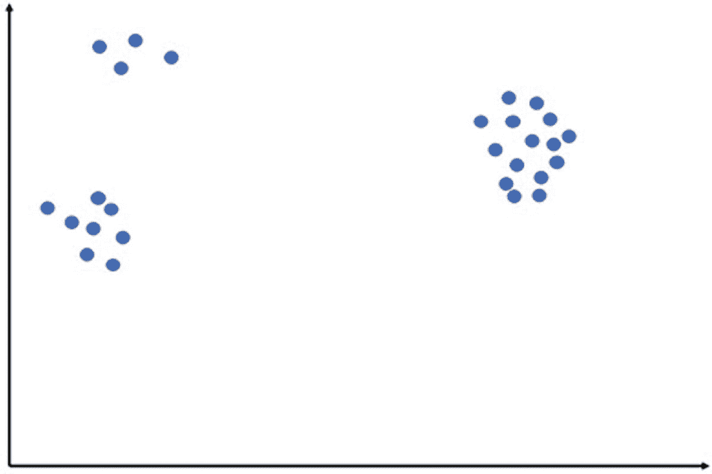

一张散点图。这些点分别聚集在右侧、左侧和左上角。

图 9-2

一个展示聚类行为的数据示例

从这些数据中我们可以清晰地看到存在三个聚类。K-means 聚类的工作原理是，我们需要确定数据中我们认为会存在的聚类数量。这使得我们基于整体感知的观察可能非常有用。如果你不知道聚类的数量，或者在分析之前没有见过这些数据，因此无法产生任何预期，你可以尝试使用不同数量的聚类来运行此算法，我们稍后会看到这一点。在这种情况下，在目视观察数据后，我可能会确定存在三个聚类。在第一阶段，算法会任意分配聚类质心的位置，如图 9-3 所示。

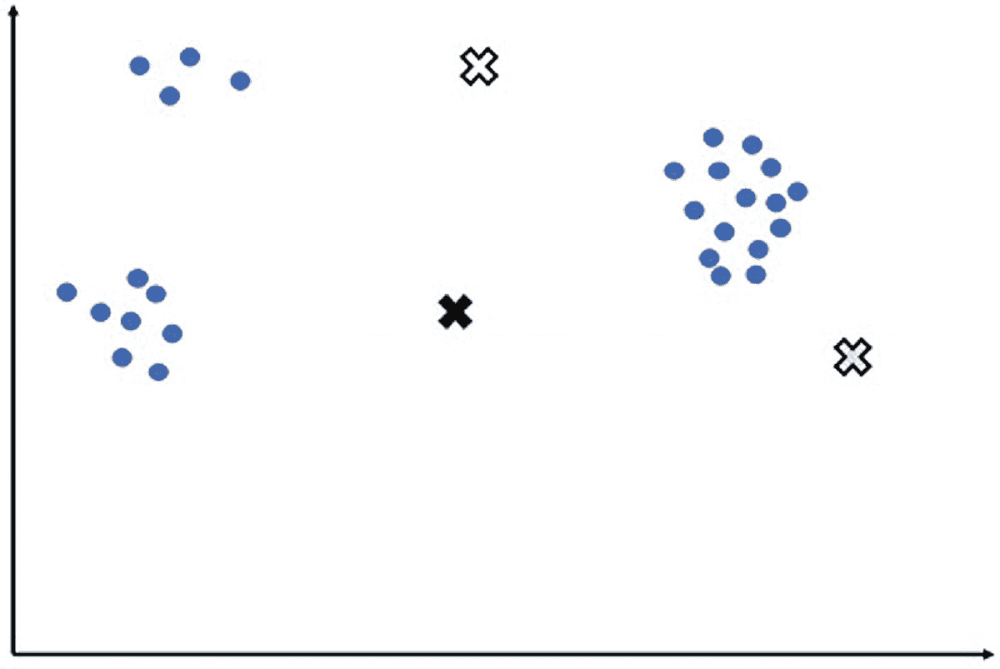

一张散点图。在右侧、左侧和左上角形成了三个聚类。

图 9-3

三个新的聚类质心凭空出现

创建这些质心后，我们计算每个数据点距离哪个质心最近，并将其分配到该质心所在的聚类。图 9-4 展示了分配的结果。

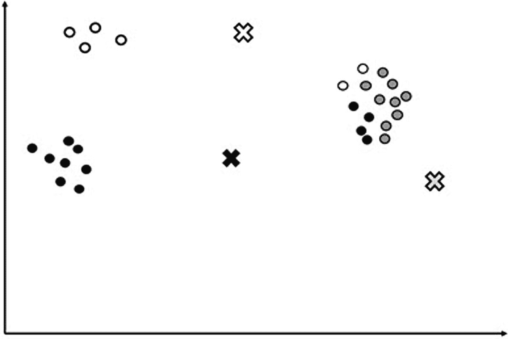

一张散点图。在右侧、左侧和左上角形成了三个聚类。

图 9-4

初始聚类分配的结果

经过初次分配后，我们可以看到结果完全不符合我们的直觉。不过，这没关系，因为流程的下一步是重新计算质心位置。新的质心位置将是每个已分配聚类的中心，这意味着黑色质心将是所有黑色数据点的平均值，白色质心将是所有白色数据点的平均值，灰色质心将是所有灰色数据点的平均值。图 9-5 展示了这些新位置。

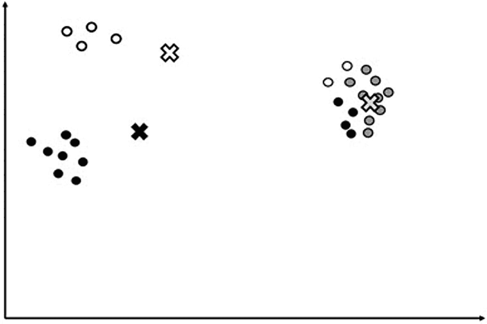

一张散点图。在右侧、左侧和左上角形成了三个聚类。右侧的聚类上标有一个十字。

图 9-5

聚类质心的新位置

有了新的位置后，我们可以再次执行聚类分析，为每个数据点选择最近的质心。我们可以在图 9-6 中看到最终结果。

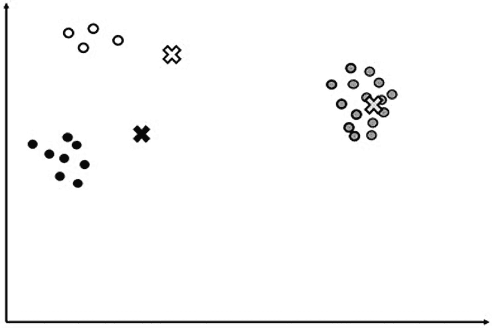

一张散点图。在右侧、左侧和左上角形成了三个聚类。右侧的聚类上标有一个十字。

图 9-6

下一轮的聚类分配使情况清晰了许多

我们重复计算质心位置和分配值的过程，直到达到如图 9-7 所示的状态，此时质心位置不再移动（超出预定义的容差范围），并且我们看不到聚类分配有任何变化。

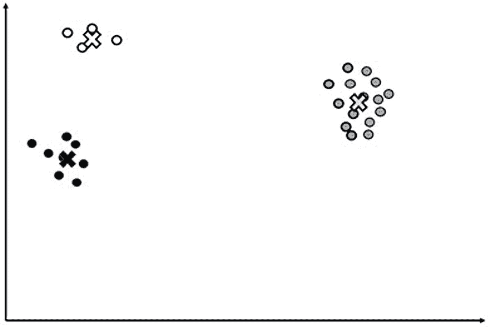

一张散点图。在右侧、左侧和左上角形成了三个聚类。这些聚类上都标有一个十字。

图 9-7

每个聚类的最终位置

此时，我们已经达到了`收敛`：聚类现在处于稳定状态，进一步的迭代既不会影响每个聚类的组成，也不会影响每个质心的位置。这个例子是故意设计得如此明显的，但 K-means 聚类仍然可以处理像鸢尾花数据集那样没有清晰“边界”的数据。图 9-8 展示了使用花瓣宽度和长度作为输入，进行 K-means 聚类（设定三个聚类）的结果。

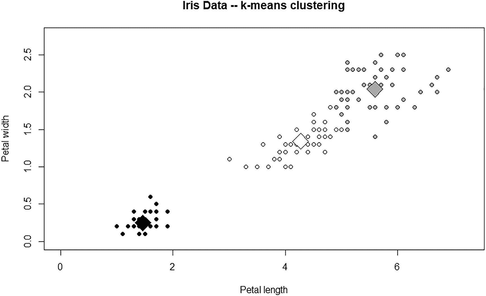

一张标题为“鸢尾花数据，K 均值聚类”的散点图。该图绘制了花瓣宽度与花瓣长度的关系，聚类上标有方形标记。

图 9-8

鸢尾花瓣的聚类

仔细对比图 9-8 和图 9-1，我们可以看到这些聚类结果与我们数据的实际值并不完全吻合。出现这种情况的原因在于，在聚类的边界区域，很难区分不同种类的鸢尾花。因此，预测结果可能并非完全准确。

如果我们思考如何将此过程应用于异常值检测，我们可以计算每个聚类的质心，然后针对每个点，确定它与其聚类质心的距离。那些相对远离同一聚类中其他点的数据点更可能是异常值。话虽如此，我们不会将 K-means 聚类用作多变量异常值检测引擎的一部分。原因在于，文献中还有其他更有效的技术可用于追踪聚类异常值。K-means 聚类为我们提供了一个易于理解的聚类示例。同时，它也为我们多变量异常值检测引擎的基础——K 近邻算法，提供了一个良好的入门介绍。


#### K-近邻算法

与 k-means 聚类不同，*k-近邻*算法是监督学习算法的一个例子。通过 k-近邻（`knn`），我们首先基于已知的聚类信息训练一个模型。使用之前的鸢尾花示例，我们知道训练数据中每朵鸢尾花的实际种类，并可以在 n 维空间中绘制出每个数据点。回到图 9-1，我们在输入数据中得到了花瓣宽度和花瓣长度的二维表示。

在训练好模型后，我们可以通过检查距离该点最近的 k 个邻居的类别，来预测新数据点的类别。图 9-9 展示了鸢尾花数据集中的一个示例，其中有两个新数据点，在图表上标记为 x。


一张散点图，标题为“埃德加·安德森鸢尾花数据，k 近邻”。图表绘制了花瓣宽度与花瓣长度的关系，聚类点带有十字标记。

图 9-9
包含两个新的未分类数据点的鸢尾花数据

假设 `k=5`。在这种情况下，我们需要找到最近的 5 个数据点的类别，以确定这些新数据点最可能属于哪个类别。对于第一个新数据点（位于图表左下角附近），我们可以看到最近的五个数据点都属于灰色聚类。在这种情况下，我们可以推断这个新数据点也应该属于那个灰色聚类。

第二个数据点则更复杂一些，因为最近的五个数据点中有三个是黑色，两个是白色。这应该能让我们对选择答案时存在的不确定性有所了解；话虽如此，由于黑色数据点比白色数据点多，我们仍将其判定为黑色数据点。这就得到了图 9-10，其中我们更新了这些新数据点的颜色。

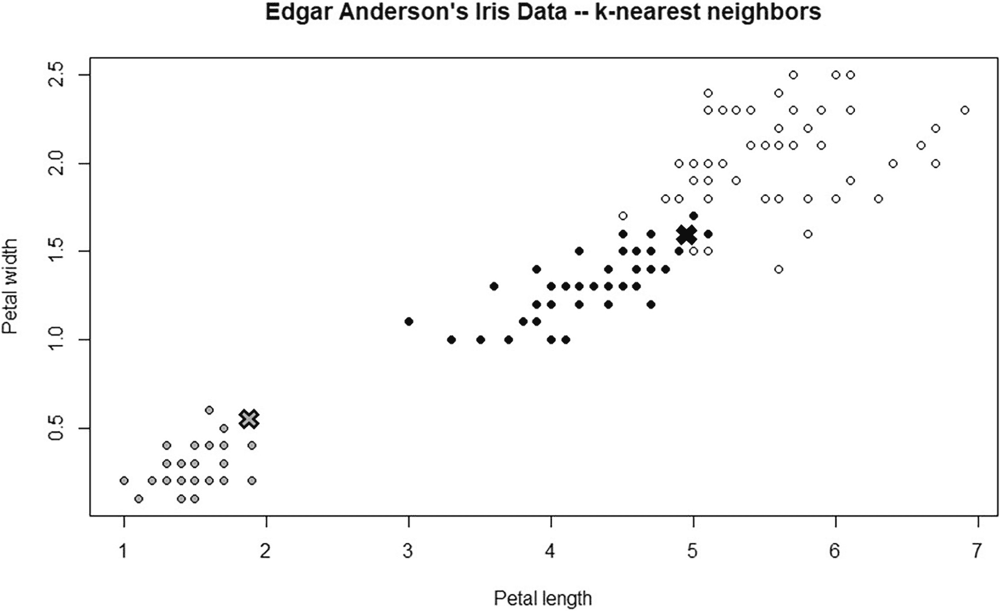

一张散点图，标题为“埃德加·安德森鸢尾花数据，k 近邻”。图表绘制了花瓣宽度与花瓣长度的关系，聚类点带有十字标记。

图 9-10
k-近邻分类的结果

这引出了关于 `knn` 的一个重要注意事项：我们应选择奇数个邻居，因为这样能给出一个确定的答案。如果选择偶数个邻居，我们可能无法得到明确的结论。

我们可以使用另外两个指标来了解算法在选择类别时的置信度：共享同一类别的邻居数量，以及到这些邻居的平均距离。在左下角的例子中，所有邻居都共享同一类别，并且新数据点距离该聚类相当近，这表明它极有可能是所选类别的一员。在第二个例子中，所有邻居都相当接近，但其中只有 60% 共享同一类别。这强烈表明预测可能是错误的。

正如我们在本节开头提到的，`knn` 构成了基于聚类的异常值检测的基础。然而，它本身并不是一个可行的解决方案，因为 k-近邻算法通常需要带标签的数据。这意味着在训练模型之前，我们需要知道某个数据点是否是异常值。如果你确实有关于特定数据点是否为异常值的良好信息，那么 `knn` 可以是一个合理的选择。但在大多数情况下，我们并没有那么多信息，需要去发现异常值，而不是识别它们。

即便如此，与邻居的邻近性这一概念在基于聚类的异常值检测算法中扮演着重要角色，因为我们使用到质心的距离和到最近邻居的距离，作为衡量某个特定数据点属于给定聚类可能性的指标。在接下来的几章中，我们将研究考虑这些细节的算法。同时，让我们回到理论层面，了解一下在什么情况下我们可能更倾向于使用聚类而非其他技术。

## 何时使用聚类是合理的

我们将探讨两种非常适合使用聚类算法的场景。第一种场景是多维数据，这也是第三部分的主题。其直觉在于，变量的组合会在各种领域中形成。到目前为止，我们很好地利用了鸢尾花示例，展示了三种不同鸢尾花品种的物理特征。我们还可以看到，当一个过程处于不同状态时，变量之间也会表现出聚类行为，例如燃气灶的当前温度与其燃料利用率之间的组合：当灶具开启且温度高时，其利用率会远高于关闭状态或燃烧器设定在较低温度时。

另一个对我们很重要的场景是多峰数据，我们在第 8 章末尾遇到过。使用像 `{ 1, 2, 3, 50, 97, 98, 99 }` 这样简单的数据集，我们可以想象，随着越来越多的记录加入，我们可能会在数据集的密度图中看到两个独立的峰值：一个在值 2 附近，另一个在值 98 附近。如果我们的异常值检测过程能够理解存在两个独立的分组，我们就能辨别出 50 并不真正属于其中任何一个分组。这就是一种称为高斯混合模型的技术发挥作用的地方。

## 高斯混合模型

*高斯混合模型*（`GMM`）被称为一种*软聚类*技术，这意味着对于某个观测值，它会分配该观测值属于任何给定聚类的概率。这与*硬聚类*技术形成对比，在硬聚类中，我们必须将观测值分配到一个单一的聚类中。`GMM` 是一种基于概率的技术，它试图从已知的*联合分布*中辨别出*条件分布*。换句话说，我们可以绘制数据点的密度图，如图 9-11 所示。该图包含了 33 个来自均值为 2、标准差为 1 的正态分布的数据点，40 个来自均值为 98、标准差为 1 的正态分布的数据点，以及数值 50.0。

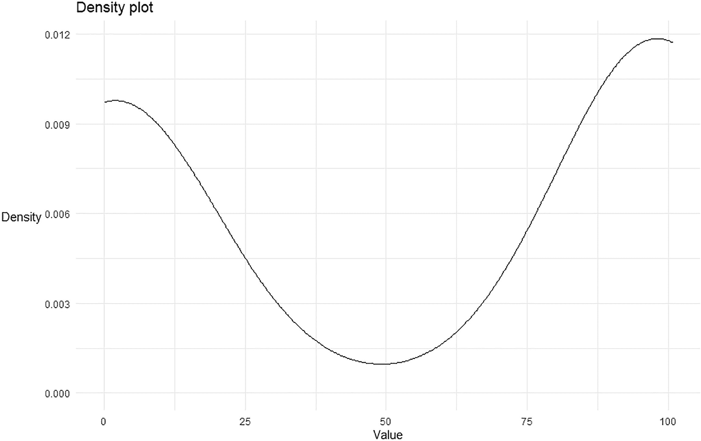

一张折线图，标题为“密度图”。图表绘制了密度与值的关系，曲线呈先凹后增的趋势。

图 9-11
展示多峰数据的密度图。请注意，此图在 0 和 100 处截断；如果我们将其延伸，会看到曲线继续下降并形成两条钟形曲线

从这张图中，我们可以清晰地看到数据集中的两个峰值，一个在两端各一处。我们数据的联合分布显然不是正态分布。话虽如此，我们可以想象两个正态分布的条件分布，每个条件分布支撑一个峰值。`GMM` 使我们能够对单变量数据做到这一点。这将使我们能够处理可能包含多峰单变量数据的情况，然后从第 10 章开始，继续创建合适的多元聚类解决方案。


### 实现单变量版本

高斯混合模型在 `scikit-learn` 中可用，具体是 `sklearn.mixture.GaussianMixture`。该过程将包含两个主要步骤。第一步将确定合适的高斯混合聚类数量，因为我们延续了不假设用户对其数据分布有任何先验知识的做法。清单 9-2 展示了确定最佳高斯混合*成分*（可视为聚类）数量的代码。

```
def get_number_of_gaussian_mixture_clusters(col):
X = np.array(col).reshape(-1,1)
bic_vals = []
max_clusters = math.floor(min(col.shape[0]/5.0, 9))
for c in range(1, max_clusters, 1):
gm = GaussianMixture(n_components = c, random_state = 0, max_iter = 250, covariance_type='full').fit(X)
bic_vals.append(gm.bic(X))
return np.argmin(bic_vals) + 1
清单 9-2
获取首选高斯混合成分数量的代码
```

代码首先将 DataFrame 列转换为一个数组，其中每个数据点作为独立的列表元素。这样做的原因是 GMM 期望多变量输入，因此即使我们实际拥有的是单变量数据，也需要以这种方式重塑数据。之后，我们确定合适的聚类数量，每五个数据点增加一个聚类，最多不超过九个聚类。诚然，九个聚类是一个人为设定的上限，但对于大多数实际数据集来说这应该不是问题，并且确实能确保操作在合理的时间内完成。此外，我们应注意，调用代码要求至少有 15 个数据点，这意味着实践中 `max_clusters` 的最小值为 3。

然后，我们对从 1 到计算出的最大数量之间的每个成分数运行 `GaussianMixture` 函数。每次执行都会产生其自身的指标结果，其中包括一个称为*贝叶斯信息准则（BIC）*的指标。该指标允许我们在不同 GMM 模型之间进行比较，我们使用 `np.argmin()` 来获取 BIC 值最低的数组元素，因为在比较模型时，值越低越好。由于 Python 数组从 0 开始索引，而我们是从 1 个成分开始顺序迭代，因此我们需要在找到的数组元素索引上加 1，才能得到给定数据集的最佳成分数。

一旦我们有了合适的成分数，就需要创建一个检查，以根据高斯混合模型的结果判断是否存在任何异常值。清单 9-3 包含了运行 GMM 检查函数的前半部分。

```
def check_gaussian_mixture(col, best_fit_cluster_count):
X = np.array(col).reshape(-1,1)
gm_model = GaussianMixture(n_components = best_fit_cluster_count, random_state = 0, max_iter = 250, covariance_type='full').fit(X)
xdf = pd.DataFrame(X, columns={"value"})
xdf["grp"] = list(gm_model.predict(X))
min_num_items = math.ceil(xdf.shape[0] * .05)
small_groups = xdf.groupby('grp').count().reset_index().query('value <= @min_num_items')
small_groups["small_cluster"] = 1.0
xdf = xdf.merge(small_groups[['grp', 'small_cluster']], on='grp', how='left').fillna(0)
清单 9-3
通过高斯混合建模检查异常值的函数开头部分
```

该函数以再次运行 `GaussianMixture()` 函数开始。我们本可以修改清单 9-2 中的代码以返回一个 GMM 模型，但为了便于单独测试每个组件，我确实在代码中引入了一些冗余。获得模型后，我们将 X 分解成一个名为 `xdf` 的新 DataFrame。然后，我们使用 `predict()` 函数进行预测。该函数返回概率最高的成分编号，因为这是最佳猜测。我们执行两项主要检查来判断某个特定数据点是否看起来是异常值。第一项检查是看它是否属于一个足够小的聚类。我们对“小”的定义包含两个方面：首先，如果一个聚类包含的数据点少于总数的 5%，我们就认为它足够小，以至于其中的数据点都是异常值。其次，如果一个聚类只包含一个数据点，我们绝对认为它是异常值——这就是为什么 `groupby()` 操作的 `query()` 函数会查找小于或等于最小项数的值。即使在数据点少于 20 个的情况下，调用 `math.ceil()` 也能确保我们捕获到孤立的数据点。我们捕获所有小聚类的成分编号，并为 `xdf` 中属于这些小聚类组件的所有元素分配一个异常值分数 1.0。

接下来，我们介绍使用 GMM 进行异常值检测的第二部分。GMM 的假设之一是每个单独的成分都遵循正态分布——这就是高斯混合模型中*高斯*的含义。因此，我们所有常规的异常值检测技术都可以在每个成分的范围内使用。我们可以像处理整个数据集一样，对单个成分运行所有测试，但为了简洁起见，我只包含一个测试：如果一个数据点偏离该成分的中位数超过 3 个 MAD，那么我们就认为它是异常值。清单 9-4 涵盖了 GMM 检查的这一部分。

```
for g in xdf["grp"].unique():
xdf_g = xdf[xdf["grp"] == g]
calc = perform_statistical_calculations(xdf_g["value"])
xdf_g = xdf_g.drop_duplicates()
if calc["mad"] > 0.0:
xdf_g['far_off'] = [check_mad(val, calc["median"], calc["mad"], 3.0) for val in xdf_g['value']]
else:
xdf_g['far_off'] = 0.0
for r in range(len(xdf_g)):
xdf.loc[xdf['value']==xdf_g.iloc[r,0], "far_off"]=xdf_g.iloc[r,4]
return [max(sc, fo) for (sc, fo) in zip(xdf["small_cluster"], xdf["far_off"])]
清单 9-4
对每个成分运行 MAD 检查，并根据检查结果确定异常值分数
```

对于每个唯一的 GMM 成分，我们获取与该成分关联的所有元素并执行统计计算。然后，我们移除重复值，因为此过程是确定性的：无论我们为值 1.5 计算多少次差异，给定 `calc` 中计算出的统计量，结果总是相同的。接下来，我们检查 MAD 是否大于 0。如果 MAD 为 0，这意味着该成分的所有数据点都包含相同的值，因此我们与 MAD 的距离度量也为 0。假设数据点存在一些方差，我们就像对整个数据集所做的那样运行 `check_mad()` 函数。执行这些检查后，我们更新 `xdf` 并设置 `far_off` 的值。

我们做的最后一件事是返回从小聚类（`small_cluster`）或与 MAD 的距离（`far_off`）计算出的较大值。这为我们提供了一个与其他分数大致在同一量级上的分数，并允许我们将这项新检查纳入考量。


为了纳入这项检查，我们需要进行几项更新。第一项更新是针对`detect_univariate_statistical()`函数中的`weights`字典。选择合适的权重很棘手，且需要在不同因素间进行权衡。原因是，那些无法通过 GMM 检查的数据点，可能不会在任何其他检查中失败——事实上，它们可能看起来像是理想的数据点，就像我们之前遇到的情况：一个值为 50 的数据点，恰好位于两个大小相等的簇之间。因此，我们希望确保 GMM 的权重足够高，使其能够独立触发异常指示。提高这项测试的灵敏度意味着它更有可能触发边缘情况。为了平衡这些考量，我最终将权重定为 1.5，不过你可能需要根据你的数据集进一步研究，以确保这个值对你来说是合理的。

在运行测试本身时，我们仅在数据集中至少有 15 个数据点的情况下，才在`run_tests()`函数中运行 GMM 检查。GMM 在数据集越大时表现通常越好，我们也能更容易地识别出各个分量；对于小数据集，很难判断某个数据点是否属于一个新的分量。此外，如果返回高斯混合分量数量的函数指示我们只有一个分量，那么我们可以依赖常规的检查组合。

我们要做的最后一个更改是针对`determine_outliers()`函数。之前，如果某个数据点的异常分数严格大于灵敏度阈值（即灵敏度分数与最大异常分数比例中的较大者，假设最大异常分数比例小于 1.0），我们会将其判定为异常值。现在，我们将修改此函数，使其在数据点的异常分数大于或等于灵敏度阈值时，就将其判定为异常值。原因是，仅关注异常分数高于阈值的数据点，可能会排除我们认为是异常的数据点，特别是当大量数据点具有相同的异常分数时。例如，假设我们有 100 个数据点，最大异常分数比例为 0.1。这意味着我们要寻找第 90 百分位数的异常分数，为方便讨论，假设这个值是 0.80。如果 0.80 高于灵敏度水平，我们将使用 0.80 作为灵敏度阈值。现在假设前 20 个数据点的异常分数都是 0.80。在这种情况下，我们原来的代码会判定没有异常值，因为没有数据点的异常分数*大于*0.80——它们都等于 0.80！使用我们的新代码，由于存在并列情况，我们将返回 20 个异常值。这很可能更符合用户的期望，尽管它确实会改变某些单元测试的结果，特别是那些以最大异常分数比例为限制因素的测试。

### 更新测试

每当我们向集成方法中添加一项新的检查时，都可能会在边缘处产生变化。引入 GMM 也不例外，因为有几项测试的结果会因此改变。本书附带的代码仓库指出了具体哪些测试会发生变化，但一个高层次的总结是：引入 GMM 后，我们通常会得到更多的异常值。

我们还添加了一个新的测试用例：`test_detect_univariate_statistical_multi_cluster()`。这个测试用例运行的测试，其输入数据由数量不等的簇组成。其目的是确保我们能够理解 GMM 如何与其他算法交互，以及我们的单变量异常检测引擎如何决定哪些是内点、哪些是异常点。图 9-12 展示了一个包含 30 个观测值的测试的可视化解释。其中 24 个数据点的编号为 1、2 或 3。此外，我们还有两个 98、两个 99 和一个值为 100 的数据点。最后，我们还有一个值为 50 的数据点。

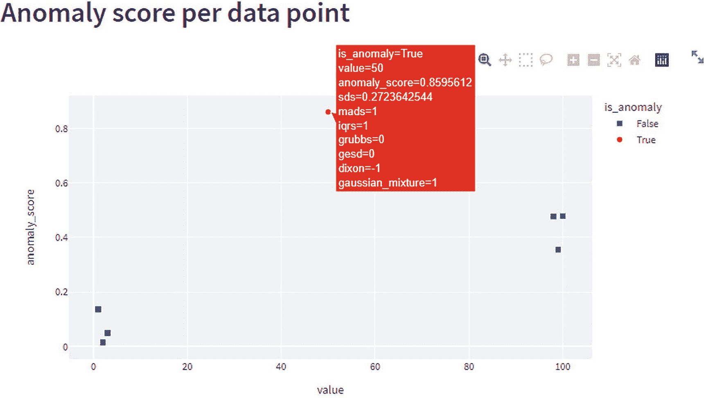

一张标题为“每个数据点的异常分数”的散点图。该图绘制了异常分数与数值的关系。图上提供了对某个点的描述。

**图 9-12**

50 明显是一个异常值

一旦我们允许数值之间存在一些方差，情况就变得更有趣了。图 9-13 展示了一个不同的场景。在这个场景中，我们仍然有一个大的簇，其数值范围大约在 1 到 3 之间；一个较小的簇，由五个数值范围大约在 98 到 100 之间的数据点组成；以及两个额外的数值：一个在 50，一个在-50。我们预期会有两个异常值：50 和-50。

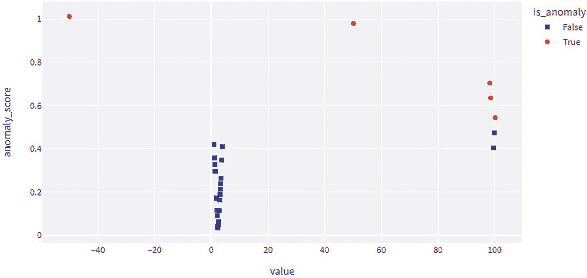

一张散点图。该图绘制了异常分数与数值的关系。数据点聚集在异常分数轴的 0 到 0.4 之间。数值为估计值。

**图 9-13**

较大簇中的三个元素被拉入成为异常值

实际上，当我们将灵敏度分数设置为 50 时，还有三个额外的数值最终被归类为异常值。对于这三个额外的数据点，其加权异常分数中的高斯混合分量相当高，范围在 0.22 到 0.48 之间。仅凭这一点还不足以让它们被标记为异常值。真正让它们越过阈值的是，这些数据点的经典度量（如 MAD 和四分位距）很高。原因是该数据集的中位数接近 0，并且数值在 1 到 3 范围内的数据点比范围外的多。因此，范围在 1 到 3 之外的值会受到较大的惩罚。最后两个数据点接近被标记为异常值，但由于它们更靠近最右侧簇的中心，其高斯混合分数分量不够高，因此它们避免了被标记为异常值。如果我们不希望看到最右侧的三个异常值，可以尝试各种方法来调整结果，例如使用较低的灵敏度水平或修改每个分量的权重。然而，无论采用何种技术，总会有一些边缘异常值无法被正确分类。

另一方面，我们也可以看到引入高斯混合建模的一个意外结果：一旦有足够多的异常值示例，它们就会形成自己的簇，从而不再是真正的异常值。图 9-14 展示了一个例子，其中大部分数据点的数值范围在 8.67 到 36.6 之间，但随后出现了一个数值超过 100 的簇。

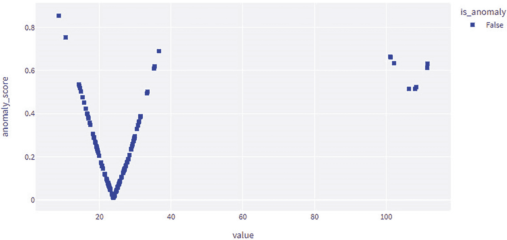

一张散点图。该图绘制了异常分数与数值的关系。图中的数据点呈 V 形。

**图 9-14**

一大簇大数值触发了高异常分数，但不足以成为明显的异常值

如果没有高斯混合建模，其他技术足以将这些高数值标记为异常值。而使用 GMM 后，结果发现这些数值足够多，它们形成了自己的簇，且该簇包含超过总数据量 5%的数据点。由于达到了 5%的阈值，这恰好足以降低它们的异常分数，使其免于被标记为异常值。根据我们检测引擎的灵敏度设置，我们仍然会捕获这些高数值的数据点；但与此同时，我们也会捕获来自较大簇中那些恰好具有较高异常分数的相当数量的数据点。归根结底，人类仍然需要评估任何异常检测引擎的结果。

## 簇的常见问题

在处理任何聚类方法时，有两个重要的考量因素：选择正确的簇数量，以及处理簇固有的非确定性行为。


### 选择正确的聚类数量

选择正确的聚类数量可能是一项挑战，尤其是当我们期望用户并不完全了解其数据形态时。在前面展示的高斯混合模型代码中，我们看到了解决此问题的一种潜在方案：约束最大化。在高斯混合模型案例中，我们最小化了（请记住，最小化只是相反方向的最大化！）不同组件数量模型的贝叶斯信息准则（`BIC`）得分。`BIC` 特别有用，因为它包含了对复杂性的惩罚，这意味着如果某个解决方案与包含更多组件的方案效果大致相同，该得分会偏向于选择组件更少的方案。因此，增加另一个组件需要显著的改进，尤其是在组件总数变得相对较大时。

另一种常见的方法是与 k-means 聚类等算法一起使用的：“肘部法则”。肘部法则使用簇内平方和（`WCSS`）。重要的是，这里的目标不是最小化 `WCSS`，因为这样做很简单：为每个数据点分配一个簇。然而，这种解决方案完全违背了聚类的目的，因此我们需要心中有一个更好的答案。在这种情况下，肘部法则得名于我们寻找随着引入更多簇而发生的 `WCSS` 变化。图 9-15 展示了一个使用鸢尾花数据集的肘部图示例。

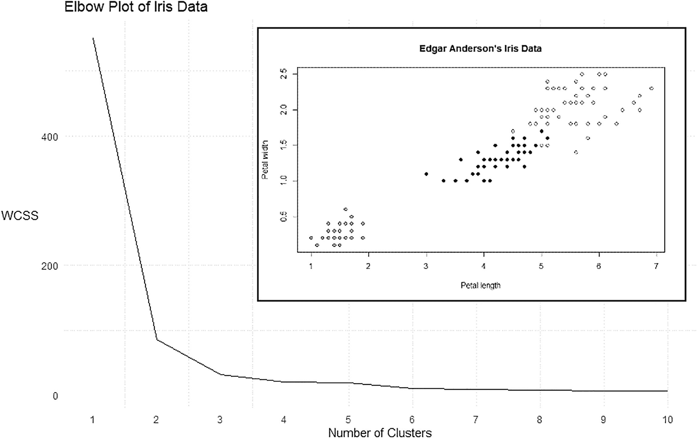

一个肘部图。该图绘制了 `WCSS` 与聚类数量的关系。肘部图中提供了埃德加·安德森鸢尾花数据的散点图。

**图 9-15** 一个肘部图，展示了随着聚类数量增加，簇内平方和的变化。为便于比较，图中包含了初始图的嵌入图。

我们可以看到从一个簇到两个簇的显著差异，快速回顾原始数据有助于我们理解原因：数据有两个主要的聚集块。从两个簇到三个簇，我们仍然看到了改进，尽管不如前者那么显著。超过三个簇之后，我们看到 `WCSS` 的改进微乎其微。因此，我们得出结论，对于这个数据集，两个或三个簇是最佳选择。

这些并不是我们可以用来确定合适聚类数量的唯一技术，但它们是两种不需要任何领域知识的技术。

### 聚类是非确定性的

我们在聚类中可能遇到的另一个问题是，结果不能保证每次都相同。一些聚类算法，包括 k-means 聚类，是非确定性的。每个质心的不同初始位置可能导致不同的结果。图 9-16 展示了这种情况的一个实例。需要注意的一点是，为了得到图 9-16 的结果，我确实需要包含两个未在图中显示的额外变量：花萼长度和花萼宽度。

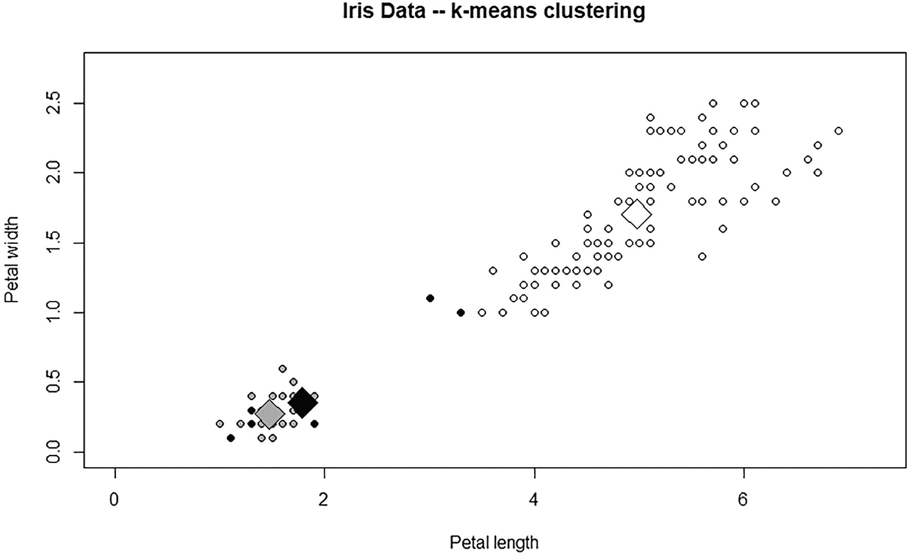

一个标题为“鸢尾花数据”的散点图。该图绘制了花瓣宽度与花瓣长度的关系，并且簇上标有方形标记。

**图 9-16** 同一个聚类问题可能存在多种解决方案。在这种情况下，我们有一些未显示的额外特征，这有时会导致这种不均匀的结果，有时则会导致我们在图 9-1 中看到的结果。

额外的特征并非聚类变异性的必要条件，但它们确实为我们提供了一个具体且可复现的示例。随着我们引入更多特征，这对于测试来说可能是一个更大的问题。在异常值检测方面，聚类的不稳定性可能会在边缘影响我们的结果，尽管不会像图 9-16 所示的那样严重。原因是图 9-16 只考虑了四个相关变量中的两个；那些仅基于这两个变量看起来像是异常值的点，在考虑所有相关特征时，实际上可能更接近质心。

## 替代方法

本书这一部分的重点是聚类方法，但如果我们完全忽略其他可行的方法，那将是失职的。在本节中，我们将介绍另一类解决多变量异常值检测问题的方法：树方法。

### 基于树的方法

有几种基于树的分类方法，但大多数都源于同一个祖先：决策树，也称为分类与回归树（`CART`）。作为软件开发人员，我们对决策树非常熟悉：决策树不过是一系列 `if-else` 语句，最终输出某种给定类型的结果。使用单个决策树，我们可以生成一个过程，根据一组输入考量来确定最可能的类别。

其他基于树的算法建立在基本决策树之上。例如，随机森林算法是一种组合来自决策树多个变体信息的方法。我们使用不同的数据和特征子集创建这些变体；然后，我们聚合来自不同树的答案，以得出一个集体答案。

决策树的另一个变体是梯度提升决策树，其中最流行的是 `XGBoost` 库。梯度提升顺序地处理决策树，这意味着该算法会从先前模型中学到的信息，并利用这些信息来创建更好的模型。它通过确定先前模型哪里出错，并添加一个旨在比先前迭代更频繁地选择正确答案的修正因子来实现这一点。

孤立森林算法是一个基于树的方法的例子，但它并非源于决策树。孤立森林算法不是根据条件规则将给定的观测值分配到某个类别，而是随机划分数据，并计算出需要多少次这样的随机划分才能隔离一个给定的数据点。所需的随机划分次数越少，该数据点就越有可能是异常值，因为这表明该数据点与其他数据点并不特别接近。


### 树模型的问题

基于树的算法在分类任务中表现出色，尤其是像 `XGBoost` 这样的算法。然而，在异常检测方面，基于树的算法表现并不理想。树模型会告诉你某个数据点属于哪个类别，但通常不会提供任何形式的似然分数。没有似然分数，我们就只能退而求其次，询问某个给定数据点是否为异常值，并回答“是”或“否”，但缺少了基于距离的方法可能提供的额外上下文信息。此外，当我们把异常检测简化为分类问题时，还会引发类别不平衡的问题：根据定义，异常值是罕见的——如果它们很常见，那它们就是正常值了！根据给定数据集中异常值的罕见程度，分类算法可能根本无法检测到异常值，因为分类算法在处理不平衡类别数据时往往存在困难。除了这些问题，训练分类算法还意味着我们需要有标记数据，标明哪些元素是异常值，哪些不是。大多数情况下，我们不会拥有带有这种标记信息的干净数据集。

`孤立森林` 试图通过计算数据点与其他点之间的距离度量来缓解第一个信息有限的问题。这确实有助于解决基于分类的树模型的第一个问题，因此这是孤立森林的一个优点。最大的缺点是，孤立森林算法通常不如我们在第 10 章至第 12 章中将要介绍的方法准确。因此，本书不会包含孤立森林。

## 结论

本章是本书的一个转折点。我们介绍的聚类技术，特别是高斯混合模型，在填补单变量能力方面的空白时非常有用。随着我们关闭单变量异常检测的大门，这种聚类分析为我们提供了洞察，这些洞察将在第三部分的剩余章节中有所帮助。

