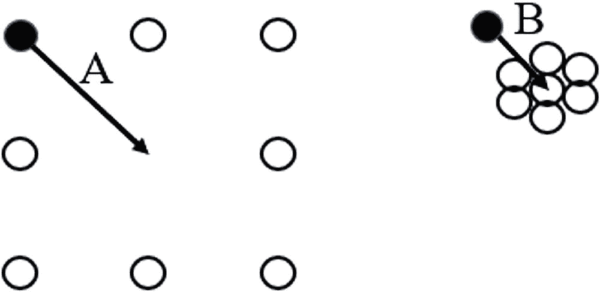
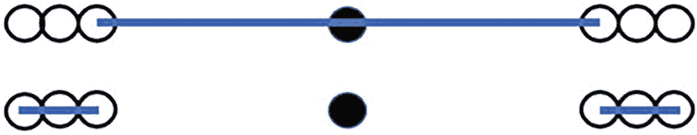
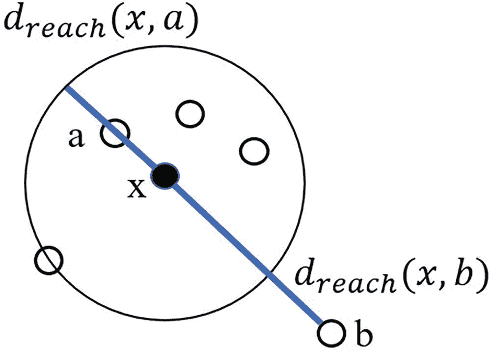
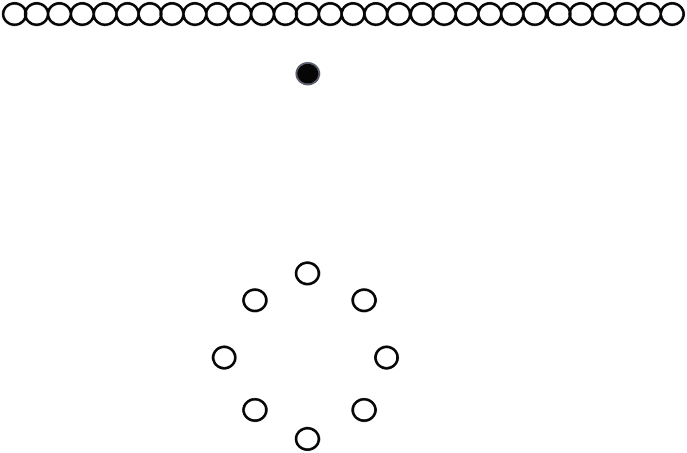
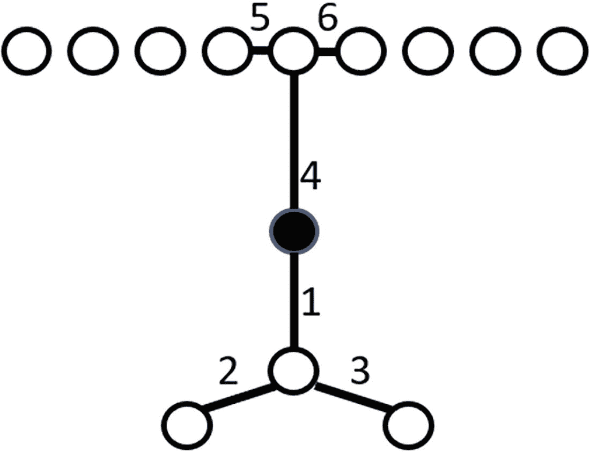
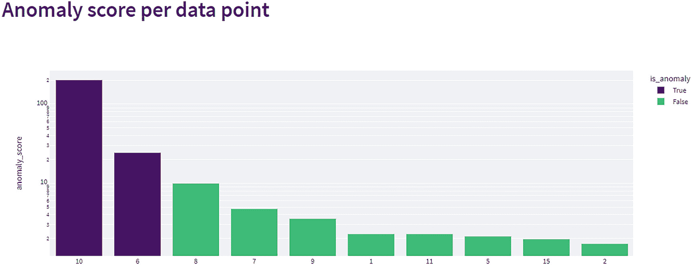

# 10. 基于连通性的离群因子 (COF)

前一章向我们介绍了聚类技术以及其中一种聚类技术——高斯混合模型的使用。在本章中，我们将实现另一种用于多变量聚类的技术：基于连通性的离群因子。

## 距离还是密度？

异常检测有两种关键方法：基于距离的方法和基于密度的方法。对于单变量异常检测，我们通常侧重于基于距离的方法。正如 Mehrotra 所解释的：“距离分布中心较远意味着观察到这样一个数据点的概率非常小。由于观察到这样一个点（从该分布中抽取）的概率很低，因此距离中心较远的数据点被视为异常”（Mehrotra, 97）。我们一开始隐含地假设单变量数据集适合一个聚类，该聚类的形状可能近似于正态分布。到了第 9 章，我们放宽了这一假设，并允许使用高斯混合模型形成多个聚类。在此过程中，我们还引入了一种基于密度的异常检测方法。

图 10-1 展示了基于密度的方法在异常检测中的重要性。如果我们仅使用距离作为异常程度的衡量标准，那么左侧聚类中标记的数据点将比右侧聚类中标记的数据点获得更高的异常分数。然而，我们的整体感知能力并不同意这种评估：我们可以看到，尽管向量 A 实际上比向量 B 长，但与向量 A 关联的数据点与其他数据点形成了规则的模式。每个数据点与至少两个邻居大致等距。相比之下，与向量 B 关联的数据点与其邻居的距离比其任何同伴都远。换句话说，对于基于密度的方法，我们更关心邻居之间的距离，而不是到质心的距离。



一组关于点 A 和点 B 的两幅插图，包含 7 个小圆圈。在点 A 中，圆圈分散；在点 B 中，圆圈密集。

**图 10-1**

向量 A 比向量 B 长。因此，纯基于距离的方法可能会让我们认为点 A 比点 B 更可能是异常值

在基于密度的方法中，我们以邻域的概念来思考，我们可以将邻域定义为给定数量的最近邻居。我们在第 9 章中通过 k 近邻（`knn`）算法看到了这一点。`knn` 与我们将在后续章节中使用的基于密度的异常检测算法的区别在于，`knn` 在定义邻域后就停止了。而基于密度的异常检测算法则更进一步：在确定给定点的邻域后，我们比较该数据点与其邻居的密度。如果数据点的密度明显小于其最近邻居的密度，那么该数据点很可能是异常值。

图 10-2 展示了这一概念的一个示例。在此例中，我们展示了沿单一维度的点示例。但请注意，该问题的多维版本在概念上是相同的，只是我们需要使用某种距离度量，如*曼哈顿距离*或*马氏距离*来计算点之间的距离。这些度量技术超出了本书的范围，但在深入研究算法时具有一定相关性。



两个数据点与其两个最近邻居之间距离的示意图。

**图 10-2**

在上图中，我们展示了数据点（黑色）到其两个最近邻居的距离。在下图中，我们展示了每个邻居到它们各自两个最近邻居的距离

回顾图 10-2 的结果，我们可以看到，我们的数据点与其邻居之间的平均距离明显更高。我们将一个点的*局部密度*定义为这些点之间平均距离的倒数。因此，我们的数据点位于一个比其邻居密度更低的区域，这是数据点为异常值的一个指标。

要使这一结果成立，必须满足一条重要规则：邻居集合不是*自反的*。换句话说，如果我们查看黑色点的两个最近邻居，这两个邻居都不会将黑色点视为它们的两个最近邻居之一。根据经验法则，一个数据点被其邻居称为最近邻居的次数越少，该数据点就越可能是异常值。

在进入基于连通性的离群因子聚类方法之前，我们需要先了解另一种算法。

### 局部异常因子

`局部异常因子`（LOF）算法是一种基于密度的方法，用于在数据集中发现异常值。我们通过衡量一个数据点周围的局部密度与其 `k` 个最近邻的局部密度进行比较，如果该数据点的 LOF 值相对于同一聚类中的其他点足够大，则将其报告为异常值。假设我们有一个数据点 `x`，邻域大小设为 `k=5`。那么我们可以找到 `x` 与其第 5 个邻居之间的距离，如图 10-3 所示。我们可以将其可视化为以 `x` 为中心的一个圆，该圆与 `x` 的第 `k` 个点相交。



局部异常因子的示意图，包含`d sub reach x, a`和`d sub reach x, b`。

图 10-3

计算数据点 `x`（`k=5`）相对于另外两个数据点 `a` 和 `b` 的可达距离。注意，邻域大小包含数据点 `x` 本身

然后，我们计算从 `x` 到每个点的距离，取实际距离或到第 `k` 个点的距离中的较大值作为 `d[reach]`。例如，点 `a` 位于我们圆的边界内，因此我们使用到第 `k` 个点的距离来定义从 `x` 到 `a` 的*可达距离*。与此同时，点 `b` 位于我们的第 `k` 个点之外，因此我们使用从 `x` 到 `b` 的实际距离作为从 `x` 到 `b` 的可达距离。在对扩展邻域中的每一对数据点执行此操作后，我们可以通过将所有从 `x` 到各个点的可达距离相加，再除以聚类中点的数量减一（即分母不包含数据点 `x` 本身），来计算 `x` 的平均可达距离。

平均可达距离让我们了解需要走多远才能找到相似的数据点。如果我们取其倒数，就可以计算出该点的*可达密度*：在点 `x` 附近，其他数据点的聚集程度如何？

最后，我们将局部异常因子定义为所有其他数据点的局部可达密度与点 `x` 的局部可达密度之比。该度量值相对较高意味着，与聚类中的其他数据点相比，数据点 `x` 与其邻居之间的距离往往更大。这一结果符合我们对异常值的直观理解：与其他点相距较远的数据点比紧密聚集在一起的点更可能是异常值。一旦我们得到每个数据点的 LOF 值，就可以使用该分数来判断某个特定数据点是否为异常值。一种方法是取前几个百分比的数值，并将这些数据点声明为异常值。或者，我们可以比较最大的分数，并使用诸如 MAD 之类的技术，看是否存在足够大的中位数偏差，从而将任何给定点声明为可能的异常值。

### 基于连通性的异常因子

局部异常因子算法对于发现异常值非常有用，但它确实存在一些实际局限性。最大的局限性在于，异常值并不总是需要位于密度较低的区域。例如，Tang 等人设计了以下聚类，如图 10-4 所示。



局部异常因子的示意图，突出显示了顶部的一堆点以及第二个点簇，两者之间存在一些间隔。

图 10-4

任何允许 LOF 将高亮点声明为异常值的 `k` 值，也会将圆内的所有点声明为异常值

在这里，我们可以看到异常值，为了清晰起见，我已将其标记为一个黑点。进一步注意，该图中实际上只有一个异常值：图像顶部有一堆点，还有第二个点簇，两者之间存在一些间隔。然而，使用 LOF 算法，我们会遇到一个问题：为了将标记的点检测为异常值，由于两个簇中元素之间的距离差异，我们也会将圆内的所有点分类为异常值。

`基于连通性的异常因子`（COF）是另一种基于密度的聚类方法，它试图解决 LOF 的这类问题。它通过在密度概念中引入一种称为*孤立性*的思想来实现这一点：即一个对象与其他对象相连的程度。构成圆的点彼此相连，就像图中顶部线条中的点彼此相连一样。然而，标记的点不符合任何一种既定模式——它孤立于这些模式，因此比以某种模式相连的点更可能是异常值。

以下是 COF 工作原理的高级总结。对于给定的数据点以及我们关心的邻居数量，我们将构建一条链，从给定的数据点开始，迭代地包含最近的未连接邻居，直到包含足够数量的数据点作为邻居。图 10-5 展示了一个示例，从标记的点开始。我们将其到最近邻居的链接定义为 1。然后，我们找到与我们的链未连接的最远点，将其标记为 2。在图 10-5 的示例中，我们继续此过程，直到在七个点之间建立六个连接。



基于连通性的异常因子示意图，突出显示了标记点，在七个点之间有六个连接。

图 10-5

标记数据点的六个连接。注意，边是按照从已连接链到下一个空闲点的最短路径顺序依次枚举的

一旦我们有了这些连接，我们就进行加权计算，强调“较早”（数值较小）的连接比“较晚”（数值较大）的连接更重要。这为我们提供了基于连通性的异常因子（COF）值。COF 值较高的数据点比 COF 值较低的数据点更可能是异常值。这使我们能够按 COF 值降序排列数据点，并找到最大的异常值，如果基础算法返回的异常值数量超过我们的最大异常比例参数允许的范围，这一点尤其有用。

计算 COF 的数学公式可在 Tang 等人的文献中找到，但由于我们将使用 Python 异常检测（PyOD）库来计算 COF，因此此处不再赘述。相反，我们将继续讨论实现。

### 引入多变量支持

多变量异常检测的代码在形式上必然与单变量异常检测有所不同——毕竟，多变量异常检测的数据结构包含一个键和一个*列表*的值，而单变量异常检测则是一个键和一个单一值。即便如此，在基础代码方面仍会有相当大的重叠。

#### 奠定基础

清单 10-1 展示了用于多变量异常检测的 API 端点定义。其中，我们的检测方法包含四个与检测相关的参数。其中两个参数，`sensitivity_score` 和 `max_fraction_anomalies`，与单变量示例一致。第三个参数 `input_data` 在功能上与单变量场景类似，不过它不再包含单个值 `val`，而是包含一个值列表 `vals`。列表中的每个元素代表我们关心的一个不同特征。例如，如果我们想对一组潜在职业运动员进行异常值检测，我们可能会包含身高、体重、直线奔跑速度、敏捷性测试等属性。这些属性中的每一个都将是我们列表中的一个独立值，并且我们将根据整套衡量指标（而不仅仅是单一指标）来比较潜在运动员。第四个参数是新增的：`n_neighbors`，它表示所需的邻居数量。这个参数对于是否将某个数据点标记为异常值会产生显著影响，但关于如何选择最佳数量，通用的建议非常有限。通常的建议是在 10（假设你至少有 30 个数据点）到 100 或 125（假设有足够多的数据点）的范围内进行搜索。为了开发方便，我们暂时将其作为调用者的一个选项，不过我们将在下一章重新审视这个决定。

```python
class Multivariate_Input(BaseModel):
    key: str
    vals: list = []

@app.post("/detect/multivariate")
def post_multivariate(
    input_data: List[Multivariate_Input],
    sensitivity_score: float = 50,
    max_fraction_anomalies: float = 1.0,
    n_neighbors: int = 10,
    debug: bool = False
):
    df = pd.DataFrame(i.__dict__ for i in input_data)
    (df, weights, details) = multivariate.detect_multivariate_statistical(df, sensitivity_score, max_fraction_anomalies, n_neighbors)
    results = { "anomalies": json.loads(df.to_json(orient='records')) }
    if (debug):
        results.update({ "debug_weights": weights })
        results.update({ "debug_details": details })
    return results
```

*清单 10-1：向外部调用者提供多变量异常值检测*

基于此定义，我们知道我们的代码库中将需要一个 `detect_multivariate_statistical()` 函数。我们还需要像单变量示例中那样的辅助函数，例如 `run_tests()` 和 `determine_outliers()`。

清单 10-2 展示了 `detect_multivariate_statistical()` 的实现。与单变量场景一样，我们将对不同算法赋予不同权重，因此需要一个权重字典。我们确定数据集中的数据点数量，然后执行一些基本检查（已从以下清单中移除，但可在本书附带的代码中找到，网址为 `https://github.com/Apress/finding-ghosts-in-your-data`），以确保我们有足够的数据点来执行多变量异常值检测，并且输入是合理的。此外，由于我们的 COF 实现要求异常值不超过数据点的 50%，我们静默地将 `max_fraction_anomalies` 上限设为 0.5 以确保这一点。

```python
def detect_multivariate_statistical(
    df,
    sensitivity_score,
    max_fraction_anomalies,
    n_neighbors
):
    weights = {"cof": 1.0}
    num_data_points = df['vals'].count()
    if max_fraction_anomalies > 0.5:
        max_fraction_anomalies = 0.5
    (df_encoded, diagnostics) = encode_string_data(df)
    (df_tested, tests_run, diagnostics) = run_tests(df_encoded, max_fraction_anomalies, n_neighbors)
    df_out = determine_outliers(df_tested, sensitivity_score, max_fraction_anomalies)
    return (df_out, weights, { … })
```

*清单 10-2：用于检测多变量数据中异常值的函数。为简洁起见，本清单中已移除部分诊断功能，但这些功能可在随附的代码仓库中找到。*

一旦我们确定数据集和输入参数都可行，就需要对传入的任何字符串数据进行编码。异常值检测算法几乎只处理数值特征，但我们的数据集通常包含代表值的字符串。我们可以让调用者进行这种转换，但为了方便并支持更广泛的数据集，我们将引入一个 `encode_string_data()` 函数，该函数将任何字符串列转换为序数。清单 10-3 展示了这个函数。该函数的第一步是分解 `vals` 中的列表，并将其转换为一组列。我们并不确切知道这些列代表什么，但缺乏有意义的名称对我们的目的来说无关紧要。下一步是使用 Pandas 中的 `select_dtypes()` 函数来确定我们是否有任何字符串列。如果有字符串列，我们创建一个序数编码器，并将每个唯一的字符串转换为相应的唯一数字。然后，我们合并两个 DataFrame，因为它们的行数相同且顺序一致，所以可以合并。这将确保我们既保留原始数据，也拥有纯数值的转换数据。

```python
def encode_string_data(df):
    df2 = pd.DataFrame([pd.Series(x) for x in df.vals])
    string_cols = df2.select_dtypes(include=[object]).columns.values
    diagnostics = { "Number of string columns in input": len(string_cols) }
    if (len(string_cols) > 0):
        diagnostics["Encoding Operation"] = "Encoding performed on string columns."
        enc = OrdinalEncoder()
        enc.fit(df2[string_cols])
        df2[string_cols] = enc.transform(df2[string_cols])
    else:
        diagnostics["Encoding Operation"] = "No encoding necessary because all columns are numeric."
    return (pd.concat([df, df2], axis=1), diagnostics)
```

*清单 10-3：编码字符串数据*

尽管我们确实包含了一个编码函数，但需要注意的是，我们采用的编码方式虽然简单，却未必是一种良好的实践。原因在于我们的编码器是序数型的，并且没有包含任何关于字符串“接近度”的度量，无论是两个单词在字母上相差多少，还是两个单词在含义上有多相似（或不相似）。例如，单词“cat”的序数值可能是 1，但“cats”的序数值可能是 900。我们的转换很简单，可能不适用于文本密集型数据集。这里的意图是为处理主要是数值型、但恰好包含一两个分类字符串特征的数据集提供一种简便方法，而不是分析特征中的文本内容并从中推断含义。创建一个更复杂的编码器来实现这一点是可能的，但这属于另一本关于自然语言处理的书籍的讨论范畴。

#### 实现 COF

COF 的实际实现很简单。清单 10-4 包含了 `run_tests()` 函数以及它所调用的 `check_cof()` 函数。

```
def run_tests(df, max_fraction_anomalies, n_neighbors):
    tests_run = {
        "cof": 1
    }
    (df_cof, diagnostics) = check_cof(df, max_fraction_anomalies, n_neighbors)
    return (df_cof, tests_run, diagnostics)

def check_cof(df, max_fraction_anomalies, n_neighbors):
    col_array = df.drop(["key", "vals"], axis=1).to_numpy()
    clf = COF(n_neighbors=n_neighbors, contamination=max_fraction_anomalies)
    clf.fit(col_array)
    diagnostics = {
        "COF Contamination": clf.contamination,
        "COF Threshold": clf.threshold_
    }
    df["is_raw_anomaly"] = clf.labels_
    df["anomaly_score"] = clf.decision_scores_
    return (df, diagnostics)
清单 10-4
实现基于连通性的离群因子检查
```

`run_tests()` 函数与其单变量版本非常相似，将有趣的代码留给了 `check_cof()`。后一个函数接受我们的 `DataFrame`，以及最大异常比例和所需的邻居数量。它首先从除 `key` 和 `vals` 之外的所有列中创建一个数组，因为 `COF` 函数要求输入的形状为数组而非 `DataFrame`。使用 `COF()` 创建分类器函数后，该函数将分类器拟合到我们的输入数组。我们使用相应的 `labels_` 属性来查看 `COF` 是否将特定数据点视为异常，并使用 `decision_scores_` 来了解给定数据点的离群程度。污染因子，我们将其捕获为 `clf.contamination`，是一个可选输入，默认为 0.1，表示数据集中异常值的比例。这类似于我们在引擎中称之为最大异常比例的概念，不同之处在于污染因子要求我们将一定百分比的结果标记为异常值，无论决策分数是高是低。如果我们将污染因子设置为 0.5，那么一半的数据点将被标记为异常值，即使每个数据点都紧密聚集在一起，人类也不会将任何数据点识别为异常。`threshold_` 输出提供了 `COF` 标记为异常值的截止点。

我们从 `COF` 获得的最重要的数值属性是决策分数。这个数值就是我们发送给 `determine_outliers()` 函数的内容。清单 10-5 展示了该函数的代码。这段代码与单变量场景有些相似，但它也考虑了 `COF` 对异常值构成的判定。

```
def determine_outliers(
    df,
    sensitivity_score,
    max_fraction_anomalies
):
    second_largest = df['anomaly_score'].nlargest(2).iloc[1]
    sensitivity_score = (100 - sensitivity_score) * second_largest / 100.0
    max_fraction_anomaly_score = np.quantile(df['anomaly_score'], 1.0 - max_fraction_anomalies)
    if max_fraction_anomaly_score > sensitivity_score and max_fraction_anomalies < 1.0:
        sensitivity_score = max_fraction_anomaly_score
    df['is_anomaly'] = np.where(df['anomaly_score'] > np.max([sensitivity_score, 1.35]), 1, 0)
    return (df, {"Sensitivity Score": sensitivity_score, "Max Fraction Anomaly Score": max_fraction_anomaly_score, "Min Score": np.max([sensitivity_score, 1.35])})
清单 10-5
用于多变量异常值检测的异常值判定函数
```

我们首先计算敏感度分数。由于我们的异常分数范围可能与 0 到 1 有很大不同，我们将 `sensitivity_score` 的范围调整为从 0 到第二大异常分数，以处理一个极端异常值主导所有其他值的情况。完成此操作后，计算过程与单变量场景相同。这里需要注意的重要一点是，与单变量场景不同，当敏感度分数设置为 100 时，我们总是可能得到等于 `max_fraction_anomalies` * 数据点数量的异常值数量。`COF` 没有任何关于特定点是否为异常值的内置规则，这使得我们对最大异常比例和敏感度分数的选择比在单变量场景中更为重要。也就是说，接近 1.0 的值不太可能是异常值，选择某个最小阈值将减少虚假异常值的数量。1.35 是一个任意选择，但旨在防止在没有实际异常的数据集中触发大量报告异常值的情况。

## 测试与网站更新

这项新技术带来了一系列新的测试，以及我们在多变量数据可视化方面需要面对的一些挑战。让我们先从单元测试的更改开始，接着是集成测试，最后是网站更新。

### 单元测试更新

文件 `test\test_multivariate.py` 包含了我们将用于确认多变量异常值检测场景功能的单元测试。清单 10-6 涵盖了第一个测试，该测试确保我们正确地将字符串编码为序数值。为了便于阅读，清单中只显示了一个测试用例；其余测试用例可在测试文件中找到。

```
@pytest.mark.parametrize("df_input, requires_encoding, number_of_string_columns", [
    ([["s1a", [1, "Bob", 2, "Janice", 3]], ["s2", [4, "Jim", 5, "Alice", 6]], ["s3", [7, "Teddy", 8, "Mercedes", 9]]], True, 2),
])
def test_detect_multivariate_encoding_string_columns(df_input, requires_encoding, number_of_string_columns):
    # Arrange
    df = pd.DataFrame(df_input, columns=["key", "vals"])
    # Act
    (df_encoded, diagnostics) = encode_string_data(df)
    encoding_performed = (diagnostics["Encoding Operation"] == "Encoding performed on string columns.")
    num_string_columns = diagnostics["Number of string columns in input"]
    # Assert
    assert(requires_encoding == encoding_performed)
    assert(number_of_string_columns == num_string_columns)
清单 10-6
将字符串编码为序数值
```

回顾上述内容，每个数组中有两个字符串列。编码函数正确地识别了这一点，并尽职尽责地对数组的第二列和第四列中的字符串进行了编码。

除此之外，还有其他几个函数旨在测试 `COF` 的输出，以及敏感度分数和最大异常比例如何结合影响结果。测试中将使用三个数据集。第一个是 `sample_input`，它包含一组人工生成的数据，跨越四列。它包含相当广泛的值范围，因此很难先验地确定是否存在任何异常值。第二个数据集是 `sample_input_one_outlier`，它包含数十行极其相似的行，差异不超过约 1%，以及一行截然不同的行。最后，`sample_input_no_outliers` 是前一个数据集减去那个异常值。

`determine_outliers()` 中的最小异常分数检查对于像 `sample_input_no_outliers` 这样的场景至关重要。如果我们没有最小阈值并将最大异常比例设置为 1.0，我们需要将敏感度分数降低到 8，才能让返回的异常值少于十个。如果没有截止点且数据点非常接近，那么结果将不是没有异常值，而是所有数据都变成了异常值。

### 集成测试更新

除了新的单元测试，我们还需要新的集成测试来处理多变量数据。这些测试位于第 10 章的 Postman 集合中，处理从零到三个异常值的基本场景，样本大小为 15 条记录。这些测试中最有趣的是 `Ch10 – Multivariate – Debug – Three Outliers, 2S1L – Two Recorded`。该测试包含三个数量级不同的异常值。第一个异常值的异常分数超过 100，第二个分数为 34，第三个分数为 5.8。这三个都是合法的异常值，但除非我们将敏感度分数设置为 83 或更高，否则我们只能捕获两个较大的异常值，因为最大的异常值“设定了曲线”，使得我们更难发现较小的异常值。这指出了我们解决方案中的一个缺陷，我们计划在接下来的两章中通过引入额外的算法并形成一种新型集成来纠正这个缺陷。

### 网站更新

本章的最后部分将介绍 Streamlit 仪表板的更新。我们首先回顾代码清单 10-7 中的 `process()` 函数。该清单包含了我们在单变量或多变量分析中需要发送的所有参数。请注意，我们并未在此函数中包含邻居数量，因为这是一个实现细节，我们不希望强制用户处理。

```
@st.cache
def process(server_url, method, sensitivity_score, max_fraction_anomalies, debug, input_data_set):
    full_server_url = f"{server_url}/{method}?sensitivity_score={sensitivity_score}&max_fraction_anomalies={max_fraction_anomalies}&debug={debug}"
    r = requests.post(
        full_server_url,
        data=input_data_set,
        headers={"Content-Type": "application/json"}
    )
    return r
```

*代码清单 10-7：`process()` 函数的定义*

主要变化出现在选择 `Detect!` 按钮时。我们现在需要区分单变量和多变量场景。代码清单 10-8 展示了这种区分，并在过程中省略了单变量代码。

```
if method=="univariate" and convert_to_json:
    input_data = convert_univariate_list_to_json(input_data)
    resp = process(server_url, method, sensitivity_score, max_fraction_anomalies, debug, input_data)
    res = json.loads(resp.content)
    df = pd.DataFrame(res['anomalies'])
if method=="univariate":
    # ...
elif method=="multivariate":
    st.header('每个数据点的异常分数')
    colors = {True: '#481567', False: '#3CBB75'}
    df = df.sort_values(by=['anomaly_score'], ascending=False)
    g = px.bar(df, x=df["key"], y=df["anomaly_score"], color=df["is_anomaly"], color_discrete_map=colors,
               hover_data=["vals"], log_y=True)
    st.plotly_chart(g, use_container_width=True)
    tbl = df[['key', 'vals', 'anomaly_score', 'is_anomaly']]
    st.write(tbl)
    if debug:
        col11, col12 = st.columns(2)
        with col11:
            st.header('调试权重')
            st.write(res['debug_weights'])
        with col12:
            st.header("已运行的测试")
            st.write(res['debug_details']['Tests run'])
            st.write(res['debug_details']['Test diagnostics'])
        st.header("完整调试详情")
        st.json(res['debug_details'])
```

*代码清单 10-8：创建可视化以展示多变量异常值结果*

对于单变量数据，我们可以创建一个散点图，使用一个变量作为 X 轴，异常分数作为 Y 轴。对于多变量数据，我们无法直接绘制数据。这有两个原因：首先，我们不知道会有多少维度，这使得很难判断哪种图表可能有用。其次，人类很难理解三维图，因此即使我们使用主成分分析（PCA）等技术将结果缩小到两个维度加上一个异常分数（假设我们能成功将其降至二维），以人类易于理解的方式同时显示这两个值和异常分数也成为一个挑战。相反，我们将每个数据点显示为柱状图中的一根柱子，柱子的高度代表异常分数。由于分数值范围可能很广，异常分数在对数轴上测量。这使我们能够看到那些较小分数的差异，同时仍然能识别出异常值。图 10-6 展示了一个示例。



*柱状图绘制了异常分数与数值的关系。数值为估计值。真值 (10, 10²), (6, 10².5)。假值 (8, 10) 等。*

*图 10-6：多变量异常检测测试的结果。该图以键为 X 轴，以对数尺度上的异常分数为 Y 轴*

之后，我们显示一个包含所有键和值的表格。最后，如果用户希望查看调试信息，我们可以在表格下方看到调试权重、已运行的测试和测试诊断。

## 结论

在本章中，我们研究了一种用于多变量异常检测的有用算法：基于连通性的异常因子（COF）。这是一个值得首先研究的算法，因为它通常非常有效。然而，正如我们在测试案例中看到的，理解适当的截断值可能是一个挑战。在下一章中，我们将介绍另一种与 COF 互补的技术，并了解如何将两者结合成一个集成方法，以减少选择适当输入和截断值的一些挑战。