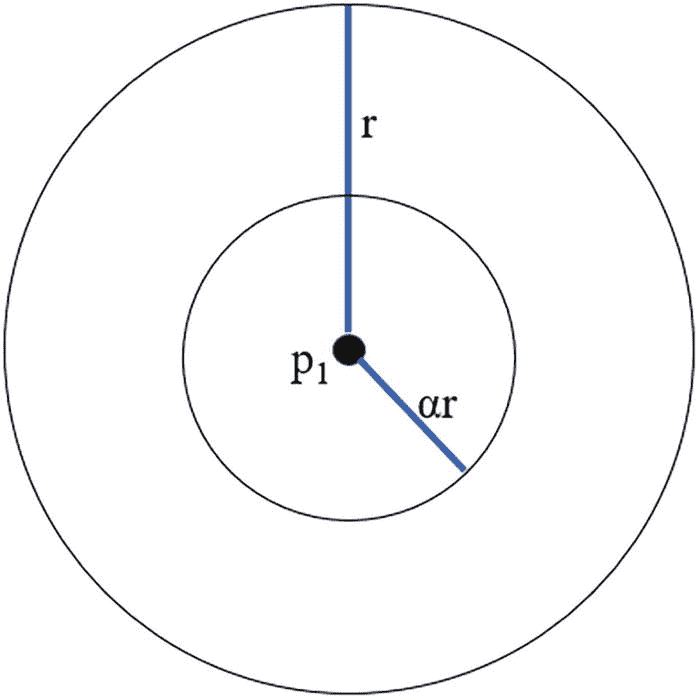
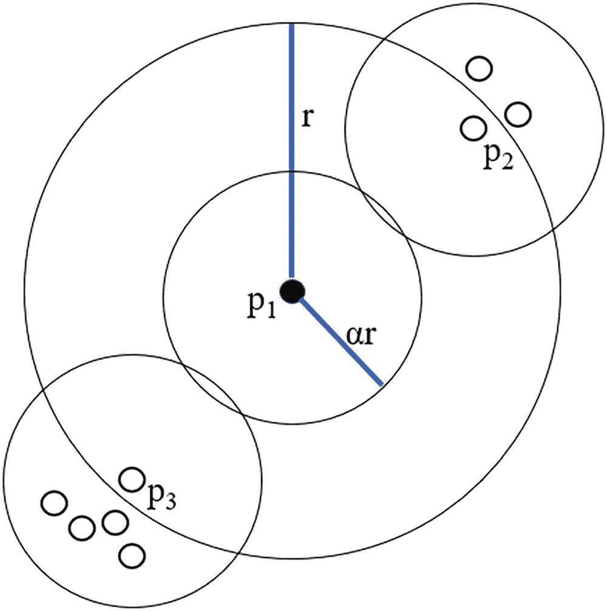
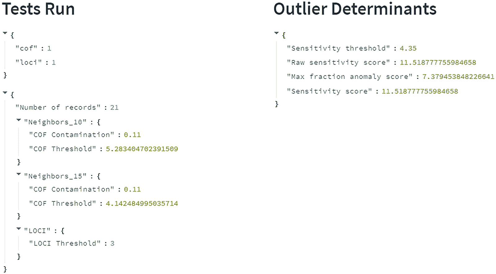

# 11. 局部相关积分（LOCI）

第 10 章向我们介绍了一种多变量聚类技术：基于连通性的异常因子（COF）。COF 是一种流行的多变量异常检测技术，但它确实有一个缺点：除了“异常分数越高越严重”之外，几乎没有直接的指导。我们缺乏关于什么才算是足够大的异常分数的可靠指导。在本章中，我们介绍一种与 COF 互补的技术，该技术自带内置指导：局部相关积分。

## 局部相关积分

*局部相关积分（LOCI）* 是另一种基于密度的方法，类似于局部异常因子（LOF）和基于连通性的异常因子（COF）。Papadimitriou 等人描述了 LOCI 与其他基于密度的度量之间的一个关键区别：LOCI“提供了一个自动的、由数据决定的截断值，以确定一个点是否为异常点”（Papadimitriou 等人，第 1 页）。这种内置的截断值意味着用户无需提供数据本身之外的任何信息。在本节中，我们将了解该算法的工作原理；然后，将其整合到我们的多变量异常检测引擎中。


### 发现邻域

`LOCI` 与其他基于密度的方法（如 `LOF` 或 `COF`）的一个重要区别在于，`LOCI` 不要求指定邻域中明确的邻居数量。相反，它采用一个称为 *alpha (α)* 的度量来表示邻域大小，其中 `0 < α < 1`。`α` 的默认值为 `0.5`；Papadimitriou 等人在他们的实验中选择了这个值（Papadimitriou 等人，第 5 页），我们将沿用这个值。

除了 `α`，我们还需要一个变量 `r`，它代表我们的*采样邻域*的距离：即我们将用来与给定点进行比较的点集。具体来说，我们根据一个半径为 `α * r` 的边界圆（即所谓的*计数邻域*）内的邻居数量来判断该数据点是否为异常值。图 11-1 给出了一个直观的例子。



一个包含 2 个集合的维恩图。它有两个同心集合，外圈半径为 `r`，内圈从点 `P1` 开始半径为 `α * r`。

图 11-1

采样邻域（半径为 `r`）和计数邻域 `α * r` 的示意图

在我们的计数邻域 `α * r` 内，我们统计存在的数据点数量，从而了解我们关注的点附近数据点的密集程度。然后，为了了解这一点与其他点相比如何，我们对采样邻域内的每个点重复此过程。图 11-2 补充了更多细节，引入了另外两个点：`p[2]` 和 `p[3]`。由于这两个点位于 `p[1]` 的采样邻域内，我们使用这两个点与 `p[1]` 进行比较。我们得出的结果是：`p[1]` 在其计数邻域内有一个数据点，`p[2]` 有三个，`p[3]` 有五个，注意计数包括被测试的数据点本身。



一个包含 11 个集合的维恩图。它有两个同心集合，外圈半径为 `r`，内圈从点 `P1` 开始半径为 `α * r`。右上角和左下角集合的交集区域分别标记为 `P2` 和 `P3`。

图 11-2

`p[1]` 采样邻域内三个数据点的计数邻域

从图 11-2 中，我们可以确定两个重要标准。第一个是计数邻域内的数据点数量，我们可以表示为 `n(p[i], αr)`。对于 `p[1]`、`p[2]` 和 `p[3]`，这个值分别是 `1`、`3` 和 `5`。

我们可以确定的第二个标准是给定采样邻域内 `αr`-邻居的平均值，我们可以表示为 `n̂(p_i, r, α)`。在这种情况下，平均值是 `3`。

有了这两个标准，我们就可以计算*多粒度偏差因子*。

### 多粒度偏差因子 (MDEF)

多粒度偏差因子 (MDEF) 使用清单 11-1 中的公式定义。

```
MDEF(p_i, r, α) = 1 - n(p_i, αr) / n̂(p_i, r, α)
```

清单 11-1

多粒度偏差因子的公式

换句话说，我们取计数邻域的大小，并将其与采样区域中的其他计数邻域进行比较。在我们的例子中，`p[1]` 的 MDEF 为 `2/3`，`p[2]` 的 MDEF 为 `0`，`p[3]` 的 MDEF 为 `-2/3`。

实际的异常值检测过程会计算采样邻域内计数邻域大小的标准差，如清单 11-2 所示。

```
σ_MDEF(p_i, r, α) = σ_n̂(p_i, r, α) / n̂(p_i, r, α)
```

清单 11-2

计算 MDEF 的标准差

一旦我们有了 MDEF 的标准差，就得到了除 `α` 之外的另一个输入参数：`k`，它表示在我们将一个数据点视为异常值之前，其 MDEF 偏离平均值的标准差个数。对此，我们可以应用本书第一部分中的经验法则：距离平均值三个标准差表示一个数据点为异常值。Papadimitriou 等人描述了此计算背后的形式逻辑，并指出当 `k=3` 时，如果邻域大小集合服从正态分布，则预计只有不到 `1%` 的数据点会触发该阈值（Papadimitriou 等人，第 5 页）。

现在我们对 `LOCI` 算法的工作原理有了一些了解，可以将其整合到我们的多变量异常值检测模型中。

## 多变量算法集成

当我们开始将 `LOCI` 与 `COF` 集成时，退一步了解我们在集成方面可用的选项是一个好主意。本节第一部分将介绍我们可用的主要集成类型。本节第二部分将让我们有机会通过集成来更有效地使用 `COF`。本节第三部分将把 `LOCI` 也加入其中。

### 集成类型

集成主要有两类：*独立集成*和*顺序集成*。在第二部分中，我们使用加权份额实现了一种独立集成形式。独立集成背后的主要思想是，我们分别运行每个测试，分别生成每个输出，并在最后合并结果。通常，如果所有（或至少足够多的）测试结果一致，我们才将一个数据点标记为异常。我们可以根据不同测试的质量对它们进行不同的加权。例如，与错误率较低的测试相比，我们可能会降低噪声较大的测试的权重。

相比之下，顺序集成像筛子一样堆叠模型。其思想是一个模型的输出作为下一个模型的输入。在实践中，我们倾向于让最敏感（通常也是噪声最大）的模型先运行，从而得到一组临时的异常值。然后，对于每个后续算法，我们只需要对剩余的异常值集执行下一组计算——如果先前噪声较大的模型认为某个数据点是正常值，我们可以直接接受它，从而节省计算开销。顺序集成的主要优点是能够快速缩小非常大的数据集，因此非常适合处理海量数据集。如果你处理的是数千万或数亿条记录，一个噪声较大的方法应该仍然能在初始阶段过滤掉 `90–95%` 的数据点，从而为噪声较小但计算成本更高的方法留下小得多的数据量。

顺序集成的主要缺点是通常需要更多的编程工作，因为像 `PyOD` 这样的库中算法的现成实现假设你会关心整个数据集，而不是一小部分数据点。为了最小化复杂性，我们将再次使用独立集成进行多变量分析。然而，这是一个值得投入开发顺序集成的领域，因为我们将使用的 `COF` 和（尤其是）`LOCI` 的实现即使对于小型数据集也可能非常耗时。

在我们把 `LOCI` 加入进来之前，值得重新审视一下 `COF`。


### COF 组合

在第 10 章结束时，我们创建了一个以 COF 为核心的多变量异常值检测系统。COF 是一个出色的算法，但它要求调用者选择邻域的大小以及判定异常值的临界点。我们的实现通过设置 1.35 的最小边界部分解决了第二个问题，但将邻居数量的选择完全留给了调用者。这是一个合理的解决方案，但我们还可以做得更好：我们可以尝试使用不同邻居数量组合（在合理范围内）的 COF，并将每次测试的结果整合成一个集成模型。为此，我们需要使用 PyOD 中的 `combination` 模块。

清单 11-3 展示了更新后的 `run_tests()` 函数。该函数现在接收最大异常比例并将其传递给 COF。我们还在此函数中完成了一些准备工作，例如将编码后的值转换为数组，而不是在 `check_cof()` 内部进行，因为 LOCI 也需要相同的数据。

```python
from pyod.models.combination import aom, moa, average, median, maximization, majority_vote
#### 代码省略
def run_tests(df, max_fraction_anomalies, n_neighbors):
    num_records = df['key'].shape[0]
    tests_run = {
        "cof": 1
    }
    diagnostics = {
        "Number of records": num_records
    }
    col_array = df.drop(["key", "vals"], axis=1).to_numpy()
    n_neighbor_range = range(n_neighbors, min(num_records - 5, n_neighbors + 100), 5)
    n_neighbor_range_len = len(n_neighbor_range)
    labels_cof = np.zeros([num_records, n_neighbor_range_len])
    scores_cof = np.zeros([num_records, n_neighbor_range_len])
    for idx,n in enumerate(n_neighbor_range):
        (labels_cof[:, idx], scores_cof[:, idx], diag_idx) = check_cof(col_array, max_fraction_anomalies=max_fraction_anomalies, n_neighbors=n)
        k = "Neighbors_" + str(n)
        diagnostics[k] = diag_idx
    df["is_raw_anomaly_cof"] = majority_vote(labels_cof)
    anomaly_score = median(scores_cof)
    df["anomaly_score"] = anomaly_score
    return (df, tests_run, diagnostics)
```

**清单 11-3**  
用于 COF 集成模型的 `run_tests()` 函数

在此函数中，我们使用 `range()` 函数生成一系列待测试的最近邻数量，从用户定义的总数（或其默认值 10）开始，以 5 为增量递增，直到原始最近邻数量加 100 与数据集中记录数减五这两者中的较小值。例如，对于 1000 个数据点且起始最近邻数量为 10，我们将得到总共 21 个值，范围从 10 到 105。相比之下，如果我们有 20 个数据点且起始最近邻数量为 4，我们将得到三个值：4、9 和 14。然后，我们构建名为 `labels_cof` 和 `scores_cof` 的二维数组来存储每次测试的结果。对于最近邻范围内的每个值，我们调用 `check_cof()`，传入列数组、最大异常比例和邻居数量，并将结果存储在我们的数组中。

在按指定次数完成 COF 运行后，我们需要以某种方式组合结果。PyOD 提供了多种机制来确定异常分数或标签的最终值。有三种直观的选项：`median()`（中位数）、`average()`（平均值）和 `maximization()`（最大值）。另一个有用的选项是 `majority_vote()`（多数投票），我们用它来确定标签值。另外两个有趣的选项是最大值平均（AOM）和平均值最大（MOA）。AOM 和 MOA 需要指定桶的数量，默认为 5。然后，我们将结果随机分配到每个桶中。对于 AOM，我们找出每个桶中的最大值，并计算这些桶最大值的平均值。对于 MOA，我们计算每个桶的平均值，并返回这些值中的最大值。通过这两种度量，我们可以平滑给定数据点在多次运行中的分数。例如，如果某个数据点的 COF 分数通常在 1.1–1.3 范围内，但某次运行的结果为 7，这会影响我们的 `average()` 和 `maximization()` 函数，但对 `median()`、MOA 和 AOM 的影响非常小。使用 AOM 或 MOA 之一来计算我们的响应可能有一些好处，但中位数也能很好地工作，并且还能确保我们无需考虑任何给定数据集需要多少个桶。因此，我们将使用中位数来计算异常分数。

接下来，清单 11-4 展示了新版本的 `check_cof()`。与第 10 章中的版本相比，该函数将接收 DataFrame 改为接收列数组，将最大异常比例作为其污染百分比，并返回数组而不是列。

```python
def check_cof(col_array, max_fraction_anomalies, n_neighbors):
    clf = COF(n_neighbors=n_neighbors, contamination=max_fraction_anomalies)
    clf.fit(col_array)
    diagnostics = {
        "COF Contamination": clf.contamination,
        "COF Threshold": clf.threshold_
    }
    return (clf.labels_, clf.decision_scores_, diagnostics)
```

**清单 11-4**  
一个用于运行 COF 测试的简单函数

通过整合覆盖不同邻居数量的多种测试，我们获得了更稳健的 COF 计算结果，并且还可以从用户那里移除关于选择多少邻居这一不必要的决策。现在，我们准备将 LOCI 纳入其中。


### 集成 LOCI

我们在上一节中对 `run_tests()` 函数所做的修改，将使我们能够以直接的方式集成 LOCI。代码清单 11-5 包含了更新后的 `run_tests()` 函数以及 LOCI 流程本身。

```
def run_tests(df, max_fraction_anomalies, n_neighbors):
    num_records = df['key'].shape[0]
    if (num_records > 1000):
        run_loci = 0
    else:
        run_loci = 1
    tests_run = {
        "cof": 1,
        "loci": run_loci
    }
    diagnostics = {
        "Number of records": num_records
    }
    col_array = df.drop(["key", "vals"], axis=1).to_numpy()
    # 为清晰起见，删除了 COF 特定代码
    anomaly_score = median(scores_cof)
    if (run_loci == 1):
        (labels_loci, scores_loci, diag_loci) = check_loci(col_array)
        df["is_raw_anomaly_loci"] = labels_loci
        anomaly_score = anomaly_score + scores_loci
        diagnostics["LOCI"] = diag_loci
    df["anomaly_score"] = anomaly_score
    return (df, tests_run, diagnostics)

def check_loci(col_array):
    clf = LOCI()
    clf.fit(col_array)
    diagnostics = {
        "LOCI Threshold": clf.threshold_
    }
    return (clf.labels_, clf.decision_scores_, diagnostics)
代码清单 11-5
在多元异常值检测过程中集成 LOCI
```

我们看到的第一个变化是决定是否运行 LOCI。在撰写本文时，PyOD 中 LOCI 的实现效率非常低，并且可能难以处理较大的数据集。因此，如果我们的数据集过大，我们将不会运行 LOCI，而是依赖效率更高的 COF 实现。假设我们确实运行了 LOCI，我们会调用 `check_loci()` 函数。请注意，我们没有传入 α 或 k 的值；我们将它们分别保留为默认值 0.5 和 3。LOCI 算法还会自动为我们确定 r 的值，因此我们无需为该参数传入任何内容。从检查函数返回的结果包括一个分数数组，每个数据点对应一个异常值分数。`median(scores_cof)` 函数调用的结果也是一个分数数组，其中包含所有 COF 测试中每个数据点的中位数数据分数。我们只需将这两个数组相加，即可得到一个不加权重的组合分数。这里的直觉是，COF 的最小阈值为 1.35，而 LOCI 的阈值为 3。我们预计对于内点和接近异常值的点，这两个值会彼此非常接近，因此通过将它们相加，我们可以让一个模型非常强烈的判断胜过另一个模型温和的反应。例如，假设 LOCI 返回的分数为 2.8，这接近但并非完全是异常值。如果 COF 返回的分数为 20，远高于 1.35 的最小阈值，那么 COF 判断的强度就会压倒 LOCI 不温不火的判断。

我们可以在代码清单 11-6 中看到这一点，这是用于确定异常值的更新函数。该函数之前接受三个输入：一个 DataFrame、我们的敏感度分数以及我们允许的最大异常值比例。现在我们向其中添加了两个参数：已运行的测试集以及每个测试的敏感度因子，COF 为 1.35，LOCI 为 3。

```
def determine_outliers(
    df,
    tests_run,
    sensitivity_factors,
    sensitivity_score,
    max_fraction_anomalies
):
    tested_sensitivity_factors = {sf: sensitivity_factors.get(sf, 0) * tests_run.get(sf, 0) for sf in set(sensitivity_factors).union(tests_run)}
    sensitivity_threshold = sum([tested_sensitivity_factors[w] for w in tested_sensitivity_factors])
    diagnostics = { "Sensitivity threshold": sensitivity_threshold }
    second_largest = df['anomaly_score'].nlargest(2).iloc[1]
    sensitivity_score = (100 - sensitivity_score) * second_largest / 100.0
    diagnostics["Raw sensitivity score"] = sensitivity_score
    max_fraction_anomaly_score = np.quantile(df['anomaly_score'], 1.0 - max_fraction_anomalies)
    diagnostics["Max fraction anomaly score"] = max_fraction_anomaly_score
    if max_fraction_anomaly_score > sensitivity_score and max_fraction_anomalies < 1.0:
        cutoff = max_fraction_anomaly_score
    else:
        cutoff = sensitivity_score
    diagnostics["Cutoff"] = cutoff
    return (df[df['anomaly_score'] > np.max([sensitivity_score, sensitivity_threshold])], diagnostics)
代码清单 11-6
用于确定哪些数据点是异常值的函数的最新形式
```

我们通过计算敏感度阈值来开始该函数，如果我们只运行了 COF，该阈值将为 1.35；如果同时运行了 COF 和 LOCI，则为 4.35。之后，我们根据第二大数据点计算敏感度分数，就像我们在第 10 章中所做的那样。然后，我们确定是否需要使用敏感度分数或最大异常值比例作为我们的截止值，就像我们在第 10 章中所做的那样。最后，返回语句根据数据点是否超过敏感度分数和敏感度阈值中的较大者，创建一个新的 `anomaly_score` 列。该函数的最后一个不同之处在于，我们返回与分数计算相关的诊断数据，允许用户诊断问题。

## 测试与网站更新

每当我们向集成模型中引入新算法或更改计算方式时，都应该审查测试并确保行为按预期方式变化。在这种情况下，我们有一些测试期望返回零个异常值，一些返回一个异常值，以及一个没有固定异常值数量的更广泛的样本数据集。在本节中，我们将审查这些测试结果，看看哪些失败了。然后，我们将转向网站更新。请注意，没有关于集成测试的部分，因为这些测试将继续按预期通过。

### 单元测试更新

关于单元测试，有两个值得注意的变化。第一个是，通过运行多次 COF 迭代并集成 LOCI，异常值的数量变得相当稳定：除非达到极端情况，否则敏感度分数和最大异常值比例的变化影响非常小。总的来说，这对我们来说是一个有趣的结果，因为这意味着最终用户无需担心选择“正确”的敏感度分数或最大异常值比例。然而，主要缺点是对更高级用户来说失去了控制权。在多元测试用例提供的样本输入中，我们看到敏感度分数为 5 时有五个异常值。再次尝试敏感度分数为 25 时，异常值数量跃升至八个，并且一直保持到敏感度分数为 100。如果用户期望异常值数量基于敏感度分数平滑（或至少规律地）增加，他们可能会对这个结果感到困惑。

另一个值得注意的变化源于 LOCI 比 COF 更敏感，至少在我们的测试数据集上是这样。例如，没有异常值和有一个异常值的样本输入都包含一条记录，其第一个输入为 87.9，第三个输入为 6180.90844，这两个值都代表“极端”值。87.9 恰好是我们看到的第一个输入中的最大值，而 6180.90844 是第三个输入中的最小值，但两者都远在各自中位数的 1% 范围内。LOCI 能够发现这种微小的差异，并将该数据点标记为意外的异常值。为了确保测试返回适当数量的异常值，将第三个值更改为其中位数 6185.90844 就足以解决问题。在使用像 COF 和 LOCI 这样的算法时，这种敏感度水平是需要留意的，特别是考虑到关于用户可控敏感度调整相对缺乏的第一个见解。


### 网站更新

本节中的网站变更较为微小，主要涉及我们新增收集的调试信息。清单 11-7 展示了相关代码块。

```
if debug:
col11, col12 = st.columns(2)
with col11:
st.header("Tests Run")
st.write(res['debug_details']['Tests run'])
st.write(res['debug_details']['Test diagnostics'])
with col12:
st.header("Outlier Determinants")
st.write(res['debug_details']['Outlier determination'])
st.header("Full Debug Details")
st.json(res['debug_details'])
Listing 11-7
Writing out details if debug mode is enabled
```

调试菜单的第一列显示了已运行的测试集以及诊断信息。该诊断信息包括数据集中的记录数；每次运行 COF 时的邻居数、污染分数和阈值；以及 LOCI 阈值。第二列显示了异常值决定因素，包括我们的灵敏度阈值以及计算灵敏度分数所做的工作。图 11-3 展示了使用预创建样本数据集的一个示例。在这两列下方，我们还可以看到完整的调试详情。



一个用于预创建样本数据集的算法。它有两列，分别标记为“已运行测试”和“异常值决定因素”。

图 11-3

我们已运行的测试以及异常值截止点的决定因素

## 结论

本章重点在于以两种方式扩展多元异常值检测模型：首先，利用 PyOD 中的 `combination` 模块，使用多个最近邻计数来运行基于连通性的异常因子；其次，整合另一种名为局部相关积分的算法。下一章将通过整合一种与 COF 和 LOCI 完全不同的算法来进一步扩展此模型。

