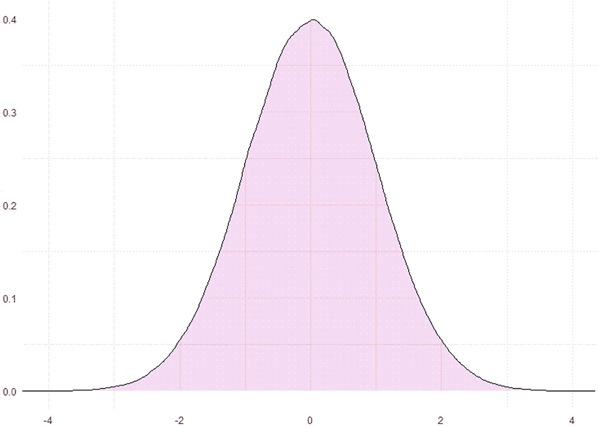
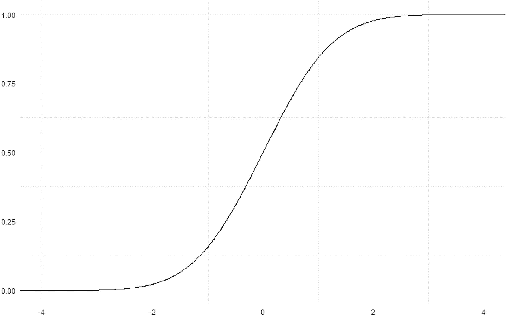
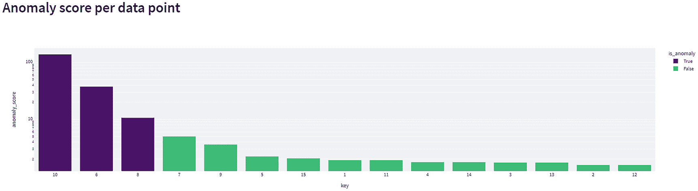
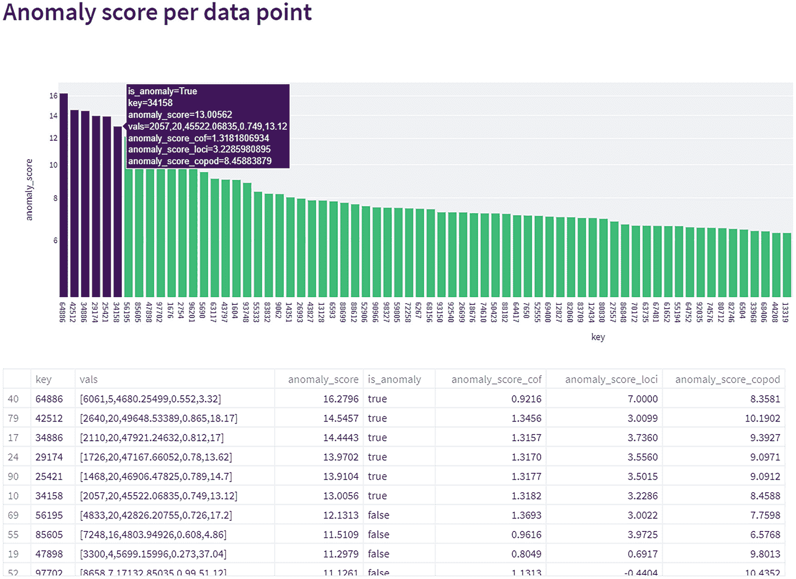
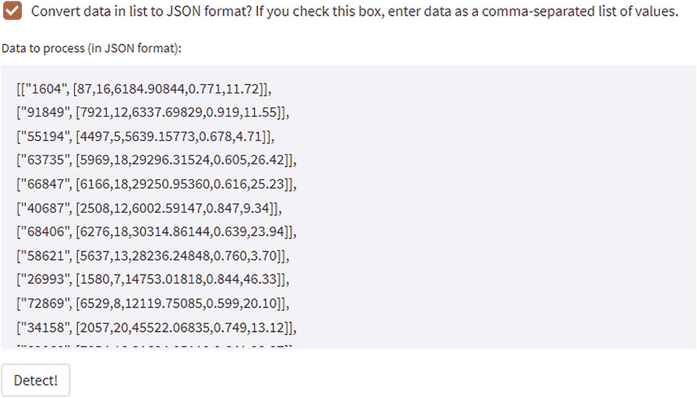

# 12. 基于 Copula 的异常值检测 (COPOD)

到目前为止，我们已经研究了用于多元异常值检测的基于聚类的模型。在本章中，我们将回顾一种新颖的非聚类技术，该技术使用一个称为 `copulas` 的概念。首先，我们将定义什么是 `copula`，以及如何使用它进行异常值检测。然后，我们将实施应用程序更改以集成这项新技术。之后，我们将更新我们的测试和网站。最后，我们将通过一些总结性说明来结束第三部分。

## 基于 Copula 的异常值检测

2020 年 9 月，Zheng Li 与四位合著者发表了一篇题为《COPOD：基于 Copula 的异常值检测》的论文。这篇论文介绍了一种用于多元异常值检测的新技术。在此论文之前，几种流行的多元异常值检测技术（包括 `LOF`、`COF` 和 `LOCI`）都侧重于聚类的概念：计算点之间的距离，并标记出那些与邻居距离足够远的点。相比之下，`COPOD` 依赖于一种称为 `copula` 的概念。

### 什么是 Copula？

“Copula”一词源自拉丁语，意为连接或纽带。在语言学中，我们使用“copula”一词来表示主语和谓语之间的连接，在英语中通常使用像“to be”这样的动词。在统计学中，`copula` 是“一种表示多元均匀分布的概率模型，用于检验多个变量之间的关联或依赖性”（Kenton, 2021）。

将这个定义分解开来，我们从包含多个变量的数据集开始。我们可能（也可能不！）知道每个变量的分布——例如，一个变量可能遵循正态分布，另一个遵循贝塔分布，第三个可能是均匀分布。到目前为止，我们一直将这些变量视为完全独立的，但在处理多元数据时，这通常不是一个好的假设。在实践中，往往存在某种联合概率分布，因为输入变量之间通常相互影响。例如，一个人的身高、体重、年龄、血压和鞋码将是相关的变量，因此将它们视为完全独立会遗漏重要信息。我们很快遇到的问题是，如何对这些变量中任意一对或组合的联合概率分布进行建模？这就是 `copula` 发挥作用的地方。

使用 `copula`，我们可以将联合概率分布简化为其 `边际分布`（也称为 `边缘分布`），这些分布是独立的，因此变量之间不相关。`Copula` 是一个函数，它使我们能够从单个联合分布转换为边际分布的耦合。

**注意**
`Copula` 理论在统计学的某些领域非常有用，但对该主题的详细理解超出了本书的范围。如需通过直观、侧重视觉的方式来理解 `copula` 函数，请参阅 Wiecki (2018)。如需更详细的 `copula` 理论综述，请参阅 Durante 和 Sempi (2010) 以及 Pakdaman (2011)。就我们的目的而言，这种高层次的理解应该足够了。

### COPOD 背后的直觉

Li 等人于 2020 年 9 月发表了一篇论文，介绍了一种新技术——`基于 Copula 的异常值检测`（`COPOD`）。`COPOD` 利用 `copula` 来分解多个变量之间的关系，即使在我们不知道各个变量自身潜在分布的情况下也能发挥作用。使用 `COPOD` 检测异常值分为三个阶段（Li 等人，第 2 页）。第一阶段是计算 `经验累积分布函数`（也称为经验 CDF 或 ECDF），它描述了在每个点上随机变量小于或等于该点的概率。在第 3 章中，我们介绍了 `概率分布函数`（PDF）的概念，并附有如图 12-1 所示的图像。简单来说，曲线的高度表示从该分布中抽取的某个随机变量取 X 轴上该值的概率。



图 12-1 正态分布的概率分布函数

概率分布函数是一种“点”度量。同一图形的累积分布函数（如图 12-2 所示）则代表一种“流”度量。换句话说，它表示从该分布中抽取一个点，该点小于或等于 X 轴上某个给定值的概率是多少？



图 12-2 正态分布的累积分布函数

这些可视化图表代表了同一潜在分布的不同视角——累积分布函数是概率分布函数在负无穷到 x 范围内的积分（换句话说，假设 CDF 是可微的，那么概率分布函数就是累积分布函数的一阶导数）。

一旦我们为每个变量获得了经验 CDF，过程的第二阶段就是确定一个经验 `copula` 函数，该函数将变量的联合概率分布转化为边际分布。

过程的最后阶段使用经验 `copula` 来近似 `尾部概率`，即采样数据点大于（对于右尾）或小于（对于左尾）某个指定值的概率。我们对每个变量都这样做，并将概率相乘，从而得到一个多变量尾部概率——我们之所以能做到这一点，是因为 `copula` 为我们提供了边际分布，而根据定义，这些边际分布是相互独立的。

给定一个尾部概率，Li 等人展示了如何利用它来估计一个数据点是异常值的可能性。作者还提供了他们算法的 Python 实现，并将其整合到了 `PyOD` 库中。

## 实现 COPOD

与第 11 章中的 `LOCI` 类似，`COPOD` 没有任何必需的用户定义参数。在清单 12-1 中，我们在实现 `COPOD` 检查时可以看到这一点。

```
def check_copod(col_array):
clf = COPOD()
clf.fit(col_array)
diagnostics = {
"COPOD Threshold": clf.threshold_
}
return (clf.labels_, clf.decision_scores_, diagnostics)
```

清单 12-1 用于对我们的多变量数据集运行 `COPOD` 测试的函数

`COPOD` 的实现速度非常快，因此无论记录数量多少，我们都可以安全地运行它。清单 12-2 展示了 `run_tests()` 函数的简化版本，该函数现在将 `COF`、`LOCI` 和 `COPOD` 作为算法包含在我们的集成中。

```
def run_tests(df, max_fraction_anomalies, n_neighbors):
num_records = df['key'].shape[0]
if (num_records > 1000):
run_loci = 0
else:
run_loci = 1
tests_run = {
"cof": 1,
"loci": run_loci,
"copod": 1
}
diagnostics = {
"Number of records": num_records
}
col_array = df.drop(["key", "vals"], axis=1).to_numpy()
### COF and LOCI code elided
(labels_copod, scores_copod, diag_copod) = check_copod(col_array)
df["is_raw_anomaly_copod"] = labels_copod
diagnostics["COPOD"] = diag_copod
df["anomaly_score_copod"] = scores_copod
anomaly_score = anomaly_score + scores_copod
df["anomaly_score"] = anomaly_score
return (df, tests_run, diagnostics)
```

清单 12-2 `run_tests()` 函数现在包含了 `COPOD`。

现在我们的集成中有了第三个算法，我们需要调整权重来确定我们的截止点。Li 等人建议每个维度使用诸如 `-ln(0.01) = 4.61`（Li 等人，第 4 页）这样的阈值。在我们的案例中，我们将使用一个更激进的分数 2.3（即 `-ln(0.10)`）加上中位数作为 `COPOD` 的截止点。我们可以在清单 12-3 中看到 `determine_outliers()` 的最终形式，它整合了 `COPOD`。

# 第 12 章 COPOD 与测试更新

```python
def determine_outliers(
    df,
    tests_run,
    sensitivity_factors,
    sensitivity_score,
    max_fraction_anomalies
):
    tested_sensitivity_factors = {sf: sensitivity_factors.get(sf, 0) * tests_run.get(sf, 0) for sf in set(sensitivity_factors).union(tests_run)}
    median_copod = df["anomaly_score_copod"].median()
    sensitivity_threshold = sum([tested_sensitivity_factors[w] for w in tested_sensitivity_factors]) + median_copod
    diagnostics = { "Sensitivity threshold": sensitivity_threshold, "COPOD Median": median_copod }
    second_largest = df['anomaly_score'].nlargest(2).iloc[1]
    sensitivity_score = (100 - sensitivity_score) * second_largest / 100.0
    diagnostics["Raw sensitivity score"] = sensitivity_score
    max_fraction_anomaly_score = np.quantile(df['anomaly_score'], 1.0 - max_fraction_anomalies)
    diagnostics["Max fraction anomaly score"] = max_fraction_anomaly_score
    if max_fraction_anomaly_score > sensitivity_score and max_fraction_anomalies np.max([sensitivity_score, sensitivity_threshold])), diagnostics)
```
**清单 12-3** `determine_outliers()` 函数现在包含了 COPOD 的计算。

我们对 `tested_sensitivity_factors` 的计算与第 11 章相同，即遍历每个测试，并将权重乘以 `tests_run` 的值（0 或 1）。

下一步是计算 COPOD 的中位数。与使用绝对度量的 LOCI 和 COF 不同，COPOD 的分数是相对于中位数的相对分数，这意味着我们需要执行此计算并将其添加到灵敏度阈值中。最终结果是，我们的最小灵敏度阈值为 3.65，即 COF 的 1.35 灵敏度因子加上 COPOD 的最小 2.3 灵敏度因子。如果我们还包含 LOCI（当观测值不超过 1000 个时），我们的最小灵敏度阈值将为 6.65。之后，函数的其余部分保持不变。

现在我们已经介绍了代码中所有必要的更改，接下来让我们继续讨论测试和网站更新。

## 测试与网站更新

正如我们在本书中多次看到的，在集成中引入新算法会影响现有的测试。在本节中，我们将回顾对单元测试和集成测试的净影响。因为这是我们在多变量异常值检测方面工作的最后一章，我们还将扩展网站，使其更加用户友好。

### 单元测试更新

运行单元测试时，最大的变化在于样本输入中异常值的数量。有趣的是，有效值的范围显著缩小，如表 12-1 所示。

**表 12-1** 在最大异常比例为 1.0 的情况下，不同敏感度评分对应的异常值数量

| 敏感度评分 | 第 10 章 | 第 11 章 | 第 12 章 |
| --- | --- | --- | --- |
| 100 | 11 | 8 | 6 |
| 50 | 11 | 8 | 6 |
| 40 | 11 | 8 | 6 |
| 25 | 4 | 8 | 6 |
| 5 | 2 | 2 | 5 |
| 1 | 1 | 2 | 3 |

在第 10 章中，我们看到异常值数量根据敏感度评分在 1 到 11 之间变化，并且在 40 到 100 之间存在一个“死区”，该区域内异常值数量不变。在第 11 章中，我们看到异常值数量要么是 2 个，要么是 8 个，分界点出现在 25 到 5 之间。在本章中，异常值的最小数量增加到了 3，最大数量下降到了 6。这进一步降低了敏感度评分的相对重要性。

### 集成测试更新

运行第 12 章的集成测试时，我们遇到了一个测试失败的情况，但这实际上是一个积极的结果。在第 10 章中，我们引入了一个包含三个异常值的集成测试，其中一个异常值相当极端，另外两个则相对较小。在 Postman 测试中，这个集成测试被称为 `Ch10 – Multivariate – Debug – Three Outliers, 2S1L – Two Recorded`。我们在第 10 章末尾提到，使用我们的输入参数，COF 只捕获了最大的两个异常值。在第 11 章中，COF 和 LOCI 的组合并没有改变这个集成测试的结果。随着 COPOD 的引入，第三个数据点的异常评分增加到足以超过检测阈值。图 12-3 以可视化形式展示了这一结果。



**图 12-3** 检测到了三个异常值，而之前 COF 只能检测到两个

这对我们来说是一个积极的结果，因为我们现在能够证明，一个大的异常值和一个中小型异常值不一定会掩盖一个小异常值。

### 网站更新

在结束多变量异常值检测的讨论之前，我们还需要向 Streamlit 网站添加少量功能。代码清单 12-4 展示了第一组更改，我们在其中将各个异常评分组件包含在每个数据点的悬停数据以及结果表中。这将使我们能够看到哪些算法对给定的数据点最有发言权。

```python
g = px.bar(df, x=df["key"], y=df["anomaly_score"], color=df["is_anomaly"], color_discrete_map=colors,
           hover_data=["vals", "anomaly_score_cof", "anomaly_score_loci", "anomaly_score_copod"], log_y=True)
st.plotly_chart(g, use_container_width=True)
tbl = df[['key', 'vals', 'anomaly_score', 'is_anomaly', 'anomaly_score_cof', 'anomaly_score_loci', 'anomaly_score_copod']]
st.write(tbl)
```

**代码清单 12-4** 为 COF、LOCI 和 COPOD 包含单独的异常评分组件

我们可以在图 12-4 中看到这一更改的结果。在大多数情况下，COPOD 似乎驱动着整体异常评分，尽管结果并不像最初看起来那么显著。我们确实需要考虑 COPOD 的中位数 6.08 和 COPOD 的敏感度因子 2.3，这意味着 COPOD 评分必须高于 8.38 才能以任何显著方式产生影响。



**图 12-4** 使用一个大型人工生成的数据集（多变量单元测试套件中的 `sample_input`），我们可以看到每个数据点都有其异常评分组件的分解，分别涵盖了 COF、LOCI 和 COPOD

另一项更改涉及接受一个数据列表。对于单变量数据，我们接受 Python 格式的数据点列表，例如 `[ 1, 2, 3, 4, 5 ]`。然后我们将其转换为键值对，并将结果发送给异常值检测引擎。对于多变量数据，最好能够接受与单元测试相同格式的数据，其中每一行是一个包含两个元素的列表：一个键和一个值列表。这种格式的一个数据点示例是 `[ "key1", [ 1, 2, 3, 4, 5 ] ]`。然后我们可以通过生成这些数据点的列表来创建数据集。完成此操作后，我们应该能够解析该列表，将其转换为 JSON，并将结果发送给异常值检测引擎。代码清单 12-5 展示了如何使用 Python 的抽象语法树（`ast`）模块来实现这一点。

```python
@st.cache
def convert_multivariate_list_to_json(multivariate_str):
    mv_ast = ast.literal_eval(multivariate_str)
    return json.dumps([{"key": k, "vals": v} for idx,[k,v] in enumerate(mv_ast)])
```

**代码清单 12-5**

# 创建抽象语法树来解析列表的列表，并将结果转换为适当的 JSON

使用 `literal_eval()` 函数，我们评估字符串并构建出一个列表的列表。`json.dumps()` 函数通过枚举数据集中的每个数据点，解析出键和值，并用适当的名称进行标记，将此列表转换为所需格式的有效 JSON。

为了操作此函数，我们需要一个基本检查，即每当使用多变量方法并且用户选中了将列表数据转换为 JSON 的复选框时，运行 `input_data = convert_multivariate_list_to_json(input_data)`。图 12-5 展示了一个示例，该示例将 `sample_input` 单元测试数据集作为输入，并为我们的异常值检测引擎构建了一个正确的 JSON 主体。



一个用于将列表数据转换为 JSON 格式的复选框。待处理数据以列表形式提供在下方，左下角有一个检测选项。

**图 12-5**
将数据点列表转换为异常值检测的有效输入

## 结论

在本章中，我们学习了足够多的关于 copula 函数的知识，以理解基于 `Copula` 的异常检测（`COPOD`）方法的基本工作原理。随后，我们将 `COPOD` 集成到我们的多变量异常检测集成模型中，并取得了良好效果。最后，我们对配套的异常检测应用程序进行了一些微小但有用的改进。

在进入第四部分和时间序列分析之前，我们应该花点时间反思一下我们已经取得的成果，以及如何改进当前的多变量异常检测系统。在第三部分中，我们构建了一个由三种算法组成的独立集成模型：基于连通性的离群因子（`COF`）、局部相关积分（`LOCI`）和 `COPOD`。这三种算法以不同的方式工作，以发现某个数据点是否可能是异常值，其中两种算法使用基于密度的方法，第三种算法使用基于 copula 函数的分布方法。我们已经看到，这三种算法的组合为我们提供了一个相当稳定的异常值判定基础，这意味着，给定不同的敏感度分数或最近邻数量，被标记为异常值的数据点数量不会出现巨大差异。我们还受益于选择了两种无需用户输入的算法和一种只需少量用户输入的算法，这非常符合我们的理念，即让统计知识较少的用户也能轻松使用我们的服务。

还有几十种其他算法可用于多变量异常检测，我们可以进行研究，但每增加一种算法都会带来新的复杂性，并且在添加之前应仔细评估。根据 Mehrotra 的研究（Mehrotra 等人，第 116-117 页），`COF` 和 `LOCI`（特别是 `ALOCI`，它是 `LOCI` 算法的一种线性近似，在 `PyOD` 中不可用）表现相当不错，这项研究发表于 `COPOD` 论文之前。以此为起点，并非越多越好。为了确保我们在进一步选择算法时做出可靠决策，对更多带标签的数据集进行更深入的分析至关重要。

这种更深入的分析也将有助于我们微调权重。`LOCI` 算法的作者为其提供了强大的超参数指导，但 `COF` 和 `COPOD` 没有。我们为每个权重做出了合理的决策，但更多的数据集可以让我们调整这些度量以获得更好的结果。

我们现在已经完成了多变量异常检测，并将转向第四部分：时间序列分析。在下一章中，我们将概述时间序列问题。