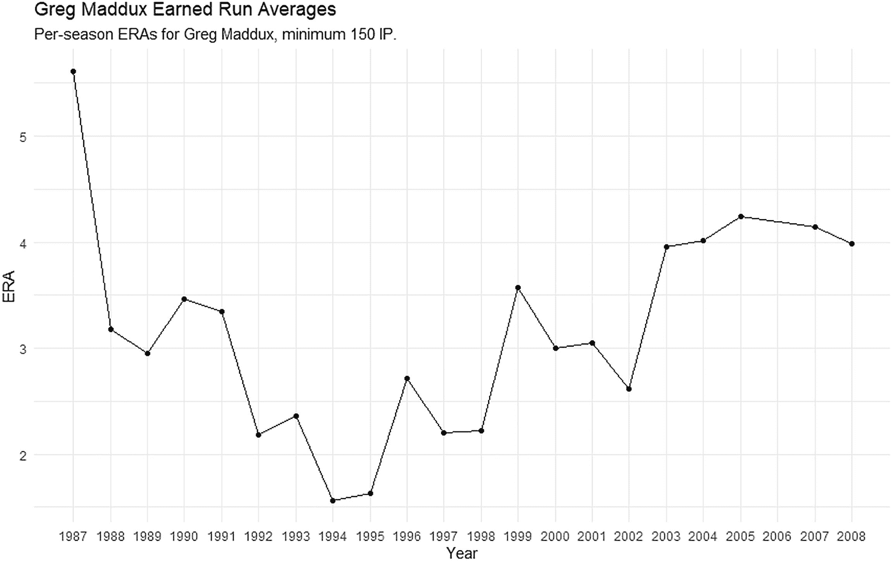
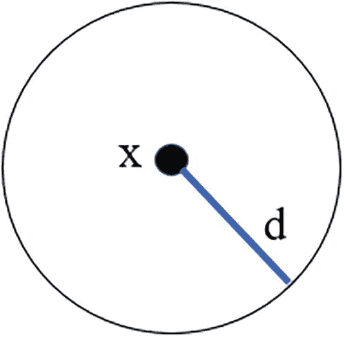
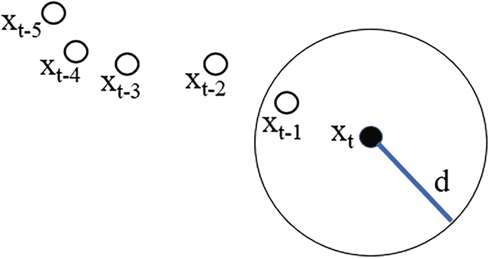
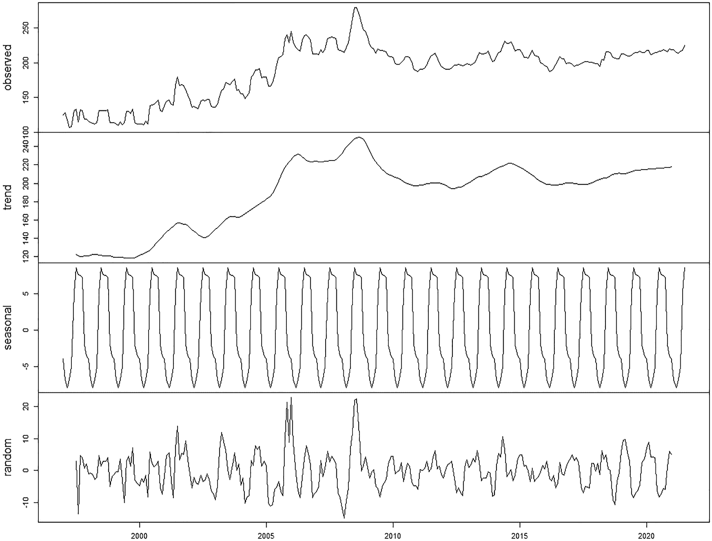

# 13. 时间与异常

现在我们已经进入本书的第四部分，是时候介绍异常检测中的一个重要主题了：时间序列异常检测。与第二和第三部分一样，我们将根据特征数量来划分时间序列分析：首先，我们将处理单序列时间序列异常检测；然后，在建立了单序列时间序列异常检测模型之后，我们将处理多序列情况。

本章将首先介绍单序列时间序列分析的基础。我们将理解为什么时间序列是一个如此重要的主题。我们还将学习时间序列分析如何改变我们对异常检测的思考方式。之后，我们将研究一些最常见的时间序列分析问题，最后将讨论在执行时间序列异常检测时，什么才真正构成异常值。

## 什么是时间序列？

其核心是，*时间序列数据* 是除了至少一个特征之外，还包含某种日期和时间组合的数据。单序列时间序列分析意味着我们收集的所有数据点都代表了同一现象在不同时间点的发现结果。为简单起见，我们也将任何日期和时间的组合称为“时间”——仅按日期回顾股票市场数据仍然构成时间序列分析。图 13-1 展示了一个时间序列数据的示例，图表显示了 Greg Maddux 在其美国职业棒球大联盟职业生涯中的自责分率。在这种情况下，我们时间序列数据的*粒度*是年度的，因为这是自责分率最常见的粒度。



时间序列分析之所以重要，有几个原因。首先，时间是一个特殊的变量，因为它总是朝一个方向移动——尽管如果我确实能使用时间机器回到过去，我一定会更新书中的这条评论！

时间序列分析重要的第二个原因是，时间不仅是线性的，而且它还是过程的促成原因之一。换句话说，过程将时间作为一个输入：如果我们决定今天采取行动，某些事情可能会在未来的某个时间点取得成果。我们的语言中甚至充满了像“成果”这样的术语，它指的是随着时间的推移结出果实的过程。大多数过程都将时间作为一个输入组件，这一事实使得时间成为我们可以用来分析数据的一个有趣特征。

这引出了第三个原因：许多商业问题都包含时间因素。例如，我们可以跟踪收入随时间增长的情况，期望它平均以某个固定的百分比增长。另一个例子是，我们可以估计目录中各种产品的需求，以便提前知道需要制造或采购多少。

话虽如此，时间序列分析当然不是我们可以执行的唯一分析类型，这也不应贬低我们迄今为止在*静态*（即，与时间无关的）异常检测技术方面所做的工作。我们应该在合理的情况下使用时间序列分析，但仅仅为了将其变成时间序列分析而加入一个不必要的时间特征，最终会损害我们对某个现象的分析。

## 时间序列改变了我们的思维方式

时间作为输入特征的特殊性质，对我们应如何分析包含时间序列成分的数据集产生了若干影响。在本节中，我们将探讨时间序列分析与经典数据分析不同的几个方面。

### 自相关

时间序列数据表现出*自相关*，也称为*序列相关*。自相关意味着时间点 `T` 的数据值直接受到时间点 `T-1`（或更一般地，对于某个 `k >= 1` 的 `T-k`）数据值的影响。例如，如果你穿过一个又大又拥挤的房间，三秒后你的位置将取决于几秒前你所在的位置。这背后的直觉是，我们无法瞬间移动，而只能在几秒钟内移动一段最大距离。忽略可能决定该最大距离的因素（例如身高、步态、受伤等），我们知道，如果一个人在三秒内能移动的最大距离是 `d`，并且他在三秒结束时位于点 `x`，那么我们可以以点 `x` 为中心画一个半径为 `d` 的圆，并知道此人在三秒前一定位于该圆内。图 13-2 展示了这一原理的实际应用。



一个圆心为点 x 的圆。圆的半径标记为 d。

图 13-2

给定一个人当前的位置以及该人在固定时间范围内能移动的最大距离，我们知道他在该时间范围开始时一定位于圆内

值得反复强调这一点，因为同样的图 13-2 也能让我们了解此人在下一个三秒时间范围结束时可能的位置：位于以点 `x` 为圆心、半径为 `d` 的圆内的某处。如果我们有足够的信息了解此人在不同时间点的位置，我们可能会得出类似图 13-3 的结果，其中我们看到一个人从 `t-5` 到现在（时间 `t`）的运动轨迹，以及他们在时间 `t+1` 可能所处的位置范围。



一个圆心为点 x sub t、半径为 d 的圆。从圆中延伸出 5 个气泡，分别标记为 x sub t minus 1、x sub t minus 2 等。

图 13-3

一个人在六个时间段内的运动轨迹。该图还包含了此人在下一个时间段可能前往的位置

诚然，图 13-3 忽略了关于运动物体的一些物理定律：以非零速度移动的人正朝着某个方向前进。假设他们能保持相同的速度，此人可能会继续朝同一方向移动并移动距离 `d`。如果此人想要掉头，则需要一些时间来减速、掉头，然后朝新方向加速。这就引出了我们的下一个要点。

### 平滑运动

在处理时间序列数据时，我们通常期望数据呈现相当平滑的运动。稍微换个例子，假设你坐在一辆停在直道上的汽车里，我们使用传感器来追踪你的瞬时加速度、速度和距离。当你踩下油门时，正向加速度会推动速度增加，这进而转化为每单位时间移动越来越远的距离。即便如此，我们仍期望这种运动是相对平滑的——我们不会期望你从 0 英里/小时的速度开始，立即跳到 80 英里/小时，再降到 12 英里/小时，然后增加到 95 英里/小时，等等。事实上，如果我们的传感器确实报告了这种情况，我们更可能认为是传感器故障，而不是速度突然变化。这是因为，在适当的时间范围内，车辆加速度是*连续的*：数据中没有跳跃或不连续点；相反，只要我们有适当粒度的数据，我们就可以绘制出一条平滑的曲线。这条曲线当然会根据你所采取的行动而上下波动，但除非我们开发出某种瞬时移动方式，否则运动就是连续的。

我们期望看到平滑运动的程度，将取决于场景的性质和数据的粒度。以毫秒为单位追踪车辆加速度、速度和距离，将产生相当平滑的数据，即使是火箭助推器升入太空的情况也是如此。相比之下，以日为单位追踪股票市场价格，则会导致数据点之间出现更大的跳跃。这种运动引出了第三个要点。

### 变化的本质

一旦我们开始处理时间序列数据，我们就会对随时间发生的变化产生预期。也就是说，如果某事物在相关时间范围内没有变化，那么它很可能就不是时间序列数据。如果我们查看某个州所有四年级学生的一组考试成绩并寻找异常值，这不是时间序列数据：这些分数本身在明天或下个月都不会改变。相比之下，如果我们希望追踪学生在一年内的成长情况，并定期进行测试，那么我们就面临一个时间序列问题，因为我们预期在一个学年的相关时间间隔内会发生某种变化。

有四种类型的变化对我们很重要。第一种是*趋势*，它是在时间序列分析过程中向上或向下的广泛运动。如果我们追踪某种产品随时间变化的价格，有几个因素会驱动趋势。其中一个因素是通货膨胀，即货币供应量相对于市场中的商品和服务的增加。另一个因素是需求随时间的变化。一些产品变得更受欢迎，这种需求的变化可能会推高价格。例如，如果一支本地运动队成为联盟中最好的队伍之一，我们可以预期观看他们比赛的门票需求（和价格）会增加。这个特定的例子被我们的第三个趋势加剧了：供应的变化。在运动队的例子中，主体育场的可用座位数量几乎是固定的——球队可以采取一些措施，比如封锁某些座位区以减少供应，但他们在短期内增加座位的方法很少。相比之下，随着人们采用某种新技术，更多的竞争者进入市场，老牌厂商提高产量，从而增加了供应水平，进而影响了价格。

第二种重要的变化是*季节性*。季节性涉及时间序列数值的周期性波动。沙滩伞的销售量在春季和夏季很可能远高于隆冬时节。同样，如果每个人都在每月 15 号发一次工资，我们可以预期每月 16 号到 18 号售出的商品数量会比 12 号到 14 号出现激增，因为人们刚刚手头宽裕，而之前则是在精打细算。这种季节性数据的*周期性*告诉我们完成一个季节性波动需要多长时间。对于沙滩伞来说，周期是年度。对于虚构的工资例子，周期将是月度。如果我们追踪沙漠环境中太阳能电池板每小时产生的能量，我们会预期有日度季节性：一天中产生的能量逐渐增加，到晚上减少，第二天这个循环又重新开始。

第三种变化是*周期性变动*。这与季节性类似，不同之处在于它往往跨越更长的时间框架，并且不那么规律。例如，假设我们试图预测某个热带岛屿的降雨量。其中的季节性成分是一年中的时间：我们可能在冬季有雨季，夏季有热季。假设我们还知道一个大约 13 年的周期，降雨量在此周期内涨落。一个周期可能持续十六年，而另一个周期可能持续九年，因此它并不像计算机能轻易识别的那样具有真正的周期性。这可能会使自动化的时间序列分析很难捕捉到非季节性周期。

第四种变化是*噪声*。这些是不规则的变化，既不是趋势变化，也不是季节性行为，也不是周期的一部分。对于噪声，我们无法仅根据现有信息知道变化的原因。

图 13-4 展示了一个使用消费者价格指数数据进行时间序列分析的例子。该特定序列涵盖了 1997 年 1 月至 2021 年 7 月期间，德克萨斯州达拉斯-沃斯堡-阿灵顿地区城市消费者的电力和管道燃气成本。消费者价格指数数据是价格的相对衡量指标，这个特定例子使用 1982 年至 1984 年的平均价格作为 100 的基准线。与 100 的差异表示百分点差异，因此 200 的值意味着价格是基准线的两倍。



一组四个折线图分别绘制了观测值、趋势、季节性和随机值相对于年份的变化。图中的线条呈现上升趋势。

图 13-4

将一个 CPI 时间序列分解为其趋势、季节性和噪声分量

该系列中的第一个图表显示了实际的 CPI 值，从 1997 年 7 月的 125.20 开始，到 2021 年 7 月的 224.73 结束。第二个图表显示了趋势，它稳步上升，在 2008 年 8 月达到 279.90 的峰值。然后，随着房地产市场的崩溃，趋势下降到 180 到 200 的范围，此后缓慢上升。第三个图表显示了季节性效应。价格在夏季往往高于冬季，这很直观：达拉斯-沃斯堡-阿灵顿地区的冬季通常相当温和，但夏季非常炎热。因此，人们在夏季大量使用空调，导致用电量激增。冬季取暖有一个小高峰，但低于夏季的高峰。在春季和秋季，当取暖和空调都不那么重要时，价格会下降。仔细观察图表，我们可以看到春季低谷和夏季高峰之间大约有 15 个左右的 CPI 点范围，这意味着季节性在我们的分析中起着重要作用，但并非主要驱动因素。

最后一个图表显示了噪声，即时间序列分析中的“随机”分量。这是去除趋势和季节性之后剩余的所有变化。我们期望它平均值为 0，并且不遵循任何可察觉的模式。如果我们在噪声分量中确实看到了强烈的模式，这是一个很好的指标，表明我们未能考虑到一个重要因素。例如，如果我们有周期性变动，我们可能会在噪声分量或趋势分量中观察到它。另一个常见的例子是我们弄错了季节性周期。如果我们假设是月度季节性——电费在月初上涨但在月末下跌——那么我们将错过前面描述的季度趋势。时间序列库可以帮助我们检测最可能的季节性候选周期，但最好的办法是对你的领域有深入的了解，包括是什么驱动了周期性行为。我们还需要更多的数据。

## 数据要求

在处理单变量和多变量数据集时，我们选择的某些算法有最小数据量要求，通常为 15`–`30 个数据点。而在处理时间序列数据时，我们需要更多的数据。这种需求的直觉在于，事物会随时间变化，因此我们需要更多数据点来理解这些变化，并判断变化是由趋势、季节性还是噪声引起的。为了将季节性与其他因素区分开，我们至少需要两个完整的季节周期。这意味着，如果我们预期季节周期为一年，就像图 13-4 中的电力场景那样，就需要收集至少两年的数据。理想情况下，我们应拥有四到六个季节周期，以确保不仅能捕捉到季节性效应，还能理解所观察的现象是否包含子周期，即周期中的周期。举一个人为的子周期行为例子：假设我们绘制欧洲游客的国际旅游图表。我们可能会预期一个在夏季达到峰值的年度周期，因为人们会享受长假并前往异国旅行。而每四年一次，由于夏季奥运会，国际旅游会出现更大的爆发。如果我们仅基于年度周期建模，可能会因此错过每四年一次“噪声”中的向上尖峰。相反，如果我们知道存在两种季节性效应，就可以对此建模——但前提是我们拥有至少八年的数据，这样就能观察到两次奥运会。

# 时间序列建模

现在我们已经了解了时间序列分析与非时间序列分析的区别，接下来简要回顾四种时间序列技术。每种技术的目标都是基于先前的数据走势预测未来的行为。重要的是，这些技术并非用于发现异常值，而是用于估计目的；尽管如此，它们能帮助我们更好地理解时间序列分析的本质，并有助于我们在后续章节中掌握合适的异常值检测技术。

## （加权）移动平均

移动平均是一种简单但效果出奇好的时间序列数据分析与未来数据预测技术。移动平均的一种常见形式是对称加权移动平均（`SWMA`），如代码清单 13-1 所示。在这种形式中，我们对固定数量的周期取移动平均，对中间周期的权重高于最近周期和最远周期。

$$ {x}_t=\frac{1}{6}{x}_{t-1}+\frac{2}{6}{x}_{t-2}+\frac{2}{6}{x}_{t-3}+\frac{1}{6}{x}_{t-4} $$

```
t
代码清单 13-1
计算数据集的对称加权移动平均
```

`SWMA` 基于这样一个理念：大多数时间序列操作往往呈现周期性行为，因此用先前周期的结果来缓和最近周期的结果是合理的。除了 `SWMA`，还有其他移动平均模型，它们更强调近期周期、包含更多先前周期，或以其他方式调整标准公式。

## 指数平滑

指数平滑是一种随时间逐步建立估计值的技术，它对近期数据赋予更高的权重，而对先前数据的权重则逐渐降低。代码清单 13-2 展示了计算一种变体（称为简单指数平滑）的两部分公式，从第一个时间段的“基准情况”开始，然后是一个递归函数作为通用情况。

$$ {s}_0={x}_0 $$

$$ {s}_t=\alpha {x}_{t-1}+\left(1-\alpha \right){s}_{t-1},t>0,0<\alpha <1 $$

```
g
代码清单 13-2
指数平滑公式
```

对于第一个时间段，我们没有先前的数据，因此在时间 1 时对 `x` 的估计值 `s[0]` 就是时间 0 时 `x` 本身的值。当我们至少有两个时间段后，就可以开始随时间建立计算表。表 13-1 包含了图 13-4 中前七个月的 CPI 数据，展示了假设平滑因子为 `α = 0.3` 时简单指数平滑过程的每一步。

表 13-1

使用简单指数平滑估算下个月 CPI 数据的简单步骤演示

| CPI | `αx[t-1]` | `(1 – α)s[t-1]` | `s[t]` |
| --- | --- | --- | --- |
| 125.20 |   |   | 125.20 |
| 128.60 | `0.3*125.20=37.56` | `0.7*125.20=87.64` | 125.20 |
| 117.60 | `0.3*128.60=38.58` | `0.7*125.20=87.64` | 126.22 |
| 106.60 | `0.3*117.60=35.28` | `0.7*126.22=88.35` | 123.63 |
| 107.60 | `0.3*106.60=31.98` | `0.7*123.63=86.54` | 118.52 |
| 130.80 | `0.3*107.60=32.28` | `0.7*118.52=82.96` | 115.24 |
| 133.40 | `0.3*130.80=39.24` | `0.7*115.24=80.67` | 119.91 |

在这个例子中，简单指数平滑在价格变化方面始终滞后于 CPI，在下跌时下降得更慢，在上涨时上升得也更慢。这种特定的指数平滑变体也无法预测季节性行为，这意味着每次夏季的上涨都会让简单指数平滑算法措手不及。公平地说，确实存在其他支持趋势和季节性的指数平滑变体，不过本书不会涉及其中任何一种。

## 自回归模型

我们将探讨的最后一类算法采用了一种称为自回归的技术。自回归源于自相关的概念，即仅根据某个值在先前时间点的数值来预测其当前值的可预测性。自相关的取值范围为 +1 到 -1，其中 +1 表示先前的数据点与当前数据点完全正相关，-1 则表示完全负相关。自相关值为 0 表示先前的数值对当前数值没有影响。自回归（`AR`）本身是一种观察并利用当前数据点与若干先前数据点之间关系的技术。在自相关中，我们假设只有两个组成部分：若干过去数值的加权信息和一个随机误差项。

除了自回归，我们还有移动平均（`MA`）模型的概念。这与我们之前讨论的加权移动平均算法略有不同。像 `SWMA` 这样的加权移动平均算法为我们提供了一种平滑估计，通过平均多个时间段的结果来平滑波峰和波谷。相比之下，`MA` 模型利用了自相关的思想，帮助我们判断“随机”误差项是否真的是随机的，或者其中是否隐藏着相关信息。另一种理解方式是：平滑移动平均计算是对先前时间点的实际值创建加权移动平均，而移动平均模型则是对误差项创建加权移动平均。

然后，我们可以将自回归模型和移动平均模型结合起来，形成 `ARMA` 模型。在 `ARMA` 模型中，我们考察先前数据滞后（`AR` 部分）以及先前残差（`MA` 部分）的影响。关于 `AR`、`MA` 和 `ARMA` 模型，我们尚未涉及的一个要求是数据必须是平稳的。如果一个时间序列的性质不依赖于你观察该序列的时间点，则该序列是平稳的。我们在此关注的关键因素包括特定数据切片的均值、方差和自相关因子（`ACF`）。如果我们回到达拉斯-沃斯堡-阿灵顿地区电价示例，我们知道平均价格随时间推移而上涨。这种随时间推移的上涨导致数据非平稳，因为 2007 年的均值与 2021 年的均值不同，因此我们观察数据的时间点很重要。如果我们简单地尝试对该数据集应用 `AR`、`MA` 或 `ARMA` 模型，可能会得出无效的结论。为了解决这个问题，我们使用一种称为差分的概念。最简单的差分形式涉及从当前值中减去先前数据点的值。我们可以执行多级差分来估计二次或更高阶的趋势。一旦我们引入了差分，我们就得到了一个使用积分（差分）技术的自回归移动平均模型，即 `ARIMA`。`ARIMA` 是分析时间序列数据和生成预测的强大技术。

现在我们已经了解了多种时间序列建模技术的工作原理，接下来让我们思考一下时间序列数据点构成异常值意味着什么。

## 什么构成异常值？

到目前为止，我们大部分的时间序列分析都集中在从单个时间序列预测下一个值（或接下来的几个值）。在本节中，我们将开始分类在时间序列数据集中什么构成异常值。我们还将拓宽时间序列分析的范畴，从单个数据集扩展到单个数据集中的多个时间序列。股票市场数据就是一个例子：在同一市场中，有多种股票的价格涨跌互现。在本节中，让我们模拟一栋办公楼内的行为，其中每个人使用门禁卡进入，并且我们能够记录谁在什么时间点进入。

### 局部异常值

我们可以将*局部异常值*定义为某个时间序列中噪声分量异常大的数据点。例如，假设我们有一名员工通常每天刷卡三次：一次在一天开始时，一次在午餐后，一次在短暂的下午休息后。偶尔，该员工可能跳过休息或休息两次，因此我们通常每天看到两到四次刷卡，这种情况已经持续了几年（意味着数据集是平稳的），且没有季节性成分。今天，这名员工刷卡了八次。这个数字异常高，误差项比趋势值 3 高出 5。这必然有外部原因：可能是该员工正在帮忙搬运办公室聚会的物资，可能是读卡器故障导致每次进入都重复刷卡，或者该员工复制了门禁卡并将复制的卡交给同伙，试图在下班后洗劫办公室。我们无法仅从时间序列数据集中辨别这一差异的具体原因，但我们可以判断出存在足够显著的差异，值得引起我们的注意，并且这构成了一个异常值。

### 随时间推移的行为变化

我们可能关心的第二种异常值是随时间推移发生的行为变化。由于一系列严格的截止日期，我们的员工无法再外出午餐，必须在办公桌前吃饭。他们还几乎将下午的户外休息次数减少到零。现在，他们平均每天不再刷卡三次，而是平均每天刷卡一次，并且整天待在楼内。这种变化之前的趋势与变化之后的趋势不同，而变化发生的点——也称为*变化点*（下一章的主题）——对我们来说很有意义。

### 全局变化中的局部非异常值

第三类异常值不像前两类那样直接。假设我们的员工继续平均每天刷卡三次。与此同时，由于不明原因，办公室关闭了多年，所有其他员工的平均每日刷卡次数从 2.85 次下降到 0 次。我们员工的行为没有改变，但他们*相对于组织其他成员*的行为发生了显著变化，使他们从接近平均水平的员工变成了远高于正常水平的员工。

### 与同组群体的差异

第四类异常值取决于了解数据集中各个时间序列之间的关系。回到我们员工的例子，我们可以考虑正式的同组群体，例如在同一部门工作的人。我们也可以考虑非正式的同组群体，例如每天一起吃午餐的一群人，或者在相似时间一起抽烟休息的一群人。如果我们对这些正式或非正式的关系有足够了解，我们可以将数据集中的这些时间序列分组，并理解它们之间协同变化的程度。然后，如果我们看到组内某个序列的行为发生变化，即使该序列本身没有剧烈变化，我们也可能认为这是异常行为。一个具体的例子是，我们那位通常每天刷卡三次的员工属于一个共同群体。由于某种原因，该共同群体的平均每日刷卡次数下降到大约 2.4 次，但我们的员工却增加到 3.4 次。从每天刷卡 3 次增加到 3.4 次不一定足以表明异常行为，尤其是如果这种变化是渐进的。尽管如此，该员工的行为与其（前？）同组群体行为之间的差异要显著得多。

### 常见技术类别

在了解了时间序列异常值的一些成因后，我们将对技术进行一个总体分类。时间序列分析技术共有三大常见类别（Mehrotra 等人，第 69 页）。第一类是*基于核的技术*，即在整个时间序列上计算某种相似性度量。由此，我们可以使用经典技术（例如计算数据点最近邻的相似性度量）来执行异常检测。

第二类技术是*基于窗口的技术*。这些技术着眼于时间序列数据窗口，并为序列中的每个窗口计算异常分数。然后，我们可以将每个相对较小窗口的分数结合起来，计算出一个总体异常分数。

第三类技术是*马尔可夫技术*，其模式仿照*马尔可夫链*。马尔可夫链是一种基于状态的过程，其中当前值高度依赖于上一个值，而任何更早的值都没有意义。换句话说，`x[t]` 的值依赖于 `x[t-1]`，但不依赖于 `x[t-2]` 或更早的值。马尔可夫技术倾向于稍微放宽这一要求，而是将我们限制在相对较少的先前数据点上。一个例子是，一只股票今天的预期价格将严重依赖于过去几天的价格，而完全不受六个月前价格的影响。

在第四部分中，我们将主要关注基于窗口的技术，因为它能最清晰地展示哪些时间段最可能是异常值。如果我们有大量相对较短的序列，并希望找出整个序列范围内的异常值，那么基于核的技术非常出色；而马尔可夫技术则非常适合追踪序列内短期行为的剧烈、意外变化。

## 结论

本章概述了时间序列分析。我们定义了什么是时间序列分析，并了解了时间序列分析与非时间序列分析的区别。接着，我们回顾了几种常见的时间序列分析模型。这些模型主要适用于基于历史信息预测未来的时间序列值，但也可以利用预测值与实际值之间的差异来指示某个数据点是否为异常值。在介绍了时间序列分析技术之后，我们更好地理解了数据点在时间序列中成为异常值的含义。最后，我们学习了时间序列异常值检测的三大主要类别。

在下一章中，我们将使用一种常见技术——变点检测——来实现单序列时间序列异常值检测。