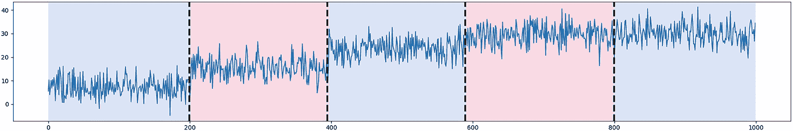
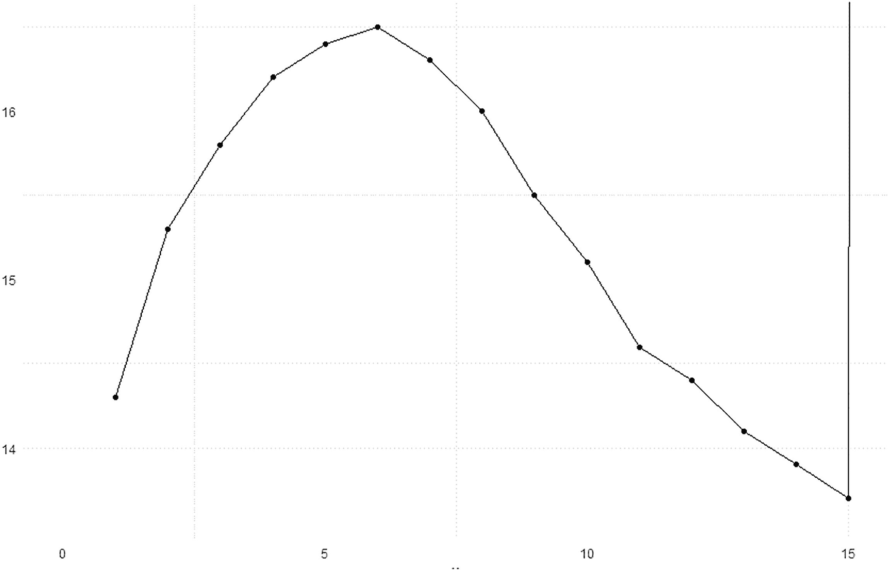
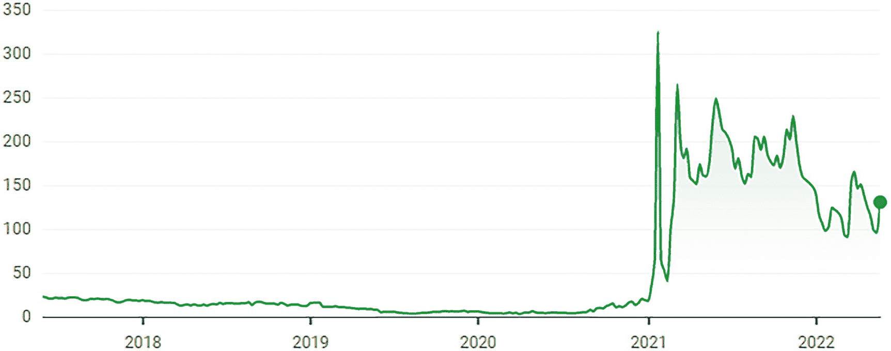
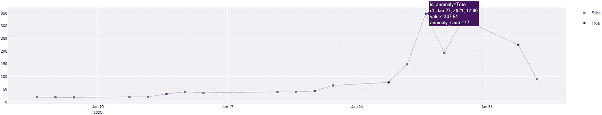

# 14. 变点检测

前一章向我们介绍了时间序列分析，让我们认识到它与标准单变量或多变量分析的不同之处。时间序列分析中最大的区别之一在于，我们通常不关心单个异常点本身；相反，我们关心的是整体系统行为的变化——特别是系统行为的意外变化。这就是变点检测概念变得重要的地方。

在本章中，我们将定义变点检测，并理解其相对于“单点”时间序列异常值检测的优势。之后，我们将研究两种类型的变点检测。然后，我们将了解如何使用 Python 中的 `ruptures` 包来实现变点检测。我们将重点介绍两种关键技术，然后在我们的异常值检测引擎中实现其中一种。最后，与其他代码开发章节一样，我们将更新测试并将我们的更改集成到网站中，使用户能够轻松执行时间序列分析。

## 什么是变点检测？

`变点检测`是对时变信号模式变化的分析。回到前一章的主题，我们可以将时间序列分解为四个组成部分：趋势、季节性、周期性和噪声。我们会期望基于恒定基本面的时间序列分析保持相当稳定，即我们可能会看到季节性或周期性等因素，但这些因素在整个时间序列中会以大致相同的程度持续出现。在时间序列分析中，引起我们注意的通常是潜在基本面的变化，这种变化会改变时间序列本身的行为。这些变化也被称为`变点`，并允许我们将数据集划分为多个数据`段`。对于每个数据段，我们假设所有数据点都遵循基本相同的规则，并基于相同的基本面。当我们在不同数据段之间移动时，某些底层机制改变了基本面。图 14-1 展示了一个人工时间序列的示例，其中有四个变点将数据划分为五个数据段。



一个图表绘制了一个人工时间序列，其中有四个变点将数据划分为五个数据段。

图 14-1

一个包含四个变点的数据集

具体来说，变点是三个特征之一的变化，我们将其称为水平、角度和幅度。在图 14-1 中，我们看到每个变点都影响了水平——每个数据段大致是平坦的（允许存在噪声）——但我们没有看到数据段内运动方向（角度）或周期性高点和低点之间的差异（幅度）发生变化。我们进行变点检测的目标是追踪何时发生变化，无论这种变化是关于水平、角度还是幅度。

### 变点检测的优势

到目前为止，我们一直假设分析中的每个数据点都是独立分布的，这意味着先前数据点的值不会影响当前数据点。我们在前一章中了解到，由于自相关，时间序列分析改变了这一点：现在，先前的值应该会影响当前值。这引出了变点检测的第一个优势：如果我们发现与先前数据点显著不同的点，我们很可能找到了对受众有意义的东西。因此，这些变点自然成为关注点。变点还有助于确保我们捕捉到新数据段的开始，而不是数据段中的每个点，从而减少了需要审查的数据点数量。

此外，变点检测有助于解决时间序列分析中的一个常见问题：脏数据。例如，假设我们想用温度计追踪烟熏炉中肉的温度。我们可能会看到温度从 125 华氏度缓慢上升到 135 华氏度。然后，温度计突然显示读数为 375 华氏度。这个数据点是一个异常值，使用我们在第 13 章讨论的时间序列技术，我们会将此点标记为异常值。然而，使用变点检测时，我们希望等待更多的读数来确定温度是回落到 135 华氏度（左右），还是保持在 375 华氏度附近——甚至进一步升高。像这样的暂时性尖峰通常表明信号故障、读数错误或转录值错误，而不是系统潜在基本面的变化——在这个例子中，基本面是烤肉的过程。当使用变点检测时，如果我们能迅速恢复到原始模式，我们往往会过滤掉一次性尖峰。

最终，是否包含一次性异常值的选择权在你手中，我们可以将变点检测与基于模型的时间序列异常值检测结合起来，以更全面地理解我们的数据。然而，在本章中，我们将继续专注于变点检测。

### 使用 ruptures 进行变点检测

Python 中的 `ruptures` 库是最完整、最流行的变点检测库之一。它内置了一系列用于执行变点检测的技术，让我们能够轻松上手。每种技术都结合了三种操作：一个我们想要最小化的`代价函数`；一个帮助我们判断是否真正到达变点的`搜索方法`；以及一个`惩罚函数`，它会根据我们检测到的变点数量增加代价，从而使得预测大量变点变得代价高昂（Truong 等人，第 4-5 页）。在本节中，我们将介绍其中两种技术：动态规划和 PELT。

## 动态规划

`动态规划`是一种能够提供最优解的技术，这意味着它会针对给定的输入数据集找到最佳解决方案。但这有一个不太理想的前提：在使用动态规划之前，我们需要知道数据集中`断点`（即分隔各段的数据点）的数量。如果我们恰好知道这个答案，那么这项技术对我们来说会非常有用。然而，在我们的场景中，我们事先并不知道答案，因为我们假设异常检测器的调用者并不了解其数据的分布情况。要求他们向我们提供这个数字，并不符合我们的预期。

幸运的是，还有其他技术不需要预先知道分段的数量，PELT 就是其中之一。

## PELT

`剪枝精确线性时间`（PELT）是另一种变点检测技术。与动态规划不同，PELT 是一种近似技术，这意味着它不能保证为给定的输入数据集找到最佳解决方案。相反，它会找到一个通常足够好的结果。我们倾向于使用 PELT 而非动态规划，有两个原因。第一个原因显而易见：动态规划要求我们传入断点的数量，而 PELT 则不需要。

另一个原因则更为实际：动态规划是一种速度较慢的算法。即使我们能够在异常检测引擎中使用它，对于大型数据集，它的速度也会比 PELT 慢得多。除此之外，`ruptures` 在其 `KernelCPD()` 函数中提供了 PELT 的优化版本，该函数是用 C 编程语言而非 Python 编写的，以进一步提升函数的性能。

## 实现变点检测

既然我们已经了解了将要使用的库和技术，那么让我们开始编写一些代码。首先，我们要更新 `main.py`，即我们 FastAPI 实现的控制器页面。清单 14-1 展示了时间序列分析的实现。

```python
class Single_TimeSeries_Input(BaseModel):
key: str
dt: datetime.datetime
value: float
@app.post("/detect/timeseries/single")
def post_time_series_single(
input_data: List[Single_TimeSeries_Input],
sensitivity_score: float = 50,
max_fraction_anomalies: float = 1.0,
debug: bool = False
):
df = pd.DataFrame(i.__dict__ for i in input_data)
(df, weights, details) = single_timeseries.detect_single_timeseries(df, sensitivity_score, max_fraction_anomalies)
results = { "anomalies": json.loads(df.to_json(orient='records', date_format='iso')) }
if (debug):
results.update({ "debug_weights": weights })
results.update({ "debug_details": details })
return results
```

清单 14-1

FastAPI 用于执行单时间序列分析的方法

每个数据点需要传入三个参数：一个`键`（`key`）、一个`日期时间`（`dt`）和一个`值`（`value`）。我们将接收这些数据点的列表，以及`敏感度分数`（`sensitivity_score`）和`最大异常比例`（`max_fraction_anomalies`），这与我们在单变量异常值检测中所做的相同。然后，我们将从 `single_timeseries.py` 文件中调用 `detect_single_timeseries()` 函数。清单 14-2 展示了这个函数的样子。

# 时间序列变点检测函数

## 清单 14-2

```python
import pandas as pd
import numpy as np
from pandas.core import base
import ruptures as rpt

def detect_single_timeseries(
    df,
    sensitivity_score,
    max_fraction_anomalies
):
    ### 此处 `weights` 作为未来扩展的预留措施。
    weights = { "time_series": 1.0 }
    ### 确保所有数据按 `dt` 排序
    df = df.sort_values("dt", axis=0, ascending=True)
    num_data_points = df['value'].count()
    if ... # 为简洁起见，省略了数据检查
    else:
        (df_tested, tests_run, diagnostics) = run_tests(df)
        (df_out, diag_outliers) = determine_outliers(df_tested, tests_run, diagnostics["num_iterations"], sensitivity_score, max_fraction_anomalies)
        return (df_out, weights, { "message": "单时间序列统计检验结果。", "Tests run": tests_run, "Test diagnostics": diagnostics, "Outlier determination": diag_outliers})
```

## 函数结构分析

这个函数的结构与我们之前在单变量和多变量场景中构建的类似：我们创建一个 `weights` 字典，运行测试，确定异常值，然后返回异常值以及权重和其他诊断细节。一个主要的区别是，我们按 `dt` 升序对值进行排序，确保我们的数据按时间序列顺序排列。因为我们期望存在序列相关性，所以无论用户如何发送数据，我们都希望确保“邻近”的点彼此靠近。

## 核心测试：变点检测

接下来我们需要做的是运行测试。我们将运行一个测试：变点检测。然而，在这个测试内部，我们有很多选择。具体来说，当使用 `ruptures` 中的 `KernelCPD()`（核变点检测）函数时，我们可以控制两个独立的参数：核的选择和添加新断点的代价（也称为惩罚）。`ruptures` 为我们提供了三种可用的核，每种核都决定了我们搜索的代价函数。

1.  **线性核**：第一种可用的核是线性代价函数，也称为 L2 代价函数。使用这个代价函数，我们创建线性分段，并计算实际信号与估计均值之间的平方差。换句话说，这代表了最小平方偏差。

2.  **高斯核**：第二个核是高斯模型，利用我们的核作为径向基函数（`radial basis function (rbf)`）。该技术比线性技术更复杂，并且在多种任务上表现良好。如果我们在不了解底层数据的情况下选择一个核，高斯核将是最佳起点。当然，额外的信息可能会引导我们选择其他核，因此这并不能保证是最优选择。

3.  **余弦核**：第三个也是最后一个可用的核使用一种称为余弦相似度（`cosine similarity`）的技术。余弦相似度在文本分割中最有用，例如在流行的 `word2vec` 算法系列中。

这些核通过实现不同的代价函数，必然会给我们不同的结果。我们不能假设用户知道哪个是正确的——我们很可能也不知道答案——所以我们采取简单的方法：构建一个集成模型，看看结果如何。

## 清单 14-3

清单 14-3 展示了 `run_tests()` 函数。该函数接受一个 `DataFrame`，并针对跨越 7 个数量级的各种惩罚因子尝试三种核技术。惩罚因子会对结果产生很大影响，但不存在适用于所有数据集的“最合适”惩罚值。因此，我们希望捕获各种惩罚值的结果，并允许用户像在单变量异常检测中那样，通过灵敏度分数和最大异常比例阈值来上下调整结果数量。

```python
def run_tests(df):
    tests_run = {
        "changepoint": 1
    }
    num_records = df['key'].shape[0]
    diagnostics = {
        "Number of records": num_records
    }
    signal = df['value'].to_numpy()
    kernels = { "linear", "rbf", "cosine" }
    penalties = { 0.001, 0.005, 0.01, 0.05, 0.1, 0.5, 1, 5, 10, 20, 50, 80, 100, 200, 500, 800, 1000 }
    diagnostics["kernels"] = kernels
    diagnostics["penalties"] = penalties
    diagnostics["num_iterations"] = len(kernels) * len(penalties)
    scores = np.zeros([num_records])
    for idx,k in enumerate(kernels):
        algo = rpt.KernelCPD(kernel=k).fit(signal)
        for idxp,p in enumerate(penalties):
            result = algo.predict(pen=p)
            for ix,r in enumerate(result[:-1]):
                scores[r] += 1
    df["anomaly_score"] = scores
    return (df, tests_run, diagnostics)
```

## 评分机制说明

在上面的清单中，我们可以看到有三个核和 17 个惩罚权重选择，总共执行了 51 次独立的核变点检测。我们对输入数据集中的变点进行评分的方法很简单。

1.  首先，我们从一个长度与数据集匹配的零初始化数组开始。
2.  然后，对于每个核和惩罚组合，我们对数据集中的值运行核变点检测。
3.  当对数据集运行 `predict()` 时，我们会得到一个数组，其中包含算法标记为变点的每个索引的一个值，再加上一个表示输入数据集长度的值。我们不需要最后一个值；相反，对于每个变点，我们在分数数组中递增该索引的当前分数。
4.  最后，每个数组索引的分数范围从 0 到 51，其中 0 表示没有模型确定该点为变点，51 表示每个模型都将其视为变点。在实践中，由于惩罚函数与任何给定数据集的交互方式，即使是极端的变点最终得分也会在 10 到 20 之间。

对每个数据点进行评分后，我们需要确定哪些变点要标记为异常。清单 14-4 提供了执行此操作的代码。


```
def determine_outliers(
    df,
    tests_run,
    num_iterations,
    sensitivity_score,
    max_fraction_anomalies
):
    sensitivity_threshold = (num_iterations / 1.5) * ((100.0 - sensitivity_score) / 100.0)
    diagnostics = { "Sensitivity threshold": sensitivity_threshold }
    max_fraction_anomaly_score = np.quantile(df['anomaly_score'], 1.0 - max_fraction_anomalies)
    diagnostics["Max fraction anomaly score"] = max_fraction_anomaly_score
    if max_fraction_anomaly_score > sensitivity_threshold and max_fraction_anomalies < 1.0:
        diagnostics["Outlier indices"] = df[df['anomaly_score'] > sensitivity_threshold].index.tolist()
        return (df[df['anomaly_score'] > sensitivity_threshold], diagnostics)
    else:
        diagnostics["Outlier indices"] = df[df['anomaly_score'] > sensitivity_threshold].index.tolist()
        return (df[df['anomaly_score'] > sensitivity_threshold], diagnostics)
```

`Listing 14-4` `The function to determine outliers in our DataFrame`

这个判定函数与我们用于单变量和多变量异常检测的函数类似。我们首先通过缩放迭代次数（即核的数量乘以可能的惩罚值数量）来设置灵敏度阈值，以增加给定灵敏度分数下数据点出现的可能性。然后，我们考虑灵敏度分数，确保更高的灵敏度分数会导致更低的灵敏度阈值，从而产生更多的异常。在多变量异常检测场景中，灵敏度分数变成了一个非常弱的杠杆，以至于用户甚至不需要考虑它。对于单时间序列，灵敏度分数再次变得相关。

除了灵敏度分数，最大异常比例仍然存在，其行为与单变量和多变量异常检测场景中相同，为可能标记为变点的数据点数量提供了一个上限。最终的结果是一个 API 端点，其行为与单变量异常检测非常相似。这将使测试和网站实现变得简单。

## 测试和网站更新

与我们的其他端点一样，我们希望确保这个新端点以合理的方式运行。为此，我们将把单元测试和 API 测试纳入其中。此外，我们需要考虑如何显示我们的结果。

### 单元测试

针对单一时间序列的单元测试，我们需要确保三件事。首先，确保我们编写的代码能够无错误运行。其次，确保“方向”设置正确，即敏感度评分和异常最大比例这两个参数——换句话说，我们希望更高的敏感度评分能检测出更多而非更少的异常值。最后，我们希望异常值的分布范围合理——理想情况下，当我们从较低的敏感度评分（如 5）逐步提高到最高值 100 时，异常值的变化应相当平滑。`清单 14-5` 展示了一个测试示例，该测试恰好满足了敏感度评分的所有三个目的。

```
@pytest.mark.parametrize("df_input, sensitivity_score, number_of_anomalies", [
    (sample_input, 100, 8),
    (sample_input, 90, 7),
    (sample_input, 80, 7),
    (sample_input, 70, 4),
    (sample_input, 60, 3),
    (sample_input, 50, 1),
    (sample_input, 40, 1),
    (sample_input, 25, 0),
    (sample_input, 5, 0),
    (sample_input, 1, 0),
    (sample_input, 0, 0),
])
def test_detect_single_timeseries_sample_sensitivity(df_input, sensitivity_score, number_of_anomalies):
    #### Arrange
    df = pd.DataFrame(df_input, columns=["key", "dt", "value"])
    max_fraction_anomalies = 1.0
    #### Act
    (df_out, weights, diagnostics) = detect_single_timeseries(df, sensitivity_score, max_fraction_anomalies)
    print(df_out.sort_values(by=['dt']))
    #### Assert
    assert(number_of_anomalies == df_out[df_out['is_anomaly'] == True].shape[0])
```

`清单 14-5` `一个覆盖多种敏感度评分的单元测试`

该测试涵盖了 11 个独立的测试用例，敏感度评分从 0 到 100 不等。样本输入集是一个人工生成的时间序列，包含 17 个数据点。前 15 个数据点的范围从最低 13.7 到最高 16.5。最后两个数据点分别为 190.8 和 193.7，表明发生了重大变化。虽然我们不应仅凭单个数据集就得出广泛结论，但可以看到，从敏感度评分 40 开始，输出结果出现了一些变化。我们可以推测，对于该数据集，敏感度评分在 50 到 70 之间可能是最合理的选择，因为对样本输入（可在随附代码库中找到）的审查显示，前六个数据点呈上升趋势，第七到第十个数据点稳步下降，第十一到第十五个数据点下降趋势趋于平缓，而第十六个数据点则出现了一个数量级的跃升。`图 14-2` 展示了该数据的简单图表，排除了两个最大的异常值。



`图 14-2`

尽管这些值的范围从 13.7 到 16.5，但我们可以看出数据中存在明显的变化点。末尾近乎垂直的线代表了从 13.7 到 190.8 的跃升。

### 集成测试

除了单元测试，我们还需要创建集成测试，以确保 API 功能按预期工作。在第 14 章的 Postman 集合中新增了三个测试。其中一个测试涵盖了未检测到任何变化点的基本场景。尽管数据中存在波动，但没有任何波动足以向异常检测引擎表明基础数据发生了根本性转变。

另外两个测试用例涵盖了近期记忆中最著名的异常之一：游戏驿站公司（`GameStop Corp`）股票（在纽约证券交易所交易代码为 `GME`）的暴涨暴跌（以及再涨再跌……）。一只从 2017 年到 2021 年 1 月 12 日期间每股交易价格在 4 美元到 20 美元之间的股票，如何能在短短一周后翻倍，并达到 347.51 美元的峰值，这是一个精彩的故事，但本书难以详述。尽管如此，仅从 `图 14-3` 中，我们就能看到游戏驿站公司的股价从 2021 年 1 月到撰写本文时的过去 18 个月里剧烈波动。



`图 14-3`

游戏驿站公司的股价虽未真正“一飞冲天”，但确实增长了一个数量级，并且，对我们的目的而言重要的是，它经历了大幅波动。

为了纪念这只股票的疯狂之旅，另外两个集成测试考察了 `GME` 在 2021 年 1 月 6 日至 2021 年 2 月 2 日期间的收盘价。在这段时间内，我们注意到在敏感度评分为 60 的情况下，存在五个独立的变化点。

### 网站更新

本章最后一项主要考虑是更新网站以支持单时间序列分析。在 `site.py` 中，我们需要做一些修改。首先，我们将包含一个默认数据集，向新用户展示如何为单时间序列调用构建数据。与集成测试类似，我们将使用 2021 年 1 月 6 日至 2021 年 2 月 2 日的 `GME` 股票数据作为示例。我们还将创建一个函数，将单时间序列列表转换为 JSON 数组。代码清单 14-6 展示了这段代码，它与多变量转换函数非常相似。


```
@st.cache
def convert_single_time_series_list_to_json(time_series_str):
mv_ast = ast.literal_eval(time_series_str)
return json.dumps([{"key": k, "dt":dt, "value": v} for idx,[k,dt,v] in enumerate(mv_ast)])
```

代码清单 14-6：将时间序列数据数组转换为 JSON，以便在异常检测引擎中使用。

另一个重大变化涉及我们如何显示时间序列数据。通常，折线图是显示时间序列数据的绝佳选择，尤其是当时间序列显示季节性、周期性等因素时。为了在将整个趋势显示为折线的同时，将异常值显示为点，我们将使用两个独立的图表。代码清单 14-7 展示了我们将用于显示这些图表的代码。

```
elif method=="timeseries/single":
st.header('每个数据点的异常分数')
colors = {True: '#481567', False: '#3CBB75'}
l = px.line(df, x=df["dt"], y=df["value"], markers=False)
l.update_traces(line=dict(color = 'rgba(50,50,50,0.2)'))
s = px.scatter(df, x=df["dt"], y=df["value"], color=df["is_anomaly"], color_discrete_map=colors,
symbol=df["is_anomaly"], symbol_sequence=['square', 'circle'],
hover_data=["anomaly_score"])
g = go.Figure(data=l.data + s.data)
st.plotly_chart(g, use_container_width=True)
tbl = df[['key', 'dt', 'value', 'anomaly_score', 'is_anomaly']]
st.write(tbl)
```

代码清单 14-7：显示折线图和散点图。

折线图包含所有数据点，我们使用 `update_traces()` 方法将其颜色更改为中性灰色，使其易于查看，同时不会掩盖我们从散点图生成的实际数据点。最后，我们使用 Plotly 的 `graph_objects` 将两个图表合并为一个图形，调用 `go.Figure()` 并传入两个图表。图 14-4 展示了此输出的一个示例。



折线图绘制了 2021 年 1 月 GME 股票的变化点。数值为估计值。最高假值（1 月 29 日，200）。最高真值（1 月 28 日，250）。

图 14-4：2021 年 1 月 GME 股票变化点的可视化表示。

当鼠标悬停在单个数据点上时，我们不仅可以看到它是否为异常，还可以看到异常分数——即有多少个单独的测试将此数据点标记为可能的变化点。此方法的调试信息还将显示构成异常值的最小阈值。例如，使用灵敏度分数 65 和最大异常值比例 0.26，触发系统的最小异常分数是 13，这意味着 1 月 19 日的值不是异常，因为只有 12 个测试将其选为变化点。然而，1 月 21 日确实显示为一个变化点，因为在 51 个可能的测试中，有 14 个将其标记为变化点。

## 进一步改进的途径

在结束本章之前，值得花一点精力思考如何改进我们的单时间序列异常检测引擎。最明显的答案是结合基于点的异常值检测和变化点检测。在上一章中，我们研究了像 ARIMA 这样的建模技术，这些技术使我们能够根据历史信息生成对数据应该处于何处的预测。利用这个过程，我们可以创建一个*回溯预测*，即对已经发生的事件进行预测，以查看我们的预测模型在给定可用信息的情况下会如何表现。然后，我们可以使用像我们为单变量异常值检测开发的距离度量，根据模型预期，来判断给定实际数据点成为异常值的可能性。

这种方法的主要症结在于我们需要一个可靠的模型，这意味着要对驱动时间序列的底层基本原理有一定的理解。例如，像 ARIMA 这样的建模技术通常期望你了解数据的周期性，例如知道每 12 个数据点出现一个周期。为了在通用异常检测引擎中实现这一点，我们需要将这个要求传递给最终用户，而用户很可能不知道正确答案。此外，时间序列分析有相当多的建模技术，并且——类似于我们之前看到的内核变化点检测——它们之间的结果可能差异很大。我们可以尝试多种模型——包括像 ARIMA 这样的技术的不同超参数组合——并确定哪个模型与最终的数据流拟合得最紧密。然后，我们可以选择那个最佳拟合模型作为候选模型，并计算与其的距离。如果你愿意尝试，我将此作为练习留给读者。

## 结论

在本章中，我们研究了一种在单时间序列上执行异常值检测的方法：跟踪每个变化点。虽然变化点不一定是异常的——它们很可能嵌入到我们希望研究的现象的底层逻辑中——但它们是一个很好的调查起点。除了变化点检测，我们还可以结合其他技术，例如计算与预期模型的距离。

在下一章中，我们将推广单时间序列分析的问题，并提出一个问题：如果我们想同时分析多个序列，该怎么办？
