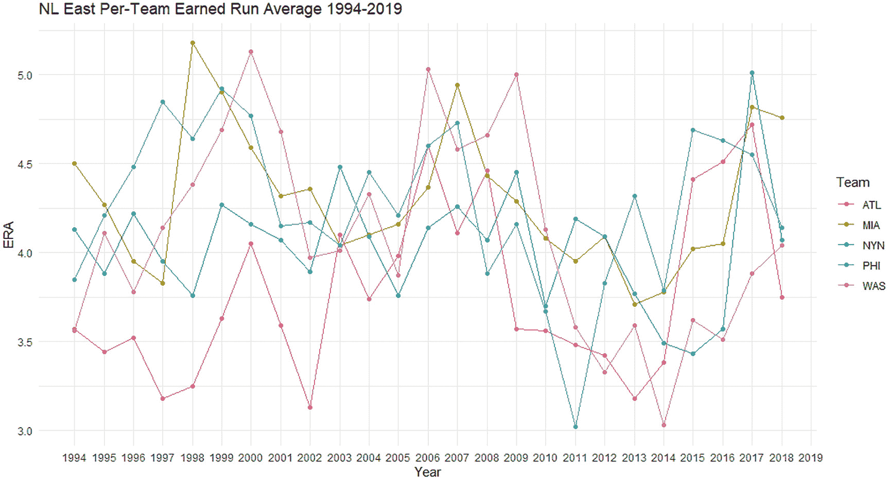
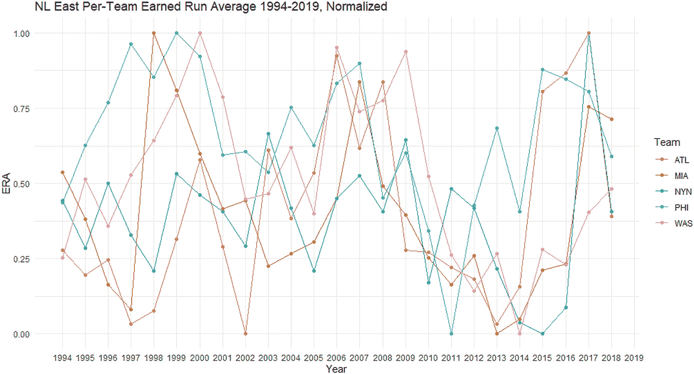
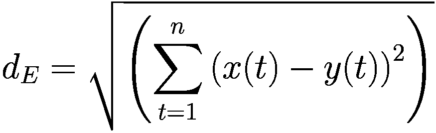
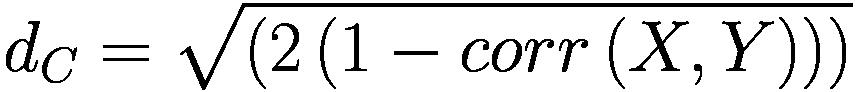
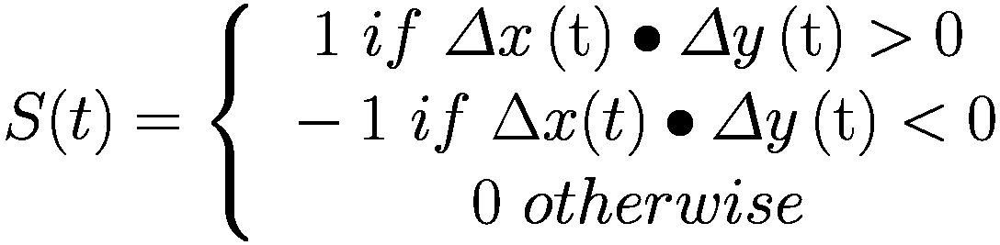

# 15. 多序列异常检测简介

第 13 章和第 14 章讨论了一种时间序列异常检测形式：单时间序列。有了这个理解基础，我们将把焦点扩展到存在多个数据序列，并且我们希望联合分析而非独立分析这些序列的情况。在本章中，我们将正式理解多序列时间序列，重点关注它与我们之前采用的单序列方法有何不同。然后，我们将研究四种分析多序列数据的常用技术。在结束本章之前，我们将回顾分析多序列数据时的一些常见问题，然后在第 16 章中实现一种算法。


## 什么是多序列时间序列？

到目前为止，我们的分析一直聚焦于单一时间序列——即图表上的一条线。我们的关键技术是使用变点检测来观察这条线何时发生显著变化。相比之下，多序列时间序列涉及以某种方式相互关联的多个现象，但与单变量与多变量异常检测不同，多序列并不等同于具有多个非时间输入变量的单一序列。相反，多序列时间序列分析仍然以单变量数据（加上时间）为特征，但会针对多个相关的数据序列进行展示。例如，图 15-1 显示了 1994 年至 2019 年分区重组期间，美国职业棒球大联盟国家联盟东区各队的自责分率平均值。我们可以将其作为多序列时间序列问题进行分析，因为序列之间（可能！）存在足够的相似性，使其具有分析价值：我们关注的是同一项运动、同一个分区、同一个变量，并且是在相同的时间范围内。我们可以假设，比赛规则和联盟范围内的趋势（例如关于使用兴奋剂的趋势）将在很大程度上驱动各支球队的表现。



一个散点图绘制了 `ERA` 与年份的关系。它绘制了球队 `ATL`、`MIA`、`NYN`、`PHI` 和 `WAS` 的平均自责分。

图 15-1

1994–2019 年国家联盟东区各队的自责分率平均值。为简单起见，蒙特利尔博览会队编码为 `WAS`，佛罗里达马林鱼队编码为 `MIA`

你很可能在上图中看到了一团混乱。只要有足够的耐心，我们或许能从中看出总体趋势，但仅凭肉眼很难将球队行为的“微观”效应与联盟范围内（或至少是分区范围内）因规则和球队行为随时间变化而产生的“宏观”效应区分开来。这是单序列分析与多序列分析的主要区别之一，但绝非唯一区别。

## 多序列时间序列的关键方面

在进行多序列时间序列分析时，有几点需要牢记。首先也是最重要的，我们的目标是对多个数据序列的形状进行某种功能性比较。我们想要理解一组数据中的行为如何影响其他数据集、如何被其影响，以及如何因共同原因而与其他数据集一同变化。为此，我们需要关注重叠的时间范围。这并不一定意味着所有序列都需要有完全相同的时间点。例如，我们可能每三秒追踪一个指标，每五秒追踪另一个指标。即使这两个序列的时间点不完全重叠，只要我们能以合理的精度进行插值，就可以比较这两个数据集。通常，为了解决时间范围不匹配的问题，我们可以使用一种称为*线性插值*的技术，即从前一个数据点到下一个数据点画一条直线，并根据我们创建的这条直线来估计已知点之间任意点的数值。我们这样做是因为没有足够的信息来了解序列的确切行为，因此，与其尝试拟合某种假设的曲线，不如画出最简单的直线，就此了事。

除此之外，我们可能还需要对数据集进行归一化处理，确保数据点的范围在 0 到 1 之间（包含端点）。这有助于我们追踪序列的偏移，而无需考虑其基准值或典型方差。举个例子，假设我们以十分之一度为单位测量温度变化，并以百分比（通常在 85 到 95 之间）测量效率评级。将这两个指标绘制在同一张图表上，将很难判断这两个属性是否以相似的模式变化。如果我们将每个序列归一化到 `[0, 1]` 区间，就更容易发现数据中的模式。图 15-2 是 1994 年至 2019 年国家联盟东区球队的同一自责分率数据集，这次进行了归一化处理，使得每支球队的最低赛季 `ERA` 为 0，最高 `ERA` 为 1。



一个散点图绘制了 `ERA` 与年份的关系。它绘制了国家联盟东区球队 `ATL`、`MIA`、`NYN`、`PHI` 和 `WAS` 的平均自责分。

图 15-2

1994–2019 年国家联盟东区各队的归一化自责分率平均值

通过对数据集进行归一化处理，我们可以看到一个微小的模式：国家联盟东区的球队整体上在大约 2010 年至 2014 年间投球表现显著更好（因为自责分率值越低越好），而它们在 2006 年至 2009 年以及 2017 年至 2019 年期间表现都相对较差。

除了归一化数据，我们可能还会决定对数据进行*审查*，这尤其因为我们的目标是发现异常值，而正如我们在单变量和多变量案例中所学到的，归一化往往会掩盖异常值。一种常见的审查方法来自 Mehrotra，即对第 10 百分位数到第 90 百分位数之间的数据点进行归一化，允许低于第 10 百分位数的值变为负数，高于第 90 百分位数的值超过 1.0（Mehrotra, 102）。通过这样做，你仍然可以观察趋势，而不会因为一个极大或极小的数据点扭曲整个时间序列的其余部分。这与我们在第 7 章中使用的 Box-Cox 变换技术非常相似。

## 需要改变什么？

随着我们的思维从单序列转向多序列，我们应该牢记以下差异。最终，当我们开始从两个方向思考时——时间向前推进以及序列之间的上下波动——这些都是需要考虑的因素。


### 有何区别？

我们想提出的一个重要问题是：我们想要追踪的差异是什么？序列之间的差异主要有两大类：点之间的距离差异和方向上的差异。对于前者，我们关注的是某个数据点的值在同一时间点上与其同类数据点存在显著差异的情况。如果某支球队在特定时间段内的自责分率（ERA）持续高于（或低于）其他球队，那么当该赛区其他球队与该球队的差距达到最大时，我们自然会认为这种差异最为异常。2017 年的华盛顿国民队就是一个很好的例子。他们的自责分率虽然与赛区其他球队同步上升，但明显优于赛区内所有其他球队。另一个类似的例子是 2002 年的亚特兰大勇士队，当时赛区内的自责分率整体相对下降，而该队的下降幅度比其他球队更大。

与距离度量相比，我们也可以关注方向上的差异：如果一个序列走势向上而其他序列走势向下，这可能值得关注，尤其是当这种变化的幅度显著，并且我们有理由相信各序列的基本面因素应该相似时。如果市场上房屋平均销售价格普遍呈上涨趋势，而某个城市却反向而行，那么这种情况就变得引人好奇。

除了这种将单个序列与其他序列进行比较的“微观”视角外，我们还有第三种差异概念：总体变化。在这种情况下，我们不太关心单个序列如何变动，而更关注所有序列作为一个整体的变动趋势。如果数据集中序列的整体趋势发生变化，这可能反映了基本面因素的改变，而这正是我们可能感兴趣的。回到我们棒球的例子，在过去 150 年间，多项规则和行为变化影响了诸如自责分率等指标：球的材质、裁判更换球的频率、投手丘的高度、投手丘到本垒板的距离、裁判对好球带的判罚尺度、比赛中更换投手的时机和频率、休赛期训练方案等等，多年来都影响着投手与击球手之间的关系。随着一项重大规则变更，例如增加投手丘高度或将其移近本垒板，我们可以预期自责分率会普遍下降，因为投手相对于击球手获得了优势。同样，规则变更如缩小好球带或引入指定击球员代替投手击球，则会导致我们预期自责分率上升。

### 领先与滞后因素

另一件需要牢记的事情是，我们是否预期一个序列对另一个序列的影响存在滞后。例如，假设我们追踪两个序列：一个表示恒温器上的温度控制设定值，另一个表示房间的当前温度。假设温度控制设定值配置正确（在办公室或零售店中情况并非总是如此）并且设备始终运行，那么温度控制设定值的变化必然先于房间温度的相应变化，温度会稳步升高或降低，直到达到平衡状态——此时要么当前室温与设定值匹配，要么供暖/制冷设备在外部条件下无法进一步改变温度。因此，如果我们按原样追踪这两个序列，可能会注意到不一致的行为：有人调高了控制单元的温度，但温度却持续下降。这是因为变化并非瞬间发生，空调可能会继续运行几分钟，之后设备控制器才会发出信号停止制冷和送风。如果我们把温度观测的时间向前推移几分钟，就应该能看到与恒温器设定值更一致的行为。

## 可用方法

解决多序列时间序列异常值检测问题的方法有两类。第一类是我们曾在第 13 章讨论过的基于模型的方法：如果我们使用 ARIMA 族、指数平滑或其他技术构建一个模型，就可以基于现有的基本面因素生成预期值。然而，这些方法的作者原本是希望我们将其用于分析单个序列，而非比较多个序列。因此，尝试将 ARIMA 这类技术用于多序列比较是笨拙的（至少可以说是如此）。

相反，我们倾向于采用 Mehrotra 等人所称的“转换方法”来处理多序列时间序列分析（Mehrotra, 172–173）。这种方法的核心见解是，我们通常不希望将每个序列作为一个整体序列来处理。相反，我们可以执行三种操作：*聚合*、*离散化*和*信号处理*。第一种操作，聚合，基于序列内变动将是平滑的假设，将时间序列中的不同值压缩在一起。通过减少给定序列中的数据点数量，使得分析更容易执行。它也为我们提供了一种便捷的方法，确保每个序列的每个数据点在时间上能够匹配。例如，如果我们在一个月内每隔一分钟从一台设备捕获一个信号，而每隔 28 秒从另一台设备捕获一个信号，我们可以将两者都聚合到每小时的时间间隔。这极大地减少了我们需要为异常值检测考虑的数据点数量，也降低了序列中的噪声触发我们选择实施的任何算法的可能性。在每个小时的时间块内，由我们自己决定如何聚合这些结果。

除了聚合，我们还可以引入第二种操作，离散化。离散化的思想是，我们根据序列的整体特征，为整个序列赋予一个单一的值。例如，我们可以将每个序列离散化为三个值之一：上升、下降和稳定。这样，我们只需要跟踪一条信息，而不是一系列值的组合。这样做，我们会丢失一些可能为分析增加细微差别的有用信息，但它确实允许我们用更少的计算量来解决复杂问题。我们可以相当容易地将此与聚合结合起来：聚合过程将每个序列分割成固定大小的窗口，而离散化操作则允许我们根据每个固定大小窗口的整体特征来描述它。

另一种技术是执行信号处理，通常使用傅里叶变换或小波变换。对此进行完整讨论超出了本书的范围，但将时间序列视为信号是一种强大的技术，也是驱动我们在前一章中使用的`ruptures`库的核心方法。

现在我们已经回顾了序列转换的一些关键技术，接下来让我们看看三种常用的算法，我们可以用它们来离散化聚合后的序列。每种算法都假设我们想要比较两个时间序列的片段，但在下一章中，我们将探讨一种方法来推广这一过程。


### 交叉欧氏距离

第一种技术称为交叉欧氏距离。清单 15-1 展示了计算两个时间序列交叉欧氏距离的公式。



```
.
清单 15-1
计算两个时间序列交叉欧氏距离的公式
```

解释该公式，我们计算每个时间点上两个序列数据点之间的距离，将这些距离的平方求和，然后对结果取平方根。举个例子，假设我们的 X 序列包含亚特兰大勇士队从 1994 年到 2002 年的平均自责分：`X = { 3.57, 3.44, 3.52, 3.18, 3.25, 3.63, 4.05, 3.59, 3.13 }`。我们的 Y 序列包含纽约大都会队在同一时期的平均自责分：`Y = { 4.13, 3.88, 4.22, 3.95, 3.76, 4.27, 4.16, 4.07, 3.89 }`。计算的第一步是求亚特兰大和纽约数据点之间差值的平方，得到 `S = { 0.31, 0.19, 0.49, 0.59, 0.26, 0.41, 0.01, 0.23, 0.58 }`。接着，我们对这些平方值求和，并对结果取平方根，得到交叉欧氏距离为 1.75。我们可以在不同球队之间比较这个值——假设我们比较的元素数量相同——并且知道交叉欧氏距离越大，表示两个序列之间的差异越大。

### 互相关系数

交叉欧氏距离是一种有用的技术，但它的缺点在于其计算尺度与底层特征相同。对于像平均自责分这样的指标，这可能会产生很大影响，原因有二：首先，球队的平均自责分随时间变化，且这些变化可能相当剧烈。例如，1914 年至 1918 年全联盟的自责分约为 2.75–2.80。而到了 80 年后的 1994 年至 1998 年，全联盟的自责分约为 4.50。在 1990 年代语境下，1.75 的交叉欧氏距离可能与 1910 年代语境下的值截然不同。此外，平均自责分的计算方式决定了其下限为 0.00，而实际下限为 2.00——事实上，从 1910 年到 2020 年，只有 1910 年的费城运动家队团队自责分低于 2.00；从 1920 年起，最低的团队自责分是 1967 年的芝加哥白袜队，为 2.45。这告诉我们，当全联盟平均自责分接近 3.00–3.20 时，数值范围可能比团队自责分为 4.50 或更高的时代更小。因此，我们可能希望使用互相关系数，其计算公式如清单 15-2 所示。



```
.
清单 15-2
互相关系数提供了两个时间序列段之间尺度无关的比较
```

在此例中，`corr` 表示时间序列段之间的皮尔逊相关系数。在前述亚特兰大与纽约的案例中，两支球队投手阵容的皮尔逊相关系数为 0.26，表明两队自责分之间存在轻微到中度的正相关。进行内部计算，我们得到 2 * (1 – 0.26) = 1.48。对该值取平方根，得到互相关系数为 1.22。请注意，这个数字*不能*直接与交叉欧氏距离比较，但它可以直接与其他互相关系数比较，例如，如果我们对 1910 年代的两支球队（而非 1990 年代）进行同样的计算。

### 同趋势（STREND）

本章要介绍的最后一个技术称为同趋势，简称 STREND。使用 STREND，我们遵循三个步骤。第一步是计算 X 和 Y 序列的差值。继续我们之前的例子，亚特兰大有九个数据点，其同区对手纽约也有对应的九个数据点。计算差值意味着我们取时间 `t` 的值，并用时间 `t+1` 的值减去它。例如，亚特兰大自责分的前两个值是 3.57 和 3.44，这意味着第一个差值计算结果为 -0.13。总共有九个数据点，因此我们会得到八个差值计算结果。对于亚特兰大，这些差值为 `{ -0.13, 0.08, -0.34, 0.07, 0.38, 0.42, -0.46, -0.46 }`，对于纽约，则为 `{ -0.25, 0.34, -0.27, -0.19, 0.51, -0.11, -0.09, -0.18 }`。这些分别构成了 `Δx` 和 `Δy`。

清单 15-3 展示了下一步，即在给定时间 t 计算 S 的值。STREND 的技巧在于，我们不关心变化的*幅度*；我们只关心变化的*方向*，具体来说，就是两个序列是否朝同一方向移动。



```
)
清单 15-3
STREND 的第二步是计算 S(t
```

计算我们投手阵容数据集的 `S(t)`，得到的结果为 `{ 1, 1, 1, -1, 1, -1, 1, 1 }`。如果存在某支球队的自责分在赛季间没有变化的情况，我们会将其标记为 0，但这里每个赛季都有变动。我们使用清单 15-4 中的公式完成 STREND 的计算。

![$$ {d}_S\left(X,Y\right)=1-\frac{1}{n-1}\sum \limits_{t\in \left[1..n-1\right]}S(t) $$](images/521828_1_En_15_Chapter/521828_1_En_15_Chapter_TeX_Equd.png)

```
)
清单 15-4
根据由某个 S(t) 定义其变动的两个时间序列段计算同趋势值的公式
```

汇总 `S(t)`，我们得到的值为 4。将其代入方程，已知 n 为 9，最终得到同趋势值为 1 – 4/8 = 0.5。对于同趋势，数值越低表示两个序列行为越相似，0 表示两者完全相关，1.0 表示完全不相关，大于 1.0 的值表示负相关。最大可能值为 2.0，表示完全负相关。


### 常见问题

在结束本章之前，我们将探讨在执行多序列时间序列异常检测时可能遇到的三个常见问题。第一个问题出现在我们尝试将建模技术应用于时间序列数据时。在这种情况下，我们需要牢记，每种时间序列建模方法都包含一个误差项，它表示不会违反模型的值范围。就此而言，假设一个序列呈略微上升趋势，而另一个序列呈略微下降趋势。再进一步假设这两个序列仍处于各自误差项的范围内。尽管一个上升而另一个下降，但我们的模型强度不足以表明趋势确实存在真实差异。我们的眼睛或许能察觉到某些变化，但模型尚未脱离“正常”行为。使用基于建模的方法可能会导致我们无法发现有效的行为差异。

我们可能遇到的第二个问题出现在使用转换方法时。在这种情况下，我们拥有代表某种尺度上距离的数值。我们能够说明一个范围与另一个范围不同，并且两个序列在某个时间点的差异比另一个时间点更大。然而，我们无法说明的是，`SameTrend`、`交叉相关系数`或`交叉欧氏距离`的数值何时大到足以将该片段标记为异常值。就像我们处理多变量异常检测技术（如`LOF`和`COF`）时的情况一样，我们需要确定某种“足够好”的度量标准。

这里最后一个重要问题是，这些技术都围绕比较两个数据序列构建。一旦引入第三个序列，我们就进入了一个全新的复杂领域。我们可以设想对每个序列进行两两比较，但如果有 20 个独立的序列，这可能会变成一场后勤噩梦。在下一章中，我们将巧妙地避开第一个问题（不采用基于模型的解决方案），转而处理第二个和第三个问题。

## 结论

在本章中，我们了解了多序列时间序列分析与单序列分析的不同之处。我们探讨了分析中的一些技术难点，例如一个序列是另一个序列的滞后指标。之后，我们研究了三种离散化时间序列片段的技术，使我们能够在没有重要信息损失的情况下整体比较两个时间序列。最后，我们讨论了多序列时间序列分析中的一些常见问题。

在下一章中，我们将介绍另一种离散化数据的技术，在我们的代码库中实现该技术，并解决 Python 中多序列时间序列异常检测的问题。

